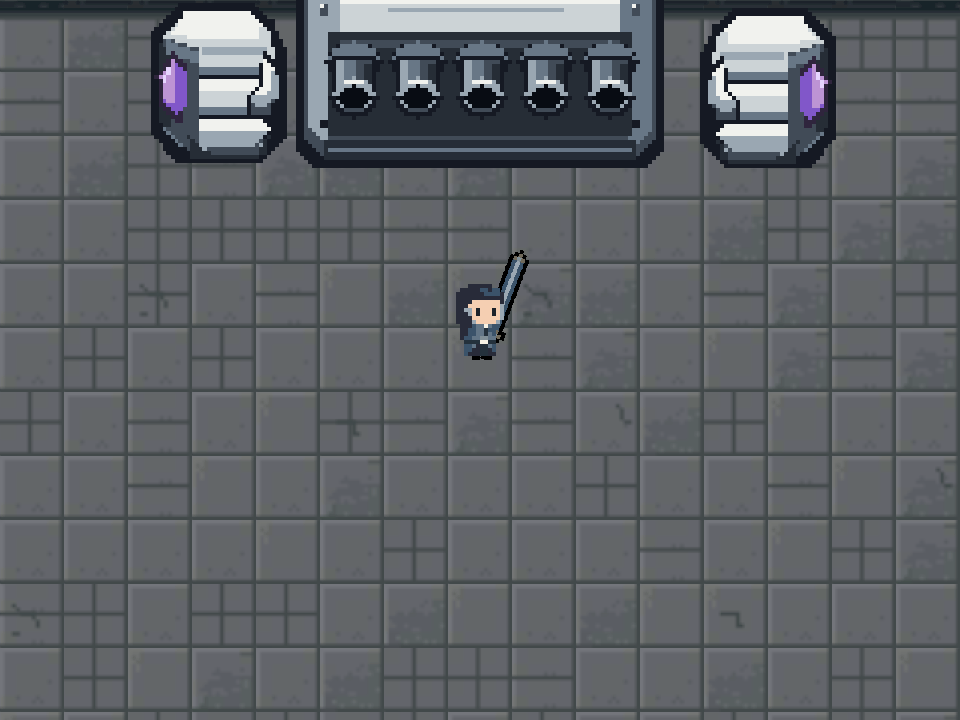

# 경비 손 공격 R01 — F-B07-02

2026-11-16 요청한 무작위 한 손의 공중 추격→빈 경고→중앙 채움→0.2초 대기→내려찍기·즉시 범위 피해를 연결했다.

## 동작과 원본

- `Boss_01`은 기존 Gold와 새 `HandSlamPattern`을 등록한다. 공통 직전 제외를 유지하며 손 패턴은 매 실행 좌우 중 하나를 무작위 선택한다.
- `GuardHandAttack`은 선택한 손만 들어 올려 Player 지면 위치를 추격한다. 최소 추격 시간과 목표 도착을 만족하면 공격 지점을 고정한다.
- 원 테두리를 먼저 표시하고 내부 원판 크기를0에서1로 키운다. 실제로 가득 표시한 Tick부터0.2게임초를 확보한 뒤 하강한다. 지면 도달 Tick에 원형 질의를 한 번 실행한다.
- 범위 밖·착지 뒤 진입에는 피해가 없다. 여러 Hitbox도 같은 Player의 피해 한 번으로 합친다. 그로기·사망·재도전·비활성화에서는 예고를 숨기고 손을 복원한다.
- 기존 Gold 투사체는 그로기로 제거하지 않으며 반사·각성·발사자 피해를 유지한다.

원본은 [경비 R05](../guard-r05/README.md)이다. [guard-separated.aseprite](guard-separated.aseprite)는 원래6레이어를 보존한 편집 원본이며, [export.lua](export.lua)로 몸통과 양손을 분리했다. 새로 그린 픽셀은 없다.

| 출력 | 크기 |16PPU 기준 연결 |
| --- | --- | --- |
| [guard-body.png](guard-body.png) |192×120px | 기존 pivot(0.5,16/120), 몸통 위치 유지 |
| [guard-hand-left.png](guard-hand-left.png) |34×40px | bottom-center pivot, home(-4.5,0) |
| [guard-hand-right.png](guard-hand-right.png) |34×40px | bottom-center pivot, home(4.5,0) |

분리한 PNG3개를 재합성한 RGBA는 R05 출력과 완전히 같다. native 재열기 출력도 같다. 실제 사용 파일은 `project/Assets/Art/Enemy/Guard/`에 연결했고 기존 front PNG·프리팹 GUID를 보존했다([아트 검사](art-validation.json)).

## 실제 화면

실제 Player 추적 GameCamera로20fps 게임 시간에69프레임을 촬영했다. GIF는 그중40장을960×720px 최근접 변환·256색으로 출력했고, 마지막 장에500ms 유지 시간을 더했다. 검사 중 Player 위치를 바꿔 추격·회피·착지 뒤 진입을 확인하므로 카메라가 즉시 이동하는 구간이 있다. 별도 Sprite 합성·프레임 보간은 없다([프레임 기록](preview-validation.json)).

원본 캡처: [추적](tracking.png), [빈 경고](empty-warning.png), [중앙 채움](half-fill.png), [full 대기](filled-hold.png), [하강](falling.png), [착지](impact.png), [복귀](returned.png). 영상의 게임 시간에서 full→하강은0.20초, 하강→착지는 캡처 간격으로0.15초에 관찰했다.

## 제작 초기값과 검증

추격 최소1.2초·속도10, 높이2.5·상승0.35초, 채움1초, 반경1.35, 하강0.12초, 피해10, 착지 회복/복귀 각0.35초는 조정 가능한 초기값이다. 높이는 Player 추적 화면 안에 손 전체가 보이도록 잡았다. full 뒤0.2초와 무작위 한 손·중앙 채움·착지 즉시 피해는 사용자 요청이다. 손은 별도 충돌체 없이 표시하고, 피해는 고정된 지면 원형 범위에서 판정한다.

- 같은 Unity6000.3.21f1 격리 Play: 손12묶음 성공·배치0(11:01:10 KST), 기존 Gold 단독 회귀10묶음 성공·배치0(10:55:35 KST), C# 오류0
- 두 패턴 등록, 여러 seed의 좌우 선택·반대 손 유지, 공중 추격·위치 고정, 정지/재개, 빈 원/중앙 채움, full 후0.2초·지연 Tick, 내부1회·외부0·늦은 진입0 확인
- 그로기·기존 Gold 유지·재도전 재사용, 실제 Gold→손→Gold 교대/반사/Fever/발사자 피해, Boss 사망/출구/사체 복원 확인
- 전체93C#·런타임53C#·소유22대상 원본/검증 사본 해시 일치(11:03:58 KST), 프리팹 내부 참조67개 중 끊긴 참조0개
- 기존 Map·GameSystems는 이번 작업 전과 동일. GuardRobot 프리팹과 PNG3개의 import 설정을 원본에 반영

근거는 [손12검사](unity-validation.json), [Gold10회귀](gold-regression-validation.json), [원본 대조](source-validation.json)다. 로그는 `project/Logs/GuardHandVerification.log`·`GuardHandGoldRegression.log`에 있다. 최초 신규 스크립트 meta GUID의33자리 오류를 유효한32자리로 수정했고, 외부/늦은 진입 검사는 무적을 해제해 피해가 실제로 없어야 통과하도록 보완한 뒤 재실행했다. 기존 SearchDatabase 시작 예외는 관찰했으나 최종 컴파일·Play는 통과했다.

11:03:58 대조 이후 다른 채팅의 `UI_Title.cs`와 다른 방의 군용 로봇 프리뷰를 추가한 `Map.prefab` 변경을 확인해 보존했다. 경비 배치와 이번 손 관련21대상의 일치는 유지되지만, 이후 두 동시 변경은 이번 실행 검증에 포함하지 않았다.

원본 Editor 수동 Play·제출 빌드는 미실행이다. 다른3패턴·최종 튜토리얼 UI·음향·새 손 타격 원화는 이번 완료 범위가 아니다. 현재 사양·SequenceDiagram·후속 범위는 [GAME_SPEC2.2.8](../../../../docs/GAME_SPEC.md)을 따른다.
