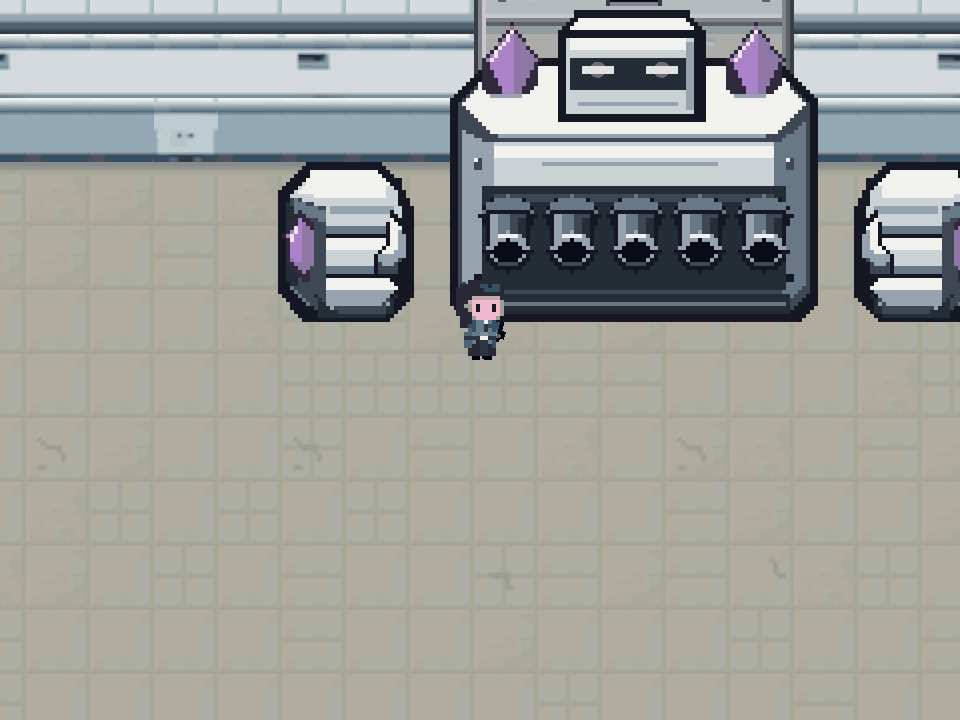

# 경비 레이저 R02 — 지면 착탄점 표시·피해

2026-11-16 사용자 첨부의 ‘땅에 닿는 착탄 지점이 피해 위치로 보이게’ 요청을 반영했다. 공중 빔은 지면 종점에서 끝나고, **분홍 테두리로 표시한 두 착탄원만 피해를 준다.**

실제 Player 추적 GameCamera의960×720 출력84장/3.5초다. 검사는 Player 위치를 일정 경로로 통제했으며 카메라 설정·출력에 합성이나 보간을 하지 않았다. [전체 보스 검토 화면](firing-full-boss-inspection.png)은 같은 카메라가 임시 검토 초점을 따르는 별도 화면이다.

## 변경

- 기존0.4게임초 위치 기록·보간을 유지한다. 양눈의 종점은 그 지면 좌표에서 x±0.25로 나뉘며, 빔을 그 뒤까지 연장하지 않는다.
- 각 종점에 분홍 원형 채움·테두리와 흰 중심광을 연결했다. 원형 표시와 실제 `OverlapCircle`은 같은 중심·반경0.35를 쓴다. 간격0.5/반경0.35는 이번 초기 튜닝값이다.
- 공중 빔 중간의 피해를 제거했다. 두 착탄원을 합쳐 같은 Player의 성공 피해는 발사당1회이며, 충전/회복/그로기/취소/사망에는 빔과 착탄 표시를 함께 닫는다.
- 충전1.2/발사3/회복0.5초·피해10은 유지했다. 정지 중에는 시각·이력·판정을 멈춘다.
- 기존 원형 표시 프리팹과 흰 원 Sprite를 재사용했다. 새 bitmap·shader·package 없이 경비 프리팹 안에 착탄 표시2개·흰 중심2개를 미리 연결한다.
- 지면 목표 앞의 벽은 착탄 반경을 사용한 CircleCast로 보정한다. 눈 원점에 겹친 출처 벽은 기존대로 제외한다.

기존[R01 전체 빔 피해/벽까지 연장 결과](../guard-laser-r01/README.md)는 변경 전 이력으로 보존한다. 공통 `LaserProjectile`과 다른 보스의 기본 장판 규칙은 이번에 변경하지 않았다.

## 검증

Unity6000.3.21f1의 격리 사본에서 **레이저12 + 기존 손/중앙 공격16 = 28묶음**, 각 컴파일·배치 종료0을 확인했다.

`unity-validation.json`은 정확한0.4초 보간, 유한 종점·표시/반경 일치, 착탄원 피해1회/중복Hitbox, 원 밖 회피·지연 추적 적중, 실제 공중 선분에 겹친 Player 무피해, 정지/그로기/기존 탄 유지/재시도/5패턴 전환/사망/Title을 기록한다. 실제84표본과 불규칙 표본의 독립 조준 기대값 최대 오차는0이다.

`hand-regression-validation.json`은 기존 몸통 피격·손 추격/충전·중앙 양손/탄환·복원 흐름을 확인한다. 추가 착탄 표시 때문에 Boss 아래 순수 원형 표시의 총수가3(손1+레이저2)으로 늘어난 검사 전제만 조정했다. 레이저 검사 뒤 변수 설명3곳을 정정했고, 동작 본문이 같은 것을 대조한 뒤 최신 주석을 동기화해 손 회귀에서 재컴파일했다.

최종 대조는 C#102/102·런타임56/56 차이0, 이번8대상 해시 일치, Map/GameSystems/Player3프리팹 일치다. 원본에는 Guard 프리팹을 GUID 보존 반영했고 내부 참조166개 중 끊긴 참조는0이다. `source-validation.json`에 시점과 SHA256을 남겼다.

로그는 `project/Logs/GuardLaserImpactVerification.log`·`GuardLaserImpactHandRegression.log`다. 기존 UnityEditor.Search.SearchDatabase 시작 예외는 관찰됐지만 컴파일·기능 검사는 통과했다. 원본 Editor 수동 Play·제출 빌드는 미실행이다.

## 자료

- `guard-eye-laser-impact.gif` / `preview-validation.json`: 실제 충전→착탄 추적84장·게임 시각·인코딩 결과
- `firing-full-boss-inspection.png`: 전체 보스와 두 지면 착탄점을 함께 본 검토 화면
- `charging-player-camera.png`: 기존 양눈 충전
- `airborne-middle-no-damage-player-camera.png`: 착탄원 밖에서 공중 선분과 겹치는 검사. 급격한 위치 재배치 직후라 Player 상단이 일부 잘렸으며 실제 판정은 Hitbox/HP로 확인했다
- `build_preview.py`: 실제 캡처를 공유 팔레트 GIF로 인코딩하고 결과를 수집하는 절차

사양·현재 API/SequenceDiagram은 `docs/GAME_SPEC.md`의 B03.3/2.2.11 R02를 따른다. 원작 손 레이저의 생성/종료와 LaserSprite의 끝 표시 동기화만 참고했으며, 과거 지면 종점의 원형 피해를 원작과 같은 기능으로 설명하지 않는다.
