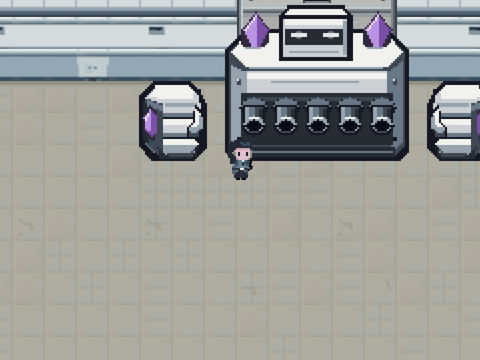

# 경비 4번 — 눈 충전·지연 추적 레이저

2026-11-16 사용자 요청의 F-B07-04 구현·연결·검증 결과다. 눈 충전 후 두 줄기 레이저를 발사하고, 발사 중에도 **0.4게임초 전 Player 위치**를 계속 조준한다.

이 GIF는 실제 Unity GameCamera의 960×720 출력 84장을 기록된 게임 시간에 맞춰 인코딩한 3.5초 구간이다. 검사에서 Player 위치를 일정 경로로 통제했으며 게임 카메라 설정은 바꾸지 않았다. 충전부터 발사 중간까지를 보여 주고, 전체 발사·회복 완료는 별도 동작 검사로 확인했다. 기본 추적 화면에는 머리 상단이 일부 잘리므로 [전체 보스 검토 화면](firing-full-boss-inspection.png)은 같은 카메라에 임시 검사 초점을 연결해 별도로 남겼다.

## 구현과 초기값

- 원화의 8×2px 흰 눈 중심에 원점을 연결했다. 원본 경비 Sprite는 변경하지 않았다.
- 위치와 게임 시각을 재사용 버퍼에 기록하고 `현재 시각 - 0.4`를 감싸는 두 표본을 보간한다. Player 이동0 → Boss 기록1 → 몸체 표시3 순서다.
- 같은 Tick에서 양눈의 방향·벽까지 길이·세 겹 표시를 맞춘 뒤 동일 폭의 피해 범위를 질의한다. 흰 중심0.15 / 분홍 본체0.5 / 부드러운 외광1.0이다.
- 두 빔은 한 공격 번호와 성공 피해 기록을 공유한다. 같은 발사에서 Player 성공 피해는 총1회이며 Slash 제거·반사를 받지 않는다.
- 충전1.2초 / 실제 첫 표시 뒤 발사3초 / 회복0.5초 / 피해10은 이번 AI 초기 튜닝값이다. 충전은 최소0.4초를 요구해 발사 전에 필요한 위치 이력을 확보한다.
- 맵 벽에서 길이를 제한한다. 눈 원점에 이미 겹친 출구 벽만 출처 겹침으로 제외한다.
- 정지 중에는 위치 기록·방향·피해 진행을 멈춘다. 그로기·취소·사망에는 충전과 현재 빔을 즉시 닫고, 이미 떠난 Normal/Gold는 공통 수명을 유지한다.

`GuardEyeLaser`는 같은 보스 수명에서 눈·선6개·충전 Sprite2개를 재사용한다. 기존 `Projectile`, `AreaProjectile`, `LaserProjectile`의 구현은 이번 작업에서 변경하지 않았다. 신규 [외광 단면 PNG](guard-laser-glow.png)는 `GuardBossSetup.PrepareLaserGlow`가 재현하는 흰 RGB/대칭 알파8×64 출력이며 새 셰이더·패키지·원화 제작은 없다.

## 검증

Unity **6000.3.21f1**의 격리 사본에서 실행했다.

| 검사 | 결과 | 근거 |
| --- | --- | --- |
| 레이저 전용·최신 입장 카메라 통합 | 12묶음 통과·컴파일 오류0·배치 종료0 | `unity-validation.json`, `project/Logs/GuardLaserVerificationFinalR02.log` |
| 기존 손·몸통 피격·중앙 내려찍기·선택 | 16묶음 통과·배치 종료0 | `hand-regression-validation.json`, `project/Logs/GuardLaserHandRegression.log` |
| 기존 벽·문·탄환·총구 순회 | 11묶음 통과·배치 종료0 | `fan-regression-validation.json`, `project/Logs/GuardLaserFanRegression.log` |

전용 검사는 불규칙 시간/방향 반전 보간, 실제24fps 갱신, 충전 무피해, 공통1회 피해/중복 Hitbox, 폭 밖 회피·지연 적중, 벽 뒤 무피해, 정지, 충전·발사 중 그로기, 기존 탄환 유지, 재시도 재사용, 실제5패턴 전환, 사망·출구 개방·Title 정리를 확인했다. 실제84표본과 불규칙 표본에서 독립 계산한 조준 기대값의 최대 오차는 모두0이다.

최종 대조에서 런타임56/56 및 이번16대상이 사본과 같고, Map/GameSystems/Player 프리팹도 바이트가 같다. Guard 프리팹 GUID를 보존했고 내부 참조142개 중 끊긴 참조는0이다. 전체 C#102/102 중 동시 작업 `MapEntranceSetup.cs`·`TutorialEntryChecks.cs` 두 Editor 파일 차이는 보존했으며 최종 실행의 검증 대상에서 제외한다. 27회귀는 마지막 입장 카메라 변경 전 스냅샷이며 레이저 소유 코드에는 차이가 없다. 최신 런타임 통합은 전용12묶음으로 확인했다.

초기 검사에서 `MonoImporter`의 Editor override와 코드 속성을 혼동한 전제 오류를 고쳤다. 최종 진단은 attribute1/importer0이다. 코드 속성 순서와 Editor 설정은 별도라는 [Unity 공식 설명](https://docs.unity.com/en-us/engine/6000.3/manual/scripting/object-oriented-development/managing-update-order/script-execution-order)을 확인했다. 이후 동시 입장 연출의 고정 카메라가 기존 Player 추적 전용 준비 검사에 걸리는 실제 초기화 오류도 발견해, 최초 입장 대기 중에는 지정된 도착 초점을 확인하도록 최소 수정하고 재검사했다.

Play 진입 시 기존 UnityEditor.Search.SearchDatabase의 `ArgumentOutOfRangeException`은 관찰됐지만 최종 컴파일·기능 검사는 통과했다. 원본 Editor 수동 Play와 제출 빌드는 미실행이다. 현재 사양·SequenceDiagram은 `docs/GAME_SPEC.md` 2.2.11을 따른다.

## 결과 파일

- `unity-validation.json`: 실제12묶음·이동/조준 표본·캡처 시각·순서 진단
- `source-validation.json`: 현재 소스/사본 SHA256·원본 반영·참조 대조
- `preview-validation.json`: GIF 프레임·게임 시간·크기·좌표 오차
- `charging-player-camera.png`: 기본 Player 추적 화면의 충전
- `firing-full-boss-inspection.png`: 전체 보스 검토용 임시 초점
- `wall-clipped-player-camera.png`: 벽에서 잘린 빔 확인
- `build_preview.py`: 가공 없는 캡처에서 GIF와 결과 파일을 재생성하는 절차
