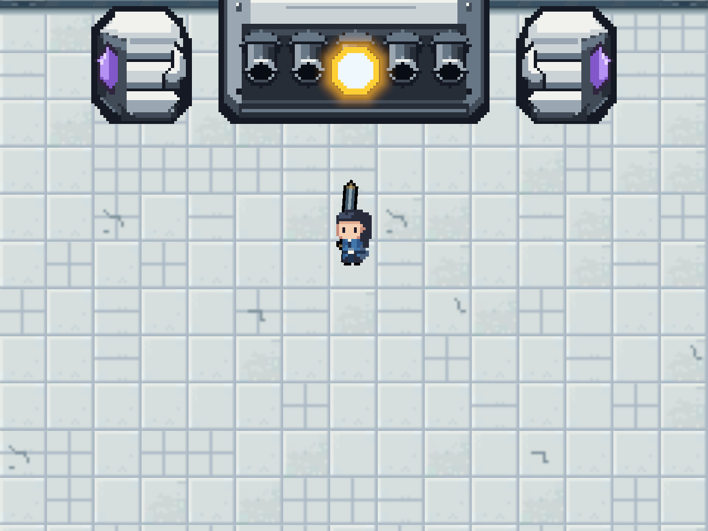
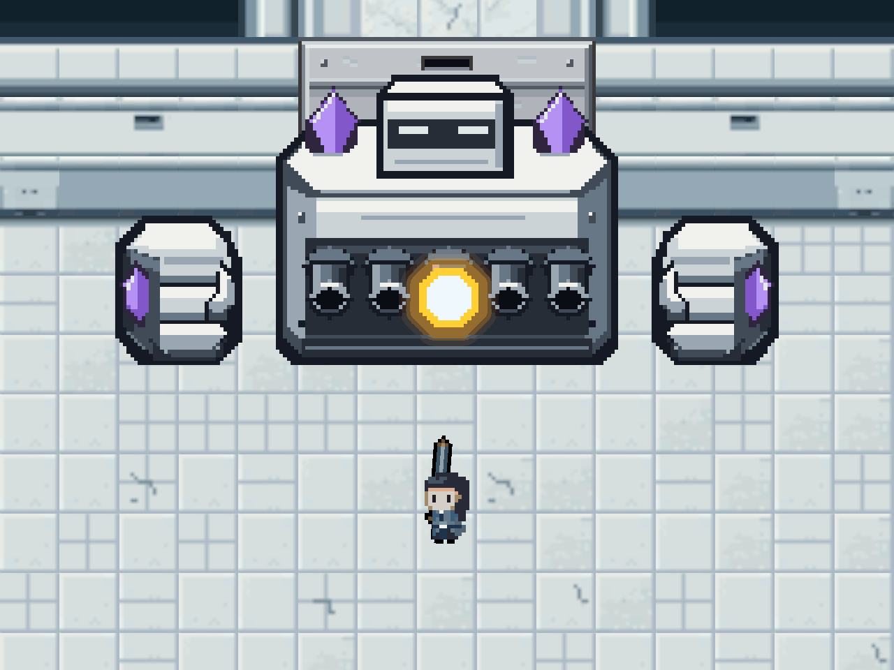

# 경비 첫 패턴 R01 — 복부 황금탄

2026-11-16 사용자 요청에 따라 경비를 출구 앞쪽으로 옮기고, 복부의 다섯 총구 중 중앙에서 황금탄 한 발을 발사하도록 실제 게임에 연결했다.

- 사용 원본: [경비 정면 R05](../guard-r05/README.md)의192×120px PNG 그대로,16PPU·Point·하단 pivot(96,104 top-left)
- 실제 사용: `project/Assets/Art/Enemy/Guard/guard-front.png`, 기존 `GuardRobot.prefab` GUID 유지
- 배치: 기존(14.5,17) → (14.5,23.5), 출구문 앞을 몸체가 가리는 화면 확인
- 총구: 왼쪽부터 local x=-1.96875/-0.96875/0.03125/1.03125/2.03125, y=1.125
- 첫 발: 중앙 index2, 준비0.8초 뒤 발사 순간 Player 방향으로 Gold1발, 속도6·수명6·피해10·실제 발사 뒤 회복1초
- 접근: 총구에서4.5world 안으로 들어오면 패턴 선택 허용. 기존 입장 지점에서 화면 밖 발사를 하지 않기 위한 AI 초기 튜닝
- 표시: 바닥19/보스20보다 앞에 탄환 본체30·후광29. R06 탄환의 모양·크기·색/alpha 출력과 물리 판정은 유지

숫자는 제작 초기값이며 최종 난이도 확정과 구분한다. 현재는 첫 패턴 하나만 등록했다. 기존 직전 패턴 제외 규칙에 따라 한 번 쏜 뒤 Idle이며, 재도전하면 이력을 초기화해 다시 발사한다. 나머지 네 패턴과 튜토리얼 안내 UI/Dialog는 이번 작업의 완료 범위가 아니다.

## 실제 Unity 화면

[Player 추적 카메라](player-view-first-shot.png)는 실행 중 기본 카메라에서 총구와 탄환이 보이는지 확인한 화면이다. 보스 윗부분은 일반 추적 화면 밖에 있다.

[전체 배치](placement-and-first-shot.png)와 아래 GIF는 **같은 GameCamera에 검사 전용 초점만 잠시 연결**해 보스·출구·Player를 함께 촬영했다. 게임의 추적 설정은 바꾸지 않았다. 비행 화면 촬영 동안 Player는 검사 목적으로 무적이며, 실제 피해는 기존 탄환 검사에서 따로 확인했다.

원본 PNG12장은 [frames](frames)에 보존했다. GIF는 실제 프레임 사이 게임 시간을 사용하고 마지막 장에600ms 정지 시간을 더해 반복한다. 별도 Sprite 합성 없이256색 GIF로 변환했다. 정확한 프레임 시간은 [preview-validation.json](preview-validation.json)을 따른다.

## 검증

- Unity6000.3.21f1의 격리 프로젝트에서 경비10묶음 성공, 배치 종료0(10:17:03 KST)
- 공통 탄환·예고17묶음 재검사 성공, 배치 종료0(10:18:38 KST)
- 실제 F 입력→수정→조우 컷씬→접근/발사, 정지, 발사 원점/방향/소유자, 반사/Fever/발사자 피해, 단일 패턴 Idle 확인
- 그로기 전 발사 취소/기존 탄 유지, 실제 Player 사망/자동 재도전/재발사, Boss 처치/위험물 정리/양쪽 문 개방/사체 보존/Title 복귀 확인
- 전체89C#·런타임51C#와 소유27대상 원본/검증 사본 해시 일치. 경비 R05 PNG 그대로 사용·탄환 본체/후광 PNG R06 보존 확인
- 원본 Map은 경비 spawn 위치 한 곳만, GameSystems는 파생 Boss 컴포넌트 참조 한 곳만 변경한 것을 대조

기록: [경비10검사](unity-validation.json), [공통17검사](hazard-validation.json), [원본·사본 대조](source-validation.json). 로그는 `project/Logs/GuardBossFirstPatternVerification.log`·`GuardBulletSortingVerification.log`에 있다. 동시 Title 편집 중 사본 시점 불일치와 검사 가상 입력 장치 미연결을 바로잡고 재검사했다. Unity SearchDatabase 시작 시 ArgumentOutOfRangeException은 관찰했으나 두 Play 검사와 종료0은 확인했다. 원본 Editor의 수동 Play와 제출 빌드는 미실행이다.

사양·호출 흐름과 후속 범위의 원본은 [GAME_SPEC2.2.7](../../../../docs/GAME_SPEC.md), 결정 기록은 [Boss_Guard_Pattern_20261116](../../../../docs/archive/01_Choice/Boss_Guard_Pattern_20261116.md)을 따른다.
