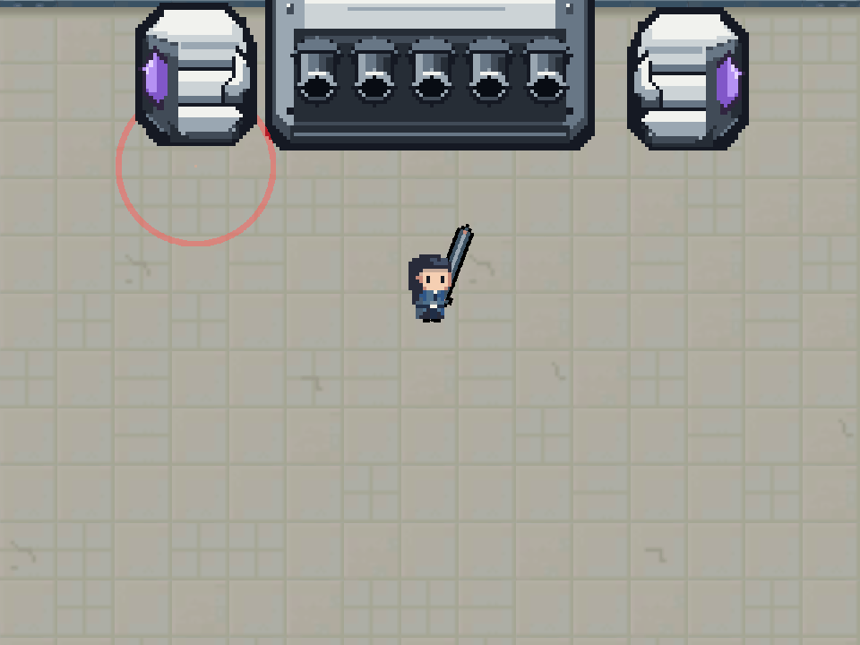
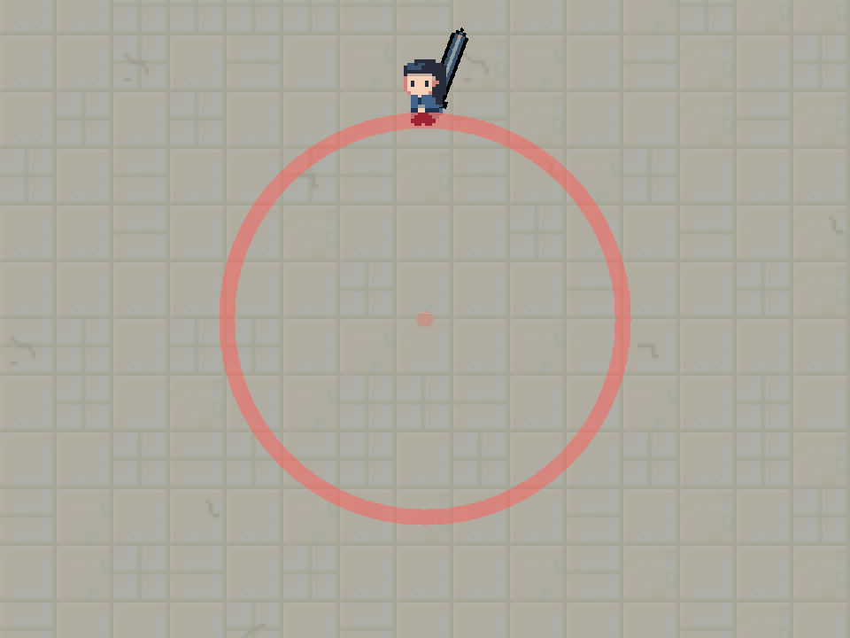

# 경비 몸통·02·03 통합 검토 자료

2026-11-16 요청한 몸통 전체 피격·02 손/예고 동시 추적·03 큰 원형 중앙 공격을 반영했다. R01의 '추격 후 경고 위치를 고정한 상태에서 충전'은 AI 해석 오류였으며 이번 동작으로 교체했다. 당시 실행 결과는 [R01](../guard-hand-r01/README.md)에 보존한다.

## 몸통 전체 피격

원화의 불투명 몸통 범위는192×120px 출력의 `[50,26]~[142,104]`이다.16PPU 기준 새 `BodyHitbox` 자식 Trigger를 **5.75×4.875world·offset(0,2.4375)**로 맞췄다. 기존 root 피격 수신자는 제거해 단일 몸통 수신자로 유지했다. 이동을 막는 기존 solid는5.5×3·offset(0,1.5) 그대로다. 실제 머리·양쪽 상부 어깨의 Normal 공격과 전체 Slash 질의가 적중하고, 같은 공격의 중복 피해를 막으며, 상부 Trigger는 이동을 막지 않는 것을 확인했다.

## 02 이동하며 차오르는 예고

시작부터 빈 원이 손의 지면 투영 위치에 나타난다. 한 손이 공중에서 Player를 추격하는 동안 같은 원의 위치도 움직이고, 내부 충전 시간의 진행률로 중앙 원판이 확대된다. **원이 가득 찬 순간** 현재 지면 위치에서 추적을 멈추고0.2게임초를 확보한 뒤 내려찍는다. 착지 순간에만 범위 피해를 한 번 질의하며 뒤늦은 진입에는 피해가 없다.

## 03 큰 원형 중앙 내려찍기·좌우 세로줄

두 손을 조우 영역 중앙 `(14.5,17)`의 좌우로 모으고 큰 원의 충전을 마치면 내려찍는다. 착지 순간 큰 원형 피해와 함께 중앙의 세로6지점에서 각각 좌/우 일반 탄환을 한 발씩, 총12발 생성한다. 전투 중 조우 Collider는 비활성 상태이므로 빈 `bounds` 대신 `transform.TransformPoint(offset)`로 실제 중앙을 얻는다. 그로기는 아직 오지 않은 착지·줄탄 생성만 취소하고 이미 생성한 탄환은 유지한다.

반경은02의1.35에서03의3.5로 크게 설정했다.03 충전1.2초·피해15·손 간격±1.1, 줄탄 간격1·속도4.5·수명5·피해10과6행은 제작 초기값이다.02 충전2.2초·높이2.5·상승0.35초·낙하0.12초·회복/복귀 각0.35초도 초기값이다.03의0.2초 유지도 공통 손 처리로 적용한 제작값이며, 원문을 새로운 사용자 확정 수치로 해석하지 않는다.

## 촬영 기준

`GuardHandChecks`에서 실제 Unity `GameCamera`로20fps 게임 시간을 촬영했다.02는69장 중39장,03은44장 중29장을960×720 최근접·256색 GIF로 변환했다. 마지막 장에500ms 반복용 유지 시간을 더했다. Sprite 합성이나 프레임 보간은 없다. 두 촬영에서 full→하강은0.20게임초, 하강→착지는0.05초 캡처 간격으로0.15초에 관찰했다([프레임 기록](preview-validation.json)).

- **02 추적 내려찍기:** 실제 Player 추적 시점으로 촬영한다.
- **03 중앙 양손 내려찍기:** 큰 원 전체, 두 손, 여섯 탄환 줄과 Player를 함께 검토하기 위해 같은 GameCamera가 중앙 `(14.5, 17)`의 임시 검토 앵커를 추적한다. 줌·렌더 설정은 유지한다. 촬영 종료와 실패 정리에서 Player 추적을 복원하고 앵커를 제거한다. 이 이미지·GIF는 **03 검토 시점**이며 기본 Player 추적 화면과 구분한다.

검사에서는 추격과 full 이후 고정·피해를 확인하려고 Player 위치를 바꾸므로 카메라 스냅 구간이 있다.03 마지막은 이미 나온 탄환의 그로기 유지 확인을 위해 손을 취소하는 구간이다. 실제 원본 캡처는 [이동/채움](half-fill.png), [02 full](filled-hold.png), [중앙 full](central-full.png), [중앙 착지](central-impact.png), [12탄 비행](central-bullets.png)이다.

## 검증·원본 반영

- Unity6000.3.21f1의 **전체 Editor 코드가 복원된** 격리 사본에서16묶음 성공·배치0(11:47:05 KST), 기존 Gold 단독10회귀 성공·배치0(11:35:43 KST), C# 오류0
- 전체 몸통 Normal/Slash·이동 구분, 좌우 무작위 한 손/경고 동행·내부 타이머/정지·full lock/.2초·지연 Tick·내부1회/외부0/늦은 진입0 확인
- 중앙 양손/큰 원·비활성 영역의 실제 중앙·착지 피해15·6원점 좌우12발·착지 전 취소·이미 생성한 탄 유지·3패턴 실제 실행/직전 제외·Gold 반사/Fever·Boss 사망/문/사체 확인
- 원본에 `GuardRobot.prefab`만 복사해 기존 GUID를 보존했다. 새 원화 제작 없이 R05와 [기존 분리 native/PNG](../guard-hand-r01/README.md)를 유지했다.
- 대조 시점 원본/사본96C# 중 런타임54와 이번 소유12대상은 모두 같다. 다른 작업의 `Assets/Editor/FeverAuraChecks.cs` 한 곳은 검증 후 편집되어 다르다. 원본 Map은 보존했으며 사본에서 발생한 군용 프리팹 YAML 블록 재정렬은 복사하지 않았다.

근거: [통합16검사](unity-validation.json), [Gold10회귀](gold-regression-validation.json), [소스/자산 대조](source-validation.json). 로그는 `project/Logs/GuardPatternsR02Verification.log`·`GuardThreePatternGoldRegression.log`다. 작성 중인 본 검사 helper와 동시 각성 Editor 파일의 스냅샷 불일치를 확인했고, 중간에는 경비용 Editor만으로 실행한 뒤 **최종에는 전체 Editor를 복원해 재검사**했다. 기존 SearchDatabase 시작 예외는 관찰했으나 최종 검사와 종료0을 확인했다.

원본 Editor 수동 Play·제출 빌드는 미실행이다. 남은04~05 패턴·최종 튜토리얼 완료는 이번 작업과 구분한다. 현재 사양과 SequenceDiagram은 [GAME_SPEC2.2.8/2.2.9](../../../../docs/GAME_SPEC.md)를 따른다.
