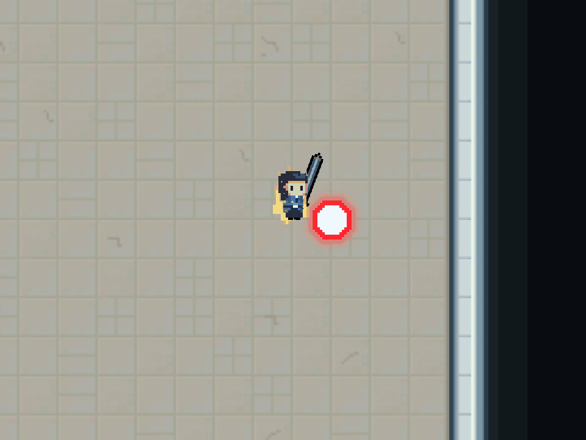
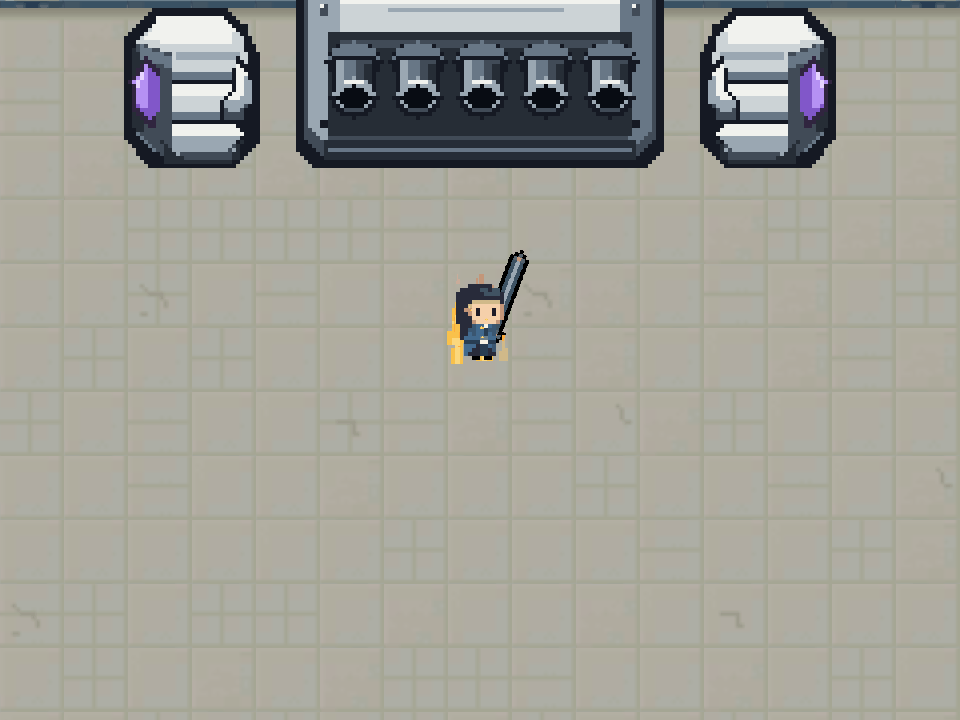

# 경비 탄환 벽 충돌·다섯 총구 부채꼴 R01

2026-11-16 요청한 맵 벽에서의 탄환 삭제와05 총구 순회 부채꼴을 구현·연결했다. 현재 패턴은01/02/03/05이며04는 미구현이다.

## 벽까지 날아가는 탄환

03 세로줄과05 부채꼴은 시간 만료 없이 비행하고 실제 벽에 닿는 순간 사라진다. `Lifetime=0`을 시간 만료 없음으로 처리하며 `RemainingLifetime=0`을 유지한다. Player 적중·Slash·사망/재도전 정리는 기존대로 종료한다. 양수 수명은 기존 시간 만료를 유지하고 Area의0수명은 기존 전조 검증에서 거부한다.

`MapManager.Initialize`에서 이번 맵 하위의 non-trigger Collider를 한 번 모아 벽·문 집합을 만든다. 각 탄환은 발사 경계에서 그 Map을 한 번 연결한다. 비행 CircleCast의 가장 가까운 벽을 먼저 확인해 벽보다 앞의 Player만 타격하며 같은 거리에서는 벽이 우선이다. 닫힌 문은 막고 열린 문은 통과한다. 발사자와 Player의 몸체·경고·다른 탄환을 벽으로 분류하지 않는다.

동시에 갱신된 **Line 각도 기준 금색탄 직선 반사**도 보존했다. 반사 방향의 실제 Boss Hitbox와 벽 중 가까운 접촉을 처리한다. 반사 방향 자체의 사양과 별도 검증은 해당 동시 작업 기록을 따른다.

## 05 다섯 총구 부채꼴 두 바퀴

총구는 **1→2→3→4→5→1→2→3→4→5**, 실제 게임 시간 **0.3초 간격**으로10묶음을 발사한다. 한 묶음5발로 현재 총50발이다. 각 총구에서 아래 방향을 중심으로60도,15도 간격의 부채꼴을 만든다.

준비0.4초·마지막 발사 뒤 회복0.5초·5발/60도·속도6/피해10은 제작 초기값이다. 순서·두 바퀴·약0.3초 간격은 사용자 요청이다. 기존 총구 접근 거리4.5 안에서 실행을 시작한다. 지연 프레임에 묶음을 몰아서 내보내지 않으며, 그로기는 아직 오지 않은 발사만 취소하고 이미 나온 탄환은 계속 비행한다. 재도전은1번 총구부터 다시 시작한다.

고정20fps 계측에서 실제 발사 시각은0.400000/0.700000/1.000000/1.299999/1.599999/1.899999/2.199999/2.499998/2.799998/3.099998초였다. 간격은0.299999714~0.300000072초다. 예비 실행의 float 누적 오차로 발생한0.35초 간격을 작은 비교 허용값으로 보정하고 재검사했다.

## 화면과 검증

두 GIF는 실제 Player 추적 GameCamera로 촬영했다. Fan39장 중 일시정지 중복 시간을 제외한37장·벽12장을960×720px 최근접·256색으로 변환했다. 마지막 장에 반복용500ms 유지 시간을 더했다. Sprite 합성·프레임 보간은 없으며 원본 R05 보스/분리 손·R06 탄환 PNG도 수정하지 않았다. [프레임·타이밍](preview-validation.json), [발사 중간](fan-midpoint.png), [벽 전](wall-before.png), [벽 후](wall-after.png)를 보존한다. 촬영 중 Player 무적과 위치 재배치는 패턴 관찰용이며 실제 피해는 별도 검사했다.

- 같은 Unity6000.3.21f1의 최신 반사 코드 포함 검증 사본에서 전용11묶음/배치0(12:44:56 KST), 몸통·손·중앙16회귀/배치0(12:46:18), 공통 탄환·장판17회귀/배치0(12:47:41), 총44개 통과·C# 오류0
- 실제 사방 고속 벽, 발사자 무시, 닫힌 문의 양끝/열린 문, 벽 앞 Player 피해·뒤 보호·tunnel 방지,0수명5.2초 이후 생존/정지/벽 종료와 양수 만료 확인
- Normal Slash·금색 반사/Fever/Owner 피해·반사 경로 벽 차단, 50개 고유 탄환과 총구10회 순서·각도·간격·정지·그로기/재도전·Title 정리 확인
- 원본 GuardRobot 프리팹의 GUID를 보존해 설정을 반영했다.12:47:24 대조에서 이번 소유14대상은 모두 검증 사본과 일치했다.
- 원본98C#/사본97C#, 원본 런타임55/사본54 차이는 동시 Tutorial 작업의 `PlayerCharacter.cs`·`PlayerSpawner.cs`·`SaveManager.cs`·`TutorialController.cs`다. 해당 파일은 보존했고 이번 검증에 포함하지 않았다. 이후 MapManager에도 같은 Tutorial의 입장 위치 필드2개가 추가돼 보존했다. 그 두 필드를 제외하면 벽 캐시/메서드를 포함한 MapManager 본문은 검증본과 같고, 나머지13개 소유 대상은 그대로 일치한다.

근거: [전용11검사](unity-validation.json), [기존16회귀](hand-regression-validation.json), [공통17회귀](projectile-regression-validation.json), [소스/자산 대조](source-validation.json). 로그는 `project/Logs/ProjectileWallFanVerification.log`·`GuardWallFanHandRegression.log`·`GuardWallFanProjectileRegression.log`다. 기존 SearchDatabase 시작 예외는 관찰했으나 세 Play 검사와 종료0을 확인했다.

원본 Editor 수동 Play·제출 빌드는 미실행이다. 현재 사양과 SequenceDiagram은 [GAME_SPEC의 공통 탄환·03·05](../../../../docs/GAME_SPEC.md)를 따른다.
