# Project Chrono — 통합 기획·클래스 정의

최초 정리: 2026-11-14. 현재 갱신: **2026-11-16 (Asia/Seoul)**. 문서 통합·Q1~Q29 답변 반영과 **F-S01 초기화, F-P01~F-P11 이동·공격·Draw/Slash·피격·사망/부활·수정·고정 효과**를 구현·연결하고 기존73묶음 검사를 마쳤다. F-B01~F-B06의 보스 공통 기반·더미4패턴·탄환 상속·Slash/그로기를 포함한 최신96묶음도 통과했으며2.2.1~2.2.6에 구현·확인 근거를 기록한다. 최종 Sprite/FX/음향·경비 로봇 실제5패턴·Ending·제출 빌드 등 전체 게임 완료와 구분한다.

사용자 후속 확정: **문서 작업이 완전히 끝나고 Sprite·FX·animation 등의 연출을 제외한 로직의 방향이 확실해진 뒤 Unity 개발을 시작한다.** 2026-11-15 후속 요청으로 시스템의 첫 Case인 F-S01 코드 작업을 시작했다. 기존 `/project`와 Title·MainWorld 씬을 사용하며, 실제 API 호출 흐름과 확인 결과를 해당 Case에 기록한다.

현재 사양 원본은 이 문서이며 [Notion 정리 페이지](https://app.notion.com/p/41857a6d6d24809a8d15f1a5aa34d48a)는 같은 내용을 검토하기 위한 게시본이다. 질문·답변은 [QUESTIONS.md](QUESTIONS.md)에 관리한다. Notion과 로컬 파일의 자동 동기화는 없으며, 후속 답변을 반영할 때 함께 갱신한다.

### 읽는 방법과 출처

- **사용자 확정**: 이번 요청·후속 답변·현재 AGENTS에서 명확히 정한 내용.
- **원문**: Notion 메모를 보존한 내용. 모순이 없더라도 이번 제출 사양으로 모두 승인된 것은 아님.
- **보완 정의**: Q3에서 역할 배치 A를 채택했다. Q4에 따라 기존 확정명을 제외한 이름은 AI가 작성하고 사용자가 기능별 결과를 보고 변경할 수 있다. 새 게임 규칙을 대신 결정하지 않는다.
- **미정**: 출처 간 충돌 또는 필수 정보 누락. 관련 Q 번호로 답변한다.
- 현행 정의에는 이름을 하나로 적는다. Q2 확정명은 유지하고 신규 API는 Try보다 Apply/Handle/Get/Set처럼 역할이 분명한 이름을 쓴다. 질문지는 확정 답변·반영 위치로 압축하고 주요 대안·이유는 3장과 선택 기록에 보존한다. Awake/Update는 외부 API와 구별한다.
- Q4 확정: 공개 데이터는 단순한 public 필드, 전역 시스템 창구는 필요한 static으로 작성한다. 불필요한 readonly·sealed·방어용 래퍼를 추가하지 않는다. 프리팹마다 다른 상태까지 모두 static으로 공유하는 뜻은 아니다. 파일 오류·잘못된 데이터 처리와 행동 가능 판정은 유지한다.
- 2026-11-15 후속 확정: 프로젝트 런타임·Editor 코드에서 namespace를 선언하지 않는다. 기존 namespace 제거와 이후 작성 규칙은 [DESIGN 2.1](agents/DESIGN.md#21-cs-code-style), 변경 이유·이력은 [선택 기록](archive/01_Choice/No_Namespace_20261115.md)을 따른다.

| 출처 ID | 원문 | 이번 정리에 사용한 범위 |
| --- | --- | --- |
| N0 | [Project Chrono](<notes/notion 문서/Project Chrono 3f657a6d6d2480e8b3d7f3695c2a618d.md>) | 하위 문서 연결 |
| N1 | [Class 구조](<notes/notion 문서/Project Chrono/Class 구조 41357a6d6d24802182cde4fe53b5364f.md>) | 클래스 전체, Sequence D 전체, 비고 1·2 |
| N2 | [필요 기능](<notes/notion 문서/Project Chrono/필요 기능 40d57a6d6d248070aadddcc4a7e6dcc8.md>) | 시스템·플레이어 Case 전체, 입력, Mode/State/Condition, 적·시스템 |
| N3 | [적 컨셉](<notes/notion 문서/Project Chrono/적 컨셉 40257a6d6d248023a8a7f063107b6b92.md>) | 6개 보스 및 모든 패턴 |
| N4 | [디자인들](<notes/notion 문서/Project Chrono/디자인들 41857a6d6d2480f2a7bfdf1eaac3d398.md>) | Title, In Game, Map, Ending 및 원본 이미지 링크 |
| L1 | [핵심 기획 확정](notes/01_핵심_기획_확정.md) | 기존 규칙·튜토리얼·태엽 보스와의 충돌 |
| L2 | [게임계획서](notes/게임계획서.md) | 캡스톤/PlayX4 범위, 시간 테마·회피 자원 |

기존 02·03 기획 문서는 대부분 빈 양식이므로 구현·검증·범위 동결의 증거로 사용하지 않았다. 원문 파일과 이미지들은 수정하지 않는다.

### 제출 범위와 컨셉

- **사용자 확정(Q1·Q24)**: 게임 입장, 체크포인트와 Trigger, **경비 로봇 1명과 원문 5개 패턴 전체**, Ending의 짧은 흐름을 먼저 완성한다. 마지막 보스가 쓰러지는 순간 완료 판정, 사망 컷씬, 스탭롤, Title 복귀가 이어진다.
- **이후 순서**: 시간이 남으면 적을 하나씩 추가하고, 그 뒤 더 여유가 있으면 dialogue를 추가한다. 나머지 5보스·33패턴은 원문 목록으로 보존하며 현재 최소 제출 구현에 포함하지 않는다.
- **후속 튜토리얼**: 전투구역으로 가며 이동·공격·회피를 안내, 경비 로봇 전투 시작에 Draw & Slash, 전투 종료 후 체크포인트를 안내한다. 지금 dialogue 시스템을 먼저 만들지 않는다.
- 서버 없는 싱글 플레이, 하나의 고정 무기와 정해진 Draw/Slash·대시·각성 능력. 무기 교체·능력 획득/선택/교체는 추가하지 않는다.
- N3 연구소·마도공학수정 컨셉을 원문으로 보존한다. 과거 시간 소녀·자유 보스 선택과의 세계관 통합을 이번 짧은 흐름에 필수인 신규 과제로 만들지 않는다.
- 커서 기준 몸체·이동 모션 **왼앞·오앞·왼뒤·오뒤의 4방향** 우선(2026-11-15 Player 시안 후속 요청), 8방향 표현은 2차 목표. 실제 이동은 WASD 8방향·대각 속도 정규화. Player 이동/대시는 벽 통과 불가, Slash는 벽과 무관하게 Line 박스 영역 판정.
- 저장·Title UI 초기화는 UniTask, 나머지는 Unity 코루틴. 오디오는 FMOD, 카메라는 자체 GameCamera. 사용자 조건과 호환 조사에 따라 **Unity 6.3 LTS 계열** 선택(3.4).
- DebugController는 Editor에서만 개입한다. 제출 소스에는 포함하고 디버그 제어 코드의 제작 효율 향상에 AI를 사용했음을 기록한다. 플레이어 빌드에서 디버그 입력을 활성화한다는 뜻은 아니다.
- Windows 10/11·키보드/마우스, 1920×1080 목표 60FPS는 기존 원문 기준으로 유지한다. 새 플랫폼 변경 요청은 없음. 과거 11/27·30일 일정은 현재 마감으로 사용하지 않는다.

### 프로젝트 완성 목표 — 콘텐츠·연출 추가에 집중할 수 있는 기반

**사용자 확정(2026-11-15)**: 세부적인 시스템 조정을 제외하면, 이후 작업을 **Boss 콘텐츠 추가와 FX·VFX 등 연출 추가에 집중할 수 있는 환경**으로 만드는 것을 현재 프로젝트의 완성 목표에 포함한다.

- 공통 전투·피격·Draw/Slash·버프·조우·사망/재도전·저장·UI 연결이 실제로 동작해야 한다. 경비 로봇 5패턴과 입장~Ending 흐름으로 이 기반을 확인한다.
- 새 Boss는 B01~B08의 보스/패턴/투사체 구성과 S02·S03의 생성·배치 연결을 통해 추가할 수 있어야 한다. 보스마다 공통 세이브·입력·재도전 시스템을 다시 만드는 작업이 반복되지 않도록 한다.
- FX·VFX·animation·음원은 U01·U02·U06~U08의 행동·타격·완료/중단 신호에 연결하고, 수치·프레임·피벗·타이밍 같은 세부 조정을 계속할 수 있어야 한다.
- 추가할 코드·데이터·프리팹·자산의 위치와 연결 방법을 실제 구현 결과와 함께 남긴다. 이름만 있는 API나 빈 함수, 미검증 연결을 기반 완성으로 보지 않는다.

현재는 **F-S01 시작·초기화 흐름만 구현·검증한 상태**이며 전체 전투·콘텐츠 기반 완성과 구분한다. 현재 경비 로봇 1명 우선 범위는 유지한다. 범용 에디터나 대규모 콘텐츠 프레임워크를 새 필수 기능으로 추가하는 뜻은 아니다. 이 기반이 동작한 뒤 3.1.1의 성능 비교로 선택 이유를 실측 근거까지 보강한다.

## 1. 클래스·구조체·enum 정의

카테고리 표시 순서는 **Player / Boss / UI·anim / 시스템·기타**이다. Q2 명칭·Q3 책임 배치를 채택했고 Q4는 신규 이름을 AI 작성에 맡겼다. 이름을 하나씩 선택받기 위해 멈추지 않는다. 실제 케이스 구현은 문서 확정 뒤 시작한다.

### 1.1 Player

#### P01. Character — 원문, MonoBehaviour

**현재 F-S01·F-P01·F-P03 구현, F-P07 지원·F-P08 피해 연결 확인**: HP·maxHP·IsDead·IsInitialized·체력 초기화와 `basicSP`·`SP`에 더해 `basicAD`·`AD`·`AS`, `IsInvulnerable`·가상 `IsDodge`를 공유한다. `ApplyDamage`가 활성/초기화·생존·컷씬·무적·Hitbox 회피와 유효 피해량을 확인해 HP를 줄이고 `OnDamaged`·최초 `OnDie`를 알린다. IsCutScene은 직렬화된 backing field와 FormerlySerializedAs("IsCutScene")로 기존 씬 값을 보존하는 프로퍼티이며 false→true 전환에만 OnCutScene을1회 알린다. 저장 HP 복원·IsDead 직접 대입은 사망 통지가 아니며 실제 치명 피해의 OnDie와 구분한다. 비전투 상태를 피해 차단 조건으로 사용하지 않는다. F-P07 지원으로 basicAS·Heal·ApplyBuff/RemoveBuff와 자기 CharacterBuff 캐시를 연결한다. IsInvulnerable은 직렬화 원본을 보존하는 virtual 프로퍼티로 바꾸어 Player가 기존 전면 무적과 Slash 보호를 OR로 합친다. F-P08은 virtual IsHitProtected를 별도로 제공하고 Hitbox 피해에만 IsDodge 또는 IsHitProtected를 적용한다. HP/IsDead와 이 호출의 치명 여부를 먼저 확정한 뒤 OnDamaged/OnDie를 발행하며 보호·렌더링·Save를 직접 지시하지 않는다. 보호/표시의 최신61묶음 확인은2.1.8을 따른다. F-P09의 Revive는 같은 개체의 maxHP·기본 AD/AS/SP·생존·컷씬/무적 원본을 확정하고 OnRevive만 알린다. Player·Buff·Spawner는 자기 구독으로 후속 정리/배치를 처리하며 Character가 직접 지시하지 않는다. 신규 부활/효과 연결의 최신 검증은2.1.9~2.1.11에서 별도로 기록한다.

- **역할(목적)**: PlayerCharacter와 BossCharacter의 부모. 공통 Status·상태·함수·이벤트를 제공한다. 원문은 Character 하나로 조회하기 쉽고 확정 전에 한 곳에서 검토하기 위해 수치를 모아 둔다.
- **생명 주기**: 세션 시작에 StageManager가 생성한 Player/Boss 프리팹에 존재한다. 사망은 Destroy가 아니며 Player 부활·Boss 재도전 초기화에서 같은 인스턴스의 위치·수치를 복원한다. 처치된 Boss는 사망 상태를 유지한다. Title 복귀/앱 종료 때 인스턴스를 제거한다. UI·Input·Component 연결은 사망으로 끊지 않고, 전투 상대의 OnDie 상호 구독만 어느 한쪽 사망 때 해제한다(Q5).
- **보유 공개 API**: `ApplyDamage(DamageInstance)` — IsDodge/IsHitProtected/IsInvulnerable 등 피해 허용 여부 확인 후 적용하고 적용 여부 반환; `ApplyBuff`, `RemoveBuff` — 자기 CharacterBuff에 효과 요청. `OnDie`, `OnDamaged`, `OnCutScene`, `OnDash` — 관련 사건 알림; `Revive()`는 같은 개체의 기본 생존 상태 복구 후 `OnRevive` 알림. 비전투 중에도 유효한 피해를 받을 수 있다(Q11).
- **보유 공개 변수**: 아래 원문 수치·상태를 public으로 둔다. 데이터 원본은 한 곳에 두고 각 Controller가 갱신한다(Q4).
- **연관 class(상속, 보유)**: MonoBehaviour 상속; PlayerCharacter·BossCharacter가 상속한다. 각 프리팹의 CharacterBuff·CharacterRendering·Hitbox와 연결한다. DamageInstance로 피해를 받고 UI·Spawner는 프리팹 수명 동안 이벤트를 연결한다.

| 원문 변수 | 역할·용도 |
| --- | --- |
| `HP`, `maxHP` | 현재 체력 / 초기화·회복 상한 |
| `AD`, `basicAD` | 매 공격에 조회하는 현재 공격력 / 초기 공격력 |
| `AS`, `basicAS` | 현재 공격 애니메이션 속도·공격 사이 간격 계산 / 초기 공격속도 |
| `SP`, `basicSP` | 현재 이동속도 / 초기 이동속도 |
| `lineLength`, `lineLifeTime` | 고정 Line 길이 / 확정 후 유지시간 |
| `dashLength`, `dashDodgeTime`, `dashNoInputTime`, `dashCoolTime` | 이동거리 / 피격 무시 / 입력 차단 / 재사용 제한 시간, 각각 별개 |
| `attackNoInputTime`, `attackCoolTime`, `attackComboTime`, `attackSP` | 느린 이동 외 입력 차단 / 다음 공격 제한 / 콤보 유지 / 공격 중 이동속도 |
| `drawNormalCoolTime`, `drawCancelCoolTime`, `slashAfterDrawCoolTime` | Slash 후 긴 Draw 대기 / 취소·확정·자연 만료 후 짧은 Draw 대기 / 확정 직후 짧은 Slash 대기(Q8) |
| `attackComboCount` | 0·1·2로 3회 콤보 관리. 원문은 Character에 두지만 AttackController가 관리한다는 내용도 있음 |
| `groggyStagger` | Player가 모으는 수치. 최대100 고정, 100 도달 즉시 현재 Boss 그로기·게이지0 소모(Q12·Q25) |
| `IsDead` | 사망 상태 |
| `IsDodge` | Hitbox 유래 피해 무시. 다른 효과로 감소하는 체력까지 무조건 무시하지 않음 |
| `IsInvulnerable` | 모든 피해 무시 |
| `IsDash`, `IsAttack`, `IsAttackCombo` | 대시 입력 제한 / 공격 행동 / 콤보 유지 여부 |
| `IsCutScene`, `IsFever` | 컷씬 입력 제한·연출 상태 / 각성 상태 |

Q2에서 drawCancelCoolTime으로 확정했다. HP/AD/AS/SP는 유지한다. 그로기 상한은 100이며 도달 즉시 현재 Boss에 그로기를 적용하고 0으로 소모한다(Q25). Dodge는 Hitbox 피해, Invulnerable은 효과 포함 모든 피해를 차단한다.

#### P02. PlayerInputController — 원문, MonoBehaviour

**현재 F-P01·F-P02·F-P03 구현, F-P04 구현·확인**: MainWorld의 독립 PlayerInput 객체가 `static Instance`를 제공한다. Start에서 GameManager·Camera 참조를 한 번 확보하고 Move/Look·Attack 콜백 값을 캐시한 뒤 Update에서 전달 여부를 판단한다. `HandleOnDash`는 Space의 performed 요청을 보관하며 같은 Update에서 이동·조준을 먼저 전달한 뒤 `Player.ApplyDash()`를 호출한다. 대시는 홀드 반복·거부 요청 예약을 하지 않는다. `HandleOnAttack`은 좌클릭의 눌림 사실 `AttackHeld`만 보관하고 Update는 `SetAttackInput(bool)`으로 전달한다. 공격 허용·시작 좌표 확보는 Character, 콤보·공격 시간·판정은 AttackController 책임이다. 대시 자체 입력 차단 중에도 Move/Look·공격 홀드 캐시는 갱신되며 차단 종료 뒤 현재 입력을 다시 판단한다. 외부 `BlockInput=true`는 이동·대시·공격 의도와 진행 행동을 정리하고, false는 키 재조회 없이 차단만 해제한다. 사망/컷씬/세션/로딩 게이트와 조준의 독립 갱신은 유지하며 시간 정지는 진행 중 공격·대시를 취소하지 않는다. F-P04는 Player↔Draw 액션 맵을 실제 전환해 Shift·Look을 공통으로 받고 Draw의 M1·R·F를 점 선택·초기화·확정으로 바꾼다. Draw 전용 라우팅을 CanMove·시간 정지 게이트보다 먼저 처리하고 전환 경계의 요청 캐시를 비워 일반 공격·대시·확정 입력이 다른 맵으로 새지 않게 한다. F-P07에서는 Player 맵의 Slash(F) 눌림을 HandleOnSlash로 받아 Player.ApplySlash에 전달하고 SetSlashMode로 일반 요청을 정리·잠근다. Draw 맵 F는 확정이며 전환 경계의 캐시 정리로 Slash로 누출되지 않는다. F-P10은 같은 Player/Slash F에서 InteractionTarget이 있으면 ApplyInteraction을 먼저 요청하고 없을 때만 ApplySlash로 보낸다. 거부된 상호작용도 Slash로 재전달하지 않는다. 후보와 진행 상태의 사건을 UI가 구독해 자기 안내를 표시한다. 기존 Slash 검증은2.1.7, 신규 상호작용은2.1.10을 따른다.

- **역할**: Input Actions가 보낸 입력값을 보관하고 현재 상태에 따라 Player에 전달할지를 결정한다. WASD 상쇄·대각 정규화는 Move 합성 바인딩이 담당하고, 화면 커서 좌표는 `Camera.ScreenPointToRay`로 Player 평면에 투영한다. 공격은 버튼 유지 사실만 전달하며 실제 행동 가능 여부·시작 커서 좌표 확보와 행동 계산은 Player 측 책임이다. Draw 모드에서는 전용 입력 사실·커서만 전달하며 공통 진입 허용은 Character, 편집/쿨타임 조건은 SkillController가 판단한다. 공통 F는 수정 후보 우선이며 실제 상호작용 허용은 Character, 일회 활성/범위 조건은 수정이 판단한다.
- **생명 주기**: Player 프리팹과 분리한 MainWorld 씬 루트에 하나 둔다. Awake는 Instance 등록과 자기 입력 차단만 수행하고 다른 서비스나 Player를 조회하지 않는다. GameCamera.Awake의 Camera 준비가 끝난 뒤 Start에서 앱 수명의 GameManager와 같은 MainWorld 수명의 Camera를 한 번 보관한다. 중복 객체는 즉시 비활성화한 뒤 제거한다. `SetPlayer(player)`는 이동 차단 상태로 대상을 연결하고 GameManager의 월드 준비 완료가 해제한다. Player 제거·교체 때에는 서비스와 캐시를 유지하며 기존 Player 대상만 해제한다. Title 복귀의 씬 언로드에서 현재 Instance인 객체만 정적 참조를 비우고 재입장한 새 입력 객체는 자기 Start에서 새 Camera를 확보한다. 사망·부활의 연결 유지 사양은 보존한다.
- **보유 공개 API**: 현재 `HandleOnMove`, `HandleOnAim` — 액션 값 보관; `HandleOnDash` — 일회 요청; `HandleOnAttack` — 공격 유지/해제; `HandleOnSlash` — Player F 일회 요청; `SetSlashMode(bool)` — Slash 일반 요청 잠금/정리; `HandleOnDraw`, `HandleOnDrawPoint`, `HandleOnDrawReset`, `HandleOnDrawConfirm` — 모드별 Shift·M1·R·F 요청; `SetDrawMode(bool)` — 실제 액션 맵 전환; `SetPlayer`, `ClearPlayer` — 대상 연결/해제; `BlockInput` — 외부 조작 차단. `SetInteraction`·`OnInteractionChanged`는 후보 변경/알림이며 설정·Debug 콜백은 후속 사양이다.
- **보유 공개 변수**: 현재 `Instance` — 전역 접근점; `Player` — 전달 대상; `BlockInput` — 외부 조작 차단; `aimInput`, `MoveInput`, `AttackHeld` — 마지막 액션 값; `AimWorldPosition` — 투영한 커서 위치; `IsDrawInput`, `HasDrawActions` — 전용 맵·연결 준비 조회. 외부에서 카메라를 주입하지 않으며 Start에서 얻은 GameManager·Camera·PlayerInput은 고정 참조로 보관한다. 변하는 입력/세션 상태와 카메라 투영은 매 프레임 현재 값을 사용한다. `InteractionTarget`은 현재 수정 후보이며 공통 행동 허용은 Character가 결정한다.
- **연관 class**: 독립 PlayerInput 객체의 Move/Look/Dash/Attack UnityEvents가 입력 함수를 호출하고 PlayerInputController가 PlayerCharacter를 참조한다. Player는 Input을 모른다. PlayerSpawner는 Instance에 대상을 연결하고 GameManager는 Instance의 차단 수명을 관리한다. 전역 이벤트 구독은 없다. CrystalCheckPoint가 후보를 알리고 UIController가 자기 안내를 구독한다. 범용 CutsceneController와 Editor 전용 DebugController 연결은 후속이다(Q6·Q23).

#### P03. PlayerCharacter — 원문, Character 상속

**현재 F-S01·F-P01~F-P08 구현, 이동 전달 변경 격리19묶음 확인(2026-11-16)**: 이동·조준·공격 유지 의도와 모든 이동 행동의 상태·수치·시간을 보관한다. `ApplyAttack()`이 공통 시작 상태를 한 번 검사하고 현재 `AimWorldPosition`을 무기의 internal ApplyAttack에 전달한다. `Update`는 일반 이동·대시·공격 중 느린 이동 변위를 계산해 `Body.Move`로 일반+대시 변위를 즉시 적용한 뒤 Rendering.SetMovement(일반 변위, AimDirection)에 전달한다. Awake에서 자신의 OnDie·OnCutScene에 CancelAttack을 구독해 실제 사망·컷씬 진입 순간 공격 의도와 무기를 함께 정리하고 OnDestroy에서 해제한다. 사망/컷씬 상태를 매 프레임 재검사해 공격을 반복 취소하지 않으며 초기화 해제·비활성화·외부 차단·재배치는 별도 취소 경계를 유지한다. 대시의 방향·설정·네 타이머는 Character, 공격의 콤보·진행·쿨타임·판정 시간은 AttackController가 관리한다. Body는 같은 호출에서 유한성·충돌·실제 위치만 처리한다. Rendering.Update(3)는 충돌 전 일반 변위로 모션을 진행하며 넉백은 추가하지 않는다. F-P04의 ApplyDraw는 활성/준비·생존·컷씬·공격·대시·입력 잠금 등 공통 시작 상태만 검사하고 자기 Skills에 요청한다. 확정 `Line? CurrentLine`의 유일한 원본은 PlayerCharacter에 저장하고 SkillController가 이 저장값의 수명·VFX를 관리한다. Draw 진행 중 상태와 쿨타임은 SkillController에 맡기며 Draw 동안 일반 이동·공격·대시를 전달하지 않는다. OnDie→ResetSkills, OnCutScene→CancelDraw와 비활성화/재배치 경계로 진행 중 전환을 정리한다. F-P05 편집과 F-P06 수명·한 번 소비의48묶음 확인은2.1.5·2.1.6을 따른다. F-P07에는 ApplySlash/CancelSlash와 AddGroggy를 연결한다. ApplySlash는 공통 시작만 검사하고 Skill에 자체 조건을 넘기며 Slash 상태의 전면 보호는 기존 무적과 OR로 합친다. 탄환 게이지100은 전달받은 현재 Boss.EnterGroggy와0소모로 즉시 처리한다. 최신 Slash55묶음 확인은2.1.7을 따르며 F-P08에서는 OnDamaged 구독으로 별도 피격 보호의 scaled 절대 기한을 관리하고 진입/종료의 OnHitProtectionChanged(bool)를 발행한다. Rendering에 색을 직접 지정하지 않으며 표시 측이 HitProtectionElapsed를 읽는다. 대시와 피격 보호를 섞지 않고 공통 수신자는 Hitbox 피해에만 둘을 검사한다. 치명 피해는 새 보호를 열지 않고 OnDie/비활성화/ResetMotion에서 정리한다. 최신61묶음 확인은2.1.8을 따른다. F-P09는 자기 OnRevive에서 기본 행동·Line/쿨타임·보호·Groggy를 복원한다. F-P10의 ApplyInteraction은 공통 허용을 검사하고 activeInteraction과 완료 구독을 소유하며 진행 동안 이동/다른 행동 잠금·전면 보호를 기존 상태와 OR로 적용한다. 수정 완료/취소 사건에서 자기 상태를 정리하고 향후 표현 구독자가 받을 진입/종료 사건을 알린다. 사망·컷씬·Block·ResetMotion은 CancelInteraction으로 진행을 취소한다. 신규 실행 확인은2.1.9~2.1.11을 따른다.

- **역할**: 입력받은 의도로 일반 이동·대시 등 모든 이동량을 계산하고 행동 상태를 확정한다. 위치에 실제로 갈 수 있는지와 충돌 후 위치 적용은 Body에 맡긴다. 무기·스킬 선택 시스템은 만들지 않는다.
- **생명 주기**: Map 검증 후 복제된 Player의 Spawner.Awake가 최초 수치·위치를 준비한다. PlayerCharacter.Awake는 자기 컴포넌트 확보 후 OnDie·OnCutScene에 자기 CancelAttack을 연결하고 OnDestroy에서 해제한다. 입력 Update(-100) → Character.Update(0)의 일반/대시 계산·Body.Move 즉시 적용·Rendering.SetMovement 전달·타이머 진행 → Rendering.Update(3) → Attack.Update(10) 순서다. 이전 FixedUpdate·물리 결과 누적 계약은 2026-11-16 사용자 요청으로 대체했다. 앱/Title 종료 전까지 같은 Player를 사용하며 사망/부활에도 같은 개체와 서비스 연결을 유지하며 자기 OnRevive 구독은 OnDestroy에서 해제한다.
- **보유 공개 API**: `SetMoveInput`, `SetAimPosition`, `SetAttackInput(bool)` — 의도 캐시; `ApplyAttack()` — 공통 행동 허용 확인 후 최신 커서 좌표로 고정 무기에 요청; `ApplyDraw()`·`CancelDraw()` — Draw 공통 시작 허용/취소 전달; `CancelAttack` — 공격 의도·진행·콤보 정리; `ApplyDash()` — 조건·방향·시간 설정과 시작 여부 반환; `CancelDash` — 대시 이동·Dodge·입력 잠금과 마지막 Body 결과 정리, 쿨타임 유지; `ResetMotion` — 재배치 때 대시·공격까지 초기화. `ApplyInteraction`·`CancelInteraction`은 수정 요청/진행 중단, `OnInteractionStateChanged(bool)`는 자기 진행 알림이며 부활 리셋은 자기 OnRevive 구독에서 실행한다.
- **보유 공개 변수**: `public Line? CurrentLine;` — 후속 사용자 요청으로 getter/internal setter 프로퍼티 대신 공개 원본 필드로 제공. 확정·수명·소비의 흐름은 SkillController가 관리한다. `HitProtectionDuration`, 현재 시각을 읽는 `HitProtectionRemaining`·`HitProtectionElapsed`·`IsHitProtected`, `OnHitProtectionChanged(bool)`, `Buffs`, `Spawner`, `IsSpawning`, `IsInteracting`, `IsSlashing`, `Groggy`·`MaxGroggy`, `MoveDirection`, `AimDirection`, `AimWorldPosition`, `IsInCombat`, AttackController를 읽는 `IsAttacking`, 자기 `Skills`·`IsDrawing`; 대시 설정 `DashSpeed`, `DashDuration`, `DodgeDuration`, `InputBlockDuration`, `DashCooldown`; `DashDirection`과 네 Remaining 시간, `IsDashing`, `IsDodge`, `IsInputBlocked` 조회. 공격·대시 전용 값은 Body에 중복 보관하지 않는다. 이동은 같은 Update 호출에서 끝나며 미처리 요청은 없다. CancelDash는 Body.Stop으로 마지막 결과·관성을 정리하고 ResetMotion·비활성화·이동 불가 분기는 Rendering에 이동0도 전달한다.
- **F-P08 API**: `ResetHitProtection`은 기한/상태를 정리하고 필요한 false 사건만 발행한다. BeginHitProtection과 만료 전환은 자기 구독/Update에서 처리한다. 최초/재피격 기간은 시작 때 snapshot을 사용하고 Remaining은 기한으로 계산하므로 Update 이전의 피해도 최신 만료 상태를 본다.
- **연관 class**: Input은 Character에 의도를 전달한다. Character는 Body.Move에 합산 변위를 적용하고 Rendering에는 일반 변위·조준을 직접 전달한다. 충돌 결과를 모션 입력으로 되돌리거나 누적하지 않는다. Character의 사망·컷씬·입력/자기 비활성화는 취소 경로, 재배치는 전체 리셋 경로를 사용한다. Body 비활성은 마지막 결과·관성을 비우며 Character의 다음 Update가 대시 시간과 이동 표시도 리셋한다.

#### P04. PlayerSpawner — 원문, MonoBehaviour

**현재 최초 생성·재배치 확장, F-P09/F-P10 확인 완료**: Map.Initialize 뒤 Player 복제 중 Awake가 자기 Player·Rigidbody2D·Map Instance를 확보하고 Current의 저장 HP와 CheckpointId를 적용한다. 최초와 수정 활성화 때 UpdateCheckpoint로 SpawnPoint를 갱신하며 playerSpawn은 로컬 위치를 재사용한다. Start에서 세션 서비스와 UI_Death를 한 번 캐시하고 OnDie/OnRevive를 구독해 IsReady를 확정한다. GameManager는 로딩을 닫은 뒤 PlayInitialSpawn의 기상 대기를 마쳐야 입력을 연다. 저장 HP0은 최초 복원 뒤 같은 생성 게이트 안에서 Revive하며 새 OnDie/DeathCount 없이 정상 생존으로 복구하고 HP>0은 그대로 유지한다. 실제 OnDie 한 번은 DeathCount+1/Save 요청→독립 사망 정지·입력 잠금·임시 표시→Stage.ResetEncounter→같은 Player.Revive→기상·복구로 이어진다. Character가 알린 OnRevive에서 playerSpawn으로 배치하며 Input/UI/Camera 대상은 유지한다.

- **역할**: Stage가 만든 Player의 최초 저장 상태·배치/연결과 사망 후속 저장·연출·자동 재도전 조정. HP/생존 확정은 Character, 자기 행동 초기화는 Player, 전투 대상 복구는 Stage/BossSpawner에 맡긴다.
- **생명 주기**: Player 프리팹 수명. Awake 자기 준비/저장 배치→Start 고정 참조/사건 구독→초기 기상→입력 허용 순서다. OnDisable은 자기 구독/지연 실행/표시를 정리하고 재활성은 준비된 참조로 다시 구독한다. Title 종료는 자기 대상 연결만 해제하며 늦은 코루틴 실행은 세대 번호로 차단한다.
- **보유 공개 API**: playerSpawn·UpdateCheckpoint — 캐시 위치 배치/갱신; Bind·Unbind — 자기 서비스 연결/해제; PlayInitialSpawn — 로딩 종료 뒤 기상 대기; CancelLifecycle — 자기 지연/표시 취소. 외부 playerInit이나 SaveData/Transform 주입은 없다.
- **보유 공개 변수**: Player·SpawnPoint, IsReady·IsSpawning·IsRespawning, DeathAnimationDuration1.42·DeathDuration0.8·SpawnDuration1.42초 초기 unscaled 튜닝. 일반 정지·진입 전 BlockInput은 복구할 상태로 따로 보관한다.
- **연관 class**: Map.OnActivated 구독자가 UpdateCheckpoint를 호출해 로컬 위치를 갱신한다. Character.OnDie/OnRevive를 구독하고 UI_Death·GameCamera·GameManager에는 자기 표시/정지만 요청한다. 저장 실패는 SaveManager가 처리하며 부활은 기다리지 않는다. 사망 저장은 PlayerHP를 변경하지 않는다.

#### P05. AttackController — 명칭 확정(원문 WeaponController)

**현재 F-P01·F-P03 구현, 표현 이관·아트16묶음 확인(2026-11-16)**: Character가 허용한 공격 요청의 커서 월드 좌표에서 방향을 고정하고 3회 콤보·공격/유지/쿨타임과 AS 배율을 관리한다. WeaponPivot은 조준 방향을 유지하고, 자식 WeaponMotion의 위치·회전은 별도 Unity Animator의 Idle·Attack1~3 클립으로 재생한다. 기존 공격 타이머와 지정 구간의 CollisionBox→Hitbox→Character 피해 처리는 유지한다. 진행 중 UpdateAim은 변경을 거부하고 다음 공격 요청에서 최신 커서 좌표를 읽는다. 실제 검1·2·3타 재생·취소 Idle 복귀와 전체 검사 한계는3.3.11을 따르며 이전35묶음을 이번 이관에서 모두 재실행한 것으로 간주하지 않는다.

- **역할**: 고정 무기 Sprite 회전, 공격 시점 커서 방향 고정, 3회 콤보와 유지시간, 공격 animation·FX 요청, 정해진 프레임의 판정 및 DamageInstance 전달. 같은 공격에서 같은 대상의 중복 적중을 막는다.
- **생명 주기**: Player Component로 유지하며 Awake에서 자기 Character·직렬화된 무기 Animator·3개 공격 클립 길이를 한 번 확보하고 CollisionBox를 재사용한다. 입력 Update(-100)→Character.Update(0)의 허용·좌표·이동 계산→Attack.Update(10)의 게임 시간·Animator 속도·판정 갱신 순서다. 공통 시작 상태·사망/컷씬 중단은 Character가 담당하므로 Attack은 같은 상태를 다시 검사하거나 OnDie에 별도 구독하지 않는다. 공격 시작마다 적중 기록을 비우고 완료·CancelAttack·자기 비활성화 때 판정을 닫고 Idle·WeaponMotion 원점을 복구한다. Query의 피해 콜백에서 취소되면 복귀 직후 IsAttacking을 확인해 종료하고 취소 자세를 다시 덮지 않는다. 느린 이동 중 콤보를 보존하며 유지시간 만료·강제 종료 때 초기화한다.
- **보유 API**: `internal ApplyAttack(Vector2)` — Character가 시작을 허용한 요청의 진행 중/쿨타임·계산 수치만 확인하고3회 콤보 공격 시작; 공개 `UpdateAim` — 무기 방향; `OpenHitWindow`, `CloseHitWindow` — 사각 판정 시작/종료; `ResetCombo`, `CancelAttack` — 초기화·강제 종료. 공격 중 느린 이동만 허용하고 대시 취소는 허용하지 않는다. 피격은 별도 경직을 만들지 않는다(Q10).
- **보유 공개 변수**: `WeaponPivot`, `WeaponMotion`, `WeaponAnimator`, `AimDirection`, `AttackDirection`; `ComboIndex`(-1은 콤보 없음,0~2는1~3타), `ComboRemaining`, `AttackCooldownRemaining`, `IsAttacking`, `HitBox` — 표현·방향·진행·판정 조회. 공격력·공격속도 원본은 P01의 AD·AS이며 공격 전용 시간·감속 배율·3타 배수·박스 기하는 AttackController 설정값이다. 실제 Cast와 Editor Gizmo는 같은 중심·크기·회전을 사용한다.
- **연관 class**: PlayerCharacter가 보유하며 무기 모션은 Animator에 요청한다. CollisionBox가 NonAlloc 사각 Cast로 Hitbox를 조회해 DamageInstance를 전달하고 동일 수신 대상은1타1회 피해를 받는다. 전용 공격 몸체 Sprite가 없어 CharacterRendering에는 가짜 공격 상태를 만들지 않는다. 콤보1·2 반전 검기·콤보3 X형 FX와 몸체 공격 아트 연결은 후속 범위다.

#### P06. SkillController — 명칭 확정, MonoBehaviour

**현재 F-P04~F-P06 구현·확인, F-P07 구현·연결·검증 완료**: Character가 공통 시작을 허용한 뒤 Draw/Slash 자체 모드·쿨타임·전환 복구와 Player.CurrentLine의 수명을 관리한다. Line 원본은 Player 한 곳에 두고 Draw Confirm을 저장·새 수명으로 교체하며 수명 예고/자연 만료를 DrawVfx에 요청한다. Slash는 현재 시각의 유효 Line을 한 번 소비한 뒤 LineSlasher에 snapshot을 전달하고 자기 unscaled 타이머로 마지막 정지 시점의 판정·복구를 조정한다. LineDrawer는 임시 기하, Slasher는 실행 기하/한 번 판정, DrawVfx는 표현만 담당한다. 확인 상태는2.1.5~2.1.7을 따른다.

- **역할**: 능력 자체 조건·모드·쿨타임·Line 수명·Slash 연출 시점과 입력/시간/UI/카메라 전환 조정. 공통 시작 허용은 Character와 중복 검사하지 않는다.
- **생명 주기**: Awake에서 자기 컴포넌트와 Drawer/Slasher를 준비하고 Start에서 MainWorld 서비스를 한 번 보관한다. 새 Line만 수명/경고/낡은 만료 표현을 초기화한다. RefreshSkillTime은 공유 게임 시각으로 수명·쿨을 한 번 갱신하고 SlashRemaining은 unscaled로 진행한다. Skill 비활성화는 Draw/Slash를 즉시 취소하고 기존 미소비 Line·남은 수명을 보존한다. 실제 사망 ResetSkills는 Line·수명·대기·표현까지 정리한다.
- **보유 API**: Character에서 요청하는 internal ApplyDraw/ApplySlash; 공개 UpdateDrawAim·PlacePoint·ResetPoints·ConfirmLine·CancelDraw·CancelSlash·SetLine(Line?)·ConsumeLine(out Line)·RefreshDrawCooldown·ResetSkills. ConsumeLine은 유효한 기하만 한 번 제거·반환하고 긴 Draw 대기를 설정하며 자연 만료 FX를 재생하지 않는다. 자연 만료는 짧은 대기·전용 꼬리로 구분한다. RefreshDrawCooldown은 Fever 획득 때 기본 대기 길이×현재 배율을 상한으로 현재 남은 대기를 줄이며 재획득마다 남은값을 반복 반감하지 않는다.
- **보유 공개 변수**: IsDrawing·IsSlashing·HasLine·CanDraw, Drawer·Slasher, LineLifetime·LineRemaining·LineElapsed, DrawCooldownRemaining·SlashCooldownRemaining, SlashDuration·SlashRemaining·SlashDamageMultiplier·SlashTargetMask와 초기 기하/대기 튜닝값.
- **연관 class**: Player는 공통 행동·Line 원본, Skill은 전환/시간, Drawer/Slasher는 기하/질의, DrawVfx는 표현을 맡는다. Slash 시작에 소모한 Line은 취소해도 복원하지 않으며 일반 pause·기존 무적 상태를 덮어쓰지 않는다. 전역 CutsceneController 전체는 후속이다.
- **후속 사용자 확정**: 이번 Line 소유 요청이 기존 Q7/P06의 Skill 보유·P07 타이머 배치를 대체한다. 원문/답변을 출처로 보존하며 P03 원본/P06 수명/P07 임시 기하를 따른다. SkillManager는 현재 SkillController의 별칭이다.

#### P07. LineDrawer — 일반 C# helper

**현재 F-P04·F-P05 구현·확인**: 일반 C# 객체로 0/1/2개 임시 점·커서 미리보기·고정 길이 확정 기하만 계산한다. Begin/Cancel/ResetPoints는 PlayerCharacter의 기존 CurrentLine을 건드리지 않는다. 첫 점 이후 커서 방향으로 미리보기를 만들고 두 번째 점은 방향만 고정하며 실제 끝점은 지정한 길이로 계산한다. 같은 점/무효 좌표·세 번째 클릭은 거부한다. 시간 정지·입력 맵·UI·카메라 전환은 SkillController, 실제 표시는 DrawVfx에 맡긴다. 전체 편집의 경계 검사·최신48묶음 결과는2.1.5를 따른다.

- **역할**: Draw 임시 점·미리보기·확정 기하 계산. Shift 진입/취소, M1 두 점, R 초기화, F 확정의 입력 의미는 PIC/SkillController가 전달한다. 이번 사용자 확정에 따라 확정 Line 원본은 PlayerCharacter, 수명·만료 예고는 SkillController가 담당하며 LineDrawer에는 별도 타이머를 두지 않는다.
- **생명 주기**: SkillController.Awake에서 한 번 생성해 재사용한다. Draw 진입 때 임시 점만 초기화하고 Confirm은 Line 값을 반환한 뒤 임시 편집을 닫는다. 확정 값은 PlayerCharacter가 보관하고 SkillController가 저장·교체하며, 표현 객체의 생성/제거는 DrawVfx가 담당한다.
- **보유 공개 API**: 현재 `Begin(length,width)`, `PlacePoint(position)`, `UpdatePreview(cursor)`, `ResetPoints`, `Confirm(out Line)`, `Cancel`. 수명 진행 API는 SkillController에 연결한다.
- **보유 공개 변수**: `StartPoint`, 방향 선택 좌표 `EndPoint`, `PointCount`, `IsDrawing`, `PreviewLine`·`CanConfirm`. 고정 길이의 실제 끝점은 PreviewLine.EndPoint이며 두 번째 클릭 거리와 구분한다. 별도 맵 경계 보정은 만들지 않는다.
- **표현 컴포넌트 DrawVfx**: `Scripts/Systems/DrawVfx.cs`의 PointPrefab·PreviewLinePrefab·LinePrefab·ExpiryLinePrefab·SlashPrefab 참조로 두 점·미리보기·확정선·만료 꼬리·Slash flash6개를 씬 루트에 한 번 생성해 재사용한다. Prepare·ShowEditing·ShowLine·ClearEditing·ClearAll은 표시만 바꾸고 입력/Line 보관을 판단하지 않는다. +X 단위 길이·단위 폭 루트의 위치/회전/스케일만 갱신하므로 슬롯과 자식 Sprite·Particle/VFX를 최신 표현으로 바꾸고 다음 Player 생성에서 반영할 수 있다. IsPrepared와 PointObjects/PreviewObject/LineObject/ExpiryObject/SlashObject는 준비·검사용 조회이며 소유자 제거 때 월드 객체도 정리한다. UpdateLineLifetime(remaining,total,dt)·TickVisuals(dt)는 Skill이 전달한 게임 시간과 비율로 후반 깜박임·표현 꼬리만 갱신하고 Line 원본/논리 수명을 보유하지 않는다. PlayLineExpiration(line)은 자연 만료 기하를 별도 재사용 꼬리로 표시하며 ClearLineEffects는 일반 제거·사망에서 꼬리 없이 정리한다. optional ExpiryLinePrefab이 없으면 LinePrefab을 재사용한다. F-P07의 PlaySlash/SetSlashProgress/ClearSlash는 성공 판정·복구 직후 별도0.12초 unscaled flash를 재생/정리하며 SlashLengthMultiplier1.15·SlashWidthMultiplier0.35는 표현만 바꾼다. 행동 타이머나 판정 폭을 VFX에 옮기지 않는다. 최종 Draw 조준점/커서 방향선 방향은3.3에 기록하고 현재 임시 두 점·확정 기하는 유지한다. 현재 임시 표현을 최종 에셋으로 간주하지 않는다. 임시 선 프리팹 내부의 DrawLineVfx는 자기 LineRenderer를 Awake에 한 번 확보하고 OnEnable/LateUpdate에서 widthMultiplier를 abs(lossyScale.y)에 맞춘다. LineRenderer에 필요한 폭 보정은 이 표현 전용 컴포넌트에 두고 범용 DrawVfx·Line 데이터·입력에는 렌더러 결합을 추가하지 않는다.
- **연관 class**: SkillController가 LineDrawer를 소유하며 Line 원본은 PlayerCharacter에 저장한다. DrawVfx는 기하 데이터를 읽는 표현이며 게임의 Line 원본이나 쿨타임을 보유하지 않는다.

#### P08. LineSlasher — 일반 C# helper

**현재 F-P07 구현·연결·검증 완료**: Skill이 시작에 한 번 소비한 Line snapshot·DamageInstance·마스크를 보관하고 마지막 정지 시점의 사각 판정을 한 번 실행한다. Player 공통 시작 상태·게임 시간·무적·UI/카메라 전환과 연출 타이머는 보유하지 않는다. 현재 변경의 검증은2.1.7을 따른다.

- **역할**: 확정 Line 사각 영역의 한 번 조회와 판정 수명 관리. 벽 너머도 같은 Line 영역으로 판정하며 여러 부위의 동시 적중 성공 여부는 Boss가 판단한다.
- **생명 주기**: SkillController.Awake가 일반 C# helper를 한 번 생성해 재사용한다. Skill.ConsumeLine이 현재 시각의 유효한 Line만 시작에 한 번 소비하고 Execute에 전달한다. ApplyHits는 Physics2D.SyncTransforms 뒤 같은 기하를 한 번 조회하고 반복 호출을 거부한다. Complete/Cancel은 자기 질의·적중 기록·snapshot을 정리한다. Q7의 재Draw 보존 규칙은 소비 후 Line 복원을 뜻하지 않는다.
- **보유 공개 API**: `Execute(Line,DamageInstance,layerMask)` — 이번 snapshot·피해·질의 준비; `ApplyHits(PlayerCharacter,BossCharacter)` — 마지막 정지 시점 한 번의 QuerySlash; `Complete`, `Cancel` — 종료/중단 뒤 추가 판정 방지.
- **보유 공개 변수**: `IsRunning`, `AttackId`, `ActiveLine`, 재사용 `HitBox` — 실행 상태·동시 타격 식별·이번 사용 선·공간 질의 도구. 방향·피해는 실행 snapshot이며 이후 커서나 Player.CurrentLine을 다시 조회해 바꾸지 않는다.
- **연관 class**: SkillController가 시간·전환을 조정하고 CollisionBox/Hitbox/DamageInstance가 실제 수신자에 전달한다. Projectile은 제거/금색 반사·게이지/Fever 보상, BossStructure/BossCharacter는 같은 AttackId의 부위 집계를 담당한다. 표현은 DrawVfx이며 전역 CutsceneController 전체를 이 helper에 합치지 않는다.

#### P09. PlayerBodyController — 명칭 확정(원문 CharacterBody)

**현재 F-P01·F-P02 구현(2026-11-16, Update 이동 변경·격리19묶음 확인)**: `Move(Vector2)`는 Character.Update(0)가 전달한 변위의 유한성·충돌을 같은 호출 안에서 검사하고 Rigidbody2D·Transform 위치에 즉시 적용한다. 요청 큐·FixedUpdate·자체 Update는 없다. 남은 변위는 충돌면에 투영하고 Trigger는 막지 않는다. 대시 여부·속도·방향·타이머·Player 수치·표시 컴포넌트는 보유하지 않는다.

- **역할**: 이동 가능한 최종 위치만 결정한다. 행동 허용·일반/대시 변위 계산은 Character, 이동 모션 선택은 Character가 전달한 일반 변위와 조준을 받는 Rendering이 맡는다. 넉백·외력은 추가하지 않는다.
- **생명 주기**: Player와 함께 생성·제거되고 Awake에서 자기 Rigidbody2D를 준비한다. 별도 실행 순서 Attribute는 없다. `Move`는 호출 즉시 적용하고 Stop·비활성화는 마지막 이동 결과·관성만 초기화한다. 대시 시간 초기화는 Character가 수행한다.
- **보유 공개 API**: `Move` — 유효 변위의 충돌 보정·위치 즉시 적용; `Stop` — 마지막 실제 이동·관성 초기화. 미처리 요청을 보관하거나 소비하는 API는 없다.
- **보유 공개 변수**: `CollisionMask`, `SkinWidth` — 충돌 설정; `MoveDirection` — 마지막 보정 후 실제 이동 방향; 읽기 전용 `ActualMovement` — 마지막 Move 호출에서 실제 적용한 변위. 이 두 결과는 진단용이며 몸체 애니메이션의 입력 원본이 아니다.
- **연관 class**: Character가 일반+대시 변위를 Move로 전달한다. Body는 Character·Rendering을 역참조하지 않는다. Rendering은 Body를 보유·조회하지 않는다. NaN·Infinity·제곱 크기 overflow를 거부하고 일반 이동·대시는 같은 충돌 경로를 따른다.

#### P10. Line — 원문의 struct, 저장 필드는 Line?

**현재 F-P04·F-P05 기하와 F-P06 보관/소비 연결 구현·확인**: 시작점·단위 방향·고정 길이·폭과 계산된 EndPoint를 가진 struct다. 두 클릭의 거리와 실제 경로 길이를 구분하며 DrawVfx의 표시 기하와 이후 Slash 판정에 같은 값을 제공한다. Player.CurrentLine이 원본을 보유하고 Skill이 수명·한 번 소비를 관리한다. Line 수명과 표시 프리팹은 이 struct에 보유하지 않는다.

- **역할**: 확정 경로의 기하 정보. 편집 중 임시 점과 확정된 경로를 구분한다.
- **생명 주기**: Draw 확정 때 값 생성, PlayerCharacter.CurrentLine에 nullable 값으로 보유하며 SkillController가 그 저장값의 수명을 관리한다. 새 확정 때 교체, Slash 사용·만료·사망 초기화 때 null. 편집 취소 때 기존 값 유지. MonoBehaviour/Destroy 대상이 아니다.
- **보유 공개 API**: 생성자 — 확정 시작점·방향·길이로 값 구성; `GetEndPoint`, `GetBounds` — 계산된 끝점·판정 영역 조회.
- **보유 공개 변수**: `StartPoint`, `Direction`, `Length`, `Width` — 확정 기하 데이터. `EndPoint`는 계산 결과이며 두 번째 입력 점까지의 거리로 Length를 바꾸지 않는다.
- **연관 class**: LineDrawer가 기하를 생성하고 SkillController가 PlayerCharacter에 저장·수명을 관리한다. LineSlasher는 Player의 저장값을 소비할 후속 기능이다. 수명 타이머·표시 상태를 Line struct에 중복 배치하지 않는다.

### 1.2 Boss

#### B01. BossCharacter — 원문, Character 상속

**현재 F-B01~06 구현, 실행 검증 완료**: Character의 체력·피해·사망을 상속하고 Awake에서 효과와 BossPatternSelector를 한 번 준비하며 구체 보스의 InitializePatterns를 호출한다. 등록 완료는 PatternsInitialized로 확인하고 BeginEncounter(Player)에서 대상을 연결한다. Update는 그로기 또는 현재 패턴만 진행하고 Idle이면 Selector에 요청한다. ApplyPattern은 등록·조건·직전 제외를 확인하며 패턴의 내부 완료 통지에서 현재 참조만 비워 Idle로 복귀한다. 그로기·사망·컷씬·재도전은 CancelPattern으로 후속 발사만 중단하고 필드 위험물 정리는 Stage의 전투 종료 경계로 분리한다. HandleSlashHit는 부위 집계 완료 뒤 보스별 기믹을 판단할 상속 창구다. 현재 실행 결과는2.2.1~2.2.6을 따른다.

**기존 F-P07~11 지원**: ReportSlashPart는 같은 AttackId의 고유 PartId를 수집하고 CompleteSlash는 한 번만 HandleSlashHit·OnSlashCompleted를 호출한다. GroggyRemaining은 Boss가 가진 단일 게임 시간 원본이며 게이지100은 즉시 진입·0소모, 일반 Apply(Groggy)는 다음 프레임 진입한다. 재진입은 기간만 갱신하며 OnGroggy를 중복 발행하지 않는다. ResetCombatState는 효과·예약·부위·기본 수치에 더해 현재 패턴·쿨타임·횟수·직전 이력도 복구한다. 이전 지원 기능 확인은2.1.9·2.1.11에 보존한다.

- **역할**: Boss의 공통 전투·행동 실행 창구. Idle에서는 패턴 목록을 직접 알지 않고 매 프레임 BossPatternSelector에 요청한다. 후보가 없으면 Idle 유지. 100 게이지 도달 즉시 그로기, 현재 패턴 중단. 기존 필드 투사체·장판은 유지한다(Q25·Q27·Q28).
- **생명 주기**: StageManager가 프리팹을 복제, BossSpawner가 기본 수치·위치·Trigger를 준비한다. Player 사망 시 같은 Boss의 위치·수치를 초기화한다. 양쪽 OnDie 상호 구독은 어느 한쪽 사망 때 해제하고 재전투 시 연결한다. 처치 Boss는 우선 전체 프리팹의 사망 표시 B안, 사체 전용 A안과 비교는 보류.
- **보유 공개 API**: `BeginEncounter(PlayerCharacter)`, `EndEncounter` — 전투 대상 연결/해제; `EnterGroggy`·`ExitGroggy` — 그로기 진입/종료; `ResetCombatState` — 재도전 상태·패턴 이력 복구; `ApplyPattern`·`CancelPattern` — 선택 패턴 시작/중단; `ReportSlashPart`·`CompleteSlash`·가상 `HandleSlashHit` — 같은 AttackId의 부위 수집·보스별 성공 판단. 전투 양쪽 OnDie 구독은 StageManager가 소유하며 피해 API는 Character 상속.
- **보유 공개 변수**: BossId·BossName·IsInCombat·IsGroggy·GroggyDuration·GroggyRemaining·CurrentPattern·BasePosition·PatternSelector·Target·PatternsInitialized, SlashParts·LastCompletedSlashAttackId·Buffs·OnSlashCompleted·OnGroggy. 패턴 목록은 Selector, 전투 Target은 Boss가 보유한다. 몸체 Collider는 Player 진입을 막으며 접촉 자체의 피해는 없다.
- **연관 class**: Boss_01~06이 상속; BossSpawner·BossPatternSelector·CharacterBuff 보유. Stage.BeginEncounter가 Player/Boss의 OnDie에 전투 종료를 구독하고 어느 한쪽 사망에서 그 전투 구독만 해제한다. EncounterTrigger·MapManager·SaveManager·UIController와 연결한다.

#### B02. BossSpawner — Boss 프리팹 Component

**현재 F-B01·05 구현, 실행 검증 완료**: Awake에서 자기 Boss·Collider·Sprite·원래 색·부위 체력을 한 번 확보하고 Initialize(MapManager,SaveData)에서 기본 위치·조우 영역·처치 기록을 적용한다. 미처치는 최대 HP와 조우 대기, 처치는 HP0·Collider/부위 닫기·회색 임시 사체 표시를 사용한다. ResetEncounter는 같은 프리팹의 전투/패턴 이력·위치·HP·부위·원래 표시를 복구하며 처치된 Boss는 유지한다. 실제 죽는 순간 DisableCombatColliders, 사망 연출 완료 뒤 ShowDefeated로 표시 책임을 나눈다. 필드 위험물 제거는 StageManager가 사망·재도전·세션 종료에 수행한다.

- **역할**: Boss 최초 초기화, Player 사망 후 수치·위치 재설정, 전투 진입 Trigger 복구. PlayerSpawner와 유사하다는 원문을 유지한다.
- **생명 주기**: Boss 프리팹 Component로 함께 유지한다. 최초 연결과 재도전 ResetEncounter를 구분한다. Player 사망 시 Boss 기본값·위치·Trigger를 복원하며 프리팹을 새로 복제하지 않는다. 세션 종료 때 연결 해제. 그로기만으로 기존 투사체·장판을 제거하지 않는다.
- **보유 공개 API**: `Initialize` — 최초 연결·수치 준비; `ResetEncounter` — 재도전 수치·위치·Trigger 복원; `PlaceAt` — 위치 적용; `Release` — 세션 종료 구독·전투 생성물 정리.
- **보유 공개 변수**: `Boss`, `EncounterTrigger`, `BasePosition` — 대상과 배치 정보. MapManager가 위치 원본을 가진다.
- **연관 class**: BossCharacter 보유, StageManager 생성 후 호출, MapManager 위치 조회, EncounterTrigger 생성/재활성화. Player 사망과 SaveManager 진행도에 의존.

#### B03. Boss_01…Boss_06 — Boss_01 우선, 나머지 후속 범위

**공통 기반용 시험 구현**: `DummyBoss : BossCharacter`와 내부 `DummyProjectilePattern : BossPattern`으로 일반탄·금색탄·레이저·장판을 각각 발사하는4개 임시 패턴을 등록한다. 체력50%의 Phase2, 금색탄 가중치2, Phase2 최초 금색탄 우선값10, Phase2 레이저 허용, 금색탄 실행 후 거리 조건을 만족한 장판을 예시로 사용한다. 같은 Slash의 부위1·2는 DummyBoss가 그로기를 요청한다. 이 값과 패턴은 검증용이며 아래 경비 로봇5패턴이나 후속 보스 콘텐츠가 완성됐다는 의미가 아니다. 상속과 새 패턴 추가 절차는2.2.3을 따른다.

- **역할**: Boss별 수치·패턴·기믹을 정의한다. N3 순서대로 Boss_01~06 이름을 사용한다(Q4). 현재 제출 대상은 경비 로봇 Boss_01과 아래 5패턴 전체(Q24), 나머지는 후속 확장 원문 목록이다.
- **생명 주기**: BossCharacter/BossSpawner의 수명을 따른다. 패턴 전용 투사체·구조물은 패턴 실행에 맞춰 준비한다. 그로기 때 현재 패턴만 중단하고 이미 나온 위험물은 자체 수명까지 유지한다. 사망·재도전 정리는 그로기와 분리한다.
- **보유 공개 API**: 공통 API 상속; `InitializePatterns` — Selector에 해당 Boss 패턴 등록; `HandleSlashHit` — 동시 부위·기믹 성공 여부 확인. Player가 성공 조건을 대신 판단하지 않는다.
- **보유 공개 변수**: 상속 수치 외 `Phase`, `PatternCooldown` 등 필요한 값만. 군용 로봇·뱀의 50% 페이즈 기준은 원문. 정확한 HP·AD·패턴 시간·가중치는 아직 값이 없으며 설정 데이터로 둘 수 있지만 승인된 밸런스 값은 아니다.
- **연관 class**: BossCharacter 상속, BossPattern·Projectile·BossStructure·CollisionBox·CharacterRendering 연결.

| 타입·콘텐츠 범위 | 원문 역할·특징 | 보존해야 할 패턴(원문 번호) |
| --- | --- | --- |
| `Boss_01` 경비 로봇 | 상체·분리 손, 문을 막는 튜토리얼 보스 | 1 복부 좌우 직선 탄환; 2 추적 손 낙하; 3 중앙 내려침·양쪽 탄환; 4 추적 눈 레이저; 5 좌우 교대 부채꼴 탄환 |
| `Boss_02` 거대 군용 로봇 | 공간에서 미사일을 꺼냄, 반사 소개. HP 50% 이하 광폭화·3/4/5 가속·6 추가 | 1 점프 착지 범위 피해; 2 접근 후 소형 미사일 폭격; 3 유도 미사일 5개·Slash 제거/시간 만료; 4 남는 역장 미사일·이동 제약; 5 직선 고속 미사일·경고; 6 상단 차원문 추적 고속 미사일·비프음 |
| `Boss_03` 뱀 | 평소 거리를 두고 배회, 머리+꼬리 동시 Slash 추가 피해. HP 50% 이하 이동 증가·5 추가 | 1 머리 추적 돌진·공격 성공/시간 경과 종료; 2 잠복 후 이전 위치에서 현재 방향으로 도약; 3 낙하 마디 정전기·먹어서 회복·먹는 중 Slash 마디 제거+그로기; 4 회전 방사 탄환; 5 마디 연속 낙하·마지막 탄환 |
| `Boss_04` 꽃 봉오리 | 중앙 몸체+4촉수, 접촉 피해·Dodge 통과 | 1 전조 후 90도 회전; 2 직선 5발; 3 직선 레이저; 4 세 방향 방패+지면 전류; 5 에너지 구 반사 적중 그로기; 6 하늘 구 낙하 폭발; 7 촉수 4개 순차 융기 2세트·각각 게이지·마지막 금색·4개 동시 Slash 즉시 그로기 |
| `Boss_05` 슈트 맨 | 기본 공격 기회가 적어 Slash로 멈추고 공격 | 1 추적 직선 레이저; 2 부채꼴 회전 레이저; 3 Slash 제거 가능한 연속 에너지 구; 4 6지점 별형 공격·마지막 착지 Slash 그로기·후속 회전; 5 화면 밖 가로/세로 돌진 중 Slash 저지+그로기; 6 대각 충전장치 2개·일반/Slash 저지, Slash 그로기; 7 관성 추적 이동·Slash 저지+그로기 |
| `Boss_06` 최종 보스 | 공중 부양·일반 공격 불가, 그로기 때 낙하·딜 타임 | 1 3지점 이동 방사 탄환; 2 육망성 입출구 12개·순회 탄환 반사 그로기; 3 추적 전기 기둥 4개·시간 후 폭발·전부 제거 그로기; 4 상하좌우 차원문 각 5개·추적 일제 탄환; 5 수정 4개 순차 융기·직접 폭파·타이밍 Slash로 폭발 없이 전부 제거+그로기; 6 약 6개 문 추적 반사 탄환; 7 벽으로 가둔 5×5 구역 중 1곳만 안전한 폭격 4회·마지막 낙하 Slash 그로기·융기 지형 복구; 8 차원문 낙하 육탄전 4회·착지 후 다시 사라지기 전 Slash 그로기 |

군용 로봇의 '반사 소개'는 어느 패턴에 적용되는지 원문에 명시되지 않았다. 해당 보스는 후속 범위다. 현재 경비 로봇 5패턴에도 금색탄 배치 지점은 명시되지 않아 원문에 없는 패턴으로 채우지 않는다. 공용 반사·각성 로직과 실제 패턴 배치는 구분한다. 꽃의 접촉 피해·Dodge 통과는 후속 보스 원문 이력이며 현재 Q28의 몸체 차단·접촉 피해 없음과 같다고 간주하지 않는다.

#### B04. BossPattern — 패턴별 C# 실행 객체

**현재 F-B03·04 구현, 실행 검증 완료**: abstract C# 실행 객체의 Begin/Tick/Cancel은 공통 수명·쿨타임·실제 사용 횟수를 관리하고 파생 OnBegin/OnTick/OnCancel이 자기 조준·전조·발사를 담당한다. Begin은 OnBegin보다 먼저 Boss.HandlePatternStarted에 실제 시작을 기록한다. 정상 Complete와 Cancel은 Boss.HandlePatternCompleted에서 현재 실행 참조만 비운 뒤 외부 OnCompleted 또는 파생 OnCancel을 호출한다. 따라서 콜백에서 새 패턴을 시작해도 이전 완료가 새 참조·이력을 지우지 않는다. 취소는 OnCompleted를 발행하지 않으며 ResetHistory는 실행·사용 시각·횟수를 함께 비운다.

- **역할**: 패턴별 실행 조건(쿨타임·HP·위치·다른 패턴 실행 횟수), 추첨 가중치, 상황별 우선 실행 조건, 실행·완료·중단을 정의한다. 일반은 가중 추첨, 특정 상황에서는 특정 패턴이 먼저 실행될 수 있다(Q27).
- **생명 주기**: Boss 초기화 때 C# 패턴 객체를 등록하고 선택 시 시작한다. 완료 후 Idle, 사망·그로기·재도전 때 Cancel. Cancel은 아직 실행 중인 동작·추가 발사를 중단하며 이미 발사된 투사체와 장판을 일괄 제거하지 않는다.
- **보유 공개 API**: `CanRun` — 실행 조건; `GetWeight` — 현재 추첨 가중치; `GetPriority` — 상황별 우선 실행 값; `Begin`, `Tick`, `Cancel`; `OnCompleted` — 종료 알림.
- **보유 공개 변수**: PatternId·Weight·Priority·Cooldown·LastUsedTime·UseCount·IsRunning·Elapsed·Owner·OnCompleted. 실제 경비 로봇의 우선 조건은 별도 콘텐츠이며 공통 Priority 기본값은0이다. Dummy의2페이즈 최초 금색탄만 시험 예시로 우선값10을 사용하고 직전 제외를 먼저 적용한다.
- **연관 class**: BossPatternSelector가 목록·선택을 보유하고 BossCharacter가 선택 결과를 실행한다. Projectile/BossStructure/CollisionBox와 CharacterRendering·위험 예고를 사용한다.

#### B05. Projectile — 구체 투사체의 기반 클래스

**현재 F-B06 구현, 실행 검증 완료**: Projectile이 공통 발사·scaled 수명·반사·종료를 관리하고 NormalProjectile은 일반 비행/Slash 제거, GoldProjectile은 일반 비행/Owner Boss 반사·Fever·게이지를 사용한다. AreaProjectile은 전조 뒤 원형 고정 범위, 이를 상속한 LaserProjectile은 방향을 가진 사각 범위로 판정한다. 레이저·장판은 Slash Ignore이고 발사 하나당 피해가 성공한 Player는 한 번만 타격한다. Hitbox·CollisionBox는 기반 Projectile을 조회하므로 모든 파생형이 같은 Slash/정리 경로에 참여한다. 기존 F-P07 확인과 신규 F-B06 확인을 구분한다.

- **역할**: 공통 수명·피해·Slash 반응을 유지하면서 구체 위험물의 TickFlight와 PrepareShape만 상속으로 변경한다. 금색 반사는 물리 반사각 대신 발사 Owner를 추적한다. 레이저/장판 타입은 F-B06에 연결하며 대규모 탄환 모듈·네트워크·풀을 추가하지 않는다.
- **생명 주기**: Awake에서 자기 Collider·질의 버퍼를 한 번 준비하고 Initialize로 발사 수치·수명·공격 번호를 설정한다. 일반 이동/반사 이동·수명은 scaled이다. 적중·Slash 제거·만료는 Despawn으로 Collider/활성 상태를 먼저 닫고 제거한다. 그로기 진입이 이미 발사된 탄을 자동 정리하지 않는다.
- **보유 공개 API**: 가상 Initialize(owner,direction,speed,lifetime,damage), OnSlashed(player,boss,slash), Reflect(boss,player), Despawn. 파생 준비는 protected Awake/PrepareShape/TickFlight, Area의 기하 확장은 ValidateShape/ConfigureShape를 사용한다. lifetime은 전조를 포함한 총수명이다.
- **보유 공개 변수**: Owner·Damage·Direction·Speed·Lifetime·SlashResponse·GroggyGain·GrantsFever·ReflectionTarget·ReflectionSpeed·CollisionRadius·CollisionMask·IsReflected·IsActive·RemainingLifetime. 수치와 속도는 Inspector 초기 튜닝이다.
- **파생 공개 설정**: AreaProjectile은 Radius·TelegraphDuration·TelegraphColor·ActiveColor·IsArmed, LaserProjectile은 Length·Width를 추가한다. 위험물 총수명보다 전조가 짧아야 하며 표준 시험 프리팹은 scale1에서 Collider와 Sprite 크기를 맞춘다. 최종 아트 적용 시 같은 기하·피벗·색 구분을 확인한다.
- **연관 class**: Hitbox가 탄환을 한 번 캐시하고 CollisionBox.QuerySlash가 탄별 한 번 OnSlashed를 호출한다. 성공한 반응은 Player.AddGroggy와 Buffs.ApplyFever로 전달한다. DummyBoss 패턴이4종 프리팹을 세션 부모 아래 생성하며 Stage.ClearBossHazards가 전투 종료 때 파생형을 포함해 Owner 기준으로 제거한다. 그로기에서는 이 정리를 호출하지 않는다.

#### B06. BossStructure — 기믹 대상 보완 정의

**현재 F-B06 연결, 실행 검증 완료**: Character를 상속하지 않는 독립 HP·일반 공격 허용·Slash 부위 보고 수신자다. 같은 공격의 중복 보고를 막고 Owner가 CompleteSlash에서 고유 조건을 판단한다. 시험 Boss의 부위1·2로 동시 타격을 확인하며 BossSpawner는 최초 부위 체력을 캐시해 재도전에 Reset하고 죽은 순간 Remove한다. 고유 충전장치/기둥/수정 콘텐츠는 후속이다.

- **역할**: 일반 피해 허용 여부·독립 체력과 부위 반응을 담당하고 같은 Slash의 PartId를 Owner Boss에 보고한다. 동시 타격 성공은 Boss가 판단한다.
- **생명 주기**: Awake에서 자기 Collider·부모 Boss를 한 번 확보한다. 제거는 프리팹을 유지한 채 Collider/IsActive를 닫고 Reset(health)으로 다음 전투 상태를 복구한다.
- **보유 공개 API**: ApplyDamage, HandleSlash, Reset, Remove. HandleSlash는 같은 AttackId를 한 번만 보고·적용한다.
- **보유 공개 변수**: Owner·PartId·AcceptsNormalAttack·HP·IsActive.
- **연관 class**: Hitbox.Structure가 실제 수신자이며 CollisionBox는 구조물별로 반응을 합친다. BossCharacter.ReportSlashPart/CompleteSlash가 여러 부위 결과를 수집한다.

#### B07. EncounterTrigger — 조우 Trigger 보완 정의

**현재 F-B02 구현, 실행 검증 완료**: Initialize(stage,boss)로 같은 세션 대상을 한 번 연결하고 OnTriggerEnter2D는 실제 Stage.Player의 진입 사실만 전달한다. Stage.BeginEncounter가 중복 진입을 막고 양쪽 OnDie를 구독한 뒤 Trigger를 닫고 CutsceneController에 첫/재조우 연출을 요청한다. 정상 완료한 첫 조우만 저장하고 그 뒤 문 닫기·Boss HUD·Boss.BeginEncounter(Player) 순서로 전투를 연다. 중단·사망에서는 연출과 구독을 정리하고 재도전은 BossSpawner가 같은 Trigger를 복원한다.

- **역할**: 미처치 Boss 구역 진입을 감지하고 첫 조우/재전투를 구분한다. Trigger 발동, 해당 컷씬 완료, 문 닫기와 Boss UI 표시 순서로 전투를 준비한다(Q17).
- **생명 주기**: StageManager 생성·MapManager 배치 후 BossSpawner가 활성화한다. 발동 즉시 중복 진입 차단, Player 사망 때 복원, Boss 처치 후 비활성화. 첫 조우 저장 요청은 결과를 기다리지 않는다.
- **보유 공개 API**: `Initialize(StageManager,BossCharacter)`; 진입은 Unity의 OnTriggerEnter2D가 받는다. 감지 Collider의 활성은 StageManager/BossSpawner가 조절한다.
- **보유 상태**: private stage·boss 캐시와 같은 Map의 Collider. 별도 공개 Boss/IsActive/TriggerBounds 사본을 만들지 않는다.
- **연관 class**: BossSpawner 소유, MapManager 위치 조회, PlayerCharacter 진입, SaveManager 첫 조우 기록, GameManager·CutsceneController·문 제어 요청.

#### B08. BossPatternSelector — Q17·Q27에서 필요한 책임 보완

**현재 F-B03 구현, 실행 검증 완료**: SetPatterns에서 고유 ID·null을 검증하고 패턴 목록과 후보/가중치 버퍼를 한 번 만든다. GetNextPattern은 조건·직전·유한한 양수 가중치를 확인한 후보 중 최고 양수 Priority만 남기고 누적 가중 구간으로 추첨한다. 음수 Priority는 일반값0으로 취급하고 같은 우선값은 가중치로 선택한다. 실제 Begin이 성공한 패턴만 HandlePatternStarted로 기록하며 빈 후보는 null이다.

- **역할**: Idle 요청에 대해 조건을 만족하고 직전 실행 패턴을 제외한 후보를 선택한다. 기본은 가중 추첨, 특정 상황의 우선 실행 조건이 있으면 해당 패턴을 먼저 선택할 수 있다. 후보가 없으면 null을 반환한다.
- **생명 주기**: Boss 초기화 때 1회 생성·패턴 등록, 전투 동안 재사용한다. 재도전 때 선택 이력 초기화, Boss 세션 종료 때 제거한다.
- **보유 공개 API**: `SetPatterns` — 목록 등록; `GetNextPattern` — 후보 또는 null 반환; `HandlePatternStarted` — 실제 실행한 직전 패턴 기록; `ResetHistory` — 재도전 이력 초기화.
- **보유 공개 변수**: `Patterns`, `LastPatternId` — 목록과 직전 실제 실행 패턴. Weight는 확률, Priority는 특정 상황의 우선 실행에 사용한다. 기본 우선 개입은 없고 지정된 규칙만 적용한다.
- **연관 class**: BossCharacter가 보유·요청하고 BossPattern의 조건·Weight·Priority를 조회한다. Controller가 목록을 알아야 할 필요는 없다.

매 프레임 목록 할당·정렬 없이 재사용 순회와 누적 가중 구간 선택을 사용한다. 직전 중복 금지는 우선 패턴에도 먼저 적용하며 모든 후보가 제외되면 Idle을 유지한다. 가중 분포·우선값·후보 없음·이력 초기화의 실제 검사 결과는2.2.3에 기록하며 실행 속도 측정 결과로 확대하지 않는다.

### 1.3 UI / anim

아래는 **연출 구현에 앞서 정한 코드의 책임과 데이터 계약**이다. Sprite·FX의 프레임·피벗·실제 모션과 미정 컷씬을 완성했다고 보지 않는다. 원문 디자인 요구는 3.3에 보존한다.

#### U01. CharacterRendering — 원문에 보유만 명시, 정의 보완

**현재 F-P01·F-P02·F-P09 상태 데이터 연결(2026-11-16, Update3 변경·격리19묶음 확인)**: Character.Update(0)가 `SetFacing(AimDirection)`과 `SetMovement(일반 이동 변위, AimDirection)`을 전달한다. Rendering.Update(3)는 전달된 이동/뒷걸음 상태로 모션·피격색·잔상을 진행한다. Body 참조·FixedUpdate·실제 이동/물리 시간 누적과 SpeedMultiplier는 제거했다. `PlayerSpriteAnimationSet`의14상태에서 Sprite·FPS·개별 유지시간·반전을 조회하고 상태 진입 때 데이터와 전체 길이를 캐시한다. Idle5fps·Move10fps·뒷걸음 역재생·오른쪽 FlipX와 소수 경과시간 보존은 유지한다. Dash 전용 자세·잔상8개, Death/Spawn의 unscaled 진행, 검 표시 복구·Draw 강조·피격 tint도 유지한다. 이전 아트16묶음 결과는3.3.11의 이관 당시 기록이며 이번 이동 순서 변경의 실행 근거가 아니다.

- **역할**: Character가 계산한 일반 이동과 조준을 몸체 Sprite·모션·FX로 표시한다. 충돌·실제 위치를 결정하거나 실제 XY 변위를 수집하지 않는다. 벽에 막혀도 일반 이동 변위가 있으면 걷기를 표시하며 SP0·입력 잠금으로 일반 변위가0이면 Idle을 선택한다. 대시는 별도 자세가 일반 이동을 덮는다.
- **생명 주기**: 같은 Player의 Character 참조와 Sprite/원본색·잔상 배열을 Awake(3)에 한 번 준비한다. Character.Update(0) 뒤 Update(3)에서 표시하며 Start는 이미 시작한 Spawn을 덮지 않는다. OnEnable은 보호 사건·현재 위상을 연결하고 OnDisable은 구독·원본색·잔상·생명주기와 이동 표시를 정리한다. Player의 논리 보호는 유지한다.
- **보유 공개 API**: `SetFacing(Vector2)` — 방향; `SetMovement(Vector2 movement, Vector2 aim)` — 일반 이동 유무와 조준 내적으로 뒷걸음 상태 선택; `BeginDash` — 고정 대시 자세; `SetDrawHighlight` — 강조/원본 sorting 복구. 생명주기 API는 F-P09를 따른다.
- **보유 공개 변수**: `BodySprite`, `FacingMarker`, `AnimationSet`, `CurrentState`, `WeaponSprite`, `FacingIndex`, `FrameIndex`, `IsMoving`, `IsBackpedaling`, `HitFlashColor`, `HitFlashInterval`, `IsHitFlashing` — 모션·방향·표시 상태. 속도 배율로 고정 FPS를 바꾸지 않으며 Player의 행동/보호 타이머를 복제하지 않는다.
- **연관 class**: Character가 일반 이동 변위·조준을 직접 전달한다. PlayerSpriteAnimationSet은 방향별 Idle·Move·Dash와 Death·Spawn의 Sprite·FPS·유지시간·반전을 보관한다. Body·범용 FSM 참조는 추가하지 않는다.

#### U02. UIController — 보완 정의(Q3·Q4)

**현재 최종 HUD·조준점 연결, 원본 실행 확인 완료**: MainWorld의 독립 GameUI가 static Instance와 Player/Boss 연결을 제공한다. Start에서 GameManager·입력을 한 번 확보하고 Cursor.SetCursor로 준비된 조준점을 적용한다. LateUpdate는 현재 HP/maxHP·Groggy/100·Skill 재사용 시간을 준비된 Canvas Image.fillAmount에 즉시 반영한다. SetPlayer/SetBoss/ClearBoss/Unbind와 Draw/Slash/사망·컷씬의 기존 표시 계약을 유지하며 Boss HUD는 조우 대상이 있을 때만 표시한다. 수정의 월드 F Sprite는 UIController의 후보·IsInteractionVisible을 읽고 기존 문자 안내는 UseWorldInteractionPrompt로 중복을 막는다. OnDisable에서 자기 구독·HUD·커서를 정리한다. 수치 원본을 UI에 복제하지 않으며 UI animation은 후속이다. 기존 기반96묶음과 이번 아트 확인은3.3.10에서 구분한다.

- **역할**: Player HP, Draw/Slash 사용 가능·쿨타임, 그로기, 전투 중 Boss HP, 상호작용 F 안내, 컷씬별 UI 숨김/복구. Player HUD와 Boss HUD는 별개로 제어해야 한다.
- **생명 주기**: MainWorld 씬 루트의 Awake에서 Instance만 등록하고 Player를 요청하지 않는다. 모든 씬 객체의 Awake 이후 Start에서 이미 부팅한 GameManager 참조를 확보한다. 중복 객체는 즉시 비활성화한 뒤 제거한다. PlayerSpawner.Bind가 Player를 연결하며 사망·부활 동안 유지한다. Boss 조우 때 Boss만 연결하며 처치 때 Boss HUD만 숨기고 대상 연결 해제한다(Q19). StageManager.Clear는 연결을 비우고 Title 전환의 씬 언로드가 객체를 제거한다. OnDestroy는 현재 Instance일 때만 전체 연결과 정적 참조를 비운다.
- **보유 공개 API**: 현재 `SetPlayer`, `SetBoss`, `ClearBoss`, `Unbind`, `SetPlayerHudVisible`, `SetBossHudVisible`, `SetDrawMode`, `SetSlashMode` — 대상·표시·자기 전환 복구. `SetDeathMode`는 생성/사망 표시 중 HUD를 보관·숨김/복구하며 자기 F 안내는 입력 후보 사건을 구독하고 Player의 현재 CanMove 등 표시 조건을 읽는다. RefreshStatus는 후속.
- **보유 공개 변수**: `Instance` — 전역 접근점; `Player`, `Boss`, `IsPlayerHudVisible`, `IsBossHudVisible`, `IsDrawMode`, `IsSlashMode`, `IsDeathMode` — 연결·표시 조회. HP/쿨타임 수치를 UI에 두 번째 원본으로 저장하지 않는다.
- **전용 표시 UI_Draw**: ShadePrefab을 카메라 자식으로 한 번 생성해 재사용하고 SetVisible로 암전·전용 키/점 상태 안내를 표시한다. Slash는 암전만 유지하고 편집 키 안내는 표시하지 않는다. LateUpdate(500)는 GameCamera의 줌 갱신 뒤 암전 크기를 맞추고 OnGUI 안내는 게임 시간0에도 보인다. 현재 HUD 숨김·암전 표시는 즉시 전환이며 최종 fade 모션은 남은 아트 조정이다. 입력 허용이나 점 기하·Line 원본은 판정하지 않는다.
- **연관 class**: Character 이벤트와 SkillController 상태 조회, CutsceneController 표시 요청, CrystalCheckPoint 상호작용. 입력 후보 변경 사건을 자기 연결 수명에 맞춰 구독/해제하며 입력/활성화 여부를 대신 판정하지 않는다. UI_Death가 생성/사망의 임시 흑백·암전 표시를 맡는다. 개별 HPBar 클래스는 새로 만들지 않는다.

#### U03. UI_Title — 보완 정의(Q3·Q4)

- **완성 아트 연결(2026-11-16, 원본 실행 확인 완료)**: TitleLogo와TitleFont로 확정 로고·PF스타더스트를 표시한다. 던그리드320×180의 로고 중심·메뉴 간격을1920×1080에6배로 환산하고 다른 비율은 균등 축소·중앙 배치한다. 시작/종료는 기존 API를 사용하며 설정은 미구현 상태를 유지해 비활성으로 표시한다. 좌표·출처·확인은3.3.10을 따른다.
- **역할**: Title animation·슬롯 초기화 완료 후 시작/설정/종료와 3슬롯을 제공한다. 진행률은 처치 Boss 수로 계산하며 SaveData에 별도 저장하지 않는다. .sav→.bak 모두 실패하면 빈 슬롯, 완료 슬롯 선택은 새게임 확인 후 초기화한다.
- **생명 주기**: Title 씬의 `Start`에서 `InitializeAsync()`를 자체 실행한다. GameManager가 이미 요청한 SaveManager의 로드 완료와 자기 표시 연출을 UniTask.WhenAll로 함께 기다린 뒤 입력을 허용한다. Title·오류 표시용 GUIStyle은 GUI.skin을 사용할 수 있는 첫 OnGUI에서 한 번 만들고 같은 UI 인스턴스에서 재사용한다. MainWorld 진입 때 해제되고 Title 복귀 때 새 인스턴스가 다시 준비한다. GameManager에 자신을 등록하거나 초기화 완료 콜백을 보내지 않는다.
- **보유 공개 API**: 현재 `InitializeAsync`, `ShowSlots`, `SelectSlot`, `ConfirmRestart`, `QuitGame`. `RefreshSlots`·`OpenSettings`는 후속 기능이며 현재 구현되지 않았다.
- **보유 공개 변수**: `SelectedSlot`, `IsReady`, `IsRestartConfirmationOpen`, `ErrorMessage`, `IntroDuration` — 선택·준비·확인창·안내·표시 연출 상태. 슬롯 내용은 `SaveManager.Slots`를 조회하며 `Current`는 사용하지 않는다.
- **연관 class**: 전역 GameManager의 `StartGame(slot, newGame)`·`QuitGame`을 호출한다. 시작 API의 반환값은 요청 수락 여부이며 디스크 저장 성공 여부가 아니다. 기본 로드 요청은 GameManager의 책임이고 UI의 Retry에서만 SaveManager 재로드와 자체 표시 준비를 다시 요청한다. UI_Settings는 후속 구현 대상이다.

#### U04. UI_Loading — 보완 정의(Q3·Q4)

- **역할**: 씬 전환·초기 배치·종료 대기의 화면을 표시한다. 현재는 OnGUI의 검은 화면과 좌하단 Loading 점 문구이며, 우하단 링과 최종 연출은 후속 아트 작업이다. 준비 실패 시 GameManager가 Title로 복귀하고 UI_Title이 안내하며, Title 복귀도 실패하면 ShowFailure로 안내한다.
- **생명 주기**: 지속 GameSystems에 존재하며 GameManager의 Show/Hide 요청에 따라 표시한다. 준비 문구4개는 static readonly 배열로 한 번 준비하고 Time.realtimeSinceStartup에 따른 인덱스만 바꿔 게임 시간 정지 중에도 표시를 갱신한다. 일반 저장 요청에는 진행 차단 화면을 표시하지 않는다.
- **보유 공개 API**: `Show`, `Hide`, `ShowFailure`.
- **보유 공개 변수**: `IsVisible`, `FailureMessage` — 외부 확인/사용자 안내.
- **연관 class**: 현재 GameManager가 씬 전환·종료 대기의 표시를 요청한다. Title 화면의 자체 준비는 UI_Title이 맡는다. 최종 로딩 FX와 대기 표시 임계시간은 후속 아트/수치 조정.

#### U05. UI_Settings — 원문 기능만 존재, 정의 보완

현재 미구현이며 사용자 UI 명명 규칙에 맞춘 예정 이름이다. 특정 화면·요소는 `UI_이름`, 공통 UI 시스템·헬퍼는 `UIController`·`UIManager`처럼 `UI` 접두사를 사용한다.

- **역할**: Title 및 비전투 ESC에서 음악·효과음 음량, 키 재지정, 해상도·창 모드를 조절한다(Q20 A). 컷씬에서는 ESC 예외 없이 입력 차단한다.
- **생명 주기**: 설정 표시/닫기 동안 사용하고 설정값은 슬롯 진행 데이터와 별도로 전역 보존한다. 새 게임 슬롯 초기화로 사용자 설정을 지우지 않는다.
- **보유 공개 API**: `Open`, `Close`, `Apply` — 표시·닫기·옵션 적용; `SetBinding` — 입력별 키 변경.
- **보유 공개 변수**: `IsOpen`, `MusicVolume`, `SfxVolume`, `Bindings`, `Resolution`, `WindowMode` — 선택값. 옵션 저장은 전역 설정 영역이며 Slot SaveData와 구분한다.
- **연관 class**: PlayerInputController 키 매핑, AudioController 음량, GameManager 설정 허용 상태. 키 재지정 패키지·별도 설정 프레임워크는 미도입.

#### U06. GameCamera — 전역 접근·자체 Camera 보유(후속 사용자 요청)

**현재 F-S01 구현, F-P04 카메라 전환 구현·확인**: MainWorld의 독립 WorldCamera 객체에서 `static Instance`와 자체 `Camera`를 공개한다. `Follow(target, snap)`으로 외부에서 지정한 Transform을 연결하고 기본 직교 줌에서 unscaled time으로 지연 추적한다. PlayerSpawner는 Instance에 Player의 Transform을 전달하고 PlayerInputController는 Instance.Camera로 커서를 투영한다. F-P04에서는 IsDrawMode와 SetDrawAim(bool,Vector2)·Restore로 Player↔커서의 가중 중심·줌 아웃을 unscaled로 적용하고 종료 때 기존 target/줌을 복구한다. F-P07은 SetSlashMode(bool,player)로 기존 target/줌을 보관하고 Player 중심으로 unscaled 줌 인하며 종료/중단 때 복구한다. DrawAimWeight0.35·DrawZoom6.5·SlashZoom4는 초기 튜닝이고 F-P09의 SetDeathMode는 생성/사망 Player 초점·줌과 자기 복구를 제공한다. 일반 범용 컷씬은 후속이다. 최신 확인은2.1.7을 따른다.

- **역할**: 자체 최소 월드 카메라. 기본 Player 지연 추적, 지정 target/시간 이동, Draw 때 Player와 커서 사이 가중 중심·줌 아웃, Slash 줌 인/복귀, 사망·보스 컷씬 포커스를 처리한다(Q19). 사용자 요청에 따라 기존 CameraController를 `GameCamera`로 변경하고 구현 파일은 `Scripts/Systems`에 둔다. 후속 사용자 요청으로 일반 FollowDuration은0.5초, Draw 전용 DrawFollowDuration은0.3초로 분리한다. 두 값은 SmoothDamp 반응의 기준시간이며 정확히 해당 시간에 도착한다는 보장은 아니다.
- **생명 주기**: MainWorld 씬 루트의 Awake에서 Instance 등록·자기 Camera 조회·기본 직교 줌만 설정한다. 중복 객체는 즉시 비활성화한 뒤 제거하며 다른 서비스나 Player 준비를 기다리지 않는다. 준비된 Player는 이후 Follow로 연결한다. Clear는 Target만 비우고 Title 전환의 씬 언로드에서 현재 Instance인 객체만 정적 참조를 비운다. Draw/Slash 진입 때만 복원할 target/줌을 보관하며 매 프레임 저장 값을 덮어쓰지 않는다. 일반 컷씬 종료·중단의 포커스 API는 후속 사양이다.
- **보유 공개 API**: 현재 `Follow(Transform, bool snap = false)` — 대상 연결·null 해제·선택적 즉시 배치. F-P04의 `SetDrawAim(bool,Vector2)`·`Restore` — Draw 가중 중심·줌/원래 상태 복구; F-P07의 `SetSlashMode(bool,Transform player=null)` — Player 중심 줌/진입 전 상태 복구. `SetDeathMode(bool,Transform)`는 생성/사망 초점/줌과 복구이며 일반 `Focus`·`SetZoom`은 후속이다.
- **보유 공개 변수**: 현재 `Instance`, `Camera`, `Target`, `FollowDuration=0.5`, `DefaultZoom` — 전역 접근·자기 카메라·추적 대상·일반 추적·기본 줌; `IsDrawMode`, `DrawFollowDuration=0.3`, `DrawAimWeight`, `DrawZoom`, `IsSlashMode`, `SlashZoom` — Draw 전용 추적·가중 중심·줌 상태와 튜닝. `IsDeathMode`·`DeathZoom=3`은 생성/사망 상태·초기 튜닝이며 일반 Focus/컷씬 Mode는 후속 사양이다.
- **연관 class**: PlayerCharacter 위치·PlayerInputController 커서 좌표·CutsceneController 요청 사용. Sephiria TargetTracker/GameCamera, Dungreed PlayerTracker에서 필요한 부분만 참고한다. Cinemachine은 현재 도입하지 않는다.
- **카메라 요청·의존 경계**: 상태를 아는 SkillController·PlayerSpawner가 SetDrawAim·SetSlashMode·SetDeathMode로 전환과 목표를 명시적으로 요청한다. GameCamera는 PlayerCharacter 상태를 조회하거나 PlayerCharacter를 참조하지 않고 자기 IsDrawMode에 따라 일반 FollowDuration0.5초/DrawFollowDuration0.3초를 자동 선택한다. 두 Inspector 값은 각각 유지·조정할 수 있으며 현재 카메라가 Player 상태를 매 프레임 찾아 초기화 순서를 우회하는 구조가 아니다.
- **완성 맵 경계(2026-11-16, 검증 중)**: WorldArtSetup은 DefaultZoom5.625·VerticalLimits(0,77)을 연결한다. Follow의 즉시 배치와 LateUpdate 목표점은 현재 직교 줌의 반높이를 포함해ClampY로 제한한다. SmoothDamp/줌 갱신 뒤 실제 카메라 위치도 다시 제한해 사망/Draw 줌 복귀 중 하단 빈 공간이 드러나지 않게 한다. 기존 모드별 초점/줌 소유는 유지한다.

#### U07. CutsceneController — 보완 정의(Q3·Q4)

**현재 F-B02·05 구현, 실행 검증 완료**: Stage와 같은 앱 객체에 존재하고 Awake에서 자기 GameManager만 확보한다. Prepare는 새 MainWorld의 서비스 Awake/Start 뒤 입력·HUD·카메라를 한 번 연결한다. Play는 먼저 Player/Boss의 IsCutScene으로 기존 Draw/Slash를 종료시킨 뒤 복원된 입력·HUD·카메라 대상을 보관/전환하고 GameManager.SetBossCutscenePaused로 자기 정지를 요청한다. unscaled 임시 대기 뒤 Complete는 복원→완료 사건, Cancel은 실행 번호 변경→복원→중단 사건으로 끝나며 WasCompleted로 정상 완료를 구분한다. 따라서 Slash 처치도 숨겨진 HUD/잠긴 입력을 사망 연출의 복원 원본으로 잘못 보관하지 않는다.

- **역할·범위**: 현재 Boss 첫 조우·재조우·사망의 연출 수명과 복구. Player 생성/사망과 Draw/Slash는 기존 전용 소유자가 유지하며 범용 FSM·엔딩·최종 animation/음향을 이 작업에서 구현했다고 보지 않는다. 게임 시간0에서도 UI·카메라·연출 대기는 unscaled로 진행한다.
- **보유 공개 API**: Prepare·Play(PlayerCharacter,BossCharacter,CutsceneKind,float)·Complete·Cancel, OnStarted·OnFinished·OnCancelled. Play의 완료 결과는 WasCompleted로 확인하고 저장 완료 결과와 혼동하지 않는다.
- **보유 공개 변수**: IsPlaying·CurrentKind·WasCompleted. 현재 CutsceneKind 실제 enum은 BossEncounter·BossReencounter·BossDeath이며 다른 예정 연출을 미리 열거하지 않는다.
- **생명 주기·연관 class**: 앱 수명 Stage/GameManager, 씬 수명 Input/UI/Camera, 세션 수명 Player/Boss를 구분한다. Prepare에서 씬 참조를 갱신하고 중단/비활성화/세션 이탈에서 소유한 표시·정지만 복원한다. 최종 연출은 이 완료/중단 경계에 연결한다.

#### U08. AudioController — FMOD 음향 연결 정의

- **역할**: FMOD를 사용해 구역별 발소리, 공격·대시·각성·Boss 효과음과 음악·음량을 연결한다. 비상업 전시와 FMOD 사용 경험이 도입 이유다(Q22).
- **생명 주기**: 게임 시스템 준비 시 생성, 씬/전투 전환 시 재생 대상 갱신, 앱 종료 때 종료. Title과 게임 음악 연결 방식은 연출 정의 때 확정.
- **보유 공개 API**: `PlayMusic`, `StopMusic`, `PlaySfx`, `PlayFootstep`, `SetVolume` — 음악·이벤트·바닥별 효과·설정 적용.
- **보유 공개 변수**: `MusicVolume`, `SfxVolume`, `CurrentMusic`, `FootstepEvents` — 음량·재생 중 이벤트·표면별 FMOD EventReference 매핑. 실제 음원과 Bank 제작은 아트/오디오 단계에서 연결한다.
- **연관 class**: UI_Settings, GameManager, CutsceneController, 공격/피격/패턴 피드백. FMOD 자체의 라이브러리 타입을 프로젝트 전용 Class로 다시 감싸는 범용 계층은 만들지 않는다.

#### U09. UI_Death — 생성·사망 임시 표시 보완

**현재 F-P09 사망 모션·Tilemap 연결, 원본 실행 확인 완료**: PlayerSpawner가 Bind/Show/Hide와MessageVisible로 요청한 표시만 담당한다. Show는 HUD·암전·Player 강조를 보관/전환하고 사망 경계에 월드 SpriteRenderer·TilemapRenderer의 sharedMaterial을 한 번 보관한다. Player 하위는 흑백에서 제외하며 준비된 URP2D 재질은 실제 texture×tint를 휘도로 변환한다. Hide/OnDisable은 원본 재질·강조·HUD/암전을 복구한다. Death 문구 시점은 Spawner가 모션/엎드림 이후 결정하며 UI가 HP·사망/부활·입력·타이머·Save·전투 복구를 판정하지 않는다.

- **보유 공개 API·변수**: Bind(player,root)·Show(bool dead)·Hide, IsVisible·IsDeath·GrayscaleMaterial. 공용 DeathGrayscale.mat와 DeathGrayscale.shader는 Startup 프리팹에 연결한다. 임시 문구와 재질/정렬 전환은 최종 Sprite·사망/기상 animation·화면 효과/음향으로 교체할 표현 경계이며 최종 연출 적용 완료와 구분한다.

### 1.4 시스템 / 기타

#### S01. GameManager — 케이스 책임 보완(Q3·Q4)

**현재 F-P04~09 시간 연결 확인, F-B02·05 확장 실행 검증 완료**: 일반 IsGameplayPaused와 Draw/Slash/사망/Boss 연출 소유 IsDrawPaused·IsSlashPaused·IsDeathPaused·IsBossCutscenePaused를 별도로 보관하고 다섯 값의 OR로 최종 게임 시간을 적용한다. 각 연출 종료는 자기 정지만 해제하므로 외부 pause·로딩이나 다른 연출의 정지를 풀지 않는다. GameManager는 시간 적용 창구이며 점·Line·Boss 패턴·전투 시작 조건을 대신 판단하지 않는다.

- **역할**: 게임 부팅·슬롯 세션 시작/종료·씬 전환·월드 생성 준비·전역 게임 시간을 조정한다. MainWorld 씬 로드 완료 뒤 StageManager.Generate를 요청하고 준비·Spawner의 최초 기상 완료 시 `PlayerInputController.Instance.BlockInput`을 해제하며 세션 종료 시 차단한다. UI_Title의 타입·참조·준비 완료를 알지 않는다. 재도전 실행은 PlayerSpawner/Stage가 맡고 완료·엔딩은 후속 구현으로, 마지막 제출 Boss 사망 후 컷씬·스탭롤·Title로 진행할 책임은 유지한다. Boss와 Player의 OnDie를 중간에서 중계하는 공통 객체 역할은 맡지 않는다.
- **생명 주기**: 앱 시스템 초기화부터 종료까지 하나 유지한다. `Awake`에서 SaveManager 초기화와 최신 슬롯 로드를 요청한다. 슬롯 시작 요청을 수락하면 플레이 시간 계측·내부 `LoadWorld` 코루틴을 시작한다. Title 복귀 때 계측과 세션 객체를 정리하고 슬롯 재로드를 요청하지만 SaveManager.Current는 지우지 않는다.
- **보유 공개 API**: 현재 `StartGame(slot, newGame)`·`ReturnToTitle`·`SetGameplayPaused`·`SetDrawPaused`·`SetSlashPaused`·`SetDeathPaused`·`SetBossCutscenePaused`·`QuitGame`. 각 정지는 자기 소유만 바꾸고 최종 시간은 한 창구에서 합친다. StartGame은 선택 슬롯으로 current를 설정하고 MainWorld 전환을 시작한다. 체크포인트 재도전은 Spawner 사건 흐름으로 연결하고 `CompleteGame`은 후속이며 QuitGame은 저장·복구 완료를 기다린다(Q29).
- **보유 공개 변수**: 현재 `Instance`, `Stage`, `Loading`, `SaveDirectory`, `CurrentPlayer`, `CurrentBoss`, `IsLoading`, `IsSessionActive`, `IsGameplayPaused`, `IsDrawPaused`, `IsSlashPaused`, `IsDeathPaused`, `IsBossCutscenePaused`, `LastError`, `SessionPlayTime`, `SubmittedBossId`. 시간 누적은 슬롯 진입~Title이며 Draw/컷씬/로딩도 포함한다. `IsInCombat`·`IsSessionCompleted`는 후속 사양이고 UI_Title 필드는 없다.
- **연관 class**: 현재 SaveManager·StageManager·UI_Loading·PlayerInputController·CutsceneController·UIController, TutorialController는 후속. UI_Title이 전역 GameManager의 공개 API를 호출하는 단방향 관계다.

#### S02. StageManager — 명칭 확정(원문 StageGeneratorManager)

**현재 F-S01·F-P09 연결, F-B01~06 확장 실행 검증 완료**: Generate는 첫 프레임 이후 씬 서비스의 Awake/Start를 확인하고 Cutscene.Prepare·HUD 참조 확보 뒤 MainWorldSession 아래 Map 검증→Boss 복제/패턴 등록·Spawner 초기화→Player 복제/Awake 배치·Bind 순서를 지킨다. 준비 후 Trigger를 열며 GameManager는 Player의 최초 기상까지 기다린다. BeginEncounter는 중복/대상 검증·사망 구독·Trigger 차단 후 첫/재조우 연출을 실행하고 정상 완료 뒤 최초 기록 저장 요청→문 닫기→Boss HUD→전투 대상 연결을 수행한다. Boss 사망은 기록·현재 HP 저장 요청과 위험물/구독 정리→사망 연출→사체·양쪽 문 개방으로 진행한다. ResetEncounter는 같은 Boss·부위·패턴 이력·문을 복구하고 Clear는 연출과 위험물·세션 객체·대상 연결을 정리한다. 실제 패턴 생성은 구체 BossPattern에 맡기며 Ending은 후속이다.

- **역할**: 필요 Map·Boss·Player·패턴 프리팹 생성의 단일 창구. MapGenerator·BossGenerator는 별도 클래스가 아닌 메서드다. 공간 배치·맵 구성·상호작용은 MapManager, 개체 초기화는 Spawner에게 맡긴다(Q3).
- **생명 주기**: 지속 GameSystems에 존재하며 GameManager가 MainWorld 씬 로드 완료 뒤 Generate를 호출한다. 현재는 경비 로봇1명이며 후속5보스를 미리 만들지 않는다. Clear는 입력을 차단하고 Input/UI/Camera의 대상을 해제한 뒤 세션 루트를 비활성화·제거한다. 씬의 세 서비스는 Title 전환으로 MainWorld가 언로드될 때 제거된다. 씬·프리팹 생성은 메인 스레드 코루틴으로 조정한다.
- **보유 공개 API**: Generate·CreateMap(save)·CreateBosses(save)·CreatePlayer()·CreatePrefab·Clear, ResetEncounter·BeginEncounter·EndEncounter·CancelBossSequence. CreatePlayer는 Map 준비와 복제 후 Awake 초기화를 검사한다. BeginEncounter는 연출을 포함한 요청, CancelBossSequence는 취소된 실행의 후속 부수효과를 차단한다. UniTask는 이 생성 흐름에 사용하지 않는다(Q21).
- **보유 공개 변수**: MapPrefab·PlayerPrefab·BossPrefab, Map·Player·Bosses·SessionRoot·IsReady·LastError, Cutscene·IsBossSequencePlaying·FirstEncounterDuration·ReencounterDuration·BossDeathDuration. UI는 새 세션 준비 때 Instance를 한 번 캐시하며 UI/Camera를 외부에서 주입받지 않는다.
- **연관 class**: GameManager가 호출, MapManager·PlayerCharacter·BossCharacter 생성. MapManager가 위치/구성, 각 Spawner가 초기화하며 PlayerSpawner는 준비된 서비스 Instance를 직접 조회한다. SaveData 처치 기록에 따라 우선 전체 Boss 프리팹 사망표시 B안을 적용한다(Q5).

#### S03. MapManager — 원문, Map 프리팹 Component

**현재 완성 맵·문 연결, 원본 실행 확인 완료**: Awake가 Instance를 등록하고 Initialize에서 체크포인트/Boss 배치와 저장 식별자를 검증하며 EntryMotion/ExitMotion을 한 번 캐시한다. Crystal.OnActivated는 Spawner.UpdateCheckpoint 뒤 입구 SetOpen(true)를 요청한다. 조우 정상 완료는 양쪽 SetOpen(false), Boss 처치 연출 완료는 양쪽 SetOpen(true)이며 실제 Collider는 MapDoor의 최종 open 확인 뒤 해제된다. RestoreCheckpointDoors는 처치된 Boss 양쪽과 활성 수정 입구를 즉시 완결 상태로 복구한다. 아트 없는 검증 객체만 기존 GameObject 활성 대체를 유지한다. 기존 기반96묶음과 새 아트 검증은3.3.10에서 구분한다.

- **역할**: 세션 Map의 배치 원본·체크포인트/Boss 위치·조우 영역과 문 목적 상태. 회복/저장은 Crystal, Player 배치는 Spawner, 문 모션·완전 개방 후 Collider 해제는 MapDoor가 맡는다.
- **생명 주기**: Stage가 Boss/Player 전에 Map을 복제해 Awake/Initialize를 끝낸다. Player 생성 후 BindPlayer로 Spawner를 한 번 연결한다. OnDestroy는 자기 Crystal 구독을 해제하고 현재 Instance일 때만 정적 참조를 비운다.
- **보유 공개 API**: Initialize·GetCheckpoint·GetBossPosition·GetEncounterArea, BindPlayer, RestoreCheckpointDoors·SetEntryDoorOpen·GetEntryDoor·SetExitDoorOpen·GetExitDoor.
- **보유 공개 변수**: Instance·Checkpoints·BossPositions·IsInitialized. CheckpointSpawn은 Id/Position, BossSpawn은 BossId/Position/EncounterArea/EntryDoor/ExitDoor와 초기화 때 확보한EntryMotion/ExitMotion을 보관한다. MapDoor는 자기Animator/Blocker·IsOpen/WantsOpen과SetOpen만 담당하며 범용 문 관리 계층은 만들지 않는다.
- **연관 class**: StageManager 생성/재도전, Crystal 사건 구독, Spawner 최초 위치와 활성화 때 로컬 캐시 갱신, BossSpawner 위치/조우 영역 조회. 저장 파일 성공 여부를 조회하지 않는다.

#### S04. CrystalCheckPoint — 원문, MonoBehaviour

**현재 F-P10 최종 수정·F 이미지 연결, 원본 실행 확인 완료**: Map.Initialize 뒤 위치·활성 이력과 PIC/UI 참조를 한 번 준비하고 CrystalAnimator.Active를 적용한다. LateUpdate는 미활성·미진행·같은 후보·UI.IsInteractionVisible일 때만 F Sprite를 표시한다. 다중 Player Collider의 마지막 이탈에서 후보를 해제하며 일회 F는 최소 한 프레임과 unscaled ActivationDuration을 기다린다. 완료는 IsActivated→활성색/부유·F숨김→maxHP회복/Groggy0→ActivatedCheckpoints·CheckpointId·PlayerHP 저장 요청→Trigger/후보정리→OnActivated→OnActivationFinished 순서다. Map/Player가 문/배치·자기 잠금을 처리한다. 사용한 Trigger는 실제 제거하고 미활성 Trigger 누락은 초기화 실패로 전달한다. 기존 논리73묶음과 새 아트 확인은3.3.10에서 구분한다.

- **역할**: 수정 후보·자체 활성 조건·연출 완료·회복/저장 데이터 확정. 공통 행동 허용·진행 보호는 Player, 실제 문 제어/SpawnPoint 갱신 요청은 Map의 구독 책임이다.
- **생명 주기**: Map 자식으로 초기화하며 저장된 활성 수정은 Trigger만 제거한다. 성공한 수정은 재활성화하지 않는다. 이탈/비활성·Player 상태 중단은 CancelActivation으로 완료 부수효과 없이 종료 사건을 알린다.
- **보유 공개 API**: Initialize(map,save)·SetInteraction(player,bool), activateCheckPoint(player) — 실행 시작 여부 반환; CancelActivation — 자기 대기 중단; OnActivated·OnActivationFinished — 성공과 성공/취소 종료를 구분한 사건.
- **보유 공개 변수**: CheckpointId·BossId·SpawnPosition, IsActivated·IsActivating, InteractionTrigger, ActivationDuration0.2초 초기 unscaled 튜닝.
- **연관 class**: PIC 후보와 UI 안내 사건, Player의 진행 구독, Map 문/Spawner 캐시 구독, SaveManager.Current.Get/Set→Save 요청. 저장 성공/실패·완료 대기는 SaveManager에 맡긴다.

#### S05. SaveManager — 원문 static class

- **역할**: 공통 도구로 3슬롯을 로드하고 선택 데이터와 비동기 저장을 관리한다. 외부 게임 코드는 `SaveManager.Current.Get/Set → SaveManager.Save()` 호출로 책임을 마치며 저장 성공 여부를 기다리거나 조회하지 않는다. 파일 기록·검증·복구 순서는 아래 Q29 규칙을 따른다.
- **생명 주기**: 앱 부팅의 Initialize에서 내부 `current = null`, `SelectSlot = -1`로 시작한다. SetCurrent 또는 NewSaveFile 때 선택 슬롯의 SaveData 참조를 current에 대입한다. MainWorld 동안 같은 참조를 유지하며 Title 재로드도 current를 초기화하지 않는다. 슬롯 목록을 디스크에서 새로 읽은 뒤 다음 선택에서만 current를 새 참조로 바꾼다. 한 저장 요청 실패는 후속 요청을 막지 않는다.
- **보유 공개 API**: `Initialize`, `LoadSlotsAsync`, `SetCurrent(index)`, `NewSaveFile`, `Save(int backupCount)` — 인자는 현재 미사용이며 복사본을 큐에 등록하고 반환; `FlushAsync` — 씬 재로드·앱 종료 같은 수명 관리에서만 기존 저장·복구 완료를 기다림. 일반 저장 호출자는 Flush를 호출하지 않는다.
- **보유 공개 변수**: `Current` — private `current` 참조를 반환하는 읽기 전용 getter, `Slots`, `SelectSlot` — 선택 슬롯 인덱스, `IsLoading`·`IsReady`·`LoadError` — 슬롯 읽기 준비 상태. Current는 Slots 배열을 매번 인덱싱하지 않는다. 쓰기 진행 상태·대기 수·성공/실패 결과는 공개하지 않으며 내부에서 처리하고 오류를 로그로 남긴다.
- **연관 class**: SaveData 보유. GameManager가 부팅·복귀 로드와 슬롯 선택을 요청하고 UI_Title은 Slots와 읽기 준비 상태를 조회한다. MainWorld 소비자는 Current의 값을 조회·갱신한다. 진행률은 UI가 처치 수로 계산한다. 최신 Q29가 Q16의 N개 백업 큐 가정을 대체한다.

#### S06. SaveData — 명칭 확정(원문 SavaData)

- **역할**: `Dictionary<string, object>` 값 보관, 문서 폴더의 기본 저장 경로 제공, XML 직렬화·암복호화·.sav 기록·무결성 검사·.bak 복구/갱신. 2026-11-15 사용자 요청으로 호출자가 key와 타입을 안다고 가정하며, `Get<T>`는 직접 형변환하고 `Set<T>`는 바로 대입한다. key 목록·이전 타입·값 범위를 검사하는 별도 계층은 두지 않는다.
- **생명 주기**: SaveManager.NewSaveFile 또는 파일 로드로 생성, 메모리에 유지하며 Set으로 갱신, 슬롯 전환/초기화 때 교체. 디스크 데이터는 별도 수명.
- **보유 공개 API**: `Get<T>`, `Set<T>` — 데이터 조회/변경 및 새 key 추가; `Copy` — 요청 시점 복사본; `LoadAsync`, `SaveAsync`, `ValidateFile`, `RestoreBackup` — 로드·기록·검사·복구. 현재 저장 타입은 기본형·문자열·`List<string>`이며 문자열 목록은 key 이름과 무관하게 별도 복사한다. 새 가변 타입을 도입할 때에는 직렬화와 복사 지원을 함께 추가한다.
- **보유 공개 변수**: `CommonPath` — `Environment.SpecialFolder.MyDocuments/Project_Chrono` 기본 경로; `Values`, `FileName`, `FilePath`, `BackupPath` — 데이터와 슬롯 파일 경로; `LastError` — 파일 로드 실패 이유. `.sav`와 `.bak`은 슬롯별 한 쌍이며 백업 개수 인자로 파일 수가 늘지 않는다. 진행률 필드는 없다.
- **연관 class**: SaveManager가 보유, UI_Title·Spawner·MapManager·Boss가 소비. 암호화 키나 타입 변환을 이유로 불필요한 프레임워크를 추가하지 않는다. 복구 정책은 아래 표 뒤에 명시한다.

**단순화 구현(2026-11-15)**: 세피리아 `SaveData`의 Dictionary 직접 접근과 `Field(key, value)[] → XmlSerializer` 구조를 적용했다. 현재 필요한 `List<string>`만 serializer에 등록하며 원본의 동적 타입명 목록·`Type.GetType` 처리는 도입하지 않았다. 새 게임의 기본값은 `SaveManager.NewSaveFile`에서 설정하며 F-P10의 ActivatedCheckpoints를 포함해 현재8개다. SaveData에는 `PlayerHP` 등 게임별 key와 고정 필드 수·순서가 없다. XML 직렬화·암호화·파일 작업은 독립 복사본으로 작업 스레드에서 수행하며, 파일 손상 검사와 Q29 복구 규칙은 유지한다. [사용자 선택 이유](archive/01_Choice/SaveData_Simplification_20261115.md).

**저장 경로·키 변경(2026-11-15)**: `SaveData.CommonPath`는 `문서/Project_Chrono`를 반환한다. GameManager가 이 경로로 SaveManager를 초기화하고 SaveManager의 슬롯 로드가 폴더를 생성한다. 암복호화 기준 문자열은 `ProjectChrono` 하나이며, AES에 필요한 길이로 맞추기 위해 SHA256으로32바이트 변환해 AES와 기존 HMAC 검사에 함께 사용한다. 게임 데이터의 타입·key 계약과 Q29 백업·복구 규칙은 유지한다.

| 데이터 | key | 갱신 시점 |
| --- | --- | --- |
| 현재 HP | `PlayerHP` | Boss clear, 수정 회복 완료 |
| 쓰러뜨린 Boss 수/기록 | `DefeatedBosses` | Boss 처치 때 BossId 기록 추가; 처치 수·진행률은 기록에서 계산 |
| 활성 체크포인트 | `CheckpointId` | 수정 회복 완료; Boss 처치 후 로드도 마지막 수정 위치 |
| 활성화한 수정 이력 | `ActivatedCheckpoints` | 새 게임은 start 포함; 수정 회복 완료에 추가, 이전 파일은 현재 CheckpointId를 메모리 이관 |
| 사망 횟수 | `DeathCount` | 매 사망 |
| 플레이 시간 | `PlayTime` | 슬롯 클릭~Title까지 누적, 저장 요청 시 현재값 반영 |
| 마지막 저장 시각 | `LastSavedAt` | 요청 스냅샷의 저장 시각; 저장 성공 보장과 구별 |
| 첫 조우 기록(보완) | `EncounteredBosses` | 첫 조우 컷씬 완료 |
| 튜토리얼 완료 단계(채택 시) | `TutorialStep` | 후속 튜토리얼 추가 시에만 사용, 현재 제출 데이터에는 불필요 |

**파일 처리 확정(Q16·Q26·Q29)**: 슬롯 로드는 .sav를 검사하고 실패하면 .bak를 검사한다. 둘 다 실패하면 빈 슬롯이다. Save(backupCount)의 인자는 남기되 현재 사용하지 않고 슬롯당 백업은 1개만 갱신한다. .sav 기록·무결성 검사, 실패 시 1회 재시도, 재실패 시 기존 .bak를 .sav로 복원하고 이유를 LogError에 남겨 해당 요청을 종료한다. 다음 저장 이벤트는 정상 시도한다. .sav 검사가 통과하면 그 파일을 .bak로 복사·저장한다. 앱 종료는 진행 중인 저장·복구 처리 완료 후 허용한다. 체크포인트·첫조우·처치의 게임 진행은 저장 완료를 기다리지 않는다. 세피리아의 백업 개수·큐를 그대로 복제한 규칙이 아니다(3.5).

**위 규칙의 코드 연결(2026-11-15, 확인 범위는 2.4.1)**: 저장 시점의 독립 복사본을 직렬 처리해 오래된 요청이 최신 데이터를 덮지 않게 한다. 파일 쓰기·복사·복구 결과를 확인하고, 임시 파일 검증 후 교체하여 유효 백업이 쓰기 중 손상되지 않도록 한다. 유효 백업이 없거나 복구도 실패하면 원인을 기록하고 무한 재시도하지 않는다. Title 전환 자체와 저장 성공을 결합하지 않되, 진행 중인 동일 슬롯 쓰기와 Title 재로드·슬롯 초기화가 경합하지 않도록 준비 완료 시점에 순서를 연결한다. 이는 확정 규칙을 충족하기 위한 구현 방식이며 별도 사용자 선택 사실은 아니다. 손상 파일 로드·복사본·저장 순서·쓰기 실패 주입 후 다음 요청 성공은 Play Mode에서 확인했다. 백업을 sav로 쓰는 복원 성공 경로·운영체제 종료·최종 빌드는 아직 미실행이다.

#### S07. CharacterBuff — 원문, MonoBehaviour

**현재 Fever 지원과 F-P11 고정 효과 확장, 검증 완료**: Fever·Slow를 다음 프레임에 적용하고 같은 프레임 Remove가 예약보다 우선한다. Fever는 획득별 회복·기간 갱신과 비중첩 AD/AS/SP 강화·Draw 대기 배율, Slow는 기간 갱신·비중첩 SP 감소만 맡는다. SP는 basicSP×Fever×Slow를 한 번 합성하므로 개별 제거/만료가 나머지 효과를 지우지 않는다. Groggy 조회/해제는 Boss 원본 수명에 위임하고 일반 Apply(Groggy)만 다음 프레임 진입을 예약한다. 게이지100 도달의 즉시 진입과 구별한다.

- **역할**: 고정 효과 예약·다음 프레임 적용·개별 갱신/해제·scaled 수명·기본 수치 기준 합성과 Draw 배율. 범용 효과 DB·스택·DOT 콘텐츠를 추가하지 않는다.
- **생명 주기**: Awake에서 자기 Character/Boss와 OnDie·OnRevive를 한 번 연결하고 OnDestroy에서 해제한다. 사망/부활은 자기 구독으로 RemoveAll하며 Draw/Slash/Death/일반 pause 동안 scaled 수명은 정지한다.
- **보유 공개 API**: Apply(BuffType)·ApplyFever — 다음 프레임 예약; Remove(BuffType)·Has(BuffType) — 개별 제거/조회; Clear·RemoveAll — 모든 효과/예약 정리; ClearDebuffs — Slow/Groggy/해로운 예약만 지우고 Fever 보존.
- **보유 공개 변수**: IsFever·FeverRemaining·FeverDuration, AttackMultiplier·AttackSpeedMultiplier·MoveSpeedMultiplier·HealPerAcquisition·FeverDrawCooldownMultiplier·DrawCooldownMultiplier, IsSlow·SlowRemaining·SlowDuration·SlowSpeedMultiplier, GroggyRemaining. Fever8초·1.5/1.25/1.25·회복5·Draw0.5와 Slow2초·SP0.5는 초기 튜닝이다.
- **연관 class**: Character.ApplyBuff/RemoveBuff 전달, 금색 Projectile 보상, Skill.RefreshDrawCooldown의 기본 길이 기준 상한 조정, Boss.EnterGroggy/ExitGroggy·단일 수명 원본. 전투 종료의 구독자는 Player 디버프만 제거하며 Fever를 유지한다.

#### S08. Hitbox — 판정 책임 보완(Q3·Q4)

- **현재 F-P03 구현**: 실제 Collider의 Owner를 Awake에 한 번 확보하고 Player/Boss 분류를 준비한다. ReceiveHit는 활성·자기 공격·대상 종류를 거른 뒤 Character.ApplyDamage에 피해를 위임한다. B06의 일반/특수 구조물 구분에 맞춰 SpecialStructure는 Normal 피해를 거부한다. SetEnabled는 피격 가능 상태만 바꾸며 몸체 이동 차단 Collider를 끄지 않는다. F-P07에서는 자기 Projectile/Structure를 Awake에 캐시해 종류를 우선 분리하고 구조물 피해는 Structure.ApplyDamage에 위임한다. 탄의 Slash 반응은 QuerySlash가 OnSlashed로 별도 전달한다. 현재 확인 결과는2.1.7을 따른다.
- **역할**: Collider2D에 연결된 피격 대상·부위를 Character/Projectile/BossStructure 수신자와 연결한다. 공간 질의는 CollisionBox, 피해 허용은 각 수신자 책임이다.
- **생명 주기**: 대상 프리팹과 함께 준비, 판정 활성 구간에 조회 가능, 비활성/사망/제거에 맞춰 판정 해제. 몸체 이동 차단 Collider와 피격 역할은 구분한다.
- **보유 공개 API**: `ReceiveHit`, `SetEnabled`.
- **보유 공개 변수**: `Owner`, `Projectile`, `Structure`, `TargetKind`, `Bounds`, `IsEnabled`, `PartId` — 대상·분류·범위·부위 식별.
- **연관 class**: Character/Projectile/BossStructure가 보유; CollisionBox가 조회; DamageInstance 전달.

#### S09. CollisionBox — 판정 책임 보완(Q3·Q4)

- **현재 F-P03 구현**: 재사용하는 일반 C# 객체다. Begin이 DamageInstance·ContactFilter2D와 수신자 집합을 준비하고 Query가 배열 결과를 받는 zero-distance Physics2D.BoxCast로 실제 Hitbox Collider를 조회한다. 초기16개 결과 배열이 가득 차면 확장 후 다시 조회해 포화 누락을 막고 같은 Character의 여러 Collider/반복 조회에도 한 타당 피해는1회만 적용한다. 피해 콜백이 공격을 취소하면 IsActive가 false인 즉시 같은 질의의 나머지 처리를 멈추고, 취소가 비운 HitTargets에 방금 수신자를 다시 추가하지 않는다. 공격 종료·취소는 End로 닫으며 Gizmo는 실제 Cast와 같은 기하를 사용한다. 일반 공격의 벽 LOS 차폐 규칙을 확정한 뜻은 아니다.
- **F-P07 확장 확인**: QuerySlash는 같은 Line 사각을 한 번 수집한 뒤 탄환·독립 구조물·Character 피해를 구분한다. 피해는 수신자 기준 한 번, Boss 부위는 고유 PartId를 같은 AttackId로 모두 보고하고 질의 완료 뒤 CompleteSlash를 통지한다. 취소·재진입은 queryVersion으로 구분해 이전 질의의 후속 처리/완료 통지를 멈춘다. 구현/검증은2.1.7을 따른다.
- **배열 재사용 방식**: 현재 ContactFilter2D·RaycastHit2D[] 결과 배열을 전달하는 BoxCast는 Unity6.3의 NonAlloc 조회 방식이다([6.3 오버로드](https://docs.unity.com/en-us/engine/6000.3/script-reference/unityengine/physics2d/boxcast)). 기존 BoxCastNonAlloc 문서도 BoxCast 사용을 권고한다([2022.3 안내](https://docs.unity3d.com/2022.3/Documentation/ScriptReference/Physics2D.BoxCastNonAlloc.html)). 배열을 매 조회마다 새로 만들지 않지만 초기 컬렉션 생성과 결과 포화에 따른 확장에는 할당이 발생한다.
- **역할**: 일반 공격·Slash·적 공격의 사각 영역을 NonAlloc Cast로 조회하고 같은 공격의 같은 피해 수신자 중복을 막는다. 실제 Collider를 대상에 사용하며 박스 위치·회전·크기와 동일한 Editor Gizmo를 그린다(Q11).
- **생명 주기**: 공격 시작에 조건·적중 기록 초기화, 일반 공격은 지정 판정 구간, Slash는1프레임 조회. 완료/중단 때 종료한다. 재사용 배열이 가득 차 누락되는 경우를 구현 검증 대상으로 둔다.
- **보유 공개 API**: `Begin`, `Query`, `QuerySlash`, `End`, `ClearHits`, `DrawGizmos` — 공격 준비·사각 Cast·종료·중복 기록·Editor 가시화. Unity6.3에서는 배열 결과를 받는 Physics2D.BoxCast 오버로드를 사용해 NonAlloc 요구를 충족하는 방향(3.4).
- **보유 공개 변수**: `Damage`, `Area`, `Angle`, `HitTargets`, `Results`, `IsActive` — 피해·박스 기하·대상 기록·재사용 결과 버퍼·실행 상태.
- **연관 class**: AttackController·LineSlasher·BossPattern이 일반 C# 질의 helper로 사용한다. Hitbox의 수신자를 기준으로 중복을 막고 Boss 부위 기믹은 AttackId/PartId별 별도 보고한다. 별도 공간 해시 프레임워크는 도입하지 않는다.

#### S10. DamageInstance — 피해 전달 struct

- **현재 F-P03 구현**: Source·Amount·Kind·AttackId·IsHitboxDamage를 readonly 필드로 묶는 값 전달 struct와 Normal/Slash/Effect enum을 작성했다. 공격 시작 시 구성한 값을 Hitbox로 전달하고 수신자 Character가 회피/무적을 구분한다. F-P07은 NextAttackId 공용 번호를 일반 공격·Slash·탄환에 적용해 서로 다른 공격의 부위 집계가 섞이지 않게 한다. Slash 수신·반사 피해는2.1.7에서 확인하며 효과 콘텐츠 전체를 구현한 것은 아니다.
- **역할**: 누가 어떤 종류의 공격으로 어떤 피해를 주었는지 전달. 일반/특수 구분, 동일 공격과 부위 기믹 판정에 필요한 식별을 보유한다.
- **생명 주기**: NextAttackId로 런타임 번호를 발급하고 공격 시작 때 struct 값을 구성해 Hitbox/피해 API에 전달한다. AttackId는 한 공격의 여러 부위 적중을 묶으며 처리 후 보관할 필요가 없는 값은 소멸한다.
- **보유 공개 API**: 생성자 — 공격자·피해·종류·공격ID 구성. 피해 가능 판정은 수신자 API가 수행한다.
- **보유 공개 변수**: `Source`, `Amount`, `Kind`, `AttackId`, `IsHitboxDamage` — 공격자·피해량·종류·중복/동시타격 묶음·회피와 효과 피해 구분.
- **연관 class**: AttackController·LineSlasher·BossPattern 생성, Hitbox 전달, Character 피해 처리. DamageType으로 종류를 구분하고 Source/TargetKind로 대상 유효성을 판정한다.

#### S11. TutorialController — 후속 기능 정의

- **역할**: 후속 여유 범위의 안내 담당. 전투구역 이동 중 이동·공격·회피, 경비 로봇 전투 시작 Draw & Slash, 승리 후 체크포인트 안내. 현재 경비 로봇1명 완성에 앞서 dialogue/튜토리얼을 구현하지 않는다(Q1).
- **생명 주기**: 후속 튜토리얼을 추가할 때 새 게임에 준비하고 완료 단계로 반복 안내를 방지한다. 지금은 정의만 보존하며 생성·구현 대상이 아니다.
- **보유 공개 API**: `Begin`, `NotifyAction`, `Advance`, `SkipCompleted`, `End`.
- **보유 공개 변수**: `CurrentStep`, `IsCompleted`, `AllowedAction`.
- **연관 class**: PlayerCharacter 이벤트·성공 결과, PlayerInputController 입력 허용, SaveData 완료 기록, Boss_01/MapManager·UIController·CutsceneController 연결.

#### S12. DebugController — 원문, Managers Component

- **역할**: Editor에서만 ~ 입력·GUI로 Character 수치를 제어한다. 제출 소스에는 포함하며 디버그 코드 제작 효율 향상에 AI를 사용했음을 보고한다(Q23).
- **생명 주기**: Editor 실행에서 Managers와 준비·대상 연결, 종료 때 해제한다. 플레이어 빌드에는 Editor 제어가 개입하지 않도록 UNITY_EDITOR 등 컴파일 경계를 적용한다. 실제 구현·빌드 확인은 아직 미실행.
- **보유 공개 API**: `Toggle`, `SetTarget`, `SetValue` — 디버그가 허용한 수치만 변경.
- **보유 공개 변수**: `IsVisible`, `Target`.
- **연관 class**: PlayerInputController 키 입력, Character 수치. 프리팹/패키지를 새로 추가하는 도구가 아니라 원문 내부 기능이다.

#### S13. 데이터 enum과 보류한 상태 표현

Q6에 따라 현재 상태 변경은 bool·이벤트 구독으로 표현하고 별도 FSM 프레임워크는 만들지 않는다. N2의 Mode/State/Condition은 원문의 개념 분류로 보존하며 현재 필수 타입으로 중복 구현하지 않는다. 아래 enum은 행동 제어기가 아니라 데이터 식별값이다.

| enum | 역할(목적) | 생명 주기 | 보유 공개 API | 보유 공개 값·용도 | 연관 class(상속, 보유) |
| --- | --- | --- | --- | --- | --- |
| CameraMode | 추적 동작 선택 | 카메라 초기화·연출 진입/복귀 때 값 설정 | 없음, GameCamera가 변경 | Observer 일반 추적, Target 지정 대상 | GameCamera 보유, 상속 없음 |
| CutsceneKind | 연출 원인 식별 | 재생 시작 때 설정, 종료·취소 때 비움 | 없음 | Spawn·PlayerDeath·BossEncounter·BossDeath·Slash·Ending | CutsceneController 보유, GameManager/UI/Camera 전달 |
| BuffType | 효과 종류 | Apply 요청~효과 제거 동안 값 전달·보유 | 없음 | Fever 각성, Groggy 그로기, Slow 감속 | CharacterBuff 보유, Character API 전달 |
| DamageType | 피해 종류 | DamageInstance 생성 때 지정, 그 값의 수명을 따름 | 없음 | Normal 일반, Slash 특수, Effect Hitbox 외 효과 | DamageInstance 보유, Character/기믹 검사 |
| SlashResponse | Slash 대상 반응 | Projectile/기믹 초기화 때 설정 | 없음 | Ignore 반응 없음, Destroy 제거, Reflect 금색 반사 | Projectile/BossStructure 보유, LineSlasher 전달 |
| TargetKind | 피격 대상 분류 | Hitbox 초기화 때 설정, 대상 수명을 따름 | 없음 | Player·Boss·NormalStructure·SpecialStructure·Projectile | Hitbox 보유, 공격 유효 대상 판정 |

원문 후보 이력: GameMode(Tutorial/Cutscene/Initializing/Normal/Combat/Dead), PlayerState(Idle/Attack/Dash/Draw/Slash), CharacterCondition(Fever/Dodge/Invulnerable/Damaged). 필요해질 때만 enum/FSM 여부를 다시 비교한다. 이번에 피격 경직 상태를 새로 추가하지 않는다.

### 1.5 누락 역할 보완 결과와 정의 상태

| 원문에서 부족했던 정의 | 현행 책임 | 확정 근거 |
| --- | --- | --- |
| GameManager·전역 컷씬·시간 | S01 시간 창구 + U07 이벤트·코루틴, Player 내부 상태는 P03 | Q3·Q6·Q9 |
| Generator·Map·문 | S02 생성 메서드, S03 배치/구성/상호작용·문 | Q3·Q18 |
| Hitbox·CollisionBox·DamageInstance | S08~S10, Collider 수신자와 NonAlloc 사각 Cast 분리 | Q3·Q11 |
| Line·편집·수명 | P10 struct, P03 nullable 원본 보유, P06 저장·수명·만료/VFX 요청, P07 임시 기하 | Q7·Q8 및 이후 사용자 소유권 수정 |
| 패턴·추첨·투사체·다중 부위 | B04/B08 실행·선택 분리, B05 상속, B06/B01 Boss 측 집계 | Q3·Q12·Q17·Q27 |
| 그로기·몸체 접촉 | 현재 패턴 중단, 기존 위험물 유지, 접촉 피해 없음·몸체 진입 차단 | Q25·Q28 |
| EncounterTrigger | B07, 컷씬 뒤 문 닫기·Boss UI | Q17 |
| 렌더링·UI·카메라·설정 | U01~U06, 4방향·자체 카메라·Player HUD 유지 | Q9·Q19·Q20 |
| 튜토리얼·엔딩 | S11 후속, S01/U07/U03 현재 엔딩 | Q1·Q24 |
| 음향·비동기·Unity | U08 FMOD, S05/U03만 UniTask, Unity6.3 LTS | Q21~Q23 및 3.4 공식 조사 |
| 저장·복원·종료 | S05/S06, 백업1개·검사/재시도/복원·종료대기 | Q16·Q26·Q29 |

Q1~Q29의 역할·공개 계약·수명·참조·현재 콘텐츠 방향은 반영했다. Q4에 따라 신규 API 이름은 사용자가 기능 결과를 보고 바꿀 수 있다. 실제 수치 튜닝·각 패턴 타이밍·에셋 규격은 구현/연출 단계에서 다루며, 정의 완료를 구현 완료로 기록하지 않는다. 현재 개발 착수를 막는 답변 대기는 없다.

## 2. Case별 흐름과 구현 대응

사용자 요구대로 **1장 정의 완료 후 실제 코드 작성과 함께**, 착수한 Case에 `class.API / class.변수` 흐름을 작성한다. 동시 작업은 `+`, 완료 후 시작은 `→`, 분기는 하위 리스트 `if : 조건`으로 쓴다. `+`는 논리적 동시 진행이며 멀티스레드를 뜻하지 않는다.

다음 목록은 원문의 Case를 잊지 않기 위한 **구현 목록과 완료 판단 기준**이다. 현재 제출 범위는 `사양 상태: 사용자 확정`, 후속 보스·튜토리얼은 `사양 상태: 후속 원문 보존`이다. F-S01 및 초기화에 필요한 저장·UI·캐릭터 부분은2.4.1, F-P01 이동·바라보기·무기 방향은2.1.1, F-P02 대시는2.1.2, F-P03 일반 공격은2.1.3에 구현·검증 상태를 기록한다. 별도 결과가 없는 다른 Case는 `구현 상태: 미착수`, `확인 결과: 미실행`이며 공통 클래스의 일부 작성만으로 전체 기능 완료를 뜻하지 않는다.

### 2.1 Player

| 기능 ID | 원문 Case와 보존 규칙 | 담당 정의 | 아트 없이 확인할 완료 조건 | 남은 아트 의존 |
| --- | --- | --- | --- | --- |
| F-P01 | 이동·바라보기·무기 방향: WASD 합산, 반대 입력 상쇄, 커서 별도 추적, 뒷걸음 | P02·P03·P05·P09·U01 | 0/대각/반대 입력·차단/해제 시 방향과 위치가 규칙대로 변화 | 4방향 프레임·역재생 모션·피벗 |
| F-P02 | 대시: 이동 중 이동 벡터, 정지 시 커서; 회피·입력차단·쿨타임 별도 | P02·P03·P09 | 벽/Boss 몸체 차단·0벡터·독립 타이머·재사용 제한 | 잔상 간격·Sprite·모션 |
| F-P03 | 일반 공격: 홀드 반복, 3콤보, AS 반영, 느린 이동만 허용·대시 취소 없음 | P03·P05·S08~10 | 콤보 만료·중복 피해·강제 중단·유효 대상 | 공격 FX·판정 프레임 일치 |
| F-P04 | Draw 진입/종료: UI·카메라·시간·전용 입력 맵 전환; 재Draw 취소 때 기존 Line 유지 | P02·P03·P06·P07·P10·U01·U02·U06·S01, 전역 U07은 후속 | 재진입/취소·복구·일반 입력 차단과 자기 정지 소유 해제 | 임시 점/선·암전과 구분한 최종 줌·HUD 모션·VFX |
| F-P05 | 점 0/1/2개, 미리보기, 고정 방향, reset/confirm/cancel | P07·P10 | 같은 점 무효·고정 길이·2개 이후 입력·취소/확정; 맵 경계 보정 없음 | 점·선 표시·커서 |
| F-P06 | Player 확정 Line 수명·만료 예고·자연 만료·쿨타임 | P03 원본·P06 수명/소비·P07 보조 DrawVfx 표현, P10 기하 값 | 시간 정책·오래된 선 제거·소비 직전 같은 게임 시각의 만료 재확인·한 번만 전달 | 깜빡임·소멸 FX |
| F-P07 | Slash: 선·쿨타임 확인, 정지 마지막 시점 판정, 피해·제거·반사·각성 | P02 입력·P03 공통 허용·P06 시간/전환·P08 판정·B01/B05/B06/S07~10 수신/보상·U02/U06/S01 표시/정지 | 대상 중복/AttackId 부위 전달·벽 무관·Line1회소모·중단 복구 | 발도·검격 FX·발동 프레임 |
| F-P08 | 피격: Dodge/Hitbox 피격 보호와 전면 무적 구분, 피해 사건 구독·빨강/원본색 표시 | P01 피해·P03 보호 기한/상태·U01 표시·S08~10 피해 전달, P09는 이동 물리 유지 | 유효 피해만 HP/OnDamaged·사망1회·효과 피해 구분·정지/재활성화/색 복원·피격 경직 없음 | 피격음·화면 피드백·최종 Sprite 미술 조정 |
| F-P09 | 최초 생성·부활·사망: 저장 HP/maxHP, 사망 수 Save·생성/사망/기상 게이트·같은 개체 복구 | P01·P03·P04·S01/02/05·U09 | 같은 인스턴스·Input/UI 연결 유지·전투 OnDie만 해제·처치 Boss/기록 보존·일반 정지 보존 | 수정 앞 기상·사망·흑백/암전·카메라 연출 |
| F-P10 | 수정 후보·공통 F 우선·지연 완료/취소·회복/이력 저장·입구·배치 캐시 | S04·P02/03/04·S03/05·U02 | 마지막 접촉 이탈은 후보 해제/실행 취소·F1회 활성화·요청 반환 뒤 저장 내부 처리 | 수정·상호작용 모션·F 아이콘·문 animation |
| F-P11 | 각성·그로기·슬로우 적용/갱신/제거 | S07·P01·B01 | Remove 우선·기간갱신+매획득회복·Draw반감값·100도달즉시그로기/0소모 | 오라·그로기·슬로우 표현 |

### 2.1.1 F-P01 구현·확인과 Sequence Diagram

- **표현 이관(2026-11-16, 아트16묶음 확인)**: 입력·이동·물리 순서는 유지하고 몸체 프레임 원본을 PlayerSpriteAnimationSet의14상태로 분리했다. CharacterRendering은 상태 진입 때 데이터를 캐시해 Idle5fps/Move10fps·후진을 재생한다. 격리 아트16묶음의 확인 범위와 기존 고정좌표 전체 검사 실패는3.3.11을 따른다. 기존 Case 번호와 입력/충돌 분기는 보존한다.
- **현재 구현(2026-11-16, 이동 누적 제거·격리19묶음 확인)**: Input.Update(-100) → Character.Update(0)의 일반/대시 계산·Body.Move 즉시 충돌/위치 적용·Rendering.SetMovement(일반 변위, 조준) → Rendering.Update(3)로 변경했다. Body·Rendering의 FixedUpdate와 요청/관찰 누적·SpeedMultiplier를 제거했다. 고정 FPS·뒷걸음·대시 자세·생명주기는 유지하고 넉백은 추가하지 않는다. 같은 Unity6000.3.21f1 격리본19묶음을 확인했고 Notion의 Class3개·기존9Case·책임 요약 저장은 완료했다.
- **이번 Update 이동 변경 확인(2026-11-16)**: 같은 Unity6000.3.21f1 격리 복사본 ProgressionVerification에서 StartupFlowChecks.RunArt의19묶음이 모두 성공했다(success=true, error 빈값). 새3묶음은 물리 스텝 없는 매 렌더 이동·연속 애니메이션, 뒷걸음/입력0/pause/Body·Character 비활성화, 임시 벽의 위치 차단과 걷기 의도 유지를 확인했다. 기존16묶음의 HUD·수정/F·문 완료·대시/잔상·사망/기상·카메라 경계·검3타/취소·Title/저장 흐름도 통과했다. 원본과 격리본의 런타임·Editor C#69개 및 Player 프리팹 바이트 일치를 확인했고 manifest는 project/Logs/MovementUpdateVerification-source.json에 저장했다. 로그 파일 수정 시각은2026-11-16 05:23:12 KST다. 실제 로그에서 컴파일 ExitCode0(288행), ALL PASSED19(834행), 배치 종료0을 확인했다. 결과는 project/Logs/MovementUpdateVerification-result.json, 로그는 project/Logs/MovementUpdateVerification.log다. 격리 자동검사는 원본 Editor 재실행·전체 전투96묶음·제출 빌드·CPU/GPU/FPS 측정을 포함하지 않는다. 별도로2026-11-16 사용자 직접 플레이에서 드득거림 해소를 확인했다(실행환경 상세 미기록). 이동 적용·모션 입력·표시 순서를 함께 바꾼 결과이며 LateUpdate를 Update로 바꾼 한 가지 변경만의 효과를 분리 검증한 것은 아니다.
- **이전 확인—2026-11-15 후속 책임 변경**: 당시 Body.FixedUpdate(100)·Rendering.FixedUpdate(200)/LateUpdate 구조의 원본 Unity 컴파일·29묶음 검사를 통과했다(2026-11-15 17:27:03 KST). 이 결과를 이번 Update 이동 변경의 검증으로 사용하지 않는다. 아래23·28묶음도 이전 구현 결과다.
- **이전 확인—Instance 분리(2026-11-15 14:38:47 KST)**: 열린 Unity6000.3.21f1 Editor에서 당시 코드 컴파일 종료 코드0과 `ConnectSharedControllers` 실행 후 F-S01·F-P01 총20묶음 Play Mode 통과를 확인함. 기존 입력·이동·충돌·표시·저장 검사에 서비스 중복 생성의 기존 Instance 보호, 외부 Transform 추적, Player 복제·재연결·제거 때 독립 서비스 유지와 자기 대상만 해제하는 검사를 추가함. 종료 후 Title 편집 상태로 복귀함. 당시 격리 저장 폴더 `project/Temp/StartupFlowChecks/d558eadcbdc943f38948565fe767472f`, 실제 컴파일·실행 로그 `C:/Users/park2/AppData/Local/Unity/Editor/Editor.log`. 사용자 저장 파일을 쓰는 검사·운영체제 종료·최종 제출 빌드는 미실행임.
- **이전 확인—참조 캐시(2026-11-15 15:28:32 KST)**: 런타임18개에서 반복 참조 확보·동일 표시 객체 생성을 검토하고 PIC·UIController의 Start 캐시, UI_Title의 첫 OnGUI GUIStyle2개 재사용, UI_Loading의 준비 문구4개 재사용을 적용함. 당시 Unity 컴파일 종료 코드0·어셈블리 재로드 및21묶음 Play Mode 검사를 통과함. 기존20묶음에 Title 재진입 후 이전 입력/카메라 제거와 새 카메라의 실제 커서 투영·조준 검사를 추가함. 종료 후 Title 편집 씬으로 복원함. 당시 격리 저장 폴더는 `project/Temp/StartupFlowChecks/badf9ac83bcd4e46bf7d53d052a0cab6`임. 성능 수치는 측정하지 않았음.
- **이번 자동 초기화·이동 요청 변경 확인(2026-11-15 16:03:29 KST)**: Spawner.Awake 자동 수치·체크포인트 초기화, Map 준비 선행, 인자 없는 playerSpawn(), Body의 누적 요청·FixedUpdate 소비와 표시 전달을 변경함. 현재 Unity6000.3.21f1 런타임·Editor 컴파일 종료 코드0·어셈블리 재로드와23묶음 Play Mode 검사 성공·오류 빈값을 확인함. 기존21묶음에 저장 체크포인트 변경 후 즉시 Awake 초기화/기존 Player 재배치, 누적 이동의 FixedUpdate 일회 적용·Stop/비활성화 정리를 추가함. 결과는 `project/Logs/StartupFlowChecks-result.json`, 격리 저장 폴더는 `project/Temp/StartupFlowChecks/4709ed5f60d54742ab8a87f8c4ce1f64`이며 종료 후 Title 편집 씬으로 복원함. 실제 사망/체크포인트 상호작용 콘텐츠·최종 아트·제출 빌드는 별도 미검증 범위임.
- **연결 위치**: `project/Assets/Scripts/Player`의 관련 클래스와 `Systems/GameManager.cs`·`Systems/GameCamera.cs`. `Assets/Prefabs/Startup/PlayerInput.prefab`에 PlayerInput·PlayerInputController와 Move→HandleOnMove·Look→HandleOnAim UnityEvents를 연결하고 MainWorld 씬 루트에 배치함. Player.prefab에는 방향 표시·무기 피벗·물리 구성이 남고 입력 Component는 분리함. GameUI·WorldCamera도 독립 씬 루트이며 Map.prefab에는 임시 벽4개가 있음. 기존 `Assets/InputSystem_Actions.inputactions`의 Player/Move(Value)·Player/Look(Value)를 사용하고 Look의 Keyboard&Mouse 바인딩은 `<Mouse>/position`임. `PlayerMovementSetup.ConnectSharedControllers`는 기존 GUID를 유지하며 이 배치를 연결하고 `StartupFlowChecks.Run`의 PlayerMovementChecks가 실제 액션 이벤트를 검사함.
- **완성 아트 후속 반영(2026-11-16)**: Directions4방향·BodySprite/검 피벗·맵/벽을3.3.10에서 연결한다. 기존Idle0.2초/Move0.14초 기본값은 당시 사용자 요청의 공통0.1초로 교체했다. 이후 Idle이 너무 빠르다는 사용자 피드백으로 Idle만0.2초로 늘렸고 Move는0.1초를 유지한다(3.3.10). 뒷걸음은 역재생한다. 2026-11-16 이동 누적 제거에서는 사용하지 않던 속도 비율도 제거하고 고정 FPS를 유지했다. 이후 대시·공격·컷씬 구현은 각 후속 Case를 따른다.
- **이전 Notion 위치·확인(2026-11-15)**: 2.1 Player 표 아래 `F-P01 SequenceDiagram`의4개 Case를 유지함. 이번 책임 변경의 Class P03·P09·U01, F-P01①②③·F-P02①~④ 총7개 시퀀스와29묶음 결과·원작 비교를 연결 도구로 갱신했고 경고 없이 성공함. 기존 F-S01 Case는 보존함. 미리보기 설정·화면 확인은 작업 체크에서 제외함(AGENTS 3·DESIGN 4.1).
- **이번 Notion 저장(2026-11-16)**: P03·P09·U01, 기존 F-P01①~④·F-P02②~④·F-P03②·F-B06④의9Case, 현재/이전 검증 구분과3.5.1 책임 문단을15개 대상 문구 교체로 저장했다. 연결 도구가 경고 없이 page_id를 반환했다. 기능별 토글·Case 번호를 유지했으며 화면 미리보기 조작은 하지 않았다. 격리19묶음의 실제 확인 결과와 원본/격리본 일치 근거도 기존 Notion 요약에 저장했다.
- **코드 검토 범위**: 서비스 누락·비활성화는 Generate의 명시적 검사에서 실패 처리·정리를 거쳐 Title로 복귀하여 무한 대기를 피함. 이 경로는 코드 검토했으며 서비스 누락 주입 실행 검사는 이번21묶음에도 포함하지 않았음.

**세피리아 코드 대조와 적용 범위**

로컬 원본 [PlayerInputController.cs](<reference/sephiria/code/ingame code/Assembly-CSharp/PlayerInputController.cs>)의 `BlockAvatarInput`·`OnDisable`·`Update`·`HandleOnMove`·`HandleOnAim`을 대조했다. 원작 실행 관찰이 아닌 코드 분석이며, 현재 프로젝트의 동작 검증과 구분한다.

| 상황 | 세피리아 코드 | 현재 프로젝트 적용 |
| --- | --- | --- |
| 입력 없음·키 해제 | 콜백이 보관한 이동값이 임계값 이하이면 Update에서 Avatar.Stop | Move의 canceled 값0을 캐시하고 Update에서 SetMoveInput(0). 디지털 키 합성으로 상쇄·정규화함 |
| 같은 키 유지 | 매 프레임 새 콜백 없이 마지막 moveInput 사용 | 마지막 MoveInput을 매 프레임 전달함 |
| 차단 활성화 | BlockAvatarInput=true 설정에서 OnDisable을 호출하여 이동·공격·시전·상호작용 정리 | BlockInput=true 설정에서 StopInput으로 이동 캐시와 전달값을 즉시0으로 만듦. 아직 없는 공격·시전 중단 코드는 추가하지 않음 |
| 차단 유지 | Update의 이동 분기를 건너뛰며 HandleOnMove/Aim은 계속 값을 보관함. 조준은 별도 분기임 | 사용자 이동 전달만 생략하므로 다른 상태 제한이 없다면 외부 스크립트 이동을 덮지 않음. 새 입력값 보관·커서 조준을 유지함 |
| 차단 해제 | false는 bool 변경뿐이며 물리 키를 재조회하지 않음 | 차단 전부터 변화 없이 유지한 키는 자동 복원하지 않음. 차단 중 새 콜백을 받았다면 그 캐시를 이후 전달함 |
| 차단 주체 | CutScenePlayer·NetworkCutScenePlayer, BossSpawner의 페이즈 연출, Grasstown_FirstEvent·Library_FirstEvent가 시작/종료에 true/false 설정 | 현재 입력 서비스 Awake와 PlayerSpawner.Bind→SetPlayer에서 true, GameManager.LoadWorld 준비 완료에서 Instance.BlockInput=false, EndSession에서 true. 실제 컷씬 콘텐츠 연결은 후속 Case임 |

원본 차단 주체는 같은 참조 폴더의 [CutScenePlayer.cs](<reference/sephiria/code/ingame code/Assembly-CSharp/CutScenePlayer.cs>)·[NetworkCutScenePlayer.cs](<reference/sephiria/code/ingame code/Assembly-CSharp/NetworkCutScenePlayer.cs>)·[BossSpawner.cs](<reference/sephiria/code/ingame code/Assembly-CSharp/BossSpawner.cs>)·[Grasstown_FirstEvent.cs](<reference/sephiria/code/ingame code/Assembly-CSharp/Grasstown_FirstEvent.cs>)·[Library_FirstEvent.cs](<reference/sephiria/code/ingame code/Assembly-CSharp/Library_FirstEvent.cs>)에서 확인했다. 네트워크 전파·무기 교체·조이스틱 시전 맵·자동 조준 구조는 현재 범위에 필요하지 않아 가져오지 않았다. 우리 프로젝트의 Player.CanMove/세션/로딩/시간 정지 검사는 명시적 BlockInput보다 먼저 적용되며 이동0·조준 전달 중지를 수행한다. 이는 차단 프로퍼티 자체의 효과와 구분한다.

**① WASD 입력 → 이동·충돌 처리**

Move 콜백의 최신 값을 Input.Update(-100)가 Character에 전달한다. Character.Update(0)는 SP·공격 이동 배율·대시/입력 잠금에 따른 일반 변위와 대시 변위를 계산한다. Body.Move는 두 변위의 합을 같은 호출 안에서 충돌 보정·위치 적용하고, Character는 충돌 전 일반 변위만 Rendering.SetMovement에 전달한다. Rendering.Update(3)는 고정 FPS의 걷기/Idle을 진행한다. 실제 이동 결과나 물리 시간은 누적하지 않으며 이번 변경은 격리19묶음에서 확인했다.

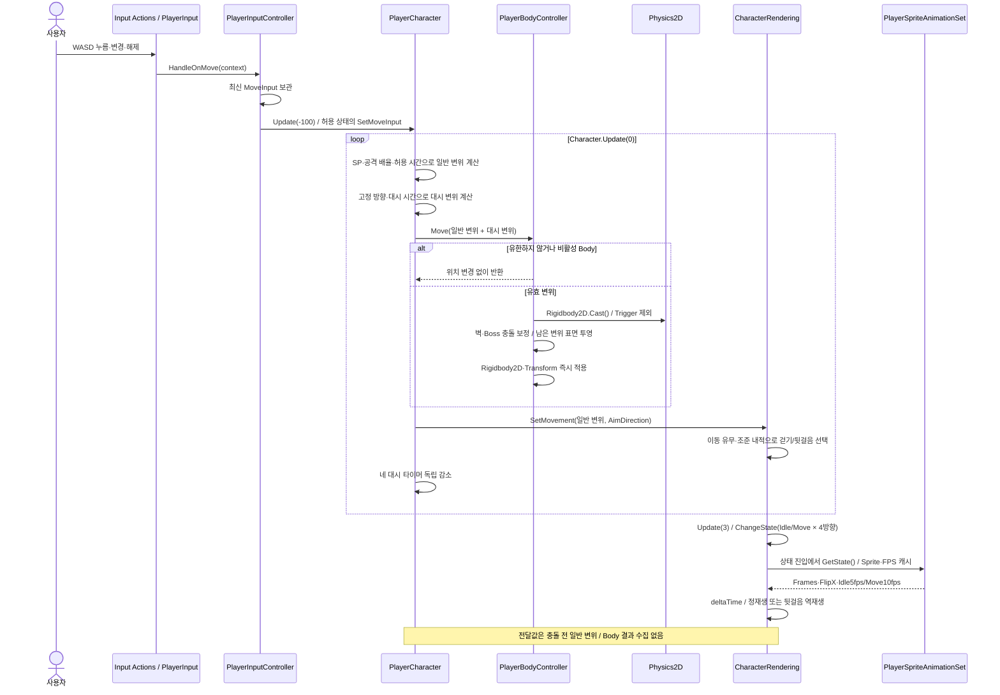

**② 마우스 이동 → 몸체·무기 방향과 뒷걸음 표현**

Look 콜백의 화면 좌표를 Input.Update가 캐시한 카메라로 투영해 Character에 전달한다. Character.Update(0)는 마지막 유효 조준으로 몸체·무기를 갱신하고 일반 이동 변위와 조준을 Rendering.SetMovement에 직접 전달한다. Rendering은 Body 이동 결과를 조회하지 않고 두 벡터의 내적으로 뒷걸음을 판단한다. Update(3)는 Idle5fps·Move10fps를 유지하며 속도 비율을 따로 보관하지 않는다. 대시·생명주기는 기존 전용 상태를 유지한다.

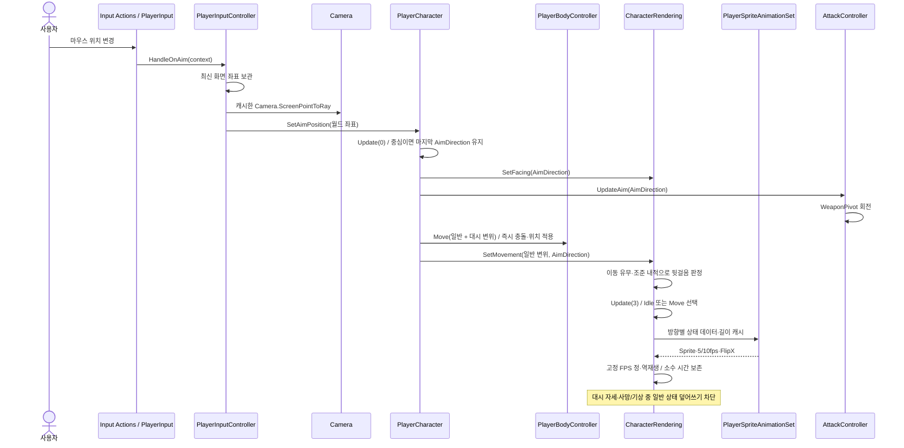

**③ 씬 서비스 준비·입력 차단 → 멈춤과 재개·Title 정리**

외부 입력은 슬롯 선택, 차단을 요청하는 외부 코드, Title 복귀임. 초기 활성 씬 서비스는 Awake·Start에서 준비하고 Stage가 한 프레임을 넘긴 뒤 Map을 먼저 생성·등록·검증함. 그다음 Player 복제의 Spawner.Awake가 Current 수치와 체크포인트 위치를 자동 적용하고 Bind가 대상을 연결함. 입력 차단·해제는 기존 계약을 유지하며 Stop은 Body의 마지막 결과·관성만 정리한다. Character는 이동 불가/리셋에서 Rendering에 이동0을 전달한다. 실제 사망·컷씬 콘텐츠는 후속 Case임.

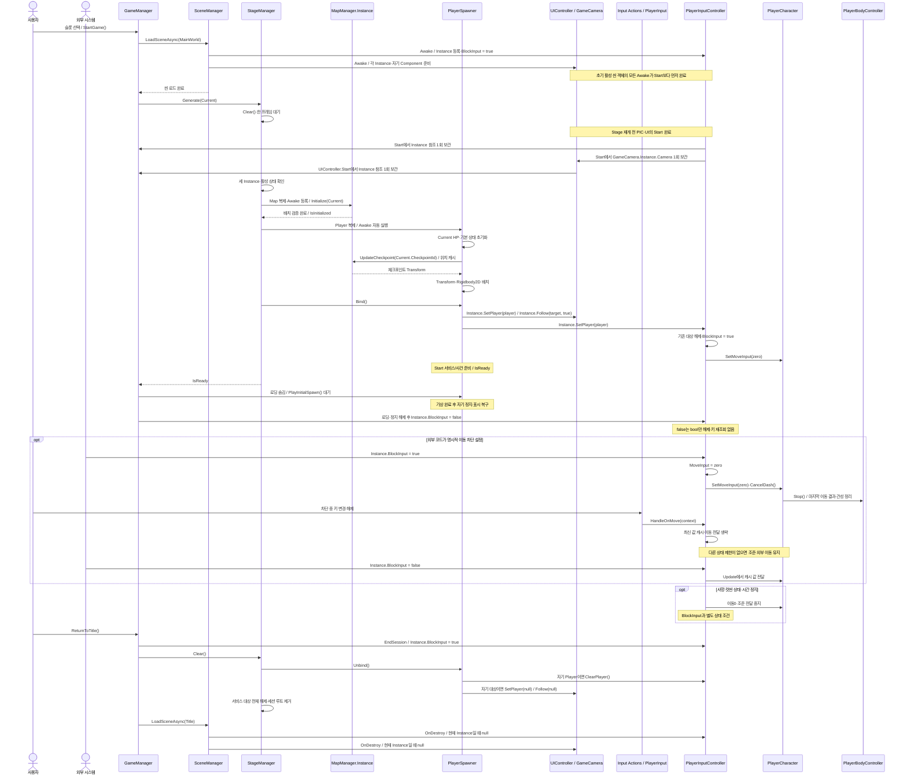

**④ 외부 코드의 Player 재연결·중복 서비스 생성 → 현재 연결 보호**

외부 입력은 준비된 Map 안에서 Player 프리팹 복제·Bind, 기존 Player의 playerSpawn() 재배치 호출, 또는 중복 서비스 생성임. 복제 즉시 Awake가 최초 초기화를 수행하고 재배치는 저장 CheckpointId로 위치를 다시 조회함. 이전 Player 제거는 새 연결을 해제하지 않으며 중복 서비스 제거도 기존 Instance를 지우지 않음. 실제 사망·부활 콘텐츠와 체크포인트 상호작용 때 로컬 값을 갱신하는 최적화는 후속 Case임.

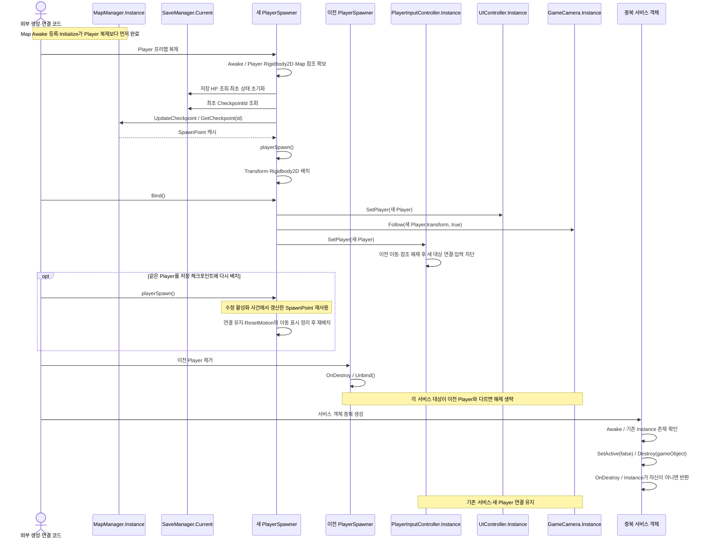

### 2.1.2 F-P02 대시 구현·확인과 Sequence Diagram

**현재 범위**: Space 입력의 일회 요청, 이동 의도 우선·정지 중 커서 방향 대시, Character.Update(0)의 변위 계산→Body.Move 즉시 충돌/적용→일반 변위 전달→Rendering.Update(3), 독립 이동·Dodge·입력차단·쿨타임을 연결한다. 원문 N2의 대시 차단 종료 뒤 기존 WASD 홀드 반영을 유지하며 외부 BlockInput과 대시 자체 입력차단을 구분한다. 당시29묶음은 IsDodge 상태 조회까지의 검사였고, 이후 F-P03에서 공통 ApplyDamage·Hitbox의 실제 Dodge 거부를 연결·검사했다(2.1.3). F-P08의 피격 연출·보호 전체 완료와 구분한다.

| 기능 ID | 사양 상태 | 코드·입력 연결 | 구현·검사 상태 | 남은 아트 / 후속 경계 |
| --- | --- | --- | --- | --- |
| F-P02 | 방향·벽/Boss 충돌·자원 없음·독립 타이머는 Q9~11 및 이번 사용자 요청 확정 | PlayerInputController.HandleOnDash → PlayerCharacter.ApplyDash/Update → Body.Move, Input Actions Dash 버튼·Space와 독립 PlayerInput 프리팹 UnityEvents | 이전 대시 구현은28묶음 통과(2026-11-15 16:17:06 KST). 이전 Character.Update·Body.FixedUpdate 분리의29묶음 통과(2026-11-15 17:27:03 KST). 현재 Body.Move 즉시 적용·Rendering.Update(3) 변경은 같은 Unity 격리본19묶음 성공 | 대시 전용 Sprite 자세·잔상 간격/투명도·FX와 음향; Hitbox 피해 판정 F-P08·공격 실행 F-P03·사망/체크포인트 콘텐츠 F-P09/10은 별도 |

**이전 대시 구현 확인(2026-11-15 16:17:06 KST)**: 당시 기존23묶음에 F-P02의5묶음을 추가해 총28묶음이 통과했다. 이동/정지/0방향 대체·대각 방향과 거리, Space 홀드의1회 입력·W 홀드 복원, 고속 벽/Boss 충돌·Trigger 통과, 독립 타이머·시간 정지/재개, 상태별 취소·재배치 초기화를 실제 Play Mode에서 확인했다. 당시 격리 저장 폴더는 `project/Temp/StartupFlowChecks/c904bd553d25429db60b39a2019f309d`, 실제 로그는 `C:/Users/park2/AppData/Local/Unity/Editor/Editor.log`이다. 이번 Update/Body 책임 변경의 결과와 구분한다. 실제 Hitbox 피해 판정·최종 대시 Sprite/잔상·사용자 저장 폴더 쓰기·OS 종료·제출 빌드는 확인 범위에 포함하지 않는다.

**검사 준비 수정**: 첫 실행은11묶음 뒤 정지 대시 검사가 실패했다. 검사에서 Rigidbody2D.position만 바꿔 Transform 기준 커서 좌표와 배치 위치가 어긋난 것이 원인이었다. 검사 준비6곳의 Transform·Rigidbody2D 위치와 Physics2D.SyncTransforms를 맞춘 뒤 런타임 코드를 추가 변경하지 않고 전체28묶음을 재실행해 통과했다. 실패한 첫 실행을 대시 런타임 오류나 통과 근거로 기록하지 않는다.


- **이번 Update/Body 책임 변경 확인(2026-11-15 17:27:03 KST)**: Character로 대시 설정·방향·네 타이머와 Update의 모든 이동 계산을 옮기고 Body의 Character/Rendering 역참조·대시/바라보기 API를 제거했다. 원본 Unity6000.3.21f1 프로젝트의 런타임·Editor 컴파일 종료 코드0·어셈블리 재로드와29묶음 Play Mode 성공·오류 빈값을 확인했다. 기존28묶음 재통과에 fixedDeltaTime 0.01/0.05의 Update 대시 거리 보존 검사를 추가했고, Body 합산 검사는 NaN·Infinity·float 최대값의 비정상/오버플로 요청 거부를 포함한다. 결과는 `project/Logs/StartupFlowChecks-result.json`, 격리 저장 폴더는 `project/Temp/StartupFlowChecks/b9a5e6e2b226447ba4f989128e993b01`이며 종료 후 Title 편집 씬 복원 로그를 확인했다. 임시 headless 복제본의 중단한 실행은 이 결과의 근거가 아니다. Notion Class3개·시퀀스7개·현재 결과 저장은 경고 없이 성공했으며 실제 Hitbox 피해·최종 아트·제출 빌드·성능 수치 측정은 별도 미확인 범위다.

**임시 튜닝값**: Character에 `DashSpeed=14`, `DashDuration=0.18초`, `DodgeDuration=0.16초`, `InputBlockDuration=0.24초`, `DashCooldown=0.65초`를 둔다. 값은 조작 검증을 위한 기본값이며 사용자 수치 확정이나 원작 프리팹 수치와 동일하다는 의미가 아니다. 장애물이 없으면 이동 거리는 속도×시간인2.52월드 단위이고 마지막 물리 프레임은 남은 시간만 반영해 길이를 초과하지 않는다. 이동 종료 뒤에도 독립 입력 차단이 남을 수 있으며, 보호·입력·쿨타임은 서로의 종료에 맞춰 강제로0이 되지 않는다.

**입력·상태 계약**: Input Action의 performed만 일회 요청으로 보관하고 같은 Update에서 최신 Move/Look을 반영한 뒤 ApplyDash를 호출한다. 쿨타임이나 상태 때문에 거부된 요청을 재실행하지 않으며 Space 홀드로 반복 발동하지 않는다. 대시 방향은 시작 때 고정하고 진행 중 Move/Aim 변경으로 꺾지 않는다. 이동/입력차단 중 일반 변위를 추가하지 않으며 차단 중 바뀐/계속 눌린 Move 값은 캐시에 남아 종료 뒤 일반 이동으로 반영된다. 당시 IsAttacking은 시작 거부용 최소 상태였으며 이후 F-P03에서 실제 AttackController의 상태 조회로 연결했다(2.1.3).

**취소·초기화·시간**: 외부 차단·사망·컷씬은 CancelDash로 이동·Dodge·입력 잠금을 취소하고 쿨타임은 유지한다. Body.Stop은 마지막 이동 결과·관성을 초기화하며 이동 큐는 없다. 일반 입력0은 대시를 취소하지 않는다. pause는 상태를 보존하고 Character는 일반 이동 표시0을 전달한다. ResetMotion·Character 비활성화·비활성 Body 확인은 이동 표시도 초기화한다. 재개 뒤 남은 상태와 현재 입력으로 계산한다.

**세피리아 근거·채택/생략**:

| 읽은 실제 파일·메서드 | 확인한 구조 | 우리 적용·차이 |
| --- | --- | --- |
| [PlayerInputController.cs](<reference/sephiria/code/ingame code/Assembly-CSharp/PlayerInputController.cs>) `HandleOnDash`351~382 | UI·화면·Block 검사 후 avatar.Dash(aimedPosition) 호출 | 입력 계층의 전달 허용 판단을 유지하고 Space performed를 캐시, 최신 이동/커서가 반영된 Update에서 호출 |
| [UnitAvatar.cs](<reference/sephiria/code/ingame code/Assembly-CSharp/UnitAvatar.cs>) `Dash`3233·Update1177~1183 | CanMove/CanDash 검사, 대시 변위로 일반 변위 교체 후 Rigidbody.RequestMove | Character.Update(0)가 시작 허용·방향·변위·타이머를 관리하고 Body.Move가 같은 호출에서 유효성·충돌·위치를 적용하며 Rendering.Update(3)는 일반 변위·조준만 받음 |
| [CharacterDash_FastMove.cs](<reference/sephiria/code/ingame code/Assembly-CSharp/CharacterDash_FastMove.cs>) `OnDashBegin`36·`DashMoveUpdate`13 | 이동 입력이 있으면 Input.normalized, 없으면 aim-position; 시작 방향 고정·진행 시간·변위 계산 | 방향 선택·진행 시간 분리만 채택. 원작의 감속87·초기속도20·0.33초를 그대로 복제하지 않고 거리 예측이 쉬운 속도×시간 튜닝 사용 |
| [CharacterDash.cs](<reference/sephiria/code/ingame code/Assembly-CSharp/CharacterDash.cs>) `StartDash`93·Update66·StopDash147·ServerCallDashAction175 | 시작 가능 검사, 이동 종료와 별도 Dodge 타이머, 충전 횟수/회복·구덩이 무시·서버 사건 | 독립 타이머·상태 정리 채택. 쿨타임만 제한하고 자원/충전·RPC·스탯 DB·구덩이 충돌 무시·장비별 모듈 생략 |

원작의 대시 이동은 Update에서 처리하며 입력 전체를 dashNoInputTime으로 잠그는 동일 구현은 위 모듈에서 확인하지 못했다. 우리 독립 입력차단과 홀드 복원은 확정 사양 N2·Q9를 따른다. 원작 무기가 StopDash(true)로 공격 전환하는 경로도 우리 Q10의 공격 중 대시 차단 규칙으로 치환한다. 추출 소스 관찰과 원작 실행/프리팹 수치 확인을 구분한다.

**Notion 기록**: 2.1 Player 표 아래 기존 F-P01 토글 다음의 독립 `F-P02 SequenceDiagram` 토글과4개 Case를 유지한다. 이번 Character.Update·타이머 소유권과 Body 물리 적용 책임을 Class P03·P09·U01 및 F-P01①②③·F-P02①~④에 반영하고29묶음 결과와 함께 연결 도구로 저장해 경고 없이 성공했다. F-S01 사용자 Case를 포함한 기존 기록은 보존했다. 미리보기 설정·화면 확인·이를 위한 UI 조작은 작업 체크에서 제외한다.

**① Space 입력 → 이동 중/정지 중 방향 확정과 시작 허용**

외부 입력은 이동·커서 변경과 Space 누름이다. 콜백은 일회 요청을 보관하고 Input.Update가 최신 Move/Look 전달 뒤 Character.ApplyDash를 호출한다. Character가 행동 허용·중복·입력 잠금·쿨타임과 설정을 확인하고 방향·네 시간을 보관한다. Body는 이 시작 판단에 참여하지 않는다.

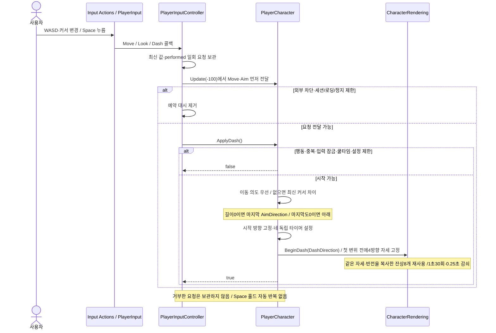

**② Character.Update → 대시 변위 계산·즉시 충돌 적용**

Character.Update(0)가 렌더 프레임의 일반/대시 변위를 계산해 Body.Move에 합산 전달한다. 대시·입력 잠금 종료 경계의 허용 시간 분리는 유지한다. Body는 요청 큐나 별도 갱신 없이 같은 호출에서 충돌·위치를 적용한다. Character는 일반 변위만 Rendering에 전달하며 대시 방향의 고정 자세·잔상은 Rendering.Update(3)의 별도 상태로 진행한다.

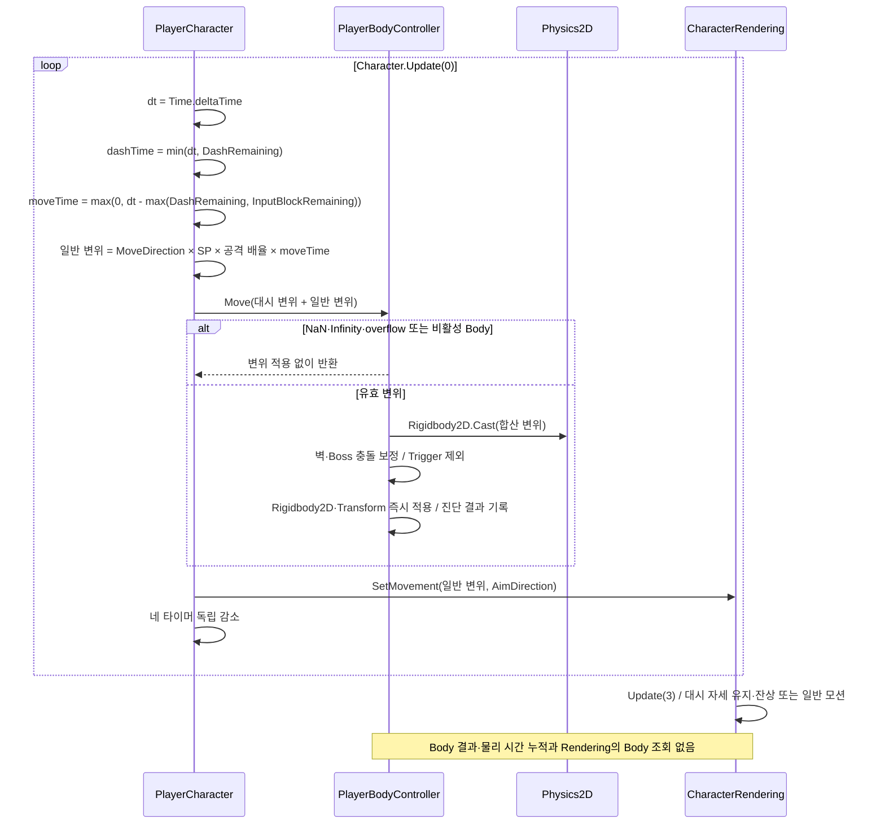

**③ 키 유지·해제와 시간 경과 → 독립 타이머·일반 이동 복원·재사용**

대시 중 WASD는 최신 의도로 유지·변경·0 해제된다. Character.Update는 남은 대시/입력 잠금 구간을 먼저 반영해 변위를 즉시 적용하고 타이머를 감소시킨다. 키 해제는 진행 중 대시를 취소하지 않으며 일반 변위만0으로 만든다. 대시 종료 후 Rendering.Update(3)는 현재 일반 이동 상태로 복귀한다. 실제 Hitbox의 Dodge 판정은 F-P08을 따른다.

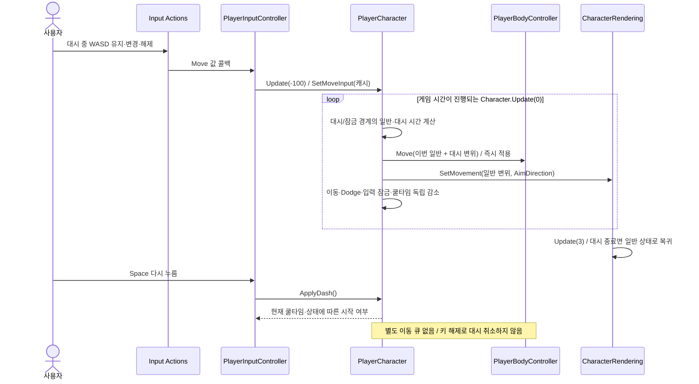

**④ 외부 차단·사망·컷씬·시간 정지·재배치 → 취소와 리셋**

외부 차단·입력/Character 비활성화·사망·컷씬은 Character.CancelDash가 이동·보호·입력 잠금을 취소하고 Body.Stop이 마지막 결과·관성을 정리한다. 이동 큐는 없으며 이동 불가·ResetMotion·Character 비활성화에서 Rendering의 이동 표시도0으로 정리한다. 시간 정지는 남은 상태를 보존하며 재배치는 Character.ResetMotion으로 쿨타임까지 리셋한다. Body 비활성화는 마지막 결과·관성만 정리하고 Character의 다음 Update가 행동·이동 표시를 리셋한다.

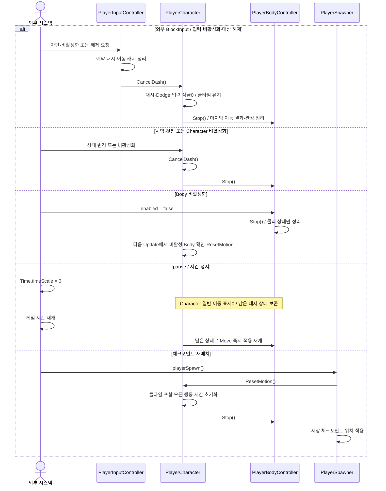

### 2.1.3 F-P03 일반 공격 구현·확인과 Sequence Diagram

**3타 연출 후속 확정(2026-11-16):** 칼을 두 번 빠르게 휘둘러 탑다운 호형 검기 두 개가 X 느낌으로 교차하게 하되, 피해는 큰 피해1회로 적용한다. 후속 스케치에 따라 서로 다른 연한 색의 호를 겹치고 교차부 앞뒤를 바꾼다. 두 번의 시각 휘두르기를 별도 피해2회로 나누지 않는다. 기존 수신자당 한 공격1회 처리와 일치하며 정확한 피해 배수는 새로 확정하지 않았다. 현재 제작된 검기와 실제 무기 모션/노출 프레임 연결의 구분은3.3.8을 따른다.

**표현 이관(2026-11-16, 아트16묶음 확인):** AttackController의 공격·판정 시간과 콤보 책임을 보존하고 WeaponPivot 아래 WeaponMotion의 위치·회전을 Unity Animator Idle·Attack1~3으로 옮겼다. 상태 선택·속도·중단 복구는 AttackController가 요청하며 Animation Event가 피해를 중복 발생시키지 않는다. 실제1·2·3타 재생·취소 Idle 복귀와 전체 검사가 공격 구간에 도달하지 못한 한계는3.3.11을 따른다. 아래35묶음 성공은 이관 전 기준선이고 기존5Case 번호는 유지한다.

**현재 범위**: 좌클릭 홀드 사실은 입력 계층, 공격 허용·시작 커서 좌표 확보는 PlayerCharacter, 한 무기의 콤보·애니메이션 진행·판정·피해 생성은 AttackController로 구분한다. Character.Update(0)가 공격 중 느린 이동을 계산하고 Body.Move로 같은 호출에서 충돌·위치를 적용하며 Rendering.Update(3)에 일반 변위를 전달한다. 이번 이동 변경의 아트 흐름19묶음은 격리본에서 성공했다. 초기 구현의17:47:36 KST 결과를 기준선으로 두고 공통 검사 제거·사망/컷씬 진입 중단과 질의 도중 취소를 반영한 **당시 원본 Unity 컴파일·35묶음 Play Mode 검사를 통과**했다(2026-11-15 18:30:34 KST).

| 기능 ID | 사양 상태 | 코드·입력 연결 | 구현·검사 상태 | 남은 아트 / 후속 경계 |
| --- | --- | --- | --- | --- |
| F-P03 | 홀드 반복·3콤보·AS·공격 중 느린 이동·대시 전환 금지는 Q10·Q11 및 이번 사용자 요청 확정 | PlayerInputController.HandleOnAttack/SetAttackInput → PlayerCharacter.ApplyAttack → AttackController → CollisionBox → Hitbox → Character.ApplyDamage. PlayerInput.prefab의 Attack UnityEvent·좌클릭과 Player/Boss의 실제 피격 Collider 연결 | 공통 검사 제거·진입 이벤트 중단 후 원본 Unity6000.3.21f1 런타임/Editor 컴파일·어셈블리 재로드, 기존29+공격6 총35묶음 Play Mode 통과·오류 빈값(2026-11-15 18:30:34 KST). Title 편집 씬 복원은 Editor.log의 로드 완료로 확인 | 최종 검집 무기 Sprite·1/2타 반전 검기·3타 X형 FX·음향과 판정 프레임/크기 조정. Draw/Slash·피격 깜빡임/보호·Boss 전투/처치/부활 흐름 전체는 별도 |

**책임·시간 계약**: Input의 Start에서 확보한 Camera·GameManager 참조를 재사용한다. Input.Update(-100)는 현재 Move/Look을 전달하고 Space 일회 요청을 먼저 판단한 다음 공격 홀드 사실만 전달한다. 공통 시작 상태인 대시·입력 잠금·사망·컷씬·준비·컴포넌트 활성·게임 시간 허용은 PlayerCharacter.ApplyAttack에서 한 번 검사하고 자신의 AimWorldPosition을 넘긴다. Attack의 internal ApplyAttack은 진행 중/쿨타임·계산 수치만 검사하며 Update(10)는 생존·컷씬·준비 상태를 재검사하지 않고 공격·콤보·쿨타임·회전·판정만 진행한다. deltaTime0 반환은 시작 허용 검사가 아니라 진행 시간과 현재 상태의 보존이다. 수동 Body.Move는 공격 시간이나 피해를 계산하지 않는다. 같은 프레임의 대시 시작이 성공하면 공격은 거부되며 진행 중 대시를 공격으로 취소하거나 공격을 대시로 취소하지 않는다.

**임시 튜닝값과 사양 구분**: 원문의 기본 공격력10을 AD 기본값으로 사용하고 AS 기본 배율은1이다. 공격 지속0.36초, 판정 시작0.09초·종료0.21초, 종료 후 대기0.08초, 콤보 유지0.8초, 공격 중 이동 배율0.35,3타 피해 배수1.5, 사각 크기(1.5,1)·로컬 오프셋(0.85,0)·무기 회전 범위110도는 동작 확인용 값이다. 원작 프리팹 값이나 사용자 확정 밸런스 수치로 기록하지 않는다. 공격 시작 시 방향·AD를 고정하고 Attack.Update가 현재 AS로 애니메이션·판정 구간·다음 공격 제한의 진행 속도를 계산한다. 콤보 유지시간은 AS와 별개인 게임 시간이다. 최종 자산 연결 뒤 조작감·표시와 함께 조정한다.

**판정·피해 계약**: 공격 방향은 시작 순간의 커서 좌표 차이로 고정하고 중심과 같으면 마지막 조준 방향을 사용한다. 진행 중 커서를 움직여도 같은 타의 방향은 바뀌지 않는다. 실제 Collider를 zero-distance 사각 Cast로 조회하며 위치·크기·회전은 Editor Gizmo와 같다. 한 타에서 피해가 적용된 Character를 기록하므로 여러 Collider·반복 조회에도 피해는1회이며, 거부된 수신자는 같은 타의 다음 조회에서 다시 허용 여부를 판단할 수 있다. 다음 타는 새 AttackId·적중 기록을 사용한다. 결과 배열 포화 시 확장 후 재질의한다. 자기 공격·닫힌/비활성 Hitbox·유효하지 않은 피해는 제외하고 최종 피해 허용은 수신자가 판단한다. B06의 특수 구조물은 Normal 피해를 거부한다. Dodge는 IsHitboxDamage, Invulnerable은 모든 피해를 막고 비전투 상태는 피해 면제 조건이 아니다. 현재 실제 수신자는 Player·기존 Boss이며 구조물·투사체 콘텐츠는 후속이다. 이동/대시의 벽 충돌과 공격 공간 질의는 별개이며, 이 구현이 공격의 벽 LOS 차폐 규칙을 사용자 확정한 뜻은 아니다.

**중단·보존 계약**: 좌클릭 해제는 다음 공격 의도만 해제하며 이미 시작한 한 타를 취소하지 않는다. 느린 이동은 콤보를 끊지 않으며, 콤보 유지시간 만료·강제 중단은 초기화한다. PlayerCharacter.Awake가 자신의 OnDie·OnCutScene에 CancelAttack을 연결하므로 실제 치명 피해·IsCutScene의 false→true 진입은 다음 Update를 기다리지 않고 Character 내부 attackHeld·무기·판정을 함께 정리한다. 같은 true 재대입·false 복귀는 진입 사건을 발행하지 않으며 저장 HP 복원·IsDead 직접 대입도 사망 사건이 아니다. 입력 서비스의 AttackHeld 캐시는 별도이므로 입력 허용 뒤 true가 다시 전달되면 새 공격을 요청할 수 있다. Update에서 사망/컷씬을 매번 공격 취소하는 중복 경로는 제거하고 초기화 해제·외부 BlockInput·대상 해제/비활성화·재배치 경계는 유지한다. 질의 중 피해 콜백이 컷씬을 시작하면 CollisionBox가 후속 대상 피해와 기록 재추가를 멈추고 Attack.Update는 복귀 직후 취소 상태를 확인해 회전/완료 처리를 생략한다. 시간 정지는 deltaTime0에서 남은 상태를 보존한다. OnDestroy는 자기 사건 구독을 해제하며 AttackController는 OnDie에 별도 구독하지 않는다.

**세피리아 근거·채택/생략**:

| 읽은 실제 파일·메서드 | 확인한 구조 | 우리 적용·차이 |
| --- | --- | --- |
| [PlayerInputController.cs](<reference/sephiria/code/ingame code/Assembly-CSharp/PlayerInputController.cs>) HandleOnFire387~448, [PlayerAvatar.cs](<reference/sephiria/code/ingame code/Assembly-CSharp/PlayerAvatar.cs>) StartAttackClientside835·StopAttack846 | 눌림/해제·UI/hover·화면/외부 차단 검사 후 Avatar 요청, Avatar가 CanMove 확인 후 무기로 전달 | 입력은 버튼 사실만 전달하고 Character가 공통 허용 상태·최신 좌표 확보. UI대화 넘김·시전 맵·네트워크 제외 |
| [WeaponControllerSimple.cs](<reference/sephiria/code/ingame code/Assembly-CSharp/WeaponControllerSimple.cs>) AttackButtonDown337·BeginAttackAnimation479·UpdateAnimatorAttackSpeed1020 | 방향 보관→현재 무기로 전달, 공격 애니메이션 시작/이동 차단·AS 배율 연결 | 한 무기의 AttackController가 방향·진행·콤보·피해 생성 소유. 일반 이동을 전부 막는 대신 Character에서 느린 이동 계산. 대시 공격의 StopDash(true) 경로는 채택하지 않음 |
| [WeaponSimple.cs](<reference/sephiria/code/ingame code/Assembly-CSharp/WeaponSimple.cs>) StartBasicAttackAnimation285·CreateBasicAttackSwingFx315·CreateBasicAttackProjectile449, [WeaponSimple_SwordAndShield.cs](<reference/sephiria/code/ingame code/Assembly-CSharp/WeaponSimple_SwordAndShield.cs>) LateUpdate114·AttackButtonDown191·AttackButtonUp355 | 기본 클래스의 입력 가상 함수는 비어 있고 파생 무기가 홀드 플래그·대기 상태에서 반복 시작. 콤보 데이터·수신자 스탯으로 타격/FX 생성 | 고정 무기1개라 추가 Weapon 클래스·무기 선택/DB·방패·RPC를 만들지 않고 같은 책임을 AttackController에 통합.3타 강한 공격은 원문 유지 |
| [MeleeCollision_Rectangle.cs](<reference/sephiria/code/ingame code/Assembly-CSharp/MeleeCollision_Rectangle.cs>) CheckCollision33, [MeleeCollision.cs](<reference/sephiria/code/ingame code/Assembly-CSharp/MeleeCollision.cs>) Attack168·ClearAttackedInSwing28, [Hitbox.cs](<reference/sephiria/code/ingame code/Assembly-CSharp/Hitbox.cs>) GetCombatBehaviour8 | 회전 오프셋의 사각 NonAlloc Cast→Collider의 Hitbox→같은 수신자 중복 기록→ApplyDamage | CollisionBox·Hitbox·DamageInstance struct로 분리. 고정10개 배열 포화·Gizmo 회전 불일치를 복사하지 않고 배열 확장/재질의·동일 회전 표시. 공간해시·높이·세력·다단히트·피해 class풀 제외 |
| [UnitAvatar.cs](<reference/sephiria/code/ingame code/Assembly-CSharp/UnitAvatar.cs>) Awake812·ForceDie2053·CancelCurrentAction2799, [WeaponControllerSimple.cs](<reference/sephiria/code/ingame code/Assembly-CSharp/WeaponControllerSimple.cs>) CancelAction137, [CutScenePlayer.cs](<reference/sephiria/code/ingame code/Assembly-CSharp/CutScenePlayer.cs>) CutSceneCoroutine48~61 | UnitAvatar가 자기 IAvatarStuckModule을 확보하고 사망 전 CancelCurrentAction으로 각 모듈의 CancelAction을 호출. WeaponControllerSimple은 진행 중 무기/애니메이션을 정리. 원작 컷씬은 Player 정지와 BlockAvatarInput을 사용 | 행동 소유자가 중단을 전달하는 책임만 채택. 우리 Player는 OnDie·컷씬 진입 사건에서 의도와 무기를 함께 취소하며 무기는 공통 상태를 반복 검사하지 않음. IsCutScene 프로퍼티의 진입 이벤트는 우리 규모에 맞춘 변형이며 원작과 동일 구현이라고 설명하지 않음 |

**검증 상태(2026-11-15 18:30:34 KST)**: 초기 구현의17:47:36 KST35묶음을 기준선으로 두고 후속 책임 정리 뒤 원본 Unity6000.3.21f1 런타임/Editor 컴파일 종료 코드0·Tundra 빌드·어셈블리 재로드와35묶음 Play Mode 성공·오류 빈값을 다시 확인했다. 기존29묶음과 좌클릭·콤보·AD/AS·느린 이동·방향/판정·중복/배열 포화·피해 허용의 공격6묶음을 유지하고 마지막 수명 검사에 실제 치명 피해의 OnDie1회·컷씬 false→true1회·다음 Update 전 취소를 포함했다. 실제 피해 콜백에서 컷씬을 시작한2대상 중1명만 피해를 받고 적중 기록0·쿨타임0·대기 무기 자세가 보존되는지 확인했다. 이때 Character 내부 홀드 의도 정리와 입력 서비스의 홀드 캐시 보존을 구분한다. 실제 결과는 `project/Logs/StartupFlowChecks-result.json`, 검사 코드는 `project/Assets/Editor/PlayerAttackChecks.cs`, 격리 저장 폴더는 `project/Temp/StartupFlowChecks/f64016af49414481848486350804150b`다. 종료 후 Title 편집 씬 복원은 Editor.log의 Assets/Scenes/Title.unity 로드 완료로 확인했으며 직접 화면 확인은 CUA 중지로 미실행이다. 최종 검기 FX/무기 Sprite·음향·실제 아트와의 판정 프레임·제출 빌드·성능 측정은 별도 미확인 범위다.

**Notion 기록**: 정리 페이지2.1 Player 표 아래 독립 `F-P03 SequenceDiagram`의 기존5개 Case와 초기 Class7개 기록을 보존하고, 이번 시작 허용·진입 사건 중단에 맞춰 Class P01·P03·P05·S09와 Case③⑤·18:30:34의35묶음 결과를 갱신했다. 연결 도구가 경고 없이 저장 성공을 반환했고 현재 로컬 Mermaid19개는 기존 설치된 Mermaid11 파서로 구문 검사를 통과했다. 미리보기 모드·화면 확인·UI 조작은 체크에서 제외하고 기존 F-S01 사용자①과 다른 기능의 Case 번호를 보존했다.

**Mermaid 구문 복구(2026-11-15)**: ③~⑤의 참여자 식별자 `Box`가 Mermaid 예약어 `box`로 해석되어 `Expecting '+', '-', 'ACTOR', got 'box'` 파싱 오류를 일으켰다. 표시명 CollisionBox는 유지하고 내부 식별자·참조만 `HitQuery`로 바꿨다. 원문은①② 통과·③~⑤ 실패, 수정본은 Mermaid11.12.0 실제 파서에서5개 모두 통과했다. Case 번호·설명·분기·호출·주석은 보존했고 동일 변경의 Notion 저장이 경고 없이 성공했다. 검사 원문·스크립트·결과는 `project/Temp/MermaidRepair`에 격리했으며 게임 코드·패키지는 변경하지 않았다. Notion 화면 표시 검사는 수행하지 않았다.

**① 좌클릭 누름·해제 → 버튼 사실 전달과 공격 허용·방향 확정**

시작 입력은 좌클릭과 커서 변경이다. Input은 홀드 사실을 전달하고 Character가 공통 행동 상태를 확인한 뒤 현재 커서 좌표를 고정 무기에 넘긴다. 공격 방향·콤보·시간은 AttackController가 확정하며 거부된 일회 클릭을 나중에 예약 실행하지 않는다.

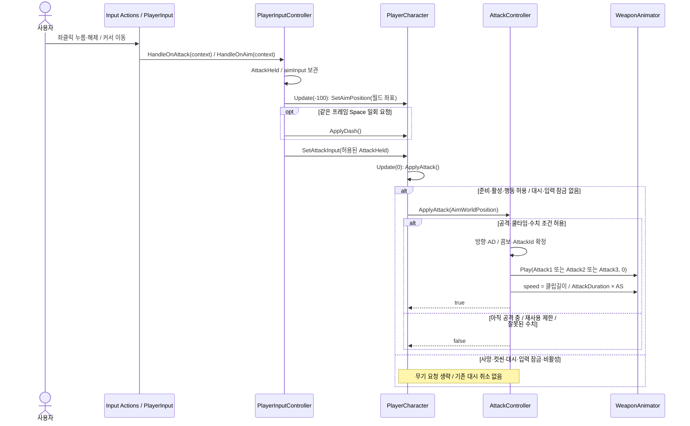

**② 공격 중 이동·조준 변경 → 느린 이동과 시작 방향 유지**

공격 중 WASD·커서를 바꾸면 Character.Update(0)가 일반 변위에 공격 이동 배율을 적용한다. Body.Move는 같은 호출에서 충돌·위치를 반영하고 Rendering은 전달받은 일반 변위로 Update(3)의 걷기/뒷걸음을 표시한다. Attack은 시작 방향을 유지하고 Update(10)에서 공격·판정과 무기 Animator 속도를 진행한다.

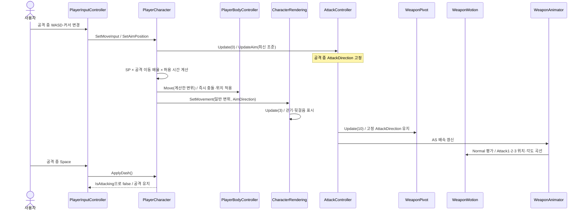

**③ 판정 구간 도달 → 실제 Collider 조회·중복 방지·피해 적용**

공격의 게임 시간이 판정 구간에 도달하면 고정 방향의 실제 박스를 조회한다. 결과 배열이 가득 차면 확장해 다시 질의하고 같은 수신자의 여러 Collider·후속 프레임은 한 타당 피해1회로 묶는다. Hitbox는 대상 연결, 수신 Character는 최종 피해 허용을 담당한다. 피해 콜백이 공격자를 컷씬으로 전환하면 같은 질의의 나머지 대상 피해와 취소 후 적중 기록 재추가를 멈추고 Attack.Update도 취소된 무기 자세를 보존한다.

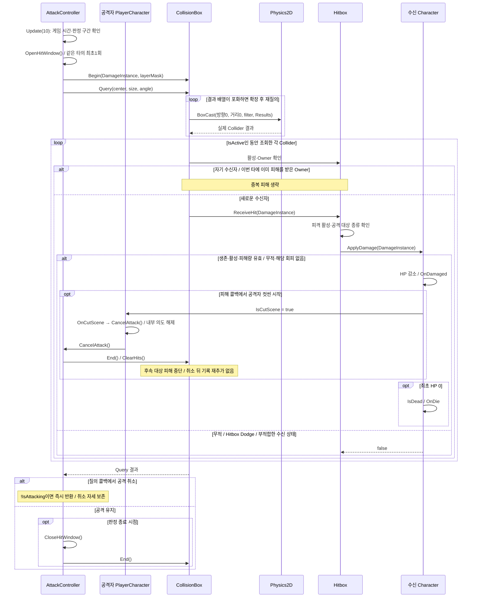

**④ 홀드 반복·해제·시간 만료 →3콤보와 다음 공격**

좌클릭을 유지하면 허용 시점에 다음 타를 시작하고3타 뒤1타로 순환한다. 해제는 진행 중 한 타를 마치게 하며 느린 이동은 유지시간을 끊지 않는다. 공격 진행·제한은 AS 배율을 사용하고 콤보 유지시간이 끝나면 다음 입력을1타로 처리한다.

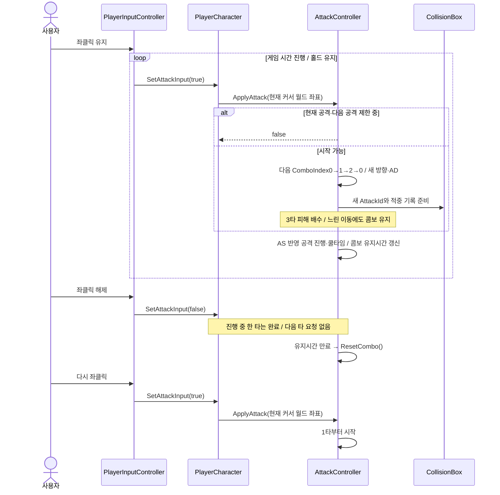

**⑤ 차단·사망·비활성화·시간 정지·재배치 → 중단 또는 상태 보존**

외부 차단·대상 해제와 실제 사망/컷씬 진입은 PlayerCharacter의 공격 의도·무기·판정을 정리한다. 사망은 ApplyDamage의 OnDie, 컷씬은 false→true의 OnCutScene을 한 번 받아 즉시 처리하며 저장 복원·IsDead 직접 대입과 구분한다. Character 비활성화는 내부 의도와 무기를, Attack 비활성화는 무기의 진행·판정을 정리한다. 시간 정지는 취소 없이 남은 게임 시간을 보존하고 재배치는 ResetMotion으로 이전 공격까지 정리한다. 입력 서비스의 홀드 캐시는 별도이므로 입력이 다시 허용되면 새 공격 요청은 가능하다. 비치명 피격 자체는 행동 경직이나 공격 중단을 만들지 않는다.

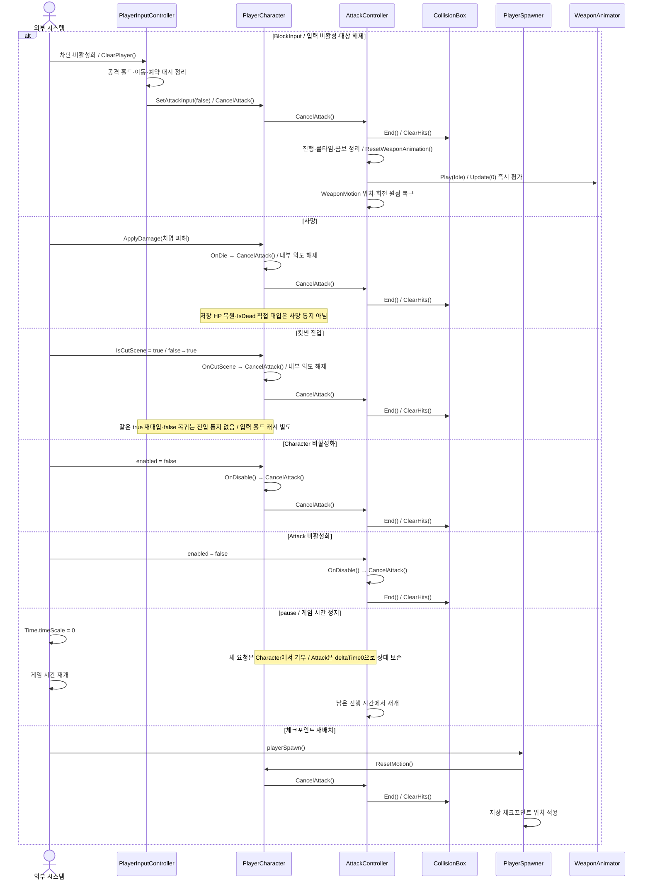

### 2.1.4 F-P04 Draw 진입·종료·입력 전환과 임시 점/Line 표현

**현재 범위·상태**: 일반 Player 입력을 Draw 전용 액션 맵으로 실제 전환하고 시간·HUD·암전·카메라·Player 강조를 진입/종료에 맞춰 연결했다. Draw 확인에 필요한 점 선택·고정 길이 미리보기·확정과 교체 가능한 임시 점/선 VFX도 연결했다. **원본 Unity6000.3.21f1 런타임/Editor 컴파일·41묶음 Play Mode 성공과 임시 Draw 화면을 확인**했다(2026-11-15 19:45:51 KST). 이41묶음은 F-P04 당시 검증 기준선이다. 이후 F-P05 전체 점 편집 확인은2.1.5, Player 원본·Skill 수명/만료·소비 경계는2.1.6을 따른다. F-P07 Slash 완료로 확대하지 않는다.

| 기능 ID | 사양·이번 연결 | 담당·호출 | 확인 상태 | 남은 아트 / 후속 |
| --- | --- | --- | --- | --- |
| F-P04 | Shift 진입/취소, Draw 전용 M1/R/F·Look, 일반 행동 차단, UI/시간/카메라 복구, 재Draw 취소의 기존 Line 보존 | PIC 입력 맵→Character 공통 시작 허용→Skill 자체 모드/쿨·Player 원본/수명·전환 조정→Drawer 기하·DrawVfx 표시, GameManager 시간·UI/Camera 각자 표시 | 당시41묶음·임시 화면 확인, 최신48묶음 회귀 성공(2026-11-15 20:41:35 KST). F-P05/F-P06 상세는2.1.5·2.1.6 | 최종 점·검기 Line·커서·암전/줌/HUD 모션·음향, SlashF-P07 |

**책임 경계**:

| 담당 | 이번 책임 | 다른 쪽에 맡기는 내용 |
| --- | --- | --- |
| PlayerInputController | Player↔Draw 액션 맵과 현재 모드의 입력 사실·커서 전달, 전환 경계 요청 캐시 정리 | 공통 행동 허용·점 기하·Line 보관·전역 시간 |
| PlayerCharacter | 활성/준비·사망·컷씬·공격·대시/잠금 등 공통 Draw 시작 허용, 자기 사건의 강제 종료 연결 | 스킬 자체 쿨·Draw 진행·편집/표현 |
| SkillController | Draw 모드·스킬 쿨·Player.CurrentLine 저장/수명 관리, 진입/취소/확정·강제 중단의 전환 조정 | 점/선 기하 계산·물리 이동·카메라/UI 내부 표시 |
| LineDrawer / Line | 임시 점0/1/2·고정 길이 방향·미리보기/확정 값 / struct 경로 데이터 | 시간 정지·입력 맵·표현 프리팹·확정 값 보관 |
| DrawVfx / UI_Draw / CharacterRendering | 점/선 프리팹 표시 / 암전·안내 / Player 강조 sorting과 원래 값 복구 | 입력 허용·데이터 확정·쿨타임 |
| GameCamera / GameManager | 커서 가중 중심·Draw 줌/기존 상태 복구 / 일반 pause와 Draw pause의 OR로 최종 게임 시간 적용 | 점 기하·스킬 시작 허용 |

**입력·시간 계약**: Shift는 홀드가 아닌 누름 요청으로 진입/취소한다. Draw에서는 M1이 점, R이 임시 점 전체 초기화, F가 유효한 두 점 확정이며 WASD·대시·일반 공격은 전달하지 않는다. PIC는 Draw 라우팅을 기존 CanMove(Time.timeScale>0) 게이트보다 먼저 선택하므로 게임 시간0에서도 편집 가능하다. 액션 맵 전환 시 예약 입력을 비워 같은 Shift가 즉시 취소로, 점 클릭이 일반 공격으로, F 확정이 다음 일반 행동으로 새지 않게 한다. Q9에 따라 Player·Boss·이동·공격·대시·스킬 쿨타임·Line/Buff 게임 시간은 정지하고 UI·카메라·Draw 입력/임시 표현만 unscaled로 계속한다. GameManager는 일반 IsGameplayPaused와 IsDrawPaused를 구분하며 Draw 종료가 외부 정지를 해제하지 않는다.

**초기화·종료 계약**: PlayerCharacter.Awake(0)는 자기 Skills를 확보하고 SkillController.Awake(20)는 helper를 준비한다. Map과 Player 복제·입력 대상 연결 뒤 Start에서 이미 준비된 GM/PIC/UI/Camera 참조를 한 번 캐시하고 사용한다. 모드가 변할 때만 전환을 요청하며 Update에서 Instance/Find를 다시 찾지 않는다. OnDie→ResetSkills는 확정 Line·임시 점·스킬 상태를 정리하고, OnCutScene→CancelDraw·Input 차단/해제·Player/스킬 비활성화·제거도 Draw가 소유한 전환을 복구한다. 취소·확정·중단이 겹쳐도 다른 정지를 풀거나 이미 끝난 전환을 다시 열지 않아야 한다. 일반 CutsceneController 전체를 새로 만드는 대신 Draw 전용 조정과 기존 사건 연결을 사용한다.

**기하·표현 교체 계약**: Q7의 보존 규칙과 이후 PlayerCharacter 원본·SkillController 수명 관리 요청이 원문 초기 Case3-7·이전 소유 배치를 대체하므로 재Draw 진입/취소는 이전 CurrentLine을 유지하고 새 확정 때만 교체한다. 첫 점은 시작점, 두 번째 점은 방향이며 실제 끝점은 고정 LineLength를 사용한다. 같은 점·유한하지 않은 좌표·두 점 이후 추가 선택은 거부하며 R은 임시 편집만 초기화한다. DrawVfx의 Point/PreviewLine/Line GameObject 프리팹 슬롯을 최신 표현으로 교체할 수 있게 하고 표시 루트의 위치·각도·길이/폭 스케일만 갱신한다. 선 루트는 +X 방향의 단위 길이/폭을 기준으로 하며 Sprite·Particle/VFX 세부는 자식에 둔다. 교체한 자체 애니메이션/Particle도 정지 중 재생하려면 해당 에셋의 unscaled 설정이 필요하며 임시 표현을 최종 아트로 보지 않는다. 이번 기본 LineLength6·LineWidth0.25·짧은 Draw 대기0.35초·확정 뒤 Slash 대기0.15초·DrawAimWeight0.35·DrawZoom6.5와 암전/정렬 값은 구현 확인용 초기 튜닝이다.

**읽은 원작·적용 차이**: Sephiria SkillController.LocalCastStart261·OnBeginCastAnimation379·OnEndCastAnimation457·CancelAction356의 시작 조건과 자기 차단/표현의 대칭 복구, WeaponSkillController.OnWeaponSkillButtonDown218의 준비/쿨 확인을 참고했다. 공통 시작 상태는 우리 Character로 분리하고 슬롯·마나·무기별 스킬·네트워크는 도입하지 않는다. TargetTracker.LateUpdate51·SetTempTarget254/ResetTempTarget274·SetZoom286과 Dungreed PlayerTracker.Awake21/LateUpdate38의 target/offset을 읽어 기존 target/줌 보관·가중 중심·unscaled 전환에 적용한다. 원작의 방 경계·2P·후처리는 제외한다. CutScenePlayer.CutSceneCoroutine48의 입력 차단/복구는 책임 경계만 참고하며 우리 Draw 전용 액션 맵·두 점 고정 길이 편집에 동일한 원작 구현은 없다. 파일 위치는 REFERENCE_CODE_MAP을 따른다.

**임시 자산·연결 위치**: `PlayerDrawSetup`의 Connect Draw Mode는 기존 Player/GameUI/PlayerInput 프리팹 GUID와 다른 구성을 보존하고 필요한 참조만 추가한다. `Assets/Prefabs/Draw/DrawPoint.prefab`·`DrawPreview.prefab`·`DrawLine.prefab`·`DrawShade.prefab`, `Assets/Graphics/TemporaryDraw/Pixel.png`·`Draw.mat`는 없을 때만 생성하고 재실행 때 기존 자산을 재사용한다. 점·암전은 SpriteRenderer, 선은 단위 로컬 기하의 임시 LineRenderer+DrawLineVfx이며 URP 기본 Unlit 재질을 복제해 사용한다. DrawVfx의 세 프리팹 슬롯과 UI_Draw의 ShadePrefab도 null일 때만 임시 기본값을 넣으므로 최신 자산 연결을 덮어쓰지 않는다. 기존 기본 선에 폭 어댑터가 없을 때는 스타일·GUID를 보존하고 필요한 DrawLineVfx 컴포넌트만 추가한다. 임시 모양 재생성을 최종 아트 갱신으로 간주하지 않는다.

**검증 상태(2026-11-15 19:45:51 KST)**: 원본 Unity6000.3.21f1 런타임/Editor 컴파일 종료 코드0·어셈블리 재로드와 StartupFlowChecks의 success=true·41개·error 빈값을 확인했다. 기존35묶음에 실제 Shift의 전용 맵 전환/시간0·표시, 점/미리보기/R/F 확정과 클릭 누출 방지, 재Draw 취소 보존·확정 교체/월드 좌표·표현 재사용, Character 공통 제한/Skill 쿨과 정지 시간, 사망·컷씬·차단·비활성화 즉시 복구, 외부 pause 중첩·입력 대상 해제의6묶음을 추가했다. 임시 선은 BakeMesh로 실제 월드 폭을 확인한다. 결과는 `project/Logs/StartupFlowChecks-result.json`, 격리 경로는 `project/Temp/StartupFlowChecks/c4cdb6b088fc4d7fae682cd7e5037c59`다. 실제 `project/Temp/DrawValidation.png`(19:45:46)의 밝은 Player·어두운 월드·청록 점2개·가늘고 고정 길이인 선·Draw2/2 조작 안내를 확인했다. 이 임시 Sprite/LineRenderer 표시를 최종 Particle/검기 FX로 기록하지 않는다. 이후 점 편집 전체는2.1.5, Line 수명·만료 예고·소비 경계는2.1.6에서 새 검증을 구분한다. F-P07 Slash와 최종 VFX/모션/음향·제출 빌드·성능 측정은 후속이다.

**수정·재검사 이력**: 19:41:05 첫 실행은23개 통과 뒤 LineRenderer BakeMesh 폭이 기대0.25 대신1.000001로 측정되어 실패했고, 표현 프리팹 안의 DrawLineVfx 폭 어댑터와 기존 스타일 보존 연결을 추가해 최종41개를 통과했다. 중간19:43:17 실행의 초기 Title 준비30초 초과는 원인을 단정하지 않고 Editor 검사 시작의 import 완료·pause 해제 대기 경계를 보완한 뒤 다시 통과한 것으로 기록한다.

**Notion 상태**: 당시 정리2.1 Player 표 아래 독립 `F-P04 SequenceDiagram`5개 Case·41묶음 결과와 Class9개의 역할을 저장했다. 이번 F-P05/F-P06 확장 후에는 Class P03·P06·P07·P08·P10과 F-P04의5개 Case 전체, 새 F-P05의4개·F-P06의6개 Case, Q7 후속 소유권 변경·관련 표를 갱신했고 연결 도구가 경고 없이 성공을 반환했다. 기존 Case 번호를 보존했으며 로컬 Mermaid 전체34개를 실제 파서로 확인했다. 미리보기 모드·화면 확인·Notion UI 조작은 수행하지 않는다. 임시 Draw 캡처 보관본은 `project/Logs/F-P04-DrawValidation.png`다.

**① 일반 Shift → 공통 시작 허용·스킬 진입과 전용 맵 전환**

일반 입력에서 Shift 누름을 받으면 Character가 공통 행동 상태를 확인하고 SkillController가 자기 쿨타임·모드를 확인한다. 성공할 때만 임시 편집·Draw 정지 소유·전용 입력/표시를 함께 시작하며 기존 확정 Line은 보존한다.

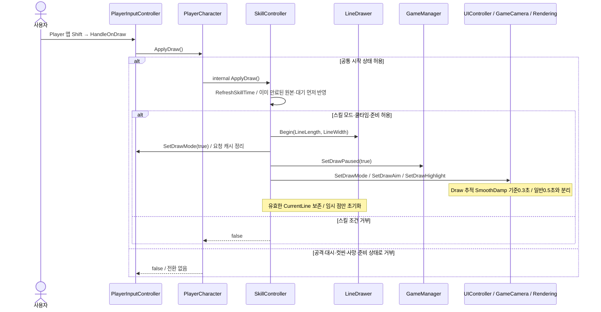

**② 정지 중 M1·커서·R·F → 임시 기하·표현과 확정 종료**

Draw 전용 입력은 게임 시간0에서도 동작한다. 첫 점 이후 커서를 따라 고정 길이 미리보기를 갱신하고 두 번째 점으로 방향을 고정한다. F가 유효한 Line을 반환할 때만 확정 데이터를 교체하고 일반 모드로 복귀한다.

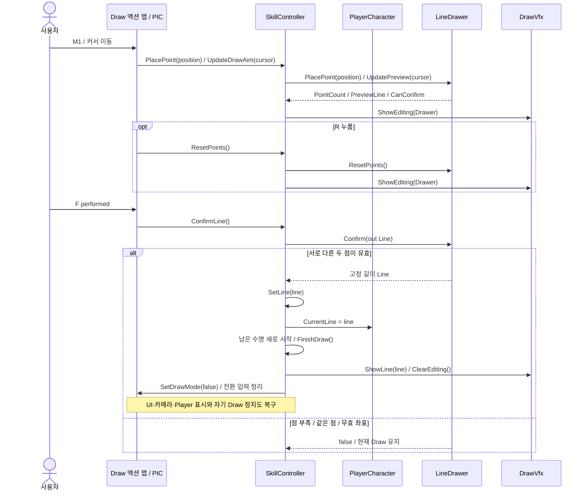

**③ 기존 Line이 있는 재Draw·Shift 취소 → 임시 편집만 정리**

재Draw와 R은 임시 점을 편집하며 기존 CurrentLine은 유지한다. Shift로 취소하면 임시 표현·Draw 전환만 종료하고 짧은 Draw 대기를 적용한다. 새 F 확정이 성공한 경우에만 이전 경로를 교체한다.

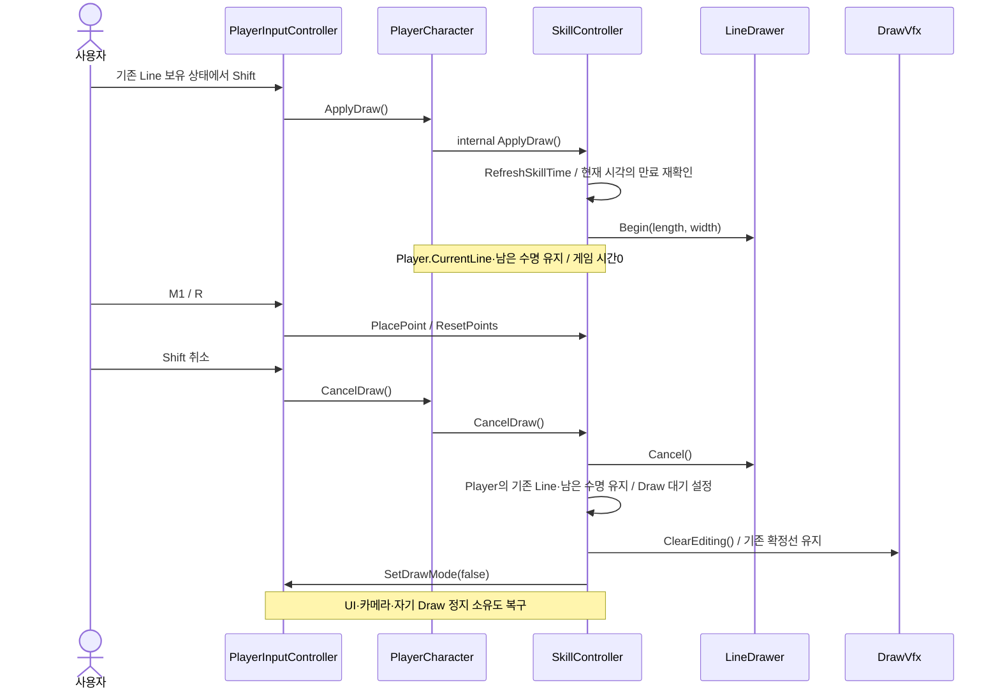

**④ 사망·컷씬·차단·비활성화 → 명시적 중단과 상태 복구**

진행 중 Draw를 공통 상태로 매 프레임 중복 검사하지 않고 사건/수명 경계에서 종료한다. 사망의 ResetSkills는 경로까지 비우며, 컷씬·입력 차단 등의 CancelDraw는 현재 편집과 자기 전환을 복구한다.

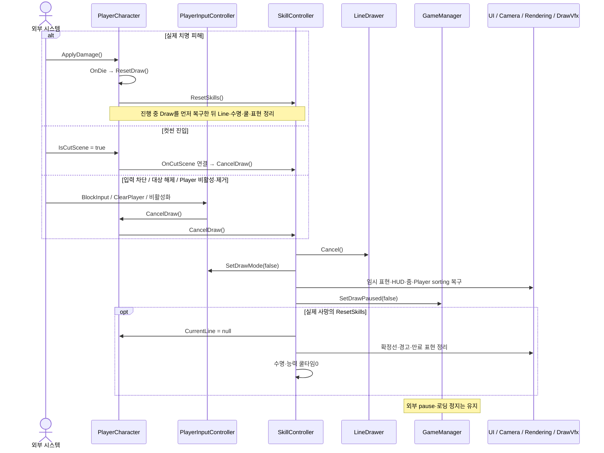

**⑤ 시간0의 커서·표현과 외부 pause 중첩 → 자기 소유만 복구**

Draw 동안 게임 행동·쿨타임과 기존 Line의 수명/경고/만료 꼬리는 멈추지만 커서·UI·카메라·임시 표현은 계속 갱신한다. 외부 pause가 추가된 뒤 Draw를 종료해도 외부 소유가 남아 있으므로 게임 시간을 재개하지 않는다.

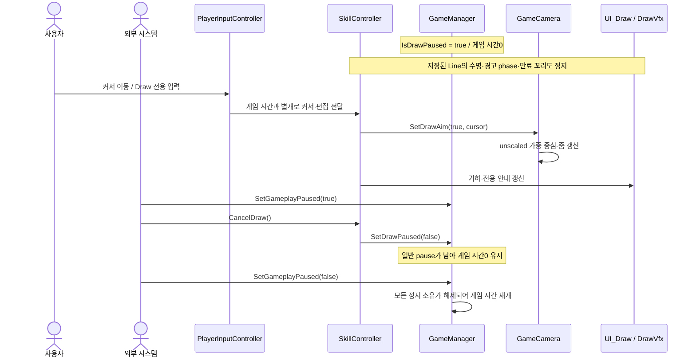

### 2.1.5 F-P05 점 편집·고정 길이 기하

**현재 범위·상태 — 구현·연결·검증 완료**: 원문 Class 구조354~365와 Q7의 임시 편집/기존 확정 Line 보존 규칙에 따른 F-P05 전체를 확인했다. F-P04에서 연결한 점0/1/2개·커서 미리보기·고정 방향·R/F/Shift 흐름에 미완 확정·무효 입력·추가 클릭·맵 경계 미보정 검사를 보강했다. 원본 Unity6000.3.21f1 최신 런타임/Editor 컴파일 종료 코드0과48묶음 Play Mode 성공·error 빈값을 확인했다(2026-11-15 20:41:35 KST). 최종 Sprite·FX·음향 조정은 별도다.

| 기능 ID | 코드·연결 | 현재 확인 | 남은 아트 의존 |
| --- | --- | --- | --- |
| F-P05 | Draw M1/Look/R/F/Shift→PIC→Skill→LineDrawer, 확정 결과→Skill.SetLine→Player.CurrentLine, DrawVfx 임시 표현 | 최신48묶음 성공. 기존 Draw 입력·표현 회귀와 신규 편집2묶음에서 점0/1/2·F 미완·R·3번째 클릭 무시·무효 좌표/크기·4방향 사분면/여러 클릭 거리의 고정 길이·맵 경계 미보정 확인 | 최종 점/커서·미리보기/확정 검기 프리팹과 표시·음향 조정 |

**기하·저장 계약**: 첫 유효 클릭은 StartPoint만 저장한다. 한 점 상태의 커서가 시작점과 다르면 고정 LineLength·LineWidth의 PreviewLine을 만들고, 같은 점이면 방향 미정으로 미리보기를 비운다. 두 번째 유효 클릭의 EndPoint는 방향을 고정할 입력 좌표이며 실제 경로 끝점은 StartPoint+단위 방향×고정 길이다. 짧거나 긴 두 번째 클릭 거리가 최종 길이를 바꾸지 않는다. 두 점 뒤 커서 이동·세 번째 클릭은 선택을 바꾸지 않는다. 유한하지 않은 좌표와 방향 제곱 길이, 같은 점은 거부하며 별도 맵 경계 Clamp·보정을 도입하지 않는다.

**편집 경계**: 점0/1개에서 F는 실패하고 Draw를 유지한다. UI_Draw의 F 안내는 Drawer.CanConfirm에 따라 `F: Need 2 points`와 `F: Confirm`으로 바뀐다. R은 0/1/2 어느 상태든 임시 점·미리보기만 비우며 Draw와 Player의 기존 확정 원본·남은 수명을 유지한다. Shift 취소는 임시 편집만 끝내고 F 성공만 Line 값을 Skill에 반환해 Player.CurrentLine에 저장·새 수명을 시작한다. 수명 관리는2.1.6의 Skill 책임이다. 같은 원작 Draw 기하는 조사 범위에서 확인하지 못했으며 Sephiria SkillController의 시작/취소 경계만 부분 참고하고 원문 확정 규칙으로 직접 구현한다.

**검증·Notion 상태**: `project/Assets/Editor/PlayerLineEditingChecks.cs`의 신규2묶음과 기존 입력/임시 표현·저장/재진입 회귀를 포함해48묶음 성공을 확인했다. 결과는 `project/Logs/StartupFlowChecks-result.json`, 격리 저장 경로는 `project/Temp/StartupFlowChecks/4a11efff5e2c4e9699cbfde2134fa525`다. 종료 후 Title 편집 씬의 저장되지 않은 변경이 없음을 화면으로 확인했다. 아래 독립 `F-P05 SequenceDiagram`4개 Case와 F-P06 변경 Case를 로컬·Notion에 저장했고 연결 도구가 경고 없이 성공을 반환했다. 최종 에셋·빌드·성능 측정은 이번 점 편집 완료와 구분한다.

**① 첫 클릭·커서 이동 → 시작점과 고정 길이 미리보기**

Draw 전용 입력이 첫 점과 커서를 전달한다. 무효 좌표는 기존 편집을 바꾸지 않고 시작점과 겹친 커서는 방향 미정으로 처리한다.

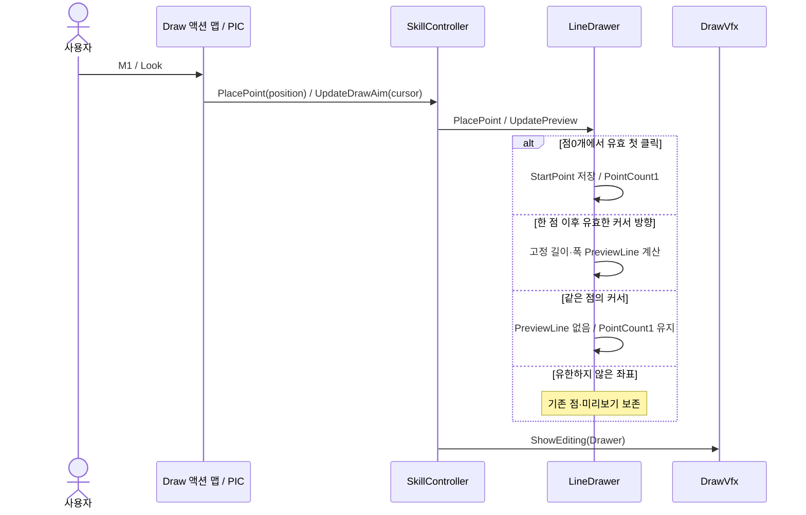

**② 두 번째 클릭 → 방향 고정·추가 클릭 무시**

두 번째 좌표는 방향만 결정하고 경로 길이는 설정값을 유지한다. 두 점 이후 커서 이동과 추가 클릭은 고정한 선을 바꾸지 않는다.

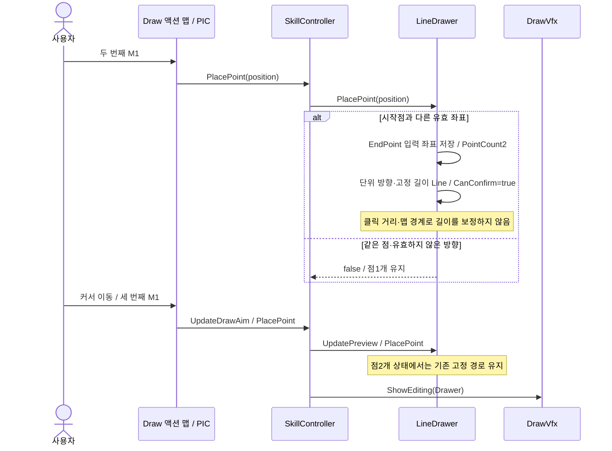

**③ 미완 F·R → Draw와 기존 원본 보존**

점이 부족한 F는 모드를 종료하지 않는다. R은 현재 임시 점만 지우므로 기존 Player 원본과 수명에 영향을 주지 않는다.

```mermaid
sequenceDiagram
    actor User as 사용자
    participant Input as Draw 액션 맵 / PIC
    participant Skill as SkillController
    participant Drawer as LineDrawer
    participant Player as PlayerCharacter
    participant Vfx as DrawVfx
    User->>Input: 점0/1개에서 F
    Input->>Skill: ConfirmLine()
    Skill->>Drawer: Confirm(out Line)
    Drawer-->>Skill: false / Draw 유지
    User->>Input: 점0/1/2개에서 R
    Input->>Skill: ResetPoints()
    Skill->>Drawer: ResetPoints()
    Drawer->>Drawer: 점0개·미리보기 제거 / Draw 유지
    Skill->>Vfx: ShowEditing(Drawer)
    Note over Player,Skill: 기존 CurrentLine·남은 수명 유지
```

**④ 유효 F 확정·Shift 취소 → 저장 교체와 임시 폐기**

유효한 두 점의 F만 Player 원본을 교체한다. 취소는 임시 편집과 Draw 전환만 정리한다.

```mermaid
sequenceDiagram
    actor User as 사용자
    participant Input as Draw 액션 맵 / PIC
    participant Skill as SkillController
    participant Drawer as LineDrawer
    participant Player as PlayerCharacter
    participant Vfx as DrawVfx
    alt 유효한 두 점에서 F
        User->>Input: F performed
        Input->>Skill: ConfirmLine()
        Skill->>Drawer: Confirm(out Line)
        Drawer-->>Skill: Line 값 / 임시 편집 종료
        Skill->>Skill: SetLine(line)
        Skill->>Player: CurrentLine = line
        Skill->>Vfx: 새 Line·새 수명 표시
    else Shift 취소
        User->>Input: Shift performed
        Input->>Player: CancelDraw()
        Player->>Skill: CancelDraw()
        Skill->>Drawer: Cancel()
        Note over Player,Skill: 기존 Line·남은 수명 보존
    end
    Skill->>Input: FinishDraw / Player 맵 복귀
    Skill->>Vfx: 임시 점·미리보기 제거
```

### 2.1.6 F-P06 Line 원본·수명·만료 VFX 연결

**이번 사용자 확정**: Draw에서 확정한 Line의 원본은 PlayerCharacter에 둔다. SkillController가 LineDrawer의 Confirm 결과를 PlayerCharacter.CurrentLine에 저장하고 그 저장값의 수명·만료·VFX 연결을 관리한다. 이전 Q7/P06의 Skill 보유·P07 타이머 배치는 이 요청으로 대체하며, LineDrawer는 임시 점과 기하만 담당한다. 사용자의 SkillManager 호칭은 현재 SkillController이며 이번에 클래스 이름을 임의로 바꾸지 않는다.

| 기능 ID | 사양 상태 | 코드·연결 | 현재 확인 | 남은 경계 |
| --- | --- | --- | --- | --- |
| F-P06의 원본/수명/만료 표현·한 번 소비 | Player 원본·Skill 수명 관리와 수명 VFX 연결은 이번 요청 확정. 보존·시간·짧은 대기는 Q7~Q9 유지 | Draw Confirm→Skill.SetLine→Player.CurrentLine, 게임 시각 기반 수명 갱신→DrawVfx 예고/만료, ConsumeLine의 만료 재확인·한 번 전달 | 구현·연결·검증 완료. 최신48묶음 성공·error 빈값(2026-11-15 20:41:35 KST), 수명5묶음과 편집2묶음/기존 회귀 포함 | F-P07 Slash 시작 허용·공격 연출·판정·피해·최종 FX/음향·밸런스·빌드/성능 측정은 별도 |

**소유·시간 계약**: PlayerCharacter.CurrentLine이 유일한 nullable 원본이고 SkillController에는 별도 CurrentLine 필드/복사 원본을 두지 않는다. Skill.HasLine은 Player의 값을 읽는다. SetLine(non-null)은 원본 저장과 시작 시점 총수명·남은 수명 초기화, 낡은 경고/만료 꼬리 정리와 새 경로 표시를 함께 수행한다. 새 확정은 같은 기하라도 새 수명을 시작한다. SetLine(null)과 사망 ResetSkills는 자연 만료 FX 없이 원본·시간·표현을 정리한다. Line struct에 시간·GameObject를 넣지 않는다.

**같은 게임 시각의 갱신·소비 경계**: Skill의 RefreshSkillTime은 Time.timeAsDouble의 이전 샘플과 현재 샘플 차이로 쿨타임·기존 만료 표현·Line 수명 순서로 갱신한다. Update와 ApplyDraw/CancelDraw/SetLine/ConsumeLine이 같은 창구를 사용하며 현재 샘플을 먼저 기록해 재진입·같은 프레임의 같은 시각을 두 번 빼지 않는다. Draw로 시간을 멈추기 직전에도 이미 만료된 원본과 짧은 대기를 반영한다. 일시 비활성화에서 재활성화하면 OnEnable에서 샘플을 다시 잡아 숨겨진 동안의 시간을 소급 차감하지 않는다. ConsumeLine은 이미 만료된 원본이면 자연 만료 처리 뒤 false, 유효하면 Line 값을 한 번 반환하고 SetLine(null)과 일반 NormalDrawCooldown을 적용한다. 소비에는 자연 만료 꼬리를 재생하지 않으며 반복 호출로 같은 Line을 다시 받을 수 없다. 이 API는 F-P07의 공통 행동 허용·공격·판정을 대신하지 않는다.

**재Draw·정지·비활성화**: 재Draw 진입/취소와 R은 Player의 기존 Line·남은 수명에 영향을 주지 않는다. Draw·일반 pause에서 게임 deltaTime0이므로 남은 시간과 후반 경고 phase·만료 꼬리 진행도 정지한다. Skill 비활성화는 논리 원본·잔여를 보존한 채 표현을 숨기고, 재활성화는 같은 수명 단계로 복귀한다. VFX만 비활성화하면 논리 수명은 Skill에서 계속 진행하며 다시 켤 때 최신 상태를 표시한다. 실제 사망·세션 종료는 원본을 남겨두는 일시 비활성화와 구분한다.

**표현 연결·초기 튜닝**: Skill은 DrawVfx.UpdateLineLifetime(remaining,total,dt)·TickVisuals(dt)·PlayLineExpiration(line)·ClearLineEffects를 호출한다. VFX는 원본이나 논리 수명을 소유하지 않고 전달받은 비율로 후반 깜박임 간격을 줄이며 별도 만료 꼬리의 표현 시간만 관리한다. optional ExpiryLinePrefab이 없으면 기존 LinePrefab으로 다섯 번째 재사용 슬롯을 준비한다. 자연 만료의 꼬리는 마지막 경로 기하에 남으며 새 확정과 겹쳐 이전 꼬리가 새 Line을 제거하지 않는다. 기본 LineLifetime8초, NormalDrawCooldown3초, WarningFraction0.35, SlowBlinkPeriod0.5초·FastBlinkPeriod0.08초, ExpiryDuration0.25초는 구현 확인용 Inspector 튜닝값이며 사용자 확정 밸런스나 원작 프리팹 수치가 아니다.

**자연 만료**: 남은 시간이0이 되는 경계에서 마지막 기하로 전용 VFX를 요청하고 Player.CurrentLine을 null로 만든다. 남은 수명은0으로 고정하고 짧은 CancelDrawCooldown을 적용한다. 이후 매 프레임 같은 만료 사건이나 쿨타임을 다시 발행하지 않는다. 수신·소모할 원본은 이미 없으므로 후속 Slash는 ConsumeLine의 반환값을 사용한다. Update 전후 어느 순서의 소비 요청에도 같은 게임 시각의 만료를 재확인하는 경계는 이번 F-P06 검사에 포함하고, 실제 Slash 행동·판정은 F-P07에서 연결한다.

**실제 참고·적용 차이**: Sephiria [MeleeCollision.cs](<reference/sephiria/code/ingame code/Assembly-CSharp/MeleeCollision.cs>) OnUpdateServer의 durationTimer.Update(Time.deltaTime)→DestroySelf는 게임 시간 기반 수명·종료 경계만 참고한다. [BulletBlinkBeforeDestroy.cs](<reference/sephiria/code/ingame code/Assembly-CSharp/BulletBlinkBeforeDestroy.cs>) OnSpawn41·Update48은 생성 시 phase 리셋·destroyTimer.Ratio 기반 가속 예고, [FlameGroundFadeFx.cs](<reference/sephiria/code/ingame code/Assembly-CSharp/FlameGroundFadeFx.cs>) Update8·OnSpawn29는 표현 재생 초기화·종료 정리를 참고했다. [SkillController.cs](<reference/sephiria/code/ingame code/Assembly-CSharp/SkillController.cs>) OnEndCastAnimation457·CancelAction356은 자기 연출/차단의 대칭 정리를 참고한다. 같은 Line 기능은 원작에서 확인하지 못했으며, 우리 원문 Class 구조366~369의 후반 가속 경고·자연 만료 연출과 이번 소유권 요청을 직접 구현한다. 네트워크·탄환·광범위 ObjectPool 프레임워크·원작 숫자는 가져오지 않는다.

**검증·Notion 상태**: 1차45묶음 뒤 확장한 최신48묶음이 성공했다(2026-11-15 20:41:35 KST, success=true·error 빈값). `project/Assets/Editor/PlayerLineLifetimeChecks.cs`의5묶음에서 Player 원본 저장·새 확정 초기화, 재Draw/일반 pause의 수명·경고 보존, 실제 깜박임 가속·자연 만료1회/짧은 대기/꼬리 종료, 교체·수동 제거·Skill/VFX 비활성화·사망 정리, 살아 있는 기하 한 번 전달/일반 대기와 Skill.Update 이전의 만료 소비 거부를 확인했다. 동일 프레임의 재호출은 중복 소비·대기 재적용·만료 꼬리 재시작을 만들지 않는다. 현재 Unity 런타임/Editor 컴파일 종료 코드0·ALL PASSED48·Title 편집 복귀와 저장되지 않은 변경 없음을 확인했다. 결과·격리 저장 경로는2.1.5와 같다. 기존 F-P04의5개 Case와 독립 `F-P05 SequenceDiagram`4개·`F-P06 SequenceDiagram`6개 Case, 관련 Class5개·Q7 후속 소유권 변경·기능 표를 로컬·Notion에 반영했고 연결 도구가 경고 없이 성공을 반환했다. 전체 Mermaid34개를 파서로 확인했다. 미리보기 모드 설정·화면 확인은 완료 체크에 포함하지 않는다.

**① Draw F 확정 → Player 원본 저장과 수명 시작**

유효한 두 점을 확정하는 외부 F 입력에서 시작한다. Drawer는 기하만 반환하고 Skill이 Player에게 원본을 저장한 뒤 새 수명·표현을 초기화한다.

```mermaid
sequenceDiagram
    actor User as 사용자
    participant Input as Draw 액션 맵 / PIC
    participant Drawer as LineDrawer
    participant Skill as SkillController
    participant Player as PlayerCharacter
    participant Vfx as DrawVfx
    User->>Input: F performed
    Input->>Skill: ConfirmLine()
    Skill->>Drawer: Confirm(out Line)
    alt 두 점의 기하 유효
        Drawer-->>Skill: 확정 Line
        Skill->>Skill: SetLine(line)
        Skill->>Player: CurrentLine = line
        Skill->>Skill: 시작 총수명 snapshot / LineRemaining 초기화
        Skill->>Vfx: 이전 경고·만료 꼬리 정리 / 새 Line 표시
        Skill->>Input: FinishDraw / Player 맵 복귀
    else 무효 기하
        Drawer-->>Skill: false
        Note over Player,Skill: 기존 Line·남은 수명 유지
    end
```

**② 게임 시간 경과 → 남은 수명과 후반 가속 경고**

게임 갱신이 시작 입력이다. Skill은 마지막 샘플 이후의 게임 경과시간을 한 번 계산한다. 기존 만료 표현을 먼저 진행하고 Player의 저장값이 있을 때만 논리 수명·경고를 갱신한다.

```mermaid
sequenceDiagram
    participant Unity as 게임 갱신
    participant Player as PlayerCharacter
    participant Skill as SkillController
    participant Vfx as DrawVfx
    Unity->>Skill: Update / RefreshSkillTime()
    Skill->>Skill: 현재 Time.timeAsDouble 샘플 / 게임 경과시간 계산
    alt 비활성 또는 경과시간0
        Note over Skill,Vfx: 수명·표현 진행 없이 반환
    else 게임 시간 진행
        Skill->>Skill: Draw/Slash 쿨타임 진행
        Skill->>Vfx: TickVisuals(elapsed)
        Skill->>Player: CurrentLine 조회
        alt 확정 Line 존재
            Skill->>Skill: LineRemaining 감소 / 시작 총수명 기준 비율
            alt 남은 수명0
                Skill->>Skill: ExpireLine / 자연 만료 Case④
            else 수명 남음
                Skill->>Vfx: UpdateLineLifetime(remaining, total, elapsed)
                alt 경고 비율 이전
                    Vfx->>Vfx: 확정선 표시 유지
                else 후반 경고 구간
                    Vfx->>Vfx: 남은 비율에 따라 깜박임 주기 단축
                end
            end
        else 원본 없음
            Note over Skill: 논리 수명 진행 없음
        end
    end
```

**③ 재Draw·pause·새 확정 → 보존·정지·수명 교체**

재Draw와 pause는 기존 수명을 초기화하지 않는다. 새 확정만 Player의 원본과 시작 시점 수명을 교체한다.

```mermaid
sequenceDiagram
    actor User as 사용자
    actor Caller as 외부 시간 시스템
    participant Input as PlayerInputController
    participant Skill as SkillController
    participant Player as PlayerCharacter
    participant GM as GameManager
    participant Vfx as DrawVfx
    User->>Input: 재Draw Shift
    Input->>Player: ApplyDraw()
    Player->>Skill: internal ApplyDraw()
    Skill->>Skill: RefreshSkillTime / Draw 전 만료 재확인
    Note over Player,Skill: 유효한 CurrentLine·남은 수명 보존
    Caller->>GM: Draw 또는 일반 pause 소유 추가
    GM->>GM: 게임 시간0
    Note over Skill: 공유 시각의 경과시간0이면 진행 없이 반환
    Note over Skill,Vfx: 논리 수명·경고 phase·만료 꼬리 정지
    Caller->>GM: 정지 소유 해제
    Skill->>Skill: 보존한 수명에서 재개
    User->>Input: 새 F 확정
    Input->>Skill: ConfirmLine()
    Skill->>Player: CurrentLine 교체
    Skill->>Skill: 새 총수명·남은 수명 초기화
    Skill->>Vfx: 낡은 경고/만료 꼬리 정리 / 새 표현
```

**④ 자연 수명0 → 원본 제거·짧은 대기·전용 만료 표현**

아직 사용하지 않은 Line의 게임 수명이 끝나는 경계다. 마지막 경로를 전용 꼬리에 전달하고 원본은 즉시 제거하므로 표현이 남아 있어도 유효 Line으로 소비하지 않는다.

```mermaid
sequenceDiagram
    participant Unity as 게임 갱신
    participant Skill as SkillController
    participant Player as PlayerCharacter
    participant Vfx as DrawVfx
    Unity->>Skill: Update / LineRemaining이0에 도달
    Skill->>Player: 마지막 CurrentLine 기하 조회
    Skill->>Skill: SetLine(null)
    Skill->>Player: CurrentLine = null
    Skill->>Vfx: ShowLine(null) / 이전 경고·꼬리 정리
    Skill->>Skill: LineRemaining0 / 짧은 Draw 대기 설정
    Skill->>Vfx: PlayLineExpiration(line)
    loop 표현 시간이 남고 게임 시간이 진행
        Skill->>Vfx: TickVisuals(deltaTime)
        Vfx->>Vfx: 별도 꼬리 폭 축소 / 종료 시 숨김
    end
    Note over Player,Skill: 다음 갱신은 같은 자연 만료를 다시 발행하지 않음
```

**⑤ 사망·명시적 제거·표현/능력 비활성화 → 원본과 표현 수명 구분**

외부 사망·제거는 자연 만료 연출과 구분한다. 일시 비활성화는 보존 범위에 따라 논리 시간과 표시만 다르게 처리한다.

```mermaid
sequenceDiagram
    actor Caller as 외부 시스템
    participant Player as PlayerCharacter
    participant Skill as SkillController
    participant Vfx as DrawVfx
    alt 실제 사망 또는 명시적 Line 제거
        Caller->>Skill: ResetSkills() / SetLine(null)
        Skill->>Player: CurrentLine = null
        Skill->>Skill: 남은 수명·관련 상태 정리
        Skill->>Vfx: ClearLineEffects()
        Note over Vfx: 자연 만료 꼬리를 새로 재생하지 않음
    else Skill 비활성화
        Caller->>Skill: 컴포넌트 비활성화
        Skill->>Vfx: 표현 숨김
        Note over Player,Skill: 원본·남은 수명 보존 / 논리 진행 정지
        Caller->>Skill: 재활성화
        Skill->>Vfx: 같은 수명 단계 복구
    else VFX만 비활성화
        Caller->>Vfx: 표현 비활성화
        Skill->>Skill: Player 원본의 논리 수명은 계속 진행
        Skill->>Vfx: 최신 비율·표현 상태 갱신 / 표시는 숨김
        Caller->>Vfx: 재활성화
        Vfx->>Vfx: OnEnable / 최신 표시 상태 복구
    end
```

**⑥ 소비 요청 → 같은 게임 시각의 만료 재확인·한 번 전달**

후속 Slash가 사용할 Line을 요청하는 API 경계다. 실제 Slash 시작 검사·애니메이션·판정·피해는 F-P07 후속이며 이 흐름은 저장된 기하의 유효한 한 번 전달까지만 다룬다.

```mermaid
sequenceDiagram
    actor Caller as 후속 Line 소비자
    participant Skill as SkillController
    participant Player as PlayerCharacter
    participant Vfx as DrawVfx
    Caller->>Skill: ConsumeLine(out Line)
    Skill->>Skill: 현재 게임 시각까지 수명 갱신
    Note over Skill: Update와 같은 시각은 중복 차감하지 않음
    Skill->>Player: CurrentLine 확인
    alt 갱신 결과 이미 만료
        Skill->>Skill: 자연 만료 / 짧은 Draw 대기
        Skill->>Player: CurrentLine = null
        Skill->>Vfx: 자연 만료 꼬리 재생
        Skill-->>Caller: false
    else 유효한 Line 존재
        Skill->>Skill: 반환할 기하 보관 / SetLine(null)
        Skill->>Player: CurrentLine = null
        Skill->>Vfx: 확정선·경고·꼬리 정리
        Skill->>Skill: 일반 Draw 대기 설정
        Skill-->>Caller: true / 한 번 전달한 Line
    else 원본 없음
        Skill-->>Caller: false
    end
    Note over Player,Skill: 반복 요청으로 같은 Line을 다시 소비하지 않음
```

### 2.1.7 F-P07 Slash 입력·전용 연출·한 번 판정

**현재 범위·상태 — 구현·연결·검증 완료**: N1 Class 구조374~393·N2 필요 기능256의 Player `Slash(F)`와 Q8~Q13·Q25를 연결했다. Player 맵의 F는 Slash, Draw 맵의 F는 경로 확정이며 전환 캐시를 비워 같은 입력이 양쪽 행동을 연속 실행하지 않게 한다. F-P10 후속 연결은 같은 F의 후보 상호작용 우선이며 후보가 없을 때만 아래 Slash 흐름으로 진입한다(2.1.10). 최신 사용자 요청의 CurrentLine 공개 필드·일반0.5초/Draw0.3초 추적 분리와 요청측 모드 설정까지 반영한 뒤 원본 Unity 컴파일·55묶음 Play Mode 성공을 확인했다(2026-11-15 21:24:31 KST). 이전48묶음과 추가 변경 전21:15:31의55묶음은 기준선이다.

| 기능 ID | 확정 사양·담당 | 코드·연결 | 현재 확인 | 남은 아트 / 후속 |
| --- | --- | --- | --- | --- |
| F-P07 | PIC 입력 사실 → P03 공통 시작 허용 → P06 자체 Line/쿨·전환 → P08 snapshot/마지막 정지 시점 1회 판정 → B05·B06·S07~10 수신/보상 | Player/Slash F→ApplySlash→ConsumeLine→LineSlasher, 독립 Slash 정지·전면 보호·입력 잠금·UI/카메라·성공 완료 후 교체 가능한 임시 flash | 최신 Unity 런타임/Editor 컴파일 종료 코드0·55묶음 성공·error 빈값(2026-11-15 21:24:31 KST), 기존48+Slash7 포함 | 최종 발도 Sprite·검격 FX·줌/HUD 모션·음향·실제 자산 타격 프레임·보스별 패턴/기믹 연결·빌드/성능 측정 |

**시작·역할 계약**: PIC는 일반 입력의 세션/UI/외부 차단과 모드만 판단해 F 눌림 사실을 보낸다. PlayerCharacter.ApplySlash는 활성/준비·생존·외부 컷씬·공격·대시·행동 잠금 등 공통 시작을 검사하고 자기 Skill에 넘긴다. Skill은 자기 모드·Slash 대기·기하/피해·연출 수치를 검사한 뒤 ConsumeLine으로 유효한 Player.CurrentLine을 시작 시점에 한 번 소모한다. 남은 Line 수명은 소비 직전 현재 게임 시각으로 재확인한다. LineSlasher는 확정 snapshot과 이번 AttackId·피해를 사용하며 현재 커서나 이후 Player 원본을 다시 읽어 공격 영역을 바꾸지 않는다. 상태 검사 중복과 외부 참조의 프레임 반복 검색을 추가하지 않는다.

**전용 연출·정지·복구**: Skill이 Slash 전용 게임 정지를 소유하며 GameManager는 일반/Draw/Slash 소유를 합쳐 최종 시간을 결정한다. Player의 Slash 전면 보호는 기존 전면 무적과 OR로 결합하므로 외부 무적 값을 덮어쓰지 않는다. 시작 때 이동 요청·일반 입력을 정리하고 Player 중심 줌 인·HUD 숨김·암전·Player 강조를 적용한다. Slash 전용 연출만 unscaled로 진행하며 게임 행동·탄환·Line·버프·쿨타임은 멈춘다. 마지막 정지 시점에 정확히 한 번 판정한 뒤 자신의 보호/입력/시간·표시를 복구하고, 성공한 완료에서만 저장한 경로 기하의 flash를 시작한다. DrawVfx는 별도0.12초 unscaled 표현 타이머를 맡고 Skill의 행동 타이머와 구분한다. 이후 Player는 이동·다른 행동을 할 수 있으며 최종 발도 잔여 Sprite는 행동에 덮어쓸 수 있게 연결할 후속 아트다. 외부 pause가 남으면 게임은 계속 정지한다.

**기하·시점·표현**: 실제 판정은 Line 시작점+방향×길이/2의 중심, 길이×폭, 방향 각도의 NonAlloc 사각 조회이며 벽 LOS로 대상을 제외하지 않는다. 같은 피해 수신자는 한 번만 피해를 받고 부위 정보는 같은 AttackId의 고유 PartId로 Boss에 별도 전달한다. 현재 임시 Slash FX는 성공한 판정/복구 직후 Line보다 얇고 길게 Line 방향을 따라 번쩍이며 교체 가능한 프리팹으로 분리한다. 시작·취소에서는 성공 flash를 재생하지 않는다. 표현이 연장되는 부분까지 피해 범위를 넓히지 않는다. SlashDuration0.15초·SlashDamageMultiplier3·flash0.12초는 확인용 초기 튜닝값이며 확정 밸런스/원작 수치가 아니다.

**수신·보상과 범위**: 일반탄은 제거하며 지정 GroggyGain을 주고 금색탄도 게이지를 준 뒤 Boss 목표 반사와 Fever를 함께 적용한다. 반사된 탄은 Player 피해 대상에서 제외한다. 게이지100은 즉시 현재 Boss 그로기·게이지0 소모이며 다음 Slash까지 기다리지 않는다. Fever는 AD/AS/SP 증가·획득마다 회복1회·기간 갱신·일반 Draw 대기 반값이며 재적용 시 수치를 중첩하거나 반복 반감하지 않는다. 실제 수신·보상 로직과 검증용 대상까지 이번에 연결하되, 경비 로봇 패턴의 임의 금색탄 배치·후속5보스 고유 부위 조건·레이저/장판·존재하지 않는 DOT 콘텐츠를 새로 만들지 않는다. 최소 연결을 F-P11 전체나 F-B04/패턴 전체 완료로 확대하지 않는다.

**중단 경계**: 사망·외부 컷씬·BlockInput·입력 대상 교체/해제·재배치·Skill/Player 비활성화·세션 정리에서 진행 중 Slash를 명시적으로 취소한다. 시작에 소모한 Line을 돌려주지 않으며 취소 후 판정·보상·flash가 뒤늦게 실행되지 않는다. 공간 질의 중 피해 콜백으로 취소되는 경우도 나머지 대상 처리를 즉시 멈추고 취소가 정리한 적중 기록을 다시 채우지 않는다. 같은 중단을 매 프레임 사망/컷씬 재검사로 대신하지 않는다.

**실제 읽은 레퍼런스**: Sephiria [MeleeCollision_Rectangle.cs](<reference/sephiria/code/ingame code/Assembly-CSharp/MeleeCollision_Rectangle.cs>) CheckCollision33의 회전/오프셋 사각 NonAlloc 조회, [MeleeCollision.cs](<reference/sephiria/code/ingame code/Assembly-CSharp/MeleeCollision.cs>) Attack168의 수신자 중복 방지·DamageInstance 전달과 첫 프레임 탄 분기를 참고했다. [BulletBreaker.cs](<reference/sephiria/code/ingame code/Assembly-CSharp/BulletBreaker.cs>) Update의 탄 제거, [Bullet.cs](<reference/sephiria/code/ingame code/Assembly-CSharp/Bullet.cs>) AttackOnServer345·DestroySelf549·TurnOnHoming581의 이동/적중/종료·명시 목표, [CharacterBuff.cs](<reference/sephiria/code/ingame code/Assembly-CSharp/CharacterBuff.cs>) Initialize190·Destroy216·AddStack289와 StatusInstance의 적용/원복, [CharacterBuff_Heal.cs](<reference/sephiria/code/ingame code/Assembly-CSharp/CharacterBuff_Heal.cs>)의 회복 전달, [CutScenePlayer.cs](<reference/sephiria/code/ingame code/Assembly-CSharp/CutScenePlayer.cs>) CutSceneCoroutine48의 차단/복구를 부분 참고했다. 같은 통합 Slash 시스템은 확인하지 못했다. 우리 규칙으로 1회 판정·Boss 목표 반사·획득별 Fever·부위 집계를 구성하며 원작 네트워크·반복 서버 질의·주기 회복·스택/DB/범용 풀을 복제하지 않는다.

**검증 상태**: `project/Assets/Editor/PlayerSlashChecks.cs`의 신규7묶음을 포함해 최신55묶음 success=true·error 빈값을 확인했다(2026-11-15 21:24:31.512 KST). 실제 F/홀드·확정 입력 누출과 거부 입력 미예약, 원본1회 소모·보호/정지·마지막 unscaled 시점 타격·성공 뒤 flash/복구, 회전한 전체 Line·벽 무관·범위 밖 제외·수신자 중복/공용 AttackId, Boss 부위 집계·구조물 피해·일반탄/금색 반사·게이지100·Fever 획득별 회복/비중첩/기간/쿨 조정, 외부 pause/무적 보존과 컷씬/Block/비활성화/대상 해제·질의 중 취소, 실제 Slash 시작 전 만료를 검사했다. 관련 실제 임시 객체의 활성 상태·기하·타이밍을 확인했으며 새 화면 캡처나 최종 미술 검수로 기록하지 않는다. 최신 소스 이후 런타임/Editor 컴파일 종료 코드0과 Title 편집 복귀·저장되지 않은 변경 없음·ALL PASSED55 표시를 확인했다. 결과는 `project/Logs/StartupFlowChecks-result.json`, 당시 격리 저장 경로는 `project/Temp/StartupFlowChecks/7e3b655f663c4e6ba2f0f14206480a69`다. Temp 경로는 실행 기록이며 이후 Unity 정리로 없어질 수 있다.

**Notion 상태**: 관련 Class16개·F-P07 기능 표·기존 F-P04의5개 Case·새 독립 `F-P07 SequenceDiagram`6개 Case·3.3 최종 Draw 방향/추적시간 분리/CurrentLine 공개 필드를 저장했고 연결 도구의20개 대상 갱신이 경고 없이 성공했다. 이후 최신21:24:31의55묶음 성공 요약도 후속1개 대상 갱신으로 경고 없이 저장했다. 로컬 Mermaid40개와 원작 코드62개 경로를 확인했다. 기존 F-P04~06 Case 번호는 보존하고 Notion 미리보기 조작은 수행하지 않는다.

**① Player F → 공통 허용·Line 1회 소모·Slash 전환**

Player 맵 F가 시작 입력이다. 거부된 요청은 Line을 소비하지 않으며 허용된 요청만 snapshot과 긴 Draw 대기를 확정하고 전용 연출을 시작한다.

```mermaid
sequenceDiagram
    actor User as 사용자
    participant Input as PlayerInputController
    participant Player as PlayerCharacter
    participant Skill as SkillController
    participant Slasher as LineSlasher
    participant GM as GameManager
    participant View as UI / GameCamera / DrawVfx
    User->>Input: Player 맵 Slash F performed
    alt 수정 후보 있음
        Input->>Player: ApplyInteraction(InteractionTarget)
        Note over Input,Player: 거부해도 Slash 재전달 없음 / F-P10
    else 후보 없음
        Input->>Player: ApplySlash()
        alt 공통 행동 허용
            Player->>Skill: ApplySlash()
            Skill->>Skill: 자체 모드·Slash 대기·수치 / 현재 시각 갱신
            alt 유효한 저장 Line과 자체 조건
                Skill->>Skill: ConsumeLine(out Line) / 긴 Draw 대기
                Skill->>Player: CurrentLine = null
                Skill->>Slasher: Execute(Line snapshot)
                Skill->>GM: Slash 전용 정지 소유 설정
                Skill->>View: HUD 숨김·암전·Player 중심 줌 인
                Note over Player,View: CurrentLine은 공개 필드 / 카메라 일반 추적 기준0.5초
                Note over Player,Skill: Slash 전면 보호·행동 잠금 / 기존 무적 보존
            else Line 없음·만료·대기·수치 거부
                Skill-->>Player: false / Slash 시작 없음
            end
        else 공통 상태 거부
            Player-->>Input: false / Line 소비 없음
        end
    end
```

**② unscaled 연출 종료 직전 → 정지 중 한 번 판정·복구**

게임 시간0에서도 전용 연출만 진행한다. 마지막 정지 시점에 같은 Line 영역을 한 번 질의하고 판정이 끝난 뒤 자기 전환을 복구한다.

```mermaid
sequenceDiagram
    participant Unity as Unity 갱신
    participant Skill as SkillController
    participant Slasher as LineSlasher
    participant Query as CollisionBox
    participant Hitbox as Hitbox / 수신 대상
    participant GM as GameManager
    participant View as UI / GameCamera / DrawVfx
    Unity->>Skill: Update / Time.unscaledTimeAsDouble
    Skill->>Skill: 마지막 실제 시각 이후 경과로 연출 시간 진행
    Note over GM: 게임 시간0 / 행동·탄환·버프·쿨 정지
    alt 마지막 정지 시점 도달
        Skill->>Slasher: ApplyHits(Player, Boss)
        Slasher->>Query: QuerySlash(Line 사각 기하)
        Query->>Hitbox: 같은 AttackId의 피해·Slash 수신
        Note over Query,Hitbox: 벽 무관 / 수신자1회·고유 부위 별도 전달
        Skill->>Slasher: Complete() / 후속 질의 없음
        Skill->>View: HUD·카메라·암전·입력 복구
        Skill->>GM: 자기 Slash 정지 해제
        Skill->>View: 성공 완료의 PlaySlash(snapshot)
        Note over View: 얇고 긴 flash만 별도0.12초 unscaled 재생
    else 연출 시간 남음
        Note over Skill,Slasher: 실제 타격 대기 / 반복 피해 없음
    end
```

**③ 일반탄·금색탄 → 제거/반사·게이지·Fever**

한 Slash가 같은 탄의 여러 Collider를 만나도 반응·보상은 한 번이다. 일반탄은 제거, 금색탄은 Boss 목표 반사와 Fever를 함께 처리한다.

```mermaid
sequenceDiagram
    participant Query as CollisionBox
    participant Projectile as Projectile
    participant Player as PlayerCharacter
    participant Boss as BossCharacter
    participant Buff as CharacterBuff
    participant Skill as SkillController
    participant Unity as 다음 프레임
    Query->>Projectile: OnSlashed(Player, Boss, DamageInstance)
    alt 아직 처리하지 않은 일반탄
        Projectile->>Projectile: 판정·표시 종료
        Projectile->>Player: GroggyGain 전달
    else 아직 처리하지 않은 금색탄
        Projectile->>Projectile: Boss 목표 반사 / Player 피해 제외
        Projectile->>Player: GroggyGain 전달
        Projectile->>Buff: ApplyFever() / 획득 수 예약
    else 이미 처리한 탄
        Note over Projectile,Player: 중복 반응·보상 없음
    end
    opt 게이지100 도달
        Player->>Boss: EnterGroggy()
        Player->>Player: 게이지0 소모
    end
    Unity->>Buff: 이전 프레임의 획득 예약 적용
    Buff->>Player: 기본 AD·AS·SP 배율 / 획득마다 Heal
    Buff->>Buff: 기간 갱신 / 동일 프레임 Remove 우선
    Buff->>Skill: RefreshDrawCooldown / 정상 길이 기준 반값 상한
```

**④ 같은 Slash의 여러 부위 → 피해 중복 방지·Boss 집계**

같은 Boss의 Collider가 여럿이어도 체력 피해는 한 번이며 고유 PartId는 각각 보고한다. 여러 부위를 맞췄을 때의 기믹 성공은 Boss가 판단한다.

```mermaid
sequenceDiagram
    participant Slasher as LineSlasher
    participant Query as CollisionBox
    participant Hitbox as Hitbox
    participant Structure as BossStructure
    participant Boss as BossCharacter
    Slasher->>Query: QuerySlash(AttackId)
    loop 조회한 고유 피격 영역
        Query->>Hitbox: 대상·PartId 확인
        alt 독립 구조물
            Query->>Structure: HandleSlash(DamageInstance)
            Structure->>Boss: ReportSlashPart(AttackId, PartId)
            Structure->>Structure: 독립 HP에 피해1회
        else Boss 피격 영역
            Query->>Boss: ReportSlashPart(AttackId, PartId)
            opt 아직 피해를 받지 않은 수신자
                Query->>Hitbox: ReceiveHit(DamageInstance)
                Hitbox->>Boss: ApplyDamage(Slash)
                Boss->>Boss: 최종 피해 허용 / HP 반영
            end
        end
    end
    Query->>Boss: CompleteSlash(AttackId)
    Note over Boss: 고유 기믹·동시 타격 성공 판단은 Boss 책임
```

**⑤ 사망·외부 차단·비활성화 → 명시적 중단·잔류 판정 제거**

진행 중 Slash를 사건·수명 경계에서 중단한다. 이미 소비한 Line은 되돌리지 않고 늦은 판정/보상과 자기 표시·정지만 정리한다.

```mermaid
sequenceDiagram
    actor Caller as 외부 시스템
    participant Player as PlayerCharacter
    participant Input as PlayerInputController
    participant Skill as SkillController
    participant Slasher as LineSlasher
    participant Query as CollisionBox
    participant GM as GameManager
    participant View as UI / Camera / DrawVfx
    alt 실제 사망·외부 컷씬
        Caller->>Player: ApplyDamage / IsCutScene 진입
        Player->>Skill: 사건 연결 / ResetSkills 또는 CancelSlash
    else 외부 입력 차단
        Caller->>Input: BlockInput=true
        Input->>Input: StopInput()
        Input->>Player: CancelSlash()
        Player->>Skill: CancelSlash()
    else 재배치·Player/Skill 비활성화
        Caller->>Skill: 명시적 CancelSlash / OnDisable 정리
    end
    Skill->>Slasher: Complete() → Cancel()
    Slasher->>Query: End / 적중 기록 정리
    Note over Slasher,Query: 콜백 취소도 남은 대상 처리 즉시 중단
    Skill->>View: 자기 Slash 표현·입력·HUD·줌 복구
    Skill->>GM: 자기 Slash 정지 해제
    Note over Player,Skill: 소모 Line 복원 없음 / 지연 판정·보상 없음
```

**⑥ 외부 pause·기존 무적 → 자기 소유만 해제**

Slash 전용 연출의 시작/끝이 외부 시스템의 정지·무적 상태를 덮어쓰지 않는다. 일반 pause와 전용 연출은 서로 다른 수명이다.

```mermaid
sequenceDiagram
    actor Caller as 외부 시스템
    participant GM as GameManager
    participant Player as PlayerCharacter
    participant Skill as SkillController
    Note over Skill: 이미 시작한 Slash에 외부 pause가 겹치는 경우
    Caller->>GM: 일반 pause 설정
    Caller->>Player: 기존 전면 무적 설정
    Note over Player,Skill: Slash 실행 중이면 전면 보호는 기존 무적 OR Slash
    Skill->>Skill: unscaled 연출 완료 또는 취소
    Skill->>GM: Slash 정지 소유만 해제
    Note over GM: 일반 pause가 남아 게임 시간0 유지
    Note over Player: Slash 보호만 끝나고 기존 무적 유지
    Caller->>GM: 일반 pause 해제
    GM->>GM: 다른 정지 소유가 없으면 게임 시간 재개
```

### 2.1.8 F-P08 피격 사건·Hitbox 보호·빨강 flash

**현재 범위·상태 — 구현·연결·검증 완료**: N2 필요 기능 Case4의 실제 HP 감소·추가 Hitbox 피해 보호·같은 기간 표시, Q9~Q11의 시간/회피/피격 경직 없음과 이번 사용자 요청의 사건 구독·빨강↔원본색 표시를 연결했다. 원문의 투명 깜빡임 표현은 이번 요청으로 대체했다. 최신 원본 Unity61묶음 success=true·error 빈값을 확인했다(2026-11-15 22:06:17 KST). 이전55묶음은 F-P07 기준선이다.

| 기능 ID | 확정 책임·연결 | 현재 확인 | 남은 아트 / 후속 |
| --- | --- | --- | --- |
| F-P08 | Hitbox/DamageInstance→P01 Character HP·사건→P03 PlayerCharacter 보호 기한/상태 알림→U01 CharacterRendering 표시. P09 Body는 기존 이동 물리만 담당 | 최신61묶음 성공·error 빈값(2026-11-15 22:06:17 KST), 기존55+피격6·최신 런타임/Editor 컴파일 종료 코드0 | 최종 피격음·화면 피드백·실제 Sprite 미술 조정, 사망/부활 연출·저장은 F-P09/F-P10·전투 진행 Case |

**발생·구독 책임**: Character.ApplyDamage는 현재 허용 상태와 피해값을 검사해 HP/IsDead를 먼저 확정하고 OnDamaged를 알린다. 그 호출의 치명 피해 여부를 snapshot으로 보관해 OnDamaged 구독자가 상태를 바꾸어도 최초 OnDie 통지를 빠뜨리지 않는다. Character가 렌더링·보호·입력·Save를 직접 호출하지 않는다. PlayerCharacter는 Awake에서 OnDamaged를 구독해 자기 보호 기한/기간을 갱신하고 진입/종료의 OnHitProtectionChanged(bool)를 발행한다. CharacterRendering은 표시가 활성화된 동안 이 사건을 구독해 자기 Sprite 색만 처리한다.

**보호·피해 규칙**: Character.IsHitProtected의 기본값은 false이며 Player가 독립 피격 보호를 제공한다. IsHitboxDamage=true의 피해만 IsDodge 또는 IsHitProtected에서 거부한다. 기존/Slash IsInvulnerable과 외부 컷씬은 효과 피해를 포함해 차단한다. IsHitboxDamage=false로 전달한 효과 피해는 대시·피격 보호를 우회하지만 실제 HP를 줄였다면 보호 기한을 새로 시작하고 flash 위상도 새로 시작한다. DamageType 이름만으로 이 플래그를 자동 변경하지 않는다. 이는 효과 피해에 새 피격 보호를 부여하지 않는 원작과의 차이이며 우리 원문의 실제 HP 감소 기준을 따른다. 무효/0/음수·비정상 값·거부 피해·Heal·저장 HP 복원에는 피격 사건/새 보호/flash를 만들지 않는다.

**기한·표시 규칙**: Player는 scaled Time.timeAsDouble+기간의 절대 종료 기한과 시작 기간을 보관한다. Remaining은 기한-현재 시각, Elapsed는 시작 기간-Remaining이며 IsHitProtected도 현재 Remaining을 읽어 Update보다 먼저 들어온 피해에 낡은 보호를 적용하지 않는다. Update는 만료 상태 전환의 false 사건만 발행하고 시간을 중복 차감하지 않는다. Draw/Slash/일반 pause에는 게임 시각이 멈춰 보호와 색 위상도 유지된다. CharacterRendering은 별도 보호/깜빡임 타이머 없이 Player의 HitProtectionElapsed로 빨강과 원본색을 교대로 선택한다. 원본 색/알파는 보호 진입 때 한 번 보관하고 종료 때 복원하므로 재피격 중 빨강을 새 원본으로 저장하지 않는다. 기본 보호0.75초·색 전환0.08초는 초기 튜닝값이다.

**행동·수명·저장 경계**: 피격 경직·자동 공격 취소·넉백을 추가하지 않는다. 기존 이동·대시·진행 공격/콤보는 자기 책임을 유지한다. 치명 피해·Player 비활성화·명시적 ResetHitProtection/ResetMotion은 보호 상태를 정리하고 구독자가 원래 색을 복원한다. Rendering만 비활성화하면 색/구독만 정리하고 논리 보호는 Player에서 계속 진행하며 재활성화는 현재 위상을 반영한다. 최초 저장 HP 적용과 피해 처리는 구분한다. PlayerHP의 기존 저장 시점은 Boss clear/수정 회복 완료이며 이번에 매 피격 저장을 추가하지 않는다.

**초기화 순서**: PlayerCharacter Awake(0)가 자기 OnDamaged/OnDie 구독을 먼저 준비하고 Rendering Awake(3)가 자기 Sprite/Player와 원본색 배열을 한 번 확보한다. 순서3은2026-11-16 이동 변경에서 조정했으며 아래61묶음은 이전 순서의 기록이다. OnEnable은 OnHitProtectionChanged를 구독한 뒤 현재 보호 상태를 동기화하고 OnDisable은 구독 해제·원본색 복구로 자기 수명만 정리한다. PC는 상태를 확정한 뒤 사건을 발행하므로 Rendering이 미준비 데이터나 구독 순서에 의존하지 않는다. 매 프레임 Instance/GetComponent/Find로 참조를 다시 구하지 않는다.

**실제 읽은 레퍼런스**: Sephiria [UnitAvatar.cs](<reference/sephiria/code/ingame code/Assembly-CSharp/UnitAvatar.cs>) ApplyDamage1336·피격 보호 검사1445/부여1982·Update1027·OnDamagedServerside1878/client5976에서 피해 수신·자기 타이머·사건 경계를 확인했다. [PlayerSpawner.cs](<reference/sephiria/code/ingame code/Assembly-CSharp/PlayerSpawner.cs>)94/142·ShowDamagedUI676과 [UI_HitWarning.cs](<reference/sephiria/code/ingame code/Assembly-CSharp/UI_HitWarning.cs>) Connect/Disconnect·HandlePlayerDamaged는 구독자가 자기 표시를 담당하는 부분 참고다. [UnitOverlaySprite.cs](<reference/sephiria/code/ingame code/Assembly-CSharp/UnitOverlaySprite.cs>) Awake8·SetDamaged59·Update15은 원본 표시 보관/복원 원리만 참고하며 원작 UnitAvatar1908의 직접 SetDamaged 호출·0.1초 material 변경은 복제하지 않는다. 같은 빨강 반복 tint 기능은 확인하지 못했고 이번 사용자 요청으로 구현한다. 네트워크·방어/가드·장비/저항·화면 경고 시스템은 도입하지 않는다.

**검증 상태**: `project/Assets/Editor/PlayerDamageChecks.cs`의 신규6묶음을 포함해61묶음이 성공했다(2026-11-15 22:06:17.465 KST, success=true·error 빈값). 실제 Hitbox 피해/즉시 상태 확정·중복 피해 거부·효과 피해 갱신, 이동/공격 경직 없음·몸체/무기 Sprite의 빨강↔고유 원본색·알파, 대시/피격 보호/전면 무적의 범위·Update 전 만료 허용, Draw/Slash/일반 pause의 기한/위상 보존, Rendering 재활성화와 Player 비활성화/재배치 정리, 치명 피해1회·중첩 피해의 사망 snapshot·저장 HP 초기화의 사건 분리를 확인했다. 최신 런타임/Editor 컴파일 종료 코드0·DLL22:05:29/22:05:31은 모두 변경 소스 이후이며 실제 ALL PASSED61 상태 표시를 확인했다. Title 복귀는 Editor.log의 Assets/Scenes/Title.unity 로드 기록으로 확인했으며 다른 앱 overlay로 가려진 전체 Title 화면·미저장 변경 표시의 직접 확인은 미실행이다. 결과는 `project/Logs/StartupFlowChecks-result.json`, 당시 격리 저장 경로는 `project/Temp/StartupFlowChecks/85e1cf1e4ecb4fe98797e896c8af3448`다. 최종 Sprite/음향·사망/부활 연출·제출 빌드까지 검증한 것은 아니다.

**Notion 상태**: 관련 Class4개·F-P08 기능 표·독립 `F-P08 SequenceDiagram`6개 Case와 최신61묶음 결과를 로컬·Notion에 저장했고 연결 도구의6개 대상 갱신이 경고 없이 성공했다. 기존 기능/Case 번호는 보존했으며 로컬 Mermaid46개·원작 코드64개 경로를 확인했다. 미리보기 모드 설정·화면 확인을 위해 Notion UI를 조작하지 않는다.

**① 실제 HP 감소 → 보호 상태와 표시의 사건 구독**

외부 피해가 실제 HP를 줄인 때에만 각 구독자가 자기 후속 처리를 시작한다. 피해 발생 함수는 표시·보호·Save를 직접 지시하지 않는다.

```mermaid
sequenceDiagram
    actor Attack as 외부 공격
    participant Hitbox as Hitbox
    participant Character as Character
    participant Player as PlayerCharacter
    participant View as CharacterRendering
    Attack->>Hitbox: ReceiveHit(DamageInstance)
    Hitbox->>Character: ApplyDamage(damage)
    alt 피해 허용 / HP 실제 감소
        Character->>Character: HP·IsDead·이 호출의 치명 여부 확정
        Character-->>Player: OnDamaged(damage)
        alt 생존 / 보호 길이 유효
            Player->>Player: 보호 종료 기한·시작 기간 갱신
            Player-->>View: 새 진입의 OnHitProtectionChanged(true)
            View->>View: 원본 tint/알파 한 번 보관 / 빨강 표시
        else 치명 피해
            Note over Player,View: 새 보호를 열지 않고 사망 Case⑤로 정리
        end
        Note over Character,View: 각 구독자가 자기 책임 처리 / 직접 렌더 호출 없음
    else 피해 거부
        Character-->>Hitbox: false
        Note over Player,View: 새 보호·피격 표시 없음
    end
```

**② 대시·피격 보호·전면 무적·효과 피해 → 최종 허용 구분**

같은 피해 API에서도 Hitbox 여부와 보호 종류에 따라 허용이 달라진다. 효과 피해로 HP가 감소하면 기존 보호의 남은값을 누적하지 않고 기한을 새로 시작한다.

```mermaid
sequenceDiagram
    actor Source as 외부 피해
    participant Character as Character
    participant Player as PlayerCharacter
    participant View as CharacterRendering
    Source->>Character: ApplyDamage(damage)
    alt 외부/Slash 전면 무적·컷씬·사망 또는 무효 피해
        Character-->>Source: false / 사건 없음
    else Hitbox 피해 + 대시 Dodge 또는 피격 보호
        Character-->>Source: false / 사건 없음
    else IsHitboxDamage=false 효과 또는 허용된 Hitbox 피해
        Character->>Character: HP 감소 확정
        Character-->>Player: OnDamaged(damage)
        Player->>Player: 종료 기한 재설정 / Elapsed0
        opt 새 보호 진입
            Player-->>View: OnHitProtectionChanged(true)
        end
        View->>Player: 현재 Elapsed 조회
        View->>View: 원본색 재캡처 없이 빨강 위상 시작
    end
```

**③ 게임 시간 경과 → 빨강/원본 전환·보호 만료**

논리 기한은 Player, Sprite 색은 Rendering의 책임이다. 피격 때문에 일반 행동이나 진행 공격을 중단하지 않는다.

```mermaid
sequenceDiagram
    participant Unity as Unity 게임 갱신
    participant Player as PlayerCharacter
    participant View as CharacterRendering
    Unity->>Player: Update / 현재 scaled 시각
    alt 보호 기한이 남음
        Unity->>View: LateUpdate()
        View->>Player: HitProtectionElapsed 조회
        View->>View: 0.08초 위상으로 빨강 또는 원본 tint
        Note over Player,View: 이동·공격·대시와 표시/보호 책임 분리
    else 보호 기한 만료
        Player->>Player: 보호 상태 종료
        Player-->>View: OnHitProtectionChanged(false)
        View->>View: 원본색·알파 복원
    end
```

**④ Draw/Slash/pause·Update 이전 피해 → 동일 시각 기준**

게임 시각 정지와 렌더 갱신을 구분한다. Update 전 피해 요청도 현재 기한을 직접 읽으므로 만료된 보호가 남아 피해를 거부하지 않는다.

```mermaid
sequenceDiagram
    actor Caller as 외부 시스템
    participant GM as GameManager
    participant Player as PlayerCharacter
    participant Character as Character
    participant View as CharacterRendering
    Caller->>GM: Draw / Slash / 일반 pause 소유 설정
    GM->>GM: 게임 시각 정지
    View->>Player: 같은 Elapsed 조회
    Note over Player,View: 보호 남은 시간·색 위상 유지
    Caller->>GM: 정지 소유 해제
    GM->>GM: 다른 정지가 없으면 게임 시각 재개
    Caller->>Character: Player.Update보다 먼저 새 Hitbox 피해
    Character->>Player: 현재 IsHitProtected 조회
    alt 현재 시각이 이미 기한 이후
        Player-->>Character: false
        Character->>Character: 허용된 피해 적용 / OnDamaged
    else 아직 기한 이전
        Player-->>Character: true
        Character-->>Caller: 보호로 피해 거부
    end
```

**⑤ 치명 피해·비활성화·명시 초기화 → 보호/원본색 정리**

치명 피해는 이 호출의 snapshot으로 사망을 알린다. 표시와 논리의 정리는 각 구독자가 맡고 저장 HP 적용은 피해 사건과 구분한다.

```mermaid
sequenceDiagram
    actor Caller as 외부 시스템
    participant Character as Character
    participant Player as PlayerCharacter
    participant View as CharacterRendering
    alt 실제 치명 피해
        Caller->>Character: ApplyDamage()
        Character->>Character: HP0·IsDead / fatal snapshot
        Character-->>Player: OnDamaged()
        Character-->>Player: OnDie()
        Player->>Player: ResetHitProtection()
    else Player 비활성화·재배치/명시 초기화
        Caller->>Player: OnDisable / ResetMotion / ResetHitProtection
        Player->>Player: 보호 기한/상태 정리
    else 저장 HP 복원 또는 Heal
        Caller->>Character: InitializeHealth / Heal
        Note over Character,View: OnDamaged·새 보호·새 flash 없음
    end
    opt 기존 보호가 종료됨
        Player-->>View: OnHitProtectionChanged(false)
        View->>View: 원래 tint/알파 복원
    end
    Note over Character,Player: 피격·사망 알림이 Save를 직접 호출하지 않음
    Note over Character: 비치명 OnDamaged 안의 중첩 치명 피해도 각 호출의 snapshot으로 OnDie 중복 방지
```

**⑥ Rendering 비활성화·재활성화 → 표시 수명과 논리 보호 분리**

렌더링을 잠시 꺼도 Player의 보호는 계속 진행한다. 다시 켜면 남은 보호와 현재 위상에 맞춰 표시하며 이벤트를 중복 구독하지 않는다.

```mermaid
sequenceDiagram
    actor Caller as 외부 시스템
    participant Player as PlayerCharacter
    participant View as CharacterRendering
    Caller->>View: 컴포넌트 비활성화
    View->>View: 원본색 복원 / 상태 사건 구독 해제
    Note over Player: 독립 보호 기한은 게임 시간으로 계속 진행
    Caller->>View: 재활성화
    View->>Player: OnHitProtectionChanged 구독
    View->>Player: 현재 보호 상태·Elapsed 조회
    alt 아직 보호 중
        View->>View: 현재 위상으로 빨강/원본 표시
    else 이미 만료
        View->>View: 원본색 유지
    end
    Note over Player,View: 매 프레임 객체 재검색·별도 보호 타이머 없음
```

### 2.1.9 F-P09 최초 생성·사망·같은 Player 자동 부활

**현재 범위·상태 — 구현·연결 후 검증 완료**: Q5·Q14의 같은 인스턴스 유지·자동 재도전과 N2 생성/사망 흐름을 연결한다. 최초 로드는 저장 HP와 체크포인트, 실제 사망 뒤 부활은 maxHP와 기본 상태를 사용한다. 유효 저장 HP0은 최초 생성 게이트 안에서 Revive로 복구하며 새 사망 횟수를 더하지 않는다. 정상 저장 HP>0은 유지한다. 초기 생성과 부활 기상도 입력을 잠근 상태에서 임시 표현을 마친다. Player를 다시 복제하거나 Input/UI/Camera의 대상을 사망마다 다시 연결하지 않는다.

**최종 Player 프레임 연결(2026-11-16, 원본 실행 확인 완료)**: 같은 생명주기 위에 Death/Spawn6프레임을 연결했다. 사망은1~3번 각0.22초,4~5번 각0.07초,6번은0.80초부터1.42초까지 유지한 뒤 `UI_Death.MessageVisible=true`로 Death 문구를0.8초 표시한다. 그다음 전투 복원·같은 Player.Revive·체크포인트 배치·1.42초 Spawn을 마치고 입력을 복구한다. 모든 시간은 초기 튜닝값이며 사망 전반이 느리고 후반이 빠르다는 요청을 구현한 값이다. Spawn 전환점은0/0.22/0.40/0.54/0.68/0.82초이며 마지막 자세를1.42초까지 유지한다. Death/Spawn은 FlipX=false이고 모션 중 검을 숨긴다. 아래 기존 Case의 순서와3.3.10을 함께 갱신한다.

| 기능 ID | 코드·책임과 실제 연결 | 현재 확인 상태 | 남은 아트·후속 범위 |
| --- | --- | --- | --- |
| F-P09 | Character HP/생존 확정→OnDie/OnRevive, Player/Buff 자기 상태 구독, Spawner 저장·독립 정지·사망/기상·배치, Stage/BossSpawner 재도전 복구 | 기존 기준선 Unity6000.3.21f1 격리 복사본73묶음 성공(23:34:17 KST), 보스 연결 최신 확인은2.2 | 최종 사망/기상 Sprite·흑백/암전/줌 모션·음향과 Ending; 패턴 취소/재시작은F-B01·04로 연결 |

**사건과 역할**: Character.ApplyDamage는 이 피해의 치명 여부를 먼저 확정해 OnDamaged 뒤 OnDie를 한 번 발행한다. Character.Revive는 같은 개체의 HP=maxHP·생존·기본 AD/AS/SP·컷씬/전면 무적 원본을 복구하고 OnRevive만 알린다. PlayerCharacter는 자기 구독으로 이동/대시/공격/상호작용·능력/Line/쿨타임·피격 보호·Groggy·비전투 상태를 정리하고 CharacterBuff는 자기 구독으로 효과/예약을 제거한다. Spawner는 자기 OnDie/OnRevive에서 사망 후속 실행과 체크포인트 배치를 맡는다. 사망/부활 발생측이 표현·버프·배치를 직접 지시하지 않는 구조를 유지한다.

**준비·시간·저장**: Map.Initialize 뒤 Player 복제 중 Spawner.Awake가 Current의 PlayerHP와 CheckpointId를 적용한다. 모든 서비스가 준비된 Start에서 고정 참조·OnDie/OnRevive를 연결하고 IsReady를 확정한 뒤 GameManager가 로딩 화면을 닫고 PlayInitialSpawn을 기다린다. 이 게이트는 IsSpawning 전면 보호·입력 잠금·DeathPause를 먼저 적용한 뒤 저장 HP0일 때만 Revive하며 OnRevive 구독 처리를 완료한다. SpawnDuration1.42초·DeathAnimationDuration1.42초·문구DeathDuration0.8초는 unscaled 초기 튜닝값이다. UI_Death는 Player를 제외한 월드 Sprite의 원본 sharedMaterial을 사망 경계에 보관해 DeathGrayscale.mat로 전환한다. DeathGrayscale.shader의 URP2D 최종 texture×tint RGB 휘도 변환으로 실제 컬러 텍스처를 흑백화하고 Hide에서 원래 재질을 복구한다. Spawner는 기존 BlockInput을 보관하고 자기 IsDeathPaused를 요청하며 GameManager는 일반/Draw/Slash/Death 정지를 OR로 합친다. 실제 사망만 DeathCount+1→Save를 한 번 요청하며 PlayerHP를0이나 maxHP로 덮어쓰지 않는다. 저장 HP 갱신은 Boss clear·수정 회복 완료 시점이다. 저장 완료·실패는 SaveManager 책임이며 부활은 디스크 쓰기를 기다리지 않는다.

**재도전·중단**: 사망 표현 뒤 Stage.ResetEncounter가 처치 기록을 보존하고 살아 있는 Boss의 기본 HP/위치·상태와 자기 전투 생성물을 복구한다. 체크포인트에 따라 입구 문을 복원한 뒤 Player.Revive→각자의 OnRevive→Spawner.playerSpawn으로 같은 Player를 로컬 SpawnPoint에 배치한다. 기상 표현 뒤 자기 표시/정지·기존 입력 상태를 복구한다. 세션 종료·비활성화는 CancelLifecycle로 코루틴/세대 번호와 자기 표시를 정리해 늦은 부활이 새 세션을 건드리지 않게 한다. 초기/재부활 모두 OnRevive 콜백 직후 세대 번호와 presentationActive를 다시 확인해 구독자가 취소한 실행의 기상 UI를 다시 열지 않는다. 처치/수정/첫 조우 기록·서비스 연결은 유지하며 일반 pause를 임의 해제하지 않는다.

**실제 참고**: Sephiria [PlayerSpawner.cs](<reference/sephiria/code/ingame code/Assembly-CSharp/PlayerSpawner.cs>)의 OnDie/OnRevive 구독·해제와 HandleDieClientside/HandleReviveClientside, [UnitAvatar.cs](<reference/sephiria/code/ingame code/Assembly-CSharp/UnitAvatar.cs>) Revive2301의 생존/HP 확정→OnRevive를 읽었다. 사건을 각 담당이 구독하는 경계만 채택하고 원작 협동 GameOver·서버 권한·네트워크 부활·인벤토리와 추가 부활 보호는 옮기지 않는다. 우리 체크포인트 자동 재도전은 Q14에 따른 별도 정책이다.

**검증·Notion 상태**: 초기 생성 잠금·HP0 복구, 실제 사망1회 저장·같은 Player/서비스 연결 유지, 처치 Boss 보존·기본값/체크포인트 복구, 외부 정지 보존·OnRevive 중 취소를 포함한 최신73묶음이 성공했다(2026-11-15 23:34:17 KST, success=true·error 빈값, 배치 종료0). 같은 Unity6000.3.21f1 임시 복사본에서 런타임/Editor 컴파일 종료0과 ALL PASSED73을 확인했고 원본 C#50개와 검사 소스 해시가 모두 일치했다. 결과는 `project/Logs/ProgressionVerification-result.json`, 실행 로그는 `project/Temp/ProgressionVerification.log`다. 원본 Editor의 이전 실패 결과를 최신 성공 파일로 덮어쓰지 않았다. Class16개·신규14Case와 기존 흐름은 Notion에 저장했고 이번 Trigger 초기화/제거 수정과 최종 검증 결과도 같은 항목에 갱신 성공했다. 최종 Sprite/모션/음향·보스 패턴과 Ending·제출 빌드 검증은 별도다.

<details>
<summary>F-P09 SequenceDiagram</summary>

2026-11-16 표현 이관은 기존①~④ 번호·사망/부활 책임을 보존한다. Render는 생명주기 진입 때 PlayerSpriteAnimationSet의 상태를 한 번 확보하고, 캐시한 개별 프레임 유지시간을 unscaled 경과에 맞춰 샘플링한다. 이번 실행 확인은3.3.11에서 별도로 기록한다.

**① 슬롯 진입 → 최초 저장 상태·기상 준비 후 입력 허용**

슬롯을 선택하면 Map 검증→Player Awake→서비스 준비/연결→임시 기상 완료 순서로 실행한다. 저장 HP>0은 유지하고0은 생성 보호 게이트 안에서 새 사망 기록 없이 부활한다.

```mermaid
sequenceDiagram
    actor User as 사용자
    participant GM as GameManager
    participant Stage as StageManager
    participant Map as MapManager
    participant Spawn as PlayerSpawner
    participant Render as CharacterRendering
    participant Player as PlayerCharacter
    participant AnimationSet as PlayerSpriteAnimationSet
    participant Input as PlayerInputController
    participant View as UI_Death / GameCamera
    User->>GM: StartGame(slot, newGame)
    GM->>Stage: Generate(selectedSave)
    Stage->>Map: 복제 / Initialize(save)
    Stage->>Player: Map 준비 후 복제
    Player->>Spawn: Awake()
    Spawn->>Player: InitializeHealth(saved PlayerHP)
    Spawn->>Map: GetCheckpoint(saved CheckpointId)
    Map-->>Spawn: SpawnPoint 캐시
    Spawn->>Spawn: playerSpawn()
    Stage->>Spawn: Bind()
    Note over Spawn: Start에서 서비스 캐시 / 사건 구독 / IsReady
    Stage-->>GM: 세션·Spawner 준비 완료
    GM->>GM: Loading.Hide()
    GM->>Spawn: PlayInitialSpawn()
    Spawn->>Input: 이전 차단 보관 / BlockInput=true
    Spawn->>GM: SetDeathPaused(true)
    Spawn->>View: 생성 표시·Player 초점
    Note over Player,Spawn: IsSpawning 전면 보호
    opt 최초 저장 HP0
        Spawn->>Player: Revive() / OnRevive 구독 처리
        Note over Spawn: 새 OnDie / DeathCount 증가 없음
    end
    Spawn->>Spawn: 콜백 이후 세대 번호·표시 소유 재확인
    Spawn->>Render: BeginLifecycleAnimation(false,SpawnDuration)
    Render->>AnimationSet: GetState(Spawn) / 프레임·개별 유지시간 조회
    AnimationSet-->>Render: StateData / 전체 길이 캐시
    Render->>Render: LateUpdate / unscaled 경과를 지정 길이에 정규화해 프레임 선택
    Note over Spawn,View: Spawn6프레임·검 숨김 / MessageVisible=false
    Note over Spawn: 취소되지 않은 실행만 unscaled SpawnDuration 대기
    Spawn->>View: 자기 표시·초점 복구
    Spawn->>Render: EndLifecycleAnimation() / 검·Idle 복구
    Render->>AnimationSet: GetState(현재 방향 Idle)
    Render->>Render: 첫 프레임·반전 적용 / 일반 게임시간 재생 복귀
    Spawn->>GM: SetDeathPaused(false)
    Spawn-->>GM: 생성 표현 완료
    GM->>Input: 월드 준비 후 BlockInput=false
```

**② 치명 피해 → 사망 사건·횟수 저장·사망 표현**

실제 피해가 사망을 확정하면 각 구독자가 자기 정리를 실행한다. Spawner의 사망 저장은 DeathCount만 갱신하고 저장 HP는 유지한다.

```mermaid
sequenceDiagram
    participant Hit as 피해 수신
    participant Base as Character
    participant Player as PlayerCharacter
    participant Buff as CharacterBuff
    participant Spawn as PlayerSpawner
    participant Render as CharacterRendering
    participant Save as SaveManager
    participant AnimationSet as PlayerSpriteAnimationSet
    participant Input as PlayerInputController
    participant GM as GameManager
    participant View as UI_Death / GameCamera
    participant Stage as StageManager
    Hit->>Base: ApplyDamage(damage)
    Base->>Base: HP / IsDead / 이번 치명 여부 확정
    Base-->>Player: OnDamaged(damage)
    Base-->>Player: OnDie
    Player->>Player: 자기 행동·Line·보호 정리
    Base-->>Buff: OnDie
    Buff->>Buff: RemoveAll()
    Base-->>Spawn: OnDie
    alt 연결된 Player의 최초 사망 실행
        Spawn->>Save: Current.DeathCount + 1 / Save()
        Save-->>Spawn: 저장 요청 반환
        Spawn->>Input: 기존 차단 보관 / BlockInput=true
        Spawn->>GM: SetDeathPaused(true)
        Spawn->>View: 텍스처 흑백 재질·암전·Player 강조 / 죽음 초점
        Spawn->>View: MessageVisible=false
        Spawn->>Render: BeginLifecycleAnimation(true,DeathAnimationDuration)
        Render->>AnimationSet: GetState(Death) / 프레임·개별 유지시간 조회
        AnimationSet-->>Render: StateData / 전체 길이 캐시
        Render->>Render: LateUpdate / unscaled 경과로 프레임 선택·마지막 자세 유지
        Note over Spawn: unscaled1.42초 / 느린1~3·빠른4~6·엎드림 유지
        Spawn->>View: MessageVisible=true / Death 문구
        Note over Spawn: unscaled DeathDuration0.8초 대기
        Note over Render: 여기서 Idle로 복귀하지 않음 / ③의 Spawn 전환·종료 또는 ④의 취소에서 복구
    else 이미 진행 중이거나 세션 대상 아님
        Spawn-->>Spawn: 중복 실행·저장 없음
    end
    Base-->>Stage: 전투 중 구독한 OnDie
    Stage->>Stage: HandlePlayerDeath → 연출 취소·전투 구독 해제·Owner 위험물 정리
```

**③ 사망 표현 완료 → 전투 복구·같은 인스턴스 부활**

처치 Boss·기존 저장 기록은 보존하고 재도전할 전투만 복구한다. Character는 부활 사실만 알리고 각 구독자가 자기 책임을 수행한다.

```mermaid
sequenceDiagram
    participant Spawn as PlayerSpawner
    participant Render as CharacterRendering
    participant Stage as StageManager
    participant AnimationSet as PlayerSpriteAnimationSet
    participant Boss as BossSpawner / BossCharacter
    participant Map as MapManager
    participant Base as Character
    participant Player as PlayerCharacter
    participant Buff as CharacterBuff
    participant View as UI_Death / GameCamera
    participant GM as GameManager
    participant Input as PlayerInputController
    Spawn->>Stage: ResetEncounter()
    Stage->>Stage: 연출/전투 종료·Owner 위험물 정리
    Stage->>Boss: 같은 전투 상태·HP·위치·부위·패턴 이력 복구
    Note over Boss: 처치된 Boss와 처치 기록 보존
    Stage->>Map: RestoreCheckpointDoors()
    Spawn->>Base: Revive()
    Base->>Base: maxHP / 기본 수치 / 생존 확정
    Base-->>Player: OnRevive
    Player->>Player: ResetForRevive()
    Base-->>Buff: OnRevive
    Buff->>Buff: RemoveAll()
    Base-->>Spawn: OnRevive
    Spawn->>Spawn: playerSpawn() / 캐시 SpawnPoint 적용
    Spawn->>Spawn: OnRevive 이후 세대 번호·presentationActive 확인
    alt 콜백에서 생명주기 취소됨
        Note over Spawn,View: 뒤늦은 기상 UI 재열림 없음
    else 같은 실행이 표시를 소유
        Spawn->>View: 기상 표시
        Spawn->>View: MessageVisible=false
        Spawn->>Render: BeginLifecycleAnimation(false,SpawnDuration)
        Render->>AnimationSet: GetState(Spawn) / Death 데이터에서 새 상태로 교체
        AnimationSet-->>Render: StateData / 개별 유지시간·전체 길이 캐시
        Render->>Render: unscaled 경과를 지정 길이에 정규화 / Spawn 프레임 선택
        Note over Spawn: unscaled SpawnDuration 대기
        Spawn->>Render: EndLifecycleAnimation() / 검·Idle 복구
        Render->>AnimationSet: GetState(현재 방향 Idle)
        Render->>Render: 첫 프레임·반전 적용 / 일반 게임시간 재생 복귀
        Spawn->>View: 원본 재질·강조·HUD·초점 복구
        Spawn->>GM: SetDeathPaused(false)
        Spawn->>Input: 진입 전 BlockInput 복구
    end
    Note over Player,Input: 같은 Player / Input·UI·Camera 연결 유지
```

**④ Title 복귀·비활성화 → 지연 실행 중단과 외부 정지 보존**

사망/기상 대기 중 종료하면 늦은 부활을 중단하고 자기 연출만 정리한다. 일반 pause의 소유 상태는 유지한다.

```mermaid
sequenceDiagram
    actor User as 사용자 / Unity
    participant Stage as StageManager
    participant Spawn as PlayerSpawner
    participant Render as CharacterRendering
    participant View as UI_Death / GameCamera
    participant GM as GameManager
    participant Input as PlayerInputController
    User->>Stage: Title 복귀 / 세션 Clear
    Stage->>Stage: Boss 연출 취소·전투 구독 해제·Owner 위험물 정리
    Stage->>Spawn: Unbind() 또는 OnDisable
    Spawn->>Spawn: CancelLifecycle()
    Spawn->>Spawn: 세대 번호 변경 / 자기 코루틴 중단
    Spawn->>Render: EndLifecycleAnimation() / 검·Idle 복구
    Spawn->>View: 자기 표시·원본 재질·초점 복구
    Spawn->>GM: SetDeathPaused(false)
    GM->>GM: 일반 / Draw / Slash / Death OR 적용
    Spawn->>Input: 자기 대상일 때만 기존 차단 복구
    Stage->>Input: 세션 종료 차단·대상 해제
    Note over Spawn: 취소된 실행의 후속 Revive 없음
```

</details>

### 2.1.10 F-P10 수정 후보·공통 F·회복 완료 저장

**현재 범위·상태 — 구현·연결 후 검증 완료**: N2 수정 상호작용과 Q15의 후보 이탈·F1회 활성화를 연결한다. Player 맵의 기존 Slash(F) 액션은 후보가 있으면 상호작용을 먼저 시도하고 후보가 없을 때 Slash로 전달한다. Draw 맵의 F 확정은 그대로 유지한다. 상호작용 요청이 거부되어도 같은 F를 Slash로 넘기지 않는다.

**완성 아트 연결(2026-11-16, 원본 실행 확인 완료)**: Crystal은 Initialize에서 UI 참조를 한 번 확보하고 LateUpdate에 현재 후보·IsInteractionVisible을 읽어 자기 F Sprite만 표시한다. 성공 프레임에 Active=true·F 숨김을 적용한 뒤 기존 회복/저장/완료 사건을 유지한다. Map은 초기화 때 문별 MapDoor를 캐시하고 실제 활성화에는 opening 모션을 요청한다. 문 Collider는 Animator의 최종 open 상태에 도달한 LateUpdate에 해제된다. 저장 이력·재도전은 즉시 완결 상태를 복구한다. 아래 기존 Case의 흐름을 갱신했으며 실제 통합 검증과 Notion 저장 결과는3.3.10에 별도 기록한다.

| 기능 ID | 코드·책임과 실제 연결 | 현재 확인 상태 | 남은 아트·후속 범위 |
| --- | --- | --- | --- |
| F-P10 | Crystal Trigger→PIC 후보/안내 사건→F 분기→Player 공통 허용/진행 보호→Crystal 지연 완료·회복/Save→Map 문/Spawner 캐시 | 동일 소스의 Unity6000.3.21f1 격리 복사본73묶음 성공(23:34:17 KST) | 최종 수정·F 아이콘·회복 모션/FX/음향·문 animation, 실제 보스 입장/종료와 조우 컷씬 |

**시작·진행·취소**: Crystal은 Map.Initialize 뒤 저장 이력과 위치를 적용하고 PIC Instance를 한 번 캐시한다. Player의 여러 Collider 접촉은 HashSet으로 보관하며 마지막 이탈만 후보를 해제한다. 활성화 전에는 실제 Collider 겹침을 다시 확인한다. Player.ApplyInteraction은 공통 생존/준비·컷씬·다른 행동·외부 차단을 검사하고 자기 activeInteraction과 완료 구독을 보관한다. 진행 중 IsInteracting은 이동/다른 행동을 잠그고 기존 전면 무적과 OR로 합친다. Crystal은 중복/이미 활성·자기 범위/데이터·수치만 검사하고 ActivationDuration0.2초 unscaled 임시 대기를 시작하며 최소 한 프레임 뒤 완료한다. 사망·외부 Block·컷씬·ResetMotion/비활성·범위 이탈은 CancelActivation으로 중단하며 회복/저장/문 열림 없이 OnActivationFinished만 알린다.

**완료·소유권**: 성공은 IsActivated를 먼저 확정하고 Player.Heal(maxHP)·Groggy=0→Current의 ActivatedCheckpoints/CheckpointId/PlayerHP 설정→Save 요청 순서다. 이후 IsActivating=false·자기 Trigger 비활성/제거·후보 정리를 확정한 뒤 OnActivated를 발행한다. Map 구독자는 SpawnPoint 캐시를 새 체크포인트로 갱신하고 EntryDoor를 열며 자기 일회 구독을 해제한다. 마지막 OnActivationFinished를 받은 Player는 자기 진행 보호·잠금/구독을 정리한다. UI는 PIC.OnInteractionChanged를 구독하고 현재 Player.CanMove 등의 표시 조건으로 자기 F 안내를 갱신한다. Player.OnInteractionStateChanged는 진입/종료를 발행하는 최종 모션 연결 경계이며 현재 별도 진행 표시 구독자는 없다. 저장 성공 여부·디스크 완료는 게임 흐름에서 기다리거나 판단하지 않는다.

**재로드·재도전**: 새 게임 ActivatedCheckpoints는 start를 포함한다. 기존 파일에 이 key가 없으면 Map 초기화에서 기존 CheckpointId를 포함한 목록으로 메모리 이관하고 그것만으로 디스크 저장을 요청하지 않는다. 저장된 활성 수정은 Trigger를 제거하며 관련 입구를 연다. playerSpawn은 매번 저장 key/맵 배열을 검색하지 않고 최초/수정 활성화 때 갱신한 SpawnPoint를 사용한다. 재도전은 RestoreCheckpointDoors로 활성 수정의 입구만 다시 열고 나머지를 닫는다. 미확정 다음 Boss 비동기 선로딩이나 범용 상호작용 선택기를 추가하지 않는다.

**실제 참고**: Sephiria [Interactable.cs](<reference/sephiria/code/ingame code/Assembly-CSharp/Interactable.cs>)의 Trigger 등록/해제·Interactive141의 진행 중 재진입 거부와 지연 후 사건, [InteractableChecker.cs](<reference/sephiria/code/ingame code/Assembly-CSharp/InteractableChecker.cs>) Add/Remove·OnInteractionStart156의 현재 후보 라우팅을 읽었다. 후보와 실행·구독자 후속 처리를 분리하는 경계만 참고했으며 우리 회복/저장/입구·1회 사용/무적 정책은 N2·Q15에 따른다. 원작의 범용 상호작용 종류·네트워크/조건부 선택 UI는 옮기지 않는다.

**검증·Notion 상태**: 최신73묶음 중 수정4묶음에서 다중 Collider/겹친 후보, 차단·컷씬·비활성·이탈 취소, 실제 F 우선·완료 후 회복/저장·문/SpawnPoint 갱신·Trigger 제거, 저장 이력 재로드와 독립 F의 Slash 전환을 확인했다. HP40과0.4f 계산의 정확 일치 검사 오탐3곳은 Approximately로 수정했고, RequireComponent가 Collider 삭제를 막는 실제 오류는 필수 지정 제거·미활성 초기화 누락 검사로 해결했다. 기존 공격 검사도 이 단일 Case에서만 captureDeltaTime0.02를 적용·복원해 배치 프레임 속도와 무관하게 한 Update의 전체 판정 구간 교차를 확인했다. 최신 결과와 범위는2.1.9, 독립5Case는 Notion 기존 토글에서 갱신했고 저장 성공했다.

<details>
<summary>F-P10 SequenceDiagram</summary>

**① 수정 범위 진입·이탈 → 후보와 안내만 변경**

수정은 Player 접촉을 후보로 알린다. 여러 Collider 중 마지막 접촉이 끝났을 때 후보를 비우며 이탈 자체는 수정을 활성화하지 않는다.

```mermaid
sequenceDiagram
    actor Unity
    participant Crystal as CrystalCheckPoint
    participant Input as PlayerInputController
    participant UI as UIController
    Unity->>Crystal: OnTriggerEnter2D(playerCollider)
    Crystal->>Crystal: 접촉 HashSet 추가 / Player·활성 상태 확인
    Crystal->>Input: SetInteraction(this, true)
    Input-->>UI: OnInteractionChanged(target)
    UI->>UI: 현재 후보·IsInteractionVisible 갱신
    Crystal->>UI: LateUpdate에서 같은 후보·표시 허용 읽기
    Crystal->>Crystal: 미활성·미진행이면 F Sprite 표시
    Unity->>Crystal: OnTriggerExit2D(playerCollider)
    alt 다른 Player Collider 접촉이 남음
        Crystal->>Crystal: 현재 후보 유지
    else 마지막 접촉 종료
        Crystal->>Crystal: CancelActivation()
        Crystal->>Input: SetInteraction(this, false)
        Input-->>UI: OnInteractionChanged(null)
        Note over Crystal: 회복·저장·활성화 없음
    end
```

**② 공통 F → 후보 우선 요청·거부 시 Slash 누출 방지**

Player 맵 F는 현재 후보 유무로 한 번만 분기한다. Draw 맵 F는 별도 확정 입력이다.

```mermaid
sequenceDiagram
    actor User as 사용자
    participant Actions as Input Actions
    participant Input as PlayerInputController
    participant Player as PlayerCharacter
    participant Crystal as CrystalCheckPoint
    participant Skill as SkillController
    User->>Actions: F performed
    alt Draw 액션 맵
        Actions->>Input: HandleOnDrawConfirm()
        Input->>Player: Draw 확정 요청
    else Player 액션 맵
        Actions->>Input: HandleOnSlash()
        Input->>Input: 세션·UI·외부 입력 게이트
        alt InteractionTarget 있음
            Input->>Player: ApplyInteraction(target)
            Player->>Player: 공통 시작 상태 확인
            alt 허용
                Player->>Crystal: activateCheckPoint(this)
                Crystal-->>Player: 지연 실행 시작 여부
                Player->>Player: 완료 구독 / 이동 정리 / 진행 상태 통지
            else 공통 상태 또는 수정 조건 거부
                Player-->>Input: false / 요청 종료
                Note over Input: 같은 F를 Slash로 전달하지 않음
            end
        else 후보 없음
            Input->>Player: ApplySlash()
            Player->>Skill: Slash 자체 조건 요청
        end
    end
```

**③ 연출 완료 → 회복·데이터 저장 요청·문과 배치 갱신**

수정이 활성화를 확정한 뒤 저장 요청까지 마치고 사건을 발행한다. 구독자는 각각 문/배치와 자기 잠금을 처리한다.

```mermaid
sequenceDiagram
    participant Player as PlayerCharacter
    participant Crystal as CrystalCheckPoint
    participant Save as SaveManager
    participant Map as MapManager
    participant Spawn as PlayerSpawner
    participant UI as UIController
    participant Door as MapDoor
    participant Animator as 문 Animator
    Player->>Crystal: activateCheckPoint(player)
    Crystal->>Crystal: IsActivating=true / unscaled 대기
    Crystal-->>Player: 시작 true
    Player->>Player: OnInteractionStateChanged(true) 발행
    Note over Player: IsInteracting / 전면 보호 / 다른 행동 잠금
    Note over Crystal: 최소 한 프레임 + ActivationDuration 완료
    Crystal->>Crystal: Player·실제 범위 재확인 / IsActivated=true
    Crystal->>Crystal: CrystalAnimator.Active=true / F Sprite 숨김
    Crystal->>Player: Heal(maxHP) / Groggy=0
    Crystal->>Save: Current.Set(ActivatedCheckpoints, CheckpointId, PlayerHP)
    Crystal->>Save: Save()
    Save-->>Crystal: 요청 반환 / 디스크 처리는 내부
    Crystal->>Crystal: IsActivating=false / Trigger·후보 정리
    Crystal-->>Map: OnActivated(this)
    Map->>Spawn: UpdateCheckpoint(CheckpointId)
    Spawn->>Map: GetCheckpoint(id)
    Map-->>Spawn: 새 SpawnPoint 캐시
    Map->>Map: SetEntryDoorOpen(BossId, true) / 자기 구독 해제
    Map->>Door: 캐시 EntryMotion.SetOpen(true)
    Door->>Door: WantsOpen=true / Collider 차단 유지
    Door->>Animator: Play(opening)
    Crystal-->>Player: OnActivationFinished(this)
    Player->>Player: activeInteraction / 자기 구독 정리
    Player->>Player: OnInteractionStateChanged(false) 발행
    Note over Door,Animator: 문이 열리는 동안 Player 통과 불가
    Animator-->>Door: LateUpdate에서 open 상태·전이 없음 확인
    Door->>Door: IsOpen=true / Blocker.enabled=false
```

**④ 지연 중 차단·사망·이탈 → 취소·자기 보호 복구**

완료 전 취소는 성공 부수효과를 일으키지 않는다. 활성 수정의 중복 요청도 별도 회복/저장을 만들지 않는다.

```mermaid
sequenceDiagram
    actor External as 외부 상태 / Unity
    participant Player as PlayerCharacter
    participant Crystal as CrystalCheckPoint
    participant UI as UIController
    External->>Player: OnDie / OnCutScene / BlockInput / ResetMotion
    Player->>Player: CancelInteraction()
    Player->>Crystal: CancelActivation()
    Crystal->>Crystal: 대기 중단 / IsActivating=false
    Crystal-->>Player: OnActivationFinished(this)
    Player->>Player: 자기 진행 상태·구독 정리
    Player->>Player: OnInteractionStateChanged(false) 발행
    Note over Crystal: HP·이력·Save·입구 변경 없음
    External->>Crystal: 이미 활성 / 중복 / 범위 밖 요청
    Crystal-->>External: false
    Note over Player: 기존 외부 무적·다른 소유 상태 유지
```

**⑤ 저장 재로드·재도전 → 활성 수정·문·캐시 재구성**

이력 없는 이전 데이터는 메모리에서 이관하고 현재 위치·활성 Trigger와 입구를 일관되게 준비한다. 사용 뒤 Trigger를 실제 제거할 수 있도록 RequireComponent로 고정하지 않는다. 미활성 수정의 범위가 누락됐으면 초기화 오류로 월드 복구 경로에 전달한다. 이후 부활은 로컬 위치 캐시를 재사용한다.

```mermaid
sequenceDiagram
    participant Stage as StageManager
    participant Map as MapManager
    participant Save as SaveData
    participant Crystal as CrystalCheckPoint
    participant Spawn as PlayerSpawner
    Stage->>Map: Initialize(save)
    alt ActivatedCheckpoints key 없음
        Map->>Save: 기존 CheckpointId를 목록에 메모리 이관
        Note over Save: 이관만으로 Save 요청하지 않음
    end
    Map->>Crystal: Initialize(map, save)
    Crystal->>Save: 활성 이력 조회
    Crystal->>Crystal: CrystalAnimator.Active=저장 이력
    alt 이미 활성
        Crystal->>Crystal: Trigger·후보 제거
    else 미활성
        alt Trigger 있음
            Map->>Crystal: OnActivated 자기 구독
        else Trigger 누락
            break 월드 생성 중단
                Crystal-->>Map: 초기화 오류
                Map-->>Stage: 기존 실패 복구 경로로 전달
            end
        end
    end
    Map->>Map: RestoreCheckpointDoors()
    Note over Map: 처치 Boss의 양쪽 문 / 활성 수정의 입구를 MapDoor.SetOpen(open,true)로 즉시 복구
    Stage->>Spawn: Player 복제 / Awake()
    Spawn->>Map: 저장 CheckpointId 위치 조회·캐시
    Stage->>Map: BindPlayer(spawner)
    Note over Spawn: 수정 OnActivated에서만 새 캐시로 갱신
    Stage->>Map: 재도전 RestoreCheckpointDoors()
    Spawn->>Spawn: playerSpawn() / SpawnPoint 재사용
```

</details>

### 2.1.11 F-P11 고정 효과·갱신/제거·그로기

**현재 범위·상태 — 구현·검증 완료, 보스 연결 확인은2.2**: Q13·Q25와 S07의 고정 Fever/Groggy/Slow, 다음 프레임 적용·동일 프레임 제거 우선·독립 기간/제거·사망/부활 초기화·Boss 처치 후 해로운 효과 정리를 기존73묶음에서 확인했다. F-B04에서는 Boss 원본 그로기에서 현재 패턴 취소·회복을 추가 연결한다. 장기 DOT·범용 효과 DB·후속 보스 역장 콘텐츠는 별도다.

| 기능 ID | 책임·연결 | 현재 확인 | 남은 아트 / 후속 |
| --- | --- | --- | --- |
| F-P11 | Character.ApplyBuff/RemoveBuff→CharacterBuff의 고정 효과 예약·합성/해제, Boss 원본 그로기 수명, Player 게이지100 즉시 요청 | 기존 기준선 Unity6000.3.21f1 격리 복사본73묶음 성공(23:34:17 KST), 보스 연결 최신 확인은2.2 | Fever/Slow/Groggy 최종 표시·음향·후속 AS 감소 역장/DOT 콘텐츠; 현재 패턴 취소는F-B04로 연결 |

**효과 계약**: Apply/ApplyFever는 즉시 수치를 바꾸지 않고 다음 프레임에 예약을 적용한다. Has는 적용 상태를 조회하며 미처리 예약과 구분한다. 같은 처리 프레임의 Remove는 앞서 예약된 적용과 제거 뒤 새 요청보다 우선한다. Fever 재획득은 기간 갱신과 획득 수만큼 Heal·Draw 대기 조정을 수행하되 배율/대기를 반복 중첩·반감하지 않는다. Slow는 현재 통합 범위에서 SP만 감속하며 재적용은 기간만 갱신한다. 이전 태엽 역장 구상의 AS 감소는 해당 후속 콘텐츠와 구분하고 이번 공용 Slow에 임의로 확장하지 않는다.

**합성·시간·정리**: SP는 basicSP×Fever 배율×Slow 배율의 한 번 계산이며 AD/AS는 기본값×Fever 배율이다. 한 효과의 제거/만료가 다른 효과를 지우거나 현재값에 다시 배율을 곱하지 않는다. Draw/Slash/Death/일반 pause에는 효과의 게임 시간이 정지한다. Clear/RemoveAll은 효과와 예약 전체, ClearDebuffs는 Slow/Groggy와 그 예약만 지워 Fever를 보존한다. OnDie·OnRevive 구독자가 자기 효과를 정리하고 Character.Revive가 효과 내부를 직접 조작하지 않는다. 현재 기본 Slow2초·SP배율0.5, 기존 Fever8초/1.5·1.25·1.25/회복5는 초기 튜닝값이다.

**그로기 원본·범위**: GroggyRemaining·Has(Groggy)는 BossCharacter의 상태/타이머를 조회하며 CharacterBuff에 두 번째 시간을 두지 않는다. 일반 Apply(Groggy)는 다음 프레임 EnterGroggy, Player의 게이지100 도달은 즉시 EnterGroggy·게이지0 소모다. 재진입은 기간 갱신이며 OnGroggy는 최초 진입 때 한 번이다. F-B04의 EnterGroggy는 CurrentPattern 참조를 비우고 해당 패턴을 즉시 Cancel하며 만료의 ExitGroggy 뒤 Idle 선택을 재개한다. CharacterBuff가 패턴 목록을 알거나 OnGroggy 구독으로 한 프레임 늦게 취소하지 않는다. 이미 발사된 탄/장판은 유지한다.

**실제 읽은 레퍼런스**: Sephiria [CharacterBuff.cs](<reference/sephiria/code/ingame code/Assembly-CSharp/CharacterBuff.cs>) Initialize/Update·Destroy·ApplyStatus/RemoveStatus·AddStack의 기간/적용/원복, [CharacterBuff_StatusInstance.cs](<reference/sephiria/code/ingame code/Assembly-CSharp/CharacterBuff_StatusInstance.cs>) ApplyStatusInner/RemoveStatusInner와 [CharacterDebuff_StatusInstance.cs](<reference/sephiria/code/ingame code/Assembly-CSharp/CharacterDebuff_StatusInstance.cs>) InitializeInner·ApplyStatusInner59/RemoveStatusInner70의 독립 수치 적용/해제, [CharacterDebuff.cs](<reference/sephiria/code/ingame code/Assembly-CSharp/CharacterDebuff.cs>)의 해로운 효과 분리를 부분 참고했다. 원작 스택·증폭·네트워크/StatusDatabase를 복제하지 않고 세 고정 효과에 필요한 예약/합성만 사용한다. 우리 Remove 우선·획득별 Heal·게이지100 규칙은 원작과 동일 구현이라는 뜻이 아니다.

**검증·Notion 상태**: 최신73묶음 중 효과4묶음에서 다음 프레임 적용·Fever/Slow 합성·비중첩/기간 갱신·획득별 회복, 개별 제거와 Remove 우선·기한/정지·실제 사망/부활 초기화, ClearDebuffs의 Fever 보존과 Boss 그로기 원본 위임을 확인했다. 전체 회귀도 성공했으며 실행 근거는2.1.9를 따른다. 독립5Case와 현재 Class 역할은 Notion에 저장했다.

<details><summary>F-P11 SequenceDiagram</summary>

**① 효과 요청 → 다음 프레임 적용·획득별 회복**

요청 순간과 수치 적용을 구분한다. 같은 프레임에 여러 금색탄이 각성을 요청해도 각성 수치는 한 배율이며 회복은 획득마다 수행한다.

```mermaid
sequenceDiagram
    actor Caller as 외부 효과 요청자
    participant Character as Character
    participant Effects as CharacterBuff
    participant Unity as 다음 프레임
    participant Skill as SkillController
    Caller->>Character: ApplyBuff(Fever / Slow)
    Character->>Effects: Apply(type)
    Effects->>Effects: 획득 수 또는 적용 예약
    Note over Character,Effects: Has는 아직 적용되지 않은 예약과 구분
    Unity->>Effects: Update / 이전 프레임 예약 처리
    Effects->>Effects: 기간 갱신 / 기본 수치에 한 번 합성
    opt Fever 획득
        loop 획득 수
            Effects->>Character: Heal(획득별 회복량)
        end
        Effects->>Skill: RefreshDrawCooldown()
        Note over Skill: 기본 대기 길이 기준 cap / 반복 반감 없음
    end
```

**② Fever·Slow 공존·재적용·만료 → 남은 효과 보존**

현재 수치를 다시 곱하지 않고 기본 수치와 적용 상태로 계산한다. 한 효과가 끝나도 다른 효과와 남은 기간은 유지한다.

```mermaid
sequenceDiagram
    actor Caller as 외부 효과 요청자
    participant Effects as CharacterBuff
    participant Character as Character
    Caller->>Effects: Apply(Slow) / ApplyFever()
    Effects->>Effects: 다음 프레임에 각 효과 적용
    Effects->>Character: SP = 기본SP × Fever × Slow
    Effects->>Character: AD / AS = 기본값 × Fever
    Caller->>Effects: 같은 효과 재적용
    Effects->>Effects: 기간 갱신 / 배율 중첩 없음
    alt Slow만 만료 또는 제거
        Effects->>Effects: Slow/예약 해제
        Effects->>Character: Fever를 유지한 SP/AD/AS 합성
    else Fever만 만료 또는 제거
        Effects->>Effects: Fever/예약 해제
        Effects->>Character: Slow SP 유지 / 기본 AD·AS
    end
```

**③ 같은 프레임 Remove·ClearDebuffs → 제거 우선·유익 효과 보존**

같은 처리에서 적용과 제거가 겹치면 제거가 우선한다. Boss 처치의 해로운 효과 정리는 유익한 Fever를 지우지 않는다.

```mermaid
sequenceDiagram
    actor Caller as 외부 시스템
    participant Effects as CharacterBuff
    participant Character as Character
    Caller->>Effects: Apply(type)
    Caller->>Effects: Remove(type)
    Effects->>Effects: 적용 상태·예약 제거 / 이번 프레임 제거 기록
    Caller->>Effects: 같은 프레임 Apply(type)
    Effects-->>Caller: false / 제거 우선
    Caller->>Effects: ClearDebuffs()
    Effects->>Effects: Slow·Groggy와 예약만 제거
    Effects->>Character: 남은 Fever 기준 수치 유지
```

**④ 시간 정지·사망·부활 → 수명 보존과 전체 정리**

일반 게임 시각과 효과의 수명은 함께 멈춘다. 사망/부활은 상태 사건 구독자가 자기 효과와 예약을 정리한다.

```mermaid
sequenceDiagram
    actor Caller as 외부 시스템
    participant GM as GameManager
    participant Character as Character
    participant Effects as CharacterBuff
    Caller->>GM: Draw / Slash / Death / BossCutscene / 일반 pause 설정
    Note over Effects: 게임 시간0 / 남은 효과 기간 보존
    Caller->>Character: 치명 피해 또는 Revive()
    Character-->>Effects: OnDie / OnRevive
    Effects->>Effects: RemoveAll() / 예약·효과 제거
    Effects->>Character: 기본 AD·AS·SP 복귀
    Note over Character,Effects: Character는 효과 내부를 직접 조작하지 않음
```

**⑤ 일반 그로기 효과·게이지100 → Boss 원본 위임**

같은 그로기라도 일반 효과 적용은 다음 프레임, 게이지 상한은 즉시다. 상태/시간은 Boss 한 곳에 보관한다.

```mermaid
sequenceDiagram
    actor Caller as 외부 요청자
    participant Effects as Boss의 CharacterBuff
    participant Player as PlayerCharacter
    participant Boss as BossCharacter
    participant Pattern as 현재 BossPattern
    alt 일반 효과 API
        Caller->>Effects: Apply(Groggy)
        Effects->>Boss: 다음 프레임 EnterGroggy()
    else Player 게이지100
        Caller->>Player: AddGroggy()
        Player->>Player: 상한100 도달 / 게이지0 소모
        Player->>Boss: 즉시 EnterGroggy()
    end
    Boss->>Boss: 자기 기간 설정 또는 갱신
    Boss->>Pattern: CurrentPattern 참조를 먼저 비우고 Cancel
    opt 최초 그로기 진입
        Boss-->>Caller: OnGroggy()
    end
    Caller->>Effects: Has(Groggy) / GroggyRemaining 조회
    Effects->>Boss: IsGroggy / GroggyRemaining 조회
    Note over Boss,Effects: 타이머 중복 없음 / 이미 발사된 탄 정리 없음
```

</details>

### 2.2 Boss

| 기능 ID | 원문 Case | 담당 정의 | 아트 없이 확인할 완료 조건 | 남은 아트 의존 |
| --- | --- | --- | --- | --- |
| F-B01 | 생존/처치 Boss 생성·사체 표시·Player 사망 시 재배치 | S02·B02 | 저장 상태별 생성·Trigger·기본 수치 복원 | 사체 Sprite·배치 크기 |
| F-B02 | 첫 조우/재조우: 문·컷씬·OnDie 구독·전투·첫 조우 저장 | B07·B01·S03·S05 | 컷씬 뒤 문+Boss HUD·첫 조우 저장·중복 진입 차단·비전투 유효피해 | 입장 컷씬·문 모션 |
| F-B03 | Idle/조건부 패턴·확률·가중치·페이즈 | B01·B04·B08 | 조건/직전 제외·가중 추첨·상황별 우선·후보 없으면 Idle | 전조·패턴 모션 |
| F-B04 | 그로기 진입·패턴 취소·회복 | B01·S07 | 100즉시발동/0소모·진행패턴중단·기존투사체/장판유지 | 그로기 표시·낙하 모션 |
| F-B05 | Boss 사망·진행 저장·문 열림·구독 해제 | B01·S01·S03·S05 | 단 한 번 처리, 저장/사체/재진입 반영 | 사망 컷씬·카메라/UI |
| F-B06 | 탄환 제거·금색 반사+각성·레이저/장판·몸 진입 차단/접촉피해 없음 | B05·B06·S08~10 | 공격당 중복·반사 소유자·유효 대상·전투 종료 정리 | 위험색·예고·범위 FX |
| F-B07-01~05 | 경비 로봇 패턴 1~5 (B03 표) | B03·B04 | 각 패턴 시작/피해/종료/강제중단 | 보스별 Sprite·손·레이저·탄환 |
| F-B08-01~06 | 군용 로봇 패턴 1~6 | B03·B04·B05·B06 | 50% 변화·유도/역장 수명·반사 대상 확정 | 미사일·문·폭격 |
| F-B09-01~05 | 뱀 패턴 1~5 및 평상 이동 | B03·B04·B06 | 머리+꼬리 동시 Slash, 먹는 시점, 50% 변화 | 마디·잠복·전기 |
| F-B10-01~07 | 꽃 봉오리 패턴 1~7 | B03·B04·B06 | 촉수 접촉·반사·4개 동시 타격 기믹 | 촉수·방패·전류 |
| F-B11-01~07 | 슈트 맨 패턴 1~7 | B03·B04·B06 | 저지 창·6번째 착지·충전 2개·관성 추적 | 레이저·착지·충전 |
| F-B12-01~08 | 최종 보스 패턴 1~8 및 부양 | B03·B04·B06 | 부양 피해 제한·기둥/수정 일괄 기믹·벽 복구 | 차원문·기둥·수정·낙하 |

경비 로봇 F-B07의 5패턴은 현재 제출 대상이다(Q24). F-B08~12의 나머지33패턴은 후속 콘텐츠이며 현재 구현 완료 조건에 포함하지 않는다. 총38개 원문 목록은 보존한다.

**F-B01~06 공통 기반 작업(2026-11-16)**: 사용자가 더미 보스·상속·각 위험물 발사·무작위/우선순위·Slash·그로기까지의 실제 확인을 완료 기준으로 지정했다. 아래 코드와 시험 프리팹을 연결하고 Unity6000.3.21f1의 실제 컴파일·96묶음 실행 검사를 통과했다. 실제 경비 로봇5패턴(F-B07), 최종 아트·음향·연출은 별도 범위다. 아래 임시 시간·크기·피해는 검증용 Inspector 값이다.

**실행 근거와 확인 범위**: Unity6000.3.21f1 격리 복사본의3차 검사에서 기존73+BossCombat15+BossLifecycle8의 **96묶음 전체 성공**을 확인했다(2026-11-16 02:28:48 KST, success=true·error 빈값·컴파일 종료0·배치 종료0·ALL PASSED96). 결과는 `project/Logs/BossCombatChecks-result.json`, 실행 로그는 `project/Logs/BossCombatChecks-Editor.log`, 원본/검사 복사본의 C#61개와 연결 산출물17개 해시 일치는 `project/Logs/BossCombatChecks-artifact-validation.json`에 기록했다. 마지막 실행 뒤 Radius 설명 주석만 정정한 파일은 실행 토큰 불변을 확인해 복사본을 맞췄으며 기능 코드는 바뀌지 않았다. 실제 검사에는12,000회 고정 seed 가중 추첨(1:3 범위),1,000회 실제 시작의 직전 중복 없음,4종 각3발, 즉시 완료/취소 콜백 재진입, 실제 Slash·게이지100·반사/Fever·부위·몸체, 첫/재조우·사망·재도전·저장·문을 포함한다.

**수정·검증 한계**: Slash 처치에서 숨겨진 HUD/차단 상태를 먼저 보관하던 문제는 IsCutScene으로 기존 능력 표시를 복구한 뒤 보관하도록 수정했다. 단독 조우 취소가 Trigger/전투 구독을 남기던 문제도 재무장·정리로 수정하고 회귀를 통과했다. 검사 자체의 부위0+1+2 합계 오탐과 Editor 하네스의 WaitForFixedUpdate 대기 오탐은 각각 기대값/대기 방식으로 정정했다. 격리 Unity 시작 로그에는 `UnityEditor.Search.SearchDatabase`의 `ArgumentOutOfRangeException`이 관찰됐으나 이후 컴파일·모든 기능 검사·배치 종료는 성공했다. 이 Editor 검색 인덱스 메시지를 없었다고 처리하거나 런타임 기능 실패로 분류하지 않는다. 제출 빌드·실제 경비 로봇5패턴·최종 아트/음향은 이번 검사 범위가 아니다.

**수동 확인과 기록**: `Assets/Scenes/BossTestArena.unity`의 GameSystems가 `Assets/Prefabs/BossTests/DummyBoss.prefab`을 사용한다. 임시 저장은 `Temp/BossArenaSaves`로 분리하며 문서 폴더의 실제 슬롯을 사용하지 않는다. 부위1·2와4종 프리팹, Collider/Hitbox·임시 색/기하를 저장했다. 단계별 코드는 `Assets/Editor/BossCombatSetup.cs`, 실행 검사는 BossCombatChecks·BossLifecycleChecks에서 확인한다. 기능별 독립6토글·16Case와 변경된 기존5Case를 포함해 로컬 Mermaid76개 파싱을 통과했다. Notion Class13개·Boss 기능별6토글/신규16Case·기존 F-P09②③④/F-P11④⑤와 실행 결과를 저장했고 연결 도구가 경고 없이 성공을 반환했다. 미리보기 모드 설정·화면 확인은 수행 대상이 아니다.

### 2.2.1 F-B01 저장 상태별 생성·같은 Boss 재도전

**코드·연결**: StageManager.CreateBosses → BossSpawner.Initialize(Map,save), MapManager.RestoreCheckpointDoors, BossSpawner.ResetEncounter. BossSpawner.Awake는 자기 Boss·Collider·Sprite·부위·원래 값만 확보하고 저장 조회/배치는 Map.Initialize 뒤의 명시적 Initialize에서 수행한다. BossCharacter.Awake의 패턴 등록도 자기 프리팹만 읽으며 Player는 생성 전 조회하지 않는다. Player 사망에서는 Stage가 현재 전투와 생성 위험물을 먼저 닫고 부활 과정의 ResetEncounter가 같은 Boss·부위를 복원한다. 처치된 Boss는 HP0·조우 없음·회색 사체를 유지한다.

**확인 상태**: 더미/생존/처치 생성, 재도전의 위치·수치·부위·패턴 이력·Trigger와 중복 구독을 96묶음 실행 검사에서 확인했다. 최종 사체 Sprite·배치 크기만 아트 연결 항목이며 미검증을 아트 의존으로 분류하지 않는다.

<details><summary>F-B01 SequenceDiagram</summary>

**① 슬롯 선택 → 생존/처치 Boss 생성**

MainWorld 생성 요청에서 Map의 배치 검증을 끝낸 뒤 Boss를 복제하고 저장 처치 여부를 적용한다.

```mermaid
sequenceDiagram
    actor User as 사용자
    participant GM as GameManager
    participant Stage as StageManager
    participant Map as MapManager
    participant Boss as BossCharacter
    participant Spawn as BossSpawner
    participant Save as SaveManager.Current
    User->>GM: 슬롯 선택·MainWorld 진입
    GM->>Stage: Generate(save)
    Stage->>Map: CreateMap·Initialize(save)
    Stage->>Boss: Instantiate → Awake
    Boss->>Boss: 자기 효과·Selector·패턴 등록
    Stage->>Spawn: Initialize(Map,save)
    Spawn->>Map: GetBossPosition·GetEncounterArea
    Spawn->>Save: DefeatedBosses 조회
    alt 미처치
        Spawn->>Boss: 최대 HP·ResetCombatState·기본 위치
        Stage->>Spawn: 월드 준비 뒤 EncounterTrigger 활성
    else 처치
        Spawn->>Boss: HP0·ShowDefeated
        Spawn->>Spawn: 몸체·부위·Trigger 닫기·회색 표시
    end
```

**② Player 사망 → 같은 Boss 초기 상태 복구**

사망 직후 발사와 전투 연결을 멈추고 부활 복구 시 같은 객체의 상태를 되돌린다. Player 사망/부활 자체는 F-P09와 연결된다.

```mermaid
sequenceDiagram
    participant Player as PlayerCharacter
    participant Stage as StageManager
    participant Boss as BossCharacter
    participant Spawn as BossSpawner
    participant Hazard as Projectile 파생형
    participant Map as MapManager
    Player->>Stage: OnDie → HandlePlayerDeath
    Stage->>Stage: CancelBossSequence·EndEncounter
    Stage->>Boss: EndEncounter → CancelPattern
    Stage->>Hazard: 소유 위험물 Despawn
    Player->>Stage: 부활 과정 ResetEncounter
    Stage->>Spawn: ResetEncounter
    Spawn->>Boss: ResetCombatState·저장 처치 상태별 HP
    Boss->>Boss: 패턴 쿨타임·횟수·직전 이력 초기화
    Spawn->>Spawn: 같은 위치·Collider·부위 HP·표시 복원
    Stage->>Map: RestoreCheckpointDoors
```
</details>

### 2.2.2 F-B02 첫 조우·재조우·전투 진입

**코드·연결**: EncounterTrigger는 실제 Player 진입을 Stage.BeginEncounter에 전달한다. Stage가 대상/세션/중복을 검증하고 Trigger를 닫은 뒤 양쪽 사망 사건을 구독한다. CutsceneController는 Prepare에서 새 MainWorld의 입력·HUD·카메라를 한 번 확보하고 Play에서 IsCutScene 진입으로 기존 Draw/Slash를 종료시킨 뒤 복원된 상태를 보관해 자기 입력·HUD·정지·초점을 적용한다. unscaled 임시 연출의 WasCompleted를 확인한 뒤 최초 EncounteredBosses 저장 요청, 문 닫기·Boss HUD·BeginEncounter(Player)를 진행한다. 취소한 첫 조우는 저장하지 않고 같은 Boss의 Trigger를 재무장한다. 저장의 디스크 완료를 기다리지 않는다. 비전투 유효 피해는 Character의 기존 피해 경로로 수신하며 조우 여부로 무적 처리하지 않는다.

**확인 상태**: 첫/재조우 완료 순서·첫 기록 일회 저장·중복 진입·취소·비전투 피해를 96묶음 실행 검사에서 확인했다. 임시 대기는 실제 최종 등장 모션을 적용한 결과가 아니다.

<details><summary>F-B02 SequenceDiagram</summary>

**① 실제 구역 진입 → 첫/재조우 완료 후 전투**

전투 준비 중에는 중복 진입을 거부하고 연출이 정상 완료된 뒤 문과 HUD를 전환한다.

```mermaid
sequenceDiagram
    actor User as 사용자
    participant Trigger as EncounterTrigger
    participant Stage as StageManager
    participant Cutscene as CutsceneController
    participant Save as SaveManager
    participant Map as MapManager
    participant UI as UIController
    participant Boss as BossCharacter
    User->>Trigger: Player를 구역 안으로 이동
    Trigger->>Stage: BeginEncounter(boss)
    Stage->>Stage: 대상·중복 검증·양쪽 OnDie 구독·Trigger 닫기
    Stage->>Save: Current.EncounteredBosses 조회
    alt 첫 조우
        Stage->>Cutscene: Play(BossEncounter,첫 연출 시간)
    else 재조우
        Stage->>Cutscene: Play(BossReencounter,재연출 시간)
    end
    Cutscene->>Cutscene: 기존 Draw/Slash 종료 → 복원 상태 보관 → 자기 차단·표시·정지
    Note over Cutscene: 실제 시간 대기 후 원래 표시·차단 복원
    Cutscene-->>Stage: 정상 완료
    opt 첫 조우
        Stage->>Save: EncounteredBosses 추가·Save 요청
    end
    Stage->>Map: 입구·출구 닫기
    Map->>Map: 캐시 MapDoor.SetOpen(false) / Collider 즉시 차단·closing 모션
    Stage->>UI: SetBoss
    UI->>UI: 준비된 Boss HP Sprite 표시 / 현재 체력 조회
    Stage->>Boss: BeginEncounter(Player)
```

**② 연출 중단·Title 이탈·사망 → 후속 전투 시작 차단**

중단된 코루틴이 이후 저장이나 전투 개시를 실행하지 않도록 실행 번호와 소유한 표시를 함께 정리한다.

```mermaid
sequenceDiagram
    actor External as 연출 중단·Title 이탈·사망
    participant Stage as StageManager
    participant Cutscene as CutsceneController
    participant Boss as BossCharacter
    participant Save as SaveManager
    External->>Stage: Clear 또는 HandlePlayerDeath
    Stage->>Stage: CancelBossSequence·실행 번호 변경·코루틴 중단
    Stage->>Cutscene: Cancel
    Cutscene->>Cutscene: 자기 입력·HUD·초점·정지 복원
    Stage->>Stage: EndEncounter·양쪽 OnDie 해제
    Stage->>Boss: EndEncounter·현재 패턴 취소
    opt 같은 세션의 미처치 Boss 조우를 중단
        Stage->>Stage: EncounterTrigger 재무장
    end
    Note over Stage,Save: 미완료 첫 조우는 기록하지 않음
```

**③ 조우 전 일반 공격 → 유효 피해 수신**

전투 진입 여부와 피해 허용을 분리해 살아 있는 Boss는 기존 일반 공격 판정에서 피해를 받는다.

```mermaid
sequenceDiagram
    actor User as 사용자
    participant Attack as AttackController
    participant Query as CollisionBox
    participant Hit as Hitbox
    participant Boss as BossCharacter
    User->>Attack: 일반 공격 입력
    Attack->>Query: Query(공격 사각)
    Query->>Hit: ReceiveHit(damage)
    Hit->>Boss: Character.ApplyDamage(damage)
    alt 생존·무적 아님·유효 피해
        Boss->>Boss: HP 차감·OnDamaged
    else 무효 상태
        Boss-->>Hit: false
    end
```
</details>

### 2.2.3 F-B03 조건·무작위·우선 패턴과 상속

**코드·연결**: BossPatternSelector.SetPatterns는 등록 때만 목록·후보·가중치 버퍼를 만든다. Idle 요청은 CanRun·직전 제외·유한한 양수 Weight를 통과한 후보에서 최고 양수 Priority를 고르고 동점끼리 가중 추첨한다. 음수 Priority는0, 후보 없음은 null이다. 실제 Begin 성공만 LastPatternId와 LastUsedTime·UseCount에 남기며 취소해도 실제 사용 이력은 유지한다. 재도전 ResetHistory가 이력을 초기화한다. 런타임 반복 조회·정렬·목록 할당으로 초기화 순서를 우회하지 않는다.

| 상속·역할 | 공통 책임 | 구체 구현 창구 |
| --- | --- | --- |
| Character → BossCharacter → DummyBoss | 피해·사망 → 전투·현재 패턴·그로기 → 시험 설정/부위 조건 | InitializePatterns, HandleSlashHit |
| BossPattern → DummyProjectilePattern | 조건·쿨타임·사용 횟수·완료/취소 → 예고·3회 발사·회복 | CanRun, GetWeight, GetPriority, OnBegin, OnTick, OnCancel |
| Projectile → NormalProjectile → GoldProjectile | 수명·비행·종료 → Slash 제거 → Boss 반사·각성 | 공통 Initialize·OnSlashed 재사용 |
| Projectile → AreaProjectile → LaserProjectile | 수명·종료 → 전조·원형 일회 피해 → 방향 사각 범위 | PrepareShape, ValidateShape, ConfigureShape |
| BossStructure : MonoBehaviour | 독립 HP·부위 보고, Character 상속 없음 | Boss의 HandleSlashHit가 동시 성공 판단 |

**패턴을 추가하는 순서**: 해당 BossCharacter 파생 클래스의 InitializePatterns에서 BossPattern 파생 객체를 한 번 등록한다. CanRun은 base 조건에 고유 조건을 추가하고 OnBegin에서 자기 실행 상태/조준을 준비한다. OnTick은 게임 시간으로 전조·발사를 진행하고 정상 종료 때 Complete를 호출한다. OnCancel은 아직 진행 중인 동작·예고만 닫고 이미 생성한 위험물을 지우지 않는다. 탄환 프리팹은 세션 부모 아래 생성 후 공통 Initialize로 Owner·방향·속도·총수명·피해를 지정한다. Boss.BeginEncounter에서 준비된 Target을 사용하며 Awake에서 Player/다른 씬 서비스를 먼저 조회하지 않는다. 새 조건·투사체·취소는 더미와 같은 실행 검사에 추가한다.

**확인 상태**: 등록 검증·비율 추첨·직전 제외·쿨타임·HP/거리/횟수·우선값·빈 후보·정상 완료/취소를 96묶음 실행 검사에서 확인했다. Dummy의4개 임시 패턴은 일반/금색/레이저/장판 연결을 확인하는 예시이며 F-B07 콘텐츠를 대체하지 않는다.

<details><summary>F-B03 SequenceDiagram</summary>

**① 전투 Idle → 조건·우선값·가중 추첨**

현재 상황에서 실행 가능한 패턴을 요청하고 후보가 없다면 Idle을 유지한다.

```mermaid
sequenceDiagram
    participant Unity
    participant Boss as BossCharacter
    participant Selector as BossPatternSelector
    participant Pattern as BossPattern 파생형
    Unity->>Boss: Update(game deltaTime)
    Boss->>Selector: Idle → GetNextPattern(this)
    loop 등록 목록의 재사용 순회
        Selector->>Pattern: CanRun·GetWeight·GetPriority
        Note over Selector: 직전 제외·유효 가중치·최고 양수 우선값
    end
    alt 후보 없음
        Selector-->>Boss: null → Idle 유지
    else 후보 있음
        Selector->>Selector: 최고 우선값 후보의 누적 가중 추첨
        Selector-->>Boss: 선택 패턴
        Boss->>Boss: ApplyPattern
        Boss->>Pattern: Begin(this)
        Pattern->>Pattern: 실제 사용 시각·횟수 기록
        Pattern->>Boss: HandlePatternStarted
        Boss->>Selector: HandlePatternStarted
        Pattern->>Pattern: OnBegin
    end
```

**② 임시 패턴 실행 → 전조·각 탄환 발사·완료**

한 번 등록한 패턴 객체가 게임 시간으로 발사를 진행한다. 완료 시 공통 Boss의 현재 실행부터 닫은 뒤 외부 완료 알림을 보낸다.

```mermaid
sequenceDiagram
    participant Unity
    participant Boss as DummyBoss
    participant Pattern as DummyProjectilePattern
    participant Projectile as Projectile 파생형
    Unity->>Boss: Update(game deltaTime)
    Boss->>Pattern: Tick(deltaTime)
    Pattern->>Pattern: 전조 시간·발사 간격 확인
    loop 정해진 발사 횟수
        Pattern->>Boss: 캐시한 Target의 현재 위치 조회
        Pattern->>Projectile: 세션 부모 아래 Instantiate
        Pattern->>Projectile: Initialize(Owner,방향,속도,총수명,피해)
    end
    Note over Pattern: 마지막 발사 뒤 회복 시간
    Pattern-->>Boss: Complete → HandlePatternCompleted(this)
    Boss->>Boss: 현재 참조가 이 패턴일 때만 비우기
    Pattern->>Pattern: 외부 OnCompleted 알림
```

**③ HP·거리·다른 패턴 횟수 변경 → 다음 추첨에 반영**

변하지 않는 대상 참조는 재사용하고 HP·거리·사용 횟수는 현재 값을 읽는다. 조건은 Dummy 예시다.

```mermaid
sequenceDiagram
    actor External as 피해 또는 Player 이동
    participant Boss as DummyBoss
    participant Selector as BossPatternSelector
    participant Pattern as DummyProjectilePattern
    External->>Boss: HP·Target 위치 변경
    Boss->>Selector: Idle의 GetNextPattern
    Selector->>Pattern: CanRun(owner)
    Pattern->>Boss: Phase·거리·금색 패턴 UseCount 조회
    Note over Pattern: 레이저는2페이즈 / 장판은금색 사용후거리조건
    Selector->>Pattern: GetPriority(owner)
    Note over Pattern: 2페이즈 최초 금색 패턴 우선값10
    Selector-->>Boss: 직전 제외 후 가장 높은 우선 후보 추첨
```
</details>

### 2.2.4 F-B04 그로기·진행 패턴 취소·회복

**코드·연결**: Player.AddGroggy가100을 채우면 즉시0을 소비하고 Boss.EnterGroggy를 요청한다. Boss는 CurrentPattern 참조를 먼저 비우고 해당 패턴을 Cancel한 뒤 그로기 단일 타이머를 유지한다. 재진입은 시간만 갱신하고 OnGroggy는 최초 진입에 한 번이다. 기존 탄환·레이저·장판은 같은 게임 시간으로 계속 진행하며 현재 패턴의 미래 발사만 멈춘다. ExitGroggy 뒤 다음 Idle 프레임이 선택을 재개한다.

**확인 상태**: 실제 Slash→게이지100→현재 패턴 취소, 후속 발사 없음, 기존 위험물 유지·피해/수명, 기간 갱신·정지·회복을 96묶음 실행 검사에서 확인했다. 그로기 Sprite·낙하 모션은 별도 아트 항목이다.

<details><summary>F-B04 SequenceDiagram</summary>

**① Slash 게이지100 → 즉시 그로기·현재 패턴만 중단**

성공한 탄환 Slash 보상에서 게이지를 소비하고 이미 발사된 위험물은 제거하지 않는다.

```mermaid
sequenceDiagram
    actor User as 사용자
    participant Skill as SkillController
    participant Projectile as Projectile 파생형
    participant Player as PlayerCharacter
    participant Boss as BossCharacter
    participant Pattern as 현재 BossPattern
    User->>Skill: F → 실제 Slash 판정
    Skill->>Projectile: CollisionBox → OnSlashed
    Projectile->>Player: AddGroggy(GroggyGain,Owner)
    alt 게이지100 도달
        Player->>Player: 게이지0으로 소비
        Player->>Boss: EnterGroggy
        Boss->>Boss: IsGroggy·GroggyRemaining 설정
        Boss->>Pattern: CurrentPattern 먼저 비우기·Cancel
        Boss-->>Boss: 최초 진입 OnGroggy
    else 100 미만
        Player->>Player: 누적 게이지 유지
    end
    Note over Projectile,Pattern: 기존 필드 위험물은 유지 / 이후 발사만 중단
```

**② 그로기 재요청·게임 정지·기간 만료 → Idle 재개**

하나의 Boss 타이머를 갱신하고 게임 시간 정지 동안 그로기와 위험물 수명을 함께 보존한다.

```mermaid
sequenceDiagram
    participant External as 효과·고유 기믹
    participant Boss as BossCharacter
    participant Unity
    participant Selector as BossPatternSelector
    External->>Boss: 그로기 중 EnterGroggy
    Boss->>Boss: 기간 갱신·중복 OnGroggy 없음
    Unity->>Boss: Update(deltaTime)
    alt 게임 시간0
        Boss->>Boss: 타이머·행동 보존
    else 기간 남음
        Boss->>Boss: GroggyRemaining 차감
    else 기간 만료
        Boss->>Boss: ExitGroggy
        Note over Boss: 다음 Idle 프레임
        Boss->>Selector: GetNextPattern
    end
```
</details>

### 2.2.5 F-B05 처치·저장·사체·통로 복구

**코드·연결**: Character의 일회 OnDie에서 Boss 자기 EndEncounter가 현재 패턴을 닫고 Stage.HandleBossDeath는 처치 중복을 차단한다. Stage는 연출/구독·Owner 위험물을 먼저 정리하고 Player 디버프·저장 HP와 DefeatedBosses를 갱신한 뒤 Save를 요청한다. 몸체·부위는 죽는 즉시 닫으며 CutsceneController의 임시 BossDeath 완료 뒤 ShowDefeated와 입구/출구 개방을 수행한다. 사망 연출을 명시적으로 취소해도 이미 확정된 처치를 되돌리지 않고 사체·양쪽 문을 정리한다. 재입장에서는 저장 처치 상태로 F-B01의 사체 분기를 따른다. 저장의 성공 여부는 외부에서 기다리지 않는다.

**확인 상태**: 전투/비전투 치명 피해·처치 중복 방지·구독 해제·위험물 제거·저장·사체·입구/출구·재진입을 96묶음 실행 검사에서 확인했다. 최종 사망 모션·화면 연출은 별도이며 Ending(F-S05)은 이번 완료 범위가 아니다.

**문 아트 연결(2026-11-16, 원본 실행 확인 완료)**: Stage의 개방 요청을 Map이 캐시한 MapDoor에 전달한다. 입구는 opening, 출구는 activation 점멸/점등→opening→open을 재생하고 open 상태에 도달해야 Collider를 해제한다. 처치 저장 재로드는 최종 open 상태로 즉시 복구한다. 이번 실행 확인은3.3.10을 따르며 이전96묶음과 구분한다.

<details><summary>F-B05 SequenceDiagram</summary>

**① 치명 피해 → 진행 저장·연출 뒤 문 열림**

죽는 순간 추가 전투를 차단하고 같은 Boss 프리팹을 사체로 남긴다.

```mermaid
sequenceDiagram
    participant Attack as Player 공격 또는 반사탄
    participant Boss as BossCharacter
    participant Stage as StageManager
    participant Save as SaveManager
    participant Spawn as BossSpawner
    participant Cutscene as CutsceneController
    participant Map as MapManager
    participant Door as MapDoor
    participant Animator as 문 Animator
    Attack->>Boss: ApplyDamage(치명 피해)
    Boss->>Boss: HP0·일회 OnDie·현재 패턴 종료
    Boss->>Stage: HandleBossDeath
    Stage->>Stage: 처치 기록 중복 확인·연출/전투 구독 종료
    Stage->>Stage: Owner 위험물 정리·Player 디버프 해제
    Stage->>Save: DefeatedBosses·PlayerHP 갱신·Save 요청
    Stage->>Spawn: DisableCombatColliders
    Stage->>Cutscene: Play(BossDeath)
    Cutscene-->>Stage: 실제 시간 연출 완료·상태 복원
    Stage->>Spawn: ShowDefeated
    Stage->>Map: 입구·출구 개방
    Map->>Door: SetOpen(true) / 양쪽 문 캐시 사용
    Door->>Animator: 입구 opening / 출구 activation부터 재생
    Note over Door,Animator: 출구 점멸·점등·상승 중 Collider 유지
    Animator-->>Door: LateUpdate에서 open 상태·전이 없음 확인
    Door->>Door: IsOpen=true / Blocker.enabled=false
```

**② 처치 후 추가 피해·Title 재진입 → 처치 상태 유지**

죽은 대상의 피해와 처치 기록을 중복 처리하지 않고 새 세션도 같은 저장 원본을 사용한다.

```mermaid
sequenceDiagram
    actor User as 사용자
    participant Boss as BossCharacter
    participant Stage as StageManager
    participant Save as SaveManager.Current
    participant Spawn as BossSpawner
    participant Map as MapManager
    User->>Boss: 처치 뒤 추가 피해
    Boss-->>User: 죽은 상태의 피해 거부·OnDie 재발행 없음
    User->>Stage: Title 복귀 후 MainWorld 재진입
    Stage->>Map: Initialize(save) → 처치 구역 통로 복구
    Map->>Map: 캐시 MapDoor.SetOpen(true,true) / 완전 개방 상태·Collider 해제
    Stage->>Spawn: Initialize(Map,save)
    Spawn->>Save: DefeatedBosses 확인
    Spawn->>Boss: HP0·ShowDefeated·Trigger 닫기
```
</details>

### 2.2.6 F-B06 탄환·범위 위험물·부위·몸체 충돌

**코드·연결**: Normal/Gold는 Projectile의 swept CircleCast로 Player를 타격하고 성공한 한 번에 종료한다. Gold의 반사는 Owner를 우선 목표로 사용하며 살아 있고 활성·초기화된 Boss가 없으면 보상 없이 거부한다. 반사 후에는 Player 피해 질의를 하지 않고 Boss 도달 시 한 번 Slash 피해를 준다. Area/Laser는 전조 종료 뒤 고정 Collider.Overlap과 재사용 버퍼·피해 성공 Player 집합으로 한 발사당 한 번만 피해를 준다. 두 종류 모두 Slash Ignore이며 lifetime은 전조 포함 총수명이다. Laser 원점은 빔 중심, Direction으로 회전한 Length×Width 사각이고 Area는 Radius 원형이다. 물리 몸체는 별도 non-trigger Collider로 Player 진입을 막고 접촉 피해 사건은 만들지 않는다.

**레퍼런스와 차이**: Sephiria Bullet.AttackOnServer/DestroySelf·BulletDestroyModule.OnDestroyRequestReceived에서 피해/종료 상태 선설정을, BulletMoveModule_Laser.Initialize/OnMove/SetLaserLength에서 Box 형태·활성 지연·기하/표시 동기화를 참고했다. Unit_Askard의 실제 발사부는 레이저 생성 뒤 SetDelayActiveTime으로 예고를 분리한다. AskardDarknessLaser의 대기→피해→종료와 재사용 Collider 배열도 확인했으나 서버/RPC·반복 피해 타이머·풀·자동 벽 길이 조정은 복제하지 않는다. BreakableProp은 독립 HP/파괴 수신 책임만 참고하고 드롭·네트워크·파괴 저장을 생략한다. 그로기에서 DespawnAllBullet까지 수행하는 원작 CancelCurrentAction은 우리 유지 규칙과 달라 사용하지 않는다.

**확인 상태**:4종 실제 발사·상속, 일반 제거·금색 반사/Fever/게이지·유효 목표·중복 방지, 레이저/장판 전조·피해·정지·만료·Slash 무반응, 동시 부위·몸체 차단/무피해와 전투 종료 정리를 96묶음 실행 검사에서 확인했다. 색과 기하를 보여 주는 임시 프리팹이며 최종 Sprite·FX·음향 적용은 아니다.

<details><summary>F-B06 SequenceDiagram</summary>

**① 실제 Slash 사각 → 일반탄 제거·금색탄 반사와 보상**

같은 공격의 중복 Collider를 Projectile 기준으로 합치고 성공한 반응에만 보상을 적용한다.

```mermaid
sequenceDiagram
    actor User as 사용자
    participant Skill as SkillController
    participant Query as CollisionBox
    participant Projectile as Projectile 파생형
    participant Player as PlayerCharacter
    participant Boss as 발사 Owner Boss
    User->>Skill: F → Line 소비·Slash 연출 완료
    Skill->>Query: QuerySlash(마지막 사각)
    Query->>Projectile: 탄환별 한 번 OnSlashed
    alt 일반탄
        Projectile->>Projectile: Despawn·추가 판정 닫기
        Projectile->>Player: AddGroggy
    else 금색탄과 유효 목표
        Projectile->>Projectile: Reflect·Player 피해 질의 제외
        Projectile->>Player: ApplyFever·AddGroggy
        Note over Projectile: 게임 시간으로 Owner 추적
        Projectile->>Boss: 도달 때 한 번 ApplyDamage
        Projectile->>Projectile: Despawn
    else 레이저·장판 또는 무효 반사 목표
        Projectile-->>Query: false·보상 없음
    end
```

**② 레이저·장판 생성 → 전조·일회 범위 피해·만료**

이미 발사된 위험물은 패턴과 독립된 수명을 가지며 그로기에서도 유지된다.

```mermaid
sequenceDiagram
    participant Pattern as BossPattern 파생형
    participant Hazard as AreaProjectile 또는 LaserProjectile
    participant Unity
    participant Hit as Player Hitbox
    participant Player as PlayerCharacter
    Pattern->>Hazard: Instantiate·Initialize
    Hazard->>Hazard: 원/사각 기하·전조색·총수명 준비
    Unity->>Hazard: Update(game deltaTime)
    alt 전조 중
        Hazard->>Hazard: 피해 없이 범위 표시
    else 활성 시간
        Hazard->>Hazard: IsArmed·활성색·Collider.Overlap
        Hazard->>Hit: 아직 성공 피해 없는 Player ReceiveHit
        Hit->>Player: ApplyDamage
        opt 피해 성공
            Hazard->>Hazard: 같은 발사 Player 적중 기록
        end
    else 수명 만료
        Hazard->>Hazard: Despawn
    end
    Note over Hazard: 게임 시간0은 정지 / Slash는 Ignore / 그로기는 제거하지 않음
```

**③ 같은 Slash의 부위1·2 → Boss 자체 기믹 성공**

구조물은 고유 부위만 보고하고 동시 성공을 Player 대신 DummyBoss가 판단한다.

```mermaid
sequenceDiagram
    actor User as 사용자
    participant Query as CollisionBox
    participant Part as BossStructure
    participant Boss as DummyBoss
    User->>Query: 실제 Slash 판정
    loop 같은 공격에 적중한 서로 다른 구조물
        Query->>Part: HandleSlash(damage)
        Part->>Boss: ReportSlashPart(AttackId,PartId)
        Part->>Part: 독립 HP 차감·필요 시 Remove
    end
    Query->>Boss: CompleteSlash(AttackId)
    Boss->>Boss: HandleSlashHit·이번 집합에1과2 확인
    opt 두 부위 동시 성공
        Boss->>Boss: EnterGroggy·현재 패턴 취소
    end
```

**④ Player 이동 → Boss 몸체 진입 차단·접촉 피해 없음**

이동 Collider와 공격 수신 Hitbox를 분리한다. Character.Update(0)가 Body.Move를 호출하면 같은 호출 안에서 Boss 몸체 Cast·충돌 보정·위치 적용을 마친다. 일반 이동 모션은 충돌 결과와 별도로 Character가 Rendering에 전달한다.

```mermaid
sequenceDiagram
    actor User as 사용자
    participant Input as PlayerInputController
    participant Player as PlayerCharacter
    participant Body as PlayerBodyController
    participant BossBody as Boss non-trigger Collider
    participant Visual as CharacterRendering
    User->>Input: Boss 방향 이동 입력
    Input->>Player: SetMoveInput
    Player->>Body: Update(0) / Move(일반 + 대시 변위)
    Body->>BossBody: 즉시 Rigidbody2D.Cast
    BossBody-->>Body: 충돌 거리·법선
    Body->>Body: 몸 안 진입 보정·위치 적용
    Player->>Visual: SetMovement(충돌 전 일반 변위, AimDirection)
    Visual->>Visual: Update(3) / 일반 이동 모션
    Note over Player,BossBody: 몸 접촉은 DamageInstance를 생성하지 않음
```


### 2.3 UI / anim

| 기능 ID | 원문 Case | 담당 정의 | 아트 없이 확인할 완료 조건 | 남은 아트 의존 |
| --- | --- | --- | --- | --- |
| F-U01 | Title·3슬롯·진행률·설정·종료 | U03·S01·S05 | sav/bak 모두 실패=빈 슬롯·완료=새게임확인·진행률 계산 | 로고·배경 동화·슬롯 디자인 |
| F-U02 | Player 4정보·Boss HP·쿨타임·상호작용 F | U02 | 값/사용 불가/대상 변경 반영·구독 해제 | 아이콘·바·게이지·배치 |
| F-U03 | 컷씬 UI 숨김/복귀·Boss HP 독립 제어 | U02·U07 | 원인별 정책·취소 복구·Boss 사망 시 Player HUD 유지/Boss HUD 숨김 | 10/60초 모션·색 |
| F-U04 | 추적·target·Draw·Slash·사망 카메라 | U06 | target 변경·정지 중 이동·복귀 | 줌량·이동 곡선·구도 |
| F-U05 | 로딩·기다림·실패 표시 | U04 | 준비 완료 집계·실패 분기·중복 해제 | 링·검은 화면 전환 |
| F-U06 | 공격 판정/FX 시점·재생속도·중단 | U01·P05·P08 | 임시 신호로 타격/종료 확인, 최종 프레임은 나중 | Sprite 프레임·FX·동기 조정 |
| F-U07 | 음악·효과음·음량 | U08 | FMOD 발소리/공격/대시/각성/Boss 이벤트·재생·정지·음량 | 실제 음악/효과음·전환 연출 |
| F-U08 | 설정·비전투 ESC | U05·P02 | 전투 중 차단, 선택 옵션 저장/복구 | 최종 패널 디자인 |

**완성 HUD 연결(2026-11-16, 원본 실행 확인 완료)**: `UIArtSetup.Apply`가 사용자 원본의 Background/Fill/Frame 레이어를 출력해 기존 GameUI 안에 Canvas를 구성한다. UIController는 연결된 Player/Boss·Skills의 현재 값과 기존 모드별 표시 상태만 읽고, UI animation 없이 Image.fillAmount와 아이콘 명암을 즉시 갱신한다. 키보드 Shift/F와 HUD 배치는3.3.9의 최종 preview를 사용한다. 같은 MainWorld의 Start/재활성화에서 조준점을 적용하고 OnDisable에서 기본 커서로 복구한다. Title 아트의 기존 시작/종료 흐름은 F-S01이며 설정 버튼은 준비된 패널이 없어 비활성 상태다.

<details>
<summary>F-U02 SequenceDiagram</summary>

**① 게임 진입 → 준비된 HUD·조준점 연결**

MainWorld의 UI는 자기 컴포넌트와 서비스 참조를 한 번 확보한다. Player 연결 뒤 로딩·기상 표시가 복구되면 네 정보와 스킬 키 이미지를 표시한다.

```mermaid
sequenceDiagram
    participant Stage as StageManager
    participant Spawn as PlayerSpawner
    participant UI as UIController
    participant Input as PlayerInputController
    participant Cursor as Unity Cursor
    participant Canvas as HUD Canvas
    UI->>UI: Awake / Instance·UI_Draw 캐시
    UI->>UI: Start / GameManager·Input 캐시
    UI->>Cursor: ApplyCursor / SetCursor(AimCursor,중앙 핫스폿)
    UI->>Input: OnInteractionChanged 구독
    Stage->>Spawn: Player 생성 뒤 Bind()
    Spawn->>UI: SetPlayer(player)
    Stage->>UI: 준비 전 숨김 / 준비 후 SetPlayerHudVisible(true)
    Note over UI: 최초 기상·Draw·Slash·사망은 기존 모드별 숨김/복구 유지
    UI->>Canvas: LateUpdate / PlayerHudRoot 표시
    Note over Canvas: HP·Groggy·Draw·Slash4개와 Shift/F 이미지
```

**② 체력·게이지·스킬 상태 변경 → 현재 값을 즉시 표시**

수치 원본은 Player/Boss/Skill에 유지한다. UI는 현재 참조를 재검색하지 않고 값만 읽으며 별도의 보간 애니메이션을 추가하지 않는다.

```mermaid
sequenceDiagram
    participant UI as UIController
    participant Player as PlayerCharacter
    participant Boss as BossCharacter
    participant Skill as SkillController
    participant Canvas as HUD Image
    loop LateUpdate
        UI->>Player: HP/maxHP·Groggy 조회
        UI->>Boss: 연결된 Boss HP/maxHP 조회
        UI->>Skill: CanDraw·HasLine·남은 재사용 시간 조회
        UI->>Canvas: HP·Groggy·BossHP fillAmount 즉시 적용
        UI->>Canvas: Draw/Slash 사용 가능 명암·쿨타임 가림 적용
    end
    Note over UI,Canvas: 변하는 수치는 캐시로 고정하지 않음 / UI animation 후속
```

**③ 보스방 진입·사망·Title 복귀 → Boss HUD와 커서 수명**

F-B02/F-B05의 조우·사망 사건이 Boss 대상만 연결·해제하고 Player HUD는 기존 모드 정책대로 유지한다. 씬 UI 비활성화에서 커서와 자기 구독을 정리한다.

```mermaid
sequenceDiagram
    actor User as 사용자
    participant Stage as StageManager
    participant UI as UIController
    participant Canvas as HUD Canvas
    participant Input as PlayerInputController
    participant Cursor as Unity Cursor
    User->>Stage: 보스 구역 진입
    Note over Stage: F-B02 조우 연출 정상 완료
    Stage->>UI: SetBoss(boss)
    UI->>Canvas: LateUpdate / BossHudRoot 표시
    Stage->>UI: 처치·전투 이탈의 ClearBoss()
    UI->>Canvas: BossHudRoot만 숨김
    User->>Stage: Title 복귀
    Stage->>UI: Unbind()
    UI->>UI: 씬 비활성화 / OnDisable
    UI->>Input: OnInteractionChanged 구독 해제
    UI->>Canvas: Player·Boss HUD 숨김
    UI->>Cursor: SetCursor(null) / 기본 커서 복구
```
</details>

<details>
<summary>F-U04 SequenceDiagram</summary>

**① 생성·이동·Draw/사망 줌 → 완성 맵 안의 추적 화면**

완성 맵의 위아래 경계와 현재 직교 줌을 함께 사용한다. 목표 위치뿐 아니라 보간·줌 변경 후 실제 카메라 위치도 제한해 줌 복구 중 화면이 맵 밖으로 나가지 않게 한다. 기존 초점/줌 전환의 상세는 F-P04·F-P07·F-P09를 따른다.

```mermaid
sequenceDiagram
    participant Spawn as PlayerSpawner
    participant Mode as SkillController / PlayerSpawner
    participant Camera as GameCamera
    participant UnityCamera as Unity Camera
    Spawn->>Camera: Follow(Player.transform,true)
    Camera->>UnityCamera: 현재 orthographicSize 조회
    Camera->>Camera: ClampY(대상y) / 즉시 위치 적용
    Mode->>Camera: SetDrawAim / SetSlashMode / SetDeathMode
    Camera->>Camera: 기존 target·zoom 보관 / 자기 모드 적용
    loop LateUpdate / unscaled 시간
        Camera->>Camera: 대상 또는 Draw 가중 중심 계산
        Camera->>Camera: 현재 줌의 반높이로 목표y ClampY
        Camera->>Camera: 일반0.5초 / Draw0.3초 SmoothDamp
        Camera->>UnityCamera: 현재 모드 목표 줌으로 MoveTowards
        Camera->>Camera: 새 줌으로 실제 위치y ClampY
    end
    Mode->>Camera: 모드 종료 / 이전 target·zoom 복구
    Note over Camera: 다음 LateUpdate도 실제 위치를 현재 화면 높이 안으로 제한
```
</details>

### 2.4 시스템 / 기타

| 기능 ID | 원문 Case | 담당 정의 | 아트 없이 확인할 완료 조건 | 남은 아트 의존 |
| --- | --- | --- | --- | --- |
| F-S01 | Title 준비·슬롯 로드·MainWorld 초기화 | S01·S02·S05 | Map/Boss/Player/UI 모두 준비 뒤 시작·실패 복구 | 최초 진입 연출 |
| F-S02 | 저장 Get/Set·명시적 비동기 Save·backup | S05·S06 | 호출자가 아는 key/타입으로 왕복·복사본·연속 저장 순서·손상/백업·종료 중 저장 | 없음 |
| F-S03 | 체크포인트·Boss 처치·첫 조우·진행률 | S03~S06 | 다음 실행/부활에서 같은 진행 상태 복원 | 문·사체 표시 연결 |
| F-S04 | 전체 정지/입력 차단·상태 우선순위 | S01·U07·P02·S07 | 죽음/로딩/Draw/Slash 전환 시 상태 잔류 없음 | 정의된 컷씬 타이밍 |
| F-S05 (후속) | 튜토리얼·재시도 안내 생략 | S11 | 완료 조건·허용 입력·진행 기록 | 안내 문구·조력자/벽 그림 |
| F-S06 | 마지막 Boss·엔딩·Title·새 게임 | S01·U03·U07·S05 | 마지막Boss사망순간 완료→컷씬→스탭롤→Title·완료슬롯 새게임확인 | 사망 컷씬·스탭롤·Title 전환 |
| F-S07 | Debug GUI·수치 변경 | S12 | Editor에서만 제어·소스제출·AI사용기록 | 최종 디자인 의존 없음 |

케이스 구현 시 각 행을 `기능 ID | 사양 상태 | 코드·씬·프리팹 연결 | 구현 상태 | 실제 확인 결과 | 남은 아트 | 비아트 차단 사항`으로 갱신한다. 임시 시각물로 확인한 결과를 최종 아트 검증으로 기록하지 않는다.

### 2.4.1 F-S01 — Title 준비·슬롯 로드·MainWorld 초기화

**착수 근거**: 2026-11-15 사용자의 시스템 첫 Case 코드 구현 요청. 신규 게임 규칙은 추가하지 않았으며 Q1·Q3·Q4·Q14·Q16·Q21·Q29의 확정 책임을 연결함.

**실제 호출 흐름**
1. `GameManager.Awake → SaveManager.Initialize → SaveManager.LoadSlotsAsync`로 공통 저장 데이터를 준비함. GameManager는 UI_Title의 참조나 초기화 콜백을 보유하지 않음.
2. `UI_Title.Start → InitializeAsync()`: `SaveManager.IsLoading 종료 대기 + Title 텍스트 초기 표시` → 둘 다 완료하고 `SaveManager.IsReady` 확인 → `UI_Title.IsReady = true`. UniTask.WhenAll을 유지하며 슬롯 로드는 UI 초기화와 독립적으로 진행함. 이전 저장 요청이 있으면 SaveManager 내부에서 `FlushAsync` 완료 후 읽음.
   - if : `.sav` 정상 → 슬롯 표시.
   - if : `.sav` 실패·`.bak` 정상 → 백업 데이터 표시.
   - if : 둘 다 없거나 손상 → 빈 슬롯. 저장 경로 준비 자체가 실패하면 LoadError를 읽고 Retry를 표시함. Retry는 SaveManager 재로드와 UI 자신의 준비를 다시 요청하며 GameManager를 재초기화하지 않음.
3. `UI_Title.SelectSlot → GameManager.StartGame`.
   - if : 빈 슬롯 → `SaveManager.NewSaveFile` 및 최초 저장 요청.
   - if : 경비 로봇 처치 완료 슬롯 → `ConfirmRestart`에서 확인한 경우만 새 데이터 생성. 취소는 기존 데이터 유지.
   - if : 진행 슬롯 → `SaveManager.SetCurrent(slot)`으로 `current = Slots[slot]`, `SelectSlot = slot`을 설정함. 외부에서는 `SaveManager.Current`로 같은 참조를 조회함.
4. 슬롯 선택에서 unscaled 플레이 시간 계측·중복 진입 차단 → `UI_Loading.Show` → 코루틴으로 `MainWorld` 로드.
5. MainWorld 초기 활성 Input·UI·GameCamera는 Awake에서 자기 등록·Component 준비, PIC·UI는 Start에서 고정 참조 확보. Stage.Generate가 첫 프레임을 넘겨 준비를 확인한 뒤 `CreateMap(save) → Map.Awake Instance 등록 → Map.Initialize(save) 완료 → CreateBosses(save) → BossSpawner.Initialize → CreatePlayer() 복제 → PlayerSpawner.Awake 최초 수치·playerSpawn() 자동 배치 → Bind()` 순서를 지킴. Spawner는 준비된 Map Instance를 한 번 확보하고 Current에서 HP·CheckpointId를 조회하므로 외부 playerInit·SaveData/Transform 인자를 받지 않음. Bind가 Input.Player·UI.Player·GameCamera.Target을 연결함.
6. PlayerSpawner.Start의 서비스/사건 준비와 Map·Boss·Player/대상 연결을 확인 → 살아 있는 Boss 조우 영역·HUD 허용 → StageManager.IsReady → 로딩 숨김 → PlayerSpawner.PlayInitialSpawn의 기상 완료 대기 → 로딩/일반 정지 해제·PlayerInputController.Instance.BlockInput=false. F-P09의 초기 생성 보호/잠금은 이 대기 경계에 적용한다.
   - if : 씬 또는 프리팹·배치·연결 준비 실패 → `StageManager.Clear`로 참조/생성물 해제 → Title 복귀 → 오류 안내 후 재선택 가능.
7. `ReturnToTitle → 세션 시간 계측 종료·입력 차단 → Clear → SaveManager.LoadSlotsAsync 요청 → Title 재로드`. Clear는 Input/UI/Camera의 대상을 해제하고 Map·Boss·Player의 MainWorldSession만 제거함. 씬 언로드가 세 서비스를 제거하며 각 OnDestroy는 자신이 현재 Instance일 때만 정적 참조를 비움. Current와 SelectSlot은 유지하며 다음 슬롯 선택에서만 갱신함. 새 UI_Title은 자기 Start로 표시를 준비하고 최신 Slots를 사용함. 종료 요청은 `FlushAsync`로 진행 중 저장·백업·복구를 기다림. Title 복귀·종료 자체가 HP·진행을 추가 자동저장하는 이벤트는 아님.

| 기능 ID | 사양 상태 | 코드·씬·프리팹 연결 | 구현 상태 | 실제 확인 결과 | 남은 아트 의존 작업 | 그 외 차단 사항 |
| --- | --- | --- | --- | --- | --- | --- |
| F-S01 | 사용자 확정 | [GameManager](../project/Assets/Scripts/Systems/GameManager.cs), [StageManager](../project/Assets/Scripts/Systems/StageManager.cs), [UI_Title](../project/Assets/Scripts/UI/UI_Title.cs), Title/MainWorld 씬·Startup 프리팹 | 씬 서비스 Awake/Start 뒤 Map 등록·Initialize를 먼저 완료하고 Player 복제의 Spawner.Awake가 수치·체크포인트 배치를 자동 수행 | 기존 코드 회귀 및 완성 아트 원본15묶음 검사·Title/HUD 화면 확인(3.3.10) | Title 배경/전환 연출·Boss 최종 Sprite 등 후속. 로고·Map·Player·검·HUD 연결 완료 | 설정 패널·제출 빌드 검증은 별도 |
| F-S02 중 F-S01 의존 범위 | 사용자 확정 | [SaveManager](../project/Assets/Scripts/Systems/SaveManager.cs), [SaveData](../project/Assets/Scripts/Systems/SaveData.cs) | Current/private current·SelectSlot으로 변경하고 파일 기록·복사본·복구 구현을 유지함 | Current 최초 null·Slots 재로드 중 참조 유지·다음 선택 전환, 저장 왕복·순서·손상 파일 복구 및 쓰기 실패 후 다음 저장 성공 확인 | 없음 | 체크포인트·조우·처치 저장 호출, 백업을 sav로 쓰는 복원 성공 경로·운영체제 종료 확인은 후속 Case에 남음 |

**이전 F-S01 확인 결과(2026-11-15, 책임 분리 전)**: 실제 Title 씬을 Play Mode로 실행하여 ①3개 빈 슬롯 준비 ②새 슬롯/중복 클릭 차단과5종 객체 생성 ③값·목록 저장 복사본 ④저장 HP 복원·단일 관리자 ⑤연속 저장 순서 ⑥손상 sav→bak 및 둘 다 손상 시 빈 슬롯 ⑦완료 슬롯 확인·취소·초기화 ⑧누락 프리팹으로 실패시켜 Title 복귀·참조 정리·재진입 ⑨종료 정리·저장 큐 비움을 확인함. 검증 코드의 `Run`은 사용자 저장과 별도인 `project/Temp/StartupFlowChecks/<guid>`를 사용하며 결과는 `project/Logs/StartupFlowChecks-result.json`, 로그는 `project/Logs/startup-playmode.log`에 남김. 로그의 누락 프리팹 오류1건은 ⑧의 의도된 실패 주입임. 검사 중 발견한 손상 파일 예외 분류 누락을 수정한 뒤 전체9묶음을 재통과함. 헤드리스 기능 검사로서 최종 화면·마우스 수동 조작·제출 빌드 확인과 구분함.

**이전 SaveData 단순화 후 재검사(2026-11-15 03:11 KST, 책임 분리 전)**: 열린 Unity6000.3.21f1 Editor에서 수정된 런타임·Editor 어셈블리의 실제 컴파일 종료(ExitCode0)를 확인하고 전체9묶음을 재통과함. ③에 임의 key 추가·int→float 교체·임의 문자열 목록의 저장 왕복 및 대기 중 원본 변경과의 분리 검사를 추가함. 당시 결과는 `project/Logs/StartupFlowChecks-result.json`, 실행/컴파일 로그는 `C:/Users/park2/AppData/Local/Unity/Editor/Editor.log`였음. 최초 별도 배치는 프로젝트가 열린 상태여서 검사 전에 종료됐으며 성공 근거로 사용하지 않음. `Tools → Chrono → Check Startup Flow` 메뉴는 수정 사항 없는 단일 저장 씬에서 실행해 검사를 마친 뒤 원래 씬으로 돌아옴. 실제 Title 편집 상태 복귀·사용자 Saves 폴더 미변경을 확인함. 당시 디스크 쓰기 실패 주입·운영체제 종료·최종 빌드는 미실행이었음.

**생성·연결 위치**
- 저장 경로·키 변경 후 검증(2026-11-15 11:55 KST): Unity6000.3.21f1에서 변경된 런타임·Editor 어셈블리 컴파일 완료와 종료 코드0, 기존 Play Mode10묶음 전체 통과를 확인함. 새 키로 저장·재로드·손상 백업·쓰기 실패 후 다음 요청을 확인했으며 검사 파일은 `project/Temp/StartupFlowChecks/1654d563765a45049d77aa8e18394bbc`에 격리함. 결과는 `project/Logs/StartupFlowChecks-result.json`, 로그는 `project/Logs/save-commonpath-playmode.log`임. 기본 Documents 경로는 OS 설정으로 확인했고 사용자 문서 폴더에 실제 게임 세이브를 쓰는 검사는 실행하지 않음. 운영체제 종료·최종 빌드·병렬/순차 성능 비교는 미실행임.
- Title/Current 책임 분리 후 검증(2026-11-15): Unity6000.3.21f1 실제 컴파일·Play Mode10묶음 통과, 최종 종료 코드0. UI 자체 연출과 공통 로드의 준비 조건·UI 초기화가 슬롯을 재로드하지 않음·Current 최초 null·Title에서 Slots를 재로드해도 Current 참조 유지·다음 선택의 새 참조 적용을 확인함. `.sav.tmp` 경로에 빈 디렉토리를 두는 쓰기 실패 주입으로 재시도·백업 복원 시도·실패 내부 처리와 다음 Save의 HP74 디스크 왕복 성공을 확인함. UI_Title·UI_Loading과 이동한 CameraController의 `.meta` 바이트/GUID도 보존함. 현재 결과는 `project/Logs/StartupFlowChecks-result.json`, 실행/컴파일 로그는 `project/Logs/title-current-refactor-playmode.log`임. 누락 PlayerPrefab과 쓰기/복원 실패 로그2건은 의도된 실패 주입임. 백업을 sav로 쓰는 복원 성공 경로·운영체제 종료·최종 빌드·병렬/순차 성능 비교는 미실행임.
- namespace 제거 후속 작업 완료(2026-11-15): 런타임14개·Editor2개의 타입을 전역으로 옮기고 Title 씬·프리팹6개의 클래스 이름 참조를 맞춤. `.meta`42개의 바이트·GUID를 보존했고 컴포넌트 참조11개와 전역 클래스명을 대조함. 열린 Unity6000.3.21f1 Editor에서 새 Assembly-CSharp/Assembly-CSharp-Editor의 컴파일 종료·오류 없음·어셈블리의 프로젝트 namespace 잔존0을 확인함. 실제 Play Mode에서 Title 준비와 Start 클릭 후3슬롯 표시를 확인하고 편집 모드로 복귀함. 슬롯 선택·사용자 저장 쓰기·기존9묶음 전체 회귀 검사는 이번 변경 후 재실행하지 않음. 명령행 실행 메서드는 `StartupSceneSetup.Run`·`StartupFlowChecks.Run`이며 이번 확인 로그는 사용자 `AppData/Local/Unity/Editor/Editor.log`임.
- `/project/Assets/Scripts/Systems`: GameManager, StageManager, MapManager, SaveManager, SaveData, GameCamera.
- `/project/Assets/Scripts/Player`: Character, PlayerCharacter, PlayerSpawner. `/Enemy`: BossCharacter, BossSpawner. 체력·배치·생존 상태의 최초 초기화 범위이며 이동·전투·부활 전체 구현은 아님.
- `/project/Assets/Scripts/UI`: UI_Title, UI_Loading, UIController. 특정 UI 요소의 클래스·파일은 `UI_` 접두사를 사용하며 공통 시스템인 UIController는 기존 이름을 유지함. 시작·슬롯·확인창·로딩·HP 표시 범위이고 설정·전체 HUD·연출은 별도 Case임. GameCamera는 월드 카메라이므로 Systems로 이동함.
- `/project/Assets/Prefabs/Startup`: GameSystems, Map, Player, GuardRobot, PlayerInput, GameUI, WorldCamera. 런타임에는 지속 GameSystems 하나, MainWorld 씬 루트의 PlayerInput·GameUI·WorldCamera, StageManager가 생성한 MainWorldSession 아래 Map·Boss·Player가 존재함. PlayerInput은 Player와 함께 복제·제거되지 않음. 기본 HP100·체크포인트 `start`·임시 위치/도형은 초기화 확인용 값이며 최종 밸런스·아트 확정이 아님.
- `/project/Assets/Editor/StartupSceneSetup.cs`: 기존 씬 GUID를 유지하는 최초 연결 도구. `/StartupFlowChecks.cs`: 별도 저장 폴더를 사용하는 실제 Play Mode 검증. 메뉴 실행은 원래 씬으로 복귀하고 명령행 배치 실행은 결과 코드로 Editor를 종료함. 제출 게임에는 Editor 코드를 포함하지 않음.
- 저장 위치: `SaveData.CommonPath`의 `문서/Project_Chrono/slot1.sav`~`slot3.sav`, 슬롯별 `.bak` 한 개. GameManager가 기본 경로를 전달하고 SaveManager가 부팅 로드 때 폴더를 생성함. 현재 PC의 문서는 `D:/Documents`이며 검사 전용 경로 지정은 유지함. key/value XML을 AES로 암호화하고 HMAC을 붙이며, 암복호화·무결성 검사 모두 `ProjectChrono` 하나를 SHA256으로 변환한32바이트 키를 사용함. 13자 문자열을 AES가 허용하는 길이로 맞추는 처리이고 별도 비밀 키 관리 시스템은 없음. 이전 키/고정 binary 형식과의 자동 이전은 추가하지 않음. 변경 전 기존 AppData의 Saves 폴더는 파일0개였고 새 기본 폴더는 부재했으며 기존 사용자 파일은 변경하지 않음.

### 2.4.2 현재 구현의 입력별 Sequence Diagram

**Notion 게시·이후 기록 방식(2026-11-15 후속 반영)**: [정리 페이지](https://app.notion.com/p/41857a6d6d24809a8d15f1a5aa34d48a) 2.4 시스템 표 아래 `F-S01 SequenceDiagram`에 기록함. 사용자 작성①과 기존 번호를 보존함. 이번 Map 선행·Spawner.Awake를 반영한③과 관련 Class 설명을 연결 도구로 저장했고 경고 없이 성공함. 미리보기 설정·화면 확인·이를 위한 UI 조작은 절차에서 제외함. 기능별 토글·번호Case·설명·Mermaid 저장과 결과 확인은 유지함(AGENTS 3·DESIGN 4.1). F-P01 구현·검사는2.1.1을 따름.

2026-11-15 책임 분리와 저장 위치·고정 키 요청을 반영한 호출 순서임. 기본 경로는 `SaveData.CommonPath`의 `문서/Project_Chrono`이며 암복호화 키의 원문은 `ProjectChrono`임. GameManager는 UI_Title의 타입·참조·초기화 완료를 알지 않으며 UI_Title이 전역 GameManager의 시작·종료 API를 호출함. 체크포인트·Boss 조우·처치의 저장 호출은 아직 연결되지 않음. `Worker`는 UniTask 작업 스레드, `WorldObjects`는 Map·Boss·Player, `Services`는 MainWorld의 독립 PlayerInputController·UIController·GameCamera를 묶은 설명용 표기임.

**① 앱 실행 → 공통 저장 준비와 Title 자체 준비**

외부 입력은 게임 실행임. GameManager의 Awake가 공통 데이터를 로드하고 UI_Title은 자신의 Start에서 표시 연출과 데이터 준비 상태를 함께 기다림. GameManager가 UI를 초기화하거나 UI가 GameManager의 초기화를 요청하는 왕복 호출은 없음. 읽기 준비 실패 시 UI가 LoadError와 Retry를 표시하며, Retry는 SaveManager 재로드와 UI 자체 초기화만 요청함.

```mermaid
sequenceDiagram
    actor User
    participant Unity
    participant GameManager
    participant SaveManager
    participant SaveData
    participant Disk
    participant UI_Title

    User->>Unity: 게임 실행
    Unity->>GameManager: Awake()
    GameManager->>GameManager: 단일 시스템 유지·종료 콜백 등록
    GameManager->>SaveData: CommonPath 조회
    SaveData-->>GameManager: 문서/Project_Chrono
    GameManager->>SaveManager: Initialize(저장 경로)
    GameManager-)SaveManager: LoadSlotsAsync()
    par 공통 슬롯 로드
        SaveManager->>SaveManager: IsLoading = true·기존 저장 완료 대기
        SaveManager->>Disk: 저장 폴더가 없으면 생성
        loop 슬롯 3개
            SaveManager->>SaveData: LoadAsync()
            SaveData->>Disk: sav 읽기·실패 시 bak 읽기
            SaveData->>SaveData: 무결성 검사·ProjectChrono 키로 복호화·XML 복원
            SaveData-->>SaveManager: 복원 데이터 또는 빈 슬롯
        end
        SaveManager->>SaveManager: Slots 교체·IsReady 공개·로드 종료
    and Title 자체 준비
        Unity->>UI_Title: Start()
        UI_Title->>UI_Title: InitializeAsync()
        UI_Title->>UI_Title: WhenAll(슬롯 로드 종료 대기, IntroDuration)
        UI_Title->>SaveManager: IsReady·LoadError·Slots 조회
        UI_Title->>UI_Title: 자체 입력·안내 상태 설정
    end
    UI_Title->>UI_Title: OnGUI / 확정 로고·PF스타더스트3메뉴·던그리드 배치
    Note over UI_Title: GUIStyle 첫 호출 캐시 /1920×1080 비율 유지 / 설정은 미구현 비활성
    UI_Title-->>User: 준비 성공 시 시작·종료 입력 허용
```

**② Start·슬롯 선택 → current 확정·MainWorld 시작 요청**

외부 입력은 Start 클릭과 슬롯 클릭임. 완료 슬롯은 `DefeatedBosses`에 `guard_robot`이 있는 슬롯이며 확인 전에는 값을 바꾸지 않음. GameManager.StartGame의 bool은 시작 요청 수락 여부만 나타내고 Save의 성공 여부와 무관함.

```mermaid
sequenceDiagram
    actor User
    participant UI_Title
    participant GameManager
    participant SaveManager

    User->>UI_Title: Start 클릭
    UI_Title->>UI_Title: ShowSlots()
    UI_Title-->>User: 준비된 Slots 3개 표시
    User->>UI_Title: 슬롯 클릭
    UI_Title->>UI_Title: SelectSlot(slot)
    alt 완료 슬롯
        UI_Title-->>User: 새 게임 확인창
        alt 취소
            User->>UI_Title: ConfirmRestart(false)
            UI_Title-->>User: 기존 데이터와 슬롯 목록 유지
        else 확인
            User->>UI_Title: ConfirmRestart(true)
            UI_Title->>GameManager: StartGame(slot, true)
            GameManager->>SaveManager: NewSaveFile(slot)
            SaveManager->>SaveManager: 기본값·current·SelectSlot 설정·최초 Save()
        end
    else 빈 슬롯
        UI_Title->>GameManager: StartGame(slot)
        GameManager->>SaveManager: NewSaveFile(slot)
        SaveManager->>SaveManager: 기본값·current·SelectSlot 설정·최초 Save()
    else 진행 슬롯
        UI_Title->>GameManager: StartGame(slot)
        GameManager->>SaveManager: SetCurrent(slot)
        SaveManager->>SaveManager: current = Slots[slot]·SelectSlot = slot
    end
    opt 시작 요청 수락
        GameManager->>GameManager: 계측 시작·중복 진입 차단·LoadWorld 코루틴
        GameManager-->>UI_Title: true
        UI_Title->>UI_Title: IsReady = false
    end
```

**③ 슬롯 선택 → MainWorld 생성·연결·실패 복구**

외부 입력은 슬롯 선택 또는 완료 슬롯의 새 게임 확인임. Current 선택 후 씬 서비스의 Awake/Start와 Stage의 첫 프레임 대기를 거쳐 Map을 먼저 복제·Instance 등록·검증함. Map.Initialize가 끝난 다음 Boss·Player 순서로 복제하며 Spawner.Awake가 Current HP와 CheckpointId를 조회해 자동 초기화·배치함. Stage는 Bind와 최종 준비 검사 후 입력을 허용함. 씬 요청·Map 준비·생성·연결 실패는 Title 복귀로 합류함.

```mermaid
sequenceDiagram
    actor User
    participant UI_Title
    participant GameManager
    participant SceneManager
    participant Services as PlayerInputController / UIController / GameCamera
    participant StageManager
    participant MapManager
    participant SaveManager
    participant WorldObjects as Map / Boss / Player
    participant PlayerSpawner
    User->>UI_Title: 슬롯 선택 또는 새 게임 확인
    UI_Title->>GameManager: StartGame(slot, newGame)
    GameManager->>SceneManager: LoadSceneAsync(MainWorld)
    SceneManager->>Services: 씬 루트 Awake / 각 Instance·자기 Component 준비
    Note over Services: Player·다른 서비스 요청 없음 / 입력 차단 상태
    SceneManager-->>GameManager: 씬 로드 완료
    GameManager->>StageManager: Generate(SaveManager.Current)
    StageManager->>StageManager: Clear()·한 프레임 대기
    Note over Services,StageManager: 재개 전 초기 활성 서비스의 Awake·Start 완료
    Services->>GameManager: PIC·UI Start에서 Instance 참조 1회 확보
    Services->>Services: PIC Start에서 GameCamera.Camera 참조 1회 확보
    StageManager->>Services: 세 Instance·활성 상태·Camera 확인
    opt 서비스·SaveData·프리팹 유효
        StageManager->>MapManager: Map 복제 / Awake Instance 등록
        StageManager->>MapManager: Initialize(Current) / 배치·Checkpoint 검증
        MapManager-->>StageManager: IsInitialized = true
        StageManager->>WorldObjects: Boss 생성·위치와 처치 상태 적용
        StageManager->>WorldObjects: CreatePlayer() / Player 프리팹 복제
        WorldObjects->>PlayerSpawner: Awake 자동 실행
        PlayerSpawner->>SaveManager: Current.PlayerHP 조회·기본 상태 초기화
        PlayerSpawner->>MapManager: Instance 확보 / UpdateCheckpoint(Current.CheckpointId)
        MapManager-->>PlayerSpawner: 저장 체크포인트 SpawnPoint 캐시
        PlayerSpawner->>WorldObjects: Transform·Rigidbody2D 위치 적용
        StageManager->>PlayerSpawner: Bind()
        PlayerSpawner->>Services: Instance.SetPlayer / Follow / SetPlayer
        StageManager->>StageManager: 한 프레임 대기 / Spawner.Start 준비·대상 연결 확인
    end
    alt 초기화 성공
        StageManager->>WorldObjects: 살아 있는 Boss 조우 영역 허용
        StageManager->>Services: Player HUD 표시
        StageManager-->>GameManager: IsReady = true
        GameManager->>GameManager: 로딩 숨김
        GameManager->>PlayerSpawner: PlayInitialSpawn() / unscaled 기상 완료 대기
        GameManager->>GameManager: 로딩·일반 정지 해제
        GameManager->>Services: PlayerInputController.Instance.BlockInput = false
    else 초기화 실패
        StageManager->>StageManager: 오류 기록·Clear()
        StageManager->>Services: 입력 차단·대상 연결 해제
        StageManager-->>GameManager: IsReady = false·LastError
        GameManager->>GameManager: EndSession()·LoadTitle(error)
        GameManager->>GameManager: 슬롯 재로드 요청·Current 유지
        GameManager->>SceneManager: Title 재로드
        SceneManager->>Services: MainWorld 언로드 / 자기 Instance만 null
        SceneManager->>UI_Title: 새 인스턴스의 Start()
        UI_Title->>UI_Title: 자체 준비 후 GameManager.LastError 표시
        UI_Title-->>User: 오류 확인·재선택 허용
    end
```

**④ 외부 코드의 Current 변경 → Save 요청·내부 파일 처리**

F-S01에서 사용하는 **F-S02 공통 저장 도구**의 흐름임. 외부 입력은 호출자의 `SaveManager.Current.Set(key, value)`와 `SaveManager.Save()`임. Current는 내부 current 참조를 직접 반환하고 슬롯 배열을 다시 조회하지 않음. 호출자는 명령을 전달한 뒤 게임 흐름을 계속하며 성공 결과·백업·재시도를 처리하지 않음. 현재 게임 흐름에 연결된 자동 저장은 NewSaveFile의 최초 저장이고 그 밖에는 공개 API·검증 코드에서 호출함.

```mermaid
sequenceDiagram
    actor Caller
    participant SaveManager
    participant SaveData
    participant Worker
    participant Disk

    Caller->>SaveManager: Current 조회
    SaveManager-->>Caller: 내부 current의 SaveData 참조
    Caller->>SaveData: Set(key, value)
    Caller->>SaveManager: Save()
    SaveManager->>SaveData: LastSavedAt 갱신·Copy()
    SaveData-->>SaveManager: 요청 시점 복사본
    SaveManager->>SaveManager: FIFO 큐에 등록
    SaveManager-->>Caller: 반환·호출자 책임 완료
    loop 내부 대기 요청
        SaveManager->>SaveData: 복사본.SaveAsync()
        SaveData->>Worker: XML 직렬화·ProjectChrono 키로 암호화·인증값 생성
        Worker->>Disk: 문서/Project_Chrono에 임시 파일 기록·검사·sav 교체
        opt 첫 기록 실패
            Worker->>Disk: 동일 요청 한 번 재시도
        end
        alt sav 기록 성공
            Worker->>Disk: 검증된 sav로 bak 한 개 갱신
            Worker-->>SaveData: 완료 또는 백업 갱신 실패
        else 재시도도 실패
            Worker->>Disk: 기존 bak 검사·sav 복원 시도
            Worker-->>SaveData: 실패·복원 결과
        end
        SaveData-->>SaveManager: 내부 처리 결과
        SaveManager->>SaveManager: 실패 로그·다음 요청 처리
    end
```

**⑤ Return to Title 클릭 → 세션 정리·Slots 재로드·Current 유지**

외부 입력은 HUD의 Return to Title 클릭임. EndSession이 입력을 차단하고 Clear는 Input/UI/Camera 대상을 비운 뒤 세션 루트만 제거함. 세 독립 서비스는 MainWorld 언로드에서 제거되며 자기 Instance일 때만 정적 참조를 비움. 복귀 자체는 Save를 추가 호출하지 않음. 내부 current와 SelectSlot은 유지하고 Slots만 재로드하며 새 UI_Title은 Slots로 준비함. 다음 시작 요청에서 Current를 선택 슬롯 참조로 바꿈.

```mermaid
sequenceDiagram
    actor User
    participant UIController
    participant GameManager
    participant StageManager
    participant Services as PlayerInputController / UIController / GameCamera
    participant SaveManager
    participant SceneManager
    participant UI_Title
    User->>UIController: Return to Title 클릭
    UIController->>GameManager: ReturnToTitle()
    GameManager->>GameManager: EndSession()·PlayTime 계측 종료
    GameManager->>Services: PlayerInputController.Instance.BlockInput = true
    GameManager->>StageManager: Clear()
    StageManager->>StageManager: PlayerSpawner.Unbind / Boss 연결 해제
    StageManager->>Services: ClearPlayer / UI.Unbind / Follow(null)
    StageManager->>StageManager: MainWorldSession 비활성화·제거 / 생성 참조 비우기
    Note over Services: 씬 서비스 자체는 씬 전환 전까지 유지
    GameManager-)SaveManager: LoadSlotsAsync()
    par 슬롯 재로드
        SaveManager->>SaveManager: 기존 저장 완료 대기·디스크 읽기
        SaveManager->>SaveManager: Slots 교체·current와 SelectSlot 유지
    and Title 씬 전환
        GameManager->>SceneManager: 한 프레임 뒤 LoadSceneAsync(Title)
        SceneManager->>Services: MainWorld 언로드 / OnDestroy
        Services->>Services: 각 Instance가 자신일 때만 null
        SceneManager->>UI_Title: Start()
        UI_Title->>UI_Title: InitializeAsync()
        UI_Title->>UI_Title: 슬롯 로드 종료 대기와 자체 연출
        SceneManager-->>GameManager: 씬 로드 완료
        GameManager->>GameManager: 전환 로딩 해제·시간 재개
    end
    UI_Title->>SaveManager: 준비 상태·Slots 조회
    UI_Title-->>User: Title 입력 허용
```

**⑥ Quit·창 닫기 → 기존 저장 처리 완료 후 종료**

F-S01의 종료 요청과 **F-S02 저장 완료 대기**가 연결되는 흐름임. 외부 입력은 Title의 Quit 클릭 또는 운영체제 창 닫기임. 종료 자체는 최종 Save를 추가하지 않으며 GameManager의 수명 관리에서 FlushAsync로 기존 작업의 완료를 기다림. 일반 게임 코드는 Save 명령 후 성공·실패를 확인하지 않음. 운영체제 창 닫기는 코드 연결 상태와 실제 빌드 확인을 구분함.

```mermaid
sequenceDiagram
    actor User
    participant UI_Title
    participant Application
    participant GameManager
    participant SaveManager

    alt Title의 Quit 클릭
        User->>UI_Title: Quit 클릭
        UI_Title->>GameManager: QuitGame()
    else 운영체제 창 닫기
        User->>Application: 종료 요청
        Application->>GameManager: wantsToQuit 콜백
        GameManager->>GameManager: QuitGame()
        GameManager-->>Application: false·즉시 종료 보류
    end
    GameManager->>GameManager: 중복 종료 차단·EndSession()·시간 정지
    GameManager->>SaveManager: FlushAsync().ToCoroutine()
    SaveManager->>SaveManager: 기존 저장·백업·복구 완료 대기
    SaveManager-->>GameManager: 대기 완료
    GameManager->>GameManager: _allowQuit = true
    alt 플레이어 빌드
        GameManager->>Application: Quit()
        Application->>GameManager: wantsToQuit 콜백
        GameManager-->>Application: true·종료 허용
    else Unity Editor
        GameManager->>Application: EditorApplication.isPlaying = false
    end
```

## 3. 고민·결정·아트·도구

### 3.1 고민

이 절은 **아직 비교·측정하지 않은 원문의 고민**이다. 선택한 현재안이 있어도 성능 우위가 입증된 것은 아니다. 제출 사양 충돌(Q)은 먼저 결정하고, 성능 비교는 기능을 구현한 뒤 같은 조건으로 한다.

| 고민 ID | 어느 부분에서 어느 로직을 어떻게 비교하려 했는가 | 출처 | 이후 비교 기준 / 상태 |
| --- | --- | --- | --- |
| C01 | Player 부활: 기존 인스턴스 이동·초기화 A / Destroy 후 재생성 B | N1 PlayerSpawner, 110행 | Q5에서 기존 인스턴스 유지 확정. 재생성과의 성능 비교는 미측정 |
| C02 | 이동속도: 상태 변경 때 SP 대입 A / 매 이동 시 bool 분기 B | N1 이동, 289행 | 동일 프레임 입력에서 CPU·정확성 비교. 미측정 |
| C03 | Scene: 한 Scene 전체 선배치 A / 한 Scene 내용을 로딩 중 교체 B / 스테이지별 Scene C | N1 비고 1, 543~549행 | 첫 로드·재도전·구간 이동·메모리. 원문은 A로 시작 후 비교 |
| C04 | 단일 맵 A / Additive Level Streaming B / 시야 타일·체크포인트 선행 배치 C | N1 StageGeneratorManager, 229~234행 | 작은 규모에 필요한지, 학습·연결 비용과 준비 지연. 미측정 |
| C05 | 처치 Boss: 사망 Sprite A / 배치 없음 B / 전체 프리팹 C; 판단 주체도 생성 측 / Boss 내부 | N1 234·414·487행 | Q5 질문의 B=전체 프리팹을 먼저 적용하고 A=사체 Sprite와 비교 예정. 이 표의 원문 A/B/C 표기와 질문 A/B를 혼동하지 않음. 성능 미측정 |
| C06 | 생성·배치·부활·컷씬: 코루틴 A / 다른 비동기 방법 B, 다음 구역 사전 준비 여부 | N1 비고 2, 551~564행 | 프레임 정지·완료 시간·취소/실패 처리. 코루틴의 진행 겹침을 멀티스레드 병렬화로 단정하지 않음 |
| C07 | 조우 Collider A와 코드 Hitbox B의 연결, 전투 중 Trigger 종료 여부 | N1 조우, 479행 | 중복 조우·전투 판정·초기화 명확성. Q11·Q17 |
| C08 | 별도 Mode FSM A / Player 상태로 일반·전투 처리 B | N2 시스템 Case 1, 77~79행 | Q6 현재 bool·이벤트 구독 채택, 명시적 FSM은 필요 시 후속 비교 |
| C09 | 전투 가능 상태를 bool로 매번 검사 A / 다른 허용 판정 B | N2 Boss 전투, 86행 | 전투 전 피해·대상 인식 정확성 및 실제 비용. B 로직은 원문 미정 |
| C10 | 모든 Boss 비활성 선배치 A / 필요할 때 생성·활성화 B | N2 Boss 배치, 112행 | 초기 로드·메모리·구간 진입 끊김. 최적화 후보 |
| C11 | 태그 판정: CompareTag A / tag == B | N2 외부 상호작용, 148행 | 실제 사용 경로에서 측정. Reddit 링크는 원문 참고이며 성능 결론으로 채택 안함 |
| C12 | 상태 enum A / '이진수' 표현 B | N2 Mode-State-Condition, 171행 | 표현 의미·조합·메모리·CPU. enum 자체와 Flags 표현을 먼저 정확히 구분 |
| C13 | Condition이 수명 관리 A / bool만 제공하고 코루틴·함수에서 통합 관리 B | N2 219행 | 종료/재적용/해제 순서·정지 중 타이머. Q5·Q9·Q13 |
| C14 | 각성 수치: 매 조회 bool 분기 A / 상태 변경 때 대입 B / 배열 C / 삼항 연산자 D | N2 224행 | 원문의 '분기 예측' 고민 보존, 측정 없는 속도 우열 결론 금지 |
| C15 | 발생 원인이 다른 무적 시간: animation event A / Update 타이머 B | N2 227행 | 프레임 속도·중단·정지·연출 교체 시 정확성. 미검증 |
| C16 | 대시 animation 종료와 입력 재개를 같은 시점 A / 다른 시점 B | N2 207행, N1 512행 | Q9 서로 다른 타이머 확정. 보호·입력·이동 종료는 독립 조정, 실제 조작감 미검증 |
| C17 | 콤보 카운터·bool 상태까지 Status에 포함 A / 각 담당 기능에 분리 B | N2 246~252행 | Dungreed·Sephiria 참고 요청. 3.5에 읽은 구조만 기록, 성능 비교 아님 |
| C18 | dot animation과 VFX를 원하는 시점에 연결하는 방법 | N2 마지막 311행 | 원문에 A/B 후보가 없으므로 없음으로 보존. Animation Event / 명시적 로직 시점 신호는 AI 제안, 연출 확정 후 비교 |
| C19 | 보스 사망 컷씬: 완전 무적 A / 피격 무시 B | N2 Boss 사망, 122행 | Q11 A: 컷씬/Slash는 전면 무적, Dodge는 Hitbox 피해 보호 |
| C20 | Slash 가능 판단을 endPoint 존재만으로 할지 / 확정 Line 유효성까지 검사할지 | N2 236행 | 임시 편집점·같은 좌표·만료 상태를 구별. 유효 Line 검사 제안 |
| C21 | 움직일 때 몸 접촉 피해, 정지할 때 접촉 허용의 자연스러움 | N2 적 상호작용 270~273행 | Q28 현재 접촉 피해 없음, Player의 Boss 몸체 진입은 충돌 차단. 조작감 미검증 |
| C22 | OnDie 직접 상호 구독 A / 공통 중계 객체 B | Q5 | A 우선. 오버헤드가 적을 것이라는 예상 + 별도 객체 설계 시간 부족. 실제 호출/해제 비용·복잡성 비교 보류 |
| C23 | 금색탄을 Boss로 빠르게 보내는 반사 연출 A / 반사각을 활용하는 실제 반사 B | Q12 | 빠른 개발을 위해 A, B는 후속 검사 영역. 물리 반사 성능을 입증한 선택 아님 |
| C24 | 몸체·이동 모션4방향 A / 8방향 B | Q9 | 개발 기간상 A, B는 2차 목표 |
| C25 | MapManager 현재 책임 유지 A / 세부 책임 클래스 분리 B | Q3 | 현재 A, 책임이 실제 커졌을 때 B 검토 |
| C26 | 특정 컷씬 ESC 건너뛰기 추가 | Q6 | 현재 입력 예외 없음, 시간이 남으면 후속 검토 |
| C27 | 패턴 추첨: 매 요청 후보 목록 구성 / 기존 목록·버퍼 재사용 순회 | Q17·Q27의 최적화·편향 우려, B08에서 구체화 | 아래 PF05로 CPU·할당 비교. 가중 분포 정확성은 별도 확인 |

L1의 입력 방법·카메라 보스 보정·회피 보정·커서·캐릭터 식별 비교는 원문 8.1~8.3에 남아 있다. 그 문서의 1일/3일/10일 실험 계획을 현재 남은 일정에 그대로 재배정하지 않는다. 이번 통합에서는 Q8·Q9·Q10·Q19와 후속 아트 검증으로 연결한다.

#### 3.1.1 최적화 비교 계획 — Unity Profiler

**목적(2026-11-15 사용자 요청)**: 같은 기능을 제공하는 구현들을 Unity Profiler로 비교하여 더 나은 성능이 확인된 안을 채택하고, 프로젝트 결과의 선택 이유를 실측 자료로 뒷받침한다. 아래 A/B 구성·우선순위·측정 조건은 이를 위한 **실험안**이다. 현재 구현안을 바꾸거나 비교를 완료했다는 뜻은 아니다. 모든 항목은 **미실행**이며, 기능이 동작한 뒤 측정한다.

| 비교 ID·출처 | 비교할 구현 | 동일하게 유지할 조건 | 주요 측정값·비교 시점 |
| --- | --- | --- | --- |
| PF01 · C05 | 현재 전체 Boss 프리팹의 사망 표시 / 사체 전용 표시 객체 | 같은 처치 기록·Sprite·위치·표시 시간, 양쪽 모두 전투 기능 중단 | 초기화/처치 구간 CPU·GC Alloc·사용 메모리·객체 수. 현재 1보스와 복수 보스 누적 결과를 분리. 완료 슬롯은 새 게임이므로 처치 맵 재로드의 실사용 이득은 해당 진행 경로가 있을 때 평가 |
| PF02 · C02·C14 | 상태 변경 시 SP·Fever 수치 계산/대입 / 매 이동·공격 조회 시 같은 수치 계산/분기 | 동일 입력·효과 획득/갱신/제거·최종 수치. 조회 비용과 상태 변경 비용 모두 포함 | 관련 함수 CPU Time/Self·Calls·GC Alloc. 실제 전투 입력에서 비교하며 배열/삼항 문법 자체의 우위를 가정하지 않음 |
| PF03 · C13 | CharacterBuff의 Update 순회로 효과 시간 관리 / 효과별 코루틴으로 같은 수명 처리 | 효과 수·기간·빈도, Draw/Slash 중 정지, Remove 우선, 사망 정리 동일 | 평상시·효과 적용/종료 프레임 CPU·GC Alloc·종료 후 잔류 작업. 현재 효과 수로 먼저 측정하고 인위적 대량 효과 결과를 실게임 개선으로 쓰지 않음 |
| PF04 · C22 | 현재 OnDie 직접 상호 구독 / 단일 중계 객체 경유 | 같은 수신자·통지 내용·전투/사망/재도전 횟수, 중복 호출·구독 누적 없음 | 구독/해제/통지 CPU·GC Alloc·반복 재도전 후 객체/참조 잔류. 저빈도 사건이므로 측정 오차 이하이면 우위 미확인 |
| PF05 · C27, B08 | 요청마다 후보 목록 구성 / 기존 패턴 목록·버퍼를 재사용하며 누적 가중치로 순회 | 같은 조건·직전 패턴 제외·우선 실행 조건·가중치·입력/난수 조건 | Idle의 GetNextPattern CPU·Calls·GC Alloc·최악 프레임. 추첨 분포·중복 금지·후보 없음은 별도 정확성 검사 |
| PF06 · C10, 조건부 | 제출 Boss 전체 선배치·비활성 / 필요한 Boss를 진행 중 준비 | Boss 2명 이상이 된 뒤 같은 자산·경로·준비 완료 조건, 단일 MainWorld 유지 | 최초 준비 시간·구간 진입 지연·전투 프레임·최대/유지 메모리. 1보스 단계에서 비교용 콘텐츠나 Streaming을 새로 만들지 않음 |
| PF07 · C11, 낮은 순위 | CompareTag / tag 문자열 비교 | 같은 호출 지점·대상·태그·실제 호출 횟수 | 실제 경로가 CPU/할당의 유의미한 비용으로 관찰될 때만 비교. 억지로 수백만 회 반복한 차이를 실게임 효과로 주장하지 않음 |

**진행 순서**: 현재안이 정상 동작하는 기준선을 확보한 뒤 PF01~PF05 중 실제 비용이 관찰되는 항목과 기존 성능 주장을 확인할 항목부터 비교한다. PF06·PF07은 조건 충족 시 진행한다. Profiler 비교가 현재 확정 기능의 완성을 대신하지 않으며, 모든 대안을 먼저 구현하는 과제로 확대하지 않는다.

**비교에서 분리할 고민**:

- C01의 Player 재생성은 세션 인스턴스·참조 유지 계약을 깨므로 단순히 더 빠르다는 이유로 채택하지 않는다. C03·C04의 씬 분리/Streaming과 C06의 비동기 도구 재선택은 현재 규모·도구 범위를 바꾸므로 이번 우선 비교에 포함하지 않는다.
- C08·C12·C17·C25의 FSM·상태 표현·책임 분리는 정확성과 추가 개발 편의가 우선이다. C07·C09는 구체 대안이 부족하다. 병목 근거 없이 새 구조를 만들지 않는다.
- C15·C18의 타이밍/연출 연결은 같은 결과·중단 규칙을 보장한 뒤 검토한다. C16·C19~C21·C23·C24·C26의 대시·무적·유효성·접촉·반사각·방향 수·skip은 행동/표현 자체가 달라 순수 최적화 비교와 별도로 유지한다.

**측정과 채택 방법**:

1. 한 번에 한 구현만 바꾼다. A/B의 기능·수치·이벤트 순서·자산 결과가 같은지 먼저 확인한다. 패턴 추첨의 의도한 확률과 편향 여부는 성능 수치와 별도로 확인한다.
2. 제출 대상 Windows 환경의 Development Build에 Profiler를 연결한다. Editor 측정은 빠른 조사 자료로 구분한다. Unity/패키지 버전·기기·스크립팅 백엔드·해상도·품질·VSync/프레임 제한·자산·입력/난수·측정 구간을 동일하게 기록한다.
3. 초기 로딩, 워밍업 후 전투, 재도전을 구분해 같은 구간을 반복 측정한다. 반복 횟수·대표 CPU 시간·느린 프레임/최대 지연·GC Alloc·사용/예약 메모리·객체 수를 남긴다. FPS 하나나 한 번의 최솟값으로 결론 내리지 않는다.
4. 정량 비교는 Deep Profile을 끈 동일 조건에서 하고 필요한 함수 구간에 ProfilerMarker를 둔다. Deep Profile은 원인 조사에만 별도 사용한다. GC Alloc은 할당량이며 그 자체로 메모리 누수의 증거가 아니다.
5. 각 비교의 주지표를 측정 전에 정한다. 반복 측정에서 개선이 확인되고 기능·다른 핵심 지표가 악화되지 않은 안을 선택한다. 지표가 서로 상충하면 비용과 이득을 함께 기록한다. 차이가 불명확하면 **성능 우위 미확인·현재안 유지**로 결론 내린다.
6. 선택 후 관련 흐름을 재검증하고 GAME_SPEC 현재안·선택 이유·결과 보고 자료를 갱신한다. 결과는 해당 기기·규모·조건에 한정하며 다른 프로젝트까지 일반화하지 않는다.

| 결과 기록 양식 | 환경·버전·반복 횟수 | A/B CPU·GC·메모리·지연 | 기능 동등성 | 채택/유지와 이유·한계 | Profiler 캡처 경로 |
| --- | --- | --- | --- | --- | --- |
| PF ID — 측정 시 작성 | 미실행 | 미측정 | 미검증 | 결정 전 | 아직 없음 |

공식 근거 확인일: **2026-11-15**. [대상 플랫폼에서 측정](https://docs.unity.com/en-us/engine/6000.3/manual/analysis/profiler/profiling-applications/profiling-target-device), [Deep Profile 비용](https://docs.unity.com/en-us/engine/6000.3/manual/analysis/profiler/deep-profiling), [ProfilerMarker](https://docs.unity.com/en-us/engine/6000.3/script-reference/unity/profiling/profilermarker), [CPU 지표](https://docs.unity.com/en-us/engine/6000.3/manual/analysis/profiler/visualizing-data/cpu/cpu), [Memory 지표](https://docs.unity.com/en-us/engine/6000.3/manual/analysis/profiler/visualizing-data/memory/memory). 이번 정리에서 Profiler 실행·추가 패키지 설치·성능 측정은 하지 않았다.

### 3.2 결정

원문에 이유가 붙은 선택은 아래에 보존한다. 이번 사용자의 확정과 원문 작성 당시의 선택을 구별하며, 성능 주장 자체를 검증 결과로 승격하지 않는다.

| 결정 ID | 선택 내용 | 원문 이유 | 상태·출처 |
| --- | --- | --- | --- |
| D01 | 수치·상태·기본 API를 Character에 우선 집중 | 쉽게 조회하고 한 곳에서 검토 후 필요한 담당으로 이동 | 원문 임시 정리, N1 9~18행 |
| D02 | Input은 의도 전달, Player는 행동 확정; 2개 Update는 구현 방법 중 하나 | 역할 분리 | 원문 선택, N1 61~65행. 호출 순서 확보 방식은 미구현 |
| D03 | 외부 상황이 BlockInput을 변경 | Player가 InputController를 모르게 함 | Q6 확정. 전역 사건→Input 차단, Player 내부 가능 여부는 Player 책임 |
| D04 | 단일 MainWorld 전체 배치부터 제작 | 이어진 공간, 작은 게임 규모, Additive 미숙 | 원문 우선안이며 비교 후 변경 가능, N1 230~233·549행, Q18 |
| D05 | 죽은 Boss는 Sprite만 배치 | 원문은 RAM 누수 방지라고 기록 | 과거 원문 선택. Q5에서 전체 프리팹 사망표시 우선으로 변경, Sprite만 두는 안은 비교 대상 |
| D06 | Boss 사망 후 이벤트·연결 해제 | 원문은 RAM 누수 방지라고 기록 | Q5에서 전투 OnDie 상호 구독만 해제함을 명확화. Player/Input/UI 생존 연결은 유지, 잔류 참조 검증 미실행 |
| D07 | 팔레트 고정·디자인 재사용 | 자연스러운 픽셀 및 작업량 감소 | 원문 선택, N4 3~6행 |
| D08 | 컷씬 종료 UI는 진입 동작 역방향 활용 | 동일하게 원위치 복구·코드 재사용 | 원문 선택, N4 125~129행 |
| D09 | 8방향 전체 공격 animation 대신 회전 무기와 검기 FX | 모든 방향 animation 확보가 어려움 | 원문 선택, N4 175~177행 |
| D10 | 콤보 1·2는 같은 검기 뒤집기, 3은 X형 별도 | 재사용 방향이며 별도 성능 이유 미기록 | 원문 선택, N4 179~181행 |
| D11 | 일반 공격은 검집채, Slash만 발도 | 검집 착용 Sprite 제작 수고 감소, 대칭 무기 | 원문 선택, N4 183행 |
| D12 | 실험실 PNG 무대 재사용·위에 Sprite 중첩 | 디자인 시간이 적어 최소 소스를 최대한 재활용 | 원문 선택, N4 191~197행 |
| D13 | 인게임 비동기 준비 대기에도 로딩 도트 재사용 | 게임이 계속 작동 중임을 알림 | 비동기 채택 시 조건부, N4 61행 |
| D14 | 클래스 정의 완료 후 케이스별 코드·흐름을 함께 작성 | 사용자가 흐름의 실제 구현을 확인하기 위함 | 2026-11-14 사용자 확정 |
| D15 | 문서와 비연출 로직 방향 확정 후 Unity 개발 시작 | 후속 사용자 지시. 별도 이유 미기록 | 2026-11-14 사용자 확정 |
| D16 | 경비 로봇1명·원문5패턴과 입장~Ending을 먼저 완성 | 극단적으로 짧은 흐름을 우선 완성하고 남는 시간에 적·dialogue 순으로 추가 | Q1·Q24 사용자 확정 |
| D17 | 신규 API 명명 위임, public/static 중심 | 기능 결과를 보고 사용자가 직관적으로 바꾸며 과한 안전장치의 코드 증가를 피함 | Q4 확정. 오류 처리 자체를 없애는 뜻은 아님 |
| D18 | Input→Player 단방향, 프리팹 세션 유지, Character별 Buff | 세피리아 구조 참고; 다른 수명 선택의 상세 이유 미기록 | Q5·Q6 확정, 직접 OnDie의 예상 이점은 C22 |
| D19 | 그로기100 즉시 발동·0소모, 패턴 중단·기존 위험물 유지 | 이유 미기록 | Q25·Q28 확정, 접촉 피해 없음/몸 진입 차단 포함 |
| D20 | Save/Title 초기화만 UniTask, 나머지 코루틴 | 세피리아의 사용처 구분 참고 | Q21 확정, 실제 추출 코드 확인 한계는 3.5 |
| D21 | FMOD 효과음·바닥 소리·음악 | 비상업 전시, FMOD를 다뤄보는 학습 목적 | Q22 확정 |
| D22 | 자체 최소 CameraController | 세피리아·던그리드 추적 조절 참고 | Q19 확정 |
| D23 | Unity6.3 LTS 계열 | 선택 plugin이2022.3 전용일 때만 이전 버전으로 하겠다는 조건; 그런 제약이 발견되지 않음 | Q23 선택 규칙 적용, 설치·검증 미실행 |
| D24 | 백업 인자는 현재 미사용·bak1개, 검증/1회재시도/복원·앱종료대기 | 이유 미기록 | Q29 최신 답변, Q16의 N개 백업 가정을 대체 |
| D25 | 질문 문단을 Q별 현재 답변·연결 ID로 압축 | 검토할 내용을 간결히 정리하기 위한 사용자 요청 | 2026-11-15 후속 요청, 상세 사양은 1장에 유지 |
| D26 | 최적화 비교 후보를 선정하고 Unity Profiler 실측 후 성능이 나은 안 채택 | 프로젝트 결과의 선택 논리를 실측으로 강화 | 2026-11-15 후속 요청. 실험안은 3.1.1, 측정·대안 채택은 미실행 |
| D27 | 세부 시스템 조정 외에는 Boss 콘텐츠·FX/VFX 추가에 집중할 수 있는 기반 완성 | 이후 제작 작업을 콘텐츠와 연출에 집중하기 위함 | 2026-11-15 후속 요청. 상단 완성 목표, 실제 기반 구현은 미착수 |

정리 방식은 [기존 기록](archive/01_Choice/Notion_Organization.md), 이번 답변·이유·대안은 [Q1~Q29 선택 기록](archive/01_Choice/Notion_Answers_20261115.md), 사용자가 나중에 비교하기로 한 항목은 [비교·보류 기록](archive/02_Hold/Notion_Comparisons_20261115.md)에 연결한다. 원문 비교 전체를 임의로 보류 결정으로 바꾸지 않고, 현재 선택·비교 미실행·명시적 후속 검토를 구별한다.

### 3.3 연출·아트 요구와 정의 순서

- **현재 보스맵·연결 복도(2026-11-15):** 미술은3.3.5 R15, 현재 편집 원본·Unity 전달본·검증/연결 범위는 **3.3.6**을 따름. 최종 원본은 `/art/archive/environment/laboratory/final/`, Unity 에셋은 `project/Assets/Art/Environment/Laboratory/`임. 현재16px 셀·400×288 방·80px 통로와16PPU는 이후 조정 가능한 제작값임. 이전 리비전·중간물은 사용자 요청으로 정리하며 ETG 참고/분석은 보존함. 기존 게임 씬·Boss 조건·충돌 연결은 후속 작업임.

- **연구소 R02 — 이전 비교 이력(2026-11-15 후속 요청):** 사용자가 최초 방은 너무 작으며 전체 방을 한 화면에 넣을 필요가 없다고 수정함. **전체 원본은1배로 모두 확인하고, 플레이 시야는 원본의320×180 영역을 잘라6배 확대해1920×1080으로 표시**함. 화면 가장자리에서 방이 잘리는 것을 허용하며 전체 방을 다시 축소해 맞추지 않음. 아래 중앙 입장·Boss 처치 후 위 중앙 출구, 원본1px→표시6×6px는 유지함([선택 기록](archive/01_Choice/Laboratory_Arena_Preview_20261115.md)). 현재 후속 분석·제작 기준은3.3.1이며 R02 파일은 이번 확인 시 부재함.
- **R02 크기·파일:** 바닥은 **512×288px(16×9개의32px 타일)**, 전체 원본은 **544×352px**, 바닥 좌상단은(16,40)임. 이전 중간 방 바닥보다 가로2배·세로약2.57배·면적약5.14배인 시험 배치이며 최종 크기 확정은 아님. 전체 원본1배 (당시 경로: `../art/environment/laboratory/r02/native/laboratory-combat-full-544x352.png`), 전체 Aseprite (당시 경로: `../art/environment/laboratory/r02/aseprite/laboratory-combat.aseprite`), 입구 부근1920×1080 (당시 경로: `../art/environment/laboratory/r02/preview/laboratory-combat-camera-entrance-1920x1080.png`), 중앙1920×1080 (당시 경로: `../art/environment/laboratory/r02/preview/laboratory-combat-camera-center-1920x1080.png`), 처치 후 출구1920×1080 (당시 경로: `../art/environment/laboratory/r02/preview/laboratory-cleared-camera-exit-1920x1080.png`). `r02/native/` 전체3장/크롭9장, `backgrounds/` Player 없는 전체3장, `preview/`1080p9장, `aseprite/`6레이어 원본3개.
- **R02 구도·검증:** 입구/중앙/출구 시야의 원점은(112,172)/(112,86)/(112,0), Player 발은(272,312)/(272,216)/(272,100)이며 모두 같은20×20 셀·보이는12×20 원본을 사용함.1920×1080에서 보이는 몸체는72×120px로 고정됨. 비교 화면의 위치 선택에 따라 전체1배의 Player와 시야 표시, 부분 확대 화면을 함께 바꿈. 좁은 채팅 폭에서1배 원본이 축소될 때는 실제 표시 비율을 표기하며1080p 파일은100% 보기로 확인함. 배치 정보 (당시 경로: `../art/environment/laboratory/r02/layout.json`)·검사 결과 (당시 경로: `../art/environment/laboratory/r02/validation.json`). Aseprite 재열기, 기존 타일16개/Player SHA-256 불변, 전체3장의 배경+Player 합성, 실제 좌표의9개 크롭과 정확한6배 출력이 전체 픽셀 검사에 통과했고 전체/입구/중앙/출구를 직접 시각 검토함. Player 위치 변경은 정적 구도 비교이며 이동·충돌·추적 카메라나 Unity 플레이 구현은 아님.
- **이전 R01 제작 이력 — 크기가 작다는 후속 피드백으로 현재 기준에서 제외:** 전체 방을320×180에 넣은 아래3크기×3상태를 만들었으며 당시 파일을 보존함. 다음 표와 R01 조건은 이전 결과이고 현재 크기 검토는3.3.1의 ETG 분석에서 이어감.

| 비교안 | 바닥 원본 영역(x,y,w,h) | 1920×1080에서 바닥 크기 | Player 높이 대비 바닥 높이 |
| --- | --- | --- | --- |
| 작은 방(compact) | 48,48,224,96px | 1344×576px | 4.8배 |
| 중간 방(medium) | 32,40,256,112px | 1536×672px | 5.6배 |
| 넓은 방(wide) | 16,32,288,128px | 1728×768px | 6.4배 |

- **R01 비교 조건:** 기존 왼뒤 Idle 첫 프레임 (`art/player/png/frames/idle/idle-left-back-01.png`, 최종 정리로 삭제됨)의20×20px 셀·보이는12×20px를 그대로 사용함. 화면상 보이는 몸체는72×120px로9안 모두 동일하고 발은 바닥 하단에서16원본px 위에 있음. 방 전체를 고정 화면으로 보는 이전 시안이며 추적 카메라·HUD·Boss를 합친 플레이 화면은 아님. 넓은 방은 북벽 상단이 원본 y0에 닿음.
- **반복 원본과 배치:** [타일 Aseprite](../art/environment/laboratory/aseprite/laboratory-tiles.aseprite), [128×128 타일 시트](../art/environment/laboratory/native/laboratory-atlas-128.png), `art/environment/laboratory/tiles/`의32×32px PNG16개. 바닥·벽·문을 분리하고 바닥은32×32 타일을 반복함. 북벽32px·측벽8px·남벽8px, 문 모듈32×32px는 이번 비교용 배치값임. 벽의 환기구·모니터는 같은 모듈의 변형이며 실내 장애물은 두지 않음.
- **R01의9개 화면·편집 원본:** `art/environment/laboratory/native/laboratory-{compact|medium|wide}-{entry|combat|cleared}-320.png`, `preview/laboratory-{size}-{state}-1920.png`, `aseprite/laboratory-{size}-{state}.aseprite`. 각 Aseprite는 외부·바닥·벽·위문·아래문·Player의6레이어이고 `backgrounds/`에는 Player를 제외한 배경9개가 있음. [중간 방 전투1080p](../art/environment/laboratory/preview/laboratory-medium-combat-1920.png), [입장1080p](../art/environment/laboratory/preview/laboratory-medium-entry-1920.png), [처치 후1080p](../art/environment/laboratory/preview/laboratory-medium-cleared-1920.png). 문은 입장 때 아래 열림/위 잠김, 전투 때 양쪽 닫힘, 처치 후 위 열림으로 표현함. 전투 중·처치 후의 아래문 폐쇄는 R02에도 유지한 시안 표시이며 새 게임 규칙 확정으로 확대하지 않음.
- **이전 레퍼런스 조사(2026-11-15):** 당시에는 Dungreed·Sephiria만 확인하고 Gungeon 내부 코드 부재로 기록했음. 이번 정밀 분석에서는 로컬 Gungeon 코드가 실제로 존재함을 확인했으며3.3.1에 근거를 연결함. 이전 웹의 [Boss Rush](https://enterthegungeon.wiki.gg/wiki/Boss_Rush), [Forge](https://enterthegungeon.wiki.gg/wiki/Forge), [Vooks 보스방 화면](https://www.vooks.net/enter-the-gungeon-switch-review/) 참고 이력은 보존함. 아래 입장/위 퇴장을 Gungeon 전체 공통 규칙이라고 해석하지 않음. 연구소 세라믹 바닥·금속 셔터는 제작안이며 원작 해골문·엘리베이터·에셋을 복제하지 않음.
- **제작·검증:** built-in imagegen으로 [제작 프롬프트](../art/environment/laboratory/source/generation-prompt.txt)에 따라1254×1254 [생성 원본](../art/environment/laboratory/source/laboratory-generated-atlas.png)을 만들고 Aseprite에서128×128로 최근접 추출·반복 경계 정리·레이어 배치함. [배치 스크립트](../art/environment/laboratory/build-laboratory.lua), [좌표](../art/environment/laboratory/layout.json), [검사 결과](../art/environment/laboratory/validation.json). Aseprite 재열기/PNG 일치·9개 출력 규격·정확한6×6 블록·Player 픽셀/해시 보존·바닥 반복을 통과함. 별도 RGBA 전체 픽셀 검사에서도6배 확대와 해당 문 영역만의 상태 변경을 확인했고 작은/중간/넓은 시안을 직접 시각 검토함.
- **남은 작업:** 사용자 크기·미술 판단, Boss 크기와 탄막/이동·HUD/카메라를 함께 둔 검토, Unity의 PPU·피벗·충돌벽·출입 Trigger·Boss 사망 신호 연결. 이번 작업은 `/art`의 비교용 아트 제작이며 `/project` 수정·Unity 컴파일/플레이는 미실행임.

- **Title 로고 — 사용자 직접 수정본 최종 확정(2026-11-15):** 사용자가 직접 수정한 [최종 Aseprite 원본](../art/title/logo_17_natural_cut_r06/title-logo-17-natural-cut.aseprite)을 Title 로고로 확정함. [투명 PNG](../art/title/logo_17_natural_cut_r06/title-logo-17-natural-cut.png)는 이 원본에서 다시 내보낸 동일 렌더임. **후속 수정은 이 사용자 수정 최종 Aseprite를 기준으로 하며, 옛 제작 스크립트나 이전 시안으로 재생성하지 않음.** 로고의 최종 선택은 완료됐으며 실제 배경·움직임·Unity 연결 및 게임 화면 검증은 남음([선택·정리 기록](archive/01_Choice/Title_Logo_Concept_Brief_20261115.md)).
- **최종 원본 확인·정리 결과:** 원본은 4,151bytes, 200×80px·정지1프레임·표시된10레이어이며 SHA-256은 `31b748048b047248abfe03e74108e3e56981383207d131aacd1bee6bd0fc28d4`임. 파일을 바이트 단위로 보존했고 현재 합성 렌더는 이전 R06 PNG와109px 다름. Aseprite에서 PNG를 재출력한 뒤 원본 합성과 모든 픽셀이 일치함을 확인함. 사용자 요청에 따라 `/art/title`의 이전 시안·비교표·ZIP·스크립트·검사 자료 등704개 파일과 빈 폴더를 정리하고 위 Aseprite와 PNG 두 파일만 남김. 아래 R06 자동 제작 당시의83px 절삭·검정 비율·가드 규격 등은 최신 사용자 수정본의 재검증 수치가 아니며 현재 원본에 다시 강제하지 않음.
- **아래 Title 기록의 시점:** V1~V5와17번 R01~R06 자동 제작의 요청·수치·검사·미승인·원본 보존 상태는 각 제작 당시의 이력임. 당시 아트 자료는 최종 정리 요청으로 삭제됐으며, 현재 기준과 최종 확정 상태는 위 두 항목을 따름.

- **이전 Title 17번 R06 자동 제작 조건·결과:** 부자연스러운 검흔 끝을 열고 검정 바탕에 소량의 푸른색을 가미한 검으로 복원하며 가드 양끝을 원본2px씩 깎음([선택 기록](archive/01_Choice/Title_Logo_Concept_Brief_20261115.md)). 당시 미리보기·전후 비교·안내/검사 자료는 최종 정리 시 삭제됐고, 같은 경로의 Aseprite는 사용자 수정 최종 원본으로 이어 사용하며 PNG는 최신 원본에서 재출력함. 사용자 허용에 따라 D/H 양끝의 글자83px를 제거해 실제 투명한 절단 출구를 만들고 검은 내부를 가늘게 마감함. 손잡이95.56%·검집94.41%를 RGB 최대24 이하의 검정 계열로 정리하고 국소 푸른 반사만 남김. 가드13→9px, 높이2px·남은 색상은 동일함. 은색 날·푸른 내부 채움·긴 십자·&와 검집/손잡이 형태는 R05와 동일함.10레이어·200×80px·실제194×51px. 원본/PNG/6배·투명 출구·변경 범위·색상 비율·가드 절삭·보존 항목 검사와 시각 확인을 마침. 이전 원본은 당시 보존했으며 새 결과의 최종 미술 승인·Unity 적용은 당시 없었음.

- **이전 Title 17번 R05 조건·결과:** 사용자 빨간 표시처럼 손잡이·가드·검집을 길고 구분되게 만들고 파란 표시처럼 십자의 좌상/우하 팔을 늘림([선택 기록](archive/01_Choice/Title_Logo_Concept_Brief_20261115.md)). 당시 미리보기·전후 비교·Aseprite·투명 PNG·안내/검사 자료(최종 정리 시 삭제). 손잡이5×9px·가드13×2px·노출 은날9px·검집 y36~66로 정리하고 끝을 좁힘. 십자 대각선 팔을(121,23)~(142,41)로 연장했으며 기존 중심·73px 주팔과 글자/&/검흔은 동일함. 검4파트를 분리한10레이어·200×80px·실제194×51px. 원본/PNG/6배·글자/검흔 보존·파트 규격/비중첩·빛 끝점 검사와 시각 확인을 마침. 새 결과의 최종 미술 승인·Unity 적용은 당시 없었으며 이전 원본은 당시 보존했음.

- **이전 Title 17번 R04 조건·결과:** 사용자 첨부의 빨간 표시로 하이라이트를 올리고 검흔을 함께 이동함. 파란 표시처럼 더 긴 십자 하이라이트를 요청함([선택 기록](archive/01_Choice/Title_Logo_Concept_Brief_20261115.md)). 당시 미리보기·전후 비교·Aseprite·투명 PNG·안내/검사 자료(최종 정리 시 삭제). 표시를 중심(130,31)로 해석해 왼쪽1px·위3px 이동하고, 검흔을(3,48)→(196,22)에 맞춤. 긴 사선 팔 x96~168(73px)과 짧은 좌상/우하 팔이 교차하며 틈 내부 푸른 채움을 유지함. 기본 글자/&/검 레이어와200×80px·실제194×46px·7레이어 규격을 당시 보존했음. 원본/PNG/6배·기본 레이어·검흔/빛 범위·십자 중심/끝점 검사와 시각 확인을 마침. 새 결과의 최종 미술 승인·Unity 적용은 당시 없었으며 이전 원본은 당시 보존했음.

- **이전 Title 17번 R03 조건 — 사용자 확정 이력:** 발도로 로고가 비스듬히 잘린 듯한 느낌을 주고 전체 절단부는 검은 틈으로 표현함. 검 가까운 부분은 푸른 하이라이트가 **틈 안쪽을 채우는 것처럼** 표현하도록 후속 명확화함. 흰 글자 음영과 은색 칼날을 이어 사용함([요청·이유](archive/01_Choice/Title_Logo_Concept_Brief_20261115.md)).
- **이전 17번 R03 제작 결과:** 당시 미리보기·전후 비교·Aseprite·투명 PNG·안내/검사 자료(최종 정리 시 삭제). 사선(3,51)→(196,26)을 따라 주 글자8개에 세로3px의 검은 틈과 얇은 절단면을 표현함. 노출 철(131,34) 가까운 틈 내부를 푸른색으로 채우고 수평36px 범위에서 남색으로 어둡게 감쇠함. R02의 글자/&/검 원본 레이어는 동일하며 효과를 분리한7레이어·200×80px·실제194×46px임. 원본/PNG/6배·원래 레이어 보존·글자 절단 교차·틈 두께·채움 범위·광원 위치 검사와 전후/대비 시각 확인을 마침. 새 결과의 최종 미술 승인·Unity 적용은 당시 없었으며 이전 원본은 당시 보존했음.

- **이전 Title 17번 R02 조건 — 사용자 확정 이력:** 노출 칼날을 실제 칼처럼 은색으로 표현하고 흰 글자에 음영을 추가함. 17번의 형태·한 줄 배치·작은 & 밑면과 검정/푸른색 검집을 유지함([요청·이유](archive/01_Choice/Title_Logo_Concept_Brief_20261115.md)).
- **이전 17번 R02 제작 결과:** 당시 미리보기·전후 비교·Aseprite·투명 PNG·안내/검사 자료(최종 정리 시 삭제). 칼날에 은색 명암과 흰 날 끝·은백색 반사광을 적용함. 글자/&에는 중성 회색6단계의 내부 음영을 넣되 흰색 인상을 유지함.200×80px·실제194×46px·4레이어이며 R01의 글자 몸체/좌표/밑면과 손잡이·검집 픽셀은 동일함. 원본/PNG/6배·중성 음영·형태 보존·검/빛 비중첩 검사와 전후/대비 시각 확인을 마침. 새 결과의 최종 미술 승인·Unity 적용은 당시 없었으며 R01 및 이전 시안은 당시 보존했음.

- **이전 Title 17번 선택·R01 조건 — 사용자 확정 이력:** V5의17번 Moon Arc를 후속 수정 기준으로 선택함. 모든 글자와 &는 흰색, 검은 검정·푸른색 계열의 단순한 검집과 발도부를 강조하도록 요청함. 기존 한 줄·가로 폭·작은 &의 밑면 정렬을 유지함([선택·이유](archive/01_Choice/Title_Logo_Concept_Brief_20261115.md)).
- **이전 17번 R01 제작 결과:** 당시 미리보기·전후 비교·Aseprite·투명 PNG·안내/검사 자료(최종 정리 시 삭제). 글자와 &의 원본 몸체·좌표를 보존하고 순백으로 통일했으며 외곽/그림자·아이보리/회색 음영을 제거함. 검은 검정·푸른색의 단순 형태, 노출 칼날8px와 짧은 푸른 반사광으로 구성함.200×80px·실제194×46px·4레이어·정지1프레임. Aseprite/PNG/6배 일치·문자 순백·몸체 보존·& 밑면·검/빛 비중첩을 검사하고 밝고 어두운 배경을 시각 확인함. **17번의 후속 수정 기준 선택은 완료, 새 색상안의 최종 미술 승인·Unity 적용은 당시 없었음.** V1~V5는 당시 보존했으며 아래는 이전 이력임.

- **이전 Title V5 수정 조건 — 사용자 확정 이력:** `&`를 더 작게 두 단어 사이에서 같은 밑면에 놓고 로고의 좌우 범위를 넓힘. 한 줄·굵은 획·검 장식 제거는 유지함. 구체 확장 비율은 제작 해석임([변경 요청·이유](archive/01_Choice/Title_Logo_Concept_Brief_20261115.md)).
- **이전 Title V5 결과:** 당시 20종 비교표·V4 대비·통합 Aseprite·전체 ZIP 자료(최종 정리 시 삭제). 투명200×80px·실제195~196×46px, 최대 가로156→196px(약25.6% 증가)이며 몸체 높이42px를 유지하고 글자 폭을 넓힘. &는9×18px·몸체 밑면y59로 주 글자와 일치함.320×180 화면에서 가로60.94~61.25%를 차지하며 이번 요청에 따라 이전 던그리드 기준 폭 제한을 넘김. Aseprite 개별5~6레이어/통합20프레임·PNG 일치·알파·규격·중복 없음·글자/& 기준선·검 비중첩·6배 출력 검사를 통과하고 전후·밝고 어두운 배경을 시각 검토함(당시 검사·안내 자료(최종 정리 시 삭제)). 최종 미술 승인·선택·Unity 적용은 당시 없었음. V1~V4는 당시 보존했으며 아래는 이전 이력임.

- **이전 Title V4 수정 조건 — 사용자 확정 이력:** 전체 로고를 한 줄로 표현하고 획을 더 두껍게 하며 검의 장식을 제거함. 이전 두 줄 요청을 대체함. 제작안은 `Draw & Slash`의 같은 기준선, 채운 굵은 글자, l 역할의 민무늬 부분 발도 검으로 구성함. 금장·끈·손잡이 무늬를 없애고 노출 철의 짧은 반짝임을 유지함([변경 요청·이유](archive/01_Choice/Title_Logo_Concept_Brief_20261115.md)).
- **이전 Title V4 결과:** 당시 20종 비교표·V3 대비·통합 Aseprite·전체 ZIP 자료(최종 정리 시 삭제). 캔버스160×80px, 실제155~156×46px, 글자 몸체 y18~59·기준선59이며 최대 가로156px를 유지하고 한 줄에 맞게 높이를 줄임. 화면320×180 기준 가로48.44~48.75%·세로25.56%,6배 실제930~936×276px. 개별5~6레이어·통합20프레임은 시안 비교용임. Aseprite 원본/PNG 일치·범위·이진 알파·중복 없음·한 줄 기준선·검/글자 비중첩·광원(107,30)의 철 위치·6배 내보내기를 확인함(당시 검사·안내 자료(최종 정리 시 삭제)). 어두운 배경에서 약했던 검집 가장자리의 명암을 조정하고 전체·전후·확대본을 시각 검토함. **최종 미술 승인·선택·Unity 적용은 당시 없었음.** V1~V3는 당시 보존했으며 아래 조건·결과는 이전 이력임.

- **이전 Title V3 수정 조건 — 사용자 확정 이력:** Draw를 더 왼쪽, Slash를 더 오른쪽에 배치하고 두 줄 사이를 좁혀 맞물리는 하나의 로고로 구성함. 사이를 가르는 빛은 발도 중 노출된 검의 철에서 발생하도록 표현함. 이전 V1·V2는 제작 이력으로 당시 보존했음([변경 요청·이유](archive/01_Choice/Title_Logo_Concept_Brief_20261115.md)).
- **이전 Title V3 결과:** 당시 20종 비교표·V2 대비·통합 Aseprite·전체 ZIP 자료(최종 정리 시 삭제). 시작점 x3/x38로35px 엇갈림, 사선 경계를 따라 몸체 최소 빈틈2px·두 줄 전체 세로 범위2px 겹침으로 구성함. 기존 중앙 막대를 제거하고 노출 철(70,39)에 밝은 반사광 중심과 좌우로 가늘어지는 빛을 연결함. 검 손잡이/가드는 위쪽 A 하단에 일부 전경으로 겹치며 아래 글자는 가리지 않음. 모든 안의 실제 경계156×75px, 투명 캔버스160×80px, 개별5~6레이어(검날 빛 분리)이며 통합20프레임은 비교용임. Aseprite 작성·원본/PNG 일치·알파·규격·중복 없음·엇갈림·틈·광원/철 위치·아래 글자 비중첩 검사를 통과했고 전체/전후/확대본을 시각 검토함(당시 검사·안내 자료(최종 정리 시 삭제)). **최종 미술 승인·선택·Unity 적용은 당시 없었음.** 아래 V2 조건·결과는 이전 이력임.

- **이전 Title V2 수정 조건 — 사용자 확정 이력:** Draw를 더 왼쪽, Slash를 더 오른쪽에 배치하고 더 가득 찬 느낌으로 수정함. 후속 첨부의 당시 검 이미지 자료(최종 정리 시 삭제)를 l의 레퍼런스로 사용함. 검은 곡선형 검집·밝은 감긴 손잡이·금색 가드와 끈을 반영하되 부분 발도 상태를 유지함. 기존20종은 V1 이력으로 당시 보존했음([변경 요청·이유](archive/01_Choice/Title_Logo_Concept_Brief_20261115.md)).
- **이전 Title V2 결과:** 당시 수정20종·전후 비교·Aseprite 통합본·전체 ZIP 자료(최종 정리 시 삭제). 캔버스160×80px·실제154~156×74~75px로 기존156×75 기준 범위 안에 있음. Draw/Slash 글자 몸체의 왼쪽 경계 차이는16~17px, 주 글자 높이는32~33px이며 몸체 불투명 픽셀은 V1보다11.6~52.1% 증가함. Aseprite 작성·개별4~5레이어 및20프레임 통합 원본 재열기·PNG 일치·알파·규격·중복 없음·엇갈림·면적 증가·검/글자 비중첩 검사를 통과함(당시 검사·파일 안내 자료(최종 정리 시 삭제)). 03번 가드 중첩은1px 위치 조정 후 해결했고 전후·전체·밝은/어두운 배경을 시각 검토함. 통합본은 비교용이며 애니메이션이 아님. **최종 미술 승인·선택·Unity 적용은 당시 없었음.** 아래 기존 Title 제작 결과는 V1 이력임.

- **이전 Title 로고 시안 — 2026-11-15 사용자 요청:** 원본 디자인의 `Draw` 위 / `Slash` 아래 / `l`에 살짝 뽑힌 검을 유지하며, 던그리드 Title 화면에서 로고가 차지하는 크기를 분석해 Aseprite 시안20종을 제작함. 작은 `&`를 포함함. 제작 조건과 최종 시안 선택은 구분함([요청·이유](archive/01_Choice/Title_Logo_Concept_Brief_20261115.md)).
- **최초 Title 크기 측정·제작 기준 이력:** N4의 `디자인들/image.png`는1602×932px이며 창틀을 제외한1600×900 게임 영역에서 전체 로고(눈 장식·외곽·그림자)는780×375px, 폭48.75%·높이41.67%, 좌상단(410,130)임. 글자 본체는780×280px로 높이31.11%임. 제작용320×180 그리드에서는 **156×75px 범위·좌상단(82,26)**, 원문6배 표시는1920×1080에서936×450px·좌상단(492,156)에 대응함. 던그리드 실제 엔진 내부 해상도를 확인한 것은 아님(당시 측정 이미지·좌표 원본 자료(최종 정리 시 삭제)).
- **이전 Title 최초 제작 결과:** 당시 20종 비교표·통합 Aseprite·전체 ZIP 자료(최종 정리 시 삭제). 각 투명160×80px 캔버스·실제148~155×68~73px이며 기준 범위 안에서 글자·검·장식의 형태를 달리함. Aseprite 1.3.18.6으로 개별4~5레이어 원본20개·PNG20장·6배 투명PNG·1080p 배치 미리보기를 작성함. 개별/20프레임 통합 원본 재열기·PNG 일치·이진 알파·범위·중복 없음 검사를 통과했고 밝은/어두운 배경을 시각 검토한 후13의 이중선을 수정·재검사함(당시 검사·파일 안내 자료(최종 정리 시 삭제)). 통합본은 비교용 단일 레이어20프레임이며 애니메이션이 아님. **최종 시안·팔레트·사용자 미술 승인·Unity 적용은 당시 없었음.** 미리보기의 타일과 메뉴는 크기 확인용이며 최종 배경/UI가 아님. 로컬 기록만 갱신함.

#### Player 최종 원본·Unity PNG — 사용자 확정(2026-11-16)

Idle·Move·Dash·Death·Spawn 미술을 사용자 확정본으로 정리했다. 확정5종 파일은 **`/art/archive/player/final/aseprite/`의8개 원본과 `unity/`의8개 PNG, 총16개**다. 후속 발도 시안은 아래 별도 항목을 따른다. Death/Spawn R03 확정 뒤 발견한 최신 사용자 Death 수정(4단계2px·5/6단계 각16px 변경)도 그대로 보존했다. 각 native는4레이어이며 아래 저장프레임·태그·시간과 픽셀 내용을 기준으로 편집한다.

| 동작 | 편집 원본 | Unity PNG | native 크기; 셀 배치 원점 | 재생 프레임·PNG 크기 | 저장 시간 |
| --- | --- | --- | --- | --- | --- |
| Idle 왼앞 | [Aseprite](../art/archive/player/final/aseprite/idle-left-front.aseprite) | [PNG](../art/archive/player/final/unity/idle-left-front.png) | 12×20; (4,0) | 저장4 / 태그2~4·3칸60×20 | 200ms/장·600ms |
| Idle 왼뒤 | [Aseprite](../art/archive/player/final/aseprite/idle-left-back.aseprite) | [PNG](../art/archive/player/final/unity/idle-left-back.png) | 12×20; (4,0) | 저장4 / 태그1~4·4칸80×20 | 200ms/장·800ms |
| Move 왼앞 | [Aseprite](../art/archive/player/final/aseprite/move-left-front.aseprite) | [PNG](../art/archive/player/final/unity/move-left-front.png) | 12×20; (4,0) | 태그1~6·6칸120×20 | 140ms/장·840ms |
| Move 왼뒤 | [Aseprite](../art/archive/player/final/aseprite/move-left-back.aseprite) | [PNG](../art/archive/player/final/unity/move-left-back.png) | 12×20; (4,0) | 태그1~6·6칸120×20 | 140ms/장·840ms |
| Dash 왼앞 | [Aseprite](../art/archive/player/final/aseprite/dash-left-front.aseprite) | [PNG](../art/archive/player/final/unity/dash-left-front.png) | 15×19; (2,1) | 태그1~1·1칸20×20 | 저장100ms·정지 포즈 |
| Dash 왼뒤 | [Aseprite](../art/archive/player/final/aseprite/dash-left-back.aseprite) | [PNG](../art/archive/player/final/unity/dash-left-back.png) | 15×19; (2,1) | 태그1~1·1칸20×20 | 저장100ms·정지 포즈 |
| Death | [Aseprite](../art/archive/player/final/aseprite/death-front.aseprite) | [PNG](../art/archive/player/final/unity/death-front.png) | 18×20; (1,0) | 태그1~6·6칸120×20 | 가변·총1420ms·1회 |
| Spawn | [Aseprite](../art/archive/player/final/aseprite/spawn-front.aseprite) | [PNG](../art/archive/player/final/unity/spawn-front.png) | 12×20; (4,0) | 태그1~6·6칸120×20 | 가변·총1420ms·1회 |

- **방향·Unity 사용 규칙(연결 전):** Idle/Move/Dash는 왼쪽 앞/뒤 원본6개를 사용하며 오른쪽은 **20×20px PNG 셀 전체의 중심을 기준으로 좌우 반전**한다. Death/Spawn은 **`flipX=false`로 현재 방향 고정**이다. 편집 원본을 PNG로 내보낼 때 위 원점을 적용하며 Unity 시트는20×20px Grid by Cell Size, Point, Compression None을 사용한다. 실제 Assets/import/Animator·코드 연결은 수행하지 않았다.
- **시간 구분:** Idle 앞의 저장1프레임은 native에 남지만 재생 태그와 Unity 시트에는 포함하지 않는다. Death 저장 시간은120/140/220/140/100/700ms, Spawn은220/180/140/140/140/600ms이다. 이 저장 시간과 정지 Dash의100ms를 게임의 최종 지속시간 규칙으로 간주하지 않으며 PPU·게임 시간 조정은 별도다.
- **최종 검사·정리:** 원본8개의 바이트·SHA-256·수정시각을 보존했고33개 재생 프레임의 PNG 픽셀/알파·태그 순서/시간·클리핑 없음과 PNG8개 재열기를 확인했다. 이전273파일·`art/player/`와 archive의 기존5폴더를 삭제했으며 잠긴 빈 폴더까지 정리해 당시 `art/archive/player/`에는 `final/`만 남겼다. 최종16파일의 해시는 삭제 전후 같다. 미술 재승인 대기는 없으며 실제 Unity 실행 검증은 이번 파일 정리와 구분한다.

**발도 현재 선택안 — 2026-11-16 사용자 요청으로 R02 복귀:** 바로 이전안으로 돌아가기로 하여 R03의 단색2×2 손·반대 눈 가림 변경을 철회했다. 아래 R02의 음영 있는5px 손과 검 위치를 그대로 사용한다. R02 원본/PNG는 보존된 파일을 재사용하며 발도 Unity 연결은 별도다.

#### Player Slash 발도 R03 — 사용자 철회 이력(2026-11-16)

- **사용자 수정:** 손 두 개를 각각 단색2×2px 정사각형으로 바꾸고 검을 반대쪽으로 옮겨 캐릭터 기준 왼눈, 즉 **화면 오른쪽 눈**을 가린다. 기존 방향·낮춤→발도→대기→납도와 얼굴 앞 틈·머리 위 손잡이 손 위치는 유지한다.
- **철회된 제작 파일:** [Aseprite 원본](../art/archive/player/iaido-r03/aseprite/iaido-front.aseprite)12×33px·9프레임·10레이어와 [Unity PNG 시트](../art/archive/player/iaido-r03/unity/iaido-front.png)288×40px·32×40px 셀9칸이다. 현재 사용 대상은 아래 R02이며 이 파일은 수정 이력으로만 남긴다.
- **수정·제작값:** 몸체4레이어의 전 프레임 픽셀은 R02와 같고 무기4레이어만 x+4px 이동해 검7×29px 기준 원점을(11,11)로 바꿨다. 두 손은 각각4px의 단색 RGBA(225,172,145,255)이다. 윗손은 x13~14/y10~11에서 추출량만큼 올라가고 아랫손은 x16~17/y19~20에 고정된다. 검집 입구y18·최대 발도 틈y15~17은 유지한다. 전9프레임에서 화면 오른쪽 눈(x14)을 가리고 왼쪽 눈(x10)2px을 보인다.9프레임·총1530ms·5개 태그/재생 범위는 R02와 같으며 시간·좌표는 제작값이다.
- **확인·남은 작업:** 원본/레이어·손의4px 단색 정사각형과 무기 접촉·눈 노출/가림·태그/시간·PNG/GIF 재열기 검사를 마쳤다. archive의2파일은 작업본과 SHA-256이 같고 기존21파일의 해시는 불변이다. 독립 프레임 시각 검토에서 동색2×2 손·무기 접촉·R02와 반대 눈 가림·몸 앞 수직 검·얼굴 높이 틈을 확인했으며 필수 수정은 없었다. GIF는 실시간 관찰이 아닌 재열기 픽셀/시간 검사로 확인했다. 당시 제작·검사는 완료했으나 이후 사용자가 R03을 철회하고 R02로 복귀했다. R03은 현재 사용 대상이 아니며 발도 Unity 연결은 별도다.

#### Player Slash 발도 R02 — 사용자 선택·복귀한 현재안(2026-11-16)

- **사용자 정정:** R01의 몸 옆 검 배치는 반려됐다. 검을 몸 앞 수직으로 두고 손잡이 손은 머리 위, 검집 손은 얼굴 옆, 칼날과 검집이 벌어지는 틈은 얼굴 앞에 놓는다. 검에 의한 얼굴 일부 가림은 의도된 표현이다. 기존 Idle_LeftFront2번 방향 고정·낮춤→발도→대기→납도와 이번 모션만 작은 손2개라는 조건을 유지한다.
- **현재 선택 파일:** [Aseprite 원본](../art/archive/player/iaido-r02/aseprite/iaido-front.aseprite)13×33px·9프레임·10레이어와 [Unity PNG 시트](../art/archive/player/iaido-r02/unity/iaido-front.png)288×40px·32×40px 셀9칸이다. native의 셀 원점은(7,7), 몸체20×20px 기준은(4,8)이다. 기존 셀의 피벗 픽셀 좌표(u,v)를 새 셀에서(u+4,v+8)에 배치하는 관계를 유지하며 새 절대 피벗값을 확정한 것은 아니다.
- **수정·제작값:** 몸체4레이어의 전 프레임 픽셀을 R01과 같게 보존하고 무기4레이어를 x-10/y+4px 이동해 검7×29px 기준 원점을(7,11)로 바꿨다. 손잡이/검집 손은 각각5px이며 머리 위/얼굴 옆에서 해당 부위에 접촉한다. 최대3px 발도 때 틈은 y15~17의 얼굴 앞에 놓이고 한쪽 눈은2px 남는다. R01의 몸 낮춤·칼 추출량·프레임별 시간(총1530ms)·5개 태그 범위를 유지한다. 좌표·시간은 시안 제작값이며 검 원본의 길이·픽셀이나 게임 무기 분리 정책을 변경하지 않는다.
- **확인·남은 작업:** native/10레이어·PNG·임시 GIF 재열기의 픽셀/시간, 몸체 보존·얼굴 앞 틈·두 손의 무기 접촉 검사를 마쳤다. archive의2파일은 작업본과 SHA-256이 같고 기존 최종16파일·검1개·R01의2파일, 총19파일의 해시는 불변이다. 독립 프레임 시각 검토에서 얼굴/몸통 앞 검, 머리 위/얼굴 높이의 두 손, 얼굴 앞 틈의 열림/닫힘과 남은 눈·귀·머리 실루엣의 가독성을 확인했으며 필수 수정은 없었다. GIF는 실시간 관찰이 아닌 재열기 픽셀/시간 검사로 확인했다. 사용자가 R03 변경을 철회하고 이 R02를 현재안으로 다시 선택했다. 복귀 시 원본/PNG2파일이 기존 보존 해시와 같음을 확인했다. 손은 음영 있는5px 모양, 검은 캐릭터 오른눈(화면 왼쪽 눈)을 가리는 R02 배치를 그대로 사용하며 발도 Unity 연결은 아직 수행하지 않았다.

#### Player Slash 발도 R01 — 몸 옆 배치 반려 이력(2026-11-16)

- **사용자 요청·방향:** 낮게 무릎을 굽히고 몸 앞에 세운 검을 조금 뽑기→꺼낸 채 대기→납도한다. 정면 고정1세트는 기존4방향 중 **Idle_LeftFront2번 프레임의 방향**이며 새 대칭 정면을 뜻하지 않는다. 이번 모션에 한해 손잡이·검집을 잡는 작은 손 두 덩어리를 표시하고 기존5종의 손 없는 표현은 유지한다.
- **당시 제작 파일:** [Aseprite 원본](../art/archive/player/iaido-r01/aseprite/iaido-front.aseprite)16×32px·9프레임·10레이어와 [Unity PNG 시트](../art/archive/player/iaido-r01/unity/iaido-front.png)288×40px·32×40px 셀9칸이다. native는 셀(8,4), 기존 몸체20×20 기준은(4,8), 검7×29px 기준은(17,7)에 놓인다. 검 원본의 길이·픽셀을 줄이지 않고 셀을 확장했으므로 기존5종의20×20px 슬라이스를 그대로 적용하지 않는다. Unity 연결 시 기존20×20px 셀의 피벗 픽셀 좌표(u,v)는 새 셀에서(u+4,v+8)로 옮겨 몸체를 정렬한다. 이는 배치 관계이며 PPU나 새 절대 피벗값을 확정한 것은 아니다.
- **편집·제작값:** 몸체4레이어, 칼날/손잡이/가드/검집4레이어, 각5px인 손2레이어로 분리했다. 몸을 낮추는 양은0/1/3/3/3/3/3/3/3px, 검을 뽑는 양은0/0/0/1/3/3/2/1/0px다. 프레임 시간은100/100/120/90/120/600/90/90/220ms(총1530ms), 태그는 Full1~9·Lower1~3·Draw4~5·Sheathe7~9를1회, Hold6을 반복하도록 구성했다. 이 수치·구간은 시안 제작값이며 최종 게임 지속시간이나 무기 분리/결합 정책의 확정이 아니다.
- **확인·남은 작업:** 원본/10레이어·PNG·손 위치·발도/대기/납도·임시 GIF9프레임 재열기 픽셀/시간 검사를 마쳤다. archive의2파일은 작업본과 SHA-256이 같고 기존 확정16파일·검 원본1개의 해시는 불변이다. 영구 결과물은 Aseprite·PNG만 보관하며 GIF는 외부 임시 검토용이다. 독립 프레임 시각 검토에서 두 눈 노출·몸 낮춤·두 손의 역할 분리·칼 노출 증가/유지/감소를 확인했고 필수 수정은 없었다. GIF는 실시간 관찰이 아닌 재열기 픽셀/시간 검사로 확인했다. 당시 시안 제작·검사를 마쳤지만 이후 사용자가 몸 옆 검 배치를 반려했다. 현재 수정안은 위 R02를 따르며 R01 원본은 보존한다.

#### Player 제작·선택 이력

아래는 당시 제작·검사 기록이다. 이전 파일·비교표·시안 폴더는 사용자 최종 정리 요청으로 삭제했으며 경로는 이력 표기다. 현재 원본과 Unity 입력은 위 최종 표를 사용하고, 이전 시안의 픽셀 배치나 생성 규칙을 최신 사용자 원본에 소급 적용하지 않는다.

- **Player 기본 디자인 — 2026-11-15 사용자 확정:** 사용자가 직접 수정한 `D:/Desktop/player-idle-concepts.aseprite`를 default로 선택하고 이전 시안 전체 삭제와 해당 스프라이트의 Idle4방향 제작을 요청함. 당시 보존본 `player-default-user.aseprite`은 전달 파일과 바이트 단위로 같으며 SHA-256은 `231F6A65148D1337E6FE0C8E8CE683CC39795D2D4E9DFE0792FD3CD80B1B333D`임.20×20px·1프레임·4레이어, 사용색13종의 최초 선택 원본임. 현재 형태는 아래 사용자 수정 통합본의 왼쪽 프레임을 기준으로 삼음. 검은 단발·푸른 의상·피부 음영과 검은 부츠를 유지하며 새 검은 외곽선을 두르지 않음. 여성 인간형·동양풍·머리 약1/2·앞면의 노출된 수직 얼굴·내려오는 뒷머리·팔/손/무기 생략 및 흰 전투 배경의 가독성 조건을 이어감. [선택·변경 이력](archive/01_Choice/Player_Idle_Concept_Brief_20261115.md).
- **이전 정적4방향 파일:** 비교 PNG (`art/player/preview/player-default.png`, 최종 정리로 삭제됨), 통합 Aseprite (`art/player/aseprite/default/player-default.aseprite`, 최종 정리로 삭제됨), 80×20px Unity 시트 (`art/player/png/sheets/default/player-default.png`, 최종 정리로 삭제됨). 순서는 왼앞·오앞·왼뒤·오뒤이며12×20px 통합본4프레임은 방향별 정지 포즈임. 개별20×20px PNG는 `png/frames/default/idle-{left-front,right-front,left-back,right-back}.png`에 둠. 정적 포즈와 Idle 재생 모션을 구분함.
- **직전 뒤쪽2방향 수정 이력 — 이후 사용자 직접 수정으로 갱신됨:** 첨부 레퍼런스4장처럼 등판 대부분을 옷으로 덮고 얼굴의 작은 일부와 약1px 귀만 보이도록 조정함. 기존 뒷모습의 피부 노출7px을3px(얼굴2px+귀1px)로 줄이고 허리 가로줄·앞면 바지처럼 보이던 어두운 하단 분할을 제거함. 푸른 겉옷은 y18까지 이어지고 좁은 주름과 y19의 부츠를 남김. 이 단계에서 기본 디자인과 앞쪽2방향·출력 경로를 유지했음. 이후 사용자가 왼뒤를 직접 수정했으므로 이3px 피부 배치를 현재 원본에 다시 강제하지 않음.
- **정적 디자인의 사용자 수정 이력:** 사용자가 저장한 통합 Aseprite를 이전 PNG와 비교한 결과 왼뒤(3번 프레임)의 합성 픽셀38개만 변경됐고1·2·4프레임은 같았음. 입력 원본을 당시 보존본 `player-idle-user-left-edits.aseprite`에 바이트 단위로 보존함(SHA-256 `6E1F9ACAF4B889106EBD01AB7274E94ECBCDEE82F2542EC5BB62370B48A1CB46`). 사용자 왼뒤의 피부 노출9px을 그대로 유지하고 오른뒤에38px 변경을 반전 반영함. 왼앞·왼뒤 픽셀/레이어 내용은 불변이며 오른쪽 두 프레임은 대응 왼쪽의 정확한 수평 반전임. 당시 `build-idle-directions.lua`로 통합본의 왼쪽 프레임을 읽어 생성했으며 해당 스크립트와 `rear-left.lua`는 이번 정리에서 삭제함. 현재 편집 기준은 위 Aseprite 원본임.
- **제작·검사와 남은 작업:** Aseprite 1.3.18.6으로 각20×20px 캔버스·실제12×20px·불투명188px·4레이어를 유지함. 최초13색 팔레트 범위, 왼쪽 프레임 픽셀/레이어 보존, 개별 원본/PNG 및 통합 원본 재열기·좌우 반전 일치 검사를 통과함(`default/validation.json`(당시 자료·현재 삭제됨)). 방향 태그4개가 각각 해당 방향의 단일프레임만 가리키도록 정리하고 PNG·시트·미리보기를 갱신함. **사용자 왼쪽 수정과 그 반전 반영은 완료했으며 기술 검사를 전체 미술의 최종 승인으로 간주하지 않음.** 아래 Idle 외 애니메이션·피벗·게임 내 표시 크기·Unity 연결·실제 전투 가독성 검증은 미실행이며 독립 회전 무기의 별도 손 점/손 생략 방식도 아직 선택하지 않음.
- **Idle 레퍼런스 분석 이력 — 이후 사용자 직접 수정:** 사용자가 제공한 정면4장·후면4장의 프레임별 픽셀 변화를 분석해 현재 디자인에 적용함. 레퍼런스 머리의 y좌표는 앞9/9/10/10, 뒤9/10/10/9이며 전체 실루엣의 최하단 y는 전부30으로 같음. 앞은 발 픽셀(10,30)·(15,30)이4단계 동안 유지되고 뒤는3·4단계에서 옷자락에 가려짐. 순환 인접 프레임의 변경 픽셀 수는 앞24/122/17/107, 뒤61/70/74/59임. 따라서 전체 몸체의 위치 이동이 아니라 머리 상하와 하체 압축, 머리끝·옷자락의 늦은 반응을 적용함(`idle_animation/reference/ANALYSIS.md`(당시 자료·현재 삭제됨), `idle_animation/reference/reference-analysis.json`(당시 자료·현재 삭제됨)). PNG8장에는 프레임 시간 정보가 없으므로 각200ms·총0.8초 반복은 이전 제작 가정을 유지한 값이며 사용자 확정 타이밍과 구분함.
- **직전 자동 제작의 움직임 이력:** 애니메이션 캔버스를 **20×20px**로 되돌리고 발 기준선은 y19로 유지함. 머리 상대 y변위는 앞 **0/0/+1/+1**, 뒤 **0/+1/+1/0**이며, 앞은 하체를1px 압축하고 머리끝·옷자락이 늦게 움직임. 뒤2단계는 머리가 내려가도 끝부분은 유지하고3단계는 머리끝/옷자락이 내려오며4단계는 머리가 복귀해도 넓어진 밑단이 잠시 남음. 보이는 검은 부츠 픽셀 수는 앞4/4/4/4, 뒤4/4/0/0으로 뒤3·4단계의 부츠는 옷에 가려짐. 방향별 첫 단계는 정적 default와 픽셀이 같지만 나머지는 부위별 변형이므로 원본 전체 픽셀 보존으로 기록하지 않음. **이전20×22px 전체 이동과 위 자동 변형 규칙은 제작 이력이며 현재 사용자 개별 Idle 파일을 덮어쓰는 기준으로 사용하지 않음.**
- **당시 Idle 편집 기준:** `/art/player/aseprite/idle/idle-left-front.aseprite`와 `idle-left-back.aseprite`의 사용자 저장 내용이며 오른쪽은 모든 프레임/레이어를 정확히 반전한 원본임. 편집 캔버스는12×20px이며4저장프레임·4레이어·200ms를 유지함. 앞쪽 태그2~4는600ms, 뒤쪽1~4는800ms이며 앞쪽 저장1프레임은 편집/보존용으로 남지만 Unity 재생 시트에는 포함하지 않음. 과거 GIF 합동 미리보기의2.4초는 두 주기를 함께 보여주기 위한 값이었음.
- **당시 Idle 파일:** 비교 PNG (`art/player/preview/player-idle.png`, 최종 정리로 삭제됨), 16프레임 통합 Aseprite (`art/player/aseprite/idle/player-idle.aseprite`, 최종 정리로 삭제됨). 개별 원본4개는 `aseprite/idle/idle-{direction}.aseprite`, 저장프레임16장은 `png/frames/idle/idle-{direction}-{01..04}.png`임. 통합 태그는 왼앞2~4, 오앞6~8, 왼뒤9~12, 오뒤13~16을 유지함. Unity 시트는 `png/sheets/idle/idle-{direction}.png`이며 **앞은 태그2~4의60×20px(3칸), 뒤는1~4의80×20px(4칸)**임. 모든 셀은20×20px이고 방향은 left-front/right-front/left-back/right-back을 사용함.
- **Idle 기존 검사와 남은 작업:** 사용자 왼쪽 원본 보존·프레임/레이어 반전·개별/통합 재열기·태그 범위·타이밍 검사를 완료했던 파일을 정리함. 현재 정리의 바이트 보존·PNG/시트 대조·파일 수는 아래 정리 검증 결과로 구분함. 이전 GIF·ZIP·검사JSON·동기화 스크립트·중복 사본은 이번 정리에서 삭제했으며 사용자 미술 판단과 실제 Unity 연결은 별도임.
- **Move6단계 — 사용자 요청·분석:** 새 앞6장·뒤6장 레퍼런스12장의 픽셀 변화를 분석해 현재 캐릭터에 적용하되 **레퍼런스보다 발 구르기를 줄임**. 레퍼런스 머리 y는 앞11/7/7/11/7/8, 뒤11/7/9/11/7/9로 최대 진폭4px임. 뒤1·4는 같고2·5 및3·6은 다리4px만 달라 상체 반복과 교대 발동작으로 구분됨(`move_animation/reference/ANALYSIS.md`(당시 자료·현재 삭제됨), `move_animation/reference/reference-analysis.json`(당시 자료·현재 삭제됨)). 최초 제작 당시 사용자 Idle 왼쪽 원본을 `move_animation/source/`에 보존해 사용했으며 현재 기준은 아래 사용자 수정 Move 파일임.
- **Move 최초 제작의 움직임·가정 이력:**20×20px 안에서6개의 서로 다른 포즈를 제작함. 머리 y는1/0/0/1/0/0으로 진폭1px, 발바닥 높이는18/19로 들림 최대1px, 수평 발 이동은 기준 대비±1px이며 매 프레임 검은 발 픽셀 최소2개를 y19에 남겨 접지를 유지함. 검은 부츠는 매 프레임4px이며 발 중심 간격은 최대4px로 뒤 레퍼런스2단계의8px보다 좁힘. 머리/머리카락/얼굴은 사용자 Idle의 앞3/1/2/4/1/2, 뒤2/1/4/3/1/4프레임 픽셀을 그대로 가져오며 오른쪽은 정확한 반전임. **각140ms·총840ms 반복은 레퍼런스 PNG에 시간 정보가 없어 적용한 제작 가정**이며 사용자 확정 타이밍이 아님.
- **당시 Move 편집 기준:** `/art/player/aseprite/move/move-left-front.aseprite`와 `move-left-back.aseprite`의 최신 사용자 저장 내용을 기준으로 오른쪽의 모든 프레임/레이어를 반전함.편집 캔버스는12×20px이며6프레임·4레이어·140ms·태그1~6(840ms 반복)을 유지함. 과거 Idle 입력이나 생성 규칙으로 현재 Move를 재작성하지 않음.
- **당시 Move 파일·검사:** 비교 PNG (`art/player/preview/player-move.png`, 최종 정리로 삭제됨), 24프레임 통합 Aseprite (`art/player/aseprite/move/player-move.aseprite`, 최종 정리로 삭제됨). 개별 원본4개는 `aseprite/move/move-{direction}.aseprite`, 프레임24장은 `png/frames/move/move-{direction}-{01..06}.png`, Unity 시트4장은 `png/sheets/move/move-{direction}.png`이며 각120×20px·6칸임. 통합 태그는1~6/7~12/13~18/19~24임. 사용자 Move 왼쪽 파일 보존·좌우 반전·개별/통합 재열기·픽셀/타이밍 및 비교표 검토를 마쳤던 결과이며 이번 경로 정리의 검증은 별도로 기록함. 사용자 미술 판단·다른 애니메이션·실제 Unity 연결은 남음.
- **기존 정적·Idle·Move PNG·Aseprite 정리 이력(2026-11-15):** `/art/player/aseprite/`에 기본 통합1개·Idle4개별/1통합·Move4개별/1통합의 **11개 편집 원본**, `png/frames/`에 기본4·Idle16·Move24의 **44장**, `png/sheets/`에 기본1·Idle4·Move4의 **9장**, `preview/`에 비교PNG **3장**을 두어 총 **11Aseprite+56PNG=67파일**로 정리함. 정리 직후 복사한 원본·비교PNG의 SHA-256과 수정시각은 이전과 같았음. 아래 추가 여백 축소로 현재 Aseprite 바이트/수정시각은 달라졌으며 PNG는 그대로임. Aseprite 재내보내기로 전체 저장프레임·통합본 합성·8방향 태그 순서/시간을 확인했고 PNG/시트 재열기의 픽셀·RGBA 투명도0/255·좌우 반전 검사를 통과함. 독립 검사와 시트 시각 검토에서도 잘림이 없음을 확인함. 경로를 검증한 기존 `default/`·`idle_animation/`·`move_animation/`의207파일을 삭제했고 당시 정리한 세트에는 다른 확장자가 없었음. 프로젝트Assets·코드·씬은 변경하지 않았으며 PPU·피벗은 미정으로 유지함.
- **Aseprite 경계 축소 — 추가 요청 완료:** 기존 정적·Idle·Move 편집 원본11개 모두 **12×20px**임. 각 파일의 전체 프레임 불투명 영역을 합친 원래 경계가 **(x4,y0,width12,height20)**로 같아 native crop으로 좌우4px씩 제거했음. 모든 합성 프레임·4레이어/셀 설정·팔레트·태그 범위/방향/반복·시간을 재열기 대조했고,20×20px 셀의 **(4,0)**에 배치해 이전 픽셀과 완전히 일치함을 확인함. 잘림은 없고 PNG56장의 해시는 전후 같으며 총 파일 수와 확장자 구성도 유지됨. **새 Unity PNG를 내보낼 때만20×20px 셀의(4,0)에 원본을 배치하며 편집 Aseprite는12×20px로 유지함.**
- **Unity 가져오기 안내 — 실제 미적용:** `png/sheets/`의 사용할 PNG를 Unity Assets에 가져와 Texture Type을 **Sprite (2D and UI)**, Sprite Mode를 **Multiple**, Filter Mode를 **Point**, Compression을 **None**으로 설정함. Sprite Editor의 Slice에서 **Grid by Cell Size·20×20px**로 나누고 각 PNG 셀의20×20px 비율을 유지함. Idle은 프레임당 **200ms**, Move는 **140ms**이며 앞 Idle3칸/뒤4칸/Move6칸을 순서대로 재생함. 게임 내 표시 크기·PPU·피벗·Animator 연결은 이번 파일 정리에서 확정하거나 적용하지 않음.
- **Death/Spawn R03 —3px 상승·눈선 수정:** 사용자 추가 요청에 따라 Spawn 시작을 기본 Idle보다3px 아래로 내림. 단계별 머리 y변위는3/3/2/1/1/0, 몸통은3/3/2/1/0/0이며 왼발은2단계부터 접지하고 오른발은4단계 y18에서5단계 y19로 접지함. 발 간격은 고정하고 마지막은 Idle 앞2번과 같음. Death는1~3단계 각 눈을2px 가로선, 기울어진4단계는2px 대각선으로 유지하고5~6단계는 얼굴의 바닥 접촉으로 눈이 보이지 않음. Death는4단계 눈선만, Spawn은1~3단계만 수정했으며 나머지 R02 포즈·손/팔 없음 조건·확정 Dash를 보존함. R02의2px 시작안은 이전 이력임.
- **Death/Spawn R03 결과·검사:** 비교 PNG (`art/archive/player/death-spawn-r03/preview/player-death-spawn-r03.png`, 최종 정리로 삭제됨), Death 원본 (`art/archive/player/death-spawn-r03/aseprite/player-death-front.aseprite`, 최종 정리로 삭제됨), Spawn 원본 (`art/archive/player/death-spawn-r03/aseprite/player-spawn-front.aseprite`, 최종 정리로 삭제됨). 보관본은 `/art/archive/player/death-spawn-r03/`의29파일(2Aseprite+27PNG), 작업본은 `/art/player/death-spawn-r03/`임. Death18×20px·Spawn12×20px, 각6프레임·4레이어·정방향1회 태그·시안 타이밍1420ms를 유지함. Unity20×20px 원점은 각각(1,0)/(4,0)이고 각 시트는120×20px임. native/PNG·눈선/눈 가림·발 순서·최종 Idle 일치 검사와 독립 프레임 시각 검토를 통과했고 기존138파일은 불변, archive29파일은 작업본과 해시가 같음. 임시 GIF11프레임/1420ms는 Aseprite 재열기로 픽셀·시간을 검사했으며 실시간 재생 관찰로 기록하지 않음. **R03 시안 제작·검사·보관 완료, 사용자 최종 미술 검토 전·Unity 미연결**이며 세부 자세/시간은 제작값임.
- **Death/Spawn R02 — 사용자 정정 반영 이력(Spawn2px 시작):** R01의 제자리/카메라 쪽 사망과 Spawn 다리 벌림 해석은 사용자 요구와 달라 반려됨. R02 Death는1~3단계에서 감은 가로눈으로 왼쪽 숙임/무릎 동작,4단계에서 왼쪽45° 전복,5~6단계에서 머리는 왼쪽·몸/발은 오른쪽으로 눕고 얼굴이 바닥에 닿아 눈이 보이지 않음. 마지막 피부는 바닥선 y19에만 드러남. Spawn은 첫 단계에서 전체를2px 내려 원본 하단2행을 의도적으로 숨기고,2단계 왼발(x7~8,y19) 접지→3단계 왼발 지지/몸 올림→4단계 오른발(x10~11,y18) 들어옴→5단계 오른발 y19 접지→6단계 기존 Idle 앞2번 픽셀 일치임. 발 x좌표는 고정해 다리를 벌리지 않으며 손·팔은 추가하지 않음. 구체 자세 수치는 제작안이고 사용자 최종 미술 확정과 구분함.
- **Death/Spawn R02 파일·검사:** 비교 PNG (`art/archive/player/death-spawn-r02/preview/player-death-spawn-r02.png`, 최종 정리로 삭제됨), Death 원본 (`art/archive/player/death-spawn-r02/aseprite/player-death-front.aseprite`, 최종 정리로 삭제됨), Spawn 원본 (`art/archive/player/death-spawn-r02/aseprite/player-spawn-front.aseprite`, 최종 정리로 삭제됨), Death Unity 시트 (`art/archive/player/death-spawn-r02/unity/player-death-front.png`, 최종 정리로 삭제됨), Spawn Unity 시트 (`art/archive/player/death-spawn-r02/unity/player-spawn-front.png`, 최종 정리로 삭제됨). 각6프레임·4레이어·정방향1회 태그이며 기존 시안 타이밍 각1420ms를 유지함. Death native/타이트PNG는18×20px·Unity20×20px 원점(1,0), Spawn은12×20px·원점(4,0)임. 보관29파일(2Aseprite+27PNG)은 `/art/archive/player/death-spawn-r02/`, 작업본은 `/art/player/death-spawn-r02/`에 있음. native/모든 레이어·PNG/시트·눈0·발 순서·최종 Idle 일치·임시 GIF11프레임/1420ms 복원 검사를 통과함. 기존109파일의 해시는 불변이며 archive29파일은 작업본과 같음. 독립 시각 검토에서 왼쪽 착지/최종 눈 가림·왼발 지지 후 오른발·손/팔 없음·의도한 하단 가림 외 불필요한 잘림 없음을 확인함. **R02 시안 제작·검사·보관 완료, 사용자 최종 미술 검토 전·Unity 연결 미실행**이며 Dash 확정은 유지함.
- **Death/Spawn R01 초기 해석 이력(사용자 정정·반려):** 사용자 요청에 따라 두 모션 모두 정면으로 제작하며 손·팔은 계속 표시하지 않음. Death는 각 프레임에서 높이를 맞춘 가로2px 눈2개를 유지하고 무릎을 꿇은 뒤 카메라 쪽으로 엎어짐.5·6단계는 부츠를 겉옷으로 가려 뒤쪽의 연속된 몸통과 앞아래 머리가 겹치도록 표현함. Spawn은 하체가 앉은 자세→손 없이 숙임→하체 올림→다리 펴기→상체 세움→기존 Idle 앞2번 프레임과 픽셀 일치의6단계임. 사용자 설명의 무릎을 짚는 느낌을 상체/하체 자세로 표현하고 발 간격은 넓음→중간→좁음으로 정리함. **이 R01의 사망 방향·다리 벌림 해석은 반려됐으며 당시 후속 기준은 R03**임.
- **Death/Spawn R01 파일·시간:** 6단계 비교 PNG (`art/archive/player/death-spawn-r01/preview/player-death-spawn-r01.png`, 최종 정리로 삭제됨), Death 원본 (`art/archive/player/death-spawn-r01/aseprite/player-death-front.aseprite`, 최종 정리로 삭제됨), Spawn 원본 (`art/archive/player/death-spawn-r01/aseprite/player-spawn-front.aseprite`, 최종 정리로 삭제됨), Death Unity 시트 (`art/archive/player/death-spawn-r01/unity/player-death-front.png`, 최종 정리로 삭제됨), Spawn Unity 시트 (`art/archive/player/death-spawn-r01/unity/player-spawn-front.png`, 최종 정리로 삭제됨). 각 native는12×20px·6프레임·4레이어이며20×20px Unity 셀에는(4,0)에 배치함. 태그 `Death_Front`/`Spawn_Front`는1~6·정방향·1회 재생임. Death는120/140/220/140/100/700ms, Spawn은220/180/140/140/140/600ms로 각각1420ms이며 **이 시간은 시안 제작값으로 최종 게임 규칙이 아님**. 보관한29파일은 원본2개·타이트PNG12장·Unity 프레임12장·120×20px 시트2장·1168×660px 비교판1장이며 경로는 `/art/archive/player/death-spawn-r01/`, 작업본은 `/art/player/death-spawn-r01/`임.
- **Death/Spawn R01 검사 상태:** 원본13색·이진 알파·피부 픽셀의 얼굴 레이어 한정·새 손/팔 없음, native 재열기·모든 레이어/PNG·시간/태그·시트 검사를 통과함. 기존 Idle/Move/default·확정 Dash의72파일 SHA-256은 불변이고 archive29파일은 작업본과 같음. 독립 시각 검토에서 Death의 앞으로 엎어짐과 Spawn의 앉음→숙임→하체 펴기, 손/팔·잘림 없음이 확인됐으며 필수 수정은 발견되지 않음. 재생 검토 GIF11프레임·1420ms의 복원 픽셀/시간도 검사했으며 GIF는 별도 임시 미리보기에만 두고 PNG·Aseprite 보관본에는 포함하지 않음. **이 R01의 기술 검사는 제작 당시 결과이며 반려된 방향/발 해석을 사용자 요구 충족으로 기록하지 않음.** 실제 Unity 연결·사망/생성 실행 검증은 수행하지 않음.
- **Dash R02 사용자 수정본 확정(2026-11-16):** 사용자가 방향을 직접 고친 `/art/archive/player/dash-r02/aseprite/dash-left-{front,back}.aseprite`를 최종 Dash 미술로 확정함. 두 native의 바이트·SHA-256·수정시각을 보존하고 작업본과 PNG/비교판을 동기화했음. 기존 PNG 대비 앞11px(알파 변경), 뒤18px(알파9px)의 사용자 수정을 반영함.15×19px·1프레임100ms·4레이어·태그 `Dash_LeftFront`/`Dash_LeftBack`1~1, Unity20×20px 원점(2,1)과40×20px 시트를 유지함.13색·이진 알파·native/PNG 복원·작업본/보관8파일 일치를 확인했으며 비교판은 R01과 USER FINAL임. **현재 Dash는 사용자 미술 확정이며 실제 Unity 연결은 미실행**이다.1포즈의100ms는 게임 Dash 지속시간이 아님. 아래 R02 제작 조건/픽셀 수는 사용자 수정 전 시안 이력이다.
- **Dash R02 — 후방 머리끝/옷자락·뒤발 수정 시안:** 사용자 요청에 따라 R01의 상체 기울임·발 전체 뒤1px 이동을 유지하고 머리카락/옷자락이 뒤로 흐르도록 수정함. 얼굴/귀·머리 윗부분·상체/허리와 앞발(x8~9,y19)은 보존하고 뒤발만 x11~12에서12~13으로 추가1px 이동함. 현재 구현의 머리끝과 허리 아래 옷자락은 오른쪽으로 가늘게 이어지며 원래 팔레트만 사용함. 합성 변경은 앞27px·뒤36px임. 두 native/타이트PNG는15×19px·1정지 포즈·4레이어이고 Unity20×20px 배치 원점(2,1)과 앞/뒤40×20px 시트를 유지함.
- **Dash R02 파일·검사 상태:** 비교 PNG (`art/archive/player/dash-r02/preview/player-dash-r02.png`, 최종 정리로 삭제됨), 앞 원본 (`art/archive/player/dash-r02/aseprite/dash-left-front.aseprite`, 최종 정리로 삭제됨), 뒤 원본 (`art/archive/player/dash-r02/aseprite/dash-left-back.aseprite`, 최종 정리로 삭제됨). R01과 같은 구성의8파일을 `/art/archive/player/dash-r02/`에 보관하며 작업본은 `/art/player/dash-r02/`임. native 재열기·4레이어/픽셀·PNG·태그/시간·발 위치 검사를 통과함. 기존 Player와 R01 작업/보관본83파일의 SHA-256은 불변이며 R02 archive8파일도 작업본과 같음. 독립 시각 검토에서 머리/옷의 후방 흐름·자연스러운 발목/옷단 틈·연결/잘림 없음·옷끝이 팔로 보이지 않음을 확인했고 필수 수정은 발견되지 않음. **시안 제작·검사·보관 완료이며 사용자 최종 미술 검토와 실제 Unity 연결은 아직 없음.**
- **Dash 앞/뒤 정지 포즈 R01 — 2026-11-16 시안 제작:** 사용자는 발을 진행 방향의 반대로1px 보내고 상체를 앞으로 기울인 앞/뒤 정지 포즈2개를 요청함. 기준은 현재 왼앞 Idle의2번 프레임과 왼뒤 Idle의1번 프레임이며 기존 Idle·Move는 변경하지 않음. 왼쪽을 바라보는 시안 좌표에서 발 마스크는 정확히+1x, 허리는0, 가슴은-1x, 머리/얼굴/뒷머리는-2x·+1y로 배치함. **발 뒤1px·전방 기울임은 사용자 조건이고 나머지 부위별 이동값은 AI 시안의 구현값으로 최종 확정 사양이 아님.** 기존 팔레트만 사용하고 새 팔·손·무기는 추가하지 않음.
- **Dash R01 당시 파일·배치:** 앞/뒤 비교 PNG (`art/archive/player/dash-r01/preview/player-dash-r01.png`, 최종 정리로 삭제됨), 앞 포즈 Aseprite (`art/archive/player/dash-r01/aseprite/dash-left-front.aseprite`, 최종 정리로 삭제됨), 뒤 포즈 Aseprite (`art/archive/player/dash-r01/aseprite/dash-left-back.aseprite`, 최종 정리로 삭제됨), 앞/뒤40×20px Unity 시트 (`art/archive/player/dash-r01/unity/player-dash-front-back.png`, 최종 정리로 삭제됨). 각 편집 원본과 `png/dash-left-{front,back}.png`는 **13×19px**,1정지 포즈·4레이어이며 태그는 `Dash_LeftFront`/`Dash_LeftBack`임. `unity/dash-left-{front,back}.png`는20×20px이고 native의 배치 원점은 **(2,1)**임. 비교판은1024×480px에서 각각 기준 Idle과 같은10배로 표시함. 완성8파일은 `/art/archive/player/dash-r01/`, 로컬 작업본은 `/art/player/dash-r01/`에 구분함.1프레임의 저장 시간은 게임 Dash 지속시간을 정한 값이 아님.
- **Dash R01 검사·남은 작업:** native 재열기·모든 레이어/PNG 일치·발 후퇴1px·잘림 없음·팔레트 검사를 통과함. 별도 시각 검토에서도 전방 기울임과 발 후퇴, 목/허리/발 연결·얼굴/귀/머리 보존·새 팔/손 없음 조건을 확인했으며 필수 수정은 발견되지 않음. 기존 Player67파일의 SHA-256은 모두 같고 archive8파일도 작업 결과와 바이트가 같음. 작업 폴더는 Git 제외, archive는 보관 대상으로 확인했으며 커밋은 수행하지 않음. **시안 제작·검사·보관 완료이며 사용자 미술 검토와 최종 채택, 실제 Unity 연결은 아직 없음.** 실제 Dash 동작·잔상·최종 피벗/표시 크기 검증과 구분함.
- **이전 시안 이력:** 이전 Player 시안8폴더는 사용자 요청으로 삭제했고 이후 `default/`·`idle_animation/`·`move_animation/`에서 제작을 이어옴. 이번 PNG·Aseprite 정리에서 그3폴더도 삭제하고 새 구조로 대체함. 제작·수정·반려의 결정은 [선택 이력](archive/01_Choice/Player_Idle_Concept_Brief_20261115.md)에 남기며 바탕화면 전달 원본·Title·Unity 자산은 정리 대상이 아님.

- 사용자 확정: 연출 방식을 완전히 정의한 순간 구체 구현 부분을 정한다. 그 전에도 입력 차단·상태·시간·완료/중단 신호·피해 프레임 연결처럼 코드로 해결할 계약을 먼저 준비한다.
- 원문 규격: 1920×1080, 60FPS, `6×6 source px`, 팔레트 고정, 픽셀 재사용.2026-11-15 연구소 요청의 후속 답변으로 **원본1px→화면6×6px** 의미를 확인함. 월드 단위·PPU·피벗은 미정이며 방 크기는 위 비교안으로 검토함.
- Map 크기 결정 순서: Player 캐릭터 이미지, 예시 Boss 크기, 무대, 복도/문, 수정. 아직 크기를 임의로 확정하지 않는다.

| 자산 | 원문 요구·재사용 | 사용 위치 / 코드 연결 | 아직 필요한 정의·확인 |
| --- | --- | --- | --- |
| Title 로고·배경 | 사용자 직접 수정한17번 최종 Aseprite를 로고 기준으로 확정. 이후 수정도 해당 원본을 사용함. 연구소 흰 타일·깜빡이는 조명 | U03 Title | 로고 확정·PNG 일치·2파일 정리 완료. 실제 배경·움직임·Unity 연결과 게임 화면 검증은 남음 |
| Player 몸체 | Idle/Move/Dash 왼쪽 앞/뒤6원본과 방향 고정 Death/Spawn2원본의 사용자 확정본을 final에 정리함. 오른쪽은20×20셀 중심 반전으로 재사용 | U01·P09 | 실제 Unity 연결·PPU/게임 표시 크기·게임 모션 시간·실제 전투/이동 확인 |
| 고정 무기·일반 공격 | 검집채 공격, 축 회전과 FX로 방향 표현; 1/2콤보 검기 좌우 반전, 3콤보 X | P05·U01 | 사각 판정과 공격 프레임·FX 일치 |
| 대시 | 시작 시 Sprite 자세를 끝 위치에 표시, 끝에 가까울수록 촘촘한 잔상. 사용자 확정 앞/뒤 왼쪽 포즈를 final에 보관하고 오른쪽은 반전 사용 | P09·U01 | Unity 연결, 충돌 시 끝 위치·잔상 간격·투명도 |
| Draw 점·선·커서 | 어두운 화면에서도 보이는 pixel FX, 고정 길이 미리보기, 수명 후반 깜빡임 가속·만료 FX. 후속 사용자 최종 아트 방향: 두 점 오브젝트를 그대로 최종 배치하지 않고 첫 점 위치는 조준점 아이콘, 두 번째 점의 방향은 커서를 따라 방향이 바뀌는 선으로 표현 | P07·P10 | 최종 조준점·방향선 자산/연출 연결, 동일 점 무효 표시·선 너비·수명 표시. 이번에는 현재 임시 두 점과 입력/확정 기하를 유지하며 최종 아트 방향만 기록 |
| Slash | 발도 후 검을 넣는 순간 줌/UI/색 복원, 경로 검격 FX, 이후 행동이 모션 덮어쓰기 가능. 이번 임시 FX는 확정 Line보다 얇고 길게 Line 방향을 따라 번쩍이는 표현 | P08·U01·U07 | 게임 정지 중 실제 타격 프레임·최종 검격 FX. 표현의 길이/폭과 실제 Line 판정 영역은 구분 |
| HUD | 2026-11-16 후속 변경: 상단 중앙 Boss HP, 좌하 Player HP·바로 아래 그로기 묶음, 안쪽으로 옮긴 우하 Draw/Slash. 양쪽 HP12px·Player 연장·스킬17×17·그로기 청록. 던그리드 외형·정보 칸/숫자 없음·기존 쿨타임 표시 유지 | U02·3.3.9 R03 | 화면별 위치·크기·아이콘·값 가독성 |
| HUD 이동 | 바깥으로 나갈 때 어두워지며 60FPS 기준 10프레임; 복귀는 역방향·원색 | U02·U07 | Boss 사망 Player HUD 유지·정지 중에도 완료 |
| 로딩 | 검은 화면·우하단 회전 링, 준비 지연 시 재사용 | U04 | 임계시간·오류 안내와 겹침 |
| Player 사망·부활 | 상하 검은 프레임, 사망 후 완전 검은 화면, 수정 앞에서 일어나며 화면 복원. 왼쪽 전복·3px 낮은 시작의 Death/Spawn 사용자 확정본은 현재 방향 고정 | U01·U07·P04 | 컷씬/초기화 신호와 최종 Sprite 연결·게임 실행 확인 |
| Boss·공격 예고 | N3 6컨셉과 38패턴, 탄환/반사 가능 구분, 장판·레이저·비프음 | B03~B06·U01·U08 | 경비 로봇5패턴 우선·금색=반사+각성·전조 길이 |
| Map·문·수정 | laboratory/final: 환경43타일·11층/3848셀, 입구18/출구29프레임, Unity용3프리팹·9클립·2Controller. 미술 R15와 크기 변경 가능 기준은3.3.6 | S03·S04 | 기존 MainWorld/Map 연결·충돌벽/문 Collider·Boss 조건/Trigger·Player 정렬·카메라 최종 조정, 수정 아트 |
| Ending | 마지막 Boss 사망 컷씬·스탭롤 후 Title | S01·U07 | 확정 순서에 맞춘 컷씬·크레딧·음악 |

원본 이미지 14개는 N4 상대 경로에 그대로 있다. 문서 통합 당시에는 텍스트 요구와 링크를 정리했으며, 이후2026-11-15 Title 작업에서 손그림·던그리드 레퍼런스를 직접 확인하고 위 크기를 측정했다. 다른 원본 이미지 전체의 픽셀 규격·미술 품질을 검수한 것은 아니다. 제작 원본은 `/art`, 실제 적용 자산은 향후 `/project`에 둔다.

### 3.3.1 ETG 보스방 분석과6배 픽셀 제작 기준

**상태:** 원작 분석·단위 환산 단계의 결과(2026-11-15, Asia/Seoul). 아래 관찰값은 원작 자료의 사실, 당시 제작 권고값은 AI 제안으로 구분함. 이 분석 단계에서는 새 맵을 만들지 않았으며 **후속 사용자 선택과 실제 아트 제작은3.3.2**를 따름.1920×1080 화면, ETG 원본1px→4×4 화면px, Chrono 원본1px→6×6 화면px, 아래 입장·처치 후 위 퇴장을 유지함.

#### 분석 범위와 측정 기준

- 자료: [README](../art/environment/ETG-Boss-Maps/README_KO.md), [manifest](../art/environment/ETG-Boss-Maps/manifest.json), `maps/`의17개 `map.json`,9종 대표 PNG, `metadata/sprites.json`, 실제 개별 타일/문 PNG. 대상은 Steam Build3829397·게임2.1.9의 로컬 추출 자료임.
- **제공 PNG는4배 스크린샷이 아닌1배 원본 픽셀의 정적 재구성**임. `runtime_capture=false`. 따라서 PNG 길이를4로 나누지 않음. 게임 내 조명·봉인 애니메이션·임의 장식·카메라 추적을 실행해 확인한 자료가 아님.
- `pixels_per_cell=16`: 논리 셀 한 칸은16×16 원본px. PNG는 사방 `padding_cells=8`, 즉128px씩을 포함함. `map.json.width×16`·`height×16`을 **방 본체 경계**로 사용하며 PNG 전체 크기나 문까지 포함한 외곽 크기와 구별함.
- 예:38×27셀 방은608×432 원본px이고 PNG는864×688임. PNG 전체864를 분모로 삼으면 시야 비율을 잘못 계산함. 문 통로는 본체 밖으로 이어지므로 전체 아트 캔버스는 별도임.
- FLOOR의 최대 경계·셀 수는 구덩이, 내부 WALL과 구별해 측정함. 최대 경계 사각형은 실제 이동 가능 면적이 아니며 배치 오브젝트 Collider·플레이어 반경은 제외됨. WALL0인 방도 외벽이 없는 것이 아님. 외벽은 본체 외부에서 추가됨.
- 좌표: 원본 셀은 좌하단 원점·y위쪽, PNG는 좌상단 원점·y아래쪽. `(x,y)`셀의 PNG 좌상단은 `((x+8)×16, (height+8-y-1)×16)`임. `doors.pixel_bounds`만은 양끝 포함이므로 크기는 `max-min+1`로 계산함.
- [측정 원본](../art/environment/etg-analysis/measurements.json)에17방의 셀·바닥 경계·셀 수·입출구 후보/선택·문 좌표·비율·입력 메타데이터 SHA-256을 저장함.

#### 타일 구성과 바닥 반복

**논리 셀·그림의 돌 한 조각·반복 무늬를 서로 구분한다.** 16px 기본 타일 안에8px 작은 돌 분할이 들어갈 수도 있고, 카펫·패널 한 무늬가 여러16px 셀로 연결될 수도 있음.

| 층/표본 | 제공 자료의 기본 바닥 선택 | 반복의 역할 |
| --- | --- | --- |
| Castle / Trigger Twins | 타일110:543회,111:537회 | 같은16px 격자에서 작은 돌 분할과 큰 판 변형을 섞음. 거의1:1인 기본 바닥 위에 카펫을 별도 연결 |
| Gungeon / Ammoconda | 100~103:265/258/250/251회 | 네 변형의 재질을 유지하면서 균일 반복감을 완화 |
| Mines / Cannonbalrog | 70~73:118/84/800/78회 | 72가 약74.1%인 주력 바닥, 나머지는 드문 변형. 네 장 균등 선택과 다른 인상 |

이 횟수는 `rendering.tiles`의 `layer=floor` 전체에 대한 **해당 정적 재구성의 실현 횟수**이며 외부 연결 통로도 포함함. 원작 RNG 가중치나 방 내부의 보이는 면적 비율 자체가 아님. 카펫 등 아래에 가려진 기본 바닥도 집계됨.

- 바닥 기본층 → 재질 경계/바닥 가장자리 → 연속 카펫·길·중앙 문양 → 배치 오브젝트를 분리함. 그림 한 장에 중앙 문양을 넣고 타일마다 반복하면 안 됨.
- Trigger Twins 카펫은212/213/214/234/236/256/257/258/259의9개 역할 타일로 변·코너·내부를 연결함. 전체448배치 중 내부259가228개임. 중앙 사각형과 주변 긴 띠는 영역 단위로 설계됨.
- Beholster의 돌·흙은 재질 경계와 노이즈를 따라 전이함. 체커보드나 균일 점무늬가 아님. 구덩이 경계는 별도의 연결 타일임.
- Mine Flayer 중앙 문양은 대형 배치 이미지, Gatling Gull의 잔디·화단·둥지는 영역/배치 오브젝트임. 해당 보스방 고유 구성이지 모든 방에 필수인 타일 규칙은 아님.
- **Chrono 적용 제안:**16×16 원본px를 기본 격자로 하고 같은 명암 범위의 바닥 변형2~4개를 재사용함. 연구소의 큰 패널이 필요하면2×2셀 등으로 연결하며 모든 셀에 강한 균열·볼트·발광을 반복하지 않음. 길·중앙 표시·벽 밑 접촉 그림자는 별도 레이어로 두어 전투 영역을 읽기 쉽게 함. 원작 이미지 자체를 결과 에셋에 복사하지 않음.

#### 벽 반복과 두께감

**ETG의 벽은 사방이 같은 굵기인 테두리가 아니다.** 북쪽은 벽의 세로 면이 보이고, 좌우·남쪽은 상대적으로 얇은 상단 경계가 보이는 탑다운 표현임. 타일 재질에 따라 색·책장·기둥은 달라도 방향별 역할 분리가 중요함.

Trigger Twins의 출입구·코너에서 떨어진 직선 북벽 `x=5`를 기준으로 측정함:

| 레이어/방향 | 원본px·배치 | ETG4배 | Chrono6배 |
| --- | --- | --- | --- |
| 북벽 하단 세로 면 | y27, 타일44,16px | 64px | 96px |
| 북벽 상단 세로 면 | y28, 타일22,16px | 64px | 96px |
| 북벽 세로 면 합계 | 32px, 상하2셀 | 128px | 192px |
| 북벽 상단 단면 | y29, 타일440의 불투명 높이13px | 52px | 78px |
| 위 세 요소의 이 표본 아트 경계 | 45px | 180px | 270px |
| 좌벽/우벽 상단 단면 | 타일418/396, 불투명 폭12/11px | 48/44px | 72/66px |
| 남벽 상단 단면 | y0, 타일374, 불투명 높이14px | 56px | 84px |

- 바닥 안쪽 `y26`에는 가장자리 타일203과 AO0이 겹침. 가장자리의8px·AO의12px는 **겹치는 층**이며 합산해20px 벽 두께로 만들지 않음.
- 위45/12/11/14px는 **Castle 특정 타일의 불투명 아트 경계**임. 모든 ETG 벽의 공통 치수나 충돌 두께로 해석하지 않음. 외곽의 어두운 픽셀도 포함됨.
- 북벽은 가로16px 주기의 상·하 타일을 쌍으로 연결함. 상단만 무작위로 바꾸거나, 코너·문 옆 끝마감을 직선 타일로 덮으면 구조가 끊김. 원작은 좌끝/중간/우끝과 선택적 중간 기둥, 재질별 연결 무늬를 구별함.
- **Chrono 적용 제안:** 북벽 상·하16px 면, 상단 단면, 바닥 접촉 그림자를 분리해 제작함. 좌우/남쪽은 방향 전용 얇은 경계를 사용함. 충돌은 지면의 통과 불가 경계로 따로 두고, 북벽 그림의 높이32~45px 전체를 걸을 수 없는 바닥 두께로 빼지 않음. 문 양옆 끝마감·안쪽/바깥쪽 코너도 별도 조각으로 연결함.

#### 입구·출구 구성

제공17방에서 선택된 입구/출구 연결 폭은 모두 **2셀=32 원본px**임. `exitLength=1/3`은 연결 폭을 나타내는 두 `room_local_cells`를 대체하지 않음. 선택된 문은 전투 후 통과 가능한 열린 상태의 합성임.

| 요소 | 원본px | ETG4배 화면px | Chrono6배 화면px |
| --- | --- | --- | --- |
| 연결 통로 폭 | 32 | 128 | 192 |
| 보스 입구 전체 합성 | 66×117 | 264×468 | 396×702 |
| Castle·Mines 출구 합성 | 32×40 | 128×160 | 192×240 |
| Gungeon 출구 합성 | 42×40 | 168×160 | 252×240 |

- 입구의66×117은 문구멍의 크기가 아님. `Boss_Door_skull_north_open_001`32×53, 아래 기둥64×34, 아래 문32×33, 전실64×48, 위 기둥66×17의5개 부품이 겹친 결과임. 부품 높이의 합도 전체117과 다름.
- [입구 분리 이미지](../art/environment/ETG-Boss-Maps/maps/floor-1/trigger-twins/BulletBrosRoom01/entrance_door.png)는 문틀·상부 장식·바닥·문턱·전실이 층으로 분리됨을 보여줌. 입구 전체를 전투 바닥 안에 배치하면 전실까지 실내를 차지하게 되므로, 본체 아래의 외부 통로와 연결해서 배치함.
- Castle 열린 출구는7×40 두 문짝을 x0/25에 둬 전체32px, Mines는5×40 두 문짝을 x0/27에 둠. Gungeon은 여기에42×8 전이 장식이 더해져 전체폭42px임. **프레임 전체폭·그림상 빈틈·데이터상 통로 폭·Collider 통과 폭은 서로 다름.**
- 대부분의 원본 출입구는 `NO_RESTRICTION`; Bullet King·Treadnaught는 북쪽 `EXIT_ONLY`를 보존함. 남쪽 입구/북쪽 출구는 이 자료의 선택이며 모든 ETG 보스방의 보편 규칙이라고 하지 않음. Chrono에서는 기존 사용자 확정 방향을 적용함.
- **Chrono 적용 제안:** 연구소 입구도 통로2셀·문턱·좌우 문틀·상부 구조·전실을 분리하고, 출구는 상대적으로 간결한 문으로 위계를 줌. 해골 장식을 그대로 옮기지 않음. 통로192화면px는 현재 Player의 보이는 몸체72px 대비 약2.67배이며, 실제 통과 판정은 발 Collider로 별도 확인해야 함.
- 문을 열고 닫는 동작과 전투 봉인 상태는 분리됨. 이번 열린 정적 이미지로 닫힘 애니메이션·전투 봉인·Trigger 연결이 검증되었다고 기록하지 않음. 처치 후 아래문을 계속 막을지 여부도 기존 시안을 새 확정 규칙으로 올리지 않음.

#### 전체 방 크기와 화면 너비 비율

`화면÷방 너비 = 화면의 원본 시야 너비 ÷ (width셀×16)`로 계산함.1920×1080에서 ETG4배는480×270 원본px(**30×16.875셀**), Chrono6배는320×180 원본px(**20×11.25셀**)임. 기본 줌1·HUD 가림을 빼기 전 시야를 가정함. 방 전체 PNG의 패딩은 분모에서 제외함.

| 대표 보스방 | 본체 셀 | 본체 원본px | 같은 본체를6배로 표시한 크기 | ETG4배 화면÷방 너비 | Chrono6배 화면÷방 너비 |
| --- | --- | --- | --- | --- | --- |
| Trigger Twins | 38×27 | 608×432 | 3648×2592 | 78.95% | 52.63% |
| Bullet King | 38×27 | 608×432 | 3648×2592 | 78.95% | 52.63% |
| Gatling Gull01 | 38×27 | 608×432 | 3648×2592 | 78.95% | 52.63% |
| Ammoconda | 36×27 | 576×432 | 3456×2592 | 83.33% | 55.56% |
| Beholster01 | 38×27 | 608×432 | 3648×2592 | 78.95% | 52.63% |
| Gorgun | 46×33 | 736×528 | 4416×3168 | 65.22% | 43.48% |
| Mine Flayer01 | 34×34 | 544×544 | 3264×3264 | 88.24% | 58.82% |
| Cannonbalrog | 38×27 | 608×432 | 3648×2592 | 78.95% | 52.63% |
| Treadnaught | 45×31 | 720×496 | 4320×2976 | 66.67% | 44.44% |

대표9방 중5방이38×27셀임. 다만 Bullet King은 위쪽이 꺾인 윤곽이고, Gatling Gull은 안쪽36×25셀 바닥, Beholster는 구덩이를 포함하므로 같은 본체 치수가 같은 이동 공간을 뜻하지 않음. Gorgun 바닥 경계는44×31셀, Mine Flayer는34×33셀·대각 윤곽, Treadnaught는44×31셀 경계 안에 내부 구조물이 있음.

| 추가 변형8개 | 본체 셀 | 원본px | ETG4배→Chrono6배 너비 비율 | 구성이 달라지는 부분 |
| --- | --- | --- | --- | --- |
| GatlingGullRoom02 | 38×27 | 608×432 | 78.95%→52.63% | 바닥900셀·내부 WALL126셀 |
| GatlingGullRoom03 | 38×27 | 608×432 | 78.95%→52.63% | 바닥852셀·내부 WALL174셀 |
| GatlingGullRoom04 | 45×20 | 720×320 | 66.67%→44.44% | 가로로 긴 구조·PIT80셀 |
| GatlingGullRoom05 | 50×47 | 800×752 | 60.00%→40.00% | 가장 큰 변형·바닥2182셀 |
| Beholster AG&D02 | 38×27 | 608×432 | 78.95%→52.63% | PIT64셀 |
| Beholster AG&D03 | 38×27 | 608×432 | 78.95%→52.63% | PIT100셀 |
| Beholster AG&D04 | 38×27 | 608×432 | 78.95%→52.63% | PIT64셀 |
| MineFlayer AG&D02 | 34×34 | 544×544 | 88.24%→58.82% | 바닥950셀, 대표형902셀과 차이 |

대표9방의 너비 시야 범위는 ETG65.22~88.24%, 동일 셀을 유지한Chrono43.48~58.82%임.17변형 전체로 넓히면 각각60~88.24%,40~58.82%임. 따라서 **원작 보스방은 항상 한 화면에 전부 들어온다**거나 **보스방은 모두 같은 크기다**라고 적용하면 안 됨.

#### 우리 게임에 적용할 수치와 선택의 차이

**확대 배율의 환산과 방 구성의 환산을 분리한다.** 이미4배로 표시된 치수는×1.5, 이 폴더의1배 원본 치수는×6이 Chrono 화면 치수임. 원본 타일을1.5배 리샘플링한 뒤 다시6배 표시하지 않음.

| 보존하려는 기준 | 제작 방법 | 대표38×27셀에서의 결과 |
| --- | --- | --- |
| 원작16px 타일과 방 셀 수 | 원본608×432 유지, 표시만6배 | 화면3648×2592, 너비52.63%·높이41.67%가 보임. ETG보다 한 화면에 적은 공간이 보이는 큰 전투장 |
| 원작의 화면/방 비율 | 방 본체 원본 치수를4/6=2/3로 재설계 | 이론값405⅓×288 원본px, 너비78.95%·높이62.5%.16px 정수 격자에는 정확히 맞지 않음 |
| 화면/방 비율에 가장 가까운 정수 격자 후보 | 25×18셀=400×288 | 너비80%, 원작보다+1.05%p.2셀 문을 정확한 중앙에 두면 반셀 정렬 조정이 필요함 |
| 중앙2셀 문과 좌우 대칭을 함께 유지하는 후보 | **26×18셀=416×288** | 너비76.92%, 원작보다−2.02%p·높이62.5%. 화면2496×1728, 좌우 대칭 배치에 적합 |

**이전 제작 권고 — 후속 선택으로 대체됨:**26×18셀·416×288 원본px는 당시 중앙2셀 문 대칭을 고려한 AI 제안이었음. 이후 사용자는 **25×18셀·400×288 원본px**를 선택했고 문을 반셀 위치에 중앙 정렬하여 제작함. 현재 기준은3.3.2임. 위 비교표는 분석 이력으로 보존하며416px를 현재 승인값으로 사용하지 않음.

이 권고는 **방/시야 비율**의 근사치임. 타일·문·벽은16px 셀을 유지하면 원작 화면보다1.5배 커지므로 모든 요소의 화면 비율까지 동시에 같아지는 것은 아님. 전체 구도를 완전히 같게 만들려면16px 타일은10⅔px,32px 문 폭은21⅓px,32px 벽 면은21⅓px가 필요해 정수 픽셀과 충돌함. 원작 이미지를2/3로 강제 리샘플링하지 말고 어떤 모듈을 보존할지 정한 뒤 정수px로 새로 그려야 함.

- 이전 R02 기록의 바닥512×288은6배에서3072×1728, 가로/세로 시야62.5%임. 대표 ETG의78.95%/62.5%와 비교하면 세로는 같고 가로는 더 넓은 방임. 기존 문서의32px 반복 타일은 화면192px로, ETG16px 기본 셀의64px보다3배 큼. 큰 패널을2×2모듈로 연결하는 것과 모든 기본 셀 자체를32px로 만드는 것을 구별해야 함. **R02 실제 파일 부재로 이 비교는 문서상 치수 계산만 수행함.**
- 제작 순서:16px 격자와 바닥 경계 → 연속 바닥 패턴 → 방향별 벽 면/단면/그림자 →2셀 문 통로·문턱·문틀·전실 → 기존 Player 배치 → 전체1배와320×180 부분 시야의6배 비교. 기둥·구덩이는 보스 패턴에 필요한 경우에만 추가하며 레퍼런스에 있다는 이유로 새 필수 기능으로 만들지 않음.
- 필요한 타일 역할: 바닥 변형, 영역의 내부/변/코너, 북벽 상·하와 좌끝/중간/우끝, 방향별 상단 단면·코너, 접촉 그림자, 문턱·문틀·문짝. 이 역할표는 구조 재현을 위한 제작안이며 새 에셋 생성 완료가 아님.
- 크기 확인은 Player 현재 원본12×20의 보이는 픽셀을 유지해 화면72×120으로 수행함. 비교용 전체맵을 줄여 보는 화면과 실제1080p 플레이 시야를 혼동하지 않음.
- Unity 연결 시 원본 PPU를P로 정하면320×180 원본 시야의 직교 카메라 반높이는 `90/P`임. 예시PPU16이면5.625이나 **PPU 확정은 아님**. Point/Nearest·정수6배·픽셀 단위 시야 이동을 확인해야 하며 이번 작업에서 카메라/씬 설정을 변경하지 않음.

#### 코드 근거·검증과 후속 완료 조건

로컬 `docs/reference/enter the gungeon/code/ingame code/Assembly-CSharp/`의 실제 추출 코드를 읽음:

| 파일·위치 | 확인한 사실 | 채택/생략 |
| --- | --- | --- |
| [TK2DDungeonAssembler](<reference/enter the gungeon/code/ingame code/Assembly-CSharp/TK2DDungeonAssembler.cs>)147·529·652·2237·2331행 | 가중 타일 선택, 이웃 기반 바닥 경계, 재질/문턱, 상하 벽 면과 양끝 연결 | 타일 역할·인접 연결·상하 짝을 채택 제안. 원작 던전 생성기 전체는 불필요 |
| [TileIndexGrid](<reference/enter the gungeon/code/ingame code/Assembly-CSharp/TileIndexGrid.cs>)154행 | 이웃 조건에 따른 변·코너·내부 타일 선택 | 작은 고정 보스방에 필요한 연결만 참고 |
| [DungeonDoorController](<reference/enter the gungeon/code/ingame code/Assembly-CSharp/DungeonDoorController.cs>)318·522·803·857·949행 | 깊이 갱신, 열림/닫힘, 봉인/해제의 별도 처리 | 문 상태·표현·충돌 책임 구분. 원작 잠금/열쇠/다방향 던전 체계는 생략 |
| [BraveCameraUtility](<reference/enter the gungeon/code/ingame code/Assembly-CSharp/BraveCameraUtility.cs>)30·41행, [Pixelator](<reference/enter the gungeon/code/ingame code/Assembly-CSharp/Pixelator.cs>)941·947행, [CameraController](<reference/enter the gungeon/code/ingame code/Assembly-CSharp/CameraController.cs>)41행 | 기본 가로480·16:9 세로270, 표시 배율과 직교 카메라·zoom 연동 | 사용자4배 가정의 정적 코드 근거. 연출 줌·추적을 실제 관찰한 결과는 아님 |

검증:17개 메타데이터의 셀 수 합계·치수·128px 패딩,34개 문 PNG 헤더와 양끝 포함 경계,9개 대표 이미지, 바닥 레이어 빈도, 벽 표본·문 부품,4배/6배 산식을 대조함. 입력 메타데이터 해시를 측정 JSON에 남김. 반복 실행 시 원작 RNG가 같아진다거나 원작 라이브 화면과 픽셀 단위로 일치한다고 주장하지 않음.

후속 실제 아트 제작·선택 규격·원본1배/1080p6배 검토 결과는3.3.2에 반영함. 문 열림/닫힘·충돌·통과 Trigger·보스 사망 연결·카메라 추적의 실제 Unity 동작은 별도 확인해야 하며 원작 분석·정적 아트 제작 완료와 구분함.

### 3.3.2 흰 실험실 ETG-R03 — 균일 셀 선택과 실제 제작

> 제작 이력: 아래 이전 경로는 당시 기록이며 현재 파일 위치가 아님. 최신 결과는3.3.6을 따름. 중간물 삭제 내역은 최종 패키지의 `validation/cleanup.json`에 기록함. 초기 R01/R02의 일부 파일은 이번 정리 전부터 없었음.

이 절은 최초 R03 제작 이력임. 선택한 바닥·셀·시야 비율은 유지하며, 현재 입구 위치·벽 두께·편집 원본은 **3.3.3 ETG-R04**를 따름.

**사용자 선택:** ETG 최빈 직사각형의 시야/방 비율을 우선 계산한 뒤, 정수 픽셀 제약의 두 선택지 중 **400×288 원본px·16×16px 균일 셀·25×18칸**을 선택함.405×288px·10/11px 혼합 셀 안은 채택하지 않음. 요청한 흰 실험실, 반복되면서 단조롭지 않은 바닥·크랙을 제작함. 크기 선택과 새 미술의 최종 검토, Unity 연결은 구분함.

#### 최빈 직사각형과 환산

직사각형은 **외곽이 직사각형인 방**으로 분류하며 내부 장애물·구덩이는 허용함.17변형에서 Bullet King·Mine Flayer2개를 제외한14개 중, 방 데이터의38×27셀은9개로 가장 많음. 내부의 실제 비벽 경계로 비교해도38×27셀이6개로 가장 많음. 이 분류를 장애물이 전혀 없는 빈 바닥만의 통계라고 해석하지 않음.

| 항목 | ETG 기준 | Chrono 정확한 이론값 | 사용자 선택·제작값 |
| --- | --- | --- | --- |
| 화면 | 1920×1080 | 1920×1080 | 1920×1080 |
| 원본1px 표시 | 4×4 화면px | 6×6 화면px | 6×6 화면px |
| 카메라 원본 시야 | 480×270 | 320×180 | 320×180 |
| 방 바닥 | 608×432,38×27셀 | 405⅓×288 | **400×288,25×18셀** |
| 시야÷방 너비 | 15/19=78.947368% | 78.947368% | **80%** |
| 시야÷방 높이 | 5/8=62.5% | 62.5% | **62.5%** |
| 셀·기본 타일 | 16×16 원본px | 원작 셀 수까지 유지하면10⅔×10⅔ | **16×16 원본px=96×96 화면px** |

정확한 바닥 폭은 `320÷(480/608)=405⅓`임. 정수 원본 픽셀과 균일16px 셀로는 그대로 그릴 수 없음. 선택한400px는 이론 폭보다 **1.315789% 작고**, 가로 시야 비율은 **+1.052632%p** 큼. 세로는 정확히 일치함. 따라서 선택 결과를 수학적으로 완전히 같은 비율이라고 표현하지 않음. 이전416px 권고보다 목표에 가까운 균일 셀 구성임. 실제 바닥은6배에서2400×1728 화면px가 되며,20×11.25셀 분량만1920×1080에 보임.

이번 선택은 **방/시야 관계에 가깝게 맞추면서 균일16px 셀을 보존**하는 결정임. 원작16px 셀의 화면64px와 달리 우리 셀은96px이며, 문·벽도 아래 제작 모듈을 사용하므로 모든 세부 요소까지 원작과 같은 화면 비율은 아님. [계산 자료](../art/environment/etg-analysis/rectangular-scale-choice.json), [사용자 선택 기록](archive/01_Choice/Laboratory_Arena_Preview_20261115.md)을 따름.

#### 제작 구성과 실제 규격

원본 위치는 `art/environment/laboratory/etg-r03/` (당시 경로: `../art/environment/laboratory/etg-r03/`)임. 전체 캔버스는 **432×448 원본px**, 바닥 경계는 **(16,64)부터400×288px**이며 벽·위 출구·아래 전실을 별도 포함함. 전체 캔버스 크기를 전투 바닥의 크기나 카메라 시야의 분모로 사용하지 않음.

| 묶음 | 제작 내용 | 규격·실제 적용 |
| --- | --- | --- |
| 기본 바닥6종 | 깨끗한 판·색차·모서리 마모·얕은 표면 흔적·작은 패널4분할·가로2분할 | 모두16×16px. 작은8px 무늬는 셀 내부의 그림이며 논리 셀은16px 유지 |
| 크랙4종 | 짧은 굽은 금·갈라진 금·모서리 손상·사선 금 | 투명16×16 데칼,1px 중심 선.450셀 중18곳=4%, 바닥과 별도 레이어 |
| 북벽 면4종 | 상단 기본/환기구, 하단 기본/서비스 패널 | 상·하16px씩 총32px, 상단 단면8px를 추가하여 총40px |
| 벽 단면4종 | 북쪽 상단·좌측·우측·남쪽 | 측면/남쪽의 보이는 단면은8px, 북벽처럼 사방을32px 면으로 둘러싸지 않음 |
| 바닥 경계8종 | 상하좌우4종·코너4종 | 실내 접촉 그림자·가장자리. 북쪽3px, 측면2px 등의 별도 접촉층 |
| 문용 반복2종 | 문턱, 금속 문짝 패널 |16×16. 문짝 패널은 하나의32×32 폐쇄 면으로 조립하여 작은 문4개처럼 반복하지 않음 |
| 입구 합성 | 큰 문틀·양쪽 기둥·문짝·문턱·전실 | 전체64×88px, 원점(184,344), 중앙 통로32px |
| 출구 합성 | 간결한 문틀·문짝·문턱 | 전체48×60px, 원점(192,4), 중앙 통로32px |

위 재사용 타일은 **28개**이며 128×64 타일 아틀라스 (당시 경로: `../art/environment/laboratory/etg-r03/atlas/native-tileset-128x64.png`)의8열×4행 중28칸에 들어감. 문은 실내 위·아래 중앙 x216에 맞춤. 바닥 기준 통로 왼쪽은x184=11.5셀이고 전체 캔버스에서는x200임. 홀수25칸 방에서2칸 폭 문을 중앙 정렬하기 위한 **반셀 오프셋8px**이며, 일반 바닥 격자를 찌그러뜨리지 않음.

#### 흰 실험실 표현과 반복 규칙

- 밝은 회백색 세라믹·옅은 청회색 이음새·차가운 금속 패널로 구성함. 순백 glare나 검은 균열로 바닥 대비를 과도하게 높이지 않음. 환기구·서비스 패널은 북벽에 붙이고 중앙에는 새 장애물을 넣지 않음.
- 기본 변형 배치는 고정 시드20261115의 가중 선택이며, 실제450칸의 사용 횟수는 `floor00~05=189/44/53/33/78/53`임. 서로 다른 크기의 패널 무늬가16px 격자 안에서 반복되고, 옆 타일의 이음새는 공통 위치·색으로 연결됨.
- 크랙18곳은 서로 최소 맨해튼3셀 간격을 두고 규칙적인 격자 배치를 피함. 위아래 문의 접근부에는 배치하지 않음. 크랙 타일은4종을 반복 재사용하되 바닥 레이어와 분리되어 밀도·위치를 수정할 수 있음. 이 밀도와 가중치는 **이번 미술 제작값**이며 ETG 원본의 확률을 그대로 복원했다는 뜻이 아님.
- 문 표시3종: `entry`는 아래 열림/위 닫힘, `combat`은 양쪽 닫힘, `cleared`는 아래 닫힘/위 열림. 열린 문은 좁게 접힌 문짝과 안쪽 통로, 닫힌 문은 하나의 큰 금속 면으로 구별함. 처치 후 아래문을 계속 닫을지 등 게임 규칙은 이 정적 아트 상태만으로 새 확정하지 않음.

#### 원본·미리보기와 검사

- 편집 원본: 전투 Aseprite (당시 경로: `../art/environment/laboratory/etg-r03/aseprite/laboratory-combat.aseprite`), 입장 (당시 경로: `../art/environment/laboratory/etg-r03/aseprite/laboratory-entry.aseprite`), 처치 후 (당시 경로: `../art/environment/laboratory/etg-r03/aseprite/laboratory-cleared.aseprite`), 타일셋 (당시 경로: `../art/environment/laboratory/etg-r03/aseprite/laboratory-tileset.aseprite`). 맵은1프레임·7레이어 `outside→floor→cracks→floor-border→walls→entrance→exit`임. Player는 배경 원본에 포함하지 않고 크기 비교 PNG에만 합성함.
- 전체 전투맵1배·Player 포함 (당시 경로: `../art/environment/laboratory/etg-r03/native/laboratory-combat-with-player-432x448.png`), Player 없는 배경 (당시 경로: `../art/environment/laboratory/etg-r03/native/laboratory-combat-432x448.png`). `native/`에는 전체3상태·Player 포함3상태·부분 시야9개가 있음.
- 실제1080p 비교: 입구 (당시 경로: `../art/environment/laboratory/etg-r03/preview/laboratory-entry-entrance-1920x1080.png`), 중앙 (당시 경로: `../art/environment/laboratory/etg-r03/preview/laboratory-combat-center-1920x1080.png`), 출구 (당시 경로: `../art/environment/laboratory/etg-r03/preview/laboratory-cleared-exit-1920x1080.png`). `preview/`에는3문 상태×3시점의9개 화면과 타일8배 비교가 있음. 입구/중앙/출구 원점은(56,248)/(56,118)/(56,0), 각각320×180 원본px를6배 표시함.
- 미술 재료는 내장 **imagegen**으로 생성했으며 원본1254×1254 아틀라스 (당시 경로: `../art/environment/laboratory/etg-r03/source/laboratory-imagegen-atlas.png`)와 최종 사용 프롬프트 (당시 경로: `../art/environment/laboratory/etg-r03/source/imagegen-prompt.txt`)를 보존함. 생성본을 그대로 정수 픽셀 자산이라고 주장하지 않음. 게임용으로16px 셀·고정24색 팔레트·공통 타일 경계를 정리하고 반복 조립·데칼 분리·정수6배 출력함.
- 초기 재현용 조립 스크립트 (당시 경로: `../art/environment/laboratory/etg-r03/build-map.py`)와 Aseprite 묶기/재열기 스크립트 (당시 경로: `../art/environment/laboratory/etg-r03/build-aseprite.lua`)를 남김. Aseprite 묶기는 공식 [Sprite](https://aseprite.org/api/sprite)·[Image](https://aseprite.org/api/image) API를 사용함. **후속 사용자가 편집한 Aseprite는 편집 원본으로 유지**하며, 초기 스크립트를 다시 실행해 사용자 수정을 덮어쓰지 않음.
- 배치/팔레트 입력 해시 (당시 경로: `../art/environment/laboratory/etg-r03/layout.json`), 검사 결과 (당시 경로: `../art/environment/laboratory/etg-r03/validation/checks.json`):450셀의 실제 타일 일치·400×288 바닥 경계·28개16px 타일·이진 알파·18크랙·기존 Player 해시 불변을 확인함.9개1080p의 **모든6×6 블록**을 원본 픽셀과 대조하여 통과함. Aseprite 실제 실행 종료코드0·오류 출력 없음, 저장 후 다시 열어21개 맵 레이어·3개 합성·타일셋 픽셀 일치를 확인함. 전체/중앙/열린 입구/열린 출구와 타일을 시각 검토함.
- **완료와 남은 작업:** 이번 요청의 분석·사용자 규격 선택·실험실 아트 제작·정적 검사 완료. Unity Assets 가져오기·PPU·발 충돌 경계·문 Trigger·Boss 사망 연결·카메라 추적·실제 전투 플레이는 미실행임. 그림의 벽 높이·문 외곽 크기를 Collider로 그대로 쓰지 않음.

### 3.3.3 흰 실험실 ETG-R04 — 입구 외부 배치와 경계 벽 보강

> 제작 이력: 아래 이전 경로는 당시 기록이며 현재 파일 위치가 아님. 최신 결과는3.3.6을 따름. 중간물 삭제 내역은 최종 패키지의 `validation/cleanup.json`에 기록함. 초기 R01/R02의 일부 파일은 이번 정리 전부터 없었음.

사용자 요청: 아래 입구가 전투 바닥 안쪽에 영향을 주지 않도록 더 아래로 옮기고, 사이에 약1타일 여유를 둠. 벽은 더 이상 이동할 수 없는 경계임이 보이도록 두께를 명확하게 표현함. 현재 R03 Aseprite의 레이어를 읽어 수정했으며 기존 바닥·크랙·문 그림·Player를 보존함. 정확한 이동량·벽 단면 치수는 이 요청에 대한 AI 제작값임.

| 요소 | R04 원본px 기준 | 의도 |
| --- | --- | --- |
| 전투 바닥 |400×288,25×18셀, 시작(32,64), 끝(432,352) 미포함 | 크기·450셀 패턴·18크랙 유지. 시야320×180은 가로80%·세로62.5% |
| 전체 캔버스 |464×480 | 바깥 벽과 입구 공간을 수용. 방 크기나 시야 비율의 분모가 아님 |
| 좌우·아래 경계 벽 | 기존8→16px. 남벽 y352~367 | 밝은 윗면·어두운 측면·실내 접촉선으로 두께와 이동 한계 표현 |
| 북벽 | 기존 정면32px 유지, 상단 단면8→16px | 기존 패널·환기구를 보존하며 단면 구분 강화 |
| 입구 전체 그림 |(200,384),64×88. 기존 위치에서 아래40px | 바닥 안8px 침범 제거. 문틀·문짝·전실 전체를 함께 이동 |
| 연결 통로 |(216,352),32×32. 그중 벽 밖 여유 구간은(216,368),32×16 | 벽 바깥 끝에서 문틀까지 **16px=1타일**. 바닥 끝에서 문틀까지는 벽 포함32px |
| 출구 |(208,4),48×60. 연결부(216,64),32×1 | 캔버스 확장에 따른 가로16px 이동만 적용 |

- 아래 연결부 `(216,352,32,1)`는 바닥 경계에 유지함. 문을 옮긴 만큼 연결부도 아래로 옮기지 않음. 남벽·바닥 접촉선에32px 통로를 열고 별도 `approach` 바닥으로 연결함. 문틀 시작 y384와 문짝 폐쇄 면 y400~431은 다른 영역임.
- 편집 원본: 전투 (당시 경로: `../art/environment/laboratory/etg-r04/aseprite/laboratory-combat.aseprite`)·입장 (당시 경로: `../art/environment/laboratory/etg-r04/aseprite/laboratory-entry.aseprite`)·처치 후 (당시 경로: `../art/environment/laboratory/etg-r04/aseprite/laboratory-cleared.aseprite`)·타일셋 (당시 경로: `../art/environment/laboratory/etg-r04/aseprite/laboratory-tileset.aseprite`). 맵은1프레임·8레이어 `outside→floor→cracks→floor-border→walls→approach→entrance→exit`. Player는 배경 원본에 포함하지 않음.
- 전체1배 비교 (당시 경로: `../art/environment/laboratory/etg-r04/native/laboratory-combat-with-player-464x480.png`),1920×1080 입구 (당시 경로: `../art/environment/laboratory/etg-r04/preview/laboratory-entry-entrance-1920x1080.png`)·중앙 (당시 경로: `../art/environment/laboratory/etg-r04/preview/laboratory-combat-center-1920x1080.png`)·출구 (당시 경로: `../art/environment/laboratory/etg-r04/preview/laboratory-cleared-exit-1920x1080.png`). 총3문 상태×3시점9화면이며 크롭 원점은 입구(72,300),중앙(72,118),출구(72,0).320×180px를 정수6배 출력함.
- 배치 정보 (당시 경로: `../art/environment/laboratory/etg-r04/layout.json`)·검사 결과 (당시 경로: `../art/environment/laboratory/etg-r04/validation/checks.json`): 바닥·크랙·문 그림 보존, 입구의 바닥 비중첩·16px 여유·통로 연결,9화면의 모든6×6블록을 대조함. Aseprite CLI 종료0·오류 출력 없음, 재열기 후24레이어·3합성·타일셋 일치. 기존 R03 Aseprite4파일의 해시·수정시각과 Player 해시 불변을 확인함. 전체·입구·출구를 시각 검토함.
- `source-layers/`는 이번 수정에 사용한 R03 저장 내용의 추출본이며 수정 스크립트 (당시 경로: `../art/environment/laboratory/etg-r04/revise-map.py`)·Aseprite 묶기/검사 (당시 경로: `../art/environment/laboratory/etg-r04/build-aseprite.lua`)를 보존함. 후속 사용자 편집은 현재 Aseprite가 원본이며 스크립트 재실행으로 덮어쓰지 않음.
- **완료 범위:** 요청한 그래픽 수정·편집 원본·정적 검사 완료. Unity import·Collider·문 Trigger·전투 연결·플레이 검증은 미실행. 보이는 벽 두께를 그대로 충돌 영역이라고 간주하지 않음.

### 3.3.4 대리석 연결 복도 — corridor-r01

> 제작 이력: 아래 이전 경로는 당시 기록이며 현재 파일 위치가 아님. 최신 결과는3.3.6을 따름. 중간물 삭제 내역은 최종 패키지의 `validation/cleanup.json`에 기록함. 초기 R01/R02의 일부 파일은 이번 정리 전부터 없었음.

이 절의 R01/R02는 이전 제작 이력임. 사용자 후속 요청으로 병목·단계적 확장·돌출 지지부를 제거했으며 현재 구조와 편집 원본은 **3.3.5**를 따름.

사용자 요청: 타일로 보스방과 보스방을 잇는 복도를 만들고, 보스 입구와 자연스럽게 연결되는지 확인함. 현재 흰색·청회색 색감은 유지하며 바닥 패턴을 대리석 복도로 변경함. 아래 폭·길이·방 간격은 요청에 따른 **AI 제작값**이며 별도 게임 규칙 확정이 아님.

| 요소 | 제작 규격 | 구성 |
| --- | --- | --- |
| 타일·표시 |16×16 원본px·1px→6×6 화면px | 기존 방과 같은 규격.1920×1080은320×180 원본 시야 |
| 복도 본체 바닥 |96×192px·6×12셀 | 중앙4셀은 대리석, 양쪽1셀씩 테두리 띠. 본체 양끝의 넓은 대기부 포함96×224px |
| 큰 대리석 판 |32×32px·4변형 | 각 판을16px 타일4개로 분리. 판 내부에는 줄눈 없이 결이 이어지고 판 사이에만 줄눈을 둠 |
| 벽·문 연결 | 벽16px·문 통로32px |6셀 복도를4셀→2셀로 좁혀 문 축에 맞춤. 기존 출구의8px 기둥에는8px 어깨 마감 |
| 두 방 배치 | 다음 방(0,0), 이전 방(0,752), 전체464×1232px | 다음 방 `entry`와 이전 방 `cleared`의 열린 문을 사용. 두400×288 전투 바닥은 유지 |
| 문 사이 연결 | y472~755의284px | 본체192px+위40px+아래52px. 타일은 문 그림 아래 위8px·아래12px 겹쳐 여백 단절 방지 |

- 복도 전용 재사용 타일 **28개**: 대리석 판 조각16개, 좌우 띠2개, 문턱1개, 벽/모서리7개, 출구 어깨 마감2개. 복도 바닥98셀·벽46셀을 조립하며 배치 정보 (당시 경로: `../art/environment/laboratory/corridor-r01/layout.json`)에 위치와 타일 이름을 기록함. 반복 판의 종류를 섞어 기존 실험실의 작은 판·크랙 패턴과 구분함.
- 방 전체의 불투명 PNG를 복도 위에 붙이지 않음. 현재 R04 Aseprite에서 추출한 투명7레이어씩을 사용하고 배경을 먼저 합성하여 위 방 아래8px·아래 방 위4px의 이미지 여백이 통로를 가리지 않게 함. 기존 방 그림·문 크기·1타일 외부 접근부는 보존함.
- 편집 원본: 복도128×304·3레이어 (당시 경로: `../art/environment/laboratory/corridor-r01/aseprite/marble-corridor.aseprite`), 두 방 연결464×1232·18레이어 (당시 경로: `../art/environment/laboratory/corridor-r01/aseprite/connected-rooms.aseprite`), 타일셋 (당시 경로: `../art/environment/laboratory/corridor-r01/aseprite/corridor-tileset.aseprite`). Player는 배경 원본에 포함하지 않음.
- 전체 연결 PNG (당시 경로: `../art/environment/laboratory/corridor-r01/native/connected-rooms-464x1232.png`), 양쪽 접속부 비교 (당시 경로: `../art/environment/laboratory/corridor-r01/native/connected-junctions-464x560.png`),1080p 이전 방 출구 (당시 경로: `../art/environment/laboratory/corridor-r01/preview/previous-exit-1920x1080.png`)·복도 중앙 (당시 경로: `../art/environment/laboratory/corridor-r01/preview/corridor-1920x1080.png`)·다음 방 입구 (당시 경로: `../art/environment/laboratory/corridor-r01/preview/next-entrance-1920x1080.png`). 시야를 복도 폭에 맞춰 확대하지 않고 정확한6배를 유지함.
- 대리석 재료는 내장 ImageGen으로 생성한 원본 (당시 경로: `../art/environment/laboratory/corridor-r01/source/marble-imagegen-atlas.png`)과 프롬프트 (당시 경로: `../art/environment/laboratory/corridor-r01/source/imagegen-prompt.txt`)를 보존함. 생성 이미지를 그대로 타일로 사용하지 않고32px 판·기존 계열6색·16px 분할로 정리함. 조립 스크립트 (당시 경로: `../art/environment/laboratory/corridor-r01/build-corridor.py`)는 이번 최초 제작 재현용이며 후속 사용자가 편집한 Aseprite를 덮어쓰지 않음.
- **검증 완료:** 정적 검사 (당시 경로: `../art/environment/laboratory/corridor-r01/validation/checks.json`)13항목 통과. 양쪽 접속부·중앙을 시각 검토하고 통로 연속·벽/바닥 비중첩·16px 타일·기존 방/Player 보존·3화면의6×6 픽셀 블록을 확인함. Aseprite 종료0·오류 출력 없음, 재열기 후21개 레이어·두 합성·타일셋 픽셀 일치. R04 지도3개의 해시·수정시각 불변. `art-walkable-mask.png`는 정적 연결 검사용이며 Collider 자산이 아님. **Unity import·실제 이동/충돌·문 Trigger·전투 상태 전이는 미실행**임.

#### R02 — 긴 복도 벽 축소·문 주변 지지벽 보강

- 사용자 표시의 빨간 긴 외벽이 과도하게 두껍고 파란 문 접속부가 얇다는 피드백을 반영함. 현재 R01 Aseprite를 읽어 수정하고 기존 R01·R04는 보존함.
- 긴 외벽은 **16→8px**로 줄임. 바닥 안쪽 경계는 유지하여 왼쪽x176~183,오른쪽x280~287에 배치함. 바닥96px·문 통로32px·대리석 결·문짝·두 방 배치는 그대로임.
- 위 입구 바깥 양옆에 **16px 지지벽**을 더함. 기존1타일 접근부 옆의 지지대와4px 높이 꺾임 조각으로 연결함. 아래 출구의 바깥 빈자리x184~199/264~279에도16px 지지벽을 이어 방 외벽에 닿게 함. 정확한8/16px 수치는 사용자 방향에 대한 AI 제작값임.
- 현재 두 방 연결 원본 (당시 경로: `../art/environment/laboratory/corridor-r02/aseprite/connected-rooms.aseprite`)은464×1232·19레이어, 복도 모듈 (당시 경로: `../art/environment/laboratory/corridor-r02/aseprite/marble-corridor.aseprite`)은128×400·4레이어. 모듈 원점을(168,368)로 올려 새 위쪽 지지부를 포함함. 타일셋 (당시 경로: `../art/environment/laboratory/corridor-r02/aseprite/corridor-tileset.aseprite`)은34개16px 타일·128×80. 셀 규격과 통로 크기를 바꾼 것이 아님.
- 수정 연결 PNG (당시 경로: `../art/environment/laboratory/corridor-r02/native/connected-junctions-464x560.png`), 왼쪽R01/오른쪽R02 비교 (당시 경로: `../art/environment/laboratory/corridor-r02/preview/r01-left-r02-right.png`),1080p 입구 (당시 경로: `../art/environment/laboratory/corridor-r02/preview/next-entrance-1920x1080.png`)·중앙 (당시 경로: `../art/environment/laboratory/corridor-r02/preview/corridor-1920x1080.png`)·출구 (당시 경로: `../art/environment/laboratory/corridor-r02/preview/previous-exit-1920x1080.png`). 배치는 layout.json (당시 경로: `../art/environment/laboratory/corridor-r02/layout.json`)을 따름.
- 검사 결과 (당시 경로: `../art/environment/laboratory/corridor-r02/validation/checks.json`): 정적16항목 통과. 원본17레이어·R01 Aseprite3개의 해시/수정시각·Player 보존,8px 외벽·16px 지지부·4px 꺾임·32px 통로 비침범·3화면의6×6 출력과 모듈 범위를 확인함. Aseprite 종료0·오류 출력 없음,23레이어·2합성·타일셋 재열기 픽셀 일치. 비교/접속부 시각 검토 완료. 그래픽 수정이며 Unity 충돌·이동 확인은 미실행임. 후속 사용자 편집은 새 Aseprite가 원본이며 초기 수정 스크립트로 덮어쓰지 않음.

### 3.3.5 일정 폭 복도와 독립 문 — corridor-r03

> 제작 이력: 아래 이전 경로는 당시 기록이며 현재 파일 위치가 아님. 최신 결과는3.3.6을 따름. 중간물 삭제 내역은 최종 패키지의 `validation/cleanup.json`에 기록함. 초기 R01/R02의 일부 파일은 이번 정리 전부터 없었음.

아래 R03~R15는 이전 제작 기록임. 현재 미술은 이 절 끝의 R15이며 편집 원본과 Unity 전달본은 **3.3.6**을 따름. 회빛/잔기스 문판과 중앙 장식 제거는 R14,문틀 없는 상승·소멸은 R12,입구 문틀은 R09 사용자 수정,바닥 재질 경계는 R10,출입 위치는 R07,보행 격자와 벽 두께는 R05 규격을 유지함.

사용자가 ETG 입구 참고 이미지 (당시 경로: `../art/environment/laboratory/corridor-r03/source/user-etg-corridor-reference.png`)를 제시하며, 먼저 일정 폭 복도를 완성한 뒤 같은 폭의 문 타일맵을 특정 위치에 놓고 환경과 구별되는 색을 사용하도록 요청함. 기존 좁은 문에 복도를 맞춰 줄이던 제작 방향을 대체함. 아래 정확한 치수·구리빛 색상은 요청에 대한 AI 제작값임.

| 요소 | R03 제작 규격 | 적용 |
| --- | --- | --- |
| 방 바닥 |400×288px·25×18셀 | 두 방의 floor/cracks 픽셀 보존. 기존 방 위치(0,0)/(0,752) 유지 |
| 중앙 복도 바닥 |(184,352),96×464px·6×29셀 | 문 없는 상태에서 모든 행의 폭96px. 양옆8px 벽 포함112×464px |
| 출입구4곳 | 모두96px | 방의 벽·바닥 경계만 개방. 위/아래 외곽 복도도 같은 폭으로 연결 |
| 독립 문 타일맵 |112×48px·7×3셀 | 문틀 양옆8px은 복도 벽과 일치, 중앙 문짝/통로96px은 복도 바닥과 일치 |
| 문 위치 |x176, 위 방 북/남y16/384, 아래 방 북/남y768/1136 | 같은 방 로컬 위치를 재사용. 남벽 바깥 끝→문 시작16px 여유 유지 |
| 열린 문 | 중앙(8,12),96×34px 완전 투명 | 문짝을 위쪽 포켓에 수납하고 바닥은 원래 복도가 비침. 통로 폭 축소 없음 |

- 문 없는 바닥·벽을 먼저 조립한 뒤 문을 별도 레이어로 합성함. 벽 포함 복도와 문 전체 폭은 모두112px이며 문 앞뒤로 넓어지거나 좁아지지 않음. 반셀 중심 정렬은 이전과 같은 방식으로 사용하고16px 셀을 변형하지 않음.
- 복도 기본형/문 배치 비교 (당시 경로: `../art/environment/laboratory/corridor-r03/preview/base-left-doors-right.png`): 왼쪽은 문 없는 바탕, 오른쪽은 닫힌 문. 열린 연결부 (당시 경로: `../art/environment/laboratory/corridor-r03/native/junctions-open-464x560.png`),전체 연결 (당시 경로: `../art/environment/laboratory/corridor-r03/native/connected-rooms-464x1232.png`),1080p 닫힌 입구 (당시 경로: `../art/environment/laboratory/corridor-r03/preview/next-entrance-closed-1920x1080.png`)·열린 입구 (당시 경로: `../art/environment/laboratory/corridor-r03/preview/next-entrance-open-1920x1080.png`). 전체3시점×열림/닫힘6화면을320×180→1920×1080 정수6배 출력함.
- 편집 원본: 두 방 연결15레이어 (당시 경로: `../art/environment/laboratory/corridor-r03/aseprite/connected-rooms.aseprite`),직선 복도2레이어 (당시 경로: `../art/environment/laboratory/corridor-r03/aseprite/straight-corridor.aseprite`),열린 문 (당시 경로: `../art/environment/laboratory/corridor-r03/aseprite/security-door-open.aseprite`),닫힌 문 (당시 경로: `../art/environment/laboratory/corridor-r03/aseprite/security-door-closed.aseprite`),타일셋 (당시 경로: `../art/environment/laboratory/corridor-r03/aseprite/environment-tileset.aseprite`). 문은 각각 leaf/frame2레이어. 타일62개는 환경20개와 열린/닫힌 문21개씩이며 실제 Unity Tilemap 생성과 구분함.
- 문은 흰색·청회색 환경과 대비되는 구리빛 주황색·짙은 프레임·작은 상태등으로 구성함. 내장 ImageGen 재료 원본 (당시 경로: `../art/environment/laboratory/corridor-r03/source/security-door-imagegen.png`)·프롬프트 (당시 경로: `../art/environment/laboratory/corridor-r03/source/imagegen-prompt.txt`)를 보존하고, 이를112×48 정수 픽셀·문짝 팔레트·8px 프레임·16px 타일로 정리함. 대리석은 현재 편집 타일을 재사용함.
- 배치 정보 (당시 경로: `../art/environment/laboratory/corridor-r03/layout.json`)에 열린/닫힌 문 각각7×3 타일 이름 배열과 환경 배치를 저장함. 정적 검사 (당시 경로: `../art/environment/laboratory/corridor-r03/validation/checks.json`)20항목 통과: 원본 보존·일정 폭·문 레이어 범위·열린 통로·62타일·6화면의 정수6배 확인. Aseprite 종료0·오류 출력 없음,21레이어·4합성·타일셋 재열기 일치. 문 없는/열린/닫힌 연결을 시각 검토함. 후속 편집은 현재 Aseprite가 원본이며 제작 스크립트로 덮어쓰지 않음. **정적 아트 작업이며 Unity import·충돌·문 애니메이션/Trigger·실제 플레이는 미실행**임. 문 상태 그림만으로 새 전투 규칙을 확정하지 않음.

#### R04 — 연보라 승강 차단문과 빨강/파랑 표시등

- 사용자 요청: 이전 차단문 디자인을 활용하고 위아래로 움직여 개폐함. 빨간불은 차단, 파란불은 앞으로 통과 가능한 상태로 구분함. 실험실/복도의 색과 구별되도록 문 타일에 옅은 보라색을 섞어 자색 마력으로 작동하는 느낌을 은은하게 표현함.
- 이전 회색 문 (당시 경로: `../art/environment/laboratory/corridor-r04/source/legacy-gray-entrance.png`)의 매입 금속판·문틀·상단 표시등을 디자인 참고로 사용함. 구리 양문의 중앙 분할·손잡이는 제거하고 가로 보강선이 이어진 한 장의 셔터로 제작함. 문 픽셀 자체를 이전과 동일하게 보존했다는 뜻은 아님. 프레임/패널의 저채도 연보라와 얇은 자색 선·작은 코어만 추가하고 환경 바탕11레이어는 그대로 유지함.
- 규격은112×48px·양쪽8px 프레임·중앙96px 통로를 유지함. 문짝 원본96×38px을(8,8)에 놓고 위로38px 이동하며 상단에서 마스킹함. 크기를 줄이거나 좌우로 벌리지 않음. 완전 열림의 중앙96×38px은 투명하며 복도 바닥이 비침.
- 애니메이션 정보 (당시 경로: `../art/environment/laboratory/corridor-r04/animation.json`): **18프레임·3레이어 `shutter/frame/signal`**, 태그 `closed`1, `opening`2~9, `open`10, `closing`11~18. 승강 위치0/3/8/15/23/30/35/38px, 개폐 각640ms, 닫힘 대기700ms·열림 대기1000ms의 시연 루프2980ms임. 시간은 AI 제작값이며 사용자 최종 타이밍 확정이 아님.
- 여는 중에는 빨강, 완전히 수납된9~10프레임에서만 파랑임.11프레임은 완전히 열린 위치에서 먼저 빨강으로 바뀌고12프레임부터 내려옴. 이는 표시·애니메이션 사양이며 실제 Collider 차단 전환은 아직 연결하지 않음.
- 편집 원본: 승강문 애니메이션 (당시 경로: `../art/environment/laboratory/corridor-r04/aseprite/lift-gate.aseprite`),두 방 연결 (당시 경로: `../art/environment/laboratory/corridor-r04/aseprite/connected-rooms.aseprite`),문 없는 복도 (당시 경로: `../art/environment/laboratory/corridor-r04/aseprite/straight-corridor.aseprite`),타일셋 (당시 경로: `../art/environment/laboratory/corridor-r04/aseprite/environment-tileset.aseprite`). 2016×48 PNG 시트 (당시 경로: `../art/environment/laboratory/corridor-r04/native/lift-gate-sheet-2016x48.png`)는112×48셀18개. 타일122개(환경20+문102)를 재사용하며18프레임 각각의7×3 타일 이름 배열을 보존함.
- 1080p 개폐 GIF (당시 경로: `../art/environment/laboratory/corridor-r04/preview/lift-gate-cycle-1920x1080.gif`),전체 연결 GIF (당시 경로: `../art/environment/laboratory/corridor-r04/preview/connected-gate-cycle-464x560.gif`),왼쪽 빨강/닫힘·오른쪽 파랑/열림 비교 (당시 경로: `../art/environment/laboratory/corridor-r04/preview/red-closed-left-blue-open-right.png`). 동일한 연속 프레임은 GIF에 합쳐질 수 있으며 Aseprite의18프레임·태그와 총 표시 시간은 유지함.
- 검사 결과 (당시 경로: `../art/environment/laboratory/corridor-r04/validation/checks.json`)24항목 통과: 바탕11레이어/원본6개 보존·문짝 이동/마스킹·고정 프레임·신호 전환·완전 열림·122타일/18타일맵·PNG 시트·6배 표시 확인. 두 GIF는 동일 프레임 병합 후16프레임이며 픽셀·순서·각 지속시간·총2980ms 일치. Aseprite 종료0·오류 출력 없음,정적17레이어·애니메이션54개 레이어 캔버스·합성21개·태그/시간 재열기 일치. 시각 검토 완료. 후속 사용자가 편집한 Aseprite가 현재 원본임. **Unity import·Animator/문 상태 전이·Collider·Trigger·실제 플레이는 미실행**임.

#### R05 — 정수 타일 통로·1셀 벽·중앙 상하 분리문

- 사용자 요청: 반 타일 벽의 얇은 느낌을 해소하고 이동 경로를 정수 타일 단위로 맞춤. 후속 답변으로 문 중앙에서 위/아래 절반이 서로 반대 방향으로 움직이도록 확정함. 한 장을 위로만 수납하던 R04를 대체함.
- 격자: 방은 **400×288px·25×18셀**, 복도는 **80×464px·5×29셀**, 벽은 양쪽 **16px·1셀**, 문/복도의 외곽 폭은 **112px·7셀**임. 방 중심x232에 홀수5셀을 맞춰 통로x192~271, 왼벽x176~191·오른벽x272~287로 배치함.25셀 방·중앙 정렬·기존 외곽 폭을 함께 보존하기 위한 AI 제작값이며 기존96px 통로보다16px(16.7%) 좁아짐.
- 복도 바닥을 x192부터16px 타일로 다시 배치하고 네 출입구의 벽/바닥 테두리를 같은80px 개구부로 맞춤. 현재 방 측벽의16px 타일을 재사용했으며 방 floor/cracks·Player는 보존함. 방의 안쪽2~3px 테두리, 복도 inlay, 문 상하 덮개는 비충돌 장식으로 정의함. 아트 이동 영역 (당시 경로: `../art/environment/laboratory/corridor-r05/validation/art-walkable-mask.png`)의 모든 경계는16px 격자에 놓이고 통로는 세로로 이어짐. 실제 Collider 데이터는 아님.
- 문 전체112×48px·7×3타일, 양쪽 기둥16px, 위/아래 덮개8px. 중앙은 **80×16px 두 판**을(16,8)/(16,24)에 놓고 각각 위로16px/아래로16px 이동해 덮개 아래로 수납함. 열린 중앙80×32px은 투명함. 판을 축소하지 않고 평행 이동/클립하며 중앙 가로 이음선과 나뉘는 자색 코어로 분리 구조를 표현함.
- 애니메이션 (당시 경로: `../art/environment/laboratory/corridor-r05/animation.json`):18프레임·4레이어 `upper-panel/lower-panel/frame/signal`, 기존4태그·개폐 각640ms·총2980ms 시연 유지. 각 판의 이동량0/1/3/6/10/13/15/16px.9~10프레임만 파랑, 닫힘11프레임에서 먼저 빨강으로 전환함. 저채도 연보라·작은 자색 포인트를 유지하며 정확한 시간/치수/색 값은 AI 제작값임.
- 편집 원본: 상하 분리문 (당시 경로: `../art/environment/laboratory/corridor-r05/aseprite/lift-gate.aseprite`),두 방 연결 (당시 경로: `../art/environment/laboratory/corridor-r05/aseprite/connected-rooms.aseprite`),문 없는 복도 (당시 경로: `../art/environment/laboratory/corridor-r05/aseprite/straight-corridor.aseprite`),110타일셋 (당시 경로: `../art/environment/laboratory/corridor-r05/aseprite/environment-tileset.aseprite`). 배치 정보 (당시 경로: `../art/environment/laboratory/corridor-r05/layout.json`)에 환경 타일 배치와18프레임의7×3 문 타일맵을 기록함. 현재 편집 원본을 다음 수정의 입력으로 사용하며 이전 스크립트 재실행으로 사용자 편집을 덮어쓰지 않음.
- 미리보기: 1080p 개폐 GIF (당시 경로: `../art/environment/laboratory/corridor-r05/preview/lift-gate-cycle-1920x1080.gif`),전체 연결 GIF (당시 경로: `../art/environment/laboratory/corridor-r05/preview/connected-gate-cycle-464x560.gif`),닫힘/열림 비교 (당시 경로: `../art/environment/laboratory/corridor-r05/preview/red-closed-left-blue-open-right.png`).1원본px→6×6px,320×180 시야→1920×1080을 유지함.
- 독립 검사 (당시 경로: `../art/environment/laboratory/corridor-r05/validation/checks.json`)29/29 통과: 정수 보행 격자·80px 통로/16px 벽·4포트 복원/변경 범위·방 floor/cracks·110타일/배치·상하 두 판 이동/클립·신호·정수6배·Player/원본 보존을 확인함. 두 GIF는 동일 프레임 병합 후16프레임이며 픽셀·순서·시간2980ms 일치. Aseprite 재열기 (당시 경로: `../art/environment/laboratory/corridor-r05/validation/aseprite-result.json`)는 CLI 종료0·오류 출력 없음,정적17레이어·애니메이션72레이어 캔버스·합성21개·시간/4태그 일치. 입력143개와 R04 원본4개 해시/수정시각 불변,입구/출구 시각 검토 완료. **Unity import·문 상태 전이·Collider·Trigger·실제 플레이는 미실행**임.

#### R06 — 좌우 분리문과 깊이 표현

- 사용자 요청: 상하보다 좌우 분리가 자연스럽다는 판단에 따라 좌우 개폐로 변경하고, 종잇조각처럼 얇아 보이는 문 외형을 개선함. R05 환경11레이어·복도2레이어·400×288 방·80px 통로·16px 벽·112×48 문 외곽과 위치는 유지함.
- 중앙 **40×32px 두 판**을(16,8)/(56,8)에 놓고 왼쪽−40px/오른쪽+40px 평행 이동 후x16~95 개구부에서 클립함. 판의 크기를 줄이지 않으며 완전 열림의80×32px 통로에는 문판이나 판 그림자가 남지 않음.5셀 통로의 중앙에서 나누는 문판 폭40px은 시각 자산 규격이며 보행 경계는 기존 정수16px 격자임.
- 두께 보강: 문틀의 밝은4px 윗면과 어두운 전면,1셀 기둥 안쪽의 어두운 수납 홈,문판 중앙3px 단면·하단4px 경사면을 구분함. 광원을 위/왼쪽 기준으로 정리하고 아래40~47행의 반투명 접촉 그림자를 각 판의 남은 폭과 함께 줄임. 완전 개방 시 중앙 그림자는 사라지고 기둥 아래 그림자와 낮은 바닥 레일만 남음. 연보라/자색·빨강 차단/파랑 완전 열림을 유지함. 면 두께·명도·그림자 값은 AI 제작값이며 입체감의 최종 미술 판단은 사용자 검토 대상임.
- 애니메이션 정보 (당시 경로: `../art/environment/laboratory/corridor-r06/animation.json`):18프레임·5레이어 `contact-shadow/left-panel/right-panel/frame/signal`,4태그와 개폐 각640ms·총2980ms 시연 유지. 이동량0/3/8/16/25/33/38/40px. 파랑은9~10프레임, 닫힘11프레임에서 먼저 빨강으로 전환함.
- 편집 원본: 좌우 분리문 (당시 경로: `../art/environment/laboratory/corridor-r06/aseprite/sliding-gate.aseprite`),두 방 연결 (당시 경로: `../art/environment/laboratory/corridor-r06/aseprite/connected-rooms.aseprite`),문 없는 복도 (당시 경로: `../art/environment/laboratory/corridor-r06/aseprite/straight-corridor.aseprite`),106타일셋 (당시 경로: `../art/environment/laboratory/corridor-r06/aseprite/environment-tileset.aseprite`). 배치 정보 (당시 경로: `../art/environment/laboratory/corridor-r06/layout.json`)·2016×48 시트 (당시 경로: `../art/environment/laboratory/corridor-r06/native/sliding-gate-sheet-2016x48.png`)·1080p GIF (당시 경로: `../art/environment/laboratory/corridor-r06/preview/sliding-gate-cycle-1920x1080.gif`)·전체 연결 GIF (당시 경로: `../art/environment/laboratory/corridor-r06/preview/connected-gate-cycle-464x560.gif`). 기존1px→6×6px 표시를 유지함. 후속 수정은 현재 Aseprite를 입력으로 하며 제작 스크립트로 사용자 편집을 덮어쓰지 않음.
- 독립 검사 (당시 경로: `../art/environment/laboratory/corridor-r06/validation/checks.json`)27/27 통과: 원본·환경11레이어·복도2레이어·보행 격자·106타일/배치·좌우 이동/클립·판 그림자 축소/소멸·신호·Player·6배 표시를 확인함. GIF는 근접 색이 바뀌던 팔레트 양자화를 직접 RGB 인덱스 매핑으로 수정한 뒤 두 파일의16프레임·픽셀·순서·시간2980ms 완전 일치를 재확인함. 입구·중간 개방·완전 개방 시각 검토 완료.
- Aseprite 재열기 (당시 경로: `../art/environment/laboratory/corridor-r06/validation/aseprite-result.json`): CLI 종료0·오류 출력 없음,정적17레이어·애니메이션90레이어 캔버스·시간/4태그 완전 일치. 합성21개 중20개 일치. 연결 맵은 Pillow/Aseprite 알파 반올림 차이로 실제 반투명 접촉 그림자 내부1,341px에서 RGB 채널 최대1 차이이며,alpha와 그림자 밖 픽셀은 완전 일치함. 이 제한 범위만 허용해 검증했으며 모든 합성의 완전 일치로 기록하지 않음. 입력 PNG386개·JSON3개와 R05 원본4개 해시/수정시각 불변. **Unity import·문 상태 전이·Collider·Trigger·실제 플레이는 미실행**임.

#### R07 — 1타일 상단·회로 표시·입구 간격 축소

- 사용자 요청: 문의 상부를1타일 높이로 보강하고 표시등을 그 높이 가운데로 옮김. 표시등 양옆에 검은 자줏빛 회로선을 연결하고, 첨부 이미지의 빨간 영역이 문 상단이 되도록 위로 당김. 이전16px 여유 공간보다 이번 배치 요청을 우선함.
- 상단은 **8→16px·1타일(6배 화면96px)**로 확대함. 밝은 윗면/어두운 아래 모서리를 유지하고 중앙(40,7)에32×3px 빨강/파랑 표시를 배치함. 양옆의 `#38263f` 선과 `#503650` 접점은 표시등 하우징까지 연결되며 개폐 중에도 고정됨. 구체적인 회로 경로·색 값은 AI 제작값임.
- 배치: 다음 입구의 상단y384→368,16px 보가368~383을 차지하여 방 남벽 바깥 끝368과 붙음. 벽 바깥→상단의 여유는16→0px. 네 문 편집 캔버스는x176·y0/368/752/1120의 **112×64px·7×4타일**이며 기존 캔버스 하단은 유지함. 아래8px는 투명 여백임. 본체를 로컬+8px 옮기고 캔버스 원점을−16px 옮겨 문짝/그림자의 실제 위치는−8px임. 전투 바닥과 겹치지 않음.
- 현재 R06 Aseprite에서 문짝·접촉 그림자18프레임과 프레임 본체를 읽어 평행 이동함. 패널40×32px·±40px 좌우 개폐·신호 전환/시간·환경11레이어·복도2레이어·보행80px/벽16px은 유지함. 열린 영역은 로컬(16,16)의80×32px임.16px 정렬은 보행 경계와 캔버스에 적용하며 모든 세부 픽셀이16배수라는 뜻은 아님.
- 편집 원본: 좌우 분리문 (당시 경로: `../art/environment/laboratory/corridor-r07/aseprite/sliding-gate.aseprite`),두 방 연결 (당시 경로: `../art/environment/laboratory/corridor-r07/aseprite/connected-rooms.aseprite`),문 없는 복도 (당시 경로: `../art/environment/laboratory/corridor-r07/aseprite/straight-corridor.aseprite`),95타일셋 (당시 경로: `../art/environment/laboratory/corridor-r07/aseprite/environment-tileset.aseprite`). 배치 (당시 경로: `../art/environment/laboratory/corridor-r07/layout.json`)·18프레임/5레이어 애니메이션 (당시 경로: `../art/environment/laboratory/corridor-r07/animation.json`)·2016×64 시트 (당시 경로: `../art/environment/laboratory/corridor-r07/native/sliding-gate-sheet-2016x64.png`)·1080p GIF (당시 경로: `../art/environment/laboratory/corridor-r07/preview/sliding-gate-cycle-1920x1080.gif`). 기존6배 표시와2980ms 시연을 유지함. 후속 작업은 현재 Aseprite를 입력으로 하며 옛 스크립트로 사용자 편집을 덮어쓰지 않음.
- 독립 검사 (당시 경로: `../art/environment/laboratory/corridor-r07/validation/checks.json`)28/28 통과: 상단16px·중앙 신호/회로·4개 배치/간격·전투 바닥 미침범·54개 패널/그림자 레이어의+8px 이동·프레임 몸체 이동·환경11레이어/복도2레이어 보존·95타일/7×4맵·112×64 출력/하단8px투명·80×32 개방·격자/Player/6배 표시를 확인함. 두 GIF는16프레임·픽셀·순서·시간2980ms 완전 일치. 닫힘/열림·전체 연결부 시각 검토 완료.
- Aseprite 재열기 (당시 경로: `../art/environment/laboratory/corridor-r07/validation/aseprite-result.json`): CLI 종료0·오류 출력 없음,정적17레이어·애니메이션90레이어 캔버스·시간/태그와20개 합성 완전 일치. 연결 맵만 반투명 접촉 그림자 내부1,345px에서 Pillow/Aseprite RGB 반올림 최대1 차이,alpha/그림자 밖 차이0을 확인하고 이 한정 범위만 허용함. 입력 PNG393개·JSON3개 및 R06 원본4개 해시/수정시각 불변. **Unity import·문 상태 전이·Collider·Trigger·실제 플레이는 미실행**임.

#### R08 — 투명 코너와 가는 회로 분기

- 사용자 표시의 상단 양끝 경사면 바깥 삼각 코너를 각각6px씩 **실제 알파0**으로 처리함. 배경색으로 칠한 것이 아니므로 뒤쪽 벽/바닥이 보임. 기존 회로에서 위아래로 뻗는1px·`#503650` 분기9개를 안내선에 맞춰 추가함. 수정 범위는 프레임의 양쪽 상단y0~17이며 표시등 하우징과 문짝 영역은 유지함.
- 현재 R07 Aseprite의 프레임만 수정하고 패널/그림자/신호18프레임·112×64 캔버스·상단16px·문 위치·환경·보행 격자·시간/태그는 그대로 유지함. 배치/코너 좌표/분기 경로 (당시 경로: `../art/environment/laboratory/corridor-r08/layout.json`)에 제작값을 기록함.
- 편집 원본: 좌우 분리문 (당시 경로: `../art/environment/laboratory/corridor-r08/aseprite/sliding-gate.aseprite`),두 방 연결 (당시 경로: `../art/environment/laboratory/corridor-r08/aseprite/connected-rooms.aseprite`),문 없는 복도 (당시 경로: `../art/environment/laboratory/corridor-r08/aseprite/straight-corridor.aseprite`),95타일셋 (당시 경로: `../art/environment/laboratory/corridor-r08/aseprite/environment-tileset.aseprite`). 1080p 닫힘 (당시 경로: `../art/environment/laboratory/corridor-r08/preview/next-entrance-closed-1920x1080.png`)·개폐 GIF (당시 경로: `../art/environment/laboratory/corridor-r08/preview/sliding-gate-cycle-1920x1080.gif`). 후속 수정은 현재 Aseprite를 입력으로 하며 옛 스크립트로 사용자 편집을 덮어쓰지 않음.
- 제한 검사 (당시 경로: `../art/environment/laboratory/corridor-r08/validation/checks.json`)14/14 통과. 프레임의 변경91px이 양쪽y0~17에만 있음을 확인함.12코너의 알파0과4문/열림·닫힘에서 실제 뒤 배경 표시,9개 가는 분기,비프레임72레이어·환경/복도·배치/동작·원본 보존 및95타일·6배 표시·두 GIF 픽셀/시간2980ms를 확인함. 시각 검토 완료.
- Aseprite 재열기 (당시 경로: `../art/environment/laboratory/corridor-r08/validation/aseprite-result.json`): CLI 종료0·오류 출력 없음,개별107레이어·시간/태그·20합성 정확일치. 연결 맵만 기존과 같이 반투명 그림자 내부1,345px에서 RGB 최대1 반올림 차이,alpha/그림자 밖 차이0으로 한정 검증함. 입력 PNG393개·JSON3개 및 R07 원본4개 해시/수정시각 불변. **Unity import·문 상태 전이·Collider·Trigger·실제 플레이는 미실행**임.

#### R09 — 사용자 문 수정 반영과 완결 타일3열

- 사용자 요청: 직접 수정한 Aseprite를 반영하고, 복도 오른쪽의 반쪽 슬랩을 없애도록3×3 전용 무늬 또는1×1 타일3개 배치를 허용함. **1×1·16×16px 완결 대리석 타일3열**을 선택해 중앙x208/224/240,폭48px에 배치함. 양쪽16px inlay와 벽·전체80px 통로는 유지함. 중앙29행·외곽4/8행의123칸 모두 완결 타일이며32px 슬랩의 절반을 배치하지 않음.
- 무늬는 현재32×32 슬랩4종을 복원한 뒤 내부30×30px를16×16px로 최근접 재표본화함. 위/왼쪽에만1px 이음매를 두어 경계가2px로 중복되지 않음. 기본4종과 작은 크랙1종을 섞음. 색·대리석 재료를 재사용한 새 모듈이며 정확한 배치/변형은 AI 제작값임.
- 사용자 편집 조사 (당시 경로: `../art/environment/laboratory/corridor-r09/source-hashes.json`): 최신 R08 `sliding-gate.aseprite`의 `frame`1프레임에만215px 변경,90셀 모두 비연결이며 나머지17프레임 문틀은 이전 상태였음. 저장 시 문틀만 보이고 나머지4레이어는 숨김이었음. **수정된 문틀 픽셀을 그대로18개 개폐 프레임·맵4문에 적용**하고 출력에서는5레이어 모두 표시함. 패널·그림자·표시등 픽셀과 시간/태그는 보존함. 사용자 입력 원본은 저장 상태·바이트·수정시각을 바꾸지 않음.
- 편집 원본: 사용자 수정 반영 문 (당시 경로: `../art/environment/laboratory/corridor-r09/aseprite/sliding-gate.aseprite`),두 방 연결 (당시 경로: `../art/environment/laboratory/corridor-r09/aseprite/connected-rooms.aseprite`),온전한3열 복도 (당시 경로: `../art/environment/laboratory/corridor-r09/aseprite/straight-corridor.aseprite`),84타일셋 (당시 경로: `../art/environment/laboratory/corridor-r09/aseprite/environment-tileset.aseprite`). 배치 정보 (당시 경로: `../art/environment/laboratory/corridor-r09/layout.json`)·문/입구 GIF (당시 경로: `../art/environment/laboratory/corridor-r09/preview/sliding-gate-cycle-1920x1080.gif`)·복도 확대 (당시 경로: `../art/environment/laboratory/corridor-r09/preview/corridor-open-1920x1080.png`). 다음 수정은 이 현재 Aseprite를 입력으로 하며 옛 생성 코드로 사용자 작업을 덮어쓰지 않음.
- 핵심 검사 (당시 경로: `../art/environment/laboratory/corridor-r09/validation/checks.json`)17/17 통과: 사용자 문틀1프레임→18전체 정확 적용·비프레임72레이어 보존/재표시·원본 보존·중앙123완결 타일(일반116/크랙7)·inlay/벽/방 보존·84타일/배치·6배 시야·두 GIF 픽셀/순서/시간2980ms를 확인함. 문/복도/전체 연결부 시각 검토 완료.
- Aseprite 재열기 (당시 경로: `../art/environment/laboratory/corridor-r09/validation/aseprite-result.json`): CLI 종료0·오류 출력 없음,의도한 R09 입력 PNG 대비 개별107레이어·시간/태그·20합성 정확일치. 사용자 원본의2~18프레임 문틀은215px씩 의도적으로 변경했으므로 원본90레이어 전체 불변으로 기록하지 않음. 연결 맵만 반투명 그림자 내부1,381px에서 RGB 최대1 반올림 차이,alpha/그림자 밖 차이0으로 한정 검증함. 입력 PNG382개·JSON3개와 최신 사용자 입력 Aseprite4개 해시/수정시각 불변. **Unity import·문 상태 전이·Collider·Trigger·실제 플레이는 미실행**임.

#### R10 — 문턱을 경계로 전투방 바닥 연결

- 사용자 요청: 문 이후 전투 장소까지의 바닥에 전투 장소 타일을 사용해 공간 변화를 쉽게 인지하게 함. **문 바닥 문턱(local y48)**을 재질 경계로 삼고 방 쪽은 전투방 타일,복도 쪽은 기존 대리석으로 구성함. 북문 열린 창 너머는 대리석,남문 열린 창 너머는 실험실 바닥이며 양쪽 모두 같은 문턱 기준임.
- 전환 구간은x192·폭80px의 y48~63/352~415/800~815/1104~1167,총50셀임. 각 방의 현재 `floor` 레이어에서 온전한16px 타일을 복사하고32px 반복 위상을 맞춤. 이 구간의 inlay도 전투방 타일로 대체함. 구간 밖 inlay/대리석·벽·방 floor/cracks와 모든 문90레이어·위치/보행기하는 보존함. 중앙 순수 대리석 구간은 y416~799의24행,중앙 완결3열을 유지함.
- 배치 정보 (당시 경로: `../art/environment/laboratory/corridor-r10/layout.json`)의 `room_side_floor_regions`에4개 목적/원본 영역과 문턱 좌표를 기록함. 편집 원본: 두 방 연결 (당시 경로: `../art/environment/laboratory/corridor-r10/aseprite/connected-rooms.aseprite`),문 없는 연결 복도 (당시 경로: `../art/environment/laboratory/corridor-r10/aseprite/straight-corridor.aseprite`),사용자 수정 문 (당시 경로: `../art/environment/laboratory/corridor-r10/aseprite/sliding-gate.aseprite`),89타일셋 (당시 경로: `../art/environment/laboratory/corridor-r10/aseprite/environment-tileset.aseprite`). 입구 열린 시야 (당시 경로: `../art/environment/laboratory/corridor-r10/preview/next-entrance-open-1920x1080.png`)·반대편 출구 (당시 경로: `../art/environment/laboratory/corridor-r10/preview/previous-exit-open-1920x1080.png`)·개폐 GIF (당시 경로: `../art/environment/laboratory/corridor-r10/preview/sliding-gate-cycle-1920x1080.gif`). 후속 수정은 현재 Aseprite를 입력으로 하며 옛 생성 코드로 덮어쓰지 않음.
- 핵심 검사 (당시 경로: `../art/environment/laboratory/corridor-r10/validation/checks.json`)15/15 통과: 네 문턱의50셀·원본 바닥 픽셀/32px 반복 위상·전환 영역 밖 바닥/벽·문90레이어·보행기하·시간/태그를 확인함. 중앙 대리석24행×3열·89타일 배치·6배 시야·두 GIF의 픽셀/순서/2980ms 일치와 양쪽 열린 문 시각 검토를 마침.
- Aseprite 재열기 (당시 경로: `../art/environment/laboratory/corridor-r10/validation/aseprite-result.json`): CLI 종료0·오류 출력 없음, 정적17레이어·문90레이어와20합성 정확일치. 연결 맵만 반투명 접촉 그림자 내부1,252px에서 RGB 최대1 반올림 차이이며 alpha/그림자 밖 차이는0임. 입력 PNG384개·JSON3개와 R09 Aseprite4개의 해시/수정시각 보존을 확인함. **Unity import·문 상태 전이·Collider·Trigger·실제 플레이는 미실행**임.

#### R11 — 북쪽 출구 전용 승강 차단문

- 사용자 요청: 출구 쪽 문이 어색하므로 **아래에서 위로 올라가 열리는 차단문**으로 변경함. `next-outer-exit`·`previous-exit`2개에 적용하고 남쪽 입구2개는 기존 좌우 분리문을 유지함. 현재 R10 Aseprite4개를 입력으로 사용하며 원본을 덮어쓰지 않음.
- 출구는112×64px 문틀 안의80×32px 단일 셔터가 위로32px 이동하며 상단 문틀 뒤로 수납됨. 가로3단·하단4px 빔·측면 베벨과 원본 팔레트를 사용함. 문틀/상단16px·사용자 회로·표시등·문턱·위치는 보존함. 빨강은 닫힘/동작 중,파랑은 완전 열림 표시이며 실제 충돌 판정 구현은 아님. 입구와 동일한18프레임·closed/opening/open/closing4태그·전체2980ms,개폐각640ms는 AI 아트 미리보기 시간임.
- 바닥/벽11레이어·문턱 재질 경계50셀·통로/방 치수·입구90레이어는 유지함. 두 문 종류는 layout.json (당시 경로: `../art/archive/environment/laboratory/corridor-r11/layout.json`)의 `door_locations.gate_type`과 `door_types`로 구분함. 출구 전용 프레임/좌표/타일맵은 exit-animation.json (당시 경로: `../art/archive/environment/laboratory/corridor-r11/exit-animation.json`),입구는 animation.json (당시 경로: `../art/archive/environment/laboratory/corridor-r11/animation.json`)을 따름. 아틀라스는 기존89타일에 출구35타일을 추가한124개·128×256px임.
- 완성 편집 원본: 출구 승강문 (당시 경로: `../art/archive/environment/laboratory/corridor-r11/aseprite/exit-lift-gate.aseprite`),입구 좌우문 (당시 경로: `../art/archive/environment/laboratory/corridor-r11/aseprite/sliding-gate.aseprite`),두 방 연결 (당시 경로: `../art/archive/environment/laboratory/corridor-r11/aseprite/connected-rooms.aseprite`),문 없는 복도 (당시 경로: `../art/archive/environment/laboratory/corridor-r11/aseprite/straight-corridor.aseprite`),타일셋 (당시 경로: `../art/archive/environment/laboratory/corridor-r11/aseprite/environment-tileset.aseprite`). 출구 개폐 GIF (당시 경로: `../art/archive/environment/laboratory/corridor-r11/preview/exit-lift-gate-cycle-1920x1080.gif`)·입구/출구 동작 비교 (당시 경로: `../art/archive/environment/laboratory/corridor-r11/preview/entrance-slide-exit-lift-cycle-464x560.gif`). 작업 중 추출/스크립트는 `/art/environment/laboratory/corridor-r11/`에 유지하며 후속 편집은 **archive의 현재 Aseprite**에서 시작함.
- 핵심 검사 (당시 경로: `../art/archive/environment/laboratory/corridor-r11/validation/checks.json`)17/17 통과: 입력 원본·입구90레이어·환경11레이어/복도2레이어 보존, 출구 단일판의 정수 −Y 이동/클리핑·그림자·신호, 두 출구 영역만의 변경,124타일/36상태 타일맵 복원,6배 시야와 두 GIF의 픽셀/순서/2980ms 일치를 확인함. 출구/입구 연결과 개폐 단계 시각 검토 완료. 초기 출구 JSON의 태그 누락은4태그를 복사하도록 수정하고 최종 재검사함.
- Aseprite 재열기 (당시 경로: `../art/archive/environment/laboratory/corridor-r11/validation/aseprite-result.json`): CLI 종료0·오류 출력 없음. 정적17레이어·입구90/출구72캔버스·시간/태그 일치,39합성 중38개 정확일치. 연결 맵만 실제 반투명 접촉 그림자 내부936px에서 RGB 최대1 반올림 차이이며 alpha/그림자 밖 차이0임. 입구/문 없는 복도 Aseprite는 R10과 바이트·수정시각 동일 복사본임. 입력 PNG512개·JSON4개와 R10 원본4개를 보존하고 완성본은 보관 해시 (당시 경로: `../art/archive/environment/laboratory/corridor-r11/archive-manifest.json`)로 복사 일치를 확인함. **Unity import·애니메이션 연결·Collider·Trigger·실제 플레이는 미실행**임.

#### R12 — 문틀 없는 벽 패턴 슬레이트 상승·소멸

- 사용자 요청: 출구에 같은 테두리를 재사용하지 않고 벽과 비슷한 패턴의 슬레이트가 하늘로 올라간 뒤 사라지게 함. archive R11의 최신 Aseprite5개를 입력으로 사용함. 북쪽 출구2개의 보라 문틀·기둥·회로를 제거하고 남쪽 입구2개·환경은 보존함.
- **판과 배치:** 실제 `previous-walls`의[96,768,80,48] 재질을 기반으로80×48px 판을 구성함. 내부3,284픽셀은 원본 패턴과 같으며 가장자리2px 두께·작은 표시등 홈만 추가함. 닫힌 판은 양옆 북벽의 패널·몰딩 높이와 일치함. 애니메이션은112×128px·2레이어(`slab`,`signal`),기존 문 rect를 기준으로 anchor[0,64]만큼 위에 배치함. 닫힌 판은 local[16,80,80,48],최고 상승은[16,32,80,48]임. 기존 출입구/방/통로/벽과 바닥 재질 경계는 변경하지 않음.
- **연출:** 판 전체가 크기 변경·개구부 클립 없이48px 상승한 뒤 최상단에서2×2 원본 픽셀 블록의 표시 비율100→75→50→25→0%로 소멸함. 판·표시등은 함께 이동/소멸하고 완전 열림에는 문틀·그림자도 남지 않음. 상승 초기 빨강,48px 도달 후 파랑,완전 소멸 시 표시등 없음,닫히는 동안 빨강임.22프레임·closed1/opening2~11/open12/closing13~22,개폐각800ms·전체3300ms는 AI 아트 미리보기 값이며 실제 통과 가능 시점의 구현을 뜻하지 않음.
- **편집/출력:** 출구 슬레이트 (당시 경로: `../art/archive/environment/laboratory/corridor-r12/aseprite/exit-rising-slate.aseprite`),기존 입구 (당시 경로: `../art/archive/environment/laboratory/corridor-r12/aseprite/sliding-gate.aseprite`),두 방 연결 (당시 경로: `../art/archive/environment/laboratory/corridor-r12/aseprite/connected-rooms.aseprite`),문 없는 복도 (당시 경로: `../art/archive/environment/laboratory/corridor-r12/aseprite/straight-corridor.aseprite`),타일셋 (당시 경로: `../art/archive/environment/laboratory/corridor-r12/aseprite/environment-tileset.aseprite`). 출구 개폐 GIF (당시 경로: `../art/archive/environment/laboratory/corridor-r12/preview/exit-rising-slate-cycle-1920x1080.gif`)·연결 맵 GIF (당시 경로: `../art/archive/environment/laboratory/corridor-r12/preview/connected-rising-slate-cycle-464x560.gif`). 출구 프레임 정보 (당시 경로: `../art/archive/environment/laboratory/corridor-r12/exit-animation.json`)·배치/240타일 아틀라스 (당시 경로: `../art/archive/environment/laboratory/corridor-r12/layout.json`). 아틀라스128×480px,출구 시트2464×128px. 후속 편집은 archive의 현재 Aseprite를 입력으로 사용함.
- **캔버스 한계:** 최북쪽 출구는 상승 시 기존 전체맵 이미지의 y0 위로 일부가 나감. 개별112×128 애니메이션에는 전체가 보존되며 이것은 판을 문틀 안에서 잘라내는 동작이 아님. 전체맵464×1232·방 좌표는 확장하지 않았으며 중앙 출구 미리보기에서는 상승·소멸 전체가 보임.
- 핵심 검사 (당시 경로: `../art/archive/environment/laboratory/corridor-r12/validation/checks.json`)16/16 통과: 원본·환경11/입구90/복도2레이어 보존, 판 전체3,840픽셀의48px 이동·개구부 클립 없음, 최상단에서2px 블록 소멸·11/12/13프레임 전체투명, anchor·240타일/22개 타일맵·6배 시야를 확인함. 두 GIF는 같은 장면을 합친19프레임으로 출력되며 픽셀/순서/전체3300ms가 원본22프레임과 일치함. 벽 이음새·상승/소멸·열린 통로 시각 검토 완료.
- Aseprite 재열기 (당시 경로: `../art/archive/environment/laboratory/corridor-r12/validation/aseprite-result.json`): CLI 종료0·오류 출력 없음. 정적17레이어·입구90/출구44캔버스와 시간/태그 정확일치,43합성 중42개 정확일치. 연결 맵만 입구의 실제 반투명 그림자 내부686px에서 RGB 최대1 반올림 차이이며 alpha/그림자 밖 차이0임. 입력 PNG699개·JSON4개 및 archive/work 원본10개 해시/수정시각 보존. 완성 원본5개와 필요한 출력은 보관 해시 (당시 경로: `../art/archive/environment/laboratory/corridor-r12/archive-manifest.json`)로 복사 일치를 확인함. **Unity import·애니메이션/Collider/Trigger·게임 상태 연결·실제 플레이는 미실행**임.

#### R13 — 이전 문 팔레트와 구별되는 출구 문판

- 사용자 정정: R12처럼 벽을 그대로 복제하지 않고 **이전 문의 팔레트**를 유지함. 벽과는 디자인 구조만 비슷하게 하고 문이라고 인식될 차이를 둠. 최신 archive R12 Aseprite5개를 입력으로 사용함.
- 현재 입구에서 실제 사용한 연보라 면색(177,172,198),음영(158,157,184),밝은 모서리(200,196,218),베벨(133,131,158),자주 회로색(56,38,63)을 사용함. 벽과는 가로 패널/몰딩 구성을 공유하고 환기구 복제를 제거함. 중앙 잠금 장치·체결부·가는 자주 회로와 판 자체의 금속 모서리로 출구를 구분함. 판 자체 장식은 같이 이동/소멸하며 고정 문틀은 추가하지 않음.
- R12의80×48 판·112×128 캔버스·anchor[0,64]·48px 상승·2px 블록 소멸·22프레임/3300ms·신호/태그와 완전 열림 투명도를 유지함. 입구·바닥·벽·재질 경계·보행 기하·Player도 보존함. 최북단 전체맵 경계 제한은 R12와 같음.
- 편집 원본: 출구 슬레이트 (당시 경로: `../art/archive/environment/laboratory/corridor-r13/aseprite/exit-rising-slate.aseprite`),기존 입구 (당시 경로: `../art/archive/environment/laboratory/corridor-r13/aseprite/sliding-gate.aseprite`),연결 맵 (당시 경로: `../art/archive/environment/laboratory/corridor-r13/aseprite/connected-rooms.aseprite`),복도 (당시 경로: `../art/archive/environment/laboratory/corridor-r13/aseprite/straight-corridor.aseprite`),타일셋 (당시 경로: `../art/archive/environment/laboratory/corridor-r13/aseprite/environment-tileset.aseprite`). 닫힌 출구 (당시 경로: `../art/archive/environment/laboratory/corridor-r13/preview/previous-exit-closed-1920x1080.png`)·상승/소멸 GIF (당시 경로: `../art/archive/environment/laboratory/corridor-r13/preview/exit-rising-slate-cycle-1920x1080.gif`)·배치 (당시 경로: `../art/archive/environment/laboratory/corridor-r13/layout.json`). 후속 편집은 archive의 현재 Aseprite에서 시작함.
- 핵심 검사 (당시 경로: `../art/archive/environment/laboratory/corridor-r13/validation/checks.json`)9/9 통과: 문판9색의 현재 입구 팔레트 소속,22프레임의 R12 알파/표시등/동작/시간 일치,원본·입구/환경 보존,360타일/입출구 타일맵·6배 시야·두 GIF의 픽셀/순서/3300ms 일치를 확인함. 벽과 구별되는 문판과 상승/소멸의 시각 검토 완료. 아틀라스128×720px이며 이전 타일240개에 새 문판120개를 추가함.
- Aseprite 재열기 (당시 경로: `../art/archive/environment/laboratory/corridor-r13/validation/aseprite-result.json`): CLI 종료0·오류 출력 없음. 정적17레이어·입구90/출구44캔버스와 시간/태그 정확일치,43합성 중42개 정확일치. 연결 맵만 기존 입구의 실제 반투명 그림자 내부686px에서 RGB 최대1 차이이며 alpha/그림자 밖 차이0임. 입력 PNG794개·JSON4개와 archive/work 원본10개 해시/수정시각 보존. 완성 원본과 출력33개는 보관 해시 (당시 경로: `../art/archive/environment/laboratory/corridor-r13/archive-manifest.json`)로 복사 일치를 확인함. **Unity import·애니메이션/Collider/Trigger·게임 상태 연결·실제 플레이는 미실행**임.

#### R14 — 중앙 장식 없는 회빛 문판과 잔기스

- 사용자 요청: 첨부 표시의 가운데 디자인을 제거하고 색감을 더 회빛으로 바꿈. 작은 명암 차이로 잔기스를 표현함. 출구의 중앙 잠금부·표시등·양옆 회로를 모두 제거하며, 이전 출구 팔레트/표시등 보존 조건은 이번 요청이 대체함. 남쪽 입구는 보존함.
- 현재 archive R13 Aseprite5개를 입력으로 사용함. 출구 문판 자체의 베벨·가로 몰딩·외곽 볼트 형태를 유지하고 낮은 채도의 회색 금속과 짧은 명암 흠집을 적용함. 출구는 단일 `slab` 레이어이며 `signal=none`으로 기록함. R12 이후의80×48 판·112×128 캔버스·anchor[0,64]·48px 상승·소멸·22프레임/3300ms·알파 형태와 환경/입구는 유지함.
- 편집 원본: 출구 문판 (당시 경로: `../art/archive/environment/laboratory/corridor-r14/aseprite/exit-rising-slate.aseprite`),기존 입구 (당시 경로: `../art/archive/environment/laboratory/corridor-r14/aseprite/sliding-gate.aseprite`),연결 맵 (당시 경로: `../art/archive/environment/laboratory/corridor-r14/aseprite/connected-rooms.aseprite`),복도 (당시 경로: `../art/archive/environment/laboratory/corridor-r14/aseprite/straight-corridor.aseprite`),타일셋 (당시 경로: `../art/archive/environment/laboratory/corridor-r14/aseprite/environment-tileset.aseprite`). 닫힌 출구 (당시 경로: `../art/archive/environment/laboratory/corridor-r14/preview/previous-exit-closed-1920x1080.png`)·상승/소멸 GIF (당시 경로: `../art/archive/environment/laboratory/corridor-r14/preview/exit-rising-slate-cycle-1920x1080.gif`)·배치 (당시 경로: `../art/archive/environment/laboratory/corridor-r14/layout.json`). 후속 편집은 archive의 현재 Aseprite에서 시작함.
- 핵심 검사 (당시 경로: `../art/archive/environment/laboratory/corridor-r14/validation/checks.json`)8/8 통과: 중앙 장치/표시등/회로 제거·단일 slab·signal none,미세 잔기스12곳/100px(판 면적2.604%,바탕과 RGB 차이8~10),R13과 같은22프레임 알파/기하/동작/시간,원본/환경/입구 보존을 확인함.494타일/타일맵·6배 시야·두 GIF의 픽셀/순서/3300ms 일치와 회빛/잔기스·개폐 단계 시각 검토 완료. 아틀라스128×992px임.
- Aseprite 재열기 (당시 경로: `../art/archive/environment/laboratory/corridor-r14/validation/aseprite-result.json`): CLI 종료0·오류 출력 없음. 정적17·입구90·출구22캔버스와 시간/태그 정확일치,43합성 중42개 정확일치. 연결 맵만 기존 입구의 반투명 그림자 내부686px에서 RGB 최대1 차이이며 alpha/그림자 밖 차이0임. 입력 PNG906개·JSON4개와 archive/work 원본10개 해시/수정시각 보존. 완성 원본/출력33개는 보관 해시 (당시 경로: `../art/archive/environment/laboratory/corridor-r14/archive-manifest.json`)로 복사 일치를 확인함. **Unity import·애니메이션/Collider/Trigger·게임 상태 연결·실제 플레이는 미실행**임.

#### R15 — 상단 표시등의 점멸·초록 점등 후 개방

- 사용자 요청: 표시한 상단 중앙에 기본 검정 표시등을 두고 개방 조건 만족 시 깜빡임→초록 점등→문 열림 시작 순서로 연출함. 기존 중앙 장치·회로를 다시 넣는 요청은 아님.
- 현재 archive R14 문판 픽셀과 회색/잔기스를 그대로 보존하고 별도 `signal` 레이어를 추가함. 표시등은112×128 캔버스의[49,85,14,4]에 배치하여6배 화면에서84×24px로 보임. 검정 홈과 초록 픽셀 광륜은 같은 영역/이진 alpha를 사용하며 판과 함께 이동·소멸함. 입구 좌우문과 환경·격자는 유지함. 아트 검증 완료이며 실제 Unity 개방 조건/상태 전이 연결은 미실행임.
- 제작 시간값: `closed`1(미리보기700ms), `activation`2–8(초록/검정100ms씩3회, 초록300ms), `opening`9–18(10×80ms), `open`19(미리보기1000ms), `closing`20–29(10×80ms). 전체29프레임/4200ms. activation900ms 동안 판은 정지하며 기존 opening 첫80ms 정지 프레임을 거쳐 trigger980ms 뒤 첫 실제 이동이 나타남. 실제 게임의 closed/open은 조건 전환까지 유지해야 하며 GIF의 반복 시간은 자동 개방 규칙이 아님. 정확한 시간은 AI 제작값임.
- 편집 원본: 출구 문판 (당시 경로: `../art/archive/environment/laboratory/corridor-r15/aseprite/exit-rising-slate.aseprite`),입구 (당시 경로: `../art/archive/environment/laboratory/corridor-r15/aseprite/sliding-gate.aseprite`),연결 맵 (당시 경로: `../art/archive/environment/laboratory/corridor-r15/aseprite/connected-rooms.aseprite`),복도 (당시 경로: `../art/archive/environment/laboratory/corridor-r15/aseprite/straight-corridor.aseprite`),타일셋 (당시 경로: `../art/archive/environment/laboratory/corridor-r15/aseprite/environment-tileset.aseprite`). 닫힌 출구 (당시 경로: `../art/archive/environment/laboratory/corridor-r15/preview/previous-exit-closed-1920x1080.png`)·개방 GIF (당시 경로: `../art/archive/environment/laboratory/corridor-r15/preview/exit-rising-slate-cycle-1920x1080.gif`)·배치 (당시 경로: `../art/archive/environment/laboratory/corridor-r15/layout.json`). 후속 편집은 archive의 현재 Aseprite에서 시작함.
- 핵심 검사 (당시 경로: `../art/archive/environment/laboratory/corridor-r15/validation/checks.json`)9/9 통과: 원본10개 SHA/mtime·환경11층/복도2층/입구90층 보존, 출구29프레임의 R14 문판 완전일치와 별도 표시등의 위치·정지 점멸/점등·이동/소멸을 확인함.514타일/128×1040 아틀라스·입출구47프레임 타일맵/시트·6배 시야가 정확일치하며 두 GIF는26개 병합 프레임/4200ms로 픽셀·순서·시간이 일치함. 닫힘과 개방 단계의 시각 검토도 마침.
- Aseprite 재열기 (당시 경로: `../art/archive/environment/laboratory/corridor-r15/validation/aseprite-result.json`): CLI 종료0·오류 출력 없음. 정적17·입구90·출구58=165레이어 캔버스와29프레임/5태그/4200ms 정확일치.50합성 중49개 정확일치, 연결 맵만 기존 입구의 반투명 그림자 내부686px에서 RGB 최대1 차이이며 alpha/영역 밖 차이0임. 입력956PNG·4JSON 및 원본10개 보존. 완성 원본/출력33개는 보관 해시 (당시 경로: `../art/archive/environment/laboratory/corridor-r15/archive-manifest.json`)로 복사 일치를 확인함. 최북단 전체맵 y0 밖 상승은 개별 클립의 잘림과 구별함. **Unity import·개방 조건·애니메이션/Collider/Trigger·실제 플레이는 미실행**임.

### 3.3.6 실험실 최종 전달 패키지·크기 조정 가능성

- 사용자 요청(2026-11-15): 최신 결과를 Unity에 바로 적용 가능한 형태로 정리하고 그동안의 중간 작업물을 모두 제거함. **현재 방·복도·문 크기와 PPU는 이후 조정 가능한 제작 기준값이며 영구 고정 사양이 아님.** 기존16px 셀/400×288 방/80px 통로를 지금 임의로 변경하지 않고 조정 가능성을 명시함.
- 현재 편집 원본/가져오기 입력은 [최종 폴더 안내](../art/archive/environment/laboratory/final/README.md)를 따름. `aseprite/`5개, `unity/`의 실제 환경 아틀라스와 두 문 시트 PNG3개·배치/애니메이션 JSON3개, 최종 미리보기와 검증 요약을 남김. R15 연결 맵·복도·입구·출구 Aseprite4개는 바이트/수정시각 그대로 보존하고 타일셋은 실제 사용하는 환경 타일43개로 다시 묶음. 방 바닥·크랙·벽·복도를 포함한11층/3848셀과 입구18/출구29프레임을 보존함.
- Unity 출력은 `project/Assets/Art/Environment/Laboratory/`의 Textures/Data/Tiles/Animations/Prefabs와 전용 Unlit 재질임. 메뉴 `Tools/Chrono/Import Laboratory Art`는 최종 입력으로만 재생성하며 기존 생성 에셋·Sprite 이름의 GUID를 재사용함. 입력 PNG/JSON은 Aseprite 저장만으로 자동 동기화되지 않음. 생성 프리팹의 수동 수정은 메뉴 재실행 전에 입력에 반영해야 함.
- 입출구 `Open`/`Close` Trigger와 closed/open 유지, opening/closing, 출구 activation 점멸/점등을 Animator에 구성함. 연결 맵은 모든 문이 닫힌 상태로 시작함. 기존 연결 맵 Aseprite의 가운데 열린 문 상태는 편집 비교용으로 보존함. **기존 MainWorld/Startup Map 교체·Boss 개방 조건·Collider/Trigger·Player와 벽의 최종 그리기 순서는 후속 연결 작업**임.
- 크기 조정:16PPU/scale1에서1셀=1unit, 현재6배1920×1080 시야의 직교 카메라 크기는5.625임. 기존 카메라 설정은 변경하지 않음. 정수 셀 재배치와 출입구/벽/재질 경계/문 앵커를 함께 수정하며, PPU 변경 시 전체 Sprite·Grid·카메라·충돌 배치를 함께 검토함. 문 피벗은 아래 중앙이며 전체 캔버스 높이H와 legacy rect[x,y,w,h]를 `(x+w/2)/PPU, (H-y-h)/PPU`로 변환함.
- 검증: [최종 아트 대조](../art/archive/environment/laboratory/final/validation/art-review.json)6/6 통과. [Unity 결과](../art/archive/environment/laboratory/final/validation/UnityImport.json)는 같은6000.3.21f1 격리 프로젝트에서 실제 생성/저장/재로드한43타일·3848셀·11타일맵·9클립·47프레임 샘플·9전이를 확인함. 생성 에셋과GUID를 기존 프로젝트에 복사했으며 미술 입력6파일이 일치함. 기존 Editor의 병렬 코드 컴파일 오류는 이후 해결되어 현재 compiler ExitCode0·도메인 재로드 완료와 이후 C# 오류0도 확인함. 원본 게임 플레이 검증과는 구분함. [정리 내역](../art/archive/environment/laboratory/final/validation/cleanup.json)의 실험실 중간물과 임시 Unity 프로젝트를 제거하고 ETG 참고/분석·Player·Title은 보존함. 실제 게임 씬·Boss 조건·충돌 연결과 플레이는 미실행임.

#### 자수정 최종 전달 — Unity 준비·배치 크롭·정리(2026-11-16)

**현재 원본은 `/art/archive/environment/amethyst/final/`이며 R05 승인 색상과 R06 배치·부유를 유지함.** [전달 안내](../art/archive/environment/amethyst/final/README.md)·[비활성 수정](../art/archive/environment/amethyst/final/aseprite/amethyst-inactive.aseprite)·[활성 부유 수정](../art/archive/environment/amethyst/final/aseprite/amethyst-active-float.aseprite)이 편집 기준임. 사용자 직접 수정 원본은 [보존본](../art/archive/environment/amethyst/final/source/amethyst-user-edited.aseprite)으로 바이트 그대로 남김.

- 배치 확인용 [비활성 Aseprite](../art/archive/environment/amethyst/final/aseprite/placement-inactive.aseprite)·[활성 Aseprite](../art/archive/environment/amethyst/final/aseprite/placement-active.aseprite)는 첨부 범위에 맞춰 원본 Map의 `[0,0,464,560]`만 남긴 각각1/8프레임·11레이어 편집본임. 아래쪽 방의 캔버스 밖 cel 데이터와 빈6레이어를 제거했으며 전체9프레임의 원본 크롭 픽셀·시간·태그 일치를 확인함. [PNG 미리보기](../art/archive/environment/amethyst/final/preview/placement-active.png)·[크롭 검사](../art/archive/environment/amethyst/final/validation/ArtPreparation.json) 제공.
- 배치 좌표: 위쪽 방 남문(`next-entrance`) 아래 복도 왼쪽 벽 옆1타일(열12·행28,0부터), 비활성 몸체 좌상단(192,432), 바닥 앵커(200,464), 발밑 타일[192,448,16,16]. 기존464×1232 LaboratoryLayout의 자식 로컬 좌표는 `(12.5,48,0)`임. 크롭 이미지를 독립 배치할 때만 `(12.5,6,0)`을 사용하며 실제 전체 맵 좌표와 혼용하지 않음.
- 부유/규격: 몸체16×32·공통 캔버스16×40, 비활성1프레임 정지, 활성8프레임×200ms=1.6초 반복. 비활성 대비 Y오프셋−3/−4/−4/−3/−2/−2/−3/−3px(이동 폭2px)이며 그림자는 고정. [활성 시트](../art/archive/environment/amethyst/final/unity/amethyst-active-float-sheet.png)·[프레임/앵커](../art/archive/environment/amethyst/final/unity/animation.json)·[GIF](../art/archive/environment/amethyst/final/preview/active-float.gif) 제공.
- Unity 에셋: `project/Assets/Art/Environment/Amethyst/`에 Sprite9개·클립2개·Controller1개·[Amethyst.prefab](../project/Assets/Art/Environment/Amethyst/Prefabs/Amethyst.prefab)을 반영함.16PPU·Point·무압축·밉맵 없음·pivot(0.5,0.1), 기존 LaboratoryUnlit 공유. Animator Bool `Active`의 기본값false는 비활성, true는 활성 부유이며 양방향 즉시 전환함. 별도 런타임 스크립트를 추가하지 않음.
- 검증: 같은 Unity6000.3.21f1 격리 프로젝트에서 실제 import·저장·8프레임 샘플·1.6초 반복·활성/비활성 왕복 전환 등 [24개 검사](../art/archive/environment/amethyst/final/validation/UnityImport.json) 성공, compiler ExitCode0·정상 종료 확인. 프로젝트에 복사한 에셋/메타19파일의 해시와 GUID도 일치함. **원본 프로젝트 Editor 재임포트·MainWorld 배치·실제 수정 활성화 사건 연결·게임 플레이 검증은 미실행**이며 후속 연결 범위임.
- 정리: [원본 보존 검사](../art/archive/environment/amethyst/final/validation/SourcePreservation.json) 후 R01~R06의 이전 제작12폴더 내116파일과 임시 검증/정리2폴더를 제거함. [정리 결과](../art/archive/environment/amethyst/final/validation/Cleanup.json)에 남긴 것처럼 `amethyst-r06/aseprite`와 그 상위 빈 폴더는 다른 프로세스의 잠금 때문에 잔존함. 파일은0개이며 Aseprite/Explorer의 이전 위치 잠금 해제 후 빈 폴더만 제거하면 됨. UI 제어 승인은 시간 초과되어 수행하지 못함.

**이전 제작 이력(R01~R06,2026-11-15)**: 아래 검증·보존·Unity 미적용 표기는 각 제작 당시의 상태임. 당시 중간 파일은 이번 정리 대상으로 제거했으므로 이전 링크는 제거함. R06에서4개 native·몸체/그림자/배경/GIF13항목과 원본 해시·시각 검토를 확인했으며 최종 전달본으로 옮긴 수정 원본/시트/메타데이터는 바이트 동일함. 이후 편집은 위 최종 경로를 사용함.

**R05 색상 제작 이력(최종 전달본에서 확정 색상으로 유지)**: 사용자는 R04처럼 단순히 옅게 만드는 방식 대신 비활성은 더 어둡게, 활성은 더 진하게 구분하도록 요청했고 후속으로 비활성에도 보라색이 남아야 함을 명시함. 사용자 수정 형태는 그대로 두고 비활성은 어두운 자주·보라색, 활성은 선명한 고채도 보라/마젠타 면과 제한된 밝은 하이라이트로 변경함. 비활성 원본·활성 원본·좌 비활성/우 활성 비교·맵 비교가 당시 결과였음. 각각의 Map 편집본도 같은 폴더 `aseprite/`에 저장함.16×32px/1프레임100ms/3레이어·위치(224,80) 유지. 현재 R01 사용자 원본을 직접 읽어 양쪽 모두434개 레이어 픽셀의 RGB만 교체했고 각414개 표시 픽셀의 형태·무늬·알파와 레이어 구조를 보존함. 실제 Aseprite 종료0·색상/구조/재열기/맵10항목·사용자 원본 해시·독립 시각 검토 확인. 비활성의 보라빛과 활성의 강한 채도 차이를 맵에서도 확인했으며 최종 팔레트·프롬프트·후속 보정을 기록함. Unity 미적용이며 아래 항목은 이전 제작 이력임.

**R04 제작 이력(이후 두 상태 색상은 R05로 변경)**: 사용자가 직접 수정한 `art/archive/environment/amethyst-r01/aseprite/amethyst.aseprite`를 비활성 모습으로 지정함. 실제 파일은815bytes/23:16:52 수정/SHA-256 `BAE16AB8F363BF20549AE99EBF1F892BDA33E494B2A8F615E7F84133E4EE0603`으로 이전 제작본과 다르며, 이 파일을 직접 읽었음. 기존 R01 PNG나 R02·R03 그림으로 사용자 형태를 덮어쓰지 않음. 원본 파일은 바이트 그대로 보존하고 비활성 보관본·활성 원본·활성 PNG·좌 비활성/우 활성 비교를 저장함.

- R04 활성 색: 어두운 보라색 윤곽을 유지하면서 내부 면을 밝은 라벤더색, 기존 하이라이트를 흰빛 보라색으로 바꿈.8색 RGB 대응만 적용하며16×32px/1프레임100ms/3레이어, 레이어별 모든 픽셀alpha·투명픽셀·cel 위치/크기·레이어 이름/순서/opacity/blend와 사용자 표면 무늬를 유지함.434개 레이어 픽셀 RGB만 변경. 이미지 생성은 색상 참고에 사용하고 그 형상을 다시 샘플링하지 않음(색상표·프롬프트·출처). 비활성 상태 지정은 사용자 확정, 활성 세부 팔레트는 이번 제작안임.
- 활성 Map 편집본·문 앞6배 시야는 기존 좌상단(224,80)/그림자를 유지하고 현재 사용자 형태의 활성 색을 반영함. 실제 Aseprite 종료0·재열기/구조/알파/색상/배경9항목·사용자 원본/비활성 복사본 해시·독립 시각 검토 확인. 원본 게임/Unity 연결은 미실행임.

**R03 제작 이력(이후 사용자 수정 비활성 원본·R04가 당시 기준)**: 사용자는 위아래 꼭짓점이 자연스러운 top-down 구도로 보이게 하려던 것이며, R02의 단순 몸통 축소·정면 대칭 해석을 바로잡고 처음 생성한 `exec-65714f62-52f6-4136-a6c6-ee6aa03a54f7.png`를 수정 기준으로 지정함. 해당 초기 이미지를 실제 읽어 이미지 생성 편집의 유일한 입력으로 사용했고, 상단의 넓고 깊은 면·면별 사선 접속·짧게 압축된 하단 끝으로 구성함. R02를 수정 입력으로 삼지 않음. 당시 자수정 원본·Map 배치본·6배 시야를 후속 편집에 사용함.16×32px/기존8색/좌상단(224,80)/그림자 유지. 프롬프트·원본 출처, 재열기6항목, 치수·팔레트·배경6항목, R01·R02 파일 보존을 확인함. R01 대비 Map 변경244px은 자수정 영역 안이며 기존 맵 배경은 유지됨. 독립 시각 검토에서 상단 깊이·짧은 하단·양끝 표시·잘림 없음 확인. 실제3D 카메라 계산값이나 사용자 최종 미술 승인으로 기록하지 않으며 Unity는 미적용임.

**R02 제작 이력(구도는 R03에서 재수정)**: 사용자 후속 요청을 중간 몸통 길이 조정으로 해석하여 위·아래 꼭짓점이 모두 보이는 양끝형으로 수정함. 자수정 원본·Map 배치본·6배 시야를 이후 편집에 사용함.16×32px/기존8색/좌상단(224,80)/그림자를 유지하고 최대폭16px 행 수를22→16으로 줄임. 위·아래 끝은 각각2px 이내로 모이고 하단 꼭짓점이 그림자 위에서 구분됨. 이미지 생성 편집 후 Aseprite에서 격자·팔레트를 정리함(프롬프트). 실제 Aseprite 종료0·재열기6항목 및 형태·보존6항목·독립 시각 검토 통과. R01 대비 Map 변경165px은 기존 자수정16×32 영역 안에 한정되고 R01 파일9개 해시는 불변임. Unity 미적용이며 아래 R01은 제작 이력으로 보존함.

- 사용자 요청: Map 기준 둘레1Cell·높이2Cell의 보라색 자수정을 제작해 문 앞에 배치함. 제작 해석은 **바닥 점유 폭1Cell·높이2Cell=16×32px**이며 수학적 둘레 길이로 계산하지 않았음. 어느 문인지 지정되지 않아 위쪽 방의 북쪽 출구를 AI 배치 기준으로 선택함. 새 형태의 사용자 최종 미술 승인과 구분함.
- 결과: 자수정 편집 원본·투명 PNG, Map 배치 원본·6배 시야. 이미지 생성 도구의 형태를 Aseprite에서16×32 격자·8색으로 정리했고 자수정은 외곽/어두운면·보라색면·하이라이트3레이어임. 프롬프트·출처·치수는 manifest.json에 기록함.
- 배치: 현재 `laboratory/final/aseprite/connected-rooms.aseprite`를 직접 읽어 기존15레이어를 유지하고 자수정·접촉 그림자2레이어만 추가한 별도464×1232 편집본. 자수정 좌상단(224,80), 바닥 중앙(232,112), 문 아래쪽과16px 간격.16PPU 적용 시 바닥 앵커는 맵 로컬(14.5,70)이며 현재 Unity에 적용한 좌표가 아님.
- 검증: 실제 Aseprite CLI 종료0, 6항목 검사 통과. 정확16×32 불투명 경계, 두 편집본 재열기 픽셀 일치, 추가 레이어 숨김 시 원본 합성과 정확 일치, 배치 영역 밖 변경0·변경472px 확인. 원본 맵/배치JSON SHA-256 불변과 문 겹침·잘림 없는6배 시야를 확인함.
- 범위: **아트 제작·편집본 배치 완료**. 기존 실험실 원본과 Unity Assets·MainWorld/Startup Map은 변경하지 않음. 수정 상호작용·문 개방 기능 및 Unity 연결/플레이 검증 완료를 뜻하지 않음. 후속 수정은 위 자수정/배치 Aseprite를 기준으로 함.

### 3.3.7 검 크기 비교 — sword-size-r01

**Detail R02의 검·검집 미술을 기본 검으로 사용자 최종 확정했다(2026-11-15).** 폭3px·전체길이28px·어두운 대칭 검집을 유지하며 현재 결과는 아래 VFX R04의 캡처 기반 손잡이 이동/각도와 새 궤적 시안이다. 검끝 바깥으로 확장되는 흰 호 방향은 유지하되 기존 임의 자세를 측정값으로 교체했다. 기본 검 확정과 VFX/동작·실제 Unity 적용 완료를 구분하며 이전 비교는 제작 이력이다.

#### VFX R04 — 대검6캡처의 이동 피벗·각도 측정과 우리 검 배치

- 사용자 요청(2026-11-15): 대검이 검기를 만들기까지의6장으로 회전 기준점과 프레임별 각도 변화를 측정한다. 우리 검도 한 점 주위의 단순 회전 대신 프레임마다 위치/각도를 배치하고 검끝 궤적에 호를 그린다.
- 결과: [6프레임 비교판](../art/archive/weapon/sword-vfx-r04/previews/measured-motion-frames.png)·[6배 검토 GIF](../art/archive/weapon/sword-vfx-r04/previews/measured-motion-6x.gif)·[원본 측정 표시](../art/archive/weapon/sword-vfx-r04/previews/reference-landmarks.png)·[측정 CSV](../art/archive/weapon/sword-vfx-r04/motion-measurements.csv)·[측정 방법/한계](../art/archive/weapon/sword-vfx-r04/README_KO.md). 프레임판은4배, GIF는6배다. 금색은손잡이·청록은검끝·주황점선은F6추정 구간이다.
- 구조: 원작은 Sprite 내부 pivot을 바꾸지 않는다. `WeaponSimple.Initialize`의mainWeaponParent 부착, `WeaponControllerSimple.Aim`의Shoulder 조준, `Weapon_GreatSword_1.prefab`의Shoulder오프셋(2.5,7)px와 실제 연결된 `GreatSword_Attack1.anim`의Shoulder/Weapon Position/Euler 곡선을 확인했다. 원본Sprite는11×28·PNG 연속좌표pivot(5.5,22)이며 가드에서3.5px·불투명 팁중심에서20.5px 떨어진 손잡이다. `New` 클립과 구분하며 해당 클립의 시각을 캡처에 유일하게 대응한 것은 아니다.
- 측정: F1~F5는 칼날 색 ROI 주축으로 각도를 구하고, 가드/팁·원본길이로 손잡이를 추정했다. Player 몸 아래 기준점을 수동 지정하고 화면 약4.3px를 원본1px로 환산했다. 원작 엔진의 정확한 Player pivot이나 카메라를 복구한 값은 아니다. 작업상 손잡이 오차 범위는F1/F2/F5 ±5화면px, F3/F4 ±3화면px이며 통계적 신뢰구간이 아니다.

| 캡처 | 검 각도(오른쪽0°·위90°) | 직전 대비 | 우리 손잡이 X오른쪽/Y위(px) | 상태 |
| --- | ---: | ---: | --- | --- |
| F1 |199.6° |— |(1.6,9.4) |축 측정·가려진 grip 추정 |
| F2 |185.7° |−13.8° |(2.5,8.9) |축 측정·가려진 grip 추정 |
| F3 |89.4° |−96.3° |(4.3,7.4) |축 측정·가드 기준 grip |
| F4 |10.1° |−79.3° |(4.9,5.0) |축 측정·가드 기준 grip |
| F5 |−45.1° |−55.3° |(4.1,2.1) |축 측정·가드 기준 grip |
| F6 |약−83° |약−38° |약(1.4,0.9) |부분 축·grip/끝점 가정 |

- F6 한계: 검기 아래y263~272의 짧은 칼날 경계에서 약−83°를 구했으며 각도 불확실성은약±10°다. 가드·손잡이·끝점은 가려져 있다. 수동 손잡이 가정(157,235)을 부분 축에 투영한 위치와 원본 길이로 복원한 끝점을 **추정**으로 표시했다. 원작의 실제 회전점으로 확정하지 않는다.
- [배치 Aseprite](../art/archive/weapon/sword-vfx-r04/aseprite/measured-sword-motion.aseprite):128×128·6프레임/6태그·환경/Player/검/FX/숨김궤적5레이어, Player 원점(64,88). 확정 검의pixel-index 손잡이(5,3)를 고정하고 측정 상대위치로 옮기며 `PNG각=-90°-검각`으로 회전한다. 몸은 기존Idle를 사용한 위치 비교이며 신체 공격모션 제작과 구분한다.
- [3단계 FX Aseprite](../art/archive/weapon/sword-vfx-r04/aseprite/sword-vfx-3stage.aseprite):시작/끝/마무리·공통원점(64,88). 각도/손잡이 위치의 기하 보간으로 만든 끝면 궤적 바깥에최대12px 흰 띠를 그렸다. F6를 포함하는 마지막 호 경계는 추정에 의존한다. FX120/90/70ms는 기존 시안값이다. 측정판 GIF의180ms×5+600ms=1.5초는 검토용이며 캡처의 실제 프레임 간격·각속도를 복원한 값이 아니다.
- 검증: Aseprite 배치6프레임/FX3프레임 재열기·PNG 일치, 알파0/255·시각 검사·원본5파일 해시 보존을 확인했다. 독립 검사에서6검포즈/Player 원본 픽셀·GIF6프레임1500ms/디코딩·정확6배·크롭·흰띠의궤적외측·F6검끝접촉/추정표시를 확인했다. 실제 게임의 피격 범위·공격시간·Unity 연결은 변경하지 않았다.
- 다음: 이동하는 손잡이와 시계방향 동작·새 호 형태를 검토한다. F6정확 위치/시간 복원에는 가리지 않은 검 또는 원본 영상/실제 재생 정보가 필요하며 추정값을 확정 수치로 넘기지 않는다. 기본 검 미술은 유지한다.

#### VFX R03 — 검끝 궤적에 맞닿는 안쪽 경계와 넓은 바깥 범위

- 사용자 요청(2026-11-15): VFX를 원점에서 더 멀고 크게 그린다. 현재 휘두르는 검의 끝점 궤적과 흰 호의 가장 안쪽을 맞물리게 하여 검보다 먼 거리까지 피격 가능한 표현을 만든다. 이전의 작은 반경 제약은 이 요청으로 대체하며 시작·끝·마무리3단계와 기본 검은 유지한다.
- [3단계 비교판](../art/archive/weapon/sword-vfx-r03/previews/sword-vfx-three-stages.png)·[6배 재생](../art/archive/weapon/sword-vfx-r03/previews/sword-vfx-6x.gif)·[3배 느린 재생](../art/archive/weapon/sword-vfx-r03/previews/sword-vfx-6x-slow.gif). 상단은6배 Player 합성, 하단은4배 검끝 궤적 확인이다. 청록 궤적과 금색 표시점은 확인용이며 VFX 자산에는 들어가지 않는다.
- [VFX 원본](../art/archive/weapon/sword-vfx-r03/aseprite/sword-vfx-3stage.aseprite):128×128·Player 원점(64,88)·3프레임/3태그. PNG3장과384×128 시트를 함께 보관한다. [검 합성 원본](../art/archive/weapon/sword-vfx-r03/aseprite/sword-vfx-player-preview.aseprite)은 R02의9프레임 자세·Player·배경·검을 유지한다. 크롭을96×80으로 넓혀 확장된 효과와 오른아래 검끝이 잘리지 않게 했다.
- 안쪽 경계: 원본 검의 마지막 불투명 행y27과 손잡이(5,3)를 기준으로, 기존6자세의 검 각도와 손잡이 이동을501점으로 보간했다. 전체길이28px를 손잡이부터의 길이로 쓰지 않고 검끝 중심24px·끝면24.5px를 구분한다. 끝면 궤적이 흰 호의 안쪽 경계이며 정방향 픽셀로 새로 채웠다. 검 렌더링의 픽셀 좌표와 FX 셀 중심 간0.5px 차이를 반영했다.
- 바깥 경계: Player 원점에서 바깥 방향으로 최대12px를 추가한다. 시작 호는77×57px·1180픽셀·최대반경47.27px, 끝 꼬리는28×39px·326픽셀, 잔광은9×10px·10픽셀이다. 검끝 중심의 자세별 반경은약24.66~37px이다. 최대12px와 이 윤곽은 제작 조정값이며 사용자 최종 승인 수치가 아니다.
- 시간/색: R02의120/90/70ms와 불투명 `#F7FBF5`를 유지한다. GIF는 효과280ms 뒤600ms 반복 휴지, 느린 재생은 전체3배다. 확대 비교용 청록선은 별도 합성이며 실제 FX는 회전·보간하지 않는다.
- 검증: Aseprite3프레임/9프레임 재열기 및 PNG/시트 일치, Start1~3·End4~6의 실제 회전 검끝 픽셀과 해당 단계 FX가 빈 픽셀 간격 없이 공유변으로 접촉함을 독립 확인했다. 흰 영역은 궤적 바깥에 있고 실제 최대 추가거리는약11.99px다. 알파0/255·크롭 잘림 없음, GIF9프레임880/2640ms·디코딩/6배 픽셀 일치와 R02의배경/Player/검9프레임 보존을 확인했다. 입력5파일 해시를 보존했다. **검보다 먼 타격 범위를 보여주는 아트 시안이며 실제 충돌·피해 판정, Unity 연결을 변경하거나 검증한 것은 아니다.**
- 다음: R03의 거리·흰 호 두께·꼬리/잔광 피드백에 따라 조정한다. 실제 연결 시 확정할 피해 범위와 보이는 외곽의 일치 여부를 확인하며 기본 검 미술은 재선택하지 않는다.

#### VFX R02 — 정방향 시작·끝·마무리3단계

- 사용자 요청(2026-11-15): Sephiria 우상단 공격 캡처9장의 VFX와 대검 위치 변화를 참고한다. 검의 회전으로 픽셀이 찌그러질 수 있음을 인정하되 VFX는 정방향으로 제작하고 **시작 → 끝 → 마무리**3단계로 구성한다. 기본 검은 Detail R02 확정본을 유지한다.
- [3단계 비교판](../art/archive/weapon/sword-vfx-r02/previews/sword-vfx-three-stages.png)·[정상 속도6배 GIF](../art/archive/weapon/sword-vfx-r02/previews/sword-vfx-6x.gif)·[3배 느린 GIF](../art/archive/weapon/sword-vfx-r02/previews/sword-vfx-6x-slow.gif). 비교판은1920×1080이며 Player 합성은6배, 하단 FX 확대는10배로 표시했다.
- [VFX 편집 원본](../art/archive/weapon/sword-vfx-r02/aseprite/sword-vfx-3stage.aseprite):64×64px·3프레임·3태그(`01-Start`, `02-End`, `03-Finish`)·Player 발 기준점(32,44)·위쪽 공격 기준이다. 흰색 `#F7FBF5`의 불투명 픽셀만 사용하고 회전·보간·발광 없이 새 윤곽을 작성했다. PNG3장과192×64 시트를 함께 출력했다.
- 시안 형태:①큰 호(34×24px·293픽셀) → ②왼쪽으로 남는 갈고리 꼬리(11×24px·86픽셀) → ③왼아래 잔광(10×3px·6픽셀)이다. Player 원점에서 최대 픽셀중심 반경은26.73/25.93/16.87px로 검 전체길이28px 안쪽이다. 이번 형태·크기는 AI 제작값이며 이전35/45/55% 중 사용자 선택을 받았다는 뜻은 아니다.
- 시안 시간:시작120ms·끝90ms·마무리70ms, 합계280ms. 캡처에는 시간 정보가 없어 실제 Sephiria 재생 시간을 복원했다고 주장하지 않는다. 추출1타에는 큰 호 유지와 꼬리2형태만 확인되므로 잔광은 최신 사용자 캡처를 바탕으로 추가 제작했다. 추출 합성의 오른쪽 꼬리를 그대로 사용하지 않고 캡처의 왼쪽 소멸 방향을 따른다.
- [검·Player 합성 원본](../art/archive/weapon/sword-vfx-r02/aseprite/sword-vfx-player-preview.aseprite):128×128·4레이어·9프레임. 기존 Player Idle 첫 프레임을 유지하고 확정 검만 손잡이(5,3) 중심으로 회전시킨 시안 자세다. VFX는 각 단계 동안 Player 기준점에 고정한다.9번째 무효과600ms는 반복 확인용 휴지 구간이며 네 번째 VFX 단계가 아니다. 실제 게임 공격 곡선·상체 공격 모션의 재현과 구분한다.
- 검증: Aseprite1.3.18.6에서3단계 원본·9프레임 합성 재열기/출력 픽셀 일치, 알파0/255·원점 고정·반경28px미만·잘림 없음과 비교판을 확인했다. 원본 검·Player·환경·추출FX는 보존했다. 게임 코드·판정·셰이더·Unity 연결은 변경하지 않았다.
- 다음: R02의 호/꼬리/잔광 형태·반경·시간 피드백을 받아 조정한다. 승인된 기본 검을 다시 선택 대기로 돌리지 않으며 실제 게임 적용은 요청된 범위에서 별도 연결·검증한다.

#### VFX R01 — 기본 검 확정·휘두르기 중간의 작은 효과3안

- 사용자 확정/요청(2026-11-15): Detail R02를 기본 검으로 확정했다. 검집째 휘두르되 VFX는 검에 비해 작은 영역을 Player 기준으로 사용하고, 추출한 VFX 파일을 확대/축소하여 휘두르는 중간에 배치한 Aseprite를 우선 제작한다. 기본 검을 다시 미술 선택 대기로 돌리지 않는다.
- [현재6배 비교 PNG](../art/archive/weapon/sword-vfx-r01/previews/mid-swing-vfx-size-comparison.png)·[편집 Aseprite](../art/archive/weapon/sword-vfx-r01/aseprite/mid-swing-fx-scale-study.aseprite): 같은 검/몸/배경/자세에 FX만 A35%·B45%·C55%로 축소했다. 실제 알파 경계는8×11/10×14/12×20px, 불투명 샘플은36/55/81px, Player 원점에서 픽셀중심 최대거리는14.58/18.56/23.55px이다. 기본 검 길이28px와 Player12×20px에 비해 작게 붙는 후보이며 이 수치·최종VFX는 AI 비교 제안이다.
- 참고 입력은 `/art/weapon/sephiria-sword-fx/combo-01/fx-only/008.png`다. README/manifest와 실제 PNG를 확인했다.1타 시작0.133333초(60Hz frame8), 원본128×128·Player원점(64,88)·FX경계[56,45,22,36]을 사용한다. 크기 변환은 사각형 중심이 아니라 Player원점을 고정해 `p'=origin+scale*(p-origin)`으로 최근접 샘플링한다. 추출파일 RGBA를 유지했으며 원작HDR발광색 재현/색상확정은 아니다.
- 자세: 원본manifest의 검 손잡이(69.5,76.5), 원작 위쪽 검 기준-72.4752°를 현재 아래쪽 검의 PNG 회전-107.5248°로 변환했다. 확정 `sword-detail-r02/aseprite/sword-sheathed.aseprite`를 실제 손잡이(5,3) 기준으로 회전하고 크기는 그대로 유지했다. Player는 기존 왼뒤Idle 첫 프레임이다. 작게 줄인 효과의 가시성을 위해 합성순서는 배경→Player→FX→검이며 실제 게임 정렬의 확정이 아니다.
- 편집 원본은128×128px·배경/Player/FX/검4레이어·A/B/C3개 단일프레임 태그다.3프레임은 크기 후보이며 공격 애니메이션이 아니다.1920×1080 비교판은 모든 아트를 정확6배로 표시하고 아래에는FX만 분리해 Player원점을 금색십자로 표시했다. 원본/배경포함PNG/투명합성PNG/FX단독PNG·Lua·검사는 `/art/archive/weapon/sword-vfx-r01/`, 작업본은 `/art/weapon/sword-vfx-r01/`에 있다.
- 검증:2개 Aseprite 재열기·3프레임 출력 일치, 배경/Player/검 고정·원점기준 축소·각FX거리28px미만과 잘림 없음을 확인했다. 확정 기본 검/Player/추출FX 원본은 보존했다. 게임 코드·판정 범위·전체공격시간/프레임·Unity 연결은 이번 정적 크기 비교의 범위가 아니다.
- 다음: VFX R01의 A/B/C 또는 중간 크기·위치 피드백 → 같은 원점/기본 검을 기준으로 필요한 공격 프레임·연출 조정 → 요청된 게임 연결/검증. 기본 검 미술 확정은 유지한다.

#### Detail R02 — 검집 밝기 완화·좌우 대칭

- 사용자 요청(2026-11-15): 검집이 너무 칼처럼 보이므로 조금 어둡게 하고 좌우 대칭으로 만든다. 확정 폭3px·전체길이28px는 유지한다. 요청은 검집에 적용하며 뽑은 칼날·손잡이·가드의 픽셀은 R01 그대로 보존했다.
- [현재 상세판](../art/archive/weapon/sword-detail-r02/previews/sword-and-scabbard-detail-board.png)·[통합 Aseprite](../art/archive/weapon/sword-detail-r02/aseprite/sword-and-scabbard.aseprite): 한쪽의 밝은 날선을 없애고 양쪽 열을 같은 청회색 `#3D5263`, 중앙을 낮은 대비의 금속색 `#8FA5B0`로 바꿨다. 중앙에만 짧은 반사광을 두고 입구와 끝마개도 좌우 같은 색으로 맞췄다. 비스듬한 끝면을 평평한3px 폭으로 정리해 검집의 대칭을 유지했다.
- 구성은 R01과 동일한12×32px·공통 손잡이점(5,3), 검집째/뽑은 검/검집3태그·4레이어와 개별3원본이다. 검집 단독21px·전체28px, 상세20배·Player 착용6배를 유지했다. 새 검집2색을 더해13색+투명을 팔레트에 저장했다. 현재 파일은 `/art/archive/weapon/sword-detail-r02/`, 작업본은 `/art/weapon/sword-detail-r02/`이다.
- 검증:6개 Aseprite 재열기·통합3상태/개별 출력 일치, 실제축x5에 대한 검집 RGBA 좌우 대칭·폭3/길이21, 뽑은 검 전체와 검집째의 손잡이/가드 구간 픽셀 불변을 확인했다. 불투명 픽셀의 평균 가중RGB 밝기가 R01보다 낮음을 확인했고 상세/착용판 잘림을 시각 검토했다. 원본 Player/맵·Unity·추출FX는 변경하지 않았다.
- 다음: Detail R02의 어두운 대칭 검집에 대한 미술 피드백 → 세부 확정 → Sephiria Sword & Shield 참고 FX 크기·반경·연출. 폭3/전체길이28 확정은 유지한다.

#### Detail R01 — 확정3×28px 검·칼날처럼 보이는 금속 검집

- 사용자 확정/요청(2026-11-15): 너비3px·길이28px로 정하고 처음 첨부한 검3장을 참고해 Aseprite에서 검과 검집을 제작한다. 검집째 휘두르지만 칼날처럼 느껴지도록 팔레트를 설정한다. 크기 선택 이유는 미기록이며 새 디테일·색상은 AI 제작 제안으로 사용자 확정과 구분한다. 검은 곧게 유지한다.
- [현재 상세 비교판](../art/archive/weapon/sword-detail-r01/previews/sword-and-scabbard-detail-board.png)·[통합 편집 원본](../art/archive/weapon/sword-detail-r01/aseprite/sword-and-scabbard.aseprite): 왼쪽부터 뽑은 검/검집 단독/검집에 넣은 검을20배로 보여주며, 오른쪽은 기존 Player에 착용한 위/아래 방향을 정확6배로 보여준다. 몸은 왼뒤 방향을 유지한다. 전체28px는 손잡이6px+가드1px+검집/칼날21px이며 검집 단독 길이는21px이다. 손잡이·검집·칼날 본체 폭3px, 기존 가드 돌출만5px이다.
- 레퍼런스 반영: 첫 사진의 밝은 감개·작은 금속 장식, 두 번째의 직선 단날/짧은 가드·검집 형상, 세 번째의 청록/짙은 손잡이 대비를3px 격자에 단순화했다. 곡률은 사용자 요청에 따라 적용하지 않고 큰 술 장식도 확정 폭 밖으로 확장하지 않았다. 검집/칼날 끝만 마지막 행에서 곧은 경사로 깎았다.
- 팔레트 제안: 검집3열을 어두운 등 `#1C2633`·강철면 `#728A99`·연속 은빛 모서리 `#DCEFF0`로 나눠 밝은 바닥에서도 몸체를 구분하고 칼날처럼 읽히게 했다. 면의 짧은 반사광은 `#A1C4CC`, 뽑은 칼날은 더 밝은 `#F6FAF0`, 감개는 `#D8DDC5`, 작은 가드/입구/끝 손잡이 장식은 낮은 채도의 금색 `#B49B63` 계열이다. 총11색+투명 팔레트를 각 검/검집 및 통합 Aseprite에 저장했다. 자체 발광·FX를 추가한 것은 아니다.
- 편집 구성: `/art/archive/weapon/sword-detail-r01/aseprite/`의 `sword-drawn.aseprite`, `scabbard.aseprite`, `sword-sheathed.aseprite`는 모두12×32px 좌표계를 유지한다. `sword-and-scabbard.aseprite`는 Grip/Guard/Blade/Scabbard4레이어·sheathed/drawn/scabbard3개 단일프레임 태그이며 모든 파츠의 공통 손잡이점은(5,3)이다. 검집은y7~27 위치를 유지하므로 분리본을 같은 좌표에 놓으면 닫힌 상태와 일치한다. Player 맥락 원본과 상세판까지6개 Aseprite이며 대응 PNG·제작Lua·검사는 같은 보관 폴더에 있다. 작업본은 `/art/weapon/sword-detail-r01/`이다.
- 검증:6개 Aseprite 재열기/출력 픽셀 대조, 통합3프레임과 개별 출력 일치·팔레트12슬롯 저장, 전체28/검집21px·본체3px·끝면 외 직선축·원본PlayerPNG 대응을 확인했다.20배 상세와6배 착용에서 검집/칼날 구분·잘림 없음을 시각 검토했다. 원본 Player/맵·Unity·추출FX는 변경하지 않았다.
- 다음: Detail R01의 검/검집 팔레트·손잡이/가드·끝면 피드백 → 해당 원본 수정·세부 확정 → Sephiria Sword & Shield 참고 FX 크기·반경·연출. 폭3/전체길이28은 다시 크기 선택 대기로 돌리지 않는다.

#### R07 — 정확6배·폭3px·길이26/28/30px×검 끝 아래/위

- 사용자 요청(2026-11-15):6픽셀 단위에서 너비3px에 대해 길이26/28/30px를 검 방향이 아래일 때와 위일 때 각각 비교한다. 검집·손잡이 폭은 모두3px이며 전체길이에는 가드·손잡이·검집이 포함된다. 이번 비교 기준이며 최종 선택은 대기 중이다.
- [1920×1080 비교 PNG](../art/archive/weapon/sword-size-r07/previews/sword-down-up-six-options-1920x1080.png)·[Aseprite 비교판](../art/archive/weapon/sword-size-r07/aseprite/sword-down-up-six-options-1920x1080.aseprite): **윗줄 A/B/C=검 끝 아래26/28/30px, 아랫줄 D/E/F=검 끝 위26/28/30px**이다. 몸은 기존 왼뒤 방향으로 고정했고 검만180° 회전했다. 배경/Player/검 모두 원본1px→화면6×6px이며 화면 기준 검폭18px·길이156/168/180px, Player높이120px이다.
- 26/30px 아래 방향은 R05 원본과 픽셀이 같고28px는 같은 손잡이를 유지해 검집 길이만 사이값으로 제작했다. 위 방향은12×32px 원본의 수평/수직 반전으로 정확180° 회전했으며 색상·픽셀을 보존한다.3px 손잡이의 실제 중심은 아래(5,3)·위(6,28)로, 각 Player 발밑 기준(-5,+10)px에 동일하게 정렬했다. 이전 비교용slice(6,3)는 실제 중심의1px 오른쪽이므로 이번 회전축과 구분한다. 아래 방향의 기존 몸 대비 픽셀 위치는 그대로다.
- 카메라중심(232,114)·시야320×180px·16PPU 제작 가정에서 대응 직교크기는5.625다. Player발밑은 각 열x136/232/328, 아래방향y104·위방향y180이다. 결과는 Aseprite 정적 배치이며 최종 Player/무기 연결이나 Unity카메라 변경은 수행하지 않았다.
- `/art/archive/weapon/sword-size-r07/`에 검6개·9레이어 비교판 총7개 Aseprite, PNG·제작Lua·검사를 보관한다.7개 재열기/출력 대조,26/30px 기존원본 일치·28px치수, 위방향의 정확180°픽셀 대응, 화면검길이156/168/180px·원본Player 대응과6안/라벨 잘림 없음을 확인했다. 작업본은 `/art/weapon/sword-size-r07/`이다.
- 다음: R07 길이26/28/30px 및 위/아래 방향 피드백 → 선택한 원본의 디테일/피벗 → Sephiria Sword & Shield 참고 FX 크기·반경·연출.

#### R06 — 원본1px을 화면4×4px로 표시한4안

- 사용자 요청(2026-11-15): 픽셀 표시 단위를6에서4로 줄인 게임 화면에서 같은4안을 다시 비교한다. 이번 출력은 정확4배이며 직전 R05의 실제 표시6.75배와 구분한다.
- [1920×1080 비교 PNG](../art/archive/weapon/sword-size-r06/previews/sword-four-options-1920x1080.png)·[Aseprite 비교판](../art/archive/weapon/sword-size-r06/aseprite/sword-four-options-1920x1080.aseprite): A=폭3/길이26, B=폭4/길이26, C=폭3/길이30, D=폭4/길이30을 같은2×2 위치 관계로 표시했다. 검집·손잡이·가드·Player 원본은 R05와 같고 배경/Player/검을 모두 최근접4배로 표시했다. 화면 기준 Player높이80px, 검길이104/120px, 검집·손잡이폭12/16px이다.
- 원본 시야480×270px·기존 카메라중심(232,114)·Player4개 원본 배치를 유지했다. 맵 밖 좌우8px/위21px는 기존 바깥 배경색으로 채웠으며 주석 라벨은 화면에 읽기 좋게 별도 배치했다. 환경/Player16PPU 가정에서 대응 직교크기는8.4375지만 **실제 Unity 카메라 설정은 변경하지 않은 Aseprite 정적 비교**이다.
- `/art/archive/weapon/sword-size-r06/`에 검4개·비교판 총5개 Aseprite와 PNG·제작Lua·검사를 보관했다.5개 재열기/출력 대조, 검4종의 R05 픽셀 일치, 원본 PlayerPNG 대응·실제3/4px폭과26/30px길이·직선축, 화면의4안/라벨 잘림 없음을 확인했다. 작업본은 `/art/weapon/sword-size-r06/`이다.
- 다음:4배 시야에서 A/B/C/D 선택 또는 조정 → 선택한 원본의 디테일/피벗 → Sephiria Sword & Shield 참고 FX 크기·반경·연출. 표시 배율의 최종 게임 반영은 별도 결정이다.

#### R05 — 검집·손잡이 동일폭3/4px×길이26/30px의4안

- 사용자 요청(2026-11-15): 검집과 손잡이 모두3px인 안/4px인 안, 길이26px/30px를 조합한 총4개를 한 화면에서 비교한다. 이번 비교 조건이며 최종 선택은 대기 중이다.
- [1920×1080 비교 PNG](../art/archive/weapon/sword-size-r05/previews/sword-four-options-1920x1080.png)·[Aseprite 비교판](../art/archive/weapon/sword-size-r05/aseprite/sword-four-options-1920x1080.aseprite): **A 왼위=폭3/길이26, B 오른위=폭4/길이26, C 왼아래=폭3/길이30, D 오른아래=폭4/길이30**의2×2 배치이다.4개 모두 R04의6.75배 표시를 유지하고 화면을 줄여 붙이지 않았다.
- Aseprite1.3.18.6에서 검4개를12×32px·검집/손잡이/금속3레이어로 작성했다. 손잡이의 테두리를 포함한 전체 폭과 상단 금속 마개를 검집과 같은3/4px·같은 수직축으로 맞췄다. 손잡이 길이·피벗은 그대로 유지하고 전체26/30px 차이는 검집 길이에 적용했다. 가드만 양쪽1px씩 돌출한5/6px이며 길이에는 손잡이·가드·검집을 모두 포함한다.
- 현재 카메라5·환경16PPU·Player16PPU 제작 가정, 위쪽 계열 왼뒤 원본·왼허리/몸 앞 표시·직선축은 R04와 같다. Player 발밑은 원본 맵의 A(168,104)/B(296,104)/C(168,160)/D(296,160)이며 손잡이점은 각 발밑 기준(-4,+10)px이다. 실제 게임 캡처·Unity 설정 변경이 아닌 정적 아트 미리보기다.
- 원본·PNG·제작Lua·검사는 `/art/archive/weapon/sword-size-r05/`, 작업본은 `/art/weapon/sword-size-r05/`에 있다. 검4개와7레이어 비교판 총5개 Aseprite를 재열기해 출력 픽셀과 대조했다. 가드 외 모든 불투명 행의3/4px 폭·일직선, 전체26/30px, 원본 PlayerPNG 대응·Player/맵 파일 불변과4안 잘림 없음을 확인했다.
- 다음: R05 A/B/C/D 선택 또는 크기 조정 → 선택한 원본의 디테일/피벗 → Sephiria Sword & Shield 참고 FX 크기·반경·연출.

#### R04 — 길이26px·폭4/3/2px의1920×1080 시야 비교

- 사용자 요청(2026-11-15): 이번 비교는 길이26px로 고정하고 width4/3/2px를1920×1080 인게임 모습으로 배치한다. 비교 기준 지정과 최종 크기 확정을 구분하며 폭 선택은 대기 중이다.
- [같은 배율 나란히 비교](../art/archive/weapon/sword-size-r04/previews/width-comparison-1920x1080.png)와 각각 중앙에 한 명씩 배치한 [폭4px](../art/archive/weapon/sword-size-r04/previews/width-4px-1920x1080.png)·[폭3px](../art/archive/weapon/sword-size-r04/previews/width-3px-1920x1080.png)·[폭2px](../art/archive/weapon/sword-size-r04/previews/width-2px-1920x1080.png)를 제작했다. 네 PNG 모두1920×1080이다. 개별3프레임은 배경·Player·위치가 같고 검집 폭과 해당 표기만 다르다.
- Aseprite1.3.18.6에서 직선 검3개를12×32px·3레이어로 작성했다. 길이는 손잡이/가드/검집 포함26px이고 손잡이·가드는 동일하게 유지했다. 폭은 검집 본체의 매행4/3/2px를 뜻한다.4px안은 R03 B원본과 픽셀이 동일하다.3px안은 정수 픽셀 배치로 실루엣 중심이 짝수폭보다0.5px 왼쪽이며 비교용 손잡이점(6,3)은 동일하다.
- 배경은 `laboratory/final/aseprite/connected-rooms.aseprite`, Player는 기존 `idle-left-back.aseprite` 첫 프레임이다. 카메라/발밑을 원본(232,114)에 두고 손잡이는 발밑 기준(-4,+10)px·수직·몸 앞 표시를 유지했다. 원본 파일은 수정하지 않았다.
- 시야 근거: 현재 `GameCamera.DefaultZoom=5`·`WorldCamera.prefab`의5와 환경16PPU에서1080/(2×5×16)=6.75배로 계산했다. 시야284.444…×160 원본px, 검 전체175.5화면px·검집폭27/20.25/13.5화면px를 최근접 샘플링했다. 이전 아트 비교의 정수6배와 다르다. **최종 Player 시트는 아직 Unity 미연결이므로 Player의16PPU는 환경과 맞춘 제작 가정이며, 결과는 실제 게임 캡처가 아닌 Aseprite 정적 배치 미리보기다.** UI·게임 연결·카메라 설정을 변경하지 않았다.
- 원본은 `/art/archive/weapon/sword-size-r04/aseprite/`의 검3개·개별1080p3프레임·동일배율 비교판 총5개, PNG·제작Lua·검사기록도 같은 폴더에 보관한다. 작업본은 `/art/weapon/sword-size-r04/`이다.5개 native 재열기와 PNG픽셀 대조,26px/직선폭3안·4px이전원본 일치·Player원본PNG 대응을 확인했고 네 화면의 배치/잘림을 시각 검토했다.
- 다음: 폭4/3/2px 선택 또는 조정 → 선택한 원본의 디테일/피벗 → Sephiria Sword & Shield 참고 FX 크기·반경·연출. Unity 무기 적용과 실제 플레이 검증은 이번 작업 범위가 아니다.

#### R03 — Aseprite 실제 픽셀 검과 Player 시트 비교

- 사용자 요청(2026-11-15): 첨부 검3장을 참고하되 반드시 Aseprite에서 휘지 않은 검을 제작하고, 상단을 바라보는 현재 Player의 왼쪽 착용 모습을 크기별로 보여준다. 크기부터 고른 뒤 디테일과 FX를 정한다. A~F 치수는 여전히 AI 제안이며 사용자 최종 선택이 아니다.
- [현재 비교 PNG](../art/archive/weapon/sword-size-r03/previews/sword-size-comparison.png)·[편집 원본](../art/archive/weapon/sword-size-r03/aseprite/sword-size-comparison.aseprite): A/B/C는 전체 길이22/26/30px·검집 폭4px, D/E/F는 같은 길이·폭6px이다. 길이는 손잡이·가드·검집을 포함하며 Player 높이20px 대비110/130/150%이다. 모든 캐릭터·검을 정확히6배 확대했고 상단에는 현재4방향 원본 시트를 함께 놓았다.
- 실제 Aseprite1.3.18.6 Lua API에서 픽셀을 그려 작성했다. 검6개는12×32px·검집/손잡이/금속장식3레이어, 착용 비교6개는32×40px·원본 Player/검2레이어·왼뒤/오뒤2프레임이다. 통합 비교판은1440×1110px·9레이어이다. 개별 Aseprite와 투명PNG, 제작Lua 및 검사 결과를 같은 보관 폴더에 두고 작업본은 `/art/weapon/sword-size-r03/`에 유지한다.
- Player는 `art/player/aseprite/idle/idle-left-back.aseprite`·`idle-right-back.aseprite`의12×20px 첫 프레임을 그대로 렌더했다. 기존20×20 PNG와(4,0) 복원 비교가 일치하며 원본 Player를 다시 그리거나 수정하지 않았다. 별도 직북 Sprite가 없어 기존 위쪽 계열인 왼뒤·오뒤를 함께 표시했다.
- 배치: R02의 원작 대기 무기점을 픽셀 격자에 맞춰 발밑 중앙 기준(-4,+10)px로 반올림했다. 검 원본의 비교용 손잡이점(6,3)을 그 위치에 맞추고 수직으로 세웠다. 비교판에서는 검이 몸 앞에 표시되어 형태가 잘 보이도록 했으며 게임의 최종 피벗·가림 순서 확정은 아니다. 금색 가드·청록 손잡이·어두운 검집은 크기 판단용 공통 디자인이다.
- 검증: 저장한13개 Aseprite를 다시 열어 검/통합판7개와 비교6개의12프레임을 출력 픽셀과 대조했다. 길이6개, 검집의 매행 일정한4/6px 폭·수직축, Player 원본PNG 대응과 원본3파일 SHA-256 불변을 확인했다. 통합판의6안·12자세·표기·잘림을 시각 확인했다. 상세는 `qa/aseprite-validation.json`이다.
- 다음: R03 A~F 또는 중간 길이/폭 선택 → 해당 픽셀 원본의 디테일·피벗 확정 → `/art/weapon/sephiria-sword-fx/` 참고 FX 크기·반경·연출. 크기 시안 제작 완료와 최종 무기 확정·Unity 적용을 구분한다. 추출 FX·게임 파일은 변경하지 않았다.

#### R02 — 직선 검집·두께와 길이·실제 무기점

- 사용자 후속 요청(2026-11-15): 기울기 없이 곧게 비교하고 검집째 빠르게 휘두르는 공격 수단이 분명하게 보이도록 더 두껍고 크게 만든다. 플레이어 중심으로부터의 이격은 Sephiria 실제 Weapon point를 참고한다. 길이·두께 최종 선택은 아직 없음.
- [현재 시트 PNG](../art/archive/weapon/sword-size-r02/sword-size-thickness-comparison.png): A/B/C는 전체 길이22/26/30px·검집 폭4px, D/E/F는 같은 길이·폭6px의 **표시 환산 치수**이다. Player20×20 PNG를8배 표시하며 검은 수직·같은 기준점이다. [편집 가능한 비교 HTML](../art/archive/weapon/sword-size-r02/sword-comparison.html)은 기준점 표시 및 몸 앞/뒤 가림 비교를 제공한다. 생성 검 원본·Player 참조 복사본·프롬프트·레이아웃/검사 JSON도 같은 폴더에 보관한다. 실제 게임용 픽셀 Sprite/Aseprite 완성본은 아니다.
- 무기점 근거: `Weapon_SwordAndShield_1.prefab`의 `mainShoulderOffset=(0.15625,0.4375)`, `PlayerAvatar.prefab`의 연결된 `AnimationWrapper/Shoulder`(axis=YAxis, fat/tallScale=1), `WeaponSimple.Initialize`의 mainWeaponParent 부모 연결/local=0, `WeaponShoulder.Aim(true)`의 y+0.0625를 확인했다. 실제 `AnimationWrapper.controller` layer1 `SwrodAndShield`→`SwordAndShield_Idle`의 motion GUID `8d0375e80eb10ae479d1de3bce66e3ae`는 `SwordAndShield_Idle.anim`이며 첫 키의 `Shoulder/Weapon=(0.078,0.104)`이다. **16PPU·북쪽·대기 첫 프레임에서 원점 대비(3.748,9.664)px**이며 대기 중(4.116,9.728)px까지 미세 변동한다. `SwingPoint`의 FX 거리와 구분한다.
- 적용 차이: 원작은 조준 x 부호로 root를 반전하므로 왼쪽 착용 비교에서는 x=-3.748을 사용하고 Player 발밑 중앙을 원점으로 대응했다. 원작의 정확한 북쪽 입력Δx=0은 오른쪽 방향이며 이번 왼쪽 모습은 그 위치를 거울 대응한 비교 조건이다. 원작 대기 회전100°는 사용자 요청에 따라 수직으로 변경했다. 검의 손잡이 내 기준점(전체 높이의13%)을 무기점에 정렬하고 잘 보이도록 기본 몸 앞 표시를 사용했으며 원작의 몸 뒤 정렬은 HTML 버튼으로 별도 확인한다. 원작 실행 화면 재현/측정이나 게임 코드 변경이 아니다.
- 검증: 최종1320×1086 시각 검토에서6개 길이/폭·수직축·잘림 없음을 확인했다. 실제 브라우저 레이아웃의 길이176/208/240px(8배), 폭 환산4/6px, 기준점 최대 오차0.002원본px(CSS 반올림)를 확인했다. Player 참조 복사본 SHA-256 일치와 검에 가리지 않은 원본 불투명 픽셀823샘플의 RGB 불일치0을 확인했다. 상세는 [검사 요약](../art/archive/weapon/sword-size-r02/validation-summary.json)이다.
- 다음: A~F 또는 중간 길이/두께 피드백 → 해당 크기의 실제 픽셀 검·피벗/세부 디자인 확정 → 기존 `/art/weapon/sephiria-sword-fx/` 참고 FX 크기·반경·연출. 현재 Unity·원본 Player·추출 FX는 변경하지 않았다.

#### R01 — 최초 길이 느낌 비교 이력

- 사용자 요청(2026-11-15): 첨부한 가늘고 완만하게 휜 검3장과 현재 Player를 비교하여 먼저 크기를 선택하고 이후 디테일, FX 크기·반경·연출을 정한다. 몸체 상단 방향·왼쪽 허리 착용을 비교 조건으로 지정했다. FX 참고 입력은 `/art/weapon/sephiria-sword-fx/`이며 이번에는 변경하지 않았다. [요청 기록](archive/01_Choice/Sword_Size_First_20261115.md).
- 비교 기준: 현재 `art/player/png/frames/idle/idle-left-back-01.png`의 왼뒤 Idle 첫 프레임(20×20 셀, 불투명 몸체12×20px)을 참조했다. 별도 직북 Sprite가 없어 기존 왼뒤 방향을 사용했다. 검은 단순한 청록 손잡이·작은 금색 가드·어두운 검집으로 통일한 제안이며 디테일 확정이 아니다.
- 결과: built-in `image_gen`으로 같은 몸체 크기·허리 위치의 A 짧게/B 보통/C 길게/D 더 길게/E 가장 길게 비교판을 생성했다. [비교 PNG](../art/archive/weapon/sword-size-r01/sword-size-comparison.png)와 [생성 프롬프트](../art/archive/weapon/sword-size-r01/generation-prompt.txt)를 보관하고 `/art/weapon/sword-size-r01/`에도 PNG를 두었다.
- 확인과 한계: 최종1536×1024 PNG의5개 크기·상단 방향·왼쪽 허리 착용·끝부분 잘림 없음을 시각 확인하고 작업본/보관본 SHA-256 일치를 확인했다. 초기 생성본의 비율 표시가 실제 길이와 맞지 않아 수정본에서 숫자를 제거했다. **정성적 크기 선택용 생성 이미지이며 원본 Player 픽셀 보존·정확한 길이 비율·Unity 스케일 검증을 뜻하지 않는다.** 게임용 Sprite/Aseprite, 크기 선택, 세부 디자인, FX 제작·연결은 아직 미완이다. 선택 후 원본 Player를 보존한 실제 픽셀 길이·피벗을 정한다.

### 3.3.8 세피리아 대검 1·2타 공격 모션 정밀 분석

#### Player·검 포함3콤보 프레임 — 2026-11-16

- 최신 사용자 확정: **1·2타는 기존대로 유지하고3타를45프레임 이상60프레임 미만 중에서 가장 긴 공격으로** 만든다.3타의 준비와 두 번의 휘두름 모두1·2타만큼 충분한 시간을 둔다. 이전28프레임은 이 요청으로 대체한다. 왼→오로 오른쪽에 도달한2프레임 뒤 오→왼으로 되베어 왼쪽에서 끝내는 방향은 유지한다. 아래54프레임·구체 키/노출은 요청에 맞춘 제작안이며 게임 적용과 구분한다.
- [현행R02 안내](../art/archive/weapon/player-combo-preview-r02/README.md)·[1타 전체](../art/archive/weapon/player-combo-preview-r02/attack-01-all-frames.png)·[2타 전체](../art/archive/weapon/player-combo-preview-r02/attack-02-all-frames.png)·[3타54장](../art/archive/weapon/player-combo-preview-r02/attack-03-all-frames.png).1·2타는 이전60칸/초의37/45표본이며 마지막은 종료 경계로 추가 유지하지 않는다. 실제 구간36/44칸보다3타54칸이 길다.136표본의128×128/4배PNG 총272개·비교3장·느린GIF3개·좌표/시간/노출JSON·CSV를 저장했다.1·2타의모든PNG·비교·GIF는R01과바이트가같다.
- 3타 제작안: **준비F1–22(22칸) → 왼→오F23–30(8칸) → F31 오른쪽 유지 → 되베기F32–39(8칸) → 왼쪽 마무리F40–54(15칸)**. 오른쪽 도달F30/31의−110°를 유지하고F32부터−95°로 되돌아F39에110°로 왼쪽 도달/F44 이후120°에 둔다. F30→F32는 정확히2프레임이다.1·2타 준비18/14칸·휘두름각7칸에 비해3타 준비/각베기 모두 충분하다. 구체 피벗/각도 키는manifest를 따른다.
- 검기 노출:1타V1 F23–25/V2 F26–28/V3 F29–31/V4 F32–34,2타V1 F15–17/V2 F18–20/V3 F21–23/V4 F24–26은 유지한다.3타는 두 번째 베기가 전방에 진입하는 **V1 F34–36/V2 F37–39/V3 F40–42/V4 F43–45**에 각3칸씩 배치했다. 두 시각 휘두르기·큰 피해1회 방침은 유지하며 새 피해 배수를 정하지 않는다. 이전28프레임 시점은 [R01 제작 이력](../art/archive/weapon/player-combo-preview-r01/README.md)으로만 남긴다.
- 현행Player 뒷방향 첫20×20셀의 몸체는 고정하고 기존 비교와 같은 검집 포함`weapon_00`7×29셀을 사용한다. 검기70×66/피벗(35,33)·Player 상대(+2.5,+24)px/16PPU와 방향별 색을 유지한다.1·2타 출력/좌표·현재 검기/반전·3타54장/구간/방향/2프레임·모든PNG/확대·잘림·입력 보존을 확인했다. 새로운 몸체 공격 아트·실행 캡처·Unity 코드/클립/씬 적용은 수행하지 않았다. 게임의 기존AttackDuration 정규화와 이번 정적 비교 시간을 혼동하지 않는다.

#### 3타 탑다운 호 교차 검기 — 2026-11-16

- 최신 사용자 방향: 탑다운임을 유지하고 **이전 호형 검기 두 개를 반전해 겹친다.** 중앙에서 위아래 관계를 바꾸며 약간 치우친 비원형으로 X 느낌을 만든다. 후속 정정으로 **바깥으로 벌어진 아래쪽 끝을 플레이어 중심으로 모으고,1타 방향은 연보라/2타 방향은 연하늘로 일치**시킨다. 두 번 휘두르는 시각 연출·꼬리의 마지막 소멸·큰 피해1회 방침을 유지하며 정확한 피해 배수는 새로 확정하지 않았다. 이전 직선X/공통 푸른색/R02의 반대 색 배정은 이 요청으로 대체한다.
- [현재3타 native](../art/archive/weapon/greatsword-vfx-edit/aseprite/greatsword-swing-attack3.aseprite)·[4장 비교](../art/archive/weapon/greatsword-vfx-edit/attack3-x-preview.png)·[순서 GIF](../art/archive/weapon/greatsword-vfx-edit/attack3-x-preview.gif). 기존 호4장에 전단/압축·반대 기울임·3px 높이차를 유지한 뒤 y32 아래만 중심x35 쪽으로 좁혔다. y59에서 가로폭45%이며 위쪽 호·중앙 교차는 유지한다. 마지막 두 잔광의x좌표는4/65에서19/48로 이동해 간격61px→29px로 줄었다. A는1타와 같은 연보라`#E5D2FF`, 반전한B는2타와 같은 연하늘`#C3EAFF`이다. 세부 변형/치수는 이번 제작안이다.
- A/B의 온전한 호와 `CROSSOVER_A_FRONT` 덮개로 중앙 위쪽A/아래쪽B의 앞뒤를 유지한다. 첫 장의 겹침69픽셀 중A가앞인23개/B가앞인46개가 모두 존재한다. 원본4장의 소멸 순서대로1305→167→11→2픽셀로 줄고 마지막에는 양쪽 꼬리1픽셀씩 남는다.
- 70×66·피벗(35,33)·16PPU와 전용 출력cmd/png-attack3 경로를 유지한다. Aseprite1.3.18.6 재열기/출력·원본 변형 대응·두 색/앞뒤·양쪽 꼬리·잘림을 확인했다.1·2타는 아래 단색 지시에 따라 색만 수정했다. GIF시간/빈 휴지는 검토용이며 실제 노출 프레임·두 번 휘두르는 무기 클립·게임 연결·최종 미술 승인은 후속이다.

#### 1·2타 방향별 단색 팔레트 — 2026-11-16

- 최신 사용자 선택: **1타 전체는 연보라`#E5D2FF`,2타 전체는 연하늘`#C3EAFF` 단색**으로 통일해 색만 보아도 휘두르는 방향을 예상하도록 한다.3타의 같은 방향에도 같은 색을 적용한다. 이전 흰색1타/흰색+금빛 주황 외곽2타는 제작 이력으로 남기고 현행에서 대체한다.
- [1타 native](../art/archive/weapon/greatsword-vfx-edit/aseprite/greatsword-swing.aseprite)·[2타 native](../art/archive/weapon/greatsword-vfx-edit/aseprite/greatsword-swing-attack2.aseprite)·[1·2타 비교](../art/archive/weapon/greatsword-vfx-edit/attack2-palette-preview.png)·[전체 비교](../art/archive/weapon/greatsword-vfx-edit/attack-combo-preview.png). 두 파일의`VFX_EDIT` 불투명RGB만 바꿨으며 개별 출력은 기존처럼 반전 전 방향이다. 실제2타는`horizontalFlip=true`로 표시하고 비교판에는 반전 방향을 보여준다.
- 각 타의1895→312→30→5 불투명 픽셀·알파/형태·70×66·4프레임·피벗·셀 위치·미리보기 시간과 숨김/잠금 원본 비교·가이드를 보존했다. Aseprite 재열기/전용 출력cmd·시트/PNG·단색·방향 대응을 검사했다. 원작 파일은 수정하지 않았으며 이전 강화 검기의 분석 경위는 [선택 기록](archive/01_Choice/Player_Attack_Sephiria_20261115.md)의 선택9에 남긴다. Unity 연결/노출 프레임은 후속이다.

#### 검기 Aseprite 편집 작업실 — 2026-11-16

- 사용자 요청: 원작 VFX4장을 활용해 작업량을 줄이고 Aseprite에서 일부 수정할 수 있는 환경을 준비한다. 이후 사용자가 제공하는 이미지가 지정한 공격 프레임에 나오도록 연결한다. 프레임 배치는 파일 준비만으로 임의 확정하지 않는다.
- [작업 안내](../art/archive/weapon/greatsword-vfx-edit/README.md)·[1타 편집 native](../art/archive/weapon/greatsword-vfx-edit/aseprite/greatsword-swing.aseprite).70×66/4프레임과 공통 피벗(35,33), 수정용VFX_EDIT·숨김/잠금 원본 비교·피벗 가이드를 구성했다.1·2타는 같은 알파4장에 좌우 반전/별도 팔레트를 사용하며 현재 편집 파일은 각 타별로 분리돼 있다.
- 저장 후 `Export-PNG.cmd`로 개별PNG4장·280×66시트·피벗/순서JSON을 갱신한다. 원본/가이드 레이어는 출력에서 제외한다. 현재 Aseprite1.3.18.6 native 재열기/출력·실제 배치 도구 실행과 원본RGBA 일치·규격/피벗·레이어를 확인했다.
- 작업실 준비 당시 이미지는 수정 전 원작과 같았다. 이후1·2·3타의 형태/색상은 위 현행 항목을 따른다. 최종 이미지/재생프레임 지시·Unity 연결은 후속이며 Aseprite 미리보기 시간과 이전 원작 참고의4장×3칸(0.2초)을 게임 최종 시간으로 고정하지 않는다.

#### 제작 시간 기준과 고주사율 재생 — 2026-11-16

- 사용자 요구: 제작 기준보다 높은 실행 FPS에서도 공격/VFX가 빨라지거나 전체 재생 시간이 달라지지 않아야 한다. 제작·설명용 타임라인은60fps(1초를60칸)로 통일하되 게임의 목표/최대 렌더 FPS로 취급하지 않는다.
- 적용 기준: 실행의 Update 횟수로 다음 이미지에 진행하지 않고 게임 경과 시간에 해당하는 자세·Sprite를 선택한다. 원작 참고의4장×장당3/60초=0.2초는 비교값이며 최종 노출/유지 프레임은 사용자가 지정한다. 지정한 목표 시간은30/60/144/240fps에서도 같게 유지하고 공격속도·슬로모션·정지 등 의도된 게임 시간 배율은 별도로 따른다.
- 타이머의 초과 시간을0으로 버려 실행 FPS에 따라 프레임 유지 시간이 늘어나는 원작 방식은 그대로 복제하지 않는다. 누적 경과 시간을 보존하거나 시작 시간 대비 현재 단계로 결정한다. 낮은 FPS에서 지나간 Sprite를 한 장씩 추가 재생해 전체 길이를 늘리지 않으며, 시작/판정/종료 사건은 시간 구간 통과를 처리해 누락하지 않는다.
- 검증 시 목표 프레임 번호가 아니라 실제 게임 시간의 생성 시점·각 이미지 유지·종료 시점을 비교한다. 이번 요청은 제작/구현 기준 기록이며 VFX 런타임 연결이나 다중 FPS 실행 검증을 완료한 것으로 취급하지 않는다.

#### Player 포함 프레임 — 2026-11-16

- 사용자 요청: 이전 우리 검/원작 모션 프레임에 우리 Player Sprite도 함께 넣는다. [현재 결과 안내](../art/archive/weapon/sephiria-motion-our-player-r02/README.md), [1타30fps](../art/archive/weapon/sephiria-motion-our-player-r02/attack-01-all-30fps.png), [2타30fps](../art/archive/weapon/sephiria-motion-our-player-r02/attack-02-all-30fps.png).
- 현재 뒷방향 Idle 첫20×20셀을16PPU·발밑 중앙 피벗으로 놓고 몸체 자세를 고정했다. 검 p(t)/φ(t)와 FX 거리/시간/픽셀은 이전124표본과 같다. 원작 이벤트의 검 앞뒤 전환(1타F11,2타F9)을 적용했다. 외부 FX와 Player SortingGroup의 실제 전체 정렬은 실행 미관측이며, 합성에서는 FX를 몸 앞/전경 검 뒤에 표시하는 검토용 순서를 사용한다.
- 30fps19/23·60fps37/45표본의4비교판·248투명PNG를 저장했다. 현재 Player native/final/Unity 픽셀·피벗과 이전 모션 데이터 일치·입력 해시·잘림을 확인했다. 몸체 공격 자세 제작·게임 코드/씬 적용·원작 렌더 캡처와 구분한다.
- 좌표식 설명: 원작 C#에 보고서의 식이 그대로 존재하는 것이 아니라, 원작 Transform 계층의 거리·조준 회전과 에셋 키의 Animator 보간 결과를 분석자가 수식으로 표현한 것이다. 수치와 키는 원본에서 읽었으며 상세는 원작 분석3.2에 명시했다.

#### 우리 검 교체 프레임 재구성 — 2026-11-16

- 사용자 요청: 원작의 VFX 간격·피벗으로부터 거리·움직임을 같게 유지하고 검만 현재 우리 Sprite로 바꿔1·2타 전체 프레임을 다시 출력한다. 현재 게임이 쓰는 `weapon.aseprite` 첫 태그/Unity `weapon_00`의7×29px 검집째 이미지를 사용한다. 기존 오래된 Detail R02 작업본으로 되돌리지 않는다.
- [결과 안내](../art/archive/weapon/sephiria-motion-our-sword-r01/README.md), [1타30fps 전체](../art/archive/weapon/sephiria-motion-our-sword-r01/attack-01-all-30fps.png), [2타30fps 전체](../art/archive/weapon/sephiria-motion-our-sword-r01/attack-02-all-30fps.png).30fps19/23표본과60fps 보간37/45표본의4비교판·개별 투명PNG248개(native/6x)·재현스크립트/manifest를 보관했다.
- 적용: 검 색·크기·픽셀을 유지하고 아래향을 위향으로180° 정렬해 같은 손잡이 피벗에 놓았다. 원작 p(t)/φ(t)·16PPU·Shoulder(2.5,8)px·검기(2.5,24)px·FX4장의 원본 크기와 피벗/반전·F11/F7발생·20Hz명목 간격을 유지한다. 검 길이 차이로 생기는 칼끝과 검기 사이 간격은 자동 보정하지 않는다.
- 확인: native 레이어 합성/Unity 첫 셀 전픽셀 일치,8입력 해시 보존·124위치/각도/시간 표본 대조·검기 별도 합성 일치·248PNG 규격/잘림·4비교판과 독립 검토 완료. 정적 Player 상대 재구성이며 원작 렌더 캡처·우리 게임의 공격 코드/씬 연결·최종 모션 승인은 별도다. 명목 시간과 실제 Update 차이는 아래 원작 분석을 따른다.

- 사용자 요청(2026-11-15): 대검 첫 번째·두 번째 일반 공격의 프레임별 Sprite 위치·회전 중심/각도·검기 발생/유지/방향을 분석해 공격 애니메이션 제작에 사용한다. 상세 원본은 [분석 문서](archive/03_Analysis/Sephiria_GreatSword_Attacks_20261115.md)와 연결된 CSV·JSON·그림이다.
- 확인 결과: 실제 AnimationWrapper 대검 레이어의 Attack1/2를 추적했다. 이동하는 Weapon 피벗과 회전의 별도 곡선, 30fps의19/23표본·60fps의37/45표본, 검기 생성 F11/F7과 원본4장·20Hz 별도 타이머를 복원했다. 원작은 주요3형태 뒤5픽셀 잔광1장이 더 있으며, 실제 렌더 프레임과 명목 시간의 차이를 문서에 구분했다.
- 검증: 원본68파일 해시·124수치 표본·피벗/칼끝 픽셀·FX 알파/공통 피벗·문서 링크·그림 및 독립 검토를 확인했다. 원작 실행 녹화와 좌측 부모 행렬 관측은 미실행이다. 코드·씬·아트 적용은 수행하지 않았고, 현재3.3.7의 검/VFX 시안을 승인·대체한 것으로 취급하지 않는다. 다음 제작은 분석 자료와 현재 확정된 우리 검 디자인을 함께 사용한다.

### 3.3.9 UI 최종 전달 — HUD·조준점·키보드

**2026-11-16 사용자 요청 반영**: 마지막 배치 수정 후 사용자 편집 HUD5종·조준점 원본과 키보드 시트를 `/art/archive/ui/final/`에 모았다. [최종 안내](../art/archive/ui/final/README.md), [프리뷰](../art/archive/ui/final/preview/1920x1080.png), [위치·앵커 기록](../art/archive/ui/final/PLACEMENT.md)을 기준으로 한다. 현재 사양은 아래와 같고 R01~R03는 이전 제작 이력이다.

- **배치:** 원본6배. Boss125×12→750×72@(585,36), Player90×11→540×66@(18,900), Groggy49×7→294×42@(18,972), Draw/Slash17×17→102×102@(1608,900)/(1746,900). 마지막 요청의 Boss위2px·나머지아래1px는 화면−12px/+6px로 반영했다. HP/두스킬 상단 정렬·HP/그로기사이6화면px·스킬사이6원본px를 유지한다.
- **비율·앵커:** `PLACEMENT.md`·`layout.json`에 화면 좌상단 비율과 Unity anchor/pivot/anchoredPosition을 기록했다. 위중앙 Boss(0,−36), 좌하 Player(18,114)·Groggy(18,66), 우하 Draw(−210,78)·Slash(−72,78)이며 Unity의 오른쪽/위 양수 기준이다.5개 Rect 역산이 프리뷰 좌표와 일치한다.
- **원본·PNG:** 사용자 Aseprite6개(HUD5+31×31조준점), 키보드256×416 원본시트를 바이트 동일하게 보존했다. Native 합성과PNG가 전픽셀일치한다. 조준점 중앙hotspot은(15,15)이며 표시 크기는 이번에 새로 정하지 않았다.
- **키보드:** 90종×4외형(light/light-outline/dark/dark-outline)의360개16×16 PNG와 키/변형/파일명/시트좌표/입력매칭참고 `key-map.json`을 준비했다. 모든 셀·알파픽셀 포함·겹침없음·PNG전픽셀일치를 별도디코더로확인했다. 모호한 문장부호 매핑은 비워 두며 실제 스킬/키 연결은 수행하지 않았다.
- **Unity 전달:** `project/Assets/Art/UI/{HUD,Cursor,Keyboard}/`에366개 PNG와 실제Unity생성`.meta`,키맵을 배치했다. Sprite Single·16PPU·Point·FullRect·압축없음·Mipmap없음,Cursor만Readable. 같은6000.3.21f1 격리프로젝트에서366개Sprite의실제import/로드/크기/GUID검증·배치종료0을확인하고본프로젝트복사파일해시를대조했다. 근거는 `unity-validation.json`이다. 본프로젝트씬의실제수치/입력/모션/UI연결및게임플레이검증과구분한다.
- **정리:** 사용자 요청대로 최종 보존 대조 후 이전R01~R03아트·원본이전경로·임시UI작업폴더를삭제했다. `art/archive/ui`에는`final`만남고`art/ui`임시폴더도제거됐다. 실제 삭제 결과는 최종 `cleanup.json`을 따른다. 선택 경위는 [결정 기록](archive/01_Choice/HUD_Reference_Brief_20261115.md), 원작 UI 코드의 적용 근거는 [Dungreed 분석](archive/03_Analysis/Dungreed_HUD_20261116.md)에 보존한다.
- **다음:** 준비된Sprite와배치데이터를실제Canvas·HP/그로기/쿨타임·Cursor·키안내에연결하고플레이확인. 현재HUD PNG는사용자저장상태의합성이며동적채움구현과구분한다.

### 3.3.10 완성 아트 1차 게임 반영 — 2026-11-16

**사용자 확정 요청 / 구현·원본 Unity 실행 검증 완료.** 입력 경로의 `art/arhive`는 실제 존재하는 `/art/archive/`로 확인했다. 원본 Aseprite와 기존 Unity 에셋 GUID를 보존하고 현재 Title·MainWorld/Startup 프리팹에 연결했다. 선택 경위는 [기록](archive/01_Choice/Art_First_Integration_20261116.md)을 따른다.

| 기능 | 이번 확정 동작·준비된 입력 | 연결 대상·확인 결과 |
| --- | --- | --- |
| F-S01·F-U01 Title | 최종 Title 로고와 PF스타더스트 글꼴의3버튼, 던그리드 Title 이미지·배치 참고 | UI_Title·Title 씬: 시작/종료 경로·3버튼 배치 확인. 기존 미구현 설정 패널은 비활성 버튼으로 유지 |
| F-S03·F-P10·F-B01/02/05 맵·수정·문 | Laboratory 최종 맵과 Amethyst 최종 배치 관계 사용. 근접 F 키 이미지→활성색/키 숨김/부유→보스방 입구 개방. Boss OnDie 흐름은 출구 개방과 연결하며 문이 완전히 열린 뒤 통과 | MapManager·CrystalCheckPoint·MapDoor·StageManager·Map 프리팹: 실제 충돌/Trigger·저장 재로드/재도전·다음 방 이동 확인 |
| F-P01·F-P02 Player·검 | final의 Idle/Move/Dash/Death/Spawn과 확정 기본 검. 현재 Idle은60FPS 기준12프레임(0.2초), Move는6프레임(0.1초)마다 전환. Dash는 이동 방향4자세 중 하나를 고정하고 같은 자세 잔상 | CharacterRendering·AttackController·Player 프리팹: 방향/반전·피벗·모션 우선순위·대시 잔상 확인. 기존 공통0.1초 검사는 아래 당시 결과 |
| F-P09 사망·기상 | Death1~3은 느리게,4~6은 빠르게 재생하고 넘어진 자세를 유지한 뒤 Death 문구→체크포인트에서 Spawn | PlayerSpawner·CharacterRendering·UI_Death: 실제 시간 대기·순서·취소/재진입·같은 Player 복구 확인. 구체 지속시간은 구현 튜닝값으로 구분 |
| F-U02·F-U03·F-P01·F-B02 UI | final preview 기준 Player HP·Groggy·Draw·Slash4개, 스킬 아래 Shift/F 이미지. 게임 조준점, 보스방 진입 시 Boss HP 표시 | UIController·UI_Death·GameUI: 현재 수치/조건/커서 수명·화면 배치 확인. UI animation은 사용자 요청으로 후속 |

**맵 연결 배치안(구현 선택, 미술 원본 변경 없음):** 기존 두 방의 아래→위 진행을 사용한다. 최종 수정 미리보기는 위쪽 방 입구(14.5,50) 앞의 수정(12.5,48), 즉 입구 기준(-2,-2)이다. 같은 관계를 첫 보스방인 아래방 입구(14.5,3) 앞 수정(12.5,1)에 적용한다. 아래방 Boss 기본 위치(14.5,17), 출구(14.5,26)를 사용하고 출구 뒤 복도를 거쳐 위 방으로 이동한다. 위 방 입구는 다음 방 접근을 위해 열린 상태로 준비한다.16PPU·scale1의 맵 로컬 좌표이며 기존 원본464×1232 전체 맵과464×560 배치 크롭의 좌표를 혼용하지 않는다.

**맵·수정·문 연결:** `WorldArtSetup.Apply`가 기존 Map GUID와 start/mid 식별자를 유지하며 완성 맵,14개 보행 경계 BoxCollider와4개 문을 연결한다. 두 체크포인트 위치는(14.5,1.4), 실제 수정mid는(12.5,1)·상호작용 반경2.2다. 카메라는16PPU에서320×180 시야인5.625를 사용한다. `VerticalLimits(0,77)`와 현재 줌으로 Follow·목표점 및 보간/줌 이후 실제 위치를 제한해 맵 하단 밖이 드러나지 않게 한다. `MapDoor.Awake`는 자기 Animator/Collider를 캐시하며 저장 복원은 즉시 open/closed, 사건은 opening/activation/closing을 재생한다. 매프레임에는 상태값만 읽고 open·전이 없음을 확인한 LateUpdate에서만 충돌을 해제한다. `CrystalCheckPoint.Initialize`의 UI 캐시·저장이력 Active 적용, 후보 F Sprite와 성공 Active/숨김을 연결했다. 문 정렬19·Player20·검21로 문 앞 Player 가림을 방지한다. 실제 실행 결과는 아래 검증 상태를 따른다.

**Player·검 연결:** `PlayerArtSetup.Apply`가 final8시트의33프레임을20×20셀·16PPU·아래중앙 피벗으로 기존 Player에 연결한다. 오른쪽은 왼쪽 앞/뒤 시트를 반전하고 Death/Spawn은 반전하지 않는다. 대시 잔상은 Awake에서8개를 만들고1/30초마다 같은 자세·월드 위치를 복사해0.25초 동안 청록alpha0.6에서 감쇠한다. 매프레임 생성/파괴하지 않는다. 사망/기상 시간은2.1.9를 따른다. UI_Death는 사건 경계에서 Player 하위를 제외한 SpriteRenderer·TilemapRenderer를 모아 흑백 재질을 적용하고 종료 시 원본 재질로 복구한다. 현재 `art/archive/weapon/weapon.aseprite`의3태그(sword-sheathed/drawn/scabbard)를7×29 출력으로 준비하고 기존 검집째 휘두르기 선택에 맞춰 첫 Sprite를 사용한다. 손잡이 피벗(0.5,25.5/29), 무기축(0,0.5), 검 로컬(0.12,0)·90도 보정으로 기존 AttackController의 판정/회전 흐름에 연결하며 새 공격 VFX 승인으로 취급하지 않는다.

**Title·HUD 연결:** `UIArtSetup.Apply`가 기존 Title·GameUI를 갱신한다. 기준1920×1080에서200×80 로고는Rect(360,141,1200,480),3버튼은x672·y670.8/742.8/814.8·576×67.2·PF48이다. 던그리드 Title.unity의 활성 로고 중심(160,63.5)·버튼 localY(-33,-45,-57),scale0.8을 환산했다. 실제 TitleUIManager/UI_TitleBasicControl 코드와 씬 RectTransform을 읽었으며 원작 로고 픽셀 추출·실행 관측과 구분한다. 시작→기존3슬롯,종료→기존QuitGame을 유지하고 설정 패널은 기존 미구현이므로 버튼이 비활성이다. HUD는3.3.9의최종PLACEMENT를 사용하며 스킬 아래Shift/F는48×48,중심x1659/1797·화면y1038이다. HP/Groggy/BossHP는 원본층을 분리한 채움, 스킬은 현재 사용 가능 명암·쿨타임 가림으로 표시하고 UI 애니메이션은 추가하지 않는다. Groggy 원본 배경층에 합쳐진 청록64픽셀은 원본 Aseprite를 보존하고 파생 empty PNG에서만 빈 배경 회색으로 바꿔0%에도 남던 채움을 제거했다. 조준점은Start/재활성화에서SetCursor(핫스폿15,15),OnDisable에서기본복구한다. 새F-U02 3Case와관련기존Case의실제호출을갱신했다.

**검증 결과(2026-11-16 03:23:30 KST):** 현재 Unity6000.3.21f1의 런타임·Editor 컴파일 완료 뒤 **원본 프로젝트의15묶음 Play Mode 검사 전체 성공**, `success=true`·`error` 빈값과 Title 편집 씬 복귀를 확인했다. 결과는 `project/Logs/StartupFlowChecks-result.json` 및 작업별 보관본 `project/Logs/ArtIntegration-result.json`이며 저장은 `project/Temp/StartupFlowChecks/9cae6e7e16f54de2a5000ba35c908dbf`에 격리했다. Title/3슬롯·최종 맵/Player/HUD, 실제 F의 활성/부유/저장 재로드, 개방 전 물리 차단/완료 뒤 통과, 조우 입구 봉인/Boss HP, 실제 Boss OnDie와 다음 방 이동,0.1초 프레임·4방향 대시 자세/잔상 소멸, 실제 사망→문구→동일 Player 체크포인트 Spawn·Tilemap 흑백/재질 복구, Spawn 줌 복구 시 맵 경계, Title 서비스 정리·완료 슬롯 취소를 확인했다. 직접 작성 C#67개 중 런타임은43개이며 Player PNG8개와 Title 원본 PNG의 바이트 일치를 확인했다. 원본 컴파일부터 최종15묶음/Title 복귀의 로그는 `project/Logs/ArtIntegration-original-Editor.log`, 소스67개와5프리팹/Title의 SHA-256·아트 원본 대조는 `project/Logs/ArtIntegration-artifact-validation.json`에 보관했다.

**Idle 후속 조정·검증(2026-11-16 03:44:51 KST):** 사용자가 기존 Idle이 너무 빠르다고 판단해 Sprite 프레임 간격을0.1→0.2초(60FPS 기준6→12프레임)로 두 배 늘렸다. Move는0.1초를 유지한다. `CharacterRendering` 기본값·`PlayerArtSetup.Apply`·기존 Player 프리팹·`PlayerArtChecks`를 같은 값으로 맞췄다. 원본 Editor의 변경 코드 컴파일 완료를 확인했고, 같은 Unity6000.3.21f1 격리 복사본에서 컴파일과 아트 Play Mode15묶음 전체 성공(`success=true`, `error` 빈값)을 확인했다. 이 중0.2초 설정값과 실제 Idle 프레임 전환을 확인했으며 정확한 경과 시간을 별도로 계측하지는 않았다. 결과는 `project/Logs/IdleSpeedVerification-result.json`, 실행 로그는 `project/Logs/IdleSpeedVerification-Unity.log`다. 원본 Editor는 다른 작업이 진행 중이어서 이번 조정의 Play Mode 검사를 다시 실행하지 않았다. 바로 위03:23:30의0.1초 검사는 변경 전 원본 프로젝트 결과다.

**화면·범위:** `project/Logs/ArtIntegration/`의 `title.png`, `checkpoint-before.png`, `checkpoint-active.png`, `boss-room.png`에서 로고/3메뉴·F 안내/활성색·문·Player/검·HUD4개/기본키/Boss HP 배치를 확인했다. 최종 `checkpoint-active.png`에서 Groggy0의 전부 회색 배경·HP 최대치를 다시 확인했다. 하드웨어 커서는 ScreenCapture에 포함되지 않으므로 SetCursor 연결·핫스폿 설정 확인과 실제 화면 시각 검증을 구분한다. 기존 PlayerMovementChecks의 옛 임시 맵 절대좌표 검사는 이번 완성 맵 전체 회귀 결과로 사용하지 않았으며 관련 문 판정과 새15묶음으로 변경 흐름을 확인했다. 기존73/96묶음은 당시 코드 기준선이다. 설정 패널은 기존 미구현으로 버튼 비활성, UI animation은 후속이다. 경비 로봇5패턴·최종 공격 VFX·음향·Ending·제출 빌드는 이번 완료에 포함하지 않는다.

**흐름 기록:** 관련 기존15Case와 신규 F-U02의3Case·F-U04의1Case를 실제 코드에 맞춰 갱신하고 Notion2장의 기능별 SequenceDiagram에 저장했다. 로컬 Mermaid80개 파싱과 원작 코드 경로73개/참조 검사를 통과했다. 외부 저장은 승인된 Sequence 범위로 한정했으며 Notion Class 본문은 이번 작업에서 갱신하지 않았다.

Idle 후속 조정은 F-P01 기존 Case①·②의 프레임 간격 문구를 로컬과 Notion의 동일 토글에서 갱신했다. 입력·이동·표시 호출 순서와 Case 번호는 유지한다.

### 3.3.11 Player 애니메이션 책임 이관 — 2026-11-16

**진행 상태: 코드·에셋·프리팹 이관과 격리 아트 Play16묶음 확인 완료.** Sephiria의 실제 기본 Player를 [행동별 분석](archive/03_Analysis/Sephiria_Player_Animation_Architecture_20261116.md)으로 정리한 뒤 몸체 Sprite 재생과 무기 Transform 곡선을 분리했다. 같은 Unity6000.3.21f1 격리본의 Editor 컴파일·PlayerArtSetup.Apply 실행으로 새 에셋과 연결 프리팹을 생성하고 원본 Assets에 복사했다. 최종 아트 Play16묶음은 모두 성공했으며 아래 전체 검사 실패·미실행 범위와 구분한다.3.3.10의15묶음·2.1.3의35묶음은 변경 전 근거다. 기존 보행·후진·대시·피격 보호·사망/부활·Draw/Slash의 확정 동작을 원작 규칙으로 교체하지 않는다.

| 대상 | 이번 코드·생성 도구의 역할 | 데이터·시간 | 실제 적용·확인 상태 |
| --- | --- | --- | --- |
| PlayerSpriteAnimationSet | 상태별 Sprite·FPS·개별 유지시간·Loop·FlipX를 보관하는 ScriptableObject. 행동 상태나 피해 판정은 소유하지 않음 | Idle/Move/Dash 각4방향 + Death/Spawn, 총14상태. `Assets/Art/Player/Animations/PlayerSpriteAnimationSet.asset` | 생성·원본 Player 참조 반영, 아트 Play16묶음 확인 |
| CharacterRendering | 같은 Player의 실제 이동·조준을 읽고 상태 진입 때 StateData·전체 길이를 한 번 캐시하여 표시 | Idle5fps(0.2초), Move10fps(0.1초), 후진 역재생. 소수 시간 보존. 일반 모션은 게임 시간 | Idle 진행·4방향 Dash/잔상·Death/Spawn을 아트 Play에서 확인 |
| AttackController + 무기 Animator | 공격 방향·3콤보·AS·타격창은 AttackController, 자식 WeaponMotion의 위치·Euler 곡선은 Animator | Idle·Attack1·Attack2·Attack3 총4클립, `PlayerWeapon.controller`. `Animator.speed = clip.length / AttackDuration × AS`로 기존 한 타0.36초/AS 계약 유지 | 실제 검1·2·3타 곡선 재생·취소 Idle 복귀 확인. 전체 공격/판정 회귀는 아래 한계 참조 |
| PlayerArtSetup / PlayerWeaponAnimationSetup | 기존 GUID를 보존하여 상태 데이터·누락된 무기 클립/Controller와 프리팹 참조를 생성·연결 | 경로 `Assets/Art/Player/Animations/Weapon/`. `WeaponPivot → WeaponMotion → WeaponVisual`로 조준·모션·Sprite 보정 분리 | Apply 산출물 원본 반영·격리 아트16묶음 확인, 전체 Startup 검사 성공과 구분 |

**원작에서 채택한 부분:** 몸체는 AnimationSet 데이터/상태 재생, 무기는 별도 Animator 곡선이라는 책임을 채택한다. 무기1·2·3타의 키·접선은 원작 기본 GreatSword_Attack1/2/3에서 가져오고 조준 기준 +Y의 위치 `(x,y)`를 우리 +X 기준 `(y,-x)`로 변환한다. 생성 클립의 편집 기준은60fps이며 원본 키 시간은 보존한다. 클립 길이를 기존 공격 시간에 정규화하므로 원작 공격의 실제 지속시간까지 그대로 적용한 것은 아니다. 무기 교체·코스튬·RPC·전역 애니메이터 관리자·범용 FSM과 원작 Timer의 초과시간 폐기는 가져오지 않는다. 공격 판정은 기존 코드 타이머가 담당하며 생성 클립에 피해 Animation Event를 넣지 않는다.

**원작3타 몸체와의 차이:** 원작 기본 Attack3는0초 `GreatSwordSwing_Start`와0.76666665초 `GreatSwordSwing_Stop`으로 조준 위/아래의 GREATSWORDSWING_UPPER/LOWER10장·20fps를 연결하며 `(1+ATTACKSPEED/100) × greatsworSwingSpeed` 배율을 사용한다.1·2타의 ATTACK3장·20fps와 다른 경로다. SWEEP7장·30fps는 별도 요청/플래그이며 기본3타가 아니다. 우리3타는 무기 Transform 곡선만 적용했고 전용 몸체 아트가 없어 해당 몸체 상태와 요청 이벤트를 생략했다. 자세한 실제 호출·조건은 [분석4.2](archive/03_Analysis/Sephiria_Player_Animation_Architecture_20261116.md#42-대검-공격과-몸체-공격)를 따른다.

**유지한 별도 연출:** 대시 방향 한 장 고정·잔상8개 재사용, 피격 보호의 빨강/원본색, Draw 정렬 강조와 Slash의 시간 정책은 유지한다. Death/Spawn은6장·unscaled 진행과 Spawner의 종료 책임을 유지한다. Death의 프레임별 시간은 `[0.22,0.22,0.22,0.07,0.07,0.62]`, Spawn은 `[0.22,0.18,0.14,0.14,0.14,0.60]`초로 총1.42초이며 외부 지정 전체 길이에 맞춰 재생한다. 전용 일반 공격 몸체 Sprite는 보유하지 않아 공격 몸체 상태를 완료로 만들지 않는다. Slash 발도 R02의 아트 연결·검기FX·음향도 이번 데이터/무기 구조 이관 완료와 구분한다.

**수명·중단:** CharacterRendering은 Awake의 자기 참조·표시 배열 준비 후 상태 데이터만 경계에서 조회한다. Start는 이미 시작한 Spawn을 덮지 않는다. AttackController는 Awake에서 직렬화된 Animator·클립 길이를 확인하고 반복 GetComponent/클립 목록 탐색을 하지 않는다. 완료·취소·비활성화에서는 Idle을 즉시 평가하고 WeaponMotion 위치/회전을 복원하여 이전 공격 자세가 남지 않도록 한다. 이번 아트 검사에서 실제 세 공격의 재생과 취소 복귀를 확인했으며 전체 AS·판정·재진입 회귀를 모두 재실행했다는 뜻은 아니다.

**실행 근거·범위:** 최종 동일 스냅샷의 대표 로그는 `project/Logs/PlayerAnimationFinalCheck.log`다. Unity6000.3.21f1 격리본의 Tundra build success·Editor 컴파일 ExitCode0·`ALL PASSED (16 checks)`와 배치 종료0을 확인했다. 새 Case는 실제 검1·2·3타의 Transform 곡선 재생과 취소 후 Idle 복귀다. 기존 아트 Case는 Title/3슬롯, 수정·문·Boss방, Idle,4방향 Dash/잔상, Death/Spawn·같은 Player 부활, 카메라 복구·Title 복귀 등을 포함한다. 앞선 `PlayerAnimationArtCheck3.log`의16묶음 성공도 보존하되 최종 근거는 FinalCheck로 통일한다. 원본 Editor의 Play와 제출 빌드는 이번 결과에 포함하지 않는다.

**전체 회귀 한계:** `StartupFlowChecks.Run`도 시도했지만 현재 완성 맵과 과거 고정좌표 가정이 맞지 않아 이동 속도·Boss 충돌·Body 요청 검사에서 순차 실패했고 공격 검사 구간까지 도달하지 못했다(`project/Logs/PlayerAnimationFlowCheck.log`~`PlayerAnimationFlowCheck7.log`). 예를 들어 Boss 충돌 검사는 Player(0,0)와 실제 Boss(14.5,17)를 비교했다. 검사 수정 시도는 원본에서 되돌렸으며, 이 전체 검사가 통과한 것으로 기록하지 않는다. 최종 성공 근거는 위 아트16묶음이다. 전체 이동/타격 회귀가 필요하면 현재 맵에 맞는 배치 전제를 먼저 정리해야 하며 실패한 검사를 삭제·완료 처리한 것은 아니다.

**기록 상태:** 로컬 Class P05·U01과 F-P01①②·F-P03①②⑤·F-P09①②③의 기존 Case에 실제 데이터·Animator 호출을 반영했고 동일 대상의 Notion 정리 페이지 갱신도 성공했다. 기존 Case 번호를 보존했으며 미리보기 설정·화면 확인·마우스 조작은 검사 대상에서 제외했다.

**선택 경위:** 시간 부족과 구현 리스크를 줄이기 위해 Sephiria의 Player 애니메이션 재생 구조로 이관하기로 한 사용자 선택·이유는 [선택 기록8](archive/01_Choice/Player_Attack_Sephiria_20261115.md#선택-사안-8--player-애니메이션-재생-구조-이관)을 따른다. 원작의 모든 아트·공격 이벤트·속도를 그대로 복제하는 결정과는 구분한다.

### 3.3.12 보스 6종 탑다운 정면 시안 — front-r01

**현재 기준(2026-11-16 후속 피드백):** 2D 제작 대상은 경비·군용·뱀·슈트·연구자5종이다. 경비·뱀은 아래 R04, 군용은 R03, 연구자는 R02 기본형/흩날림, 슈트는 R01을 유지한다. 뱀의 첨부는27×27px 크기만 참조하며, 윤곽·면을 복제했던 R03은 AI 해석 오류로 사용자가 거절한 이력이다. 꽃은 원래3D 모델을 import하려던 대상이라는 사용자 정정에 따라2D 제작에서 제외했다. 기존 꽃 PNG/native는 R01 이력으로만 보존하며3D 모델 도입·연결은 아직 수행하지 않았다. 아래 표의 이전 버전은 당시 제작·검사 이력이다.

**사용자 요청(2026-11-16):** 보스를 8방향으로 만들어 Player를 향한 바라보기·공격을 자연스럽게 한다. 이번 작업은 직접 그린 6종의 PDF 스케치와 [Notion 적 컨셉](https://app.notion.com/p/40257a6d6d248023a8a7f063107b6b92)의 지정 레퍼런스를 검색해 각각의 탑다운 정면 픽셀 이미지를 Aseprite로 제작하는 범위다. 대부분 Player보다 크거나 약간 크게 하고 디테일은 간략하게 한다. [선택 기록](archive/01_Choice/Boss_Front_Concept_Brief_20261116.md) 참조.

**R01 제작 결과:** 화면 아래(S)를 보는 정지 시안 6종을 Aseprite native로 제작했다. 머리·어깨·장갑 윗면과 꽃/뱀의 등면을 드러내며 공통 보라 수정을 사용한다. 아래 치수·팔레트는 당시 제작안이며 사용자 최종 미술 확정·콜라이더 크기가 아니다. 원본과 투명 PNG, 같은4배의 현재 Player(20px 셀) 비교판은 [R01 아트 안내](../art/archive/boss/front-r01/README.md)와 [R01 비교 그림](../art/archive/boss/front-r01/contact-sheet.png)에 보존한다.

| 대상 | 캔버스 / 실제 불투명 경계 | 보존한 스케치·구조 | 제작 색상 / 레이어 |
| --- | --- | --- | --- |
| 경비 로봇 | 104×88 / 95×78px | 상체·작은 머리·경광등·어깨 수정/고리·복부 구멍·분리 양손·하단 고정축 | 황동·짙은 금속·보라 / 7개 |
| 거대 군용 로봇 | 72×88 / 69×82px | 큰 등 수정·얼굴3슬릿·큰 장갑·두 다리, 본체 발사기 없음 | 노란 장갑·회색 관절·보라 / 8개 |
| 전기 뱀 | 104×128 / 92×120px | 같은 직경8마디·원형 치아 입·보라 배선, 휜 몸체의 머리가 남향 | 밝은 회백 장갑·보라·청록 전류 / 10개 |
| 기계 꽃봉오리 | 96×96 / 84×85px | 닫힌 봉오리·정확히4대각 케이블·굽은 관/남향 노즐·금속 받침 | 적자색·녹색·짙은 금속 / 7개 |
| 슈트 맨 | 30×30 / 28×28px | PDF의 무안면 아이언맨형 마스크·록맨 크기/큰 장갑·부츠 | 붉은 슈트·금색 얼굴·보라 가슴 / 5개 |
| 연구자 | 25×25 / 23×23px | 헝클어진 검은 머리·검은 뿔테·흰 연구복·보라 손 | 흰 가운·짙은 바지·보라 / 5개 |

**참고 판단:** 경비의 황동 기계 인상, 군용의 MapleStory Block Golem 노란 블록 장갑, 뱀의 Binah 밝은 분절 장갑/Ammoconda 마디, 꽃의 Vinethesis 적자색/4촉수, 슈트의 Mega Man 압축 비례를 참고했다. 슈트 색·무안면과 뱀의 동일 마디는 PDF를 우선했다. 연구자는 Notion 외형 레퍼런스가 공란이어서 PDF를 기준으로 했다. 직접 확인 범위와 웹 출처는 아트 안내의 참고 출처에 기록했다. 원작 픽셀을 복사하지 않았다.

**확인 결과:** Aseprite에서 6원본을 재열어 프레임1·규격·42개 레이어의 표시/비어 있지 않음을 확인했다. native 렌더와 PNG는 모두 픽셀 차이0, 중간 알파0, 캔버스 가장자리 접촉0이며 각11~35색이다. [검증 기록](../art/archive/boss/front-r01/validation.json), 개별6배 확대와4배 Player 비교판으로 외형·방향·크기·잘림을 확인했다. `Front_S` 1프레임의100ms는 파일 형식상의 값으로 애니메이션 속도 결정이 아니다.

#### R02 — 경비·군용·뱀 수정과 연구자 기본형/흩날림

**R02 당시 변경과 실제 제작:** [수정4종·Player 동일3배 비교](../art/archive/boss/revisions-r02/comparison.png)에 당시 모습을 모았다. 연구자 R02는 현재도 유지하며 경비·군용·뱀은 아래 R03·R04로 갱신했다. 픽셀 크기는 여백을 포함한 캔버스와 실제 불투명 경계를 구분한다. 요청된 색·형태·크기 방향을 반영했으며 새 픽셀 배치와 미리보기 시간은 최종 미술 선택과 구분한다.

| 대상·R02 원본 | 규격·레이어 | 반영한 수정 |
| --- | --- | --- |
| [경비 R02](../art/archive/boss/guard-r02/aseprite/01-guard-robot-front.aseprite) | 192×120px / 전체178×87px / 7레이어·18색·1장 | 검정·흰색 경찰 장갑, 빨간 사이렌, 고리 없이 박힌 어깨 수정, 분명한5총구, 고정축 없는 평평한 밑면. 몸통61×44→92×66px·상체61×58→92×87px로 약1.5배. 각34×40px 주먹의 높이는 Player20px의2배이며 바깥 손등 면에 수정이 일부 노출됨 |
| [군용 R02](../art/archive/boss/military-r02/aseprite/02-military-robot-front.aseprite) | 112×136px / 전체104×123px / 10레이어·18색·1장 | 올리브 국방색·짙은 관절, 윗면/정면/어두운 측면이 구분되는 직육면체 머리. 기존69×82px 대비 가로1.507배·세로1.5배. 등 수정의 좌우 꼭짓점 설계 간격은28→32px로, 단순1.5배값42px보다 약24% 작게 조정한 상대 크기이며 절대 픽셀 감소는 아님 |
| [뱀 R02](../art/archive/boss/worm-r02/aseprite/03-electric-worm-front.aseprite) | 112×176px / 전체93×167px / 9레이어·22색·1장 | 동일8마디를31×24→31×34px로 세워 부피를 보강. 수정 보유3마디는 검정·보라 침식, 나머지5마디는 밝은 장갑과1px 실 모양 보라 마력선. 외부 잔가지 전기 장식 전부 제거 |
| 연구자 R02 [기본형](../art/archive/boss/researcher-r02/aseprite/researcher-base.aseprite) · [흩날림](../art/archive/boss/researcher-r02/aseprite/researcher-flutter.aseprite) | 30×30px / 전체21×28px / 8레이어·15색 / 기본1장·흩날림6장 | 일반 남성·흰 연구복 기본형을 먼저 제작하고 피부색3×3 정사각 손을 사용. 몸/얼굴/손 등6레이어는 고정하며 머리끝·가운자락2레이어만1~2px 움직임 |

**R02 확인 결과:** 경비·군용은 [공동 검사](../art/archive/boss/robots-r02/validation.json), 뱀은 [개별 검사](../art/archive/boss/worm-r02/validation.json), 연구자는 [프레임 검사](../art/archive/boss/researcher-r02/validation.json)를 따른다. 원본 재열기·PNG 픽셀 차이0·중간 알파0·가장자리 잘림 없음을 확인했고 이전 R01은 보존했다. 경비5총구·양손40px, 연구자 기본형=흩날림첫장·고정6레이어 불변·6프레임 PNG/180×30시트 일치·원배율/8배 GIF 재열기와 확대 시각 검토를 확인했다. 연구자180ms×6=1.08초 루프는 제작 미리보기 제안이며 최종 게임 재생 시간이 아니다.

#### R03 — 군용 대칭·혼합색, 첨부27px 뱀 마디, 경비 사이렌/총구 수정

[R03 당시3종 비교](../art/archive/boss/revisions-r03/comparison.png)는 Player와 동일3배, 뱀의 첨부 원본/색상 변형 단위는8배로 표시한다. 군용 R03만 현행이며 경비는 R04로 갱신했다. 뱀 R03의 첨부 윤곽·면 복제는 AI가 크기 참조 요청을 잘못 해석한 결과로 사용자가 거절했으며, 아래 파일 검사 통과를 디자인 승인으로 보지 않는다.

| 대상·R03 원본 | 규격·레이어 | 반영한 수정 |
| --- | --- | --- |
| [경비 R03](../art/archive/boss/guard-r03/aseprite/01-guard-robot-front.aseprite) | 192×120px / 전체178×78px / 6레이어·13색·1장 | 머리의 빨간 사이렌과 받침을 제거했다. 총구 뒤 장착부는 고정하고5개 앞 입구의 중심을 y88→86으로 올리며 관 길이를2px 줄였다. 몸통·머리·어깨 수정·양손의 다른5레이어는 픽셀 차이0 |
| [군용 R03](../art/archive/boss/military-r03/aseprite/02-military-robot-front.aseprite) | 112×136px / 전체102×122px / 10레이어·31색·1장 | 중앙 x55.5 기준 형상·색·알파를 정확히 좌우 대칭으로 맞췄다. 국방색 중심에 모래색 장갑 삽입부, 청회색 금속 부품, 짝을 이룬 어두운 적색 표식을 섞었다. 직육면체 머리와 몸체 대비 작은 등 수정은 유지 |
| [뱀 R03 — 거절된 제작안](../art/archive/boss/worm-r03/aseprite/03-electric-worm-front.aseprite) | 104×152px / 전체89×144px / 9레이어·19색·1장 | 크기만 참조하라는 의도와 달리 첨부의27×27px 윤곽·면을 복제했다. 밝은 일반5개와 검보라 수정3개(머리 포함)의8마디로 만들었으나 사용자 정정에 따라 현행에서 제외했다 |

**R03 확인 결과:** [경비 검사](../art/archive/boss/guard-r03/validation.json), [군용 검사](../art/archive/boss/military-r03/validation.json), [뱀 검사](../art/archive/boss/worm-r03/validation.json)에서 native 재열기/PNG 차이0·중간 알파0·경계 잘림 없음을 확인했다. 군용은 최종 합성과 각 레이어의 좌우 반전 픽셀 차이가0이다. 뱀의 일반/수정/머리27×27px 출력은 각각577개 불투명 픽셀로 [첨부 기준 원본](../art/archive/boss/worm-r03/segment-reference-27x27.png)의 알파와 차이0이며,8개 마디 셀 모두27×27px다. 기존 R02 원본은 보존했다. 경비의 총구2px 상승은 전체 총구층 이동이 아니라 앞 입구·관 길이 변경이다.

#### R04 — 뱀은 크기만 참조해 재제작·경비 손가락 수 수정

[현행 비교](../art/archive/boss/revisions-r04/comparison.png)에 경비 R04·뱀 R04와 손·마디 확대를 모았다. 군용은 R03을 유지한다. 뱀은 첨부의27×27px 크기만 기준으로 삼아 둥근 장갑 마디를 새로 그렸고, 경비는 각 손의 접힌 손가락3개와 안쪽 엄지1개를 구분했다. 구체적인 픽셀 배치의 최종 미술 선택·게임 연결과 구분한다.

| 대상·현행 원본 | 규격·레이어 | 반영한 수정 |
| --- | --- | --- |
| [경비 R04](../art/archive/boss/guard-r04/aseprite/01-guard-robot-front.aseprite) | 192×120px / 전체178×78px / 6레이어·13색·1장 | 양손34×40px 크기와 외곽을 유지하며 각각3개의 접힌 흰 손가락 판과 별도 안쪽 엄지1개로 수정했다. 사이렌 제거·총구 앞2px 상승을 포함한 다른4레이어는 R03 그대로 유지 |
| [뱀 R04](../art/archive/boss/worm-r04/aseprite/03-electric-worm-front.aseprite) | 104×152px / 전체89×144px / 9레이어·18색·1장 | 각27×27px의 볼록한 장갑 마디에 등판 이음선과 말린 하단 테두리를 새로 그렸다. 밝은 일반5개·검보라 수정3개(머리 포함)의8마디, 실 모양 마력선과 외부 잔가지 없는 구분은 유지. 첨부의 윤곽·면은 복제하지 않음 |

**R04 확인 결과:** [경비 검사](../art/archive/boss/guard-r04/validation.json), [뱀 검사](../art/archive/boss/worm-r04/validation.json)에서 native/PNG 픽셀 차이0·중간 알파0·경계 잘림 없음을 확인했다. 경비 양손은 각각355픽셀의 색을 바꾸고 알파 차이0이며 다른4레이어의 픽셀 차이0, 이전 R03 파일 해시 불변을 확인했다. 확대 검토에서 각 손의3손가락·1엄지를 구분했다. 뱀의8개 마디 셀은 모두27×27px이며 일반/수정/머리 출력은 각각604개 불투명 픽셀이다. 첨부 면 구성을 복제했던 R03과 다른 독립 장갑 형태를 확대 검토했다.

**남은 작업:** 수정 시안에 대한 사용자 미술 피드백, 나머지7방향·후속 상태별 모션·방향별 겹침/공격 연결, Unity import·PPU/피벗·프리팹 연결과 실제 전투 확인은 아직 수행하지 않았다. 꽃3D 모델 import는 별도 미구현이다. 이번 아트는 기존 Boss01 우선 전투 구현 범위를 확장하거나 전체 콘텐츠·8방향 완료를 뜻하지 않으며 게임 코드/씬은 수정하지 않았다.

### 3.4 Plugin·asset·Unity 버전

공식 자료 확인일 **2026-11-15**. 사용 목적에서 도구를 선정하고 지원 교집합을 확인했다. 사용자 Q23의 선택 규칙에 따라 **Unity6.3 LTS 계열**을 사용한다. 문서 통합 당시에는 프로젝트 부재로 기록했으나, F-S01 착수에서 기존 프로젝트와 설치된 **6000.3.21f1**을 확인해 그대로 사용했다. **UniTask2.5.11**을 공식 Git 패키지로 고정 설치하고 현재 코드의 컴파일·Play Mode 조합을 확인했다. 프로젝트 버전 이전·다른 도구 설치·구매·제출 빌드를 수행했다는 뜻은 아니다.

| 도구·대안 | 용도와 현재 결정 | 도입·학습·연결 예상 / 비용·조건 | 버전 근거와 확인 한계 |
| --- | --- | --- | --- |
| UniTask | **채택·F-S01에 설치**. 세이브 파일 저장과 Title UI 초기화에만 사용. 게임 생성·연출·기타 대기는 Unity 코루틴 | 기존 AI 추정1~3시간, MIT 고지 유지 | 2.5.11 릴리스·README 최소2018.4.13f1 확인. 현재6000.3.21f1에서 실제 컴파일·시작 흐름 Play Mode 검사 통과(2026-11-15) |
| 표준 Task·비동기 파일I/O | 비교 대안으로 보존, 별도 비동기 프레임워크 추가 안함 | 추정1~2시간, 별도 패키지 비용 없음 | UniTask 자체가 직렬화/암호화/백업을 해결하거나 동기I/O를 자동 백그라운드화하지 않음 |
| FMOD Studio + Unity Integration | **채택**. 표면별 발소리·공격/대시/Fever/Boss 효과음·음악, 학습 목적 | 단순 BGM·음량2~4시간, 처음 이벤트/Bank 학습까지4~8시간 이상 가능. 비상업 전시 EULA 조건·크레딧 준수 | Integration2.04.00은 Unity6.3 지원 명시, 일반 최소6.0. Studio/Integration은 같은2.04계열. 전체 음원 제작 시간은 별도 |
| AudioSource·AudioMixer | 기본 오디오 비교 대안, 현재 FMOD 대신 채택하지 않음 | 추정0.5~2시간, 음원 권리는 별도 | 음량/음악 소유자를 이중으로 만들지 않음 |
| 자체 GameCamera | **채택**. 기본 추적·Draw 가중 중심·컷씬 이동/줌 | 필요한 동작만 코드 작성·확인, 패키지 비용 없음 | Sephiria/Dungreed 읽은 부분을3.5에 기록. 정확한 추적 시간·unscaled 동작은 구현 검증 필요 |
| Cinemachine | 조사한 대안, 현재 미도입 | 추정1~3시간 학습/연결; 패키지 LICENSE 확인 | 자체 Camera Transform과 중복 제어할 수 있어 동시에 연결하지 않음 |
| Unity 기본 SpriteRenderer·Animator·UI·선 표시 | 4방향·HUD·점/선·경비 로봇5패턴의 우선 도구 후보 | 추가 유료 팩보다 원문 디자인 재사용. 실제 제작/연결 시간은 에셋 규격에 의존 | LineRenderer는 선 표시 후보이고 픽셀 표현을 보장하지 않음. 유료 Sprite/FX asset은 아직 선정·구매하지 않음 |

근거: [UniTask2.5.11](https://github.com/Cysharp/UniTask/releases/tag/2.5.11), [패키지 메타데이터](https://github.com/Cysharp/UniTask/blob/2.5.11/src/UniTask/Assets/Plugins/UniTask/package.json), [README·사용 방식](https://github.com/Cysharp/UniTask), [MIT License](https://github.com/Cysharp/UniTask/blob/master/LICENSE). 최소 지원 버전과 최신 Editor에서 실제 빌드 검증은 구별한다.

[FMOD2.04 지원표](https://www.fmod.com/docs/2.04/unity/welcome.html), [2.04 변경 사항](https://www.fmod.com/docs/2.04/unity/welcome-whats-new-204.html), [연결 안내](https://www.fmod.com/docs/2.04/unity/integration-tutorial.html). 2.04 표의2022.3은 Tuanjie 대상이며 일반 Unity2022.3 지원으로 읽지 않는다. [FMOD2.03 표](https://www.fmod.com/docs/2.03/unity/welcome.html)는2022.3과6.3을 지원하지만 현재 내려갈 필요는 없다. [FMOD EULA](https://www.fmod.com/legal)의 비상업 사용 조건과 FMOD / Firelight Technologies Pty Ltd. 크레딧을 제출에 반영한다. 음원 자체의 사용 조건은 별도다.

Unity6.3 LTS의 공식 공개 패치 예로 [6000.3.28f1](https://unity.com/releases/editor/whats-new/6000.3.28f1)(2026-11-03)을 확인했다. 이를 설치된 버전이나 절대 최신 패치라고 기록하지 않는다. 개발 착수 시 실제 설치 가능한6.3 LTS 패치를 기록하면 된다.

**사각 판정 API**: 사용자 CastNonAlloc 요구는 재사용 결과 배열에 채우는 사각 Cast이다. [Unity6.3 Physics2D.BoxCast](https://docs.unity3d.com/6000.3/Documentation/ScriptReference/Physics2D.BoxCast.html)의 ContactFilter2D·RaycastHit2D[] 오버로드가 이를 지원한다. [2022.3 BoxCastNonAlloc](https://docs.unity3d.com/2022.3/Documentation/ScriptReference/Physics2D.BoxCastNonAlloc.html)은 향후 폐기 안내와 BoxCast 권고가 있으나6.3에서 무조건 제거됐다고 단정하지 않는다. 0거리 Cast와 시작 중첩의 결과가 OverlapBox와 동일하다고 가정하지 않고 실제 시작 중첩·회전·버퍼 포화·Gizmo 일치를 확인한다. 사용자 요청을 임의로 Overlap 판정으로 교체하지 않는다.

### 3.5 레퍼런스 활용과 확인 한계

현재 `docs/reference`에는 Dungreed·Sephiria·Enter the Gungeon 추출 코드가 존재한다. 과거 STATUS의 부재 기록을 현재 사실로 사용하지 않는다. Gungeon 맵 정적 자료·카메라/타일/문 코드 확인 범위와 실행 미확인 한계는3.3.1을 따름. 다른 원본의 버전·추출 완전성·실행 결과는 각 README의 확인 범위를 따른다.

| 실제 읽은 파일·위치 | 확인한 책임 | 현재 게임에 필요한 최소 채택 제안 / 생략 이유 |
| --- | --- | --- |
| [Dungreed Status](<reference/dungreed/code/ingame code/Assembly-CSharp/Status.cs>) 6~70행 | HP 등 수치·계산 | 수치와 행동 상태를 구분. 범용 수치 라이브러리 복제는 불필요 |
| [Dungreed Creature](<reference/dungreed/code/ingame code/Assembly-CSharp/Creature.cs>) 396~430·1004·1065~1079행 | Status 보유, 죽음·무적 확인 후 피해 적용 | Character 피해 허용 판정 참고. 현재 Character 집중 보유 선택을 자동 변경하지 않음 |
| [Dungreed CharacterController2D](<reference/dungreed/code/ingame code/Assembly-CSharp/CharacterController2D.cs>) 696·851·918행 | 행동 enum·대시 상태 | 상태 책임 참고. 횡스크롤 점프·중력 생략 |
| [Sephiria UnitAvatar](<reference/sephiria/code/ingame code/Assembly-CSharp/UnitAvatar.cs>) 151~224행 | 수치 조회·변경 API | 조회 책임만 참고. 서버·SyncDictionary·대규모 스탯 DB 생략 |
| [Sephiria WeaponSimple](<reference/sephiria/code/ingame code/Assembly-CSharp/WeaponSimple.cs>) 451~485·525·820·829행 | 콤보 idx별 공격·캐릭터 수치 조회 | 콤보를 공격 담당에 두는 후보. 무기 교체·획득 생략 |
| [Sephiria WeaponControllerSimple](<reference/sephiria/code/ingame code/Assembly-CSharp/WeaponControllerSimple.cs>) 479~508행 | 공격 단계·animation·이동 차단 연결 | 실행과 표현 연결만 참고. 서버/클라이언트 분기 생략 |
| [Sephiria CharacterBuff](<reference/sephiria/code/ingame code/Assembly-CSharp/CharacterBuff.cs>) 193~227·252~272행 | 효과 초기화·종료·중복 적용 방지 | 원문 수명·대상·효과 책임과 대응. 네트워크·복잡한 중첩 체계 생략 |

추가로 Q5·Q6·Q11·Q16·Q19·Q21에서 요청한 실제 코드를 확인했다. 아래는 실행 결과가 아닌 추출 소스 관찰이다.

| 실제 읽은 파일·위치 | 확인한 내용 | 채택할 부분 / 복제하지 않을 부분 |
| --- | --- | --- |
| [Sephiria PlayerInputController](<reference/sephiria/code/ingame code/Assembly-CSharp/PlayerInputController.cs>) 317행, [PlayerSpawner](<reference/sephiria/code/ingame code/Assembly-CSharp/PlayerSpawner.cs>) 291행 | Input이 Player 기능을 조회·호출, 생성 후 입력·카메라 연결 | 단방향 의도 전달·생성 뒤 연결. 네트워크 권한·아이템·무기 선택은 생략 |
| [CutScenePlayer](<reference/sephiria/code/ingame code/Assembly-CSharp/CutScenePlayer.cs>) 48행 | 컷씬 입력 차단, 기존 이동·공격·캐스팅 종료 | 전역 입력 사건과 내부 행동 정리 구분 |
| [Hitbox](<reference/sephiria/code/ingame code/Assembly-CSharp/Hitbox.cs>) 8행, [MeleeCollision](<reference/sephiria/code/ingame code/Assembly-CSharp/MeleeCollision.cs>) 168·483행 | Collider 대상에서 피해 수신자로 연결, attackedInSwing으로 중복 방지, 결과 버퍼10 | 수신자 매핑·공격별 중복 방지. 고정10개를 검증 없이 그대로 채택하지 않음 |
| [MeleeCollision_Rectangle](<reference/sephiria/code/ingame code/Assembly-CSharp/MeleeCollision_Rectangle.cs>) 8·33행 | BoxCastNonAlloc에 박스 회전·크기·offset, 0방향/0거리 사용 | 재사용 Cast 참고. Gizmo는 offset만 회전하고 박스 회전은 맞지 않을 수 있어 그대로 복제하지 않음 |
| [Bullet](<reference/sephiria/code/ingame code/Assembly-CSharp/Bullet.cs>) 197행, [TopdownSpatialHash](<reference/sephiria/code/ingame code/Assembly-CSharp/TopdownSpatialHash.cs>) 60행 | 다른 경로는 공간 해시/OverlapCollider, 공간 해시 검사는 대상 중심점 OverlapPoint이며 버퍼 만충 시 반환 | 모든 피격이 같은 Cast라는 설명은 하지 않음. 현재 규모에 공간 해시·중심점 판정을 추가하지 않음 |
| [Sephiria SaveManager](<reference/sephiria/code/ingame code/Assembly-CSharp/SaveManager.cs>) 103~188행, [HandleSaveProgress](<reference/sephiria/code/ingame code/Assembly-CSharp/HandleSaveProgress.cs>) 8행 | 최신 대기 복사본 하나씩 덮어두는 방식, UniTask.RunOnThreadPool 호출, LateUpdate 완료 처리 | 비동기 작업/완료 관찰만 참고. FIFO 큐라는 설명은 틀리며 async 상태기계 본문이 없어 세부 저장 순서는 확인 불가 |
| [Sephiria SaveData](<reference/sephiria/code/ingame code/Assembly-CSharp/SaveData.cs>) 23~29·47~63·119~173·263~386·478~524·565~595행 | 문서/Saved Games/Sephiria의 CommonPath·동일 고정 문자열 AES 암복호화, Dictionary 직접 형변환/대입, Field 배열과 XmlSerializer, 얕은 복사, timestamp 백업 최대20, .saving 기록 뒤 원본 삭제·이동. 복구 루프에서 후보 대신 BindedPath를 읽음 | 직접 Get/Set·key/value XML·문서 폴더 CommonPath와 고정 키 방식을 적용함. 현재 경로는 문서/Project_Chrono, 키 원문은 ProjectChrono임. 실제 관리자 이름은 SaveManager이며 SaveDataManager.cs는 없음. 동적 타입명 복원은 현재 필요 없어 생략. 목록 얕은 복사·삭제후이동·잘못된 복구 경로는 복제하지 않으며 우리 .bak1개·재시도 규칙을 유지함. 원본 실행 버그로 재현한 것은 아님 |
| [TitleSceneUIControlnitializer](<reference/sephiria/code/ingame code/Assembly-CSharp/TitleSceneUIControlnitializer.cs>) 28·155·191행, [UI_SaveProfilePanel](<reference/sephiria/code/ingame code/Assembly-CSharp/UI_SaveProfilePanel.cs>) 8행, [UI_TitleLobby](<reference/sephiria/code/ingame code/Assembly-CSharp/UI_TitleLobby.cs>) 76행 | UniTaskVoid 시작과 대기, 파일 존재·정상/오류/빈 슬롯, 새 게임 확인 | Title 준비·상태 표시 참고, 클라우드 생략. 일부 파일 읽기는 동기이므로 UniTask 사용=모든 파일 비동기라고 하지 않음 |
| [Sephiria GameCamera](<reference/sephiria/code/ingame code/Assembly-CSharp/GameCamera.cs>) 111행, [TargetTracker](<reference/sephiria/code/ingame code/Assembly-CSharp/TargetTracker.cs>) 51·137행 | 관찰 대상·마우스 offset·방 경계·지수형 추적, 멀면 순간 배치 | 최소 target/offset/경계 참고. 정확한1초 도착 보장 아님, scaled/unscaled는 우리 Q9로 정리 |
| [Dungreed PlayerTracker](<reference/dungreed/code/ingame code/Assembly-CSharp/PlayerTracker.cs>) 34·146·154행 | target+offset+경계. trackTime=0.5 미사용, speed 인자 대신 상수 사용 | 최소 추적과 연출 전환만 참고. 0.5초 추적이라고 해석하지 않음, 2인·층·로딩 연결 생략 |

#### 3.5.1 클래스 대응과 Instance 초기화 순서

구현할 정의40개와 Sephiria·Dungreed의 실제 파일·메서드·채택/생략 근거는 [REFERENCE_CODE_MAP.md](REFERENCE_CODE_MAP.md)를 먼저 확인한다. 작업마다 해당 클래스의 이번 기능을 정한 뒤 연결된 원본 본문과 호출자를 읽고 현재 규모에 맞춰 적용한다. 아래는 원작을 실행한 결과가 아닌 추출 소스·meta·씬 직렬화 대조이며, 우리 프로젝트의 실행 검사 결과는2.1.1과 구분한다.

| 실제 근거 | 원본에서 확인한 등록·요청 시점 | 현재 적용 |
| --- | --- | --- |
| Sephiria [PlayerInputController.cs](<reference/sephiria/code/ingame code/Assembly-CSharp/PlayerInputController.cs>)73·102·167·317행, [PlayerSpawner.cs](<reference/sephiria/code/ingame code/Assembly-CSharp/PlayerSpawner.cs>)291~299행 | 입력 Awake는 Instance·입력 맵을 준비하고 OnDestroy는 자기 Instance만 해제함. Update에서 GameCamera.Instance.Camera를 조회하며 Spawner.OnStartAuthority가 GameCamera→UIManager→PlayerInputController 순으로 Player를 연결함 | Player 외부의 Instance 입력 서비스와 생성 후 직접 연결을 채택. 네트워크 권한 단계 대신 씬 로드 완료·Stage 준비 검사 뒤 Bind() 호출. 원작의 프레임별 Camera 조회는 그대로 옮기지 않고 우리 씬 수명에 맞춰 Start에서 한 번 확보함 |
| Sephiria [GameCamera.cs](<reference/sephiria/code/ingame code/Assembly-CSharp/GameCamera.cs>)34·44·110행, [UIManager.cs](<reference/sephiria/code/ingame code/Assembly-CSharp/UIManager.cs>)70·198·222행 | 카메라는 Awake에서 Instance와 자기 Camera를 준비하고 SetObserver로 추적 대상을 받음. UI는 Awake 등록 후 ConnectPlayerObject/DisconnectPlayerObject로 대상을 전환함 | GameCamera.Instance.Camera·외부 Transform Follow와 UIController.Instance를 채택. 두 서비스의 Awake에서 외부 의존 조회를 없애고 씬 수명으로 유지함 |
| Sephiria `assets/ExportedProject/Assets/Scripts/Assembly-CSharp/*.cs.meta`와 [MainWorld.unity](<reference/sephiria/assets/ExportedProject/Assets/Scenes/MainWorld.unity>) | executionOrder는 ScreenFader=-6000, UIManager=-700, PlayerInputController=-98, GameCamera·PlayerSpawner=0. 씬에서 입력 스크립트는 Player가 아닌 InputSystem 오브젝트(fileID345, m_Father=0)에 연결됨. Main Camera(fileID356)와 UIManager(fileID810)도 별도 객체임 | 원작의 준비 순서·독립 배치 근거를 확인함. 우리 입력의 -100은 입력 Update→Player Update 순서에 유지하며 서비스 간 참조는 초기 활성 씬 객체의 Awake→Start 단계로 해결함. StageManager는 첫 프레임을 넘겨 Start까지 끝난 뒤 Player를 생성함 |
| Dungreed [GameCamera.cs](<reference/dungreed/code/ingame code/Assembly-CSharp/GameCamera.cs>)52행, [UIManager.cs](<reference/dungreed/code/ingame code/Assembly-CSharp/UIManager.cs>)80행; Sephiria [SingletonObject.cs](<reference/sephiria/code/ingame code/Assembly-CSharp/SingletonObject.cs>)9·26행 | Dungreed 카메라/UI는 Awake에서 Instance 등록·DontDestroyOnLoad를 수행함. Sephiria SingletonObject는 GUID별 중복 객체를 비활성화·제거하고 자신이 등록한 항목만 정리함 | 중복 객체의 즉시 비활성화·제거와 소유한 참조만 정리하는 방식을 적용. 우리 서비스는 MainWorld 수명이므로 DontDestroyOnLoad·GUID 범용 싱글턴 계층은 도입하지 않음 |

현재 생성 순서는 `GameManager.Awake·Current 선택 → MainWorld 초기 활성 서비스 Awake → PIC·UI Start → Stage.Generate 첫 프레임 이후 준비 확인 → Map 복제·Awake Instance 등록 → Map.Initialize 완료 → Boss 생성 → Player 복제·Spawner.Awake 수치/체크포인트 자동 초기화 → Bind → Spawner.Start 서비스/사건 준비 → 연결 검사 → 로딩 종료 → 최초 기상 완료 → 입력 허용`이다. Stage.CreatePlayer는 복제 전에 Map Instance·IsInitialized·Current를 확인하고 Instantiate가 반환된 직후 Player 초기화·배치 결과를 검사한다. 초기 활성 씬의 Awake→Start 보장을 실행 중 Instantiate에 일반화하지 않고 명시적 생성 순서로 Map 준비를 보장한다. Map은 세션 수명이며 OnDestroy에서 자기 Instance만 비운다. Player 교체 동안 서비스 캐시는 유지하고 Title 전환에서 서비스·캐시가 함께 제거되며 재진입 때 새 Start가 새 Camera를 확보한다.

현재 이동 책임(2026-11-16)은 Input.Update(-100) → PlayerCharacter.Update(0)의 일반/대시 계산 → Body.Move 즉시 유한성·충돌·Rigidbody2D/Transform 적용 → Character가 일반 변위·조준을 Rendering.SetMovement에 직접 전달 → Rendering.Update(3)이다. Body/Rendering의 요청·관찰 누적과 FixedUpdate를 제거했다. 세피리아 UnitAvatar.Update1183→TopdownRigidbody.Update183/Move328의 렌더 Update 이동과 PlayerAvatar.SetAnimationTransition375·388/Animator2D_Basic.Update55를 실제로 읽었다. 원작은 입력/능력치로 모션을 고르며 우리는 계산된 일반 변위를 전달한다. Body.ActualMovement는 마지막 Move의 진단값만 유지하고 Rendering은 Body를 조회하지 않는다. 고정 FPS·뒷걸음 역재생·대시 자세·생명주기는 우리 사양으로 유지하며 원작 높이·외력·네트워크·뒷모습 MOVE_BACK을 그대로 도입하지 않는다. 이번 검증은2.1.1·2.1.2의 현재 항목을 따른다.

Sephiria [PlayerSpawner.cs](<reference/sephiria/code/ingame code/Assembly-CSharp/PlayerSpawner.cs>)76행의 Awake 자기 참조 확보와291행의 생성 후 연결을 분리한 구조, [FloorGenerator.cs](<reference/sephiria/code/ingame code/Assembly-CSharp/FloorGenerator.cs>)113행의 식별자별 spawnPoints 검색을 참고했다. 우리 Spawner는 준비된 Map Instance와 Current를 직접 조회하도록 변형했으며 원작의 서버 권한·절차 던전 생성이나 Map singleton 자체를 그대로 복제한 것은 아니다. F-P10은 수정 OnActivated의 Map 구독자가 Spawner.UpdateCheckpoint로 로컬 SpawnPoint를 갱신하도록 연결했고 이후 playerSpawn은 캐시를 재사용한다.

**반복 조회·생성 감사 범위**: 직접 작성한 런타임18개에서 PIC.Update의 GameManager·Camera 재확보, UIController.OnGUI의 GameManager 재확보, UI_Title.OnGUI의 동일 GUIStyle2개 생성, UI_Loading.OnGUI의 같은 네 가지 준비 문자열 생성을 수정했다. GUIStyle은 GUI.skin이 유효한 첫 OnGUI에서 만들고 재사용한다. PlayerCharacter·PlayerBodyController·GameCamera의 GetComponent는 이미 Awake 캐시이며 Stage·Spawner의 생성/연결/정리 시 조회는 프레임 반복이 아니다. SaveManager.Current는 슬롯 선택 때 교체되므로 앱 부팅 시 고정하지 않고, HP·CanMove·IsLoading·Target.position·카메라 위치 등 변하는 값은 계속 읽는다. static 필드 읽기는 객체 생성/GC 할당과 다르며 이번 개선의 성능 수치는 측정하지 않았다.

원본의 서버·멀티플레이·무기 교체·대규모 상태 체계는 현재 게임으로 옮기지 않는다. 현재 선택의 성능 우위나 실행 정상 여부는 미검증이다.

### 3.6 다음 단계

1. Q1~Q29 답변과 정의·케이스 범위·선택 이유를 통합했고 현재 답변 대기는 없다. 신규 API 이름은 Q4에 따라 기능별 구현 결과를 보고 사용자가 수정할 수 있다.
2. F-S01은 기존Unity6000.3.21f1 프로젝트에서 구현·검증했다(2.4.1). 후속 요청은 해당 Case에 필요한 기존 코드부터 확인하고 확장한다. 프로젝트 재생성이나 이미 확정한 Q1~Q29 재선택을 반복하지 않는다.
3. 2장 각 케이스마다 실제 코드와 함께 class.API/변수 기반 상세 흐름을 작성한다. 동시는 +, 순서는 →, 분기는 if : 하위 목록. 호출·데이터 연결과 아트 없이 가능한 동작 확인을 함께 남긴다.
4. 연출이 정의된 항목에 Sprite·FX·animation·음원을 적용하고 실제 자산에 의존하는 크기·피벗·타이밍 조정을 마친다. 검증은 구현 중부터 반복한다.
5. 공통 기능이 동작해 비교 가능한 기준선이 생기면 3.1.1의 Profiler 비교를 수행한다. 기능 동등성·실측 결과·채택 이유를 남겨 콘텐츠·연출 추가에 집중할 기반과 결과 보고의 근거를 함께 보강한다.
