# Project Chrono — 통합 기획·클래스 정의

최초 정리: 2026-11-14. 현재 갱신: **2026-11-16 (Asia/Seoul)**. 이 문서는 현재 사양·클래스·기능별 흐름과 개정 근거의 원본이다. 문서 통합·Q1~Q29 답변 반영 후 F-S01·F-P01~F-P11·보스 공통 기반, 경비 로봇5패턴, Sprite·FX·일부 음향, 최초 입장과 임시 데모 엔딩을 구현·연결했다. 제출 전 소스 정리와 Windows Player 빌드 성공까지의 결과는 [개발 결과 종합](results/Development_Results.md)에서 한 번에 읽는다. 기능별 격리 검사와 실제 전체 플레이·성능 실측·미술 승인은 각각의 범위를 구분한다.

2026-11-16 사용자 요청에 따라 일회성 전송·검사·이전 판본·지난 오류 로그를 정리하고 최종 규칙·원본·확인 결과와 현재 한계만 남겼다. 기능별 검사와 미완 상태를 구분하며 `project`는 문서 정리에서 수정하지 않았다.

사용자 후속 확정: **문서 작업이 완전히 끝나고 Sprite·FX·animation 등의 연출을 제외한 로직의 방향이 확실해진 뒤 Unity 개발을 시작한다.** 2026-11-15 후속 요청으로 시스템의 첫 Case인 F-S01 코드 작업을 시작했다. 기존 `/project`와 Title·MainWorld 씬을 사용하며, 실제 API 호출 흐름과 확인 결과를 해당 Case에 기록한다.

현재 사양 원본은 이 문서이며 [Notion 정리 페이지](https://app.notion.com/p/41857a6d6d24809a8d15f1a5aa34d48a)는 같은 내용을 검토하기 위한 게시본이다. 질문·답변은 [QUESTIONS.md](QUESTIONS.md)에 관리한다. Notion과 로컬 파일의 자동 동기화는 없으며, 후속 답변을 반영할 때 함께 갱신한다.

### 읽는 방법과 출처

- **사용자 확정**: 이번 요청·후속 답변·현재 AGENTS에서 명확히 정한 내용.
- **원문**: Notion 메모를 보존한 내용. 모순이 없더라도 이번 제출 사양으로 모두 승인된 것은 아님.
- **보완 정의**: Q3에서 역할 배치 A를 채택했다. Q4에 따라 기존 확정명을 제외한 이름은 AI가 작성하고 사용자가 기능별 결과를 보고 변경할 수 있다. 새 게임 규칙을 대신 결정하지 않는다.
- **미정**: 출처 간 충돌 또는 필수 정보 누락. 관련 Q 번호로 답변한다.
- 현행 정의에는 이름을 하나로 적는다. Q2 확정명은 유지하고 신규 API는 Try보다 Apply/Handle/Get/Set처럼 역할이 분명한 이름을 쓴다. 질문지는 확정 답변·반영 위치로 압축하고 주요 대안·이유는 3장과 선택 기록에 보존한다. Awake/Update는 외부 API와 구별한다.
- Q4 확정: 공개 데이터는 단순한 public 필드, 전역 시스템 창구는 필요한 static으로 작성한다. 불필요한 readonly·sealed·방어용 래퍼를 추가하지 않는다. 프리팹마다 다른 상태까지 모두 static으로 공유하는 뜻은 아니다. 파일 오류·잘못된 데이터 처리와 행동 가능 판정은 유지한다.
- 2026-11-15 후속 확정: 프로젝트 런타임·Editor 코드에서 namespace를 선언하지 않는다. 기존 namespace 제거와 이후 작성 규칙은 [DESIGN 2.1](agents/DESIGN.md#21-cs-code-style), 변경 이유·이력은 [선택 기록](archive/01_Choice/No_Namespace_20261115.md)을 따른다.

| 출처 ID | 원문 | 이번 정리에 사용한 범위 |
| --- | --- | --- |
| N0 | [Project Chrono](<notes/notion 문서/Project Chrono 3f657a6d6d2480e8b3d7f3695c2a618d.md>) | 하위 문서 연결 |
| N1 | [Class 구조](<notes/notion 문서/Project Chrono/Class 구조 41357a6d6d24802182cde4fe53b5364f.md>) | 클래스 전체, Sequence D 전체, 비고 1·2 |
| N2 | [필요 기능](<notes/notion 문서/Project Chrono/필요 기능 40d57a6d6d248070aadddcc4a7e6dcc8.md>) | 시스템·플레이어 Case 전체, 입력, Mode/State/Condition, 적·시스템 |
| N3 | [적 컨셉](<notes/notion 문서/Project Chrono/적 컨셉 40257a6d6d248023a8a7f063107b6b92.md>) | 6개 보스 및 모든 패턴 |
| N4 | [디자인들](<notes/notion 문서/Project Chrono/디자인들 41857a6d6d2480f2a7bfdf1eaac3d398.md>) | Title, In Game, Map, Ending 및 원본 이미지 링크 |
| L1 | [핵심 기획 확정](notes/01_핵심_기획_확정.md) | 기존 규칙·튜토리얼·태엽 보스와의 충돌 |
| L2 | [게임계획서](notes/게임계획서.md) | 캡스톤/PlayX4 범위, 시간 테마·회피 자원 |

미작성 양식은 결과 근거로 사용하지 않는다. 개발자가 작성한 기획·Notion 원문과 이미지는 고유 출처로 유지한다.

### 제출 범위와 컨셉

- **사용자 확정(Q1·Q24)**: 게임 입장, 체크포인트와 Trigger, **경비 로봇 1명과 원문 5개 패턴 전체**, Ending의 짧은 흐름을 먼저 완성한다. 마지막 보스가 쓰러지는 순간 완료 판정, 사망 컷씬, 스탭롤, Title 복귀가 이어진다.
- **이후 순서**: 시간이 남으면 적을 하나씩 추가하고, 그 뒤 더 여유가 있으면 dialogue를 추가한다. 나머지 5보스·33패턴은 원문 목록으로 보존하며 현재 최소 제출 구현에 포함하지 않는다.
- **후속 튜토리얼**: 전투구역으로 가며 이동·공격·회피를 안내, 경비 로봇 전투 시작에 Draw & Slash, 전투 종료 후 체크포인트를 안내한다. 지금 dialogue 시스템을 먼저 만들지 않는다.
- 서버 없는 싱글 플레이, 하나의 고정 무기와 정해진 Draw/Slash·대시·각성 능력. 무기 교체·능력 획득/선택/교체는 추가하지 않는다.
- N3 연구소·마도공학수정 컨셉을 원문으로 보존한다. 과거 시간 소녀·자유 보스 선택과의 세계관 통합을 이번 짧은 흐름에 필수인 신규 과제로 만들지 않는다.
- 커서 기준 몸체·이동 모션 **왼앞·오앞·왼뒤·오뒤의 4방향** 우선(2026-11-15 Player 시안 후속 요청), 8방향 표현은 2차 목표. 실제 이동은 WASD 8방향·대각 속도 정규화. Player 이동/대시는 벽 통과 불가, Slash는 벽과 무관하게 Line 박스 영역 판정.
- 저장·Title UI 초기화는 UniTask, 나머지는 Unity 코루틴. 현재 Player 음향은 추출 WAV와 Unity 내장 AudioSource를 사용하며 FMOD는 이전 선택 이력이다. 카메라는 자체 GameCamera. 사용자 조건과 호환 조사에 따라 **Unity 6.3 LTS 계열** 선택(3.4).
- 사용자 후속 요청(2026-11-16)에 따라 실제 게임 구동과 무관한 Editor 검사·제작 도구, 시험 씬/보스와 관측·기즈모 코드를 프로젝트에서 제거했다. 이전 DebugController 포함 계획을 대체하며 기존 검증·선택 이력은 보존한다. 정리 범위와 최종 확인은3.7을 따른다.
- Windows 10/11·키보드/마우스, 1920×1080 목표 60FPS는 기존 원문 기준으로 유지한다. 새 플랫폼 변경 요청은 없음. 과거 11/27·30일 일정은 현재 마감으로 사용하지 않는다.

### 프로젝트 완성 목표 — 콘텐츠·연출 추가에 집중할 수 있는 기반

**사용자 확정(2026-11-15)**: 세부적인 시스템 조정을 제외하면, 이후 작업을 **Boss 콘텐츠 추가와 FX·VFX 등 연출 추가에 집중할 수 있는 환경**으로 만드는 것을 현재 프로젝트의 완성 목표에 포함한다.

- 공통 전투·피격·Draw/Slash·버프·조우·사망/재도전·저장·UI 연결이 실제로 동작해야 한다. 경비 로봇 5패턴과 입장~Ending 흐름으로 이 기반을 확인한다.
- 새 Boss는 B01~B08의 보스/패턴/투사체 구성과 S02·S03의 생성·배치 연결을 통해 추가할 수 있어야 한다. 보스마다 공통 세이브·입력·재도전 시스템을 다시 만드는 작업이 반복되지 않도록 한다.
- FX·VFX·animation·음원은 U01·U02·U06~U08의 행동·타격·완료/중단 신호에 연결하고, 수치·프레임·피벗·타이밍 같은 세부 조정을 계속할 수 있어야 한다.
- 추가할 코드·데이터·프리팹·자산의 위치와 연결 방법을 실제 구현 결과와 함께 남긴다. 이름만 있는 API나 빈 함수, 미검증 연결을 기반 완성으로 보지 않는다.

현재는 F-S01·Player F-P01~F-P11·경비5패턴·입장·임시 데모 엔딩을 구현·연결하고 기능별 검사를 수행했다. 전체 실행 파일의 연속 시연·최종 밸런스·Profiler 비교는 미확인이며 경비 로봇1명 우선 범위를 유지한다. 범용 에디터나 대규모 콘텐츠 프레임워크를 새 필수 기능으로 추가하는 뜻은 아니다. 이 기반이 동작한 뒤 3.1.1의 성능 비교로 선택 이유를 실측 근거까지 보강한다.

## 1. 클래스·구조체·enum 정의

카테고리 표시 순서는 **Player / Boss / UI·anim / 시스템·기타**이다. Q2 명칭·Q3 책임 배치를 채택했고 Q4는 신규 이름을 AI 작성에 맡겼다. 이름을 하나씩 선택받기 위해 멈추지 않는다. 실제 케이스 구현은 문서 확정 뒤 시작한다.

### 1.1 Player

#### P01. Character — 원문, MonoBehaviour

**현재 F-S01·F-P01·F-P03 구현, F-P07 지원·F-P08 피해 연결 확인**: HP·maxHP·IsDead·IsInitialized·체력 초기화와 `basicSP`·`SP`에 더해 `basicAD`·`AD`·`AS`, `IsInvulnerable`·가상 `IsDodge`를 공유한다. `ApplyDamage`가 활성/초기화·생존·컷씬·무적·Hitbox 회피와 유효 피해량을 확인해 HP를 줄이고 `OnDamaged`·최초 `OnDie`를 알린다. IsCutScene은 직렬화된 backing field와 FormerlySerializedAs("IsCutScene")로 기존 씬 값을 보존하는 프로퍼티이며 false→true 전환에만 OnCutScene을1회 알린다. 저장 HP 복원·IsDead 직접 대입은 사망 통지가 아니며 실제 치명 피해의 OnDie와 구분한다. 비전투 상태를 피해 차단 조건으로 사용하지 않는다. F-P07 지원으로 basicAS·Heal·ApplyBuff/RemoveBuff와 자기 CharacterBuff 캐시를 연결한다. IsInvulnerable은 직렬화 원본을 보존하는 virtual 프로퍼티로 바꾸어 Player가 기존 전면 무적과 Slash 보호를 OR로 합친다. F-P08은 virtual IsHitProtected를 별도로 제공하고 Hitbox 피해에만 IsDodge 또는 IsHitProtected를 적용한다. HP/IsDead와 이 호출의 치명 여부를 먼저 확정한 뒤 OnDamaged/OnDie를 발행하며 보호·렌더링·Save를 직접 지시하지 않는다. 보호/표시의 최신61묶음 확인은2.1.8을 따른다. F-P09의 Revive는 같은 개체의 maxHP·기본 AD/AS/SP·생존·컷씬/무적 원본을 확정하고 OnRevive만 알린다. Player·Buff·Spawner는 자기 구독으로 후속 정리/배치를 처리하며 Character가 직접 지시하지 않는다. 신규 부활/효과 연결의 최신 검증은2.1.9~2.1.11에서 별도로 기록한다.

- **역할(목적)**: PlayerCharacter와 BossCharacter의 부모. 공통 Status·상태·함수·이벤트를 제공한다. 원문은 Character 하나로 조회하기 쉽고 확정 전에 한 곳에서 검토하기 위해 수치를 모아 둔다.
- **생명 주기**: 세션 시작에 StageManager가 생성한 Player/Boss 프리팹에 존재한다. 사망은 Destroy가 아니며 Player 부활·Boss 재도전 초기화에서 같은 인스턴스의 위치·수치를 복원한다. 처치된 Boss는 사망 상태를 유지한다. Title 복귀/앱 종료 때 인스턴스를 제거한다. UI·Input·Component 연결은 사망으로 끊지 않고, 전투 상대의 OnDie 상호 구독만 어느 한쪽 사망 때 해제한다(Q5).
- **보유 공개 API**: `ApplyDamage(DamageInstance)` — IsDodge/IsHitProtected/IsInvulnerable 등 피해 허용 여부 확인 후 적용하고 적용 여부 반환; `ApplyBuff`, `RemoveBuff` — 자기 CharacterBuff에 효과 요청. `OnDie`, `OnDamaged`, `OnCutScene`, `OnDash` — 관련 사건 알림; `Revive()`는 같은 개체의 기본 생존 상태 복구 후 `OnRevive` 알림. 비전투 중에도 유효한 피해를 받을 수 있다(Q11).
- **보유 공개 변수**: 아래 원문 수치·상태를 public으로 둔다. 데이터 원본은 한 곳에 두고 각 Controller가 갱신한다(Q4).
- **연관 class(상속, 보유)**: MonoBehaviour 상속; PlayerCharacter·BossCharacter가 상속한다. 각 프리팹의 CharacterBuff·CharacterRendering·Hitbox와 연결한다. DamageInstance로 피해를 받고 UI·Spawner는 프리팹 수명 동안 이벤트를 연결한다.

| 원문 변수 | 역할·용도 |
| --- | --- |
| `HP`, `maxHP` | 현재 체력 / 초기화·회복 상한 |
| `AD`, `basicAD` | 매 공격에 조회하는 현재 공격력 / 초기 공격력 |
| `AS`, `basicAS` | 현재 공격 애니메이션 속도·공격 사이 간격 계산 / 초기 공격속도 |
| `SP`, `basicSP` | 현재 이동속도 / 초기 이동속도 |
| `lineLength`, `lineLifeTime` | 고정 Line 길이 / 확정 후 유지시간 |
| `dashLength`, `dashDodgeTime`, `dashNoInputTime`, `dashCoolTime` | 이동거리 / 피격 무시 / 입력 차단 / 재사용 제한 시간, 각각 별개 |
| `attackNoInputTime`, `attackCoolTime`, `attackComboTime`, `attackSP` | 느린 이동 외 입력 차단 / 다음 공격 제한 / 콤보 유지 / 공격 중 이동속도 |
| `drawNormalCoolTime`, `drawCancelCoolTime`, `slashAfterDrawCoolTime` | Slash 후 긴 Draw 대기 / 취소·확정·자연 만료 후 짧은 Draw 대기 / 확정 직후 짧은 Slash 대기(Q8) |
| `attackComboCount` | 0·1·2로 3회 콤보 관리. 원문은 Character에 두지만 AttackController가 관리한다는 내용도 있음 |
| `groggyStagger` | Player가 모으는 수치. 최대100 고정, 100 도달 즉시 현재 Boss 그로기·게이지0 소모(Q12·Q25) |
| `IsDead` | 사망 상태 |
| `IsDodge` | Hitbox 유래 피해 무시. 다른 효과로 감소하는 체력까지 무조건 무시하지 않음 |
| `IsInvulnerable` | 모든 피해 무시 |
| `IsDash`, `IsAttack`, `IsAttackCombo` | 대시 입력 제한 / 공격 행동 / 콤보 유지 여부 |
| `IsCutScene`, `IsFever` | 컷씬 입력 제한·연출 상태 / 각성 상태 |

Q2에서 drawCancelCoolTime으로 확정했다. HP/AD/AS/SP는 유지한다. 그로기 상한은 100이며 도달 즉시 현재 Boss에 그로기를 적용하고 0으로 소모한다(Q25). Dodge는 Hitbox 피해, Invulnerable은 효과 포함 모든 피해를 차단한다.

#### P02. PlayerInputController — 원문, MonoBehaviour

**현재 F-P01·F-P02·F-P03 구현, F-P04 구현·확인**: MainWorld의 독립 PlayerInput 객체가 `static Instance`를 제공한다. Start에서 GameManager·Camera 참조를 한 번 확보하고 Move/Look·Attack 콜백 값을 캐시한 뒤 Update에서 전달 여부를 판단한다. `HandleOnDash`는 Space의 performed 요청을 보관하며 같은 Update에서 이동·조준을 먼저 전달한 뒤 `Player.ApplyDash()`를 호출한다. 대시는 홀드 반복·거부 요청 예약을 하지 않는다. `HandleOnAttack`은 performed의 일회 눌림 요청과 `AttackHeld`를 보관하고 canceled에서 홀드를 해제한다. Update는 `SetAttackInput(bool)`과 새 눌림의 `ApplyAttack()`을 전달한다. 공격 중 초기 무시 구간의 짧은 클릭은 버리고 허용 후 클릭은 무기가 한 번 예약한다. 공격 허용·시작 좌표 확보는 Character, 콤보·공격 시간·판정은 AttackController 책임이다. 대시 자체 입력 차단 중에도 Move/Look·공격 홀드 캐시는 갱신되며 차단 종료 뒤 현재 입력을 다시 판단한다. 외부 `BlockInput=true`는 이동·대시·공격 의도와 진행 행동을 정리하고, false는 키 재조회 없이 차단만 해제한다. 사망/컷씬/세션/로딩 게이트와 조준의 독립 갱신은 유지하며 시간 정지는 진행 중 공격·대시를 취소하지 않는다. F-P04는 Player↔Draw 액션 맵을 실제 전환해 Shift·Look을 공통으로 받고 Draw의 M1·R·F를 점 선택·초기화·확정으로 바꾼다. Draw 전용 라우팅을 CanMove·시간 정지 게이트보다 먼저 처리하고 전환 경계의 요청 캐시를 비워 일반 공격·대시·확정 입력이 다른 맵으로 새지 않게 한다. F-P07에서는 Player 맵의 Slash(F) 눌림을 HandleOnSlash로 받아 Player.ApplySlash에 전달하고 SetSlashMode로 일반 요청을 정리·잠근다. Draw 맵 F는 확정이며 전환 경계의 캐시 정리로 Slash로 누출되지 않는다. F-P10은 같은 Player/Slash F에서 InteractionTarget이 있으면 ApplyInteraction을 먼저 요청하고 없을 때만 ApplySlash로 보낸다. 거부된 상호작용도 Slash로 재전달하지 않는다. 후보와 진행 상태의 사건을 UI가 구독해 자기 안내를 표시한다. 기존 Slash 검증은2.1.7, 신규 상호작용은2.1.10을 따른다.

- **역할**: Input Actions가 보낸 입력값을 보관하고 현재 상태에 따라 Player에 전달할지를 결정한다. WASD 상쇄·대각 정규화는 Move 합성 바인딩이 담당하고, 화면 커서 좌표는 `Camera.ScreenPointToRay`로 Player 평면에 투영한다. 공격은 새 눌림과 유지/해제 사실을 구분해 전달하며 실제 행동 가능 여부·시작 커서 좌표 확보는 Player, 입력 예약·모션/판정 계산은 AttackController 책임이다. Draw 모드에서는 전용 입력 사실·커서만 전달하며 공통 진입 허용은 Character, 편집/쿨타임 조건은 SkillController가 판단한다. 공통 F는 수정 후보 우선이며 실제 상호작용 허용은 Character, 일회 활성/범위 조건은 수정이 판단한다.
- **생명 주기**: Player 프리팹과 분리한 MainWorld 씬 루트에 하나 둔다. Awake는 Instance 등록과 자기 입력 차단만 수행하고 다른 서비스나 Player를 조회하지 않는다. GameCamera.Awake의 Camera 준비가 끝난 뒤 Start에서 앱 수명의 GameManager와 같은 MainWorld 수명의 Camera를 한 번 보관한다. 중복 객체는 즉시 비활성화한 뒤 제거한다. `SetPlayer(player)`는 이동 차단 상태로 대상을 연결하고 GameManager의 월드 준비 완료가 해제한다. Player 제거·교체 때에는 서비스와 캐시를 유지하며 기존 Player 대상만 해제한다. Title 복귀의 씬 언로드에서 현재 Instance인 객체만 정적 참조를 비우고 재입장한 새 입력 객체는 자기 Start에서 새 Camera를 확보한다. 사망·부활의 연결 유지 사양은 보존한다.
- **보유 공개 API**: 현재 `HandleOnMove`, `HandleOnAim` — 액션 값 보관; `HandleOnDash` — 일회 요청; `HandleOnAttack` — 일회 눌림과 공격 유지/해제; `HandleOnSlash` — Player F 일회 요청; `SetSlashMode(bool)` — Slash 일반 요청 잠금/정리; `HandleOnDraw`, `HandleOnDrawPoint`, `HandleOnDrawReset`, `HandleOnDrawConfirm` — 모드별 Shift·M1·R·F 요청; `SetDrawMode(bool)` — 실제 액션 맵 전환; `SetPlayer`, `ClearPlayer` — 대상 연결/해제; `BlockInput` — 외부 조작 차단. `SetInteraction`·`OnInteractionChanged`는 후보 변경/알림이며 설정·Debug 콜백은 후속 사양이다.
- **보유 공개 변수**: 현재 `Instance` — 전역 접근점; `Player` — 전달 대상; `BlockInput` — 외부 조작 차단; `aimInput`, `MoveInput`, `AttackHeld` — 마지막 액션 값; `AimWorldPosition` — 투영한 커서 위치; `IsDrawInput`, `HasDrawActions` — 전용 맵·연결 준비 조회. 외부에서 카메라를 주입하지 않으며 Start에서 얻은 GameManager·Camera·PlayerInput은 고정 참조로 보관한다. 변하는 입력/세션 상태와 카메라 투영은 매 프레임 현재 값을 사용한다. `InteractionTarget`은 현재 수정 후보이며 공통 행동 허용은 Character가 결정한다.
- **연관 class**: 독립 PlayerInput 객체의 Move/Look/Dash/Attack UnityEvents가 입력 함수를 호출하고 PlayerInputController가 PlayerCharacter를 참조한다. Player는 Input을 모른다. PlayerSpawner는 Instance에 대상을 연결하고 GameManager는 Instance의 차단 수명을 관리한다. 전역 이벤트 구독은 없다. CrystalCheckPoint가 후보를 알리고 UIController가 자기 안내를 구독한다. 범용 CutsceneController와 Editor 전용 DebugController 연결은 후속이다(Q6·Q23).

#### P03. PlayerCharacter — 원문, Character 상속

- **F-S05 R03 컷씬 보행(최종7검사·원본 반영 확인)**: `SetCutsceneMoveTarget(Vector2?)`은 일반 입력과 분리한 nullable 목표를 IsCutScene 권한에서만 보관하며 요청 순간 몸체/검의 목표 방향 pose도 맞춘다. Update(0)는 컷씬·준비·생존·비기상·게임 시간 양수·목표 있음일 때만 MoveInCutscene으로 SP×deltaTime의 목표 제한 변위를 기존 Body.Move에 전달한다. Rendering은 계획 변위·조준, 발소리는 Body.ActualMovement를 받는다. null·ResetMotion·OnDisable은 목표/표시/걷기 누적을 정리한다. 일반 입력0이 이 목표를 지우지 않으며 게임 시간0에는 목표를 유지하고 보행을 멈춘다.

- **F-U07 피드백 연결(23묶음 실행 확인)**: Awake에서 자기 `PlayerFeedback Feedback`을 한 번 캐시한다. 일반 입력 처리에서는 Body.Move 뒤 공격 밖·대시 없음·강제 전진 없음인 일반 걷기의 `ActualMovement`만 AddWalkingMovement에 전달하며 그 외에는0을 전달해 거리 누적을 비운다. 입력 의도나 충돌 전 변위를 발소리 거리로 세지 않는다.

**현재 F-S01·F-P01~F-P08 구현, 이동 전달 변경 격리19묶음 확인(2026-11-16)**: 이동·조준·공격 유지 의도와 모든 이동 행동의 상태·수치·시간을 보관한다. `ApplyAttack()`이 공통 시작 상태를 한 번 검사하고 현재 `AimWorldPosition`을 무기의 internal ApplyAttack에 전달한다. `Update`는 일반 이동·대시와 AttackController.GetAttackDisplacement의 강제 전진을 합산해 `Body.Move`로 즉시 적용한 뒤 Rendering.SetMovement(일반 변위, AimDirection)에 전달한다. 기본 SP는 원작4.4이고 공격 중 일반 입력 이동은0이다. 공격 시작의 이동 입력을 고정해 타격 생성 때 전진하며 입력이 있으면 그 방향,없으면 커서 방향으로 각각 기본거리0.5를0.3초 감속하고 SP/basicSP 배율을 반영한다. 공격 중 몸체 AimDirection도 AttackDirection으로 고정하고 최신 커서 좌표는 다음 공격을 위해 보관한다. Awake에서 자신의 OnDie·OnCutScene에 CancelAttack을 구독해 실제 사망·컷씬 진입 순간 공격 의도와 무기를 함께 정리하고 OnDestroy에서 해제한다. 사망/컷씬 상태를 매 프레임 재검사해 공격을 반복 취소하지 않으며 초기화 해제·비활성화·외부 차단·재배치는 별도 취소 경계를 유지한다. 대시는 시작속도24·감속87·이동0.14초·회피0.10초·입력잠금0.14초로 진행하고 기존 쿨타임0.65초를 유지한다. GetDashDisplacement가 감속 곡선을 정적분해 기본거리2.5074를 보존하며 이동 후 추가 잠금은0이다. 대시의 방향·설정·네 타이머는 Character, 공격의 콤보·진행·쿨타임·판정 시간은 AttackController가 관리한다. Body는 같은 호출에서 유한성·충돌·실제 위치만 처리한다. Rendering.Update(3)는 충돌 전 일반 변위로 모션을 진행하며 넉백은 추가하지 않는다. F-P04의 ApplyDraw는 활성/준비·생존·컷씬·공격·대시·입력 잠금 등 공통 시작 상태만 검사하고 자기 Skills에 요청한다. 확정 `Line? CurrentLine`의 유일한 원본은 PlayerCharacter에 저장하고 SkillController가 이 저장값의 수명·VFX를 관리한다. Draw 진행 중 상태와 쿨타임은 SkillController에 맡기며 Draw 동안 일반 이동·공격·대시를 전달하지 않는다. OnDie→ResetSkills, OnCutScene→CancelDraw와 비활성화/재배치 경계로 진행 중 전환을 정리한다. F-P05 편집과 F-P06 수명·한 번 소비의48묶음 확인은2.1.5·2.1.6을 따른다. F-P07에는 ApplySlash/CancelSlash와 AddGroggy를 연결한다. ApplySlash는 공통 시작만 검사하고 Skill에 자체 조건을 넘기며 Slash 상태의 전면 보호는 기존 무적과 OR로 합친다. 탄환 게이지100은 전달받은 현재 Boss.EnterGroggy와0소모로 즉시 처리한다. 최신 Slash55묶음 확인은2.1.7을 따르며 F-P08에서는 OnDamaged 구독으로 별도 피격 보호의 scaled 절대 기한을 관리하고 진입/종료의 OnHitProtectionChanged(bool)를 발행한다. Rendering에 색을 직접 지정하지 않으며 표시 측이 HitProtectionElapsed를 읽는다. 대시와 피격 보호를 섞지 않고 공통 수신자는 Hitbox 피해에만 둘을 검사한다. 치명 피해는 새 보호를 열지 않고 OnDie/비활성화/ResetMotion에서 정리한다. 최신61묶음 확인은2.1.8을 따른다. F-P09는 자기 OnRevive에서 기본 행동·Line/쿨타임·보호·Groggy를 복원한다. F-P10의 ApplyInteraction은 공통 허용을 검사하고 activeInteraction과 완료 구독을 소유하며 진행 동안 이동/다른 행동 잠금·전면 보호를 기존 상태와 OR로 적용한다. 수정 완료/취소 사건에서 자기 상태를 정리하고 향후 표현 구독자가 받을 진입/종료 사건을 알린다. 사망·컷씬·Block·ResetMotion은 CancelInteraction으로 진행을 취소한다. 신규 실행 확인은2.1.9~2.1.11을 따른다.

- **역할**: 입력받은 의도로 일반 이동·대시를 계산하고 AttackController의 강제 전진을 합산해 행동 상태를 확정한다. 위치에 실제로 갈 수 있는지와 충돌 후 위치 적용은 Body에 맡긴다. 무기·스킬 선택 시스템은 만들지 않는다.
- **생명 주기**: Map 검증 후 복제된 Player의 Spawner.Awake가 최초 수치·위치를 준비한다. PlayerCharacter.Awake는 자기 컴포넌트 확보 후 OnDie·OnCutScene에 자기 CancelAttack을 연결하고 OnDestroy에서 해제한다. 입력 Update(-100) → Character.Update(0)의 일반/대시/공격 전진 합산·Body.Move 즉시 적용·Rendering.SetMovement 전달·타이머 진행 → Rendering.Update(3) → Attack.Update(10) 순서다. 이전 FixedUpdate·물리 결과 누적 계약은 2026-11-16 사용자 요청으로 대체했다. 앱/Title 종료 전까지 같은 Player를 사용하며 사망/부활에도 같은 개체와 서비스 연결을 유지하며 자기 OnRevive 구독은 OnDestroy에서 해제한다.
- **보유 공개 API**: `SetMoveInput`, `SetAimPosition`, `SetAttackInput(bool)` — 의도 캐시; `ApplyAttack()` — 공통 행동 허용 확인 후 최신 커서 좌표로 새 타 또는 허용 구간의 클릭 예약 요청; `ApplyDraw()`·`CancelDraw()` — Draw 공통 시작 허용/취소 전달; `CancelAttack` — 공격 의도·진행·콤보 정리; `ApplyDash()` — 조건·방향·시간 설정과 시작 여부 반환; `CancelDash` — 대시 이동·Dodge·입력 잠금과 마지막 Body 결과 정리, 쿨타임 유지; `ResetMotion` — 재배치 때 대시·공격까지 초기화. `ApplyInteraction`·`CancelInteraction`은 수정 요청/진행 중단이며 부활 리셋은 자기 OnRevive 구독에서 실행한다.
- **보유 공개 변수**: `public Line? CurrentLine;` — 후속 사용자 요청으로 getter/internal setter 프로퍼티 대신 공개 원본 필드로 제공. 확정·수명·소비의 흐름은 SkillController가 관리한다. `HitProtectionDuration`, 현재 시각을 읽는 `HitProtectionRemaining`·`HitProtectionElapsed`·`IsHitProtected`, `OnHitProtectionChanged(bool)`, `Buffs`, `Spawner`, `IsSpawning`, `IsInteracting`, `IsSlashing`, `Groggy`·`MaxGroggy`, `MoveDirection`, `AimDirection`, `AimWorldPosition`, `IsInCombat`, AttackController를 읽는 `IsAttacking`, 자기 `Skills`·`IsDrawing`; 대시 설정 `DashSpeed`, `DashDeceleration`, `DashDuration`, `DodgeDuration`, `InputBlockDuration`, `DashCooldown`; `DashDirection`과 네 Remaining 시간, `IsDashing`, `IsDodge`, `IsInputBlocked` 조회. 공격·대시 전용 값은 Body에 중복 보관하지 않는다. 이동은 같은 Update 호출에서 끝나며 미처리 요청은 없다. CancelDash는 Body.Stop으로 마지막 결과·관성을 정리하고 ResetMotion·비활성화·이동 불가 분기는 Rendering에 이동0도 전달한다.
- **F-P08 API**: `ResetHitProtection`은 기한/상태를 정리하고 필요한 false 사건만 발행한다. BeginHitProtection과 만료 전환은 자기 구독/Update에서 처리한다. 최초/재피격 기간은 시작 때 snapshot을 사용하고 Remaining은 기한으로 계산하므로 Update 이전의 피해도 최신 만료 상태를 본다.
- **연관 class**: Input은 Character에 의도를 전달한다. Character는 일반/대시/공격 전진의 합산 변위를 Body.Move에 적용하고 Rendering에는 일반 변위·조준을 직접 전달한다. 공격 중 조준은 AttackDirection을 유지한다. 충돌 결과를 모션 입력으로 되돌리거나 누적하지 않는다. Character의 사망·컷씬·입력/자기 비활성화는 취소 경로, 재배치는 전체 리셋 경로를 사용한다. Body 비활성은 마지막 결과·관성을 비우며 Character의 다음 Update가 대시 시간과 이동 표시도 리셋한다.

#### P04. PlayerSpawner — 원문, MonoBehaviour

- **F-S05 R03 최초 배치(최종7검사·원본 반영 확인)**: `PlacePlayer(Transform)`은 ResetMotion 뒤 Transform·Rigidbody2D·기본 조준/현재 대상 카메라를 맞추는 배치 API이며 SpawnPoint 캐시를 바꾸지 않는다. 기존 playerSpawn은 PlacePlayer(SpawnPoint)를 호출한다. Tutorial.Prepare가 로딩 중 최초 위치만 EntranceSpawnPoint로 덮고 이후 계속/실제 부활은 원래 체크포인트를 사용한다. Awake의 저장 복원·Start의 고정 참조/구독과 일반 기상 책임은 유지한다.

**현재 최초 생성·재배치 확장, F-P09/F-P10 확인 완료**: Map.Initialize 뒤 Player 복제 중 Awake가 자기 Player·Rigidbody2D·Map Instance를 확보하고 Current의 저장 HP와 CheckpointId를 적용한다. 최초와 수정 활성화 때 UpdateCheckpoint로 SpawnPoint를 갱신하며 playerSpawn은 로컬 위치를 재사용한다. Start에서 세션 서비스와 UI_Death를 한 번 캐시하고 OnDie/OnRevive를 구독해 IsReady를 확정한다. GameManager는 최초 입장 대상이면 Tutorial.PlayEntrance,그 외에는 PlayInitialSpawn의 기상 대기를 마친 뒤 입력을 연다. 저장 HP0은 최초 복원 뒤 같은 생성 게이트 안에서 Revive하며 새 OnDie/DeathCount 없이 정상 생존으로 복구하고 HP>0은 그대로 유지한다. 실제 OnDie 한 번은 DeathCount+1/Save 요청→독립 사망 정지·입력 잠금·임시 표시→Stage.ResetEncounter→같은 Player.Revive→기상·복구로 이어진다. Character가 알린 OnRevive에서 playerSpawn으로 배치하며 Input/UI/Camera 대상은 유지한다.

- **역할**: Stage가 만든 Player의 최초 저장 상태·배치/연결과 사망 후속 저장·연출·자동 재도전 조정. HP/생존 확정은 Character, 자기 행동 초기화는 Player, 전투 대상 복구는 Stage/BossSpawner에 맡긴다.
- **생명 주기**: Player 프리팹 수명. Awake 자기 준비/저장 배치→로딩 중 최초 입장 배치 선택→Start 고정 참조/사건 구독→최초 보행 또는 기존 기상→입력 인계 순서다. OnDisable은 자기 구독/지연 실행/표시를 정리하고 재활성은 준비된 참조로 다시 구독한다. Title 종료는 자기 대상 연결만 해제하며 늦은 코루틴 실행은 세대 번호로 차단한다.
- **보유 공개 API**: playerSpawn·UpdateCheckpoint — 캐시 위치 배치/갱신; Bind·Unbind — 자기 서비스 연결/해제; PlayInitialSpawn — 로딩 종료 뒤 기상 대기; CancelLifecycle — 자기 지연/표시 취소. 외부 playerInit이나 SaveData 주입은 없으며 최초 입장/부활의 위치 변경만 PlacePlayer(Transform)로 요청한다.
- **보유 공개 변수**: Player·SpawnPoint, IsReady·IsSpawning·IsRespawning, DeathAnimationDuration1.42·DeathDuration0.8·SpawnDuration1.42초 초기 unscaled 튜닝. 일반 정지·진입 전 BlockInput은 복구할 상태로 따로 보관한다.
- **연관 class**: Map.OnActivated 구독자가 UpdateCheckpoint를 호출해 로컬 위치를 갱신한다. Character.OnDie/OnRevive를 구독하고 UI_Death·GameCamera·GameManager에는 자기 표시/정지만 요청한다. 저장 실패는 SaveManager가 처리하며 부활은 기다리지 않는다. 사망 저장은 PlayerHP를 변경하지 않는다.

#### P05. AttackController — 명칭 확정(원문 WeaponController)

- **F-U07 피드백 연결(23묶음 실행 확인)**: Awake에서 자기 PlayerFeedback과 PlayImpact delegate를 한 번 캐시하고 일반 Query에 전달한다. 검기 SpawnEffect에서1타 A·2타 B를 요청하며 새3타는22/60모션초의 A에 이어24/60초에 B를 겹쳐 재생한다. AS는 이 발동 시점에만 반영하고 음원 길이/pitch는 유지한다. 이미 허용된 유효 피해의 FX/적중음은 수신 Collider에 ClosestPoint로 보정해 보존한 접점·각도로 요청하며 실패·중복은 재생하지 않는다.

**현재 F-P03 대검 공격 이식(2026-11-16)**: 원작 기본 대검1·2타의 위치·Euler 곡선, 어깨·검 피벗, 입력 무시/예약과 콤보 대기를 적용하고 사용자 확정 R14의54표본을 새3타로 연결한다. 공격 길이는 AS1에서1타0.6초·2타0.73333335초·3타53/60초다. 원작1·2타는 시작1/30초 뒤의 클릭을 한 번 예약하며 콤보 대기는 종료 뒤1/6게임초·추가 쿨다운0이다. 새3타의 예약 허용35/60초는 마지막 검기 이후 회복 구간을 근거로 추론한 정책이다. 실제 연결·검사 범위와 원작/추론 구분은2.1.3 및 [공격 이식 분석](archive/03_Analysis/Sephiria_Attack_Integration_20261116.md)을 따른다.

- **역할**: 고정 무기의 방향·어깨/반사·클립 샘플, 3회 콤보·입력 예약·타격 생성, 검기와 강제 전진을 관리한다. Character가 공통 허용을 검사하고 Body가 최종 충돌·위치를 적용한다.
- **생명 주기**: Player.Awake에서 자기 Character·직렬화 Animator/렌더러·클립 길이/검기 배열을 한 번 확보한다. 같은 Player의 CharacterRendering.BodySprite 레이어·순서를 최초 준비에서 캐시하고 검은 몸체 순서±1,검기는+1로 표시한다. 기본 몸체20이면 검19/21·검기21이며 원작 SortingGroup 내부의±1을 전역값−1/1로 적용하지 않는다. 공격하지 않는 Idle·이동·Wait2/Wait3에서는 조준 방향과 무관하게 검을 몸체 뒤(기본19)에 둔다. 실제 공격 중 SampleAttack의 기존 앞뒤 전환과 Wait 클립의 위치/각도 곡선은 유지한다. 판정·검기는 각각3슬롯을 준비하고 동시 수명이 더 필요할 때만 늘린 뒤 재사용한다. 입력 Update(-100)→Character.Update(0)의 요청/합산 이동→Rendering.Update(3)→Attack.Update(10)의 모션·이벤트 순서다. 생성된 각 판정은 방향·피해·중복 대상·0.15게임초 수명을 독립 보존하므로 새 타 시작으로 이전 타를 닫지 않는다. 취소·자기 비활성화는 모든 판정·검기·전진·예약·콤보를 정리한다. Animator가 활성이면 원작 Idle 곡선을 즉시 평가하고 비활성 중이었다면 재활성 OnEnable에서 Idle·speed1을 복구한다. Motion의 위치/회전을0으로 덮지 않는다.
- **보유 API**: `internal ApplyAttack(Vector2)` — 대기 중 새 타 시작 또는 공격 중 허용 시점 이후 클릭 한 번 예약; `UpdateAim` — 대기 중 어깨 위치/방향/좌우 반사; `GetAttackDisplacement(dt)` — 각 타 시작에 고정한 입력/커서 방향으로 기본거리0.5의0.3초 감속 전진 반환; `OpenHitWindow`, `CloseHitWindow` — 새 타 판정 생성/전체 종료; `ResetCombo`, `CancelAttack` — 콤보/강제 종료. 해제는 이미 허용한 예약을 지우지 않으며 처음 무시한 짧은 입력은 저장하지 않는다. 진행 중 대시 전환은 허용하지 않고 비치명 피격 자체는 중단하지 않는다.
- **보유 공개 변수**: `WeaponPivot`, `WeaponMotion`, `WeaponAnimator`, `WeaponRenderer`, `AttackVfxRenderer`, `Attack1Vfx/Attack2Vfx/Attack3Vfx`; `AimDirection`, `AttackDirection`; `ComboIndex`, `ComboRemaining`, `AttackCooldownRemaining`, `IsAttacking`, `HasBufferedAttack`, `CurrentAttackDuration`, `AttackInputOpenTime`, `IsAttackInputAllowed`; 가장 최근 판정 `HitBox`. 공격력·공격속도는 Character.AD/AS를 조회한다. `AttackDashSpeed=10f/3f`, `AttackDashDuration=0.3f`는 입력 유무와 무관하게 기본거리0.5를 만드는 사용자 확정값이다. 실제 거리는 SP/basicSP를 곱하며 원작 전진 거리0.6·시간과 프로젝트 사각 기하/3타 피해 배수는2.1.3에 구분한다.
- **연관 class**: WeaponPivot의 조준·반사 아래 WeaponMotion은 Animator의 Idle·Attack1~3·Wait2/3 곡선을 수동 샘플한다. 검기는 Player 위치만 추종하고 생성 당시 회전/반사/상대 위치를 보존한다.1·2타 검기는 생성 후0.2게임초를 AS와 별개로 재생하고 새3타는 R14 모션 시간으로6개 합성 상태를 표시한다. CollisionBox→Hitbox→Character로 한 타/수신자당1회 피해를 전달한다. 새3타의 두 색 검기도 판정/피해/전진은 한 번만 생성한다. 전용 공격 몸체 Sprite는 별도 아트 범위이며 현재 음향/적중 표현은 U08·F-U07을 따른다.

#### P06. SkillController — 명칭 확정, MonoBehaviour

**현재 F-P04~F-P06 구현·확인, F-P07 구현·연결·검증 완료**: Character가 공통 시작을 허용한 뒤 Draw/Slash 자체 모드·쿨타임·전환 복구와 Player.CurrentLine의 수명을 관리한다. Line 원본은 Player 한 곳에 두고 Draw Confirm을 저장·새 수명으로 교체하며 수명 예고/자연 만료를 DrawVfx에 요청한다. Slash는 현재 시각의 유효 Line을 한 번 소비한 뒤 DrawVfx.GetLineEffectWidth(line)로 오라 전체 폭을 얻어 LineSlasher에 원본 Line·HitWidth snapshot을 전달하고 자기 unscaled 타이머로 마지막 정지 시점의 판정·복구를 조정한다. LineDrawer는 임시 기하, Slasher는 실행 기하/한 번 판정, DrawVfx는 표현만 담당한다. 확인 상태는2.1.5~2.1.7을 따른다.

- **역할**: 능력 자체 조건·모드·쿨타임·Line 수명·Slash 연출 시점과 입력/시간/UI/카메라 전환 조정. 공통 시작 허용은 Character와 중복 검사하지 않는다.
- **생명 주기**: Awake에서 자기 컴포넌트와 Drawer/Slasher를 준비하고 Start에서 MainWorld 서비스를 한 번 보관한다. 새 Line만 수명/경고/낡은 만료 표현을 초기화한다. RefreshSkillTime은 공유 게임 시각으로 수명·쿨을 한 번 갱신하고 SlashRemaining은 unscaled로 진행한다. Skill 비활성화는 Draw/Slash를 즉시 취소하고 기존 미소비 Line·남은 수명을 보존한다. 실제 사망 ResetSkills는 Line·수명·대기·표현까지 정리한다.
- **보유 API**: Character에서 요청하는 internal ApplyDraw/ApplySlash; 공개 UpdateDrawAim·PlacePoint·ResetPoints·ConfirmLine·CancelDraw·CancelSlash·SetLine(Line?)·ConsumeLine(out Line)·RefreshDrawCooldown·ResetSkills. ConsumeLine은 유효한 기하만 한 번 제거·반환하고 긴 Draw 대기를 설정하며 자연 만료 FX를 재생하지 않는다. 자연 만료는 짧은 대기·전용 꼬리로 구분한다. RefreshDrawCooldown은 Fever 획득 때 기본 대기 길이×현재 배율을 상한으로 현재 남은 대기를 줄이며 재획득마다 남은값을 반복 반감하지 않는다.
- **보유 공개 변수**: IsDrawing·IsSlashing·HasLine·CanDraw, Drawer·Slasher, LineLifetime·LineRemaining, DrawCooldownRemaining·SlashCooldownRemaining, SlashDuration·SlashRemaining·SlashDamageMultiplier·SlashTargetMask와 초기 기하/대기 튜닝값.
- **연관 class**: Player는 공통 행동·Line 원본, Skill은 전환/시간, Drawer/Slasher는 기하/질의, DrawVfx는 표현을 맡는다. Slash 시작에 소모한 Line은 취소해도 복원하지 않으며 일반 pause·기존 무적 상태를 덮어쓰지 않는다. 전역 CutsceneController 전체는 후속이다.
- **후속 사용자 확정**: 이번 Line 소유 요청이 기존 Q7/P06의 Skill 보유·P07 타이머 배치를 대체한다. 원문/답변을 출처로 보존하며 P03 원본/P06 수명/P07 임시 기하를 따른다. SkillManager는 현재 SkillController의 별칭이다.

**F-P07 연출 후속 코드(2026-11-16, 현재 연결·격리19/23묶음 확인)**: 빠른 확대→느린 확대/발도 대기→칼날 빛→납도→공간참 대기의 구간을 같은 unscaled 경과로 샘플한다. `SlashFastZoomDuration`·`SlashHoldDuration`·`SlashGlintDuration`·`SlashSheatheDuration`·`SlashImpactDelay`·`SlashZoomOutDuration`, `SlashPlaybackSpeed`와 빠른/느린/복귀의3개 AnimationCurve를 Inspector에서 조절한다. 시작에 시간·배속·줌 목표를 snapshot으로 고정하며 `SlashElapsed`·`SlashRemaining`으로 진행을 조회한다. `SlashDuration`은 전체 길이/배속을 조회하는 계산 프로퍼티이며 검사 전용 setter는 제거했다. 발도 데이터/FX 준비 실패는 Line 소비 전에 거부한다. `SlashPresentationFx`는 Skill.Start가 준비된 월드 카메라를 한 번 전달하고 칼날 빛·납도음·공간참음/화면 표현만 요청받는다. 실제 판정·전투 시간/입력 해제는 지연 공간참 시점이며 상세·검증 상태는2.1.7을 따른다.

**F-P07 시전 표시 연결 후속(2026-11-16, 연결·격리22/28묶음 확인)**: Skill.ApplySlash는 유효 Line을 시작1회 소비하고 Slasher.Execute에 snapshot을 넘긴 직후 DrawVfx.ShowSlashLine(snapshot)을 요청한다. Skill.SetLine은 시전 중에도 Player 원본·수명은 갱신하지만 유지 snapshot의 표시를 덮지 않으며, FinishSlash는 Slasher.Complete 뒤 ClearSlash·ShowLine(player.CurrentLine)으로 유지 표시를 끝내고 현재 원본을 다시 표시한다. 통상 원본은 이미 소비돼 null이며 취소가 소비한 Line을 복원하지 않는다. 이 책임은 LineDrawer의 임시 기하나 Draw R08 alpha/입자 정책을 변경하지 않는다.

#### P07. LineDrawer — 일반 C# helper

**현재 F-P04·F-P05 구현·확인**: 일반 C# 객체로 0/1/2개 임시 점·커서 미리보기·고정 길이 확정 기하만 계산한다. Begin/Cancel/ResetPoints는 PlayerCharacter의 기존 CurrentLine을 건드리지 않는다. 첫 점 이후 커서 방향으로 미리보기를 만들고 두 번째 점은 방향만 고정하며 실제 끝점은 지정한 길이로 계산한다. 같은 점/무효 좌표·세 번째 클릭은 거부한다. 시간 정지·입력 맵·UI·카메라 전환은 SkillController, 실제 표시는 DrawVfx에 맡긴다. 전체 편집의 경계 검사·최신48묶음 결과는2.1.5를 따른다.

- **역할**: Draw 임시 점·미리보기·확정 기하 계산. Shift 진입/취소, M1 두 점, R 초기화, F 확정의 입력 의미는 PIC/SkillController가 전달한다. 이번 사용자 확정에 따라 확정 Line 원본은 PlayerCharacter, 수명·만료 예고는 SkillController가 담당하며 LineDrawer에는 별도 타이머를 두지 않는다.
- **생명 주기**: SkillController.Awake에서 한 번 생성해 재사용한다. Draw 진입 때 임시 점만 초기화하고 Confirm은 Line 값을 반환한 뒤 임시 편집을 닫는다. 확정 값은 PlayerCharacter가 보관하고 SkillController가 저장·교체하며, 표현 객체의 생성/제거는 DrawVfx가 담당한다.
- **보유 공개 API**: 현재 `Begin(length,width)`, `PlacePoint(position)`, `UpdatePreview(cursor)`, `ResetPoints`, `Confirm(out Line)`, `Cancel`. 수명 진행 API는 SkillController에 연결한다.
- **보유 공개 변수**: `StartPoint`, 방향 선택 좌표 `EndPoint`, `PointCount`, `IsDrawing`, `PreviewLine`·`CanConfirm`. 고정 길이의 실제 끝점은 PreviewLine.EndPoint이며 두 번째 클릭 거리와 구분한다. 별도 맵 경계 보정은 만들지 않는다.
- **표현 컴포넌트 DrawVfx**: `Scripts/Systems/DrawVfx.cs`의 PreviewLinePrefab·LinePrefab·ExpiryLinePrefab·SlashPrefab 참조로 미리보기·확정선·만료 꼬리·Slash flash4개를 씬 루트에 한 번 생성해 재사용한다. Prepare·ShowEditing·ShowLine·ClearEditing·ClearAll은 표시만 바꾸고 입력/Line 보관을 판단하지 않는다. +X 단위 길이·단위 폭 루트의 위치/회전/스케일만 갱신하므로 슬롯과 자식 Sprite·Particle/VFX를 최신 표현으로 바꾸고 다음 Player 생성에서 반영할 수 있다. IsPrepared와 PreviewObject/LineObject/ExpiryObject/SlashObject는 준비·검사용 조회이며 소유자 제거 때 월드 객체도 정리한다. UpdateLineLifetime(remaining,total,dt)는 GameObject 활성 상태를 유지한 LineOpacity의 연속0~1 왕복을 SetOpacity로 전달한다. R06의 PlayLineExpiration은 같은 R04 texture/white tint의 원본 선과 Evaporation.Play(line,expiryTotal)을 연결하고 TickVisuals는 원본 선의 초기25% alpha 전환·Evaporation.Tick(dt)를 같은 scaled clock으로 진행한다. 제자리 SetDissolve 방식은 대체한다. Skill이 논리 수명·scaled 시각을 소유하고 DrawVfx는 alpha 위상·분해 표현 시간만 가진다. PlayLineExpiration(line)은 자연 만료 기하를 별도 재사용 꼬리로 표시하며 ClearLineEffects는 일반 제거·사망에서 꼬리 없이 정리한다. optional ExpiryLinePrefab이 없으면 LinePrefab을 재사용한다. 레거시 PlaySlash/SetSlashProgress·SlashPrefab과 길이1.15/폭0.35배율은 기존 자산 정리로 확대하지 않고 남기지만 현재 정상 Slash 흐름에서는 호출하지 않는다. ClearSlash는 잔류 표현 정리에 사용한다. 행동 타이머나 판정 폭을 VFX에 옮기지 않는다. 2026-11-16 사용자 선택에 따라 PointPrefab·PointObjects·ShowPoint·점 객체 생성을 제거하고 ShowEditing은 PreviewLine만 표시한다. Prepare는 LinePrefab/지정 ExpiryLinePrefab의 DrawLineVfx와 EvaporationMaterial을 확인한다. Awake에서 경로4개와 씬 루트 입자1개를 한 번 준비하며 확정/만료의 DrawLineVfx·DrawEvaporationVfx를 캐시해 재사용한다. 미리보기·확정·만료선에1536×1024 RGBA 발광 리본 이미지 FX 재질을 연결하고 SlashFlash 재질·논리 두 점·판정 기하는 유지한다. 현행 적용/확인은3.3.13을 따른다. 선 프리팹 내부의 DrawLineVfx는 자기 LineRenderer를 Awake에 한 번 확보하고 OnEnable/LateUpdate에서 widthMultiplier를 abs(lossyScale.y)×Max(0,WidthMultiplier)에 맞춘다. WidthMultiplier는 렌더러 표시 배율이며 미리보기/확정/만료 프리팹3f·Slash1f, Line.Width0.25는 유지한다. GetLineEffectWidth(Line)은 캐시한 lineVisual.WidthMultiplier로 line.Width×Max(1,배율)을 반환하고 Skill이 이 값을 별도 Slash HitWidth로 시전 시작에 고정한다. 표시/공간참은 원본 Line을 사용해 중복 확대하지 않는다. DrawLineVfx는 Awake에 확보한 MaterialPropertyBlock으로 SetOpacity/_Opacity만 전달한다. DrawVfx는 EvaporationMaterial과 씬 루트의 DrawEvaporationVfx를 한 번 준비·재사용하고 종료/교체/사망에서 Clear한다. 폭/alpha/분해의 렌더러 적용은 이 표현 컴포넌트에 두고 Line 원본/입력/논리 수명과 분리한다.
- **연관 class**: SkillController가 LineDrawer를 소유하며 Line 원본은 PlayerCharacter에 저장한다. DrawVfx는 기하 데이터를 읽는 표현이며 게임의 Line 원본이나 쿨타임을 보유하지 않는다.

**F-P07 DrawVfx 표시 후속(2026-11-16, 연결·격리22/28묶음 확인)**: `ShowSlashLine(Line)`은 기존 `LineObject`를 재사용해 이번 소비 snapshot의 원래 맵 위치·방향·길이를 유지하고 알파1로 표시한다. `IsSlashLineVisible`은 사용 가능한 Line 보유와 별개인 시전 표시 상태다. 수명 경고·자연 만료 입자는 이 시작 경계에서 정리하며 별도 객체나 사용 가능한 Line을 생성하지 않는다. `ShowLine(CurrentLine)`이 시전 표시 상태를 해제하고 실제 현재 원본 표시로 돌아간다. 초기 solid gold/어두운 외곽 막대는 사용자 시각 반려로 구분하고, 단절된 공간에 걸친 노란 검격 잔광 VFX로 수정한다. 빛/조각은 실제 판정을 늘리지 않는다. 기존 흰색 SlashFlash 장식 막대도 현재 정상 Slash에서는 재생하지 않으며 레거시 API/자산만 남긴다. 실제 실행/화면 확인은2.1.7을 따른다.

#### P08. LineSlasher — 일반 C# helper

**현재 F-P07 구현·연결·검증 완료**: Skill이 시작에 한 번 소비한 Line snapshot·DamageInstance·마스크를 보관하고 마지막 정지 시점의 사각 판정을 한 번 실행한다. Player 공통 시작 상태·게임 시간·무적·UI/카메라 전환과 연출 타이머는 보유하지 않는다. 현재 변경의 검증은2.1.7을 따른다.

- **역할**: 확정 Line 사각 영역의 한 번 조회와 판정 수명 관리. 벽 너머도 같은 Line 영역으로 판정하며 여러 부위의 동시 적중 성공 여부는 Boss가 판단한다.
- **생명 주기**: SkillController.Awake가 일반 C# helper를 한 번 생성해 재사용한다. Skill.ConsumeLine이 현재 시각의 유효한 Line만 시작에 한 번 소비하고 Execute에 전달한다. ApplyHits는 Physics2D.SyncTransforms 뒤 같은 기하를 한 번 조회하고 반복 호출을 거부한다. Complete/Cancel은 자기 질의·적중 기록·snapshot을 정리한다. Q7의 재Draw 보존 규칙은 소비 후 Line 복원을 뜻하지 않는다.
- **보유 공개 API**: `Execute(Line,hitWidth,DamageInstance,layerMask)` — 원본 Line·별도 판정 폭 snapshot·피해·질의 준비; `ApplyHits(PlayerCharacter,BossCharacter)` — 마지막 정지 시점 한 번의 QuerySlash; `Complete`, `Cancel` — 종료/중단 뒤 추가 판정 방지.
- **보유 공개 변수**: `IsRunning`, `AttackId`, `ActiveLine`, `HitWidth`, 재사용 `HitBox` — 실행 상태·동시 타격 식별·원본 선·오라 전체 판정 폭·공간 질의 도구. 방향·폭/피해는 시전 시작 snapshot이며 이후 커서/Player.CurrentLine·style 변경으로 바꾸지 않는다. ApplyHits는 크기(ActiveLine.Length,HitWidth)로 QuerySlash를 한 번 요청하고 Complete/Cancel은 HitWidth를0으로 정리한다.
- **연관 class**: SkillController가 시간·전환을 조정하고 CollisionBox/Hitbox/DamageInstance가 실제 수신자에 전달한다. Projectile은 제거/금색 반사·게이지/Fever 보상, BossStructure/BossCharacter는 같은 AttackId의 부위 집계를 담당한다. 시전선은 DrawVfx, 검격/공간참 VFX는 SlashPresentationFx이며 전역 CutsceneController 전체를 이 helper에 합치지 않는다.

#### P09. PlayerBodyController — 명칭 확정(원문 CharacterBody)

- **F-S05 R03 미세 도착(최종7검사·원본 반영 확인)**: 최소 변위 제곱 MinimumMoveSqr를1e−7에서1e−12로 낮춰0.0002 같은 마지막 요청도 기존 Rigidbody2D.Cast·최대3pass·Skin 경로로 적용한다. 컷씬 목표의1e−5 종료 오차보다 작은 이동까지 처리하며 일반 이동/대시와 충돌 책임은 동일하다.


**현재 F-P01·F-P02 구현(2026-11-16, Update 이동 변경·격리19묶음 확인)**: `Move(Vector2)`는 Character.Update(0)가 전달한 변위의 유한성·충돌을 같은 호출 안에서 검사하고 Rigidbody2D·Transform 위치에 즉시 적용한다. 요청 큐·FixedUpdate·자체 Update는 없다. 남은 변위는 충돌면에 투영하고 Trigger는 막지 않는다. 대시 여부·속도·방향·타이머·Player 수치·표시 컴포넌트는 보유하지 않는다.

- **역할**: 이동 가능한 최종 위치만 결정한다. 행동 허용·일반/대시 변위 계산은 Character, 이동 모션 선택은 Character가 전달한 일반 변위와 조준을 받는 Rendering이 맡는다. 넉백·외력은 추가하지 않는다.
- **생명 주기**: Player와 함께 생성·제거되고 Awake에서 자기 Rigidbody2D를 준비한다. 별도 실행 순서 Attribute는 없다. `Move`는 호출 즉시 적용하고 Stop·비활성화는 마지막 이동 결과·관성만 초기화한다. 대시 시간 초기화는 Character가 수행한다.
- **보유 공개 API**: `Move` — 유효 변위의 충돌 보정·위치 즉시 적용; `Stop` — 마지막 실제 이동·관성 초기화. 미처리 요청을 보관하거나 소비하는 API는 없다.
- **보유 공개 변수**: `CollisionMask`, `SkinWidth` — 충돌 설정; `MoveDirection` — 마지막 보정 후 실제 이동 방향; 읽기 전용 `ActualMovement` — 마지막 Move 호출에서 실제 적용한 변위. 이 두 결과는 진단용이며 몸체 애니메이션의 입력 원본이 아니다.
- **연관 class**: Character가 일반+대시 변위를 Move로 전달한다. Body는 Character·Rendering을 역참조하지 않는다. Rendering은 Body를 보유·조회하지 않는다. NaN·Infinity·제곱 크기 overflow를 거부하고 일반 이동·대시는 같은 충돌 경로를 따른다.

#### P10. Line — 원문의 struct, 저장 필드는 Line?

**현재 F-P04·F-P05 기하와 F-P06 보관/소비 연결 구현·확인**: 시작점·단위 방향·고정 길이·폭과 계산된 EndPoint를 가진 struct다. 두 클릭의 거리와 실제 경로 길이를 구분하며 DrawVfx의 표시와 Slash 중심/방향·길이에 원본 기하를 제공한다. Width는 기본 폭0.25로 보존하며 Slash는 같은 값에서 계산한 별도 HitWidth로 오라 전체를 포함한다. Player.CurrentLine이 원본을 보유하고 Skill이 수명·한 번 소비를 관리한다. Line 수명과 표시 프리팹은 이 struct에 보유하지 않는다.

- **역할**: 확정 경로의 기하 정보. 편집 중 임시 점과 확정된 경로를 구분한다.
- **생명 주기**: Draw 확정 때 값 생성, PlayerCharacter.CurrentLine에 nullable 값으로 보유하며 SkillController가 그 저장값의 수명을 관리한다. 새 확정 때 교체, Slash 사용·만료·사망 초기화 때 null. 편집 취소 때 기존 값 유지. MonoBehaviour/Destroy 대상이 아니다.
- **보유 공개 API**: 생성자 — 확정 시작점·방향·길이로 값 구성; `GetEndPoint`, `GetBounds` — 계산된 끝점·판정 영역 조회.
- **보유 공개 변수**: `StartPoint`, `Direction`, `Length`, `Width` — 확정 원본 기하 데이터. Width는 표시 기하의 기본 폭이며 실제 Slash Query 폭은 LineSlasher.HitWidth로 분리한다. `EndPoint`는 계산 결과이며 두 번째 입력 점까지의 거리로 Length를 바꾸지 않는다.
- **연관 class**: LineDrawer가 기하를 생성하고 SkillController가 PlayerCharacter에 저장·수명을 관리한다. LineSlasher는 Player의 저장값을 소비할 후속 기능이다. 수명 타이머·표시 상태를 Line struct에 중복 배치하지 않는다.

#### P11. FeverAuraFx — 각성 상태의 황금 상승 오라, F-P11

**현재 구현·연결 및11묶음 격리 Unity 실행 확인 완료(2026-11-16)**: 각성 중 몸에서 위로 피어오르는 황금 오라만 표시한다. Player/FeverAura의 Flames(body−1)·Embers(body+2) 두 ParticleSystem과 자체 Unlit 재질을 연결한다. 각성 수치·획득 회복·기간과 Remove 우선은 S07 CharacterBuff의 원본을 유지한다. 금빛·입자 크기/속도/양은 프로젝트의 AI 초기 표현이며 Sephiria의 같은 오라 자산·수치 복제로 설명하지 않는다.

- **역할**: CharacterBuff의 실제 각성 진입·해제 사건을 자기 ParticleSystem에 반영한다. 외부 효과 요청·피해·스탯·잔여시간을 판정하지 않는다.
- **생명 주기**: Player 수명이며 실행 순서는 CharacterBuff30 뒤 FeverAuraFx40이다. Awake에서 자기 Buff를 한 번 캐시하고 serialized Emitters를 확인한다. OnEnable에서 OnFeverChanged를 구독하고 현재 IsFever를 한 번 동기화한다. 이후 별도 Update·매 프레임 Instance/GetComponent·상태 polling은 없다. OnDisable은 구독 해제와 자기 입자 StopEmittingAndClear를 수행한다.
- **보유 공개 API·변수**: `ParticleSystem[] Emitters` — 연결한 오라 입자들; 읽기 전용 `IsPlaying` — 마지막 전환 사건을 반영한 재생 상태다. private SetAura가 Play(false) 또는 Stop(false,StopEmittingAndClear)만 요청하며 다른 VFX·오디오를 정지하지 않는다.
- **갱신·정리**: false→true에 한 번 재생하고 재획득의 true→true는 입자나 시간을 처음부터 재시작하지 않는다. 만료/명시 제거·사망/부활의 실제 true→false는 잔여 입자까지 즉시 비운다. whole Player 또는 오라 컴포넌트 비활성화는 표시만 정리하며, 재활성 때 Buff.IsFever가 유지 중이면 재개한다. Buff 컴포넌트만 끄는 경우 기존 상태 원본을 그대로 보존하고 추가 알림/숨김 게이트를 만들지 않는다.
- **연관 class·시간**: CharacterBuff.OnFeverChanged(bool)의 표시 구독자이며 수명/수치의 역참조·변경은 없다. Player 자식의 local simulation·scaled looping 입자로 몸을 따라 위로 상승한다. 게임 시간0에서는 입자와 Fever 수명이 함께 멈춘다. CharacterRendering.Awake(3)는 프리팹 자식 ParticleSystemRenderer 목록/보관 배열을 한 번 준비하고 SetDrawHighlight 진입 때 원래 순서를 보관한 뒤 몸체 sortingOrder의 전후 차이를 입자에도 더한다. 몸 뒤 불길/앞 불씨 관계를 유지해 Draw 암전 위에 표시하고 종료 때 원복하며 Aura에 Update/Draw 사건을 추가하지 않는다. Buff30은 상태 준비·수치 확정, Aura40은 그 뒤 자기 참조/구독 준비 순서다. 원작 CharacterBuff의 loop FX1개 준비·대상 중심 추적·종료 정리와 ElementalParticle의 Play/Stop 책임만 참고한다.

### 1.2 Boss

#### B01. BossCharacter — 원문, Character 상속

**현재 F-B01~06 구현, 실행 검증 완료**: Character의 체력·피해·사망을 상속하고 Awake에서 효과와 BossPatternSelector를 한 번 준비하며 구체 보스의 InitializePatterns를 호출한다. 등록 완료는 PatternsInitialized로 확인하고 BeginEncounter(Player)에서 대상을 연결한다. Update는 그로기 또는 현재 패턴만 진행하고 Idle이면 Selector에 요청한다. ApplyPattern은 등록·조건·직전 제외를 확인하며 패턴의 내부 완료 통지에서 현재 참조만 비워 Idle로 복귀한다. 그로기·사망·컷씬·재도전은 CancelPattern으로 후속 발사만 중단하고 필드 위험물 정리는 Stage의 전투 종료 경계로 분리한다. HandleSlashHit는 부위 집계 완료 뒤 보스별 기믹을 판단할 상속 창구다. 현재 실행 결과는2.2.1~2.2.6을 따른다.

**기존 F-P07~11 지원**: ReportSlashPart는 같은 AttackId의 고유 PartId를 수집하고 CompleteSlash는 한 번만 HandleSlashHit를 호출한다. GroggyRemaining은 Boss가 가진 단일 게임 시간 원본이며 게이지100은 즉시 진입·0소모, 일반 Apply(Groggy)는 다음 프레임 진입한다. 재진입은 기간만 갱신한다. ResetCombatState는 효과·예약·부위·기본 수치에 더해 현재 패턴·쿨타임·직전 이력도 복구한다. 이전 지원 기능 확인은2.1.9·2.1.11에 보존한다.

- **역할**: Boss의 공통 전투·행동 실행 창구. Idle에서는 패턴 목록을 직접 알지 않고 매 프레임 BossPatternSelector에 요청한다. 후보가 없으면 Idle 유지. 100 게이지 도달 즉시 그로기, 현재 패턴 중단. 기존 필드 투사체·장판은 유지한다(Q25·Q27·Q28).
- **생명 주기**: StageManager가 프리팹을 복제, BossSpawner가 기본 수치·위치·Trigger를 준비한다. Player 사망 시 같은 Boss의 위치·수치를 초기화한다. 양쪽 OnDie 상호 구독은 어느 한쪽 사망 때 해제하고 재전투 시 연결한다. 처치 Boss는 우선 전체 프리팹의 사망 표시 B안, 사체 전용 A안과 비교는 보류.
- **보유 공개 API**: `BeginEncounter(PlayerCharacter)`, `EndEncounter` — 전투 대상 연결/해제; `EnterGroggy`·`ExitGroggy` — 그로기 진입/종료; `ResetCombatState` — 재도전 상태·패턴 이력 복구; `ApplyPattern`·`CancelPattern` — 선택 패턴 시작/중단; `ReportSlashPart`·`CompleteSlash`·가상 `HandleSlashHit` — 같은 AttackId의 부위 수집·보스별 성공 판단. 전투 양쪽 OnDie 구독은 StageManager가 소유하며 피해 API는 Character 상속.
- **보유 공개 변수**: BossId·BossName·IsInCombat·IsGroggy·GroggyDuration·GroggyRemaining·CurrentPattern·BasePosition·PatternSelector·Target·PatternsInitialized, Buffs. 패턴 목록은 Selector, 전투 Target은 Boss가 보유한다. 몸체 Collider는 Player 진입을 막으며 접촉 자체의 피해는 없다.
- **연관 class**: Boss_01~06이 상속; BossSpawner·BossPatternSelector·CharacterBuff 보유. Stage.BeginEncounter가 Player/Boss의 OnDie에 전투 종료를 구독하고 어느 한쪽 사망에서 그 전투 구독만 해제한다. EncounterTrigger·MapManager·SaveManager·UIController와 연결한다.

#### B02. BossSpawner — Boss 프리팹 Component

**현재 F-B01·05 구현, 실행 검증 완료**: Awake에서 자기 Boss·Collider·Sprite·원래 색·부위 체력을 한 번 확보하고 Initialize(MapManager,SaveData)에서 기본 위치·조우 영역·처치 기록을 적용한다. 미처치는 최대 HP와 조우 대기, 처치는 HP0·Collider/부위 닫기·회색 임시 사체 표시를 사용한다. ResetEncounter는 같은 프리팹의 전투/패턴 이력·위치·HP·부위·원래 표시를 복구하며 처치된 Boss는 유지한다. 실제 죽는 순간 DisableCombatColliders, 사망 연출 완료 뒤 ShowDefeated로 표시 책임을 나눈다. 필드 위험물 제거는 StageManager가 사망·재도전·세션 종료에 수행한다.

- **역할**: Boss 최초 초기화, Player 사망 후 수치·위치 재설정, 전투 진입 Trigger 복구. PlayerSpawner와 유사하다는 원문을 유지한다.
- **생명 주기**: Boss 프리팹 Component로 함께 유지한다. 최초 연결과 재도전 ResetEncounter를 구분한다. Player 사망 시 Boss 기본값·위치·Trigger를 복원하며 프리팹을 새로 복제하지 않는다. 세션 종료 때 연결 해제. 그로기만으로 기존 투사체·장판을 제거하지 않는다.
- **보유 공개 API**: `Initialize` — 최초 연결·수치 준비; `ResetEncounter` — 재도전 수치·위치·Trigger 복원; `PlaceAt` — 위치 적용; `Release` — 세션 종료 구독·전투 생성물 정리.
- **보유 공개 변수**: `Boss`, `EncounterTrigger`, `BasePosition` — 대상과 배치 정보. MapManager가 위치 원본을 가진다.
- **연관 class**: BossCharacter 보유, StageManager 생성 후 호출, MapManager 위치 조회, EncounterTrigger 생성/재활성화. Player 사망과 SaveManager 진행도에 의존.

#### B03. Boss_01…Boss_06 — Boss_01 우선, 나머지 후속 범위

**이전 공통 기반 시험 구현 이력(현재 제출 코드에서 제거)**: `DummyBoss : BossCharacter`와 내부 `DummyProjectilePattern : BossPattern`으로 일반탄·금색탄·레이저·장판을 각각 발사하는4개 임시 패턴을 등록한다. 체력50%의 Phase2, 금색탄 가중치2, Phase2 최초 금색탄 우선값10, Phase2 레이저 허용, 금색탄 실행 후 거리 조건을 만족한 장판을 예시로 사용한다. 같은 Slash의 부위1·2는 DummyBoss가 그로기를 요청한다. 이 값과 패턴은 검증용이며 아래 경비 로봇5패턴이나 후속 보스 콘텐츠가 완성됐다는 의미가 아니다. 상속과 새 패턴 추가 절차는2.2.3을 따른다.

- **역할**: Boss별 수치·패턴·기믹을 정의한다. N3 순서대로 Boss_01~06 이름을 사용한다(Q4). 현재 제출 대상은 경비 로봇 Boss_01과 아래 5패턴 전체(Q24), 나머지는 후속 확장 원문 목록이다.
- **생명 주기**: BossCharacter/BossSpawner의 수명을 따른다. 패턴 전용 투사체·구조물은 패턴 실행에 맞춰 준비한다. 그로기 때 현재 패턴만 중단하고 이미 나온 위험물은 자체 수명까지 유지한다. 사망·재도전 정리는 그로기와 분리한다.
- **보유 공개 API**: 공통 API 상속; `InitializePatterns` — Selector에 해당 Boss 패턴 등록; `HandleSlashHit` — 동시 부위·기믹 성공 여부 확인. Player가 성공 조건을 대신 판단하지 않는다.
- **보유 공개 변수**: 상속 수치 외 `Phase`, `PatternCooldown` 등 필요한 값만. 군용 로봇·뱀의 50% 페이즈 기준은 원문. 정확한 HP·AD·패턴 시간·가중치는 아직 값이 없으며 설정 데이터로 둘 수 있지만 승인된 밸런스 값은 아니다.
- **연관 class**: BossCharacter 상속, BossPattern·Projectile·BossStructure·CollisionBox·CharacterRendering 연결.

| 타입·콘텐츠 범위 | 원문 역할·특징 | 보존해야 할 패턴(원문 번호) |
| --- | --- | --- |
| `Boss_01` 경비 로봇 | 상체·분리 손, 문을 막는 튜토리얼 보스 | 1 복부5총구 중1곳 금색 직선탄1발(2026-11-16 사용자 요청); 2 추적 손 낙하; 3 중앙 내려침·양쪽 탄환; 4 추적 눈 레이저; 5 복부5총구1→5 두 바퀴/0.3게임초/10묶음 부채꼴 |
| `Boss_02` 거대 군용 로봇 | 공간에서 미사일을 꺼냄, 반사 소개. HP 50% 이하 광폭화·3/4/5 가속·6 추가 | 1 점프 착지 범위 피해; 2 접근 후 소형 미사일 폭격; 3 유도 미사일 5개·Slash 제거/시간 만료; 4 남는 역장 미사일·이동 제약; 5 직선 고속 미사일·경고; 6 상단 차원문 추적 고속 미사일·비프음 |
| `Boss_03` 뱀 | 평소 거리를 두고 배회, 머리+꼬리 동시 Slash 추가 피해. HP 50% 이하 이동 증가·5 추가 | 1 머리 추적 돌진·공격 성공/시간 경과 종료; 2 잠복 후 이전 위치에서 현재 방향으로 도약; 3 낙하 마디 정전기·먹어서 회복·먹는 중 Slash 마디 제거+그로기; 4 회전 방사 탄환; 5 마디 연속 낙하·마지막 탄환 |
| `Boss_04` 꽃 봉오리 | 중앙 몸체+4촉수, 접촉 피해·Dodge 통과 | 1 전조 후 90도 회전; 2 직선 5발; 3 직선 레이저; 4 세 방향 방패+지면 전류; 5 에너지 구 반사 적중 그로기; 6 하늘 구 낙하 폭발; 7 촉수 4개 순차 융기 2세트·각각 게이지·마지막 금색·4개 동시 Slash 즉시 그로기 |
| `Boss_05` 슈트 맨 | 기본 공격 기회가 적어 Slash로 멈추고 공격 | 1 추적 직선 레이저; 2 부채꼴 회전 레이저; 3 Slash 제거 가능한 연속 에너지 구; 4 6지점 별형 공격·마지막 착지 Slash 그로기·후속 회전; 5 화면 밖 가로/세로 돌진 중 Slash 저지+그로기; 6 대각 충전장치 2개·일반/Slash 저지, Slash 그로기; 7 관성 추적 이동·Slash 저지+그로기 |
| `Boss_06` 최종 보스 | 공중 부양·일반 공격 불가, 그로기 때 낙하·딜 타임 | 1 3지점 이동 방사 탄환; 2 육망성 입출구 12개·순회 탄환 반사 그로기; 3 추적 전기 기둥 4개·시간 후 폭발·전부 제거 그로기; 4 상하좌우 차원문 각 5개·추적 일제 탄환; 5 수정 4개 순차 융기·직접 폭파·타이밍 Slash로 폭발 없이 전부 제거+그로기; 6 약 6개 문 추적 반사 탄환; 7 벽으로 가둔 5×5 구역 중 1곳만 안전한 폭격 4회·마지막 낙하 Slash 그로기·융기 지형 복구; 8 차원문 낙하 육탄전 4회·착지 후 다시 사라지기 전 Slash 그로기 |

군용 로봇의 '반사 소개'는 어느 패턴에 적용되는지 원문에 명시되지 않았다. 해당 보스는 후속 범위다. 경비 F-B07-01은2026-11-16 사용자 요청으로 복부5총구 중1곳에서 Player 방향 금색탄1발을 발사하기로 확정했다. 이전 Gold 배치 미정은 이 첫 패턴에 한해 대체하며 다른 패턴의 임의 배치는 확정하지 않는다. 공용 반사·각성 로직과 실제 패턴 배치는 구분한다. 꽃의 접촉 피해·Dodge 통과는 후속 보스 원문 이력이며 현재 Q28의 몸체 차단·접촉 피해 없음과 같다고 간주하지 않는다.

#### B03.1 Boss_01·GoldShotPattern·HandSlamPattern·CentralSlamPattern·EyeLaserPattern·FanShotPattern — F-B07-01~05

**현재5개 등록·04 구현·연결·검증 완료(2026-11-16)**: InitializePatterns가 자기 Muzzles5개/GoldPrefab/NormalPrefab/HandAttack/EyeLaser·BossSpawner를 확인해 Gold/한 손/중앙/눈 레이저/부채꼴5개 C# 패턴을 등록한다. BossSpawner는 자기 컴포넌트에서 한 번 캐시하고 Player는 BeginEncounter의 Target을 재사용한다. 공통 쿨타임·직전 제외·조건/가중 선택을 유지하며 강제 순서/우선값은 추가하지 않는다. 단독 Gold R01/이전2패턴 손R01 결과는 당시 검증 이력이다.

- **기존 설정/실행**: Muzzles·GoldPrefab·HandAttack·MuzzleIndex2·Warmup0.8·Recovery1·PatternCooldown2·BulletSpeed6·BulletLifetime6·ProjectileDamage10·ActivationRange4.5. 각 패턴은 등록 때 cooldown을 복사한다. Gold는 거리 조건·발사 순간 방향 snapshot·실제 발사 뒤 Elapsed+Recovery를 유지한다. HandSlamPattern은 Begin(Target)/Tick/Cancel을 GuardHandAttack에 전달한다.
- **03 추가 설정/중앙**: NormalPrefab·CentralRowCount6·CentralRowSpacing1·CentralBulletSpeed4.5·CentralBulletLifetime0·CentralBulletDamage10은 초기값이다. CentralSlamPattern은 생존 Target/대기 손·조우 Collider·발사 수치를 확인하고 비활성 Collider의 transform.TransformPoint(offset)로 중앙을 얻는다. 빈 bounds.center를 사용하지 않는다.
- **03 착지/취소**: 생성자에서 FireRows Action을 한 번 캐시한다. OnBegin은 BeginCentral(center,fireRows), OnTick은 손 Tick 뒤 종료 시 Complete, OnCancel은 손 Cancel이다. 착지 callback은 중앙x의6개y 원점 각각에서 left/right Normal을1발씩 생성/Initialize한다. 손의 시각적 ±1.1 위치와 탄 원점은 별개다. 그로기/취소는 미래 발사만 막고 이미 나온 탄은 별도 수명으로 유지한다.

- **05 FanShotPattern**: FanWarmup0.4·FanBurstInterval0.3·FanRecovery0.5·FanBulletCount5·FanSpread60·FanBulletSpeed6·FanBulletLifetime0·FanBulletDamage10. 0.3게임초/총구1→5 두 바퀴·10묶음은 사용자 확정이고 나머지는 초기값이다. CanRun은 중앙 총구↔Player4.5 접근 조건/설정을 확인한다. OnBegin은 count0·nextBurstAt=Warmup·interval 고정·completeAt=Infinity, OnTick은 최대1묶음 FireFan(count%5) 뒤 nextBurstAt=Elapsed+interval로 정하고10번째 뒤 회복을 확보한다. Cancel은 미래 묶음만 막는다.

- **04 EyeLaserPattern**: Boss_01의 EyeLaser를 필수 참조로 확인한다. CanRun은 공통 조건·생존 Target·대기 실행체, OnBegin은 EyeLaser.Begin(Target)이 거부되면 Complete, OnTick은 EyeLaser.Tick(gameDelta) 뒤 !IsRunning이면 Complete, OnCancel은 EyeLaser.Cancel이다. 별도 Update나 우선 순서는 추가하지 않는다. GuardEyeLaser 독립 실행체의 실제 API/흐름은 B03.3·2.2.11을 따르며 현재 비행 Projectile 상속 계층과 별도로 실행한다.

#### B03.2 GuardHandAttack·GuardHandPhase — F-B07-02~03

**R02 정정·03 공유 구현·연결·검증 완료(2026-11-16)**: 처음부터 손 지면 투영과 함께 움직이는 경고가 내부 충전 시간을 표시하고 full 순간 지면을 고정한다. 기존 경고 시작 고정/추적 후 별도 채움은 AI 오해/R01 이력이다. 자기 Boss·손2개·경고/채움·홈/지면 좌표·필터/질의 버퍼는 Prepare에서 한 번 준비하고 자체 Update 없이 패턴 Tick을 받는다.

- **API/상태**: Begin(PlayerCharacter)·`BeginCentral(Vector2, Action<Vector2>)`·Tick(gameDelta)·Cancel. IsRunning·IsCentral·Phase(Idle/Tracking/Holding/Falling/Recovery/Returning)·SelectedHandIndex·FillProgress·ChargeElapsed·GroundPosition·PhaseElapsed를 제공하며 실행별 반경·피해·충전 시간은 private snapshot으로 보관한다. BeginRun은 한 손/중앙 모드의 수치를 이번 실행에 고정하고 새 attackId·runVersion을 준비한다.
- **초기 설정**: Hands·Warning·Height2.5/RiseDuration0.35/TrackingSpeed10, ChargeDuration2.2, CentralChargeDuration1.2/CentralRadius3.5/CentralDamage15/CentralHandOffset1.1, FallDuration0.12·ImpactRadius1.35/ImpactDamage10·RecoveryDuration0.35/ReturnDuration0.35·CollisionMask. full 뒤0.2게임초는 사용자 확정 상수이며 나머지는 초기 튜닝이다.
- **이동/충전/고정**: BeginRun은 빈 경고를 즉시 ShowWarning한다. 한 손은 MoveTowards한 손 지면을 GroundPosition/경고 중심으로 쓰고 중앙 모드는 지정 중앙을 유지하며 양손을 좌우 목표로 모은다. 같은 Tracking Tick에서 ChargeElapsed/FillProgress와 내부 scale을 함께 갱신한다. 도착/별도 Fill 단계 없이 타이머가 full이면 Holding·PhaseElapsed0으로 전환/반환해 그 순간부터0.2초를 보장한다. 낙하는 실제 시작 높이에서0으로 진행한다.
- **착지/복원**: Impact는 impacted를 먼저 닫고 callback을 지역에 보관/필드 해제한 뒤 먼저 호출한다. runVersion/Owner가 유지되면 currentRadius/currentDamage로 원형1회 피해를 전달한다. 탄을 먼저 생성해 Player 사망의 Stage 정리가 새 탄도 함께 닫게 한다. 취소/새 실행의 버전 차이는 이전 Tick/피해 후속 처리를 중단하며 Cancel은 callback·대상·상태/채움·양손 홈을 복원한다. 이미 발사된 탄은 건드리지 않는다.

#### B03.3 GuardEyeLaser·GuardEyeLaserPhase — F-B07-04

**R02 착탄 정정 구현·연결·검증 완료(2026-11-16)**: 비행 Projectile과 별도의 연속 빔 실행체다. 눈에서 지면으로 이어진 공중 선분은 표시만 하며, 밝은 지면 착탄 원 두 개만 피해를 준다. 빔 전체 OverlapBox였던 R01의39검사는2.2.11의 이전 이력으로 보존한다.

- **수명/참조**: Awake의 Prepare는 자기 Boss·Eyes/BeamCores/BeamBodies/BeamGlows/ChargeLights와 ImpactWarnings/ImpactCores 각2개·광원 원색/Scale·재사용 필터를 한 번 준비하고 Cancel로 숨긴다. Begin에서 이번 Player와 MapManager.Instance를 한 번 연결하며 자체 Update/반복 Instance·Find 조회는 없다. OnDisable도 Cancel이다.
- **API/설정**: Begin(PlayerCharacter) bool·Tick(float gameDelta)·Cancel()·GetBeamLength(index)·GetImpactPosition(index), IsRunning·Phase(Idle/Charging/Firing/Recovery)·PhaseElapsed·HistoryTime·AimPosition·AimSampleTime=max(0,HistoryTime-0.4). 지연0.4초는 private 상수 AimDelay로 유지한다. 초기값은 ChargeDuration1.2/FiringDuration3/RecoveryDuration0.5/BeamWidth0.5/MaxLength40/ImpactRadius0.35/BeamDamage10이다. BeamWidth는 공중 표시 폭과 지면 두 점의 x간격이며 피해 반경은 ImpactRadius다.
- **실행 순서/이력 유지**: PlayerCharacter0→Boss_01의 DefaultExecutionOrder1→CharacterRendering3이다. Begin은 충전>=0.4를 요구해 시각0의 위치부터 기록하며 양수 Tick은 HistoryTime 증가→AppendSample→ReadDelayedPosition 순서다. 재사용 원형 배열의 요청 시각 전후 표본을 선형 보간하고 필요한 과거 표본 하나를 남긴다. 실제 첫 빔 표시부터 Firing 시간을 확보한다.
- **유한 지면 종점/표시**: UpdateFiringBeams는 groundTarget=AimPosition+x(눈0:-BeamWidth/2,눈1:+BeamWidth/2)를 구한다. 길이는 min(지면 목표까지 거리,MaxLength)이며 가까운 목표를 벽까지 연장하지 않는다. ImpactRadius의 CircleCast 결과 중 Map.IsWall만 접촉 길이로 제한해 착탄 원이 벽 앞에 머물게 하며 원점을 포함한 출처 벽만 제외한다. 같은 impactPositions를 여섯 LR의 끝·ImpactWarnings의 중심/직경2×반경·ImpactCores에 먼저 적용한다. 기본 착탄 원은 고정 scale0.7/내부1이며 이전 손 충전처럼 중앙 채움 애니메이션을 추가하지 않는다.
- **현재 피해/취소**: QueryImpact의 OverlapCircle2회만 같은 착탄점/반경으로 Hitbox.ReceiveHit를 호출한다. 공중 빔 중간/외광에는 피해가 없고 두 점/다중 Hitbox/재진입은 공통 attackId·성공 Player HashSet으로 패턴 전체 성공1회다. 게임 정지에는 이력/조준/단계를 고정한다. Recovery/Cancel/그로기/비활성화는 공중 빔과 두 지면 원/흰 중심을 함께 숨기며 runVersion이 이전 콜백 뒤 추가 Query를 막는다. 이미 떠난 Normal/Gold·기존 Slash Ignore는 유지한다.

#### B04. BossPattern — 패턴별 C# 실행 객체

**현재 F-B03·04 구현, 실행 검증 완료**: abstract C# 실행 객체의 Begin/Tick/Cancel은 공통 수명·쿨타임을 관리하고 파생 OnBegin/OnTick/OnCancel이 자기 조준·전조·발사를 담당한다. Begin은 OnBegin보다 먼저 Boss.HandlePatternStarted에 실제 시작을 기록한다. 정상 Complete와 Cancel은 Boss.HandlePatternCompleted에서 현재 실행 참조만 비우며 취소는 파생 OnCancel을 이어 호출한다. ResetHistory는 실행·사용 시각을 비운다. 런타임 구독자가 없던 OnCompleted와 시험 패턴용 UseCount는 제거했다.

- **역할**: 패턴별 실행 조건(쿨타임·HP·위치·다른 패턴 실행 횟수), 추첨 가중치, 상황별 우선 실행 조건, 실행·완료·중단을 정의한다. 일반은 가중 추첨, 특정 상황에서는 특정 패턴이 먼저 실행될 수 있다(Q27).
- **생명 주기**: Boss 초기화 때 C# 패턴 객체를 등록하고 선택 시 시작한다. 완료 후 Idle, 사망·그로기·재도전 때 Cancel. Cancel은 아직 실행 중인 동작·추가 발사를 중단하며 이미 발사된 투사체와 장판을 일괄 제거하지 않는다.
- **보유 공개 API**: `CanRun` — 실행 조건; `GetWeight` — 현재 추첨 가중치; `GetPriority` — 상황별 우선 실행 값; `Begin`, `Tick`, `Cancel` — 실행·진행·취소.
- **보유 공개 변수**: PatternId·Weight·Priority·Cooldown·LastUsedTime·IsRunning·Elapsed·Owner. 공통 Priority 기본값은0이며 직전 제외를 먼저 적용한다. Dummy의 횟수·2페이즈 우선값 예시는 제거된 시험 구현 이력이다.
- **연관 class**: BossPatternSelector가 목록·선택을 보유하고 BossCharacter가 선택 결과를 실행한다. Projectile/BossStructure/CollisionBox와 CharacterRendering·위험 예고를 사용한다.

#### B05. Projectile — 구체 투사체의 기반 클래스

**비행 탄환 벽 충돌·수명0 확장(2026-11-16, 구현·연결·검증 완료)**: MapManager.Initialize가 맵 안의 비활성 문을 포함한 non-trigger Collider를 HashSet으로 한 번 준비하고 IsWall(Collider2D)로 판별한다. Projectile.Initialize가 같은 맵 Instance를 발사 경계에서 한 번 캐시한다. 이동 CircleCast의 가장 가까운 벽보다 앞의 Player만 타격하며 같은 거리면 벽을 우선한다. Owner/Boss는 맵 벽 집합에 포함하지 않는다. Gold 반사도 현재 고정 비행 경로의 ReflectionTarget 실제 Hitbox보다 앞/같은 거리의 벽에서 종료한다. 라인 각도·반사 방향 사양은 별도 동시 반사 작업 기록을 따른다. 비행 Lifetime0은 시간 만료 없이 유지하고 양수는 기존 게임 시간 만료를 유지한다. 시험 Area/Laser의0수명 거부는 당시 검증 이력이며 해당 타입은 현재 제출 코드에서 제거했다. 현재03/05 Normal만0으로 설정하고 Gold6초는 유지한다. 실제 API/흐름은 F-B06 Case⑦, 벽/Fan11·손16·공통17의 최종44검사/원본 반영·확인 한계는2.2.10을 따른다.

**현재 F-B06 구현, 실행 검증 완료**: Projectile이 공통 발사·scaled 수명·반사·종료를 관리하고 NormalProjectile은 일반 비행/Slash 제거, GoldProjectile은 일반 비행/Line 반사·Owner Boss 충돌 피해·Fever·게이지를 사용한다. 이전 시험 전용 AreaProjectile/LaserProjectile은 현재 게임 자산·타입 참조가 없어 제출 정리에서 제거했다. 경비의 실제 손 원형 피해·지연 착탄 레이저는 GuardHandAttack·GuardEyeLaser가 담당한다. Hitbox·CollisionBox는 기반 Projectile을 조회하므로 모든 파생형이 같은 Slash/정리 경로에 참여한다. 기존 F-P07 확인과 신규 F-B06 확인을 구분한다.

- **역할**: 공통 수명·피해·Slash 반응을 유지하면서 구체 위험물의 TickFlight와 PrepareShape만 상속으로 변경한다. 금색 반사는 입사 Direction을 Line 접선의 수직 법선에 반사해 직진하며 Owner는 실제 충돌 피해를 받을 Boss로만 보관한다. 실제 경비 손·레이저 실행체는 별도로 유지하며 대규모 탄환 모듈·네트워크·풀을 추가하지 않는다.
- **생명 주기**: Awake에서 자기 Collider·질의 버퍼를 한 번 준비하고 Initialize로 발사 수치·수명·공격 번호를 설정한다. 일반 이동/반사 이동·수명은 scaled이다. 적중·Slash 제거·만료는 Despawn으로 Collider/활성 상태를 먼저 닫고 제거한다. 그로기 진입이 이미 발사된 탄을 자동 정리하지 않는다.
- **보유 공개 API**: 가상 Initialize(owner,direction,speed,lifetime,damage), OnSlashed(player,boss,slash,lineDirection), Reflect(boss,player,lineDirection), Despawn. 파생 준비는 protected Awake/PrepareShape/TickFlight를 사용한다. 시험 Area의 기하 확장 API는 현재 제출 코드에서 제거했다.
- **보유 공개 변수**: Owner·Damage·Direction·Speed·Lifetime·SlashResponse·GroggyGain·GrantsFever·ReflectionTarget·ReflectionSpeed·CollisionRadius·CollisionMask·IsReflected·IsActive·RemainingLifetime. ReflectionTarget은 고정 반사 경로에서 실제 Hitbox 충돌을 허용할 Boss이며 추적 목표가 아니다. 수치와 속도는 Inspector 초기 튜닝이다.
- **이전 시험 설정**: AreaProjectile의 Radius/TelegraphDuration과 LaserProjectile의 Length/Width는 제거된 시험 프리팹의 기록이다. 현재 경비 손·레이저 설정은 B03.2·B03.3을 따른다.
- **연관 class**: Hitbox가 탄환을 한 번 캐시하고 CollisionBox.QuerySlash가 요청 angle에서(cos,sin) Line 접선을 한 번 계산해 탄별 한 번 OnSlashed에 전달한다. 성공한 반응은 Player.AddGroggy와 Buffs.ApplyFever로 전달한다. 실제 Boss_01 패턴이 탄환을 세션 부모 아래 생성하며 Stage.ClearBossHazards가 전투 종료 때 Owner 기준으로 제거한다. 그로기에서는 이 정리를 호출하지 않는다.

#### B05.1 CircleWarningVfx — 이전 시험 표시, 현재 제출 코드에서 제거

**현재 R02 구현·연결·검증 완료(2026-11-16)**: 사용자 요청대로 원형 내부를 반투명 빨강으로 채우고 경계선을 더 진하게 표시한다. 내부가 빈 선만으로 표현한 R01의 AI 해석을 대체했다. 같은 Radius로 내부와 경계를 맞추고 기존 Configure/SetColor 호출·판정·전조/활성 경계를 유지한다. FillRenderer는 공유 CircleFill.asset의96삼각형 원판을 사용하며 Mesh·Material을 런타임에 생성하지 않는다. MaterialPropertyBlock의 `_Color`로 내부를 경계 alpha의0.45배로 표시한다. ExecuteAlways·OnEnable은 저장되지 않는 개별 색을 직렬화된 선 색에서 복원한다. 탄환 확대·같은 배율 비교와 이번11묶음 결과는2.2.6을 따른다.

**R01 구현·연결·검증 이력(2026-11-16)**: 원형 위험물의 실제 Radius를 반투명한 빨간 원형 선으로 표시했다. AreaProjectile.Awake는 실제 Collider가 CircleCollider2D일 때만 선택적 표시를 한 번 확보했다. ConfigureShape에서 같은 반경으로 Configure를 호출하고 기존 채움 Sprite를 숨겼다. Initialize는 TelegraphColor, 최초 IsArmed 경계는 ActiveColor를 전달했다. 이 연결이 없는 Area와 BoxCollider2D를 쓰는 Laser의 기존 표시 경로는 유지했다. 같은 Unity6000.3.21f1의 격리11묶음으로 표시·피해·정지/수명과 기존 Laser 경로를 확인했다. 이는 R01의 기술 검사 이력이며 R02 완료를 의미하지 않는다.

- **역할·수명**: 원형 위험물 자식의 LineRenderer·FillRenderer/Transform·MaterialPropertyBlock을 최초 한 번 준비하며 피해·전조 시간·수명은 AreaProjectile이 관리한다. 자체 Update·Player 조회·별도 타이머는 없다. 위험물이 정리될 때 함께 제거한다.
- **공개 API·설정**: `Configure(float radius, Color color)`는 재사용96점의 로컬 XY 닫힌 원·선폭과 공유 원판의 같은 반경·색을 설정하고, `SetColor(Color color)`는 좌표 재생성 없이 경계와 내부 MPB 색을 함께 전환한다. `OutlineWidth`는 로컬 선폭, `FillRenderer`는 내부 원판 표시, `FillOpacityMultiplier`는 경계 대비 내부 alpha 비율이다. 공유 Mesh·Material은 Editor에서 준비한다.
- **초기 제작값**: 빨강(1,0.12,0.16)의 예고 경계 alpha0.45/내부0.2025, 활성 경계0.8/내부0.36, FillOpacityMultiplier0.45·선폭0.04·반경1·실사용 예고0.8초는 조정 가능한 시작값이다. fill sorting4/edge5를 사용한다. 기존 시험 Area는 총수명0.8초의 검사 계약을 보존해 예고0.5초를 유지한다. 내부 채움·진한 경계는 사용자 요청이며 구체 값의 최종 확정과 구분한다.

#### B05.2 AreaWarningVfx·WarningShape — F-B06 순수 예고4종

**R04 구현·연결·검증 완료(2026-11-16)**: WarningShape의 Circle·Rectangle·Sector·OpenStrip을 반투명 빨강 내부/진한 경계로 표시한다. 실사용 순수 VFX는 `Assets/Prefabs/Enemy/Warnings/{Circle,Rectangle,Sector,Straight}Warning.prefab`이며 Collider/Projectile이 없다. CircleWarningVfx/AreaProjectile의 이전 시험 경로는 제출 정리에서 제거했으며 실제 손·착탄의 경고/피해는 B03.2·B03.3에 연결돼 있다.

- **API·설정**: `Configure(WarningShape shape, Color color, float sectorAngle=90)`·`SetColor(Color color)`. 공개 설정은 Shape·SectorAngle·WarningColor·OutlineWidth·FillOpacityMultiplier·FillRenderer·SecondaryOutline·CircleMesh·RectangleMesh다.
- **기하**: 원 지름1·사각1×1의 공유 Mesh와 root scale(1,1,1)을 기본으로 XY변형/회전을 사용한다. Sector는 위쪽 중심·반경0.5·기본90도,0.1~360도이며 자기 Mesh를 한 번 생성해 각도 변경에 재사용한다.360도는 공유 원판/원 테두리로 바꿔 방사 경계를 없앤다. OpenStrip은 X길이/Y폭의 사각 채움과 평행한 위·아래 선2개만 사용하며 loop=false·cap0으로 짧은 양끝을 닫지 않는다.
- **준비·정리**: ExecuteAlways의 Awake에서 자기 참조를 캐시하고 OnEnable에서 Configure한다. Inspector OnValidate는 보정/dirty만 예약하며 Update는 dirty 때만 Configure한다. 평상시 반복 조회·Mesh 생성을 하지 않고 OnDestroy에서 자기 Sector Mesh만 제거한다. 색은 공유 Material을 변경하지 않는 MPB로 전달한다.
- **원작 참고**: AOEWarningFactory의 생성→형태·색 설정, RangeAttackLine의 긴 선2개를 참고했다. Rectangle의 size×PPU, Circle/Ellipse의 고정48/64 프리셋은 우리 일반 Transform 가변 기하와 다르다. UI 풀·timer 선 수축은 생략했으며 확인 파일·행은 REFERENCE_CODE_MAP B05.2를 따른다. 실제 결과는2.2.6의 R04와 Case⑤를 따른다.

#### B05.3 ProjectileVfx — F-B06 위험/상호작용 탄환 표시

**R06 구현·연결·검증 완료(2026-11-16)**: Normal의 빨강을 금색으로 바꾼 같은 크기/형태/alpha의 Gold를 표시한다. 흰 중심은 같고 별도 InteractionRing 자식·GoldRing 공개 참조·GoldRingPath·프로젝트 gold-ring.png/meta는 제거했다. 일반/Gold는 body+halo의 Sprite2개이며 R05 원본/이력은 보존한다. 기존 Gold 반사/Fever·이동·판정·Halo pulse 알고리즘은 변경하지 않는다.

- **공개 API·설정**: `ResetPulse()`, Halo·MinimumOpacity·PulseFrequency·AuraOpacity·PulsePhase. MinimumOpacity0.7/PulseFrequency1Hz는 초기 조정값이며 Update는 Halo alpha만 바꾼다.
- **준비·수명**: Awake의 PrepareHalo에서 같은 Halo/원색을 한 번 확보하고 OnEnable의 ResetPulse가 phase0/opacity1·원색을 복원한다. Update는 양수 Time.deltaTime/Time.timeScale에서만 phase·Halo alpha를 갱신하고 정지는 현재 표시/phase를 유지한다. OnDisable은 원색·phase0/opacity1을 복원한다. 매 프레임 참조·Material을 다시 찾거나 생성하지 않는다.
- **연결·확인**: Normal/Gold 실사용·시험4프리팹의 Halo 표시다. 기존 Case⑥의 생성·정지·복원 흐름은 같아 새 Case를 추가하지 않는다. 현재17묶음 결과·반영 범위는2.2.6의 R06을 따른다.

#### B06. BossStructure — 기믹 대상 보완 정의

**현재 F-B06 연결, 실행 검증 완료**: Character를 상속하지 않는 독립 HP·일반 공격 허용·Slash 부위 보고 수신자다. 같은 공격의 중복 보고를 막고 Owner가 CompleteSlash에서 고유 조건을 판단한다. 시험 Boss의 부위1·2로 동시 타격을 확인하며 BossSpawner는 최초 부위 체력을 캐시해 재도전에 Reset하고 죽은 순간 Remove한다. 고유 충전장치/기둥/수정 콘텐츠는 후속이다.

- **역할**: 일반 피해 허용 여부·독립 체력과 부위 반응을 담당하고 같은 Slash의 PartId를 Owner Boss에 보고한다. 동시 타격 성공은 Boss가 판단한다.
- **생명 주기**: Awake에서 자기 Collider·부모 Boss를 한 번 확보한다. 제거는 프리팹을 유지한 채 Collider/IsActive를 닫고 Reset(health)으로 다음 전투 상태를 복구한다.
- **보유 공개 API**: ApplyDamage, HandleSlash, Reset, Remove. HandleSlash는 같은 AttackId를 한 번만 보고·적용한다.
- **보유 공개 변수**: Owner·PartId·AcceptsNormalAttack·HP·IsActive.
- **연관 class**: Hitbox.Structure가 실제 수신자이며 CollisionBox는 구조물별로 반응을 합친다. BossCharacter.ReportSlashPart/CompleteSlash가 여러 부위 결과를 수집한다.

#### B07. EncounterTrigger — 조우 Trigger 보완 정의

**현재 F-B02 구현, 실행 검증 완료**: Initialize(stage,boss)로 같은 세션 대상을 한 번 연결하고 OnTriggerEnter2D는 실제 Stage.Player의 진입 사실만 전달한다. Stage.BeginEncounter가 중복 진입을 막고 양쪽 OnDie를 구독한 뒤 Trigger를 닫고 CutsceneController에 첫/재조우 연출을 요청한다. 정상 완료한 첫 조우만 저장하고 그 뒤 문 닫기·Boss HUD·Boss.BeginEncounter(Player) 순서로 전투를 연다. 중단·사망에서는 연출과 구독을 정리하고 재도전은 BossSpawner가 같은 Trigger를 복원한다.

- **역할**: 미처치 Boss 구역 진입을 감지하고 첫 조우/재전투를 구분한다. Trigger 발동, 해당 컷씬 완료, 문 닫기와 Boss UI 표시 순서로 전투를 준비한다(Q17).
- **생명 주기**: StageManager 생성·MapManager 배치 후 BossSpawner가 활성화한다. 발동 즉시 중복 진입 차단, Player 사망 때 복원, Boss 처치 후 비활성화. 첫 조우 저장 요청은 결과를 기다리지 않는다.
- **보유 공개 API**: `Initialize(StageManager,BossCharacter)`; 진입은 Unity의 OnTriggerEnter2D가 받는다. 감지 Collider의 활성은 StageManager/BossSpawner가 조절한다.
- **보유 상태**: private stage·boss 캐시와 같은 Map의 Collider. 별도 공개 Boss/IsActive/TriggerBounds 사본을 만들지 않는다.
- **연관 class**: BossSpawner 소유, MapManager 위치 조회, PlayerCharacter 진입, SaveManager 첫 조우 기록, GameManager·CutsceneController·문 제어 요청.

#### B08. BossPatternSelector — Q17·Q27에서 필요한 책임 보완

**현재 F-B03 구현, 실행 검증 완료**: SetPatterns에서 고유 ID·null을 검증하고 패턴 목록과 후보/가중치 버퍼를 한 번 만든다. GetNextPattern은 조건·직전·유한한 양수 가중치를 확인한 후보 중 최고 양수 Priority만 남기고 누적 가중 구간으로 추첨한다. 음수 Priority는 일반값0으로 취급하고 같은 우선값은 가중치로 선택한다. 실제 Begin이 성공한 패턴만 HandlePatternStarted로 기록하며 빈 후보는 null이다.

- **역할**: Idle 요청에 대해 조건을 만족하고 직전 실행 패턴을 제외한 후보를 선택한다. 기본은 가중 추첨, 특정 상황의 우선 실행 조건이 있으면 해당 패턴을 먼저 선택할 수 있다. 후보가 없으면 null을 반환한다.
- **생명 주기**: Boss 초기화 때 1회 생성·패턴 등록, 전투 동안 재사용한다. 재도전 때 선택 이력 초기화, Boss 세션 종료 때 제거한다.
- **보유 공개 API**: `SetPatterns` — 목록 등록; `GetNextPattern` — 후보 또는 null 반환; `HandlePatternStarted` — 실제 실행한 직전 패턴 기록; `ResetHistory` — 재도전 이력 초기화.
- **보유 공개 변수**: `Patterns`, `LastPatternId` — 목록과 직전 실제 실행 패턴. Weight는 확률, Priority는 특정 상황의 우선 실행에 사용한다. 기본 우선 개입은 없고 지정된 규칙만 적용한다.
- **연관 class**: BossCharacter가 보유·요청하고 BossPattern의 조건·Weight·Priority를 조회한다. Controller가 목록을 알아야 할 필요는 없다.

매 프레임 목록 할당·정렬 없이 재사용 순회와 누적 가중 구간 선택을 사용한다. 직전 중복 금지는 우선 패턴에도 먼저 적용하며 모든 후보가 제외되면 Idle을 유지한다. 가중 분포·우선값·후보 없음·이력 초기화의 실제 검사 결과는2.2.3에 기록하며 실행 속도 측정 결과로 확대하지 않는다.

### 1.3 UI / anim

아래는 **연출 구현에 앞서 정한 코드의 책임과 데이터 계약**이다. Sprite·FX의 프레임·피벗·실제 모션과 미정 컷씬을 완성했다고 보지 않는다. 원문 디자인 요구는 3.3에 보존한다.

#### U01. CharacterRendering — 원문에 보유만 명시, 정의 보완

- **F-P11 오라의 Draw 정렬(11묶음 실행 확인)**: Awake(3)에서 자기 프리팹 자식 ParticleSystemRenderer 목록과 순서 보관 배열을 한 번 준비한다. SetDrawHighlight는 기존 Sprite 강조 뒤 몸체 sortingOrder의 전후 차이를 같은 입자에 더해 뒤 불꽃/앞 불씨 관계를 유지하고 종료 때 진입 전 순서로 복원한다. 별도 매 프레임 조회·입자 재생·Buff 상태 판단은 추가하지 않는다.

**현재 F-P01·F-P02·F-P09 상태 데이터 연결(2026-11-16, Update3 변경·격리19묶음 확인)**: Character.Update(0)가 `SetFacing(AimDirection)`과 `SetMovement(일반 이동 변위, AimDirection)`을 전달한다. Rendering.Update(3)는 전달된 이동/뒷걸음 상태로 모션·피격색·잔상을 진행한다. Body 참조·FixedUpdate·실제 이동/물리 시간 누적과 SpeedMultiplier는 제거했다. `PlayerSpriteAnimationSet`의14상태에서 Sprite·FPS·개별 유지시간·반전을 조회하고 상태 진입 때 데이터와 전체 길이를 캐시한다. Idle5fps·Move10fps·뒷걸음 역재생·오른쪽 FlipX와 소수 경과시간 보존은 유지한다. Dash 전용 자세·잔상8개, Death/Spawn의 unscaled 진행, 검 표시 복구·Draw 강조·피격 tint도 유지한다. 이전 아트16묶음 결과는3.3.11의 이관 당시 기록이며 이번 이동 순서 변경의 실행 근거가 아니다.

- **역할**: Character가 계산한 일반 이동과 조준을 몸체 Sprite·모션·FX로 표시한다. 충돌·실제 위치를 결정하거나 실제 XY 변위를 수집하지 않는다. 벽에 막혀도 일반 이동 변위가 있으면 걷기를 표시하며 SP0·입력 잠금으로 일반 변위가0이면 Idle을 선택한다. 대시는 별도 자세가 일반 이동을 덮는다.
- **생명 주기**: 같은 Player의 Character 참조와 Sprite/원본색·잔상 배열을 Awake(3)에 한 번 준비한다. Character.Update(0) 뒤 Update(3)에서 표시하며 Start는 이미 시작한 Spawn을 덮지 않는다. OnEnable은 보호 사건·현재 위상을 연결하고 OnDisable은 구독·원본색·잔상·생명주기와 이동 표시를 정리한다. Player의 논리 보호는 유지한다.
- **보유 공개 API**: `SetFacing(Vector2)` — 방향; `SetMovement(Vector2 movement, Vector2 aim)` — 일반 이동 유무와 조준 내적으로 뒷걸음 상태 선택; `BeginDash` — 고정 대시 자세; `SetDrawHighlight` — 강조/원본 sorting 복구. 생명주기 API는 F-P09를 따른다.
- **보유 공개 변수**: `BodySprite`, `AnimationSet`, `CurrentState`, `WeaponSprite`, `FacingIndex`, `FrameIndex`, `IsMoving`, `IsBackpedaling`, `HitFlashColor`, `HitFlashInterval`, `IsHitFlashing` — 모션·방향·표시 상태. 속도 배율로 고정 FPS를 바꾸지 않으며 Player의 행동/보호 타이머를 복제하지 않는다.
- **연관 class**: Character가 일반 이동 변위·조준을 직접 전달한다. PlayerSpriteAnimationSet은 방향별 Idle·Move·Dash와 Death·Spawn의 Sprite·FPS·유지시간·반전을 보관한다. Body·범용 FSM 참조는 추가하지 않는다.

**F-P07 발도 표시 후속 코드(2026-11-16, 연결·격리19/23묶음 확인)**: 기존14상태와 별도 `SlashAnimationSet`의 `SlashDraw`·`SlashHold`·`SlashSheathe`를 구분한다. `HasSlashAnimation`으로 세 구간의 Sprite를 소비 전 확인하고 `BeginSlashAnimation`→`SetSlashDrawProgress`→`HoldSlashAnimation`→`SetSlashSheatheProgress`→`EndSlashAnimation`으로 Skill의 외부 진행률만 표시한다. 전용 표시 중에는 일반 걷기/정지가 발도 자세를 덮지 않으며 몸체에 그려진 검과 겹치지 않도록 별도 WeaponSprite를 보관·숨김·복구한다. 납도의 마지막 닫힌 프레임은 진행률1에만 표시해 “탁” 사건과 맞춘다. `SlashBladeGlintPosition`은 현재 BodySprite Transform으로 R02 대기 프레임의 노출 칼날 중앙을 월드 좌표로 변환한다. 사망·생성·비활성화와 명시적 종료는 자기 전용 표시만 정리한다. 원본/프레임·피벗 근거와 실제 연결 확인은2.1.7을 따른다.

#### U02. UIController — 보완 정의(Q3·Q4)

**현재 최종 HUD·조준점 연결, 원본 실행 확인 완료**: MainWorld의 독립 GameUI가 static Instance와 Player/Boss 연결을 제공한다. Start에서 GameManager·입력을 한 번 확보하고 Cursor.SetCursor로 준비된 조준점을 적용한다. LateUpdate는 현재 HP/maxHP·Groggy/100·Skill 재사용 시간을 준비된 Canvas Image.fillAmount에 즉시 반영한다. SetPlayer/SetBoss/ClearBoss/Unbind와 Draw/Slash/사망·컷씬의 기존 표시 계약을 유지하며 Boss HUD는 조우 대상이 있을 때만 표시한다. 수정의 월드 F Sprite는 UIController의 후보·IsInteractionVisible을 읽고 기존 문자 안내는 UseWorldInteractionPrompt로 중복을 막는다. OnDisable에서 자기 구독·HUD·커서를 정리한다. 수치 원본을 UI에 복제하지 않으며 UI animation은 후속이다. 기존 기반96묶음과 이번 아트 확인은3.3.10에서 구분한다.

- **역할**: Player HP, Draw/Slash 사용 가능·쿨타임, 그로기, 전투 중 Boss HP, 상호작용 F 안내, 컷씬별 UI 숨김/복구. Player HUD와 Boss HUD는 별개로 제어해야 한다.
- **생명 주기**: MainWorld 씬 루트의 Awake에서 Instance만 등록하고 Player를 요청하지 않는다. 모든 씬 객체의 Awake 이후 Start에서 이미 부팅한 GameManager 참조를 확보한다. 중복 객체는 즉시 비활성화한 뒤 제거한다. PlayerSpawner.Bind가 Player를 연결하며 사망·부활 동안 유지한다. Boss 조우 때 Boss만 연결하며 처치 때 Boss HUD만 숨기고 대상 연결 해제한다(Q19). StageManager.Clear는 연결을 비우고 Title 전환의 씬 언로드가 객체를 제거한다. OnDestroy는 현재 Instance일 때만 전체 연결과 정적 참조를 비운다.
- **보유 공개 API**: 현재 `SetPlayer`, `SetBoss`, `ClearBoss`, `Unbind`, `SetPlayerHudVisible`, `SetBossHudVisible`, `SetDrawMode`, `SetSlashMode` — 대상·표시·자기 전환 복구. `SetDeathMode`는 생성/사망 표시 중 HUD를 보관·숨김/복구하며 자기 F 안내는 입력 후보 사건을 구독하고 Player의 현재 CanMove 등 표시 조건을 읽는다. RefreshStatus는 후속.
- **보유 공개 변수**: `Instance` — 전역 접근점; `Player`, `Boss`, `IsPlayerHudVisible`, `IsBossHudVisible`, `IsDrawMode`, `IsSlashMode`, `IsDeathMode` — 연결·표시 조회. HP/쿨타임 수치를 UI에 두 번째 원본으로 저장하지 않는다.
- **전용 표시 UI_Draw**: ShadePrefab을 카메라 자식으로 한 번 생성해 재사용하고 SetVisible로 암전·전용 키/점 상태 안내를 표시한다. Slash는 암전만 유지하고 편집 키 안내는 표시하지 않는다. LateUpdate(500)는 GameCamera의 줌 갱신 뒤 암전 크기를 맞추고 OnGUI 안내는 게임 시간0에도 보인다. 현재 HUD 숨김·암전 표시는 즉시 전환이며 최종 fade 모션은 남은 아트 조정이다. 입력 허용이나 점 기하·Line 원본은 판정하지 않는다.
- **연관 class**: Character 이벤트와 SkillController 상태 조회, CutsceneController 표시 요청, CrystalCheckPoint 상호작용. 입력 후보 변경 사건을 자기 연결 수명에 맞춰 구독/해제하며 입력/활성화 여부를 대신 판정하지 않는다. UI_Death가 생성/사망의 임시 흑백·암전 표시를 맡는다. 개별 HPBar 클래스는 새로 만들지 않는다.

#### U03. UI_Title — 보완 정의(Q3·Q4)

- **SaveSlot 가로 화면 후속(2026-11-16, 연결·격리 Unity 확인 완료)**: `SlotFrame` Texture2D와 첫 OnGUI에서 준비하는 `_slotStyle`·`_slotTextStyle`·`_slotHeadingStyle`을 씬 수명 동안 재사용한다. `DrawSaveSlots()`가 상단`saveslot`·가로3카드·완료 확인을 표시하며 `GetSlotRect(slot)`은640×360 논리좌표의 동일 행 영역을 반환한다. 실제 프레임·배치·확인은3.3.15와 F-U01③을 따른다. 슬롯 데이터·로딩·완료 기록의 선택 API는 그대로다.
- **Title 화면 후속(2026-11-16, 격리 실행 검증 완료)**: 원본 검 흰1px 외곽과 틈새 약3px 지속 푸른광·기존 칼날 십자 VFX·회빛 검정 배경·무상자3메뉴를 적용한다. 현재 세부 사양/결과는3.3.14를 따른다.
- **완성 아트 연결(2026-11-16, 당시 원본 실행 확인 완료)**: TitleLogo와TitleFont로 확정 로고·PF스타더스트를 표시한다. 던그리드320×180의 로고 중심·메뉴 간격을1920×1080에6배로 환산하고 다른 비율은 균등 축소·중앙 배치한다. 시작/종료는 기존 API를 사용하며 설정은 미구현 상태를 유지해 비활성으로 표시한다. 좌표·출처·확인은3.3.10을 따른다.
- **역할**: Title animation·슬롯 초기화 완료 후 시작/설정/종료와 3슬롯을 제공한다. 진행률은 처치 Boss 수로 계산하며 SaveData에 별도 저장하지 않는다. .sav→.bak 모두 실패하면 빈 슬롯, 완료 슬롯 선택은 새게임 확인 후 초기화한다.
- **생명 주기**: Title 씬의 `Start`에서 `InitializeAsync()`를 자체 실행한다. GameManager가 이미 요청한 SaveManager의 로드 완료와 자기 표시 연출을 UniTask.WhenAll로 함께 기다린 뒤 입력을 허용한다. Title·오류 표시용 GUIStyle은 GUI.skin을 사용할 수 있는 첫 OnGUI에서 한 번 만들고 같은 UI 인스턴스에서 재사용한다. MainWorld 진입 때 해제되고 Title 복귀 때 새 인스턴스가 다시 준비한다. GameManager에 자신을 등록하거나 초기화 완료 콜백을 보내지 않는다.
- **보유 공개 API**: 현재 `InitializeAsync`, `ShowSlots`, `SelectSlot`, `ConfirmRestart`, `QuitGame`. `RefreshSlots`·`OpenSettings`는 후속 기능이며 현재 구현되지 않았다.
- **보유 공개 변수**: `SelectedSlot`, `IsReady`, `IsRestartConfirmationOpen`, `ErrorMessage`, `IntroDuration` — 선택·준비·확인창·안내·표시 연출 상태. 슬롯 내용은 `SaveManager.Slots`를 조회하며 `Current`는 사용하지 않는다.
- **연관 class**: 전역 GameManager의 `StartGame(slot, newGame)`·`QuitGame`을 호출한다. 시작 API의 반환값은 요청 수락 여부이며 디스크 저장 성공 여부가 아니다. 기본 로드 요청은 GameManager의 책임이고 UI의 Retry에서만 SaveManager 재로드와 자체 표시 준비를 다시 요청한다. UI_Settings는 후속 구현 대상이다.

#### U04. UI_Loading — 보완 정의(Q3·Q4)

- **역할**: 씬 전환·초기 배치·종료 대기의 화면을 표시한다. 현재는 OnGUI의 검은 화면과 좌하단 Loading 점 문구이며, 우하단 링과 최종 연출은 후속 아트 작업이다. 준비 실패 시 GameManager가 Title로 복귀하고 UI_Title이 안내하며, Title 복귀도 실패하면 ShowFailure로 안내한다.
- **생명 주기**: 지속 GameSystems에 존재하며 GameManager의 Show/Hide 요청에 따라 표시한다. 준비 문구4개는 static readonly 배열로 한 번 준비하고 Time.realtimeSinceStartup에 따른 인덱스만 바꿔 게임 시간 정지 중에도 표시를 갱신한다. 일반 저장 요청에는 진행 차단 화면을 표시하지 않는다.
- **보유 공개 API**: `Show`, `Hide`, `ShowFailure`.
- **보유 공개 변수**: `IsVisible`, `FailureMessage` — 외부 확인/사용자 안내.
- **연관 class**: 현재 GameManager가 씬 전환·종료 대기의 표시를 요청한다. Title 화면의 자체 준비는 UI_Title이 맡는다. 최종 로딩 FX와 대기 표시 임계시간은 후속 아트/수치 조정.

#### U05. UI_Settings — 원문 기능만 존재, 정의 보완

현재 미구현이며 사용자 UI 명명 규칙에 맞춘 예정 이름이다. 특정 화면·요소는 `UI_이름`, 공통 UI 시스템·헬퍼는 `UIController`·`UIManager`처럼 `UI` 접두사를 사용한다.

- **역할**: Title 및 비전투 ESC에서 음악·효과음 음량, 키 재지정, 해상도·창 모드를 조절한다(Q20 A). 컷씬에서는 ESC 예외 없이 입력 차단한다.
- **생명 주기**: 설정 표시/닫기 동안 사용하고 설정값은 슬롯 진행 데이터와 별도로 전역 보존한다. 새 게임 슬롯 초기화로 사용자 설정을 지우지 않는다.
- **보유 공개 API**: `Open`, `Close`, `Apply` — 표시·닫기·옵션 적용; `SetBinding` — 입력별 키 변경.
- **보유 공개 변수**: `IsOpen`, `MusicVolume`, `SfxVolume`, `Bindings`, `Resolution`, `WindowMode` — 선택값. 옵션 저장은 전역 설정 영역이며 Slot SaveData와 구분한다.
- **연관 class**: PlayerInputController 키 매핑, 후속 전체 음량 설정(미구현), GameManager 설정 허용 상태. 키 재지정 패키지·별도 설정 프레임워크는 미도입.

#### U06. GameCamera — 전역 접근·자체 Camera 보유(후속 사용자 요청)

- **F-S05 R03 고정 시야(최종7검사·원본 반영 확인)**: 실제 WorldCamera 프리팹의 DefaultZoom은5.625·VerticalLimits는(−12,77)이다. Tutorial은 Bind 이후 이전 Target을 보관하고 EntranceStopPoint에 Follow(...,true)를 요청해 입장 동안 위치를 고정한다. 자기 고정 Target을 소유 중일 때만 이전 Player 추적으로 복구한다. 일반 Follow/ClampY/0.1283 감쇠와 기존 Draw·Slash·Death API는 유지한다.


**현재 F-S01·F-P04 구현/확인, F-P07 단계별 줌 후속 연결·격리 확인 완료**: MainWorld의 독립 WorldCamera 객체에서 `static Instance`와 자체 `Camera`를 공개한다. `Follow(target, snap)`으로 외부에서 지정한 Transform을 연결하고 기본 직교 줌에서 unscaled time으로 지연 추적한다. PlayerSpawner는 Instance에 Player의 Transform을 전달하고 PlayerInputController는 Instance.Camera로 커서를 투영한다. F-P04에서는 IsDrawMode와 SetDrawAim(bool,Vector2)·Restore로 ETG 마우스식 제한 조준 오프셋을 즉시 적용하고 줌 아웃은 unscaled로 진행하며 종료 때 기존 target/줌을 복구한다. F-P07은 SetSlashMode(bool,player)로 기존 target/줌을 보관하고 Skill의 SetSlashZoom 샘플로 Player 중심 빠른/느린 확대·납도 뒤 복귀를 표시한다. DrawZoom6.5·SlashFastZoom3.2·SlashZoom2.8은 초기 튜닝이고 F-P09의 SetDeathMode는 생성/사망 Player 초점·줌과 자기 복구를 제공한다. Boss 컷씬은 CutsceneController의 Follow(boss)와 Follow(previousTarget)으로 같은 일반 추적을 사용한다. 후속 연출의 실제 확인은2.1.7을 따른다.

- **역할**: 자체 최소 월드 카메라. 기본 Player 지연 추적, 지정 target/시간 이동, Draw 때 Player 기준 거리별 제한 조준 오프셋·줌 아웃, Slash 줌 인/복귀, 사망·보스 컷씬 포커스를 처리한다(Q19). 사용자 요청에 따라 기존 CameraController를 `GameCamera`로 변경하고 구현 파일은 `Scripts/Systems`에 둔다. 2026-11-16 후속 요청으로 일반 SmoothDamp의 FollowDuration을0.1283으로 조정해 정지 목표·초기속도0·경계 제외에서 변위90% 접근을 약0.25초로 맞추고 Draw 위치는 Gungeon 마우스 분기처럼 직접 적용한다. 이전 DrawFollowDuration0.3·고정 DrawAimWeight0.35는 제거했다. FollowDuration은 정확한 도착 시간이 아닌 감쇠 기준이다.
- **생명 주기**: MainWorld 씬 루트의 Awake에서 Instance 등록·자기 Camera 조회·기본 직교 줌만 설정한다. 중복 객체는 즉시 비활성화한 뒤 제거하며 다른 서비스나 Player 준비를 기다리지 않는다. 준비된 Player는 이후 Follow로 연결한다. Clear는 Target만 비우고 Title 전환의 씬 언로드에서 현재 Instance인 객체만 정적 참조를 비운다. Draw/Slash 진입 때만 복원할 target/줌을 보관하며 매 프레임 저장 값을 덮어쓰지 않는다. Boss 컷씬 종료·중단은 CutsceneController가 Follow(previousTarget)으로 이전 추적 대상을 복구한다.
- **보유 공개 API**: 현재 `Follow(Transform, bool snap = false)` — 대상 연결·null 해제·선택적 즉시 배치. F-P04의 `SetDrawAim(bool,Vector2)`·`Restore` — Draw 제한 조준 오프셋·줌/원래 상태 복구; F-P07의 `SetSlashMode(bool,Transform player=null)` — Player 중심 줌/진입 전 상태 복구. `SetDeathMode(bool,Transform)`는 생성/사망 초점/줌과 복구이며 일반 `Focus`·`SetZoom`은 후속이다.
- **보유 공개 변수**: 현재 `Instance`, `Camera`, `Target`, `FollowDuration=0.1283`, `DefaultZoom` — 전역 접근·자기 카메라·추적 대상·일반 추적·기본 줌; `IsDrawMode`, `DrawZoom=6.5`, `IsSlashMode`, `SlashZoom` — Draw 전용 조준·줌 상태와 연출 튜닝. `IsDeathMode`·`DeathZoom=3`은 생성/사망 상태·초기 튜닝이며 일반 Focus/컷씬 Mode는 후속 사양이다.
- **연관 class**: PlayerCharacter 위치·PlayerInputController 커서 좌표·CutsceneController 요청 사용. Sephiria TargetTracker/GameCamera, Dungreed PlayerTracker의 수명·복구와 Enter the Gungeon CameraController.GetCoreOffset의 실제 마우스 분기를 참고한다. Cinemachine은 현재 도입하지 않는다.
- **카메라 요청·의존 경계**: 상태를 아는 SkillController·PlayerSpawner가 SetDrawAim·SetSlashMode·SetDeathMode로 전환과 목표를 명시적으로 요청한다. GameCamera는 PlayerCharacter 상태를 조회하지 않고 자기 IsDrawMode에서 일반 SmoothDamp(smoothTime0.1283)의 지연 추적과 Draw의 즉시 조준 오프셋을 나눈다. 기존 씬 참조를 재사용하며 매 프레임 Instance/Find로 재조회하지 않는다.

**일반/컷씬 추적 반응 후속(2026-11-16):** GameCamera 기본값과 WorldCamera 프리팹의 FollowDuration을0.5에서0.1283으로 맞췄다. 이 값은 SmoothDamp의 내부 smoothTime이며0.25초 도착 타이머가 아니다. 정지 목표·초기속도0·경계 제외에서 변위90% 접근 약0.25초를 위한 계산값이다. CutsceneController.Play/Restore의 Follow는 모두 기본 snap=false이며 호출 때 추적 속도를0으로 정리하고 LateUpdate의 unscaled 추적을 공유한다. Spawn의 snap=true·Draw 직접 위치·컷씬 전체 길이·줌 규칙은 유지한다. 새 값은 CameraFollowQuarter의 실제 Unity10항목으로 확인했으며 기존 Draw/Slash 검사와 구분한 관측 조건·값·범위는 F-U04의 현재 검증 기록을 따른다. 계산·실제 원작과 차이는 [카메라 비교 분석](archive/03_Analysis/Camera_Follow_Sephiria_Comparison_20261116.md)의8절을 따른다.

**F-P07 단계별 줌 후속 코드(2026-11-16, 현재 연결·격리19/23묶음 확인)**: `SetSlashMode(true, player)`에서 기존 대상·직교 크기를 한 번 저장하고 `SlashStartZoom`으로 복귀 목표를 제공한다. Skill이 `SetSlashZoom(float)`으로 시간·곡선을 샘플하므로 카메라는 별도의 자동 Slash 확대 타이머를 진행하지 않는다. `SlashFastZoom=3.2`·`SlashZoom=2.8`은 빠른 확대의 도착점과 느린 확대의 최종점인 초기 제작값이다. Skill은 확대 방향으로 유효 목표를 제한하고 납도 순간부터 원래 줌으로 샘플 복귀한 뒤 모드를 해제한다. 취소는 즉시 진입 상태를 복원한다. 일반/Draw 위치 추적과 VerticalLimits 보정은 유지하며 실제 확인은2.1.7을 따른다.
- **완성 맵 경계(2026-11-16, R03 연결·경계 확인)**: WorldArtSetup과 MapEntranceSetup의 최종 WorldCamera는 직렬화 DefaultZoom5.625·VerticalLimits(−12,77)을 사용한다. Follow의 즉시 배치와 LateUpdate 목표점은 현재 직교 줌의 반높이를 포함해ClampY로 제한한다. SmoothDamp/줌 갱신 뒤 실제 카메라 위치도 다시 제한해 사망/Draw 줌 복귀 중 하단 빈 공간이 드러나지 않게 한다. 기존 모드별 초점/줌 소유는 유지한다.

#### U07. CutsceneController — 보완 정의(Q3·Q4)

**현재 F-B02·05 구현, 실행 검증 완료**: Stage와 같은 앱 객체에 존재하고 Awake에서 자기 GameManager만 확보한다. Prepare는 새 MainWorld의 서비스 Awake/Start 뒤 입력·HUD·카메라를 한 번 연결한다. Play는 먼저 Player/Boss의 IsCutScene으로 기존 Draw/Slash를 종료시킨 뒤 복원된 입력·HUD·카메라 대상을 보관/전환하고 GameManager.SetBossCutscenePaused로 자기 정지를 요청한다. unscaled 대기 뒤 Complete는 복원→WasCompleted=true, Cancel은 실행 번호 변경→복원→WasCompleted=false로 끝난다. 따라서 Slash 처치도 숨겨진 HUD/잠긴 입력을 사망 연출의 복원 원본으로 잘못 보관하지 않는다.

- **역할·범위**: 현재 Boss 첫 조우·재조우·사망의 연출 수명과 복구. Player 생성/사망과 Draw/Slash는 기존 전용 소유자가 유지하며 범용 FSM·엔딩·최종 animation/음향을 이 작업에서 구현했다고 보지 않는다. 게임 시간0에서도 UI·카메라·연출 대기는 unscaled로 진행한다.
- **보유 공개 API**: Prepare·Play(PlayerCharacter,BossCharacter,CutsceneKind,float)·Complete·Cancel. Play의 완료 결과는 WasCompleted로 확인하고 저장 완료 결과와 혼동하지 않는다.
- **보유 공개 변수**: IsPlaying·CurrentKind·WasCompleted. 현재 CutsceneKind 실제 enum은 BossEncounter·BossReencounter·BossDeath이며 다른 예정 연출을 미리 열거하지 않는다.
- **생명 주기·연관 class**: 앱 수명 Stage/GameManager, 씬 수명 Input/UI/Camera, 세션 수명 Player/Boss를 구분한다. Prepare에서 씬 참조를 갱신하고 중단/비활성화/세션 이탈에서 소유한 표시·정지만 복원한다. 최종 연출은 이 완료/중단 경계에 연결한다.

#### U08. PlayerFeedback — Player 음향·적중 표현, F-U07

**현재 구현·연결 및23묶음 격리 Unity 실행 확인 완료(2026-11-16)**: 사용자 후속 선택에 따라 Sephiria 음원을 WAV로 추출하고 Unity 내장 AudioSource로 재생한다. 기존 AudioController/FMOD는 이전 도구 선택이며 현재 구현한 클래스가 아니다. BGM·전체 음량 설정·대시/Fever/Boss 음향 전체 연결은 미구현으로 남긴다.

- **역할**: 공격 A/B·유효 피해 적중음·실제 걷기 발소리와 적중 Sprite만 표시한다. 피해 허용·공격 시작·이동/충돌 판정은 요청한 쪽에 남긴다. 별도 플레이어 피격음은 이번 범위가 아니다.
- **생명 주기**: Player의 자기 컴포넌트다. Awake에서 serialized Source·6음원·7frame·Material을 검증하고 적중 FX8개를 준비해 재사용한다. 동시 표시가 넘칠 때만 늘린다. Update(20)는 scaled 절대 경과로 Sprite를 선택하고 OnDisable은 자기 Source.Stop·FX 숨김·걷기 거리 초기화를 처리한다. 자기 FeedbackAudio 자식은 기존 SlashPresentationFx Source와 분리한다.
- **보유 공개 API**: `PlayAttackSound(int)` — 0은 A, 그 외 B; `PlayImpact(point,angle)` — 성공 좌표/방향으로 FX와 적중음; `AddWalkingMovement(actualMovement)` — 실제 일반 이동거리 기반 발소리. 검사용 OnSoundPlayed 사건·PlayerSoundCue와 관측 인자는 제거하고 실제 AudioSource 재생은 유지한다.
- **보유 공개 변수**: `Source`, `Attack1Clip`·`Attack2Clip`·`HitClip`, `FootstepClips[3]`, `HitFrames[7]`, `HitMaterial`; `Volume=0.8`·`FootstepVolume=4`·`StepDistance=1.2`는 프로젝트 초기 튜닝이다. 발소리는 Road01→02→03 순환·한 호출에 최대 한 번이며 변위0에는 누적을 비운다.
- **연관 class·시간**: AttackController가 검기 시작과 유효 적중 callback을 요청하고 PlayerCharacter는 Body.Move 뒤 일반 걷기와 F-S05 전용 컷씬 보행의 ActualMovement를 전달한다. 새3타 A는22/60·B는24/60모션초에 AS를 적용해 겹쳐 재생한다. 적중 FX는 원본5×57px·PPU16·중앙 pivot7장·20Hz·명목0.35게임초로 AS와 독립이다. 수신 Collider.ClosestPoint(raw Cast point)로 보정한 접점에 반지름0.2 오차, 공격각 θ 기준 `θ−90+90×sign±10°`·x반사를 적용하고 월드 좌표·흰 Unlit·order30을 유지한다. Source는2D·ignoreListenerPause=true이므로 scaled 정지는 이미 재생 중인 음원을 자동 정지하지 않는다.
- **음원 원본·한계**: A는 원작 기본대검의 attackSwish07, B는 구별용으로 선택한 attackSwish06, 적중은 CrashSlice의 Material별11개 중 hitSlash01, 발소리는 footstepRoad의3개 sample이다. 원작1·2타는07을 공유하며 B가 원작2타 전용음인 것은 아니다. 원작 Material routing/이벤트 gain·pitch·3D와 타일 호출부까지 이식한 것으로 기록하지 않는다. [추출 원본·매핑](../art/archive/audio/player-feedback-r01/README.md)·[적중 분석](archive/03_Analysis/Sephiria_Melee_Hit_Feedback_20261116.md)을 따른다.

#### U09. UI_Death — 생성·사망 임시 표시 보완

**현재 F-P09 사망 모션·Tilemap 연결, 원본 실행 확인 완료**: PlayerSpawner가 Bind/Show/Hide와MessageVisible로 요청한 표시만 담당한다. Show는 HUD·암전·Player 강조를 보관/전환하고 사망 경계에 월드 SpriteRenderer·TilemapRenderer의 sharedMaterial을 한 번 보관한다. Player 하위는 흑백에서 제외하며 준비된 URP2D 재질은 실제 texture×tint를 휘도로 변환한다. Hide/OnDisable은 원본 재질·강조·HUD/암전을 복구한다. Death 문구 시점은 Spawner가 모션/엎드림 이후 결정하며 UI가 HP·사망/부활·입력·타이머·Save·전투 복구를 판정하지 않는다.

- **보유 공개 API·변수**: Bind(player,root)·Show(bool dead)·Hide, IsVisible·IsDeath·GrayscaleMaterial. 공용 DeathGrayscale.mat와 DeathGrayscale.shader는 Startup 프리팹에 연결한다. 임시 문구와 재질/정렬 전환은 최종 Sprite·사망/기상 animation·화면 효과/음향으로 교체할 표현 경계이며 최종 연출 적용 완료와 구분한다.

### 1.4 시스템 / 기타

#### S01. GameManager — 케이스 책임 보완(Q3·Q4)

- **F-S05 R03 최초 입장 분기(최종7검사·원본 반영 확인)**: Stage 준비 뒤 Tutorial.HasPendingEntrance면 Loading/IsLoading/일반 pause를 먼저 해제하고 BlockInput은 유지한 채 PlayEntrance를 기다린다. 그 외에는 기존 Spawner.PlayInitialSpawn을 기다린다. 재개 후 같은 세션·IsReady·같은 Player와 입장 성공을 확인해 HUD를 표시하고 마지막 입력을 열며 중단된 이전 실행이 새 세션을 인계하지 않는다. 준비/입장 실패는 기존 EndSession/LoadTitle 오류 복구를 사용한다.

**현재 F-P04~09 시간 연결 확인, F-B02·05 확장 실행 검증 완료**: 일반 IsGameplayPaused와 Draw/Slash/사망/Boss 연출 소유 IsDrawPaused·IsSlashPaused·IsDeathPaused·IsBossCutscenePaused를 별도로 보관하고 다섯 값의 OR로 최종 게임 시간을 적용한다. 각 연출 종료는 자기 정지만 해제하므로 외부 pause·로딩이나 다른 연출의 정지를 풀지 않는다. GameManager는 시간 적용 창구이며 점·Line·Boss 패턴·전투 시작 조건을 대신 판단하지 않는다.

- **역할**: 게임 부팅·슬롯 세션 시작/종료·씬 전환·월드 생성 준비·전역 게임 시간을 조정한다. MainWorld 씬 로드 완료 뒤 StageManager.Generate를 요청하고 준비·최초 입장 또는 기존 기상 완료 시 `PlayerInputController.Instance.BlockInput`을 해제하며 세션 종료 시 차단한다. UI_Title의 타입·참조·준비 완료를 알지 않는다. 재도전 실행은 PlayerSpawner/Stage가 맡고 완료·엔딩은 후속 구현으로, 마지막 제출 Boss 사망 후 컷씬·스탭롤·Title로 진행할 책임은 유지한다. Boss와 Player의 OnDie를 중간에서 중계하는 공통 객체 역할은 맡지 않는다.
- **생명 주기**: 앱 시스템 초기화부터 종료까지 하나 유지한다. `Awake`에서 SaveManager 초기화와 최신 슬롯 로드를 요청한다. 슬롯 시작 요청을 수락하면 플레이 시간 계측·내부 `LoadWorld` 코루틴을 시작한다. Title 복귀 때 계측과 세션 객체를 정리하고 슬롯 재로드를 요청하지만 SaveManager.Current는 지우지 않는다.
- **보유 공개 API**: 현재 `StartGame(slot, newGame)`·`ReturnToTitle`·`SetGameplayPaused`·`SetDrawPaused`·`SetSlashPaused`·`SetDeathPaused`·`SetBossCutscenePaused`·`QuitGame`. 각 정지는 자기 소유만 바꾸고 최종 시간은 한 창구에서 합친다. StartGame은 선택 슬롯으로 current를 설정하고 MainWorld 전환을 시작한다. 체크포인트 재도전은 Spawner 사건 흐름으로 연결하고 `CompleteGame`은 후속이며 QuitGame은 저장·복구 완료를 기다린다(Q29).
- **보유 공개 변수**: 현재 `Instance`, `Stage`, `Loading`, `CurrentPlayer`, `CurrentBoss`, `IsLoading`, `IsSessionActive`, `IsGameplayPaused`, `IsDrawPaused`, `IsSlashPaused`, `IsDeathPaused`, `IsBossCutscenePaused`, `LastError`, `SessionPlayTime`, `SubmittedBossId`. 시간 누적은 슬롯 진입~Title이며 Draw/컷씬/로딩도 포함한다. `IsInCombat`·`IsSessionCompleted`는 후속 사양이고 UI_Title 필드는 없다.
- **연관 class**: 현재 SaveManager·StageManager·UI_Loading·PlayerInputController·CutsceneController·UIController·최초 입장의 TutorialController와 연결하며 전체 튜토리얼 안내는 후속. UI_Title이 전역 GameManager의 공개 API를 호출하는 단방향 관계다.

#### S02. StageManager — 명칭 확정(원문 StageGeneratorManager)

- **F-S05 R03 준비·수명(최종7검사·원본 반영 확인)**: 같은 AppRoot의 TutorialController를 Awake에서 한 번 확보해 `Tutorial`로 제공한다. Generate는 CreateMap/초기화→CreateBosses→CreatePlayer→Spawner.Bind→Tutorial.Prepare→다음 프레임 준비 확인 순서다. Clear/OnDisable은 Tutorial.Cancel을 먼저 요청해 입장 권한/이전 세대 실행을 정리한 뒤 기존 조우·생성물을 정리한다. 준비 완료 HUD는 !Tutorial.HasPendingEntrance로 표시한다.

**현재 F-S01·F-P09 연결, F-B01~06 확장 실행 검증 완료**: Generate는 첫 프레임 이후 씬 서비스의 Awake/Start를 확인하고 Cutscene.Prepare·HUD 참조 확보 뒤 MainWorldSession 아래 Map 검증→Boss 복제/패턴 등록·Spawner 초기화→Player 복제/Awake 배치·Bind 순서를 지킨다. 준비 후 Trigger를 열며 GameManager는 미완 최초 입장 보행 또는 기존 저장의 기상 완료를 기다린다. BeginEncounter는 중복/대상 검증·사망 구독·Trigger 차단 후 첫/재조우 연출을 실행하고 정상 완료 뒤 최초 기록 저장 요청→문 닫기→Boss HUD→전투 대상 연결을 수행한다. Boss 사망은 기록·현재 HP 저장 요청과 위험물/구독 정리→사망 연출→사체·양쪽 문 개방으로 진행한다. ResetEncounter는 같은 Boss·부위·패턴 이력·문을 복구하고 Clear는 연출과 위험물·세션 객체·대상 연결을 정리한다. 실제 패턴 생성은 구체 BossPattern에 맡기며 Ending은 후속이다.

- **역할**: 필요 Map·Boss·Player·패턴 프리팹 생성의 단일 창구. MapGenerator·BossGenerator는 별도 클래스가 아닌 메서드다. 공간 배치·맵 구성·상호작용은 MapManager, 개체 초기화는 Spawner에게 맡긴다(Q3).
- **생명 주기**: 지속 GameSystems에 존재하며 GameManager가 MainWorld 씬 로드 완료 뒤 Generate를 호출한다. 현재는 경비 로봇1명이며 후속5보스를 미리 만들지 않는다. Clear는 입력을 차단하고 Input/UI/Camera의 대상을 해제한 뒤 세션 루트를 비활성화·제거한다. 씬의 세 서비스는 Title 전환으로 MainWorld가 언로드될 때 제거된다. 씬·프리팹 생성은 메인 스레드 코루틴으로 조정한다.
- **보유 공개 API**: Generate·CreateMap(save)·CreateBosses(save)·CreatePlayer()·CreatePrefab·Clear, ResetEncounter·BeginEncounter·EndEncounter·CancelBossSequence. CreatePlayer는 Map 준비와 복제 후 Awake 초기화를 검사한다. BeginEncounter는 연출을 포함한 요청, CancelBossSequence는 취소된 실행의 후속 부수효과를 차단한다. UniTask는 이 생성 흐름에 사용하지 않는다(Q21).
- **보유 공개 변수**: MapPrefab·PlayerPrefab·BossPrefab, Map·Player·Bosses·SessionRoot·IsReady·LastError, Cutscene·IsBossSequencePlaying·FirstEncounterDuration·ReencounterDuration·BossDeathDuration. UI는 새 세션 준비 때 Instance를 한 번 캐시하며 UI/Camera를 외부에서 주입받지 않는다.
- **연관 class**: GameManager가 호출, MapManager·PlayerCharacter·BossCharacter 생성. MapManager가 위치/구성, 각 Spawner가 초기화하며 PlayerSpawner는 준비된 서비스 Instance를 직접 조회한다. SaveData 처치 기록에 따라 우선 전체 Boss 프리팹 사망표시 B안을 적용한다(Q5).

#### S03. MapManager — 원문, Map 프리팹 Component

- **F-S05 R03 입장 위치(최종7검사·원본 반영 확인)**: `EntranceSpawnPoint`는 남쪽 최초 출발점, `EntranceStopPoint`는 기존 start 체크포인트와 분리해 카메라 중앙/조작 인계에만 사용하는 marker다. Map은 위치만 제공하고 자격/이동/저장을 판정하지 않는다. MapEntranceSetup이 기존 팔레트·11레이어/문4개/체크포인트·다른 방을 유지한 채 남12행432cell·남쪽5경계와 카메라 하단−12을 연결한다. 실제 수치/보존 확인은 F-S05 검증 결과를 따른다.

**현재 완성 맵·문 연결, 원본 실행 확인 완료**: Awake가 Instance를 등록하고 Initialize에서 체크포인트/Boss 배치와 저장 식별자를 검증하며 EntryMotion/ExitMotion을 한 번 캐시한다. Crystal.OnActivated는 Spawner.UpdateCheckpoint 뒤 입구 SetOpen(true)를 요청한다. 조우 정상 완료는 양쪽 SetOpen(false), Boss 처치 연출 완료는 양쪽 SetOpen(true)이며 실제 Collider는 MapDoor의 최종 open 확인 뒤 해제된다. RestoreCheckpointDoors는 처치된 Boss 양쪽과 활성 수정 입구를 즉시 완결 상태로 복구한다. 아트 없는 검증 객체만 기존 GameObject 활성 대체를 유지한다. 기존 기반96묶음과 새 아트 검증은3.3.10에서 구분한다.

- **역할**: 세션 Map의 배치 원본·체크포인트/Boss 위치·조우 영역과 문 목적 상태. 회복/저장은 Crystal, Player 배치는 Spawner, 문 모션·완전 개방 후 Collider 해제는 MapDoor가 맡는다.
- **생명 주기**: Stage가 Boss/Player 전에 Map을 복제해 Awake/Initialize를 끝낸다. Player 생성 후 BindPlayer로 Spawner를 한 번 연결한다. OnDestroy는 자기 Crystal 구독을 해제하고 현재 Instance일 때만 정적 참조를 비운다.
- **보유 공개 API**: Initialize·GetCheckpoint·GetBossPosition·GetEncounterArea, BindPlayer, RestoreCheckpointDoors·SetEntryDoorOpen·GetEntryDoor·SetExitDoorOpen·GetExitDoor.
- **보유 공개 변수**: Instance·Checkpoints·BossPositions·IsInitialized. CheckpointSpawn은 Id/Position, BossSpawn은 BossId/Position/EncounterArea/EntryDoor/ExitDoor와 초기화 때 확보한EntryMotion/ExitMotion을 보관한다. MapDoor는 자기Animator/Blocker·IsOpen/WantsOpen과SetOpen만 담당하며 범용 문 관리 계층은 만들지 않는다.
- **연관 class**: StageManager 생성/재도전, Crystal 사건 구독, Spawner 최초 위치와 활성화 때 로컬 캐시 갱신, BossSpawner 위치/조우 영역 조회. 저장 파일 성공 여부를 조회하지 않는다.

#### S04. CrystalCheckPoint — 원문, MonoBehaviour

**현재 F-P10 최종 수정·F 이미지 연결, 원본 실행 확인 완료**: Map.Initialize 뒤 위치·활성 이력과 PIC/UI 참조를 한 번 준비하고 CrystalAnimator.Active를 적용한다. LateUpdate는 미활성·미진행·같은 후보·UI.IsInteractionVisible일 때만 F Sprite를 표시한다. 다중 Player Collider의 마지막 이탈에서 후보를 해제하며 일회 F는 최소 한 프레임과 unscaled ActivationDuration을 기다린다. 완료는 IsActivated→활성색/부유·F숨김→maxHP회복/Groggy0→ActivatedCheckpoints·CheckpointId·PlayerHP 저장 요청→Trigger/후보정리→OnActivated→OnActivationFinished 순서다. Map/Player가 문/배치·자기 잠금을 처리한다. 사용한 Trigger는 실제 제거하고 미활성 Trigger 누락은 초기화 실패로 전달한다. 기존 논리73묶음과 새 아트 확인은3.3.10에서 구분한다.

- **역할**: 수정 후보·자체 활성 조건·연출 완료·회복/저장 데이터 확정. 공통 행동 허용·진행 보호는 Player, 실제 문 제어/SpawnPoint 갱신 요청은 Map의 구독 책임이다.
- **생명 주기**: Map 자식으로 초기화하며 저장된 활성 수정은 Trigger만 제거한다. 성공한 수정은 재활성화하지 않는다. 이탈/비활성·Player 상태 중단은 CancelActivation으로 완료 부수효과 없이 종료 사건을 알린다.
- **보유 공개 API**: Initialize(map,save)·SetInteraction(player,bool), activateCheckPoint(player) — 실행 시작 여부 반환; CancelActivation — 자기 대기 중단; OnActivated·OnActivationFinished — 성공과 성공/취소 종료를 구분한 사건.
- **보유 공개 변수**: CheckpointId·BossId·SpawnPosition, IsActivated·IsActivating, InteractionTrigger, ActivationDuration0.2초 초기 unscaled 튜닝.
- **연관 class**: PIC 후보와 UI 안내 사건, Player의 진행 구독, Map 문/Spawner 캐시 구독, SaveManager.Current.Get/Set→Save 요청. 저장 성공/실패·완료 대기는 SaveManager에 맡긴다.

#### S05. SaveManager — 원문 static class

- **역할**: 공통 도구로 3슬롯을 로드하고 선택 데이터와 비동기 저장을 관리한다. 외부 게임 코드는 `SaveManager.Current.Get/Set → SaveManager.Save()` 호출로 책임을 마치며 저장 성공 여부를 기다리거나 조회하지 않는다. 파일 기록·검증·복구 순서는 아래 Q29 규칙을 따른다.
- **생명 주기**: 앱 부팅의 Initialize에서 내부 `current = null`, `SelectSlot = -1`로 시작한다. SetCurrent 또는 NewSaveFile 때 선택 슬롯의 SaveData 참조를 current에 대입한다. MainWorld 동안 같은 참조를 유지하며 Title 재로드도 current를 초기화하지 않는다. 슬롯 목록을 디스크에서 새로 읽은 뒤 다음 선택에서만 current를 새 참조로 바꾼다. 한 저장 요청 실패는 후속 요청을 막지 않는다.
- **보유 공개 API**: `Initialize`, `LoadSlotsAsync`, `SetCurrent(index)`, `NewSaveFile`, `Save(int backupCount)` — 인자는 현재 미사용이며 복사본을 큐에 등록하고 반환; `FlushAsync` — 씬 재로드·앱 종료 같은 수명 관리에서만 기존 저장·복구 완료를 기다림. 일반 저장 호출자는 Flush를 호출하지 않는다.
- **보유 공개 변수**: `Current` — private `current` 참조를 반환하는 읽기 전용 getter, `Slots`, `SelectSlot` — 선택 슬롯 인덱스, `IsLoading`·`IsReady`·`LoadError` — 슬롯 읽기 준비 상태. Current는 Slots 배열을 매번 인덱싱하지 않는다. 쓰기 진행 상태·대기 수·성공/실패 결과는 공개하지 않으며 내부에서 처리하고 오류를 로그로 남긴다.
- **연관 class**: SaveData 보유. GameManager가 부팅·복귀 로드와 슬롯 선택을 요청하고 UI_Title은 Slots와 읽기 준비 상태를 조회한다. MainWorld 소비자는 Current의 값을 조회·갱신한다. 진행률은 UI가 처치 수로 계산한다. 최신 Q29가 Q16의 N개 백업 큐 가정을 대체한다.

#### S06. SaveData — 명칭 확정(원문 SavaData)

- **역할**: `Dictionary<string, object>` 값 보관, 문서 폴더의 기본 저장 경로 제공, XML 직렬화·암복호화·.sav 기록·무결성 검사·.bak 복구/갱신. 2026-11-15 사용자 요청으로 호출자가 key와 타입을 안다고 가정하며, `Get<T>`는 직접 형변환하고 `Set<T>`는 바로 대입한다. key 목록·이전 타입·값 범위를 검사하는 별도 계층은 두지 않는다.
- **생명 주기**: SaveManager.NewSaveFile 또는 파일 로드로 생성, 메모리에 유지하며 Set으로 갱신, 슬롯 전환/초기화 때 교체. 디스크 데이터는 별도 수명.
- **보유 공개 API**: `Get<T>`, `Set<T>` — 데이터 조회/변경 및 새 key 추가; `Copy` — 요청 시점 복사본; `LoadAsync`, `SaveAsync`, `ValidateFile`, `RestoreBackup` — 로드·기록·검사·복구. 현재 저장 타입은 기본형·문자열·`List<string>`이며 문자열 목록은 key 이름과 무관하게 별도 복사한다. 새 가변 타입을 도입할 때에는 직렬화와 복사 지원을 함께 추가한다.
- **보유 공개 변수**: `CommonPath` — `Environment.SpecialFolder.MyDocuments/Project_Chrono` 기본 경로; `Values`, `FileName`, `FilePath`, `BackupPath` — 데이터와 슬롯 파일 경로; `LastError` — 파일 로드 실패 이유. `.sav`와 `.bak`은 슬롯별 한 쌍이며 백업 개수 인자로 파일 수가 늘지 않는다. 진행률 필드는 없다.
- **연관 class**: SaveManager가 보유, UI_Title·Spawner·MapManager·Boss가 소비. 암호화 키나 타입 변환을 이유로 불필요한 프레임워크를 추가하지 않는다. 복구 정책은 아래 표 뒤에 명시한다.

**단순화 구현(2026-11-15)**: 세피리아 `SaveData`의 Dictionary 직접 접근과 `Field(key, value)[] → XmlSerializer` 구조를 적용했다. 현재 필요한 `List<string>`만 serializer에 등록하며 원본의 동적 타입명 목록·`Type.GetType` 처리는 도입하지 않았다. 새 게임의 기본값은 `SaveManager.NewSaveFile`에서 설정하며 F-P10의 ActivatedCheckpoints를 포함해 현재8개다. SaveData에는 `PlayerHP` 등 게임별 key와 고정 필드 수·순서가 없다. XML 직렬화·암호화·파일 작업은 독립 복사본으로 작업 스레드에서 수행하며, 파일 손상 검사와 Q29 복구 규칙은 유지한다. [사용자 선택 이유](archive/01_Choice/SaveData_Simplification_20261115.md).

**저장 경로·키 변경(2026-11-15)**: `SaveData.CommonPath`는 `문서/Project_Chrono`를 반환한다. GameManager가 이 경로로 SaveManager를 초기화하고 SaveManager의 슬롯 로드가 폴더를 생성한다. 암복호화 기준 문자열은 `ProjectChrono` 하나이며, AES에 필요한 길이로 맞추기 위해 SHA256으로32바이트 변환해 AES와 기존 HMAC 검사에 함께 사용한다. 게임 데이터의 타입·key 계약과 Q29 백업·복구 규칙은 유지한다.

| 데이터 | key | 갱신 시점 |
| --- | --- | --- |
| 현재 HP | `PlayerHP` | Boss clear, 수정 회복 완료 |
| 쓰러뜨린 Boss 수/기록 | `DefeatedBosses` | Boss 처치 때 BossId 기록 추가; 처치 수·진행률은 기록에서 계산 |
| 활성 체크포인트 | `CheckpointId` | 수정 회복 완료; Boss 처치 후 로드도 마지막 수정 위치 |
| 활성화한 수정 이력 | `ActivatedCheckpoints` | 새 게임은 start 포함; 수정 회복 완료에 추가, 이전 파일은 현재 CheckpointId를 메모리 이관 |
| 사망 횟수 | `DeathCount` | 매 사망 |
| 플레이 시간 | `PlayTime` | 슬롯 클릭~Title까지 누적, 저장 요청 시 현재값 반영 |
| 마지막 저장 시각 | `LastSavedAt` | 요청 스냅샷의 저장 시각; 저장 성공 보장과 구별 |
| 첫 조우 기록(보완) | `EncounteredBosses` | 첫 조우 컷씬 완료 |
| 최초 입장 완료(2026-11-16) | `EntranceCompleted` | NewSaveFile=false, 키 존재&&false만 걷기·정상 도착 true Set/Save 요청. 키 없는 기존 저장은 기존 진행 보존 |
| 튜토리얼 완료 단계(채택 시) | `TutorialStep` | 전체 단계 안내는 후속 미구현이며 최초 입장 완료와 별도 |

**파일 처리 확정(Q16·Q26·Q29)**: 슬롯 로드는 .sav를 검사하고 실패하면 .bak를 검사한다. 둘 다 실패하면 빈 슬롯이다. Save(backupCount)의 인자는 남기되 현재 사용하지 않고 슬롯당 백업은 1개만 갱신한다. .sav 기록·무결성 검사, 실패 시 1회 재시도, 재실패 시 기존 .bak를 .sav로 복원하고 이유를 LogError에 남겨 해당 요청을 종료한다. 다음 저장 이벤트는 정상 시도한다. .sav 검사가 통과하면 그 파일을 .bak로 복사·저장한다. 앱 종료는 진행 중인 저장·복구 처리 완료 후 허용한다. 체크포인트·첫조우·처치의 게임 진행은 저장 완료를 기다리지 않는다. 세피리아의 백업 개수·큐를 그대로 복제한 규칙이 아니다(3.5).

**위 규칙의 코드 연결(2026-11-15, 확인 범위는 2.4.1)**: 저장 시점의 독립 복사본을 직렬 처리해 오래된 요청이 최신 데이터를 덮지 않게 한다. 파일 쓰기·복사·복구 결과를 확인하고, 임시 파일 검증 후 교체하여 유효 백업이 쓰기 중 손상되지 않도록 한다. 유효 백업이 없거나 복구도 실패하면 원인을 기록하고 무한 재시도하지 않는다. Title 전환 자체와 저장 성공을 결합하지 않되, 진행 중인 동일 슬롯 쓰기와 Title 재로드·슬롯 초기화가 경합하지 않도록 준비 완료 시점에 순서를 연결한다. 이는 확정 규칙을 충족하기 위한 구현 방식이며 별도 사용자 선택 사실은 아니다. 손상 파일 로드·복사본·저장 순서·쓰기 실패 주입 후 다음 요청 성공은 Play Mode에서 확인했다. 백업을 sav로 쓰는 복원 성공 경로·운영체제 종료·최종 빌드는 아직 미실행이다.

#### S07. CharacterBuff — 원문, MonoBehaviour

- **F-P11 오라 전환 알림(11묶음 실행 확인)**: `OnFeverChanged(bool)`은 ApplyFeverValues가 기간/기본 수치/Draw 대기를 갱신한 뒤 실제 false→true일 때 true, Remove(Fever)가 상태/기간과 남은 효과의 수치를 복구한 뒤 실제 true→false일 때 false를 알린다. 획득 요청 예약 순간이나 true→true 재획득에는 발행하지 않는다. 표시 구독자는 P11 FeverAuraFx이며 Buff가 ParticleSystem을 직접 소유하지 않는다.

**현재 Fever 지원과 F-P11 고정 효과 확장, 검증 완료**: Fever·Slow를 다음 프레임에 적용하고 같은 프레임 Remove가 예약보다 우선한다. Fever는 획득별 회복·기간 갱신과 비중첩 AD/AS/SP 강화·Draw 대기 배율, Slow는 기간 갱신·비중첩 SP 감소만 맡는다. SP는 basicSP×Fever×Slow를 한 번 합성하므로 개별 제거/만료가 나머지 효과를 지우지 않는다. Groggy 조회/해제는 Boss 원본 수명에 위임하고 일반 Apply(Groggy)만 다음 프레임 진입을 예약한다. 게이지100 도달의 즉시 진입과 구별한다.

- **역할**: 고정 효과 예약·다음 프레임 적용·개별 갱신/해제·scaled 수명·기본 수치 기준 합성과 Draw 배율. 범용 효과 DB·스택·DOT 콘텐츠를 추가하지 않는다.
- **생명 주기**: Awake에서 자기 Character/Boss와 OnDie·OnRevive를 한 번 연결하고 OnDestroy에서 해제한다. 사망/부활은 자기 구독으로 RemoveAll하며 Draw/Slash/Death/일반 pause 동안 scaled 수명은 정지한다.
- **보유 공개 API**: Apply(BuffType)·ApplyFever — 다음 프레임 예약; Remove(BuffType)·Has(BuffType) — 개별 제거/조회; Clear·RemoveAll — 모든 효과/예약 정리; ClearDebuffs — Slow/Groggy/해로운 예약만 지우고 Fever 보존.
- **보유 공개 변수**: IsFever·FeverRemaining·FeverDuration, AttackMultiplier·AttackSpeedMultiplier·MoveSpeedMultiplier·HealPerAcquisition·FeverDrawCooldownMultiplier·DrawCooldownMultiplier, IsSlow·SlowRemaining·SlowDuration·SlowSpeedMultiplier. 그로기 잔여 시간은 BossCharacter.GroggyRemaining에서 조회한다. Fever8초·1.5/1.25/1.25·회복5·Draw0.5와 Slow2초·SP0.5는 초기 튜닝이다.
- **연관 class**: Character.ApplyBuff/RemoveBuff 전달, 금색 Projectile 보상, Skill.RefreshDrawCooldown의 기본 길이 기준 상한 조정, Boss.EnterGroggy/ExitGroggy·단일 수명 원본. 전투 종료의 구독자는 Player 디버프만 제거하며 Fever를 유지한다.

#### S08. Hitbox — 판정 책임 보완(Q3·Q4)

- **현재 F-P03 구현**: 실제 Collider의 Owner를 Awake에 한 번 확보하고 Player/Boss 분류를 준비한다. ReceiveHit는 활성·자기 공격·대상 종류를 거른 뒤 Character.ApplyDamage에 피해를 위임한다. B06의 일반/특수 구조물 구분에 맞춰 SpecialStructure는 Normal 피해를 거부한다. SetEnabled는 피격 가능 상태만 바꾸며 몸체 이동 차단 Collider를 끄지 않는다. F-P07에서는 자기 Projectile/Structure를 Awake에 캐시해 종류를 우선 분리하고 구조물 피해는 Structure.ApplyDamage에 위임한다. 탄의 Slash 반응은 QuerySlash가 OnSlashed로 별도 전달한다. 현재 확인 결과는2.1.7을 따른다.
- **역할**: Collider2D에 연결된 피격 대상·부위를 Character/Projectile/BossStructure 수신자와 연결한다. 공간 질의는 CollisionBox, 피해 허용은 각 수신자 책임이다.
- **생명 주기**: 대상 프리팹과 함께 준비, 판정 활성 구간에 조회 가능, 비활성/사망/제거에 맞춰 판정 해제. 몸체 이동 차단 Collider와 피격 역할은 구분한다.
- **보유 공개 API**: `ReceiveHit`, `SetEnabled`.
- **보유 공개 변수**: `Owner`, `Projectile`, `Structure`, `TargetKind`, `IsEnabled`, `PartId` — 대상·분류·활성·부위 식별.
- **연관 class**: Character/Projectile/BossStructure가 보유; CollisionBox가 조회; DamageInstance 전달.

#### S09. CollisionBox — 판정 책임 보완(Q3·Q4)

- **F-U07 성공 피드백(23묶음 실행 확인)**: `Query(center,size,angle,Action<Vector2,float> onHit=null)`은 collider.ClosestPoint(Results[i].point)·Damage·요청 angle을 ReceiveHit 전에 보존한다. zero-distance 사각 Cast의 raw point가 수신 shape 밖에 놓인 실제 관측을 보정하며 Results의 raw 값은 바꾸지 않는다. ClosestPoint는 물리 접촉 여유를 포함할 수 있으며 이번 관측의0.01 여유를 수학적 bounds 밖 오류로 오판하지 않는다. Character/독립 구조물의 ReceiveHit가 true면 해당 수신자에 한 번 callback을 호출하며 피해 거부·중복에는 생략한다. 피해 사건이 판정을 취소해도 이미 성공한 callback 값은 유지하고 기존 queryVersion/활성 검사로 후속 처리를 중단한다. QuerySlash 계약은 변경하지 않는다.

- **현재 F-P03 구현**: 재사용하는 일반 C# 객체다. Begin이 DamageInstance·ContactFilter2D와 수신자 집합을 준비하고 Query가 배열 결과를 받는 zero-distance Physics2D.BoxCast로 실제 Hitbox Collider를 조회한다. 초기16개 결과 배열이 가득 차면 확장 후 다시 조회해 포화 누락을 막고 같은 Character의 여러 Collider/반복 조회에도 한 타당 피해는1회만 적용한다. 피해 콜백이 공격을 취소하면 IsActive가 false인 즉시 같은 질의의 나머지 처리를 멈추고, 취소가 비운 HitTargets에 방금 수신자를 다시 추가하지 않는다. 공격 종료·취소는 End로 닫는다. 일반 공격의 벽 LOS 차폐 규칙을 확정한 뜻은 아니다.
- **F-P07 확장 확인**: QuerySlash는 같은 Line 사각을 한 번 수집한 뒤 탄환·독립 구조물·Character 피해를 구분한다. 피해는 수신자 기준 한 번, Boss 부위는 고유 PartId를 같은 AttackId로 모두 보고하고 질의 완료 뒤 CompleteSlash를 통지한다. 취소·재진입은 queryVersion으로 구분해 이전 질의의 후속 처리/완료 통지를 멈춘다. 구현/검증은2.1.7을 따른다.
- **배열 재사용 방식**: 현재 ContactFilter2D·RaycastHit2D[] 결과 배열을 전달하는 BoxCast는 Unity6.3의 NonAlloc 조회 방식이다([6.3 오버로드](https://docs.unity.com/en-us/engine/6000.3/script-reference/unityengine/physics2d/boxcast)). 기존 BoxCastNonAlloc 문서도 BoxCast 사용을 권고한다([2022.3 안내](https://docs.unity3d.com/2022.3/Documentation/ScriptReference/Physics2D.BoxCastNonAlloc.html)). 배열을 매 조회마다 새로 만들지 않지만 초기 컬렉션 생성과 결과 포화에 따른 확장에는 할당이 발생한다.
- **역할**: 일반 공격·Slash·적 공격의 사각 영역을 NonAlloc Cast로 조회하고 같은 공격의 같은 피해 수신자 중복을 막는다. 실제 Collider를 대상으로 사용한다. Editor Gizmo는 제출 정리에서 제거했다.
- **생명 주기**: 공격 시작에 조건·적중 기록 초기화, 일반 공격은 지정 판정 구간, Slash는1프레임 조회. 완료/중단 때 종료한다. 재사용 배열이 가득 차 누락되는 경우를 구현 검증 대상으로 둔다.
- **보유 공개 API**: `Begin`, `Query`, `QuerySlash`, `End`, `ClearHits` — 공격 준비·사각 Cast·종료·중복 기록. Unity6.3에서는 배열 결과를 받는 Physics2D.BoxCast 오버로드를 사용해 NonAlloc 요구를 충족하는 방향(3.4).
- **보유 공개 변수**: `Damage`, `HitTargets`, `Results`, `IsActive` — 피해·대상 기록·재사용 결과 버퍼·실행 상태. 관측용 Area/Angle 사본은 제거했다.
- **연관 class**: AttackController·LineSlasher·BossPattern이 일반 C# 질의 helper로 사용한다. Hitbox의 수신자를 기준으로 중복을 막고 Boss 부위 기믹은 AttackId/PartId별 별도 보고한다. 별도 공간 해시 프레임워크는 도입하지 않는다.

#### S10. DamageInstance — 피해 전달 struct

- **현재 F-P03 구현**: Source·Amount·Kind·AttackId·IsHitboxDamage를 readonly 필드로 묶는 값 전달 struct와 Normal/Slash/Effect enum을 작성했다. 공격 시작 시 구성한 값을 Hitbox로 전달하고 수신자 Character가 회피/무적을 구분한다. F-P07은 NextAttackId 공용 번호를 일반 공격·Slash·탄환에 적용해 서로 다른 공격의 부위 집계가 섞이지 않게 한다. Slash 수신·반사 피해는2.1.7에서 확인하며 효과 콘텐츠 전체를 구현한 것은 아니다.
- **역할**: 누가 어떤 종류의 공격으로 어떤 피해를 주었는지 전달. 일반/특수 구분, 동일 공격과 부위 기믹 판정에 필요한 식별을 보유한다.
- **생명 주기**: NextAttackId로 런타임 번호를 발급하고 공격 시작 때 struct 값을 구성해 Hitbox/피해 API에 전달한다. AttackId는 한 공격의 여러 부위 적중을 묶으며 처리 후 보관할 필요가 없는 값은 소멸한다.
- **보유 공개 API**: 생성자 — 공격자·피해·종류·공격ID 구성. 피해 가능 판정은 수신자 API가 수행한다.
- **보유 공개 변수**: `Source`, `Amount`, `Kind`, `AttackId`, `IsHitboxDamage` — 공격자·피해량·종류·중복/동시타격 묶음·회피와 효과 피해 구분.
- **연관 class**: AttackController·LineSlasher·BossPattern 생성, Hitbox 전달, Character 피해 처리. DamageType으로 종류를 구분하고 Source/TargetKind로 대상 유효성을 판정한다.

#### S11. TutorialController — 화면 밖 최초 입장·중앙 인계, F-S05 일부 구현

**현재 R03 배치 연결·최종7검사·원본 반영 확인(2026-11-16)**: Tutorial/Player의 이동·저장·카메라 소유 로직은 R02와 같고 입장 위치·맵 길이만 수정한다. 새 게임의 미완 최초 입장은 물리 맵 안·화면 아래에서 완전히 보이지 않게 시작한다. 카메라는 도착 지점에 고정하고 실제 Player가 화면 중앙에 도착하면 일반 Player 추적·HUD·조작을 복구한다. 기존 저장/부활의 체크포인트·완료 키 계약과 전체 안내/대화 미구현은 유지한다.

- **역할**: 첫 입장 자격·숨은 배치/초기 pose·고정 카메라 소유·전용 보행 요청·완료 Save 요청과 자기 제어 복구를 조정한다. 이동/충돌은 Player/Body가 처리한다.
- **생명 주기**: GameManager·StageManager와 같은 AppRoot의 앱 수명이다. Awake에서 자기 GameManager, StageManager.Awake에서 Tutorial을 한 번 캐시한다. Stage.Generate는 Map/Player 생성→Spawner.Bind→Tutorial.Prepare 순서로 실제 Player를 먼저 카메라에 연결한다. Prepare가 로딩 화면 아래에서 씬 수명 Input/Camera·Player/Save를 확보하므로 Bind가 고정 초점을 다시 덮지 않는다. Clear/OnDisable은 Map 해제 전에 Cancel한다.
- **공개 API·변수**: `Prepare()`, `PlayEntrance()`, `Cancel()`; `HasPendingEntrance`, `IsPlaying`, `WasCompleted`, `LastError`. WasCompleted는 도착·완료 키 변경·Save 요청의 실행 결과이며 디스크 성공을 뜻하지 않는다.
- **저장·호환**: NewSaveFile만 EntranceCompleted=false를 생성하고 키 존재&&false에만 자격을 준다. 키 없는 기존 저장/true 저장은 기존 체크포인트 기상으로 진행한다. 정상 완료만 true Set→Save 요청이며 중단에는 완료 키를 쓰지 않는다. TutorialStep와 전체 튜토리얼 완료는 별도다.
- **로딩 아래 준비·첫 화면**: Spawner.PlacePlayer는 저장 SpawnPoint를 유지한 채 출발점(14.5,−11.6)에 배치한다. 독립 EntranceStopPoint는(14.5,−4.6)이며 저장 start(14.5,1.4)와 분리한다. IsCutScene/InputBlock을 보관/소유하고 SetCutsceneMoveTarget(stop)→null로 몸체·검을 위쪽 pose로 먼저 맞춘다. Bind가 지정한 이전 Camera.Target을 보관한 뒤 Follow(EntranceStopPoint,true)로 즉시 고정한다. PlayEntrance는 빈 첫 화면1프레임 뒤 보행 목표를 준다.
- **실제 보행·인계**: Player.Update(0)의 SP×game deltaTime·남은 거리 clamp→기존 Body.Move/Rendering·ActualMovement 발소리를 사용한다. 정중앙 기준은 일반 카메라가 추적하는 Player.root의 viewport(0.5,0.5)이며 Sprite의 시각 중심/pivot offset과 구분한다. StopDistance1e−5와 Body의 최소 제곱 변위1e−12로 마지막 미세 이동도 기존 충돌 경로를 거친다. 게임 시간0에는 정지하며 기본 제한시간은 거리/SP의2배+3게임초다.
- **카메라/권한 복구**: RestoreControl은 현재 Camera.Target이 자기 EntranceStopPoint일 때만 Follow(previousCameraTarget)으로 복구한다. 정상 이전 대상은 실제 Player이며 GameCamera API·일반0.1283 추적/zoom은 바꾸지 않는다. 세대 번호·Input.Player/세션 동일성으로 늦은 저장/인계를 막고, 정상 도착 뒤 GameManager가 HUD와 입력을 연다. 별도 입장 사건/범용 카메라 모드는 추가하지 않는다.

#### S12. DebugController — 이전 계획, 현재 제출 제외

2026-11-16 사용자가 실제 게임 구동과 무관한 코드·디버깅 제거를 요청했다. 이 후속 요청이 Q23의 제출 소스 포함 계획을 대체한다. 별도 DebugController 구현은 없으며 Editor 검사·제작 도구와 런타임 관측 코드를 제거했다. 과거 계획·선택의 출처는 보존하며 최종 확인은3.7을 따른다.

#### S13. 데이터 enum과 보류한 상태 표현

Q6에 따라 현재 상태 변경은 bool·이벤트 구독으로 표현하고 별도 FSM 프레임워크는 만들지 않는다. N2의 Mode/State/Condition은 원문의 개념 분류로 보존하며 현재 필수 타입으로 중복 구현하지 않는다. 아래 enum은 행동 제어기가 아니라 데이터 식별값이다.

| enum | 역할(목적) | 생명 주기 | 보유 공개 API | 보유 공개 값·용도 | 연관 class(상속, 보유) |
| --- | --- | --- | --- | --- | --- |
| CameraMode | 추적 동작 선택 | 카메라 초기화·연출 진입/복귀 때 값 설정 | 없음, GameCamera가 변경 | Observer 일반 추적, Target 지정 대상 | GameCamera 보유, 상속 없음 |
| CutsceneKind | 연출 원인 식별 | 재생 시작 때 설정, 종료·취소 때 비움 | 없음 | Spawn·PlayerDeath·BossEncounter·BossDeath·Slash·Ending | CutsceneController 보유, GameManager/UI/Camera 전달 |
| BuffType | 효과 종류 | Apply 요청~효과 제거 동안 값 전달·보유 | 없음 | Fever 각성, Groggy 그로기, Slow 감속 | CharacterBuff 보유, Character API 전달 |
| DamageType | 피해 종류 | DamageInstance 생성 때 지정, 그 값의 수명을 따름 | 없음 | Normal 일반, Slash 특수, Effect Hitbox 외 효과 | DamageInstance 보유, Character/기믹 검사 |
| SlashResponse | Slash 대상 반응 | Projectile/기믹 초기화 때 설정 | 없음 | Ignore 반응 없음, Destroy 제거, Reflect 금색 반사 | Projectile/BossStructure 보유, LineSlasher 전달 |
| TargetKind | 피격 대상 분류 | Hitbox 초기화 때 설정, 대상 수명을 따름 | 없음 | Player·Boss·NormalStructure·SpecialStructure·Projectile | Hitbox 보유, 공격 유효 대상 판정 |

원문 후보 이력: GameMode(Tutorial/Cutscene/Initializing/Normal/Combat/Dead), PlayerState(Idle/Attack/Dash/Draw/Slash), CharacterCondition(Fever/Dodge/Invulnerable/Damaged). 필요해질 때만 enum/FSM 여부를 다시 비교한다. 이번에 피격 경직 상태를 새로 추가하지 않는다.

### 1.5 누락 역할 보완 결과와 정의 상태

| 원문에서 부족했던 정의 | 현행 책임 | 확정 근거 |
| --- | --- | --- |
| GameManager·전역 컷씬·시간 | S01 시간 창구 + U07 이벤트·코루틴, Player 내부 상태는 P03 | Q3·Q6·Q9 |
| Generator·Map·문 | S02 생성 메서드, S03 배치/구성/상호작용·문 | Q3·Q18 |
| Hitbox·CollisionBox·DamageInstance | S08~S10, Collider 수신자와 NonAlloc 사각 Cast 분리 | Q3·Q11 |
| Line·편집·수명 | P10 struct, P03 nullable 원본 보유, P06 저장·수명·만료/VFX 요청, P07 임시 기하 | Q7·Q8 및 이후 사용자 소유권 수정 |
| 패턴·추첨·투사체·다중 부위 | B04/B08 실행·선택 분리, B05 상속, B06/B01 Boss 측 집계 | Q3·Q12·Q17·Q27 |
| 그로기·몸체 접촉 | 현재 패턴 중단, 기존 위험물 유지, 접촉 피해 없음·몸체 진입 차단 | Q25·Q28 |
| EncounterTrigger | B07, 컷씬 뒤 문 닫기·Boss UI | Q17 |
| 렌더링·UI·카메라·설정 | U01~U06, 4방향·자체 카메라·Player HUD 유지 | Q9·Q19·Q20 |
| 튜토리얼·엔딩 | S11 후속, S01/U07/U03 현재 엔딩 | Q1·Q24 |
| 음향·비동기·Unity | U08 PlayerFeedback·Unity 내장 음향(후속 선택), S05/U03만 UniTask, Unity6.3 LTS | Q21~Q23 및 3.4 공식 조사·Q22 후속 |
| 저장·복원·종료 | S05/S06, 백업1개·검사/재시도/복원·종료대기 | Q16·Q26·Q29 |

Q1~Q29의 역할·공개 계약·수명·참조·현재 콘텐츠 방향은 반영했다. Q4에 따라 신규 API 이름은 사용자가 기능 결과를 보고 바꿀 수 있다. 실제 수치 튜닝·각 패턴 타이밍·에셋 규격은 구현/연출 단계에서 다루며, 정의 완료를 구현 완료로 기록하지 않는다. 현재 개발 착수를 막는 답변 대기는 없다.

## 2. Case별 흐름과 구현 대응

사용자 요구대로 **1장 정의 완료 후 실제 코드 작성과 함께**, 착수한 Case에 `class.API / class.변수` 흐름을 작성한다. 동시 작업은 `+`, 완료 후 시작은 `→`, 분기는 하위 리스트 `if : 조건`으로 쓴다. `+`는 논리적 동시 진행이며 멀티스레드를 뜻하지 않는다.

다음 목록은 원문의 Case를 잊지 않기 위한 **구현 목록과 완료 판단 기준**이다. 현재 제출 범위는 `사양 상태: 사용자 확정`, 후속 보스·튜토리얼은 `사양 상태: 후속 원문 보존`이다. F-S01 및 초기화에 필요한 저장·UI·캐릭터 부분은2.4.1, F-P01 이동·바라보기·무기 방향은2.1.1, F-P02 대시는2.1.2, F-P03 일반 공격은2.1.3에 구현·검증 상태를 기록한다. 별도 결과가 없는 다른 Case는 `구현 상태: 미착수`, `확인 결과: 미실행`이며 공통 클래스의 일부 작성만으로 전체 기능 완료를 뜻하지 않는다.

### 2.1 Player

| 기능 ID | 원문 Case와 보존 규칙 | 담당 정의 | 아트 없이 확인할 완료 조건 | 남은 아트 의존 |
| --- | --- | --- | --- | --- |
| F-P01 | 이동·바라보기·무기 방향: WASD 합산, 반대 입력 상쇄, 커서 별도 추적, 뒷걸음 | P02·P03·P05·P09·U01 | 0/대각/반대 입력·차단/해제 시 방향과 위치가 규칙대로 변화 | 4방향 프레임·역재생 모션·피벗 |
| F-P02 | 대시: 이동 중 이동 벡터, 정지 시 커서; 회피·입력차단·쿨타임 별도 | P02·P03·P09 | 벽/Boss 몸체 차단·0벡터·독립 타이머·재사용 제한 | 잔상 간격·Sprite·모션 |
| F-P03 | 일반 공격: 홀드·허용 클릭 예약,3콤보,AS 반영,입력 이동0·별도 감속 전진·대시 취소 없음 | P03·P05·S08~10 | 콤보 만료·중복 피해·강제 중단·유효 대상 | 공격 FX·판정 프레임 일치 |
| F-P04 | Draw 진입/종료: UI·카메라·시간·전용 입력 맵 전환; 재Draw 취소 때 기존 Line 유지 | P02·P03·P06·P07·P10·U01·U02·U06·S01, 전역 U07은 후속 | 재진입/취소·복구·일반 입력 차단과 자기 정지 소유 해제 | 임시 점/선·암전과 구분한 최종 줌·HUD 모션·VFX |
| F-P05 | 점 0/1/2개, 미리보기, 고정 방향, reset/confirm/cancel | P07·P10 | 같은 점 무효·고정 길이·2개 이후 입력·취소/확정; 맵 경계 보정 없음 | 점·선 표시·커서 |
| F-P06 | Player 확정 Line 수명·만료 예고·자연 만료·쿨타임 | P03 원본·P06 수명/소비·P07 보조 DrawVfx 표현, P10 기하 값 | 시간 정책·오래된 선 제거·소비 직전 같은 게임 시각의 만료 재확인·한 번만 전달 | 깜빡임·소멸 FX |
| F-P07 | 시작1회 소비·시전 선 유지→오라 직사각1회 판정·금색탄 입사/Line 접선 반사·기존 검격 VFX | HitWidth0.75 snapshot·QuerySlash angle→필수 lineDirection·고정 직진/실제 OwnerHitbox 충돌 | 최신 Draw/Slash32+실제 GoldAsset17·각 배치0·변경9/런타임48 일치·각도/위치UX·CCD/벽 우선 확인 | 동시 런타임6개·나머지 suite/원본 직접 Play/import·빌드 미확인, 기존 VFX 피드백 별도 |
| F-P08 | 피격: Dodge/Hitbox 피격 보호와 전면 무적 구분, 피해 사건 구독·빨강/원본색 표시 | P01 피해·P03 보호 기한/상태·U01 표시·S08~10 피해 전달, P09는 이동 물리 유지 | 유효 피해만 HP/OnDamaged·사망1회·효과 피해 구분·정지/재활성화/색 복원·피격 경직 없음 | 피격음·화면 피드백·최종 Sprite 미술 조정 |
| F-P09 | 최초 생성·부활·사망: 저장 HP/maxHP, 사망 수 Save·생성/사망/기상 게이트·같은 개체 복구 | P01·P03·P04·S01/02/05·U09 | 같은 인스턴스·Input/UI 연결 유지·전투 OnDie만 해제·처치 Boss/기록 보존·일반 정지 보존 | 수정 앞 기상·사망·흑백/암전·카메라 연출 |
| F-P10 | 수정 후보·공통 F 우선·지연 완료/취소·회복/이력 저장·입구·배치 캐시 | S04·P02/03/04·S03/05·U02 | 마지막 접촉 이탈은 후보 해제/실행 취소·F1회 활성화·요청 반환 뒤 저장 내부 처리 | 수정·상호작용 모션·F 아이콘·문 animation |
| F-P11 | 각성·그로기·슬로우 적용/갱신/제거 | S07·P01·P11·B01 | Remove 우선·기간갱신+매획득회복·Draw반감값·100도달즉시그로기/0소모 | 황금 상승 오라 연결/11묶음 실행 확인·그로기/슬로우 표현 |

### 2.1.1 F-P01 구현·확인과 Sequence Diagram

- **표현 이관(2026-11-16, 아트16묶음 확인)**: 입력·이동·물리 순서는 유지하고 몸체 프레임 원본을 PlayerSpriteAnimationSet의14상태로 분리했다. CharacterRendering은 상태 진입 때 데이터를 캐시해 Idle5fps/Move10fps·후진을 재생한다. 격리 아트16묶음의 확인 범위와 기존 고정좌표 전체 검사 실패는3.3.11을 따른다. 기존 Case 번호와 입력/충돌 분기는 보존한다.
- **현재 구현(2026-11-16, 이동 누적 제거·격리19묶음 확인)**: Input.Update(-100) → Character.Update(0)의 일반/대시 계산·Body.Move 즉시 충돌/위치 적용·Rendering.SetMovement(일반 변위, 조준) → Rendering.Update(3)로 변경했다. Body·Rendering의 FixedUpdate와 요청/관찰 누적·SpeedMultiplier를 제거했다. 고정 FPS·뒷걸음·대시 자세·생명주기는 유지하고 넉백은 추가하지 않는다. 같은 Unity6000.3.21f1 격리본19묶음을 확인했고 Notion의 Class3개·기존9Case·책임 요약 저장은 완료했다.
- **이번 Update 이동 변경 확인(2026-11-16)**: 같은 Unity6000.3.21f1 격리 복사본 ProgressionVerification에서 StartupFlowChecks.RunArt의19묶음이 모두 성공했다(success=true, error 빈값). 새3묶음은 물리 스텝 없는 매 렌더 이동·연속 애니메이션, 뒷걸음/입력0/pause/Body·Character 비활성화, 임시 벽의 위치 차단과 걷기 의도 유지를 확인했다. 기존16묶음의 HUD·수정/F·문 완료·대시/잔상·사망/기상·카메라 경계·검3타/취소·Title/저장 흐름도 통과했다. 원본과 격리본의 런타임·Editor C#69개 및 Player 프리팹 바이트 일치를 확인했고 manifest는 project/Logs/MovementUpdateVerification-source.json에 저장했다. 로그 파일 수정 시각은2026-11-16 05:23:12 KST다. 실제 로그에서 컴파일 ExitCode0(288행), ALL PASSED19(834행), 배치 종료0을 확인했다. 결과는 project/Logs/MovementUpdateVerification-result.json, 로그는 project/Logs/MovementUpdateVerification.log다. 격리 자동검사는 원본 Editor 재실행·전체 전투96묶음·제출 빌드·CPU/GPU/FPS 측정을 포함하지 않는다. 별도로2026-11-16 사용자 직접 플레이에서 드득거림 해소를 확인했다(실행환경 상세 미기록). 이동 적용·모션 입력·표시 순서를 함께 바꾼 결과이며 LateUpdate를 Update로 바꾼 한 가지 변경만의 효과를 분리 검증한 것은 아니다.
- **이전 확인—2026-11-15 후속 책임 변경**: 당시 Body.FixedUpdate(100)·Rendering.FixedUpdate(200)/LateUpdate 구조의 원본 Unity 컴파일·29묶음 검사를 통과했다(2026-11-15 17:27:03 KST). 이 결과를 이번 Update 이동 변경의 검증으로 사용하지 않는다. 아래23·28묶음도 이전 구현 결과다.
- **이전 확인—Instance 분리(2026-11-15 14:38:47 KST)**: 열린 Unity6000.3.21f1 Editor에서 당시 코드 컴파일 종료 코드0과 `ConnectSharedControllers` 실행 후 F-S01·F-P01 총20묶음 Play Mode 통과를 확인함. 기존 입력·이동·충돌·표시·저장 검사에 서비스 중복 생성의 기존 Instance 보호, 외부 Transform 추적, Player 복제·재연결·제거 때 독립 서비스 유지와 자기 대상만 해제하는 검사를 추가함. 종료 후 Title 편집 상태로 복귀함. 당시 격리 저장 폴더 `project/Temp/StartupFlowChecks/d558eadcbdc943f38948565fe767472f`, 실제 컴파일·실행 로그 `C:/Users/park2/AppData/Local/Unity/Editor/Editor.log`. 사용자 저장 파일을 쓰는 검사·운영체제 종료·최종 제출 빌드는 미실행임.
- **이전 확인—참조 캐시(2026-11-15 15:28:32 KST)**: 런타임18개에서 반복 참조 확보·동일 표시 객체 생성을 검토하고 PIC·UIController의 Start 캐시, UI_Title의 첫 OnGUI GUIStyle2개 재사용, UI_Loading의 준비 문구4개 재사용을 적용함. 당시 Unity 컴파일 종료 코드0·어셈블리 재로드 및21묶음 Play Mode 검사를 통과함. 기존20묶음에 Title 재진입 후 이전 입력/카메라 제거와 새 카메라의 실제 커서 투영·조준 검사를 추가함. 종료 후 Title 편집 씬으로 복원함. 당시 격리 저장 폴더는 `project/Temp/StartupFlowChecks/badf9ac83bcd4e46bf7d53d052a0cab6`임. 성능 수치는 측정하지 않았음.
- **이번 자동 초기화·이동 요청 변경 확인(2026-11-15 16:03:29 KST)**: Spawner.Awake 자동 수치·체크포인트 초기화, Map 준비 선행, 인자 없는 playerSpawn(), Body의 누적 요청·FixedUpdate 소비와 표시 전달을 변경함. 현재 Unity6000.3.21f1 런타임·Editor 컴파일 종료 코드0·어셈블리 재로드와23묶음 Play Mode 검사 성공·오류 빈값을 확인함. 기존21묶음에 저장 체크포인트 변경 후 즉시 Awake 초기화/기존 Player 재배치, 누적 이동의 FixedUpdate 일회 적용·Stop/비활성화 정리를 추가함. 결과는 `project/Logs/StartupFlowChecks-result.json`, 격리 저장 폴더는 `project/Temp/StartupFlowChecks/4709ed5f60d54742ab8a87f8c4ce1f64`이며 종료 후 Title 편집 씬으로 복원함. 실제 사망/체크포인트 상호작용 콘텐츠·최종 아트·제출 빌드는 별도 미검증 범위임.
- **연결 위치**: `project/Assets/Scripts/Player`의 관련 클래스와 `Systems/GameManager.cs`·`Systems/GameCamera.cs`. `Assets/Prefabs/Startup/PlayerInput.prefab`에 PlayerInput·PlayerInputController와 Move→HandleOnMove·Look→HandleOnAim UnityEvents를 연결하고 MainWorld 씬 루트에 배치함. Player.prefab에는 방향 표시·무기 피벗·물리 구성이 남고 입력 Component는 분리함. GameUI·WorldCamera도 독립 씬 루트이며 Map.prefab에는 임시 벽4개가 있음. 기존 `Assets/InputSystem_Actions.inputactions`의 Player/Move(Value)·Player/Look(Value)를 사용하고 Look의 Keyboard&Mouse 바인딩은 `<Mouse>/position`임. `PlayerMovementSetup.ConnectSharedControllers`는 기존 GUID를 유지하며 이 배치를 연결하고 `StartupFlowChecks.Run`의 PlayerMovementChecks가 실제 액션 이벤트를 검사함.
- **완성 아트 후속 반영(2026-11-16)**: Directions4방향·BodySprite/검 피벗·맵/벽을3.3.10에서 연결한다. 기존Idle0.2초/Move0.14초 기본값은 당시 사용자 요청의 공통0.1초로 교체했다. 이후 Idle이 너무 빠르다는 사용자 피드백으로 Idle만0.2초로 늘렸고 Move는0.1초를 유지한다(3.3.10). 뒷걸음은 역재생한다. 2026-11-16 이동 누적 제거에서는 사용하지 않던 속도 비율도 제거하고 고정 FPS를 유지했다. 이후 대시·공격·컷씬 구현은 각 후속 Case를 따른다.
- **이전 Notion 위치·확인(2026-11-15)**: 2.1 Player 표 아래 `F-P01 SequenceDiagram`의4개 Case를 유지함. 이번 책임 변경의 Class P03·P09·U01, F-P01①②③·F-P02①~④ 총7개 시퀀스와29묶음 결과·원작 비교를 연결 도구로 갱신했고 경고 없이 성공함. 기존 F-S01 Case는 보존함. 미리보기 설정·화면 확인은 작업 체크에서 제외함(AGENTS 3·DESIGN 4.1).
- **이번 Notion 저장(2026-11-16)**: P03·P09·U01, 기존 F-P01①~④·F-P02②~④·F-P03②·F-B06④의9Case, 현재/이전 검증 구분과3.5.1 책임 문단을15개 대상 문구 교체로 저장했다. 연결 도구가 경고 없이 page_id를 반환했다. 기능별 토글·Case 번호를 유지했으며 화면 미리보기 조작은 하지 않았다. 격리19묶음의 실제 확인 결과와 원본/격리본 일치 근거도 기존 Notion 요약에 저장했다.
- **코드 검토 범위**: 서비스 누락·비활성화는 Generate의 명시적 검사에서 실패 처리·정리를 거쳐 Title로 복귀하여 무한 대기를 피함. 이 경로는 코드 검토했으며 서비스 누락 주입 실행 검사는 이번21묶음에도 포함하지 않았음.

**세피리아 코드 대조와 적용 범위**

로컬 원본 [PlayerInputController.cs](<reference/sephiria/code/ingame code/Assembly-CSharp/PlayerInputController.cs>)의 `BlockAvatarInput`·`OnDisable`·`Update`·`HandleOnMove`·`HandleOnAim`을 대조했다. 원작 실행 관찰이 아닌 코드 분석이며, 현재 프로젝트의 동작 검증과 구분한다.

| 상황 | 세피리아 코드 | 현재 프로젝트 적용 |
| --- | --- | --- |
| 입력 없음·키 해제 | 콜백이 보관한 이동값이 임계값 이하이면 Update에서 Avatar.Stop | Move의 canceled 값0을 캐시하고 Update에서 SetMoveInput(0). 디지털 키 합성으로 상쇄·정규화함 |
| 같은 키 유지 | 매 프레임 새 콜백 없이 마지막 moveInput 사용 | 마지막 MoveInput을 매 프레임 전달함 |
| 차단 활성화 | BlockAvatarInput=true 설정에서 OnDisable을 호출하여 이동·공격·시전·상호작용 정리 | BlockInput=true 설정에서 StopInput으로 이동 캐시와 전달값을 즉시0으로 만듦. 아직 없는 공격·시전 중단 코드는 추가하지 않음 |
| 차단 유지 | Update의 이동 분기를 건너뛰며 HandleOnMove/Aim은 계속 값을 보관함. 조준은 별도 분기임 | 사용자 이동 전달만 생략하므로 다른 상태 제한이 없다면 외부 스크립트 이동을 덮지 않음. 새 입력값 보관·커서 조준을 유지함 |
| 차단 해제 | false는 bool 변경뿐이며 물리 키를 재조회하지 않음 | 차단 전부터 변화 없이 유지한 키는 자동 복원하지 않음. 차단 중 새 콜백을 받았다면 그 캐시를 이후 전달함 |
| 차단 주체 | CutScenePlayer·NetworkCutScenePlayer, BossSpawner의 페이즈 연출, Grasstown_FirstEvent·Library_FirstEvent가 시작/종료에 true/false 설정 | 현재 입력 서비스 Awake와 PlayerSpawner.Bind→SetPlayer에서 true, GameManager.LoadWorld 준비 완료에서 Instance.BlockInput=false, EndSession에서 true. 실제 컷씬 콘텐츠 연결은 후속 Case임 |

원본 차단 주체는 같은 참조 폴더의 [CutScenePlayer.cs](<reference/sephiria/code/ingame code/Assembly-CSharp/CutScenePlayer.cs>)·[NetworkCutScenePlayer.cs](<reference/sephiria/code/ingame code/Assembly-CSharp/NetworkCutScenePlayer.cs>)·[BossSpawner.cs](<reference/sephiria/code/ingame code/Assembly-CSharp/BossSpawner.cs>)·[Grasstown_FirstEvent.cs](<reference/sephiria/code/ingame code/Assembly-CSharp/Grasstown_FirstEvent.cs>)·[Library_FirstEvent.cs](<reference/sephiria/code/ingame code/Assembly-CSharp/Library_FirstEvent.cs>)에서 확인했다. 네트워크 전파·무기 교체·조이스틱 시전 맵·자동 조준 구조는 현재 범위에 필요하지 않아 가져오지 않았다. 우리 프로젝트의 Player.CanMove/세션/로딩/시간 정지 검사는 명시적 BlockInput보다 먼저 적용되며 이동0·조준 전달 중지를 수행한다. 이는 차단 프로퍼티 자체의 효과와 구분한다.

**① WASD 입력 → 이동·충돌 처리**

Move 콜백의 최신 값을 Input.Update(-100)가 Character에 전달한다. Character.Update(0)는 SP·공격 이동 배율·대시/입력 잠금에 따른 일반 변위와 대시 변위를 계산한다. Body.Move는 두 변위의 합을 같은 호출 안에서 충돌 보정·위치 적용하고, Character는 충돌 전 일반 변위만 Rendering.SetMovement에 전달한다. Rendering.Update(3)는 고정 FPS의 걷기/Idle을 진행한다. 실제 이동 결과나 물리 시간은 누적하지 않으며 이번 변경은 격리19묶음에서 확인했다.

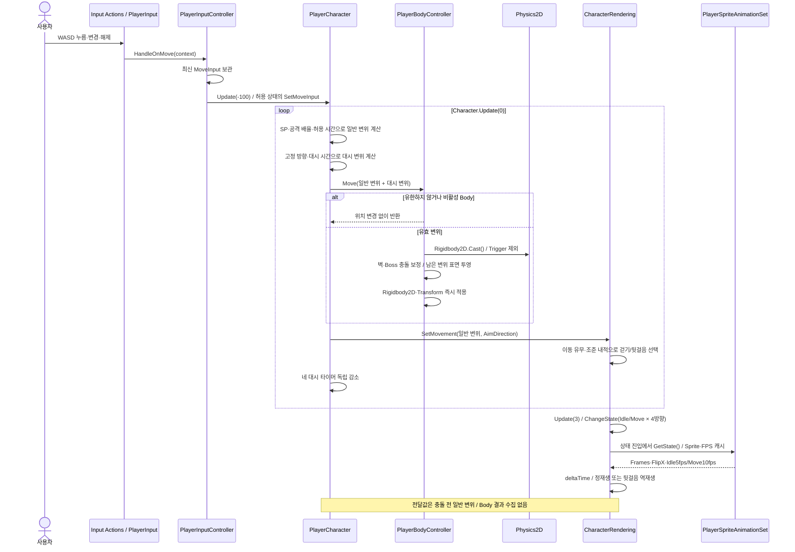

**② 마우스 이동 → 몸체·무기 방향과 뒷걸음 표현**

Look 콜백의 화면 좌표를 Input.Update가 캐시한 카메라로 투영해 Character에 전달한다. Character.Update(0)는 마지막 유효 조준으로 몸체·무기를 갱신하고 일반 이동 변위와 조준을 Rendering.SetMovement에 직접 전달한다. Rendering은 Body 이동 결과를 조회하지 않고 두 벡터의 내적으로 뒷걸음을 판단한다. Update(3)는 Idle5fps·Move10fps를 유지하며 속도 비율을 따로 보관하지 않는다. 대시·생명주기는 기존 전용 상태를 유지한다.

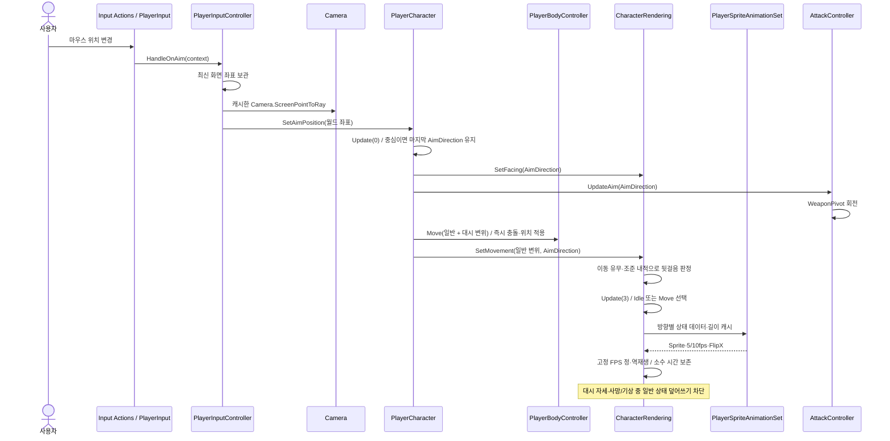

**③ 씬 서비스 준비·입력 차단 → 멈춤과 재개·Title 정리**

외부 입력은 슬롯 선택, 차단을 요청하는 외부 코드, Title 복귀임. 초기 활성 씬 서비스는 Awake·Start에서 준비하고 Stage가 한 프레임을 넘긴 뒤 Map을 먼저 생성·등록·검증함. 그다음 Player 복제의 Spawner.Awake가 Current 수치와 체크포인트 위치를 자동 적용하고 Bind가 대상을 연결함. 입력 차단·해제는 기존 계약을 유지하며 Stop은 Body의 마지막 결과·관성만 정리한다. Character는 이동 불가/리셋에서 Rendering에 이동0을 전달한다. 실제 사망·컷씬 콘텐츠는 후속 Case임.

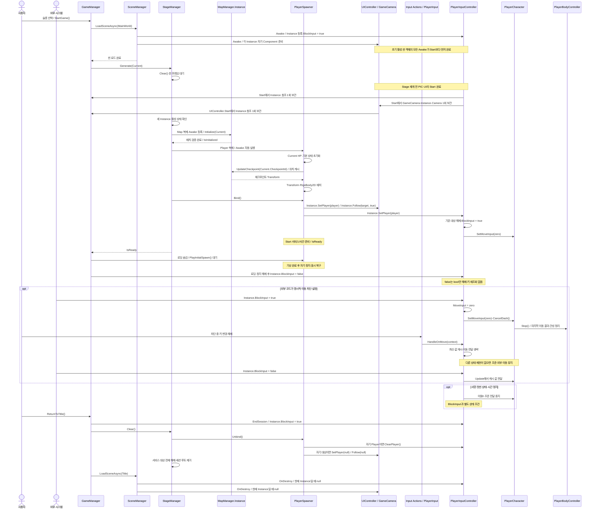

**④ 외부 코드의 Player 재연결·중복 서비스 생성 → 현재 연결 보호**

외부 입력은 준비된 Map 안에서 Player 프리팹 복제·Bind, 기존 Player의 playerSpawn() 재배치 호출, 또는 중복 서비스 생성임. 복제 즉시 Awake가 최초 초기화를 수행하고 재배치는 저장 CheckpointId로 위치를 다시 조회함. 이전 Player 제거는 새 연결을 해제하지 않으며 중복 서비스 제거도 기존 Instance를 지우지 않음. 실제 사망·부활 콘텐츠와 체크포인트 상호작용 때 로컬 값을 갱신하는 최적화는 후속 Case임.

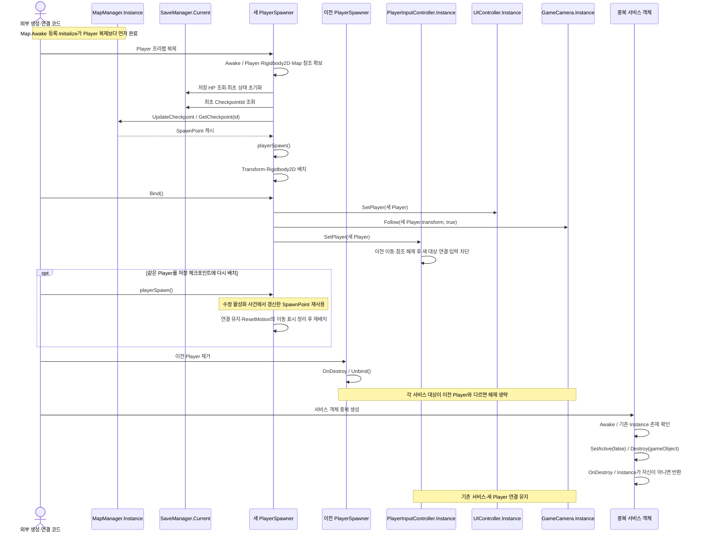

### 2.1.2 F-P02 대시 구현·확인과 Sequence Diagram

**현재 범위**: Space 입력의 일회 요청, 이동 의도 우선·정지 중 커서 방향 대시, Character.Update(0)의 변위 계산→Body.Move 즉시 충돌/적용→일반 변위 전달→Rendering.Update(3), 독립 이동·Dodge·입력차단·쿨타임을 연결한다. 원문 N2의 대시 차단 종료 뒤 기존 WASD 홀드 반영을 유지하며 외부 BlockInput과 대시 자체 입력차단을 구분한다. 당시29묶음은 IsDodge 상태 조회까지의 검사였고, 이후 F-P03에서 공통 ApplyDamage·Hitbox의 실제 Dodge 거부를 연결·검사했다(2.1.3). F-P08의 피격 연출·보호 전체 완료와 구분한다.

**현재 대시 재검증(2026-11-16):** Unity6000.3.21f1의 `project/Logs/PlayerAttackSnapshotDash.log`와 `PlayerAttackSnapshotDash-result.json`에서 컴파일 종료·8묶음 성공·error 빈값·배치 종료0을 확인했다. Space 일회 요청·방향 고정·WASD 복원/기존 쿨타임0.65 보존,0.10초 회피/0.14초 이동,정지/차단·얇은 벽 충돌을 재확인했다. Time.captureDeltaTime이1/30·1/60·1/144초인 순수 대시 거리는 모두2.5074005127이다. 실제 렌더 FPS나 성능 측정값이 아니다. AS2 공격 직후2.50787735는 대시 종료 경계 뒤 프레임 시간의 정상 공격 전진을 포함한다. 대시 구간 자체에는 공격 전진을 더하지 않는다.

**검/검기 최신 정렬 확인:** Idle·이동·Wait의 검은 몸체20 뒤19,실제 공격은 기존19/21 전환,검기는21임을 확인했다. `project/Logs/AttackSnapshot`의 `sword-on-laboratory-floor.png`에서 수정된 뒤 검은2829픽셀,같은 구도의 `sword-old-order-on-same-floor.png`에서 이전 절대−1은0픽셀이었다. 이번 비교는 실제 바닥 위 완전 가림을 재현했다. `attack-on-laboratory-floor.png`의 검기는69610픽셀이다. 캡처 구역은 outside0/corridor-floor1이고 전체 맵 정적 순서0~10과 구분한다. 지표는 `PlayerAttackSnapshotDash-metrics.json`이다.

**최신 실행 범위·한계:** `project/Logs/PlayerAttackSnapshot.log`의 공격18묶음도 success=true·error 빈값·배치0이다. `PlayerAttackSnapshot-verification.json`은 관련23파일의 원본/격리 일치·최종 baseline 변경0과 공격45자산 일치를 기록하며 baseline은 `PlayerAttackSnapshot-source.json`이다. AreaWarningVfx·CircleWarningVfx·SkillController·SlashPresentationFx·DrawEvaporationVfx·DrawVfx·GameCamera7개 동시 런타임 변경은 미동기화 상태여서 전체 최신 원본 검증으로 확대하지 않는다. 기능 검사 성공·배치0과 구분한다. 원본 Editor 수동 플레이·전체 StartupFlow·제출 빌드·성능 측정은 이번 범위가 아니다.

**앞선 캡처 이력:** `project/Logs/DashIntegration`의 이전 절대+1 비교는 검4955→2847픽셀로 몸체에 겹친 손잡이/하단의 부분 가림이었다. 당시 자료를 바닥 전체 가림 재현으로 바꾸어 설명하지 않는다. 위 최신 AttackSnapshot의 절대−1 비교가 별도의 완전 가림 근거다. 이전 대시28/29/19와공격15묶음은 각 당시 확인 이력이다.

| 기능 ID | 사양 상태 | 코드·입력 연결 | 구현·검사 상태 | 남은 아트 / 후속 경계 |
| --- | --- | --- | --- | --- |
| F-P02 | 방향·벽/Boss 충돌·자원 없음·독립 타이머는 Q9~11 및 이번 사용자 요청 확정 | PlayerInputController.HandleOnDash → PlayerCharacter.ApplyDash/Update → Body.Move, Input Actions Dash 버튼·Space와 독립 PlayerInput 프리팹 UnityEvents | 최신 PlayerAttackSnapshot의 대시8묶음·공격18묶음 성공,각 배치0. 이전8/15·28/29/19묶음은 아래 이력 | 대시 전용 Sprite 자세·잔상 간격/투명도·FX와 음향; Hitbox 피해 판정 F-P08·공격 실행 F-P03·사망/체크포인트 콘텐츠 F-P09/10은 별도 |

**이전 대시 구현 확인(2026-11-15 16:17:06 KST)**: 당시 기존23묶음에 F-P02의5묶음을 추가해 총28묶음이 통과했다. 이동/정지/0방향 대체·대각 방향과 거리, Space 홀드의1회 입력·W 홀드 복원, 고속 벽/Boss 충돌·Trigger 통과, 독립 타이머·시간 정지/재개, 상태별 취소·재배치 초기화를 실제 Play Mode에서 확인했다. 당시 격리 저장 폴더는 `project/Temp/StartupFlowChecks/c904bd553d25429db60b39a2019f309d`, 실제 로그는 `C:/Users/park2/AppData/Local/Unity/Editor/Editor.log`이다. 이번 Update/Body 책임 변경의 결과와 구분한다. 실제 Hitbox 피해 판정·최종 대시 Sprite/잔상·사용자 저장 폴더 쓰기·OS 종료·제출 빌드는 확인 범위에 포함하지 않는다.

**검사 준비 수정**: 첫 실행은11묶음 뒤 정지 대시 검사가 실패했다. 검사에서 Rigidbody2D.position만 바꿔 Transform 기준 커서 좌표와 배치 위치가 어긋난 것이 원인이었다. 검사 준비6곳의 Transform·Rigidbody2D 위치와 Physics2D.SyncTransforms를 맞춘 뒤 런타임 코드를 추가 변경하지 않고 전체28묶음을 재실행해 통과했다. 실패한 첫 실행을 대시 런타임 오류나 통과 근거로 기록하지 않는다.


- **이번 Update/Body 책임 변경 확인(2026-11-15 17:27:03 KST)**: Character로 대시 설정·방향·네 타이머와 Update의 모든 이동 계산을 옮기고 Body의 Character/Rendering 역참조·대시/바라보기 API를 제거했다. 원본 Unity6000.3.21f1 프로젝트의 런타임·Editor 컴파일 종료 코드0·어셈블리 재로드와29묶음 Play Mode 성공·오류 빈값을 확인했다. 기존28묶음 재통과에 fixedDeltaTime 0.01/0.05의 Update 대시 거리 보존 검사를 추가했고, Body 합산 검사는 NaN·Infinity·float 최대값의 비정상/오버플로 요청 거부를 포함한다. 결과는 `project/Logs/StartupFlowChecks-result.json`, 격리 저장 폴더는 `project/Temp/StartupFlowChecks/b9a5e6e2b226447ba4f989128e993b01`이며 종료 후 Title 편집 씬 복원 로그를 확인했다. 임시 headless 복제본의 중단한 실행은 이 결과의 근거가 아니다. Notion Class3개·시퀀스7개·현재 결과 저장은 경고 없이 성공했으며 실제 Hitbox 피해·최종 아트·제출 빌드·성능 수치 측정은 별도 미확인 범위다.

**현재 대시 수치(2026-11-16 후속 요청 반영):** PlayerCharacter에 `DashSpeed=24`, `DashDeceleration=87`, `DashDuration=0.14초`, `DodgeDuration=0.10초`, `InputBlockDuration=0.14초`를 적용하고 기존 `DashCooldown=0.65초`는 보존한다. 실제 원작 PlayerAvatar 프리팹의 FastMove 값이며 클래스 초기값20/0.33/0.16과 구분한다. 속도는 v(t)=max(0,24−87t)이고 GetDashDisplacement가 허용 구간을 정적분해 장애물 없는 총거리2.5074월드 단위를 적용한다. 원작의 매 Update 선감속/Euler 이동·종료 프레임 초과가 만드는 FPS별 거리 차이는 복제하지 않는다. 이동과 일반 입력 잠금은 함께0.14초에 끝나므로 추가 회복 잠금은0이다. 회피는0.10초에 별도 종료하며 쿨타임은 시작부터0.65초로 유지한다. 이전14×0.18의2.52 정속·회피0.16·잠금0.24는 과거 튜닝 이력이다.

**입력·상태 계약**: Input Action의 performed만 일회 요청으로 보관하고 같은 Update에서 최신 Move/Look을 반영한 뒤 ApplyDash를 호출한다. 쿨타임이나 상태 때문에 거부된 요청을 재실행하지 않으며 Space 홀드로 반복 발동하지 않는다. 대시 방향은 시작 때 고정하고 진행 중 Move/Aim 변경으로 꺾지 않는다. 이동/입력차단 중 일반 변위를 추가하지 않으며 차단 중 바뀐/계속 눌린 Move 값은 캐시에 남아 종료 뒤 일반 이동으로 반영된다. 당시 IsAttacking은 시작 거부용 최소 상태였으며 이후 F-P03에서 실제 AttackController의 상태 조회로 연결했다(2.1.3).

**취소·초기화·시간**: 외부 차단·사망·컷씬은 CancelDash로 이동·Dodge·입력 잠금을 취소하고 쿨타임은 유지한다. Body.Stop은 마지막 이동 결과·관성을 초기화하며 이동 큐는 없다. 일반 입력0은 대시를 취소하지 않는다. pause는 상태를 보존하고 Character는 일반 이동 표시0을 전달한다. ResetMotion·Character 비활성화·비활성 Body 확인은 이동 표시도 초기화한다. 재개 뒤 남은 상태와 현재 입력으로 계산한다.

**세피리아 근거·채택/생략**:

| 읽은 실제 파일·메서드 | 확인한 구조 | 우리 적용·차이 |
| --- | --- | --- |
| [PlayerInputController.cs](<reference/sephiria/code/ingame code/Assembly-CSharp/PlayerInputController.cs>) `HandleOnDash`351~382 | UI·화면·Block 검사 후 avatar.Dash(aimedPosition) 호출 | 입력 계층의 전달 허용 판단을 유지하고 Space performed를 캐시, 최신 이동/커서가 반영된 Update에서 호출 |
| [UnitAvatar.cs](<reference/sephiria/code/ingame code/Assembly-CSharp/UnitAvatar.cs>) `Dash`3233·Update1177~1183 | CanMove/CanDash 검사, 대시 변위로 일반 변위 교체 후 Rigidbody.RequestMove | Character.Update(0)가 시작 허용·방향·변위·타이머를 관리하고 Body.Move가 같은 호출에서 유효성·충돌·위치를 적용하며 Rendering.Update(3)는 일반 변위·조준만 받음 |
| [CharacterDash_FastMove.cs](<reference/sephiria/code/ingame code/Assembly-CSharp/CharacterDash_FastMove.cs>) `OnDashBegin`36·`DashMoveUpdate`13 | 이동 입력이 있으면 Input.normalized, 없으면 aim-position; 시작 방향 고정·진행 시간·변위 계산 | 실제 PlayerAvatar.prefab1034·2163~2178의 FastMove 연결/값24·0.14·0.10과 감속87을 채택. 클래스 초기값20·0.33·0.16과 구분. 원작 Euler 오차 대신 같은 곡선의 정적분2.5074 사용 |
| [CharacterDash.cs](<reference/sephiria/code/ingame code/Assembly-CSharp/CharacterDash.cs>) `StartDash`93·Update66·StopDash147·ServerCallDashAction175 | 시작 가능 검사, 이동 종료와 별도 Dodge 타이머, 충전 횟수/회복·구덩이 무시·서버 사건 | 독립 타이머·상태 정리 채택. 쿨타임만 제한하고 자원/충전·RPC·스탯 DB·구덩이 충돌 무시·장비별 모듈 생략 |

원작은 UnitAvatar.Update에서 대시 변위가 일반 변위를 덮고0.14초 뒤 일반 이동으로 복귀하며 별도 종료 후 회복 잠금이 없다. 우리 InputBlockDuration도0.14초로 맞추고 차단 중 최신 WASD 캐시의 복원은 N2·Q9를 유지한다. 원작 StopDash(true)의 대시 중 공격 전환은 복제하지 않고 우리 Q10의 공격↔대시 전환 금지를 유지한다. 충전 횟수·회복 구조는 도입하지 않고 기존0.65초 쿨타임을 보존한다. 실제 프리팹/코드의 정적 확인과 원작 실행 측정은 구분한다.

**Notion 기록**: 2.1 Player 표 아래 기존 F-P01 토글 다음의 독립 `F-P02 SequenceDiagram` 토글과4개 Case를 유지한다. 이번 Character.Update·타이머 소유권과 Body 물리 적용 책임을 Class P03·P09·U01 및 F-P01①②③·F-P02①~④에 반영하고29묶음 결과와 함께 연결 도구로 저장해 경고 없이 성공했다. F-S01 사용자 Case를 포함한 기존 기록은 보존했다. 미리보기 설정·화면 확인·이를 위한 UI 조작은 작업 체크에서 제외한다.

**① Space 입력 → 이동 중/정지 중 방향 확정과 시작 허용**

외부 입력은 이동·커서 변경과 Space 누름이다. 콜백은 일회 요청을 보관하고 Input.Update가 최신 Move/Look 전달 뒤 Character.ApplyDash를 호출한다. Character가 행동 허용·중복·입력 잠금·쿨타임과 설정을 확인하고 방향·초기속도24·감속87·이동/잠금0.14초·회피0.10초·기존 쿨타임0.65초를 보관한다. Body는 이 시작 판단에 참여하지 않는다.

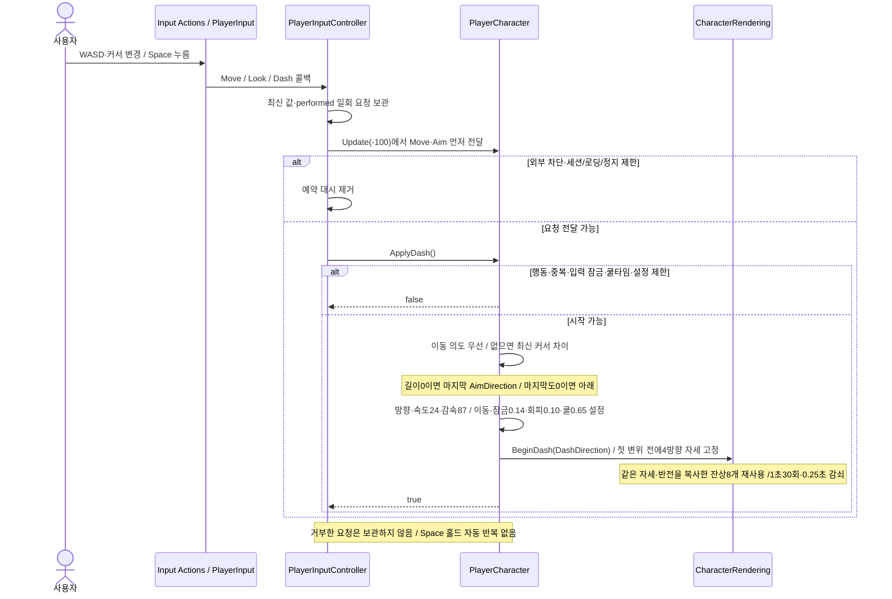

**② Character.Update → 대시 변위 계산·즉시 충돌 적용**

Character.Update(0)가 렌더 프레임의 일반/대시 변위를 계산해 Body.Move에 합산 전달한다. GetDashDisplacement는 v(t)=max(0,24−87t)를 남은 대시 시간 안에서 정적분해 FPS와 무관한 기본거리2.5074를 적용한다. 대시·입력 잠금 종료 경계의 허용 시간 분리는 유지한다. 대시 시간만큼 남은 공격 전진의 시간도 진행하되 그 변위는 버리고, 대시 종료 경계 뒤 남은 프레임 시간의 공격 전진만 합산한다. Body는 요청 큐나 별도 갱신 없이 같은 호출에서 충돌·위치를 적용한다. Character는 일반 변위만 Rendering에 전달하며 대시 방향의 고정 자세·잔상은 Rendering.Update(3)의 별도 상태로 진행한다.

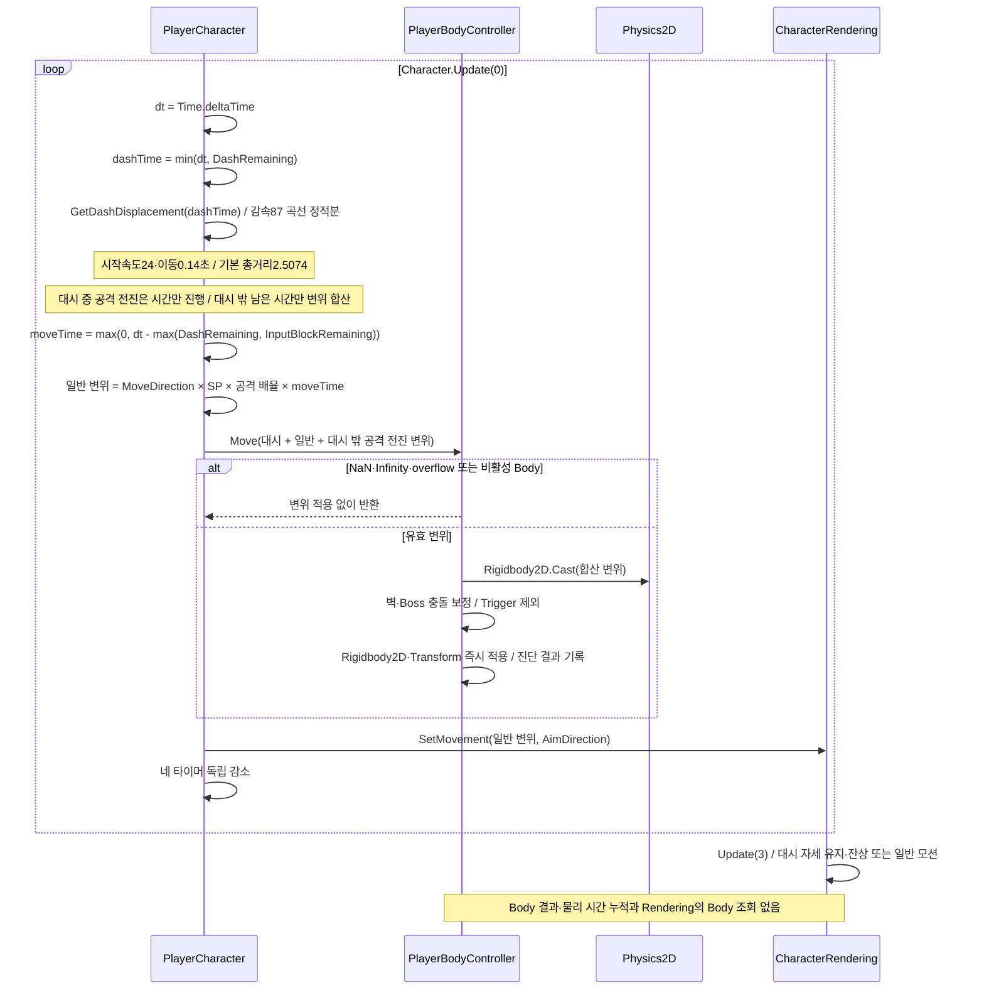

**③ 키 유지·해제와 시간 경과 → 독립 타이머·일반 이동 복원·재사용**

대시 중 WASD는 최신 의도로 유지·변경·0 해제된다. Character.Update는 남은 대시/입력 잠금 구간을 먼저 반영해 변위를 즉시 적용하고 타이머를 감소시킨다. 키 해제는 진행 중 대시를 취소하지 않으며 일반 변위만0으로 만든다. 회피는0.10초에 끝나고 이동/입력 잠금은0.14초에 함께 끝나 추가 회복 없이 현재 WASD로 일반 이동을 재개한다. 쿨타임만 시작부터0.65초까지 남는다. Rendering.Update(3)는 현재 일반 이동 상태로 복귀하며 실제 Hitbox의 Dodge 판정은 F-P08을 따른다.

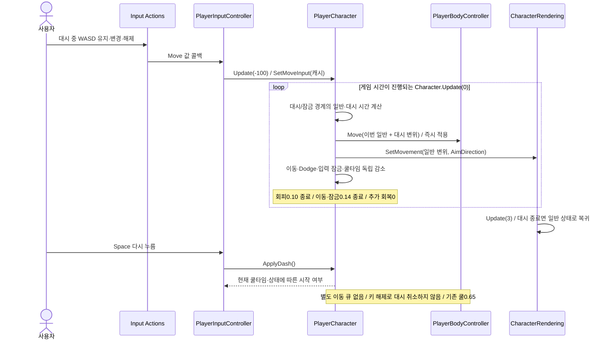

**④ 외부 차단·사망·컷씬·시간 정지·재배치 → 취소와 리셋**

외부 차단·입력/Character 비활성화·사망·컷씬은 Character.CancelDash가 이동·보호·입력 잠금을 취소하고 Body.Stop이 마지막 결과·관성을 정리한다. 이동 큐는 없으며 이동 불가·ResetMotion·Character 비활성화에서 Rendering의 이동 표시도0으로 정리한다. 시간 정지는 감속 경과·남은 상태를 보존하며 재배치는 Character.ResetMotion으로 쿨타임까지 리셋한다. Body 비활성화는 마지막 결과·관성만 정리하고 Character의 다음 Update가 행동·이동 표시를 리셋한다.

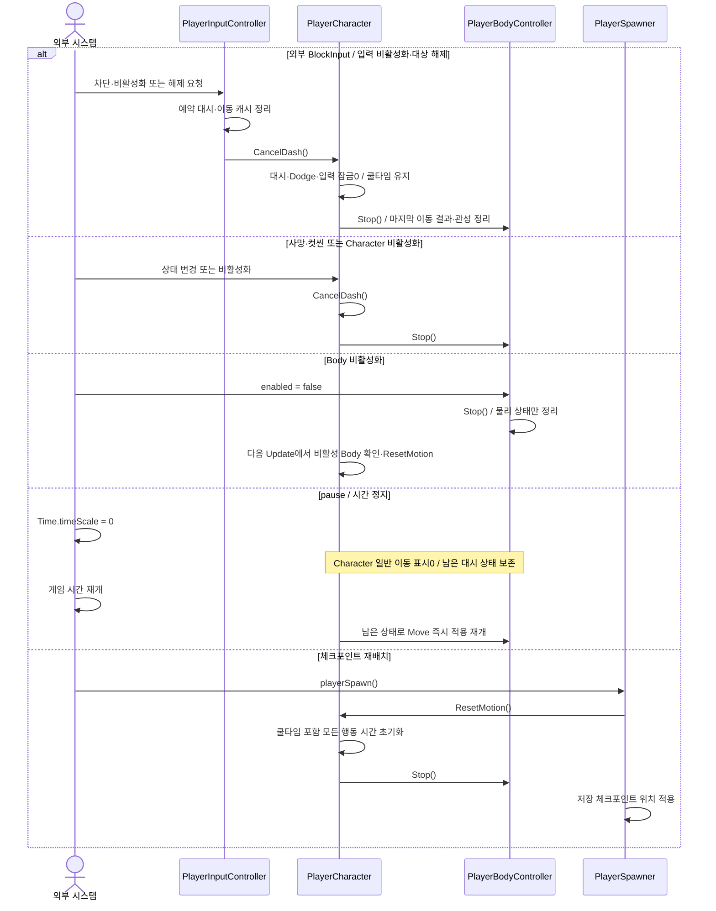

### 2.1.3 F-P03 일반 공격 구현·확인과 Sequence Diagram

**후속 Player 피드백 확인**: 이번 음향·적중 표현 연결을 포함한 공격/피드백23묶음과 원본 반영 범위는 F-U07의 최종 실행·반영 기록을 따른다. 기존 공격 계약과 아래5Case 번호를 유지하고 Case②③에 실제 소리 요청·성공 접점 callback만 추가했다.

**현재 대검 이식(2026-11-16):** Sephiria 기본 대검1·2타의 실제 위치/Euler 곡선·어깨/피벗·입력 예약·콤보 대기·이동 차단/전진을 적용하고, 사용자 확정 R14의1타1–24+2타16–45를54표본의 새3타로 연결했다. 마지막 표본이 원본2타 종료 경계이므로 새3타 길이는53/60초이며 추가 정지 표본을 넣지 않는다. 원래1·2타effect 전체를 합쳐 겹친 픽셀만 중앙왼쪽파랑/오른쪽보라가 앞이고 비겹침은 모두 보존한다.23·24번째는 보라1단계만,25번째부터 두 색,26번째는 보라만2단계 선행,35번째까지 표시하고36번째부터 둘 다 없다. 두 시각 베기는 큰피해1회다. 이전 X변형·54장 재구성은 제작 이력이며 확정 이미지 출처는3.3.8을 따른다.

**이번 후속 변경·확인(2026-11-16):** 사용자는 이동 입력 유무와 무관하게 공격 전진의 기본 거리를0.5로 통일했다. `AttackDashSpeed=10f/3f`·`AttackDashDuration=0.3f`의 선형 감속 면적은0.5이며 실제 거리는 SP/basicSP를 곱한다. 무입력 배율 필드·거리 분기는 제거했고 방향은 실제 각 타 시작의 이동 입력,입력0이면 해당 타의 커서 조준으로 고정해 타격 시 적용한다. 높은 AS의 다음 타 준비가 이전 전진을 바꾸지 않도록 활성 전진 속도 캐시는 유지한다. Idle·이동·Wait2/Wait3의 검19,실제 공격19/21·검기21과 Wait 위치/각도 곡선은 유지한다. 원작의 타격 순간 입력 조회·기본 거리0.6과 구분한 사용자 확정 변경이다.

**현재0.5 후속 검증:** `project/Logs/PlayerAttackUnified.log`·`PlayerAttackUnified-result.json`의18묶음과 `PlayerAttackUnifiedDash.log`·`PlayerAttackUnifiedDash-result.json`의8묶음이 각각 success=true·error 빈값·배치 종료0으로 통과했고 두 실행 모두 컴파일 종료·C# 오류0을 확인했다.1·2·3타의 입력/무입력 전진은 모두0.5이며 준비 중 입력 반전/해제·커서 변경과 AS2의 이전 전진 수명 분리를 확인했다. 기존544개 검 모션·54개3타 FX·입력/콤보·독립 판정·3타 단일 피해·Idle/이동/Wait 검19·실제 공격19/21·검기21·실제 바닥 표시와 Title 정리도 확인했다. `PlayerAttackUnified-verification.json`에서 관련23파일·45자산의 원본/격리 일치와 기준선 이후 변경0을 확인했다. 동시 작업8개 런타임은 미동기화로 제외했으므로 전체 최신 원본 검증은 아니다. Editor 검색 초기화 예외는 관찰됐으며 게임 검사는 완료했다. 원본 Editor 직접 Play·제출 빌드·성능 측정은 미실행이다. 아래0.3/0.6 검사는 직전 기준선이다.

**직전 snapshot 기준선:** `project/Logs/PlayerAttackSnapshot.log`·`PlayerAttackSnapshot-result.json`에서 컴파일 오류0·18묶음 성공·success=true·error 빈값·배치 종료0을 확인했다.1·2·3타 모두 무입력 시작 후 준비 중 키/커서가 바뀌어도 시작 커서 방향으로0.3,이동 입력으로 시작한 뒤 준비 중 해제해도 원래 방향으로0.6을 진행했다. AS2에서 다음 타가 시작돼도 이전 활성 전진 방향/속도는 다음 타격 전까지 유지하고 그때 해당 타의 snapshot으로 전환했다. 기존544개 검 모션·54개3타 FX·입력 무시/예약·콤보·독립 판정·3타 단일 피해·재활성/Title 정리도 재확인했다. 대시8묶음 재검증과 뒤 검19/실제 공격19·21/검기21·최신 바닥 캡처,관련23파일/45자산 일치·동시7파일 제외·검색 초기화 예외는2.1.2를 따른다.

| 기능 ID | 사양 상태 | 코드·입력 연결 | 구현·검사 상태 | 남은 아트 / 후속 경계 |
| --- | --- | --- | --- | --- |
| F-P03 | 원작 기본 대검1·2타 계약 이식·R14 새3타와3타 입력/회복 추론 위임 | Input Actions → PlayerInputController의 새 눌림/홀드 → PlayerCharacter.ApplyAttack → AttackController의 곡선/버퍼/FX/전진 → 독립 CollisionBox → Hitbox → Character.ApplyDamage | 코드·검기/클립·프리팹 연결 반영. 최신 Unity 실행 결과는 이 절의 검증 기록을 기준으로 구분 | 전용 공격 몸체 Sprite·음향의 최종 청감·실제 화면의 최종 조작감·제출 빌드·성능 측정은 별도 |

**책임·시간 계약:** Input.Start의 Camera·GameManager 고정 참조를 재사용한다. Update(-100)는 Move/Look·Space 일회 요청 뒤 공격 홀드와 performed 일회 눌림을 전달한다. PlayerCharacter가 공통 행동 허용을 한 번 검사하며 공격 중 새 클릭은 AttackController가 초기 무시/예약을 판단한다. Character.Update(0)는 공격 종료 후에만 홀드/예약으로 다음 타를 요청하고 일반 이동+대시+공격 전진을 Body.Move에 합산한다. Rendering.Update(3)의 몸체 방향도 공격 중 AttackDirection을 따른다. Attack.Update(10)는 같은 AS 적용 경과로 Animator를 수동 샘플하고 생성 이벤트를 처리한다. Animator.speed=0·Play(normalizedTime)·Update(0)를 사용하며 피해 Animation Event는 생성하지 않는다. Wait2/Wait3는 각각1/6게임초로 AS와 독립이다. Idle은 원작 곡선을 유지한다. 진행 중 공격↔대시 취소 전환은 허용하지 않는다.

**원작 수치와 프로젝트 설정 구분:**

| 항목 | 현재 기본값·계산 | 근거·구분 |
| --- | --- | --- |
| 기본 이동/공격 | SP4.4·AD10·AS배율1 | SP는 원작 PlayerAvatar 기본값, AD10·AS1은 프로젝트 기본값 |
| 공격 길이 | 1타0.6초/A,2타0.73333335초/A,새3타53/60초/A | 1·2타 원작 clip,3타 R14의54표본 직접 연결 |
| 입력 일부 무시/예약 | 1·2타 시작1/30초/A 이전 짧은 클릭 버림, 이후 클릭 한 번 예약 | 원작 AllowInputBuffer ATTACK. 허용된 예약은 해제로 지워지지 않음 |
| 새3타 예약 허용 | 35/60초/A부터 허용,53/60초/A에 다음1타 가능 | 마지막 검기 뒤 회복을 근거로 추론한 정책. 원작3타에는 예약 허용 이벤트가 없음 |
| 콤보 대기/추가 간격 | 1·2타 종료 뒤1/6게임초,AS 비적용 / 추가 쿨다운0 | 대기는 강제로 기다리는 쿨다운이 아님 |
| 타격/검기 생성 | 1타11/30초/A,2타7/30초/A,새3타22/60초/A | 원작1·2타 이벤트 / 새3타 첫 검기F23 |
| 생성된 판정 수명 | 각0.15게임초 고정,AS 비적용 | 원작 기본 대검 MeleeCollision 수명. 새 타와 독립 |
| 검기 재생 | 1·2타4장·20Hz·0.2게임초 고정 / 새3타6합성 상태·F23~35 | 원작1·2타는 생성 후 AS 비적용,새3타는 확정 모션 시간에 AS 적용 |
| 공격 중 일반 이동/전진 | 입력 이동 배율0 / 각 타 시작 입력을 고정하고 타격 시0.3게임초 감속. 입력 방향,입력0이면 커서 방향으로 모두 기본거리0.5×SP/basicSP | 사용자 확정: 초기속도10/3의 감속 면적0.5,입력별 거리 분기 제거. 원작은 타격 순간 입력 조회·초기속도4·기본거리0.6. 전진 시간 AS 비적용 |
| 사각 기하/강화 피해 | 크기(1.5,1),오프셋(0.85,0),3타 피해 배수1.5 | 기존 프로젝트 튜닝 유지. 원작 반경2 판정·3타 피해 배수로 교체한 것이 아님 |

A는 현재 Character.AS다. 원작은 (100+AttackSpeed)/100×(1+attackSpeedAmplify)이며 기본 대검 증폭은0이다. 프로젝트의 AttackDuration0.6은 원작 클립 전체의 공통 시간 배율 기준이고 기본 배율1이다. 이전0.36초·판정0.09~0.21초·쿨다운0.08초·콤보0.8초·이동0.35는 초기 동작 확인 이력으로 현행 값이 아니다.

**피벗·앞뒤·검기 계약:** 원작 기본 어깨(.15625,.4375)에 위/아래±.0625를 적용한다. 북쪽 조준은 어깨(.15625,.5)·SwingPoint +Y1이므로 Player 기준 검기피벗(.15625,1.5)다. 우리+X 조준 부모는 어깨(sign×.15625,위?.5:.375),조준 회전·localScale(1,sign)을 사용하고 클립 위치(x,y)를(y,-x)로 바꿔 원작 행렬을 보존한다. 원본70×66·피벗(35,33)·16PPU와 검/검기의 고정 정렬을 유지한다.1타는11/30초부터 검 앞,2타는0.3초부터 검 뒤이며 새3타는 연결한 원본 구간의 정렬을 따른다. 검기는 생성 당시 방향·반사·Player 상대 위치를 보존하고 위치만 추종한다. 서로 수명이 겹치는 검기는 독립 재사용 슬롯을 사용한다.

**판정·피해 계약:** 각 AttackHit는 DamageInstance·고정 방향·적중 목록·잔여시간을 독립 보관한다. 높은 AS에서 다음 타가 먼저 시작돼도0.15게임초 수명을 유지한다. 사각 Cast는 결과 포화 시 확장/재질의한다. 기존 관측용 Gizmo는 제출 정리에서 제거했다. 같은 타에서 실제 피해를 받은 Character는 여러 Collider·다음 조회에도1회만 맞으며 거부된 대상은 다음 조회에서 다시 판정할 수 있다. 새3타는 첫 검기에 판정/전진을 한 번만 생성하고 두 색/되베기에서 피해를 추가하지 않는다. 자기 공격·비활성 Hitbox·유효하지 않은 피해는 제외하며 최종 허용은 수신자가 판단한다. 비전투는 피해 면제 조건이 아니고 벽 이동 충돌과 공격의 공간 질의는 별개다.

**중단·보존 계약:** 초기 무시 구간의 짧은 클릭은 저장하지 않지만 허용된 예약은 해제 뒤에도 한 번 남는다. 긴 프레임이 콤보창을 넘어도 허용 예약 소비를 우선한다. OnDie·컷씬 false→true·외부 차단·대상 해제·비활성화·재배치는 모든 판정/검기/전진/예약을 취소한다. 실제 사망 사건과 저장 HP 복원·IsDead 직접 대입은 구분한다. 질의 중 취소는 CollisionBox의 질의 세대를 무효화해 후속 피해·기록 추가를 막고 취소한 Idle 자세를 보존한다. 시간 정지는 취소 없이 남은 게임 시간을 보존한다. Input의 홀드 캐시와 Character 내부 의도는 별개이며 공격 무기는 OnDie에 중복 구독하지 않는다.

**실제 읽은 원작 근거·변형:** [상세 분석](archive/03_Analysis/Sephiria_Attack_Integration_20261116.md)과 [P05 대응표](REFERENCE_CODE_MAP.md)를 따른다. WeaponSimple_GreatSword98~118·167~197의 홀드/버퍼,WeaponControllerSimple479~500·584~647·1020~1030의 이동 차단/종료/AS,GreatSword_Attack1/2 이벤트와 AnimationWrapper4140~4481·GreatSword_New_WaitForAttack2/3의 대기 곡선을 실제 확인했다. WeaponShoulder·WeaponSimple.Initialize/FX 생성,NewWeaponFireData·SpriteFx·MeleeCollision와 기본 대검/Player 프리팹에서 피벗·4/.3 전진·고정 검기/판정 수명을 확인했다. 고정 무기 하나에 필요한 책임만 적용하며 네트워크·무기 교체·DB·높이/세력·원작 범위/피해 밸런스는 가져오지 않는다.

**직전 기준선(2026-11-16):** 대시/정렬 수정 뒤 Unity6000.3.21f1 격리 실행의 `project/Logs/PlayerAttackAfterDashIntegration.log`에서 컴파일 종료·`ALL PASSED (15 checks)`·배치 종료0을 확인했고 `project/Logs/PlayerAttackAfterDashIntegration-result.json`은 success=true·error 빈값이다. 실제 Input System의 초기 클릭 무시·허용 후 누름/해제 예약·홀드1→2→3→1,4방향544개 검 모션 표본과54개3타 FX/가림,AS·콤보 경계·0.6 전진·AS2의 이전 판정 수명·3타 단일 피해·비활성→재활성의 Idle/speed1·재공격·Title 정리를 재확인했다. 워밍 후3타 F23/25/26/30/33 캡처는 앞선 공격 이식 확인 자료다. 현재 관련23파일과45자산의 원본/격리 일치·동시 변경5파일 제외·미해결 Editor 검색 초기화 예외는2.1.2의 실행 범위·한계를 따른다. 이전 전체35/아트16묶음과 별개이며 원본 Editor 수동 플레이·제출 빌드·성능 측정 완료를 뜻하지 않는다.

**적용·기록 상태:** 최초 공격 반영의45산출물 일치·실제 변경22개·GUID 보존과 당시14개 C# 사본 일치는 `project/Logs/PlayerAttackIntegration-publish.json`의 이력이다. 직전 입력 snapshot/무입력 감소·비공격 검 뒤 정렬의 이력은 `PlayerAttackSnapshot-verification.json`의 관련23파일·45자산 일치다. 이번 입력 유무별 기본거리0.5 통일은 `PlayerAttackUnified-verification.json`의 새18+8묶음·관련23파일/45자산 일치로 확인했다. 동시 작업8개 런타임 제외 범위를 유지하며 전체 최신 원본 검증으로 확대하지 않는다. Notion Class P03/P05와 기존 `F-P02 SequenceDiagram`4Case·`F-P03 SequenceDiagram`5Case에 실제 감속·공격 전진 대체·몸체 기준 정렬/Idle 조준을 저장했다. 이번0.5 통일도 Notion Class P03의 해당 문장·P05와 기존 F-P03의5Case/검증 기록에 반영했고 입력별 거리 분기는 제거·방향 분기는 보존했다. 기존 기능/Case와 다른 Slash·Draw 내용은 보존했고 연결 도구는 경고 없이 성공을 반환했다. 미리보기 설정·화면 확인·마우스/브라우저 조작은 수행하지 않았다.

**① 좌클릭 누름·해제 → 일회 눌림·홀드 전달과 공격 허용·방향 확정**

시작 입력은 좌클릭과 커서 변경이다. Input은 performed의 일회 눌림과 유지/해제를 구분해 전달한다. Character가 공통 행동 상태를 검사하고 최신 커서 좌표를 넘기면 AttackController가 새 타를 시작하거나 허용 구간의 클릭 한 번을 예약한다.1·2타 시작1/30초 이전, 새3타35/60초 이전의 짧은 클릭은 저장하지 않는다. 이 시점들은 AS로 나눈 실제 게임 시간에 해당한다.


**② 공격 중 이동·조준 변경 → 입력 이동 차단·강제 전진과 시작 방향 유지**

기본 SP는4.4이고 공격 중 일반 입력 이동 배율은0이다. 실제 각 타가 시작될 때 MoveDirection을 고정하고, 입력0이면 그 타의 커서 조준 방향을 사용한다. 입력 유무에 관계없이 초기속도10/3으로0.3게임초 동안 감속해 기본거리0.5를 전진하며 SP/basicSP를 곱한다. 입력별 거리 분기는 없다. 준비 중 WASD를 바꾸어도 이번 타의 고정값은 바뀌지 않고 다음 타 시작에 새로 읽는다. 실제 전진 발동은 기존 타격 생성 시점이다. 이전 타의 진행 중 전진과 이번 타의 준비값은 분리해 새 타격 전까지 방향/속도를 보존한다. Body.Move가 충돌·위치를 즉시 적용하며 몸체·무기는 AttackDirection을 유지한다. Idle·이동·콤보 Wait의 검은 몸체 뒤19로 두고 실제 공격 중의 기존 앞뒤 전환은 유지한다. Wait의 위치/각도 곡선은 바꾸지 않는다.

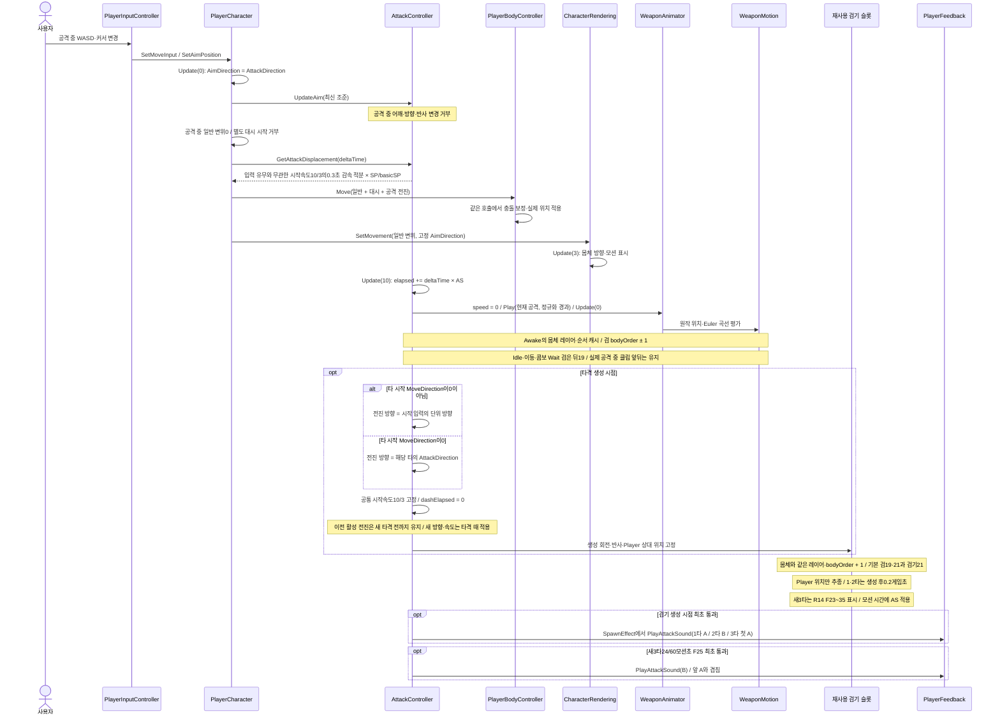

**③ 판정 구간 도달 → 독립 수명·실제 Collider 조회·중복 방지·피해 적용**

1타11/30초·2타7/30초·새3타22/60초의 모션 시점에 판정을 한 번 생성한다. 각 판정은 생성 당시 피해·방향·수신자 목록과0.15게임초 수명을 독립 보관한다. AS가 높아 다음 타가 먼저 시작돼도 이전 판정을 닫지 않는다. 새3타는 두 시각 베기 전체에 판정/피해1회다. 결과 포화는 확장 후 재질의하며 피해를 받은 같은 수신자는 한 타에 다시 맞지 않는다. 질의 중 취소는 후속 대상·취소 후 기록 추가를 멈춘다. 성공 callback은 피해 처리 전에 수신 Collider.ClosestPoint로 보정해 보존한 접점·호출 angle로 PlayerFeedback의 적중음/FX를 한 번 요청하며 실패·중복에는 생략한다. 자세한 표현·음향 흐름은 F-U07 Case②를 따른다.

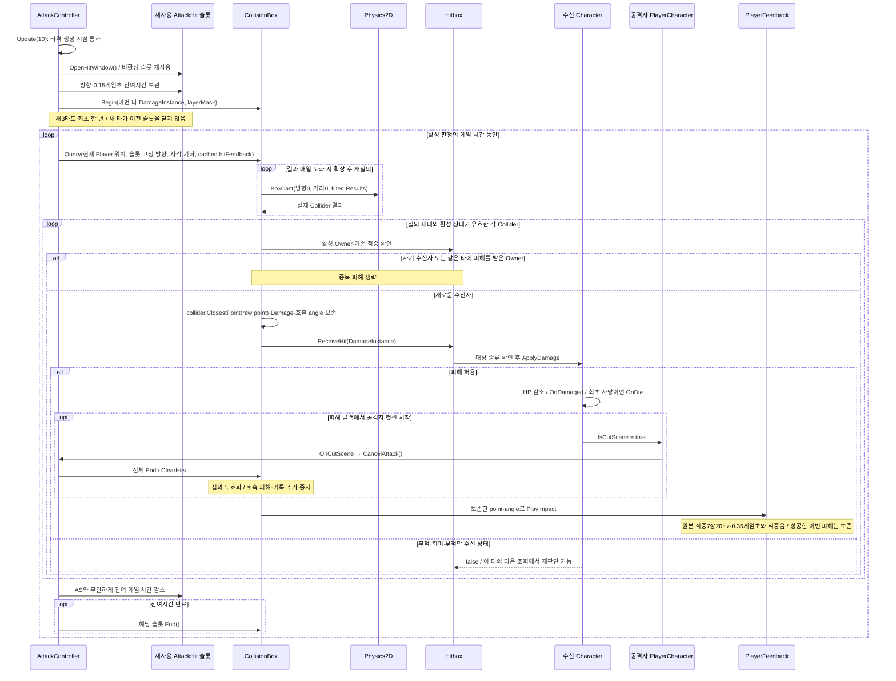

**④ 홀드·허용 클릭 예약·해제·시간 만료 →3콤보와 다음 공격**

홀드는 현재 타가 끝난 뒤 다음 타를 요청한다. 공격 중에는 새 눌림만 초기 무시/예약 판정을 받으며, 허용된 예약 한 번은 버튼을 떼어도 소비된다.1·2타 종료 뒤1/6게임초 안에 다음 타를 시작할 수 있고 이 대기는 AS와 무관하며 강제로 기다리는 쿨다운이 아니다. 새3타는 마지막 검기 이후35/60초부터 예약을 받고53/60초에 종료해 다음1타를 허용한다. 이는 사용자 위임에 따라 추론한3타 정책이며 원작3타의 무예약 동작과 구분한다. 추가 쿨다운은0이다.

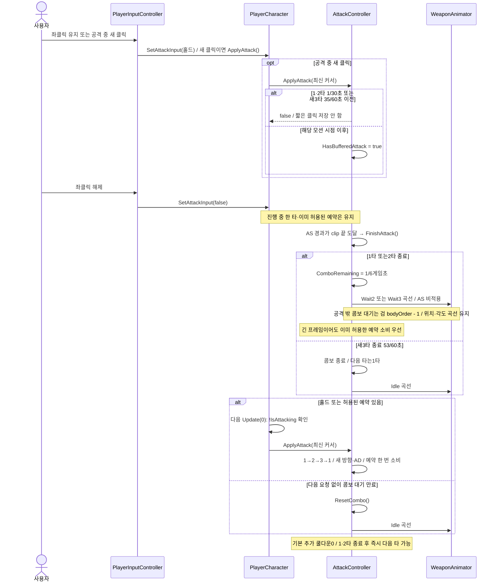

**⑤ 차단·사망·비활성화·시간 정지·재배치 → 중단 또는 상태 보존**

외부 입력 차단·대상 해제, 실제 사망/컷씬 진입, Character/Attack 비활성화와 재배치는 취소 경로로 모인다. 모든 판정·검기·전진·예약·콤보를 정리하고 Idle을 즉시 평가한다. 원작 Idle의 위치/회전 곡선을0으로 덮지 않는다. 비활성 중 Animator 평가는 생략하고 다시 활성화한 OnEnable에서 Idle·speed1을 복구한다. 시간 정지는 진행 상태와 독립 판정/검기 수명을 보존하며, 비치명 피격 자체는 경직을 만들지 않는다. Title 씬 언로드도 같은 비활성화 경계에서 이전 Player의 표시·예약을 제거한다.

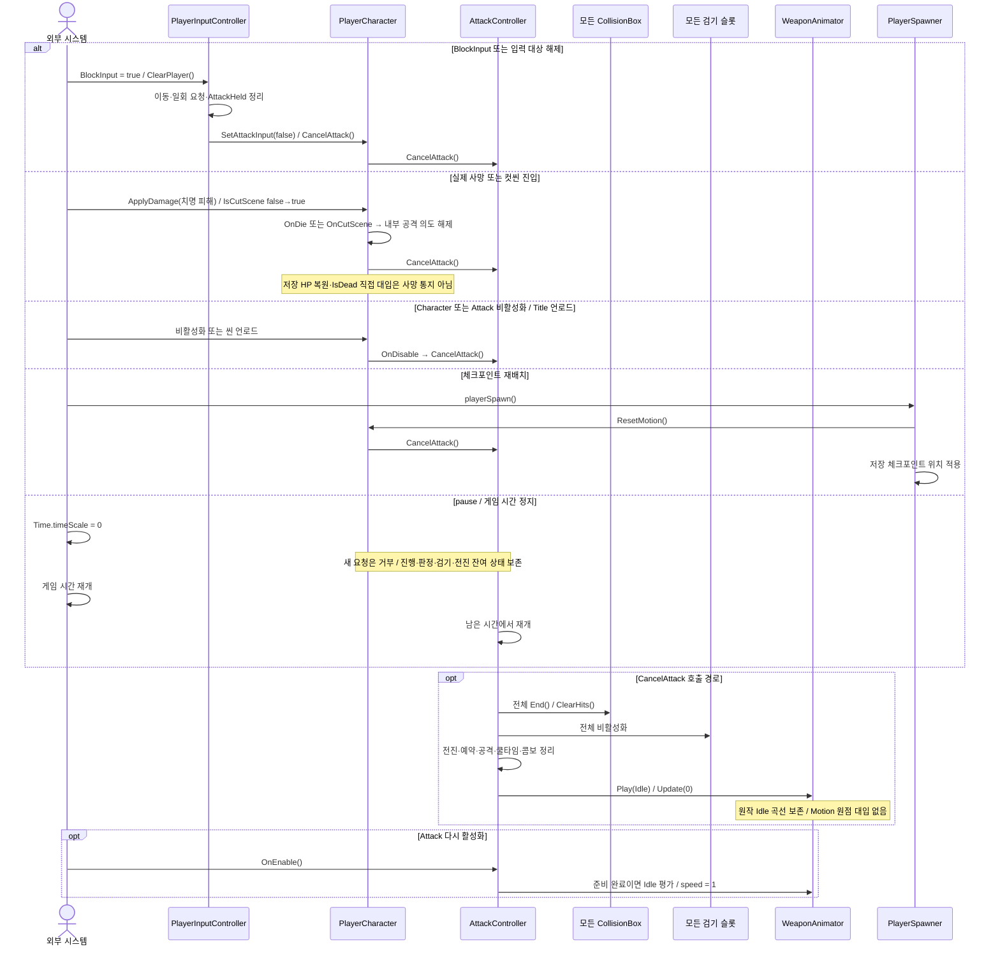

### 2.1.4 F-P04 Draw 진입·종료·입력 전환과 임시 점/Line 표현

**F-P11 후속 확인(2026-11-16)**: 기존 Draw 흐름과 Case 번호를 유지하고 CharacterRendering의 자식 입자 캐시·SetDrawHighlight 상대 순서 적용/복원을 보완했다. 게임 정지 중 오라 정지·암전 위 강조·몸 뒤/앞 관계·종료 복귀를 새 고정 효과/오라11검사에서 확인했으며 구체 결과/원본 반영 범위는2.1.11을 따른다.

**2026-11-16 표시 갱신:** 아래 임시 점/LineRenderer 검증은 당시 이력이다. 현행은 점 객체 없이 매끄러운 이미지 FX 선을 표시하며 실제 적용·이번 검사 상태는3.3.13을 따른다.

**현재 범위·상태**: 일반 Player 입력을 Draw 전용 액션 맵으로 실제 전환하고 시간·HUD·암전·카메라·Player 강조를 진입/종료에 맞춰 연결했다. Draw 확인에 필요한 점 선택·고정 길이 미리보기·확정과 교체 가능한 임시 점/선 VFX도 연결했다. **원본 Unity6000.3.21f1 런타임/Editor 컴파일·41묶음 Play Mode 성공과 임시 Draw 화면을 확인**했다(2026-11-15 19:45:51 KST). 이41묶음은 F-P04 당시 검증 기준선이다. 이후 F-P05 전체 점 편집 확인은2.1.5, Player 원본·Skill 수명/만료·소비 경계는2.1.6을 따른다. F-P07 Slash 완료로 확대하지 않는다.

| 기능 ID | 사양·이번 연결 | 담당·호출 | 확인 상태 | 남은 아트 / 후속 |
| --- | --- | --- | --- | --- |
| F-P04 | Shift 진입/취소, Draw 전용 M1/R/F·Look, 일반 행동 차단, UI/시간/카메라 복구, 재Draw 취소의 기존 Line 보존 | PIC 입력 맵→Character 공통 시작 허용→Skill 자체 모드/쿨·Player 원본/수명·전환 조정→Drawer 기하·DrawVfx 표시, GameManager 시간·UI/Camera 각자 표시 | 당시41묶음·임시 화면 확인, 최신48묶음 회귀 성공(2026-11-15 20:41:35 KST). F-P05/F-P06 상세는2.1.5·2.1.6 | 최종 점·검기 Line·커서·암전/줌/HUD 모션·음향, SlashF-P07 |

**책임 경계**:

| 담당 | 이번 책임 | 다른 쪽에 맡기는 내용 |
| --- | --- | --- |
| PlayerInputController | Player↔Draw 액션 맵과 현재 모드의 입력 사실·커서 전달, 전환 경계 요청 캐시 정리 | 공통 행동 허용·점 기하·Line 보관·전역 시간 |
| PlayerCharacter | 활성/준비·사망·컷씬·공격·대시/잠금 등 공통 Draw 시작 허용, 자기 사건의 강제 종료 연결 | 스킬 자체 쿨·Draw 진행·편집/표현 |
| SkillController | Draw 모드·스킬 쿨·Player.CurrentLine 저장/수명 관리, 진입/취소/확정·강제 중단의 전환 조정 | 점/선 기하 계산·물리 이동·카메라/UI 내부 표시 |
| LineDrawer / Line | 임시 점0/1/2·고정 길이 방향·미리보기/확정 값 / struct 경로 데이터 | 시간 정지·입력 맵·표현 프리팹·확정 값 보관 |
| DrawVfx / UI_Draw / CharacterRendering | 점/선 프리팹 표시 / 암전·안내 / Player 강조 sorting과 원래 값 복구 | 입력 허용·데이터 확정·쿨타임 |
| GameCamera / GameManager | 커서 가중 중심·Draw 줌/기존 상태 복구 / 일반 pause와 Draw pause의 OR로 최종 게임 시간 적용 | 점 기하·스킬 시작 허용 |

**입력·시간 계약**: Shift는 홀드가 아닌 누름 요청으로 진입/취소한다. Draw에서는 M1이 점, R이 임시 점 전체 초기화, F가 유효한 두 점 확정이며 WASD·대시·일반 공격은 전달하지 않는다. PIC는 Draw 라우팅을 기존 CanMove(Time.timeScale>0) 게이트보다 먼저 선택하므로 게임 시간0에서도 편집 가능하다. 액션 맵 전환 시 예약 입력을 비워 같은 Shift가 즉시 취소로, 점 클릭이 일반 공격으로, F 확정이 다음 일반 행동으로 새지 않게 한다. Q9에 따라 Player·Boss·이동·공격·대시·스킬 쿨타임·Line/Buff 게임 시간은 정지하고 UI·카메라·Draw 입력/임시 표현만 unscaled로 계속한다. GameManager는 일반 IsGameplayPaused와 IsDrawPaused를 구분하며 Draw 종료가 외부 정지를 해제하지 않는다.

**초기화·종료 계약**: PlayerCharacter.Awake(0)는 자기 Skills를 확보하고 SkillController.Awake(20)는 helper를 준비한다. Map과 Player 복제·입력 대상 연결 뒤 Start에서 이미 준비된 GM/PIC/UI/Camera 참조를 한 번 캐시하고 사용한다. 모드가 변할 때만 전환을 요청하며 Update에서 Instance/Find를 다시 찾지 않는다. OnDie→ResetSkills는 확정 Line·임시 점·스킬 상태를 정리하고, OnCutScene→CancelDraw·Input 차단/해제·Player/스킬 비활성화·제거도 Draw가 소유한 전환을 복구한다. 취소·확정·중단이 겹쳐도 다른 정지를 풀거나 이미 끝난 전환을 다시 열지 않아야 한다. 일반 CutsceneController 전체를 새로 만드는 대신 Draw 전용 조정과 기존 사건 연결을 사용한다.

**기하·표현 교체 계약**: Q7의 보존 규칙과 이후 PlayerCharacter 원본·SkillController 수명 관리 요청이 원문 초기 Case3-7·이전 소유 배치를 대체하므로 재Draw 진입/취소는 이전 CurrentLine을 유지하고 새 확정 때만 교체한다. 첫 점은 시작점, 두 번째 점은 방향이며 실제 끝점은 고정 LineLength를 사용한다. 같은 점·유한하지 않은 좌표·두 점 이후 추가 선택은 거부하며 R은 임시 편집만 초기화한다. DrawVfx의 Point/PreviewLine/Line GameObject 프리팹 슬롯을 최신 표현으로 교체할 수 있게 하고 표시 루트의 위치·각도·길이/폭 스케일만 갱신한다. 선 루트는 +X 방향의 단위 길이/폭을 기준으로 하며 Sprite·Particle/VFX 세부는 자식에 둔다. 교체한 자체 애니메이션/Particle도 정지 중 재생하려면 해당 에셋의 unscaled 설정이 필요하며 임시 표현을 최종 아트로 보지 않는다. 이번 기본 LineLength6·LineWidth0.25·짧은 Draw 대기0.35초·확정 뒤 Slash 대기0.15초·DrawZoom6.5와 암전/정렬 값은 구현 확인용 초기 튜닝이다. 이전 DrawAimWeight0.35·DrawFollowDuration0.3은 후속 Gungeon 방식 적용으로 제거했다(아래 Draw 카메라 항목).

**읽은 원작·적용 차이**: Sephiria SkillController.LocalCastStart261·OnBeginCastAnimation379·OnEndCastAnimation457·CancelAction356의 시작 조건과 자기 차단/표현의 대칭 복구, WeaponSkillController.OnWeaponSkillButtonDown218의 준비/쿨 확인을 참고했다. 공통 시작 상태는 우리 Character로 분리하고 슬롯·마나·무기별 스킬·네트워크는 도입하지 않는다. TargetTracker.LateUpdate51·SetTempTarget254/ResetTempTarget274·SetZoom286과 Dungreed PlayerTracker.Awake21/LateUpdate38의 target/offset을 읽어 기존 target/줌 보관·가중 중심·unscaled 전환에 적용한다. 원작의 방 경계·2P·후처리는 제외한다. CutScenePlayer.CutSceneCoroutine48의 입력 차단/복구는 책임 경계만 참고하며 우리 Draw 전용 액션 맵·두 점 고정 길이 편집에 동일한 원작 구현은 없다. 파일 위치는 REFERENCE_CODE_MAP을 따른다.

**임시 자산·연결 위치**: `PlayerDrawSetup`의 Connect Draw Mode는 기존 Player/GameUI/PlayerInput 프리팹 GUID와 다른 구성을 보존하고 필요한 참조만 추가한다. `Assets/Prefabs/Draw/DrawPoint.prefab`·`DrawPreview.prefab`·`DrawLine.prefab`·`DrawShade.prefab`, `Assets/Graphics/TemporaryDraw/Pixel.png`·`Draw.mat`는 없을 때만 생성하고 재실행 때 기존 자산을 재사용한다. 점·암전은 SpriteRenderer, 선은 단위 로컬 기하의 임시 LineRenderer+DrawLineVfx이며 URP 기본 Unlit 재질을 복제해 사용한다. DrawVfx의 세 프리팹 슬롯과 UI_Draw의 ShadePrefab도 null일 때만 임시 기본값을 넣으므로 최신 자산 연결을 덮어쓰지 않는다. 기존 기본 선에 폭 어댑터가 없을 때는 스타일·GUID를 보존하고 필요한 DrawLineVfx 컴포넌트만 추가한다. 임시 모양 재생성을 최종 아트 갱신으로 간주하지 않는다.

**검증 상태(2026-11-15 19:45:51 KST)**: 원본 Unity6000.3.21f1 런타임/Editor 컴파일 종료 코드0·어셈블리 재로드와 StartupFlowChecks의 success=true·41개·error 빈값을 확인했다. 기존35묶음에 실제 Shift의 전용 맵 전환/시간0·표시, 점/미리보기/R/F 확정과 클릭 누출 방지, 재Draw 취소 보존·확정 교체/월드 좌표·표현 재사용, Character 공통 제한/Skill 쿨과 정지 시간, 사망·컷씬·차단·비활성화 즉시 복구, 외부 pause 중첩·입력 대상 해제의6묶음을 추가했다. 임시 선은 BakeMesh로 실제 월드 폭을 확인한다. 결과는 `project/Logs/StartupFlowChecks-result.json`, 격리 경로는 `project/Temp/StartupFlowChecks/c4cdb6b088fc4d7fae682cd7e5037c59`다. 실제 `project/Temp/DrawValidation.png`(19:45:46)의 밝은 Player·어두운 월드·청록 점2개·가늘고 고정 길이인 선·Draw2/2 조작 안내를 확인했다. 이 임시 Sprite/LineRenderer 표시를 최종 Particle/검기 FX로 기록하지 않는다. 이후 점 편집 전체는2.1.5, Line 수명·만료 예고·소비 경계는2.1.6에서 새 검증을 구분한다. F-P07 Slash와 최종 VFX/모션/음향·제출 빌드·성능 측정은 후속이다.

**수정·재검사 이력**: 19:41:05 첫 실행은23개 통과 뒤 LineRenderer BakeMesh 폭이 기대0.25 대신1.000001로 측정되어 실패했고, 표현 프리팹 안의 DrawLineVfx 폭 어댑터와 기존 스타일 보존 연결을 추가해 최종41개를 통과했다. 중간19:43:17 실행의 초기 Title 준비30초 초과는 원인을 단정하지 않고 Editor 검사 시작의 import 완료·pause 해제 대기 경계를 보완한 뒤 다시 통과한 것으로 기록한다.

**Notion 상태**: 당시 정리2.1 Player 표 아래 독립 `F-P04 SequenceDiagram`5개 Case·41묶음 결과와 Class9개의 역할을 저장했다. 이번 F-P05/F-P06 확장 후에는 Class P03·P06·P07·P08·P10과 F-P04의5개 Case 전체, 새 F-P05의4개·F-P06의6개 Case, Q7 후속 소유권 변경·관련 표를 갱신했고 연결 도구가 경고 없이 성공을 반환했다. 기존 Case 번호를 보존했으며 로컬 Mermaid 전체34개를 실제 파서로 확인했다. 미리보기 모드·화면 확인·Notion UI 조작은 수행하지 않는다. 임시 Draw 캡처 보관본은 `project/Logs/F-P04-DrawValidation.png`다.

**Draw 카메라 후속 변경(2026-11-16):** 사용자 요청은 보이지 않던 공간까지 커서 방향으로 살펴 Slash 경로를 선택하되 기존 답답한 움직임을 Gungeon 방식으로 수정하는 것이다. 원작의 마우스 분기를 실제 읽어 적용했고, 기존 상수0.35 가중 중심·위치 SmoothDamp0.3초를 제거했다. 원작도 화면 커서를 현재 카메라로 재투영하므로 그 피드백 자체가 결함은 아니다. 기존의 과한 수평 이동·중앙 안정 구간과 상한 부재·추종 감쇠의 결합을 원인으로 해석한다. 근거/수식·정적 비교와 조사 한계는 [분석](archive/03_Analysis/Draw_Camera_Gungeon_20261116.md)을 따른다.

- `PlayerInputController.Update(-100)`가 현재 화면 커서를 Player 평면으로 투영 → `SkillController.UpdateDrawAim`이 `Drawer.UpdatePreview`/`DrawVfx.ShowEditing` 뒤 `SetDrawAim(true, position)` 전달 → `GameCamera.LateUpdate`에서 Player 기준 오프셋 계산·직접 배치한다.
- 조준 변위의 X를 aspect로 나눈 뒤 각 축을 ±1.5h로 제한한다. `w=0.33333×sqrt(clamp01((|d|−1)/max(0.01,h−1)))`, `offset=d×w`이고 길이1/64 미만은0이다. h는 현재 직교 크기다. 따라서 가까운 조준은 중심을 유지하고, 최대 축별 이동은 약0.5h다. 작은 줌의 분모0 방지와 무효 좌표 거부는 우리 안전 처리다.
- Draw에는 위치 보간/관성을 추가하지 않는다. 진입·Draw 갱신·종료 시 추적 속도를0으로 정리한다. 일반 smoothTime0.1283(정지 목표90% 접근 약0.25초)·DrawZoom6.5의 초당8 unscaled 줌·현재 화면 크기를 포함한 세로 맵 제한·확정/취소/중단의 원래 대상/줌 복구는 유지한다. 기존 프리팹에서 사라진 두 설정도 제거했고 GUID·다른 Slash 연출은 보존했다.
- 원작은 `CameraController.GetCoreCurrentBasePosition/GetCoreOffset/LateUpdate`, `PlayerController.SmoothedCameraCenter`의 실제 마우스/패드 분기를 확인했다. 원작 총/탄환을 추적 대상으로 추가하거나 패드 RoomLock·협동·픽셀 양자화·별도 화면 흔들림 체계를 이식하지 않는다. 실제 원작 실행 캡처·프리팹 직렬화값은 미확인이다.
- **실제 검증(2026-11-16 09:03:10 KST):** 같은 Unity6000.3.21f1의 전용 `project/Temp/DrawCameraVerification`에서 런타임·Editor 컴파일 종료/assembly reload와 Play **28묶음 성공·배치 종료0·success=true/error 빈값**을 확인했다. 신규 카메라5묶음은 일반 SmoothDamp 분리·중앙1world/1⁄64 cutoff·화면비·축별 상한·같은 갱신의 즉시 반전·고정 화면 커서6/12/29회 재투영 수렴·맵 경계·대상/줌 복구를 검사했다. 실제 Shift/timeScale0·30도Line 편집/확정/취소·정지 소유/강제 중단·Line 수명/Slash 판정·Title 정리도 통과했다. 30/60/144의0.2초분 호출 횟수는 계산 모델이며 실제 FPS/입력지연 계측이 아니다.
- **재현·대조:** `project/Logs/DrawCameraVerification-result.json`·`DrawCameraVerification-elevated.log`가 실제 결과다. `DrawCameraVerification-publish.json`의54대상 중 카메라/프리팹·검사/관련 meta는 최신 원본과 일치했다. 불일치2개는 검사 중 다른 Slash 작업이 바꾼 `SkillController`의 `vfx.PlaySlash` 제거와 `SlashPresentationFx`의 `_CutProgress`/주석 변경이다. 이 두 파일까지 최신 전체 실행을 확인했다고 보고하지 않는다. 원본 Editor 직접 Play·최신 동시 변경 전체 회귀·사용자 체감 승인·제출 빌드는 미실행이다.
- **문서·Notion:** 원인/선택 이유는 기존 Draw 선택13·위 분석에 기록했다. 로컬 기존 F-P04①/⑤와 F-U04①을 실제 호출 순서에 맞췄으며 [정리 페이지](https://app.notion.com/p/41857a6d6d24809a8d15f1a5aa34d48a)의 기존 U06·같은 Case/최종 결과를 표적 저장했다. 저장 오류/경고 없이 기존 번호·사용자 내용·Slash/Death 설명을 보존했으며 별도 토글/Case를 중복 생성하지 않았다.

**① 일반 Shift → 공통 시작 허용·스킬 진입과 전용 맵 전환**

일반 입력에서 Shift 누름을 받으면 Character가 공통 행동 상태를 확인하고 SkillController가 자기 쿨타임·모드를 확인한다. 성공할 때만 임시 편집·Draw 정지 소유·전용 입력/표시를 함께 시작하며 기존 확정 Line은 보존한다.

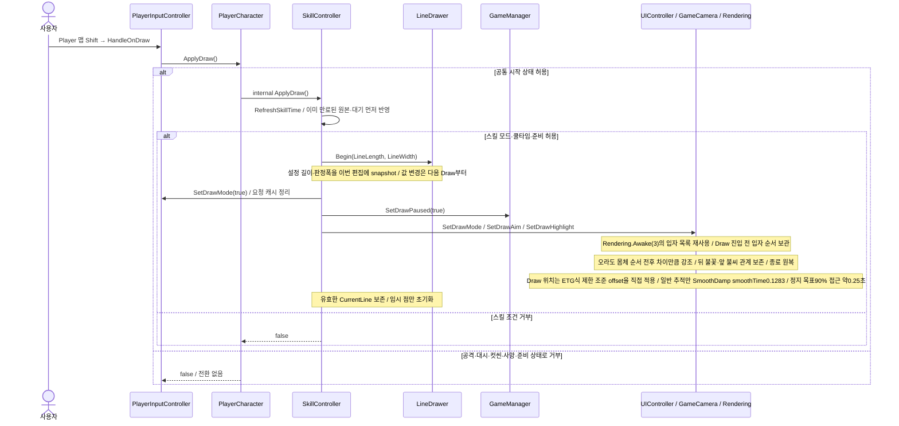

**② 정지 중 M1·커서·R·F → 임시 기하·표현과 확정 종료**

Draw 전용 입력은 게임 시간0에서도 동작한다. 첫 점 이후 커서를 따라 고정 길이 미리보기를 갱신하고 두 번째 점으로 방향을 고정한다. F가 유효한 Line을 반환할 때만 확정 데이터를 교체하고 일반 모드로 복귀한다.

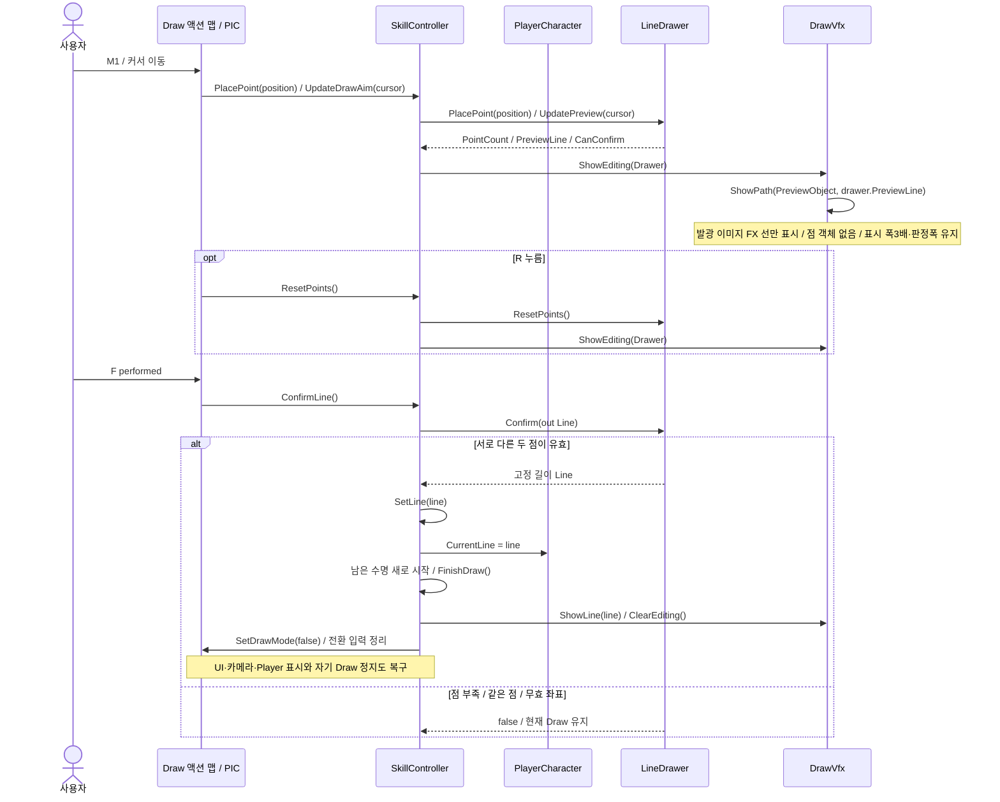

**③ 기존 Line이 있는 재Draw·Shift 취소 → 임시 편집만 정리**

재Draw와 R은 임시 점을 편집하며 기존 CurrentLine은 유지한다. Shift로 취소하면 임시 표현·Draw 전환만 종료하고 짧은 Draw 대기를 적용한다. 새 F 확정이 성공한 경우에만 이전 경로를 교체한다.

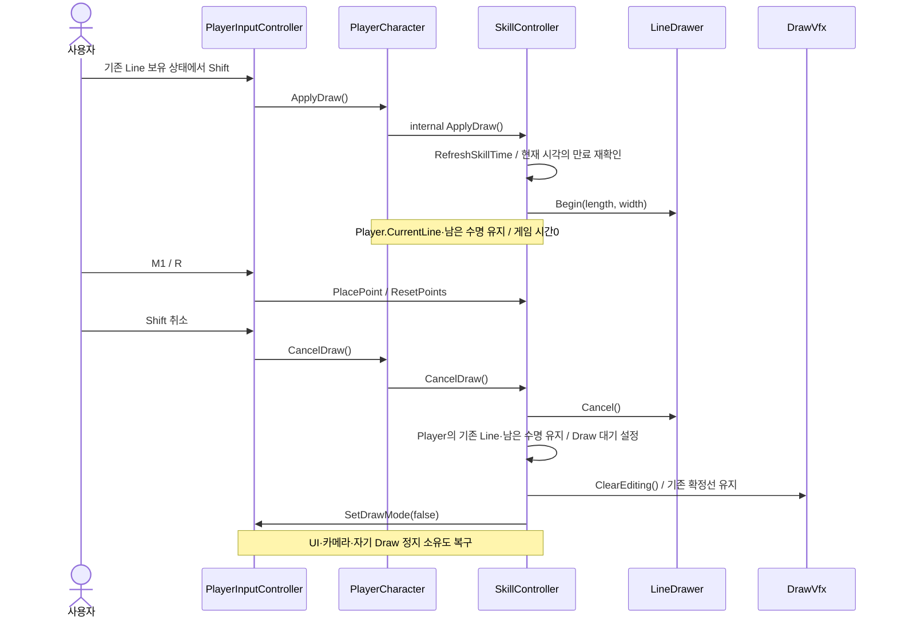

**④ 사망·컷씬·차단·비활성화 → 명시적 중단과 상태 복구**

진행 중 Draw를 공통 상태로 매 프레임 중복 검사하지 않고 사건/수명 경계에서 종료한다. 사망의 ResetSkills는 경로까지 비우며, 컷씬·입력 차단 등의 CancelDraw는 현재 편집과 자기 전환을 복구한다.

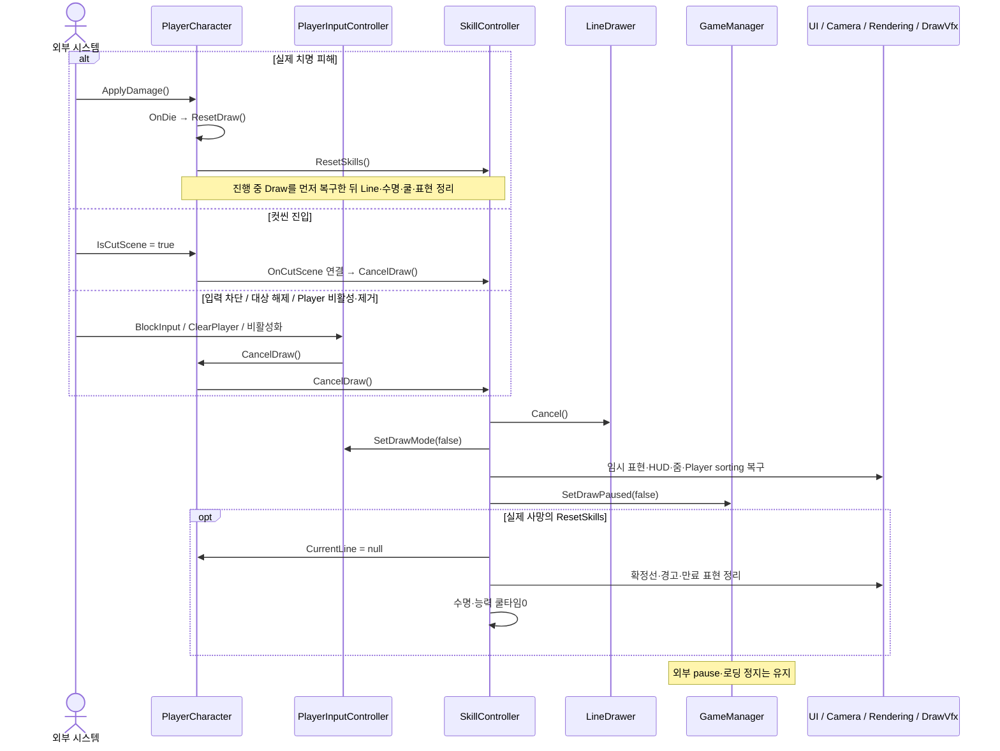

**⑤ 시간0의 커서·ETG식 제한 조준 카메라와 외부 pause 중첩 → 자기 소유만 복구**

Draw 동안 게임 행동·쿨타임과 기존 Line의 수명/경고/만료 꼬리는 멈추지만 커서·UI·카메라·임시 표현은 계속 갱신한다. PIC가 현재 화면 커서를 Player 평면에 투영해 Skill에 전달하고, GameCamera는 Player 기준 커서 변위의 가로를 종횡비로 보정한다. 축별 ±1.5×현재 반높이 제한 뒤 거리1 이내는 offset0, 그 밖은 sqrt 거리 가중0~0.33333을 적용하며 1/64 미만은0으로 정리한다. Draw 위치에는 SmoothDamp를 겹치지 않고 Player+offset을 직접 적용한다. 줌6.5로의 전환만 unscaled로 계속하며 화면 경계는 줌 반영 뒤 다시 제한한다. 외부 pause가 추가된 뒤 Draw를 종료해도 외부 소유가 남아 있으므로 게임 시간을 재개하지 않는다.


### 2.1.5 F-P05 점 편집·고정 길이 기하

**현재 범위·상태 — 구현·연결·검증 완료**: 원문 Class 구조354~365와 Q7의 임시 편집/기존 확정 Line 보존 규칙에 따른 F-P05 전체를 확인했다. F-P04에서 연결한 점0/1/2개·커서 미리보기·고정 방향·R/F/Shift 흐름에 미완 확정·무효 입력·추가 클릭·맵 경계 미보정 검사를 보강했다. 원본 Unity6000.3.21f1 최신 런타임/Editor 컴파일 종료 코드0과48묶음 Play Mode 성공·error 빈값을 확인했다(2026-11-15 20:41:35 KST). 최종 Sprite·FX·음향 조정은 별도다.

| 기능 ID | 코드·연결 | 현재 확인 | 남은 아트 의존 |
| --- | --- | --- | --- |
| F-P05 | Draw M1/Look/R/F/Shift→PIC→Skill→LineDrawer, 확정 결과→Skill.SetLine→Player.CurrentLine, DrawVfx 이미지 선 표현 | 최신48묶음 성공. 기존 Draw 입력·표현 회귀와 신규 편집2묶음에서 점0/1/2·F 미완·R·3번째 클릭 무시·무효 좌표/크기·4방향 사분면/여러 클릭 거리의 고정 길이·맵 경계 미보정 확인 | 이미지 FX 선·점 미표시의 이번 확인은3.3.13, 표시·음향 추가 조정 |

**기하·저장 계약**: 첫 유효 클릭은 StartPoint만 저장한다. 한 점 상태의 커서가 시작점과 다르면 고정 LineLength·LineWidth의 PreviewLine을 만들고, 같은 점이면 방향 미정으로 미리보기를 비운다. 두 번째 유효 클릭의 EndPoint는 방향을 고정할 입력 좌표이며 실제 경로 끝점은 StartPoint+단위 방향×고정 길이다. 짧거나 긴 두 번째 클릭 거리가 최종 길이를 바꾸지 않는다. 두 점 뒤 커서 이동·세 번째 클릭은 선택을 바꾸지 않는다. 유한하지 않은 좌표와 방향 제곱 길이, 같은 점은 거부하며 별도 맵 경계 Clamp·보정을 도입하지 않는다.

**편집 경계**: 점0/1개에서 F는 실패하고 Draw를 유지한다. UI_Draw의 F 안내는 Drawer.CanConfirm에 따라 `F: Need 2 points`와 `F: Confirm`으로 바뀐다. R은 0/1/2 어느 상태든 임시 점·미리보기만 비우며 Draw와 Player의 기존 확정 원본·남은 수명을 유지한다. Shift 취소는 임시 편집만 끝내고 F 성공만 Line 값을 Skill에 반환해 Player.CurrentLine에 저장·새 수명을 시작한다. 수명 관리는2.1.6의 Skill 책임이다. 같은 원작 Draw 기하는 조사 범위에서 확인하지 못했으며 Sephiria SkillController의 시작/취소 경계만 부분 참고하고 원문 확정 규칙으로 직접 구현한다.

**검증·Notion 상태**: `project/Assets/Editor/PlayerLineEditingChecks.cs`의 신규2묶음과 기존 입력/임시 표현·저장/재진입 회귀를 포함해48묶음 성공을 확인했다. 결과는 `project/Logs/StartupFlowChecks-result.json`, 격리 저장 경로는 `project/Temp/StartupFlowChecks/4a11efff5e2c4e9699cbfde2134fa525`다. 종료 후 Title 편집 씬의 저장되지 않은 변경이 없음을 화면으로 확인했다. 아래 독립 `F-P05 SequenceDiagram`4개 Case와 F-P06 변경 Case를 로컬·Notion에 저장했고 연결 도구가 경고 없이 성공을 반환했다. 최종 에셋·빌드·성능 측정은 이번 점 편집 완료와 구분한다.

**① 첫 클릭·커서 이동 → 시작점과 고정 길이 미리보기**

Draw 전용 입력이 첫 점과 커서를 전달한다. 무효 좌표는 기존 편집을 바꾸지 않고 시작점과 겹친 커서는 방향 미정으로 처리한다.


**② 두 번째 클릭 → 방향 고정·추가 클릭 무시**

두 번째 좌표는 방향만 결정하고 경로 길이는 설정값을 유지한다. 두 점 이후 커서 이동과 추가 클릭은 고정한 선을 바꾸지 않는다.

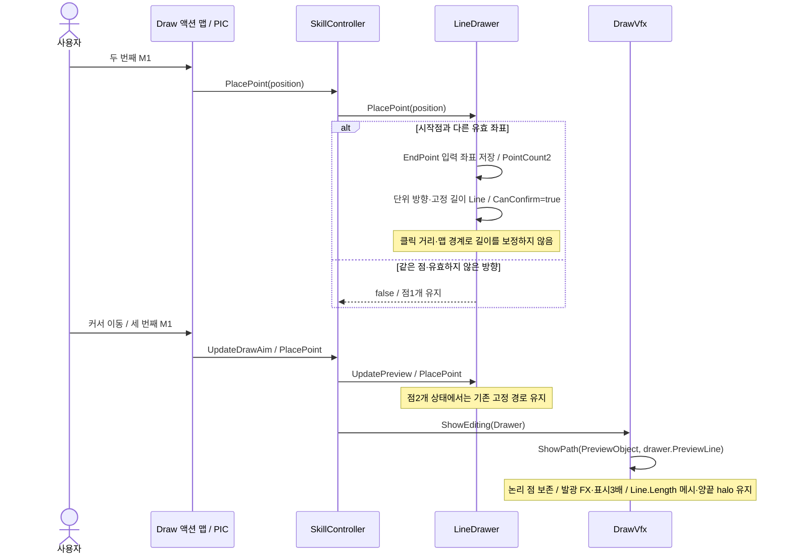

**③ 미완 F·R → Draw와 기존 원본 보존**

점이 부족한 F는 모드를 종료하지 않는다. R은 현재 임시 점만 지우므로 기존 Player 원본과 수명에 영향을 주지 않는다.

```mermaid
sequenceDiagram
    actor User as 사용자
    participant Input as Draw 액션 맵 / PIC
    participant Skill as SkillController
    participant Drawer as LineDrawer
    participant Player as PlayerCharacter
    participant Vfx as DrawVfx
    User->>Input: 점0/1개에서 F
    Input->>Skill: ConfirmLine()
    Skill->>Drawer: Confirm(out Line)
    Drawer-->>Skill: false / Draw 유지
    User->>Input: 점0/1/2개에서 R
    Input->>Skill: ResetPoints()
    Skill->>Drawer: ResetPoints()
    Drawer->>Drawer: 점0개·미리보기 제거 / Draw 유지
    Skill->>Vfx: ShowEditing(Drawer)
    Note over Player,Skill: 기존 CurrentLine·남은 수명 유지
```

**④ 유효 F 확정·Shift 취소 → 저장 교체와 임시 폐기**

유효한 두 점의 F만 Player 원본을 교체한다. 취소는 임시 편집과 Draw 전환만 정리한다.

```mermaid
sequenceDiagram
    actor User as 사용자
    participant Input as Draw 액션 맵 / PIC
    participant Skill as SkillController
    participant Drawer as LineDrawer
    participant Player as PlayerCharacter
    participant Vfx as DrawVfx
    alt 유효한 두 점에서 F
        User->>Input: F performed
        Input->>Skill: ConfirmLine()
        Skill->>Drawer: Confirm(out Line)
        Drawer-->>Skill: Line 값 / 임시 편집 종료
        Skill->>Skill: SetLine(line)
        Skill->>Player: CurrentLine = line
        Skill->>Vfx: 새 Line·새 수명 표시
    else Shift 취소
        User->>Input: Shift performed
        Input->>Player: CancelDraw()
        Player->>Skill: CancelDraw()
        Skill->>Drawer: Cancel()
        Note over Player,Skill: 기존 Line·남은 수명 보존
    end
    Skill->>Input: FinishDraw / Player 맵 복귀
    Skill->>Vfx: 편집 미리보기 숨김 / 표시 점 없음
```

### 2.1.6 F-P06 Line 원본·수명·만료 VFX 연결

**F-P07 시전 중 선 표시 후속(2026-11-16, 연결·격리22/28묶음 확인)**: Slash 시작의 CurrentLine 한 번 소비·수명 종료는 유지하되 소비 snapshot의 표시를 실제 공간참 순간까지 맵에 남긴다. 이는 보유 Line 수명을 연장하거나 사용 가능한 원본을 복원하는 기능이 아니다. 성공 공간참에서 유지선을 제거하고 노란 피해 경로·절단 표현으로 전환한다. 자연 만료의 alpha/입자와 다른 경로로 처리하며 기존 Draw R08 작업을 덮어쓰지 않는다. 현재 구현/검증과 사용자 선택의 원본은2.1.7·[선택3](archive/01_Choice/Player_Slash_Presentation_20261116.md#선택-사안-3--시전-중-line-유지와-공간참-순간-노란-피해-경로)을 따른다.

**이번 사용자 확정**: Draw에서 확정한 Line의 원본은 PlayerCharacter에 둔다. SkillController가 LineDrawer의 Confirm 결과를 PlayerCharacter.CurrentLine에 저장하고 그 저장값의 수명·만료·VFX 연결을 관리한다. 이전 Q7/P06의 Skill 보유·P07 타이머 배치는 이 요청으로 대체하며, LineDrawer는 임시 점과 기하만 담당한다. 사용자의 SkillManager 호칭은 현재 SkillController이며 이번에 클래스 이름을 임의로 바꾸지 않는다.

**2026-11-16 표시 후속 — R09 LineVFX 팔레트 연동·격리23검사/실제 화면 확인 완료:** 원형 알갱이의 색은 실제 선R04 texture의 white/cyan/blue RGB를 참조한다. R08 원형·화면 외곽1px와 입자 직경/이동·정지·수명 호출은 유지한다(3.3.13 R09).

**R06 이전 기술 이력:** alpha 왕복을 유지하고 선에서 떨어져 실제 위치를 이동하는 조각을 구현한다. R05의 제자리 noise/UV 분해는 후속 반려이며 아래23검사 이력과 새 연출 확인을 구분한다.

**이전 R05 기술 이력:** 기존 bool 점멸·주황 tint/폭 축소를 연속 alpha 왕복과 같은 R04 FX의 shader 분해로 대체한다. 아래 논리 수명·소비 계약과 Case 번호는 유지하고 과거48/23검사 이력과 이번 실제 확인을 구분한다(3.3.13 R05).

| 기능 ID | 사양 상태 | 코드·연결 | 현재 확인 | 남은 경계 |
| --- | --- | --- | --- | --- |
| F-P06의 원본/수명/만료 표현·한 번 소비 | 원형·외곽1px·입자 수명을 유지하고 LineVFX 팔레트를 따르는 사용자 후속 요청 | 기존6Case/API 동일, Setup의 _LinePaletteTex 참조와 shader RGB 샘플만 연동 | R09 C#/shader 오류0·격리23검사·실제 texture 참조/색·영상 확인. 변경4파일/런타임41 일치·동시16파일 차이 구분 |3.3.13 R09의 검증사본·원본 최신 전체 실행/미술 승인 한계 참고 |

**소유·시간 계약**: PlayerCharacter.CurrentLine이 유일한 nullable 원본이고 SkillController에는 별도 CurrentLine 필드/복사 원본을 두지 않는다. Skill.HasLine은 Player의 값을 읽는다. SetLine(non-null)은 원본 저장과 시작 시점 총수명·남은 수명 초기화, 낡은 경고/만료 꼬리 정리와 새 경로 표시를 함께 수행한다. 새 확정은 같은 기하라도 새 수명을 시작한다. SetLine(null)과 사망 ResetSkills는 자연 만료 FX 없이 원본·시간·표현을 정리한다. Line struct에 시간·GameObject를 넣지 않는다.

**같은 게임 시각의 갱신·소비 경계**: Skill의 RefreshSkillTime은 Time.timeAsDouble의 이전 샘플과 현재 샘플 차이로 쿨타임·기존 만료 표현·Line 수명 순서로 갱신한다. Update와 ApplyDraw/CancelDraw/SetLine/ConsumeLine이 같은 창구를 사용하며 현재 샘플을 먼저 기록해 재진입·같은 프레임의 같은 시각을 두 번 빼지 않는다. Draw로 시간을 멈추기 직전에도 이미 만료된 원본과 짧은 대기를 반영한다. 일시 비활성화에서 재활성화하면 OnEnable에서 샘플을 다시 잡아 숨겨진 동안의 시간을 소급 차감하지 않는다. ConsumeLine은 이미 만료된 원본이면 자연 만료 처리 뒤 false, 유효하면 Line 값을 한 번 반환하고 SetLine(null)과 일반 NormalDrawCooldown을 적용한다. 소비에는 자연 만료 꼬리를 재생하지 않으며 반복 호출로 같은 Line을 다시 받을 수 없다. 이 API는 F-P07의 공통 행동 허용·공격·판정을 대신하지 않는다.

**재Draw·정지·비활성화**: 재Draw 진입/취소와 R은 Player의 기존 Line·남은 수명에 영향을 주지 않는다. Draw·일반 pause에서 같은 scaled 경과시간0이므로 논리 수명·alpha phase·분해 진행도 정지한다. 입자도 DrawVfx가 전달한 같은 scaled dt로 진행하도록 연결하며 독립 시간으로 재개하지 않는다. Skill 비활성화는 논리 원본·잔여를 보존한 채 표현을 숨기고, 재활성화는 같은 수명 단계로 복귀한다. VFX만 비활성화하면 논리 수명은 Skill에서 계속 진행하며 다시 켤 때 최신 상태를 표시한다. 실제 사망·세션 종료는 원본을 남겨두는 일시 비활성화와 구분한다.

**현행 R09 표현·구현값:** 같은 scaled clock과 cos alpha 왕복0~1·경고 마지막12%의 원본 복귀는 유지한다. R06은 자연 만료 기본1.3초, 원본 FX 초기25% alpha fade와 실제 입자의 위/양옆 이동·고정 크기/수명 alpha를 연결했다. DrawVfx는 경로4개 외에 씬 루트 DrawEvaporationVfx1개를 Prepare(EvaporationMaterial)로 준비·재사용한다. PlayLineExpiration→Evaporation.Play, TickVisuals→SetOpacity/Particles.Tick, ApplyLineVisibility→SetVisible, ClearLineEffects→Clear, OnDestroy→입자 객체 제거의 API를 연결한다. 제자리 shader 분해는 제거했다. R07은 같은 이동/수명 구조에서 입자 모양을 procedural 원형으로, 동일 가로세로 직경을0.045~0.085world로 바꾼다. 선R04 PNG·PS 직경과 R08의 화면 외곽1px·AA0.5px/vertex stream은 유지한다. R09는 Setup이 같은 LineVFX.mainTexture를 _LinePaletteTex에 연결하고 shader가 RGB만 샘플하며 원형 shape/수명 alpha는 독립으로 유지한다. 현재 색·실행/범위는3.3.13 R09에 기록한다.

**자연 만료**: 남은 시간이0이 되는 경계에서 마지막 기하로 전용 VFX를 요청하고 Player.CurrentLine을 null로 만든다. 남은 수명은0으로 고정하고 짧은 CancelDrawCooldown을 적용한다. 이후 매 프레임 같은 만료 사건이나 쿨타임을 다시 발행하지 않는다. 수신·소모할 원본은 이미 없으므로 후속 Slash는 ConsumeLine의 반환값을 사용한다. Update 전후 어느 순서의 소비 요청에도 같은 게임 시각의 만료를 재확인하는 경계는 이번 F-P06 검사에 포함하고, 실제 Slash 행동·판정은 F-P07에서 연결한다.

**실제 참고·적용 차이**: Sephiria [MeleeCollision.cs](<reference/sephiria/code/ingame code/Assembly-CSharp/MeleeCollision.cs>) OnUpdateServer의 durationTimer.Update(Time.deltaTime)→DestroySelf는 게임 시간 기반 수명·종료 경계만 참고한다. [BulletBlinkBeforeDestroy.cs](<reference/sephiria/code/ingame code/Assembly-CSharp/BulletBlinkBeforeDestroy.cs>) OnSpawn41·Update48은 생성 시 phase 리셋·destroyTimer.Ratio 기반 가속 예고, [FlameGroundFadeFx.cs](<reference/sephiria/code/ingame code/Assembly-CSharp/FlameGroundFadeFx.cs>) Update8·OnSpawn29는 표현 재생 초기화·종료 정리를 참고했다. [SkillController.cs](<reference/sephiria/code/ingame code/Assembly-CSharp/SkillController.cs>) OnEndCastAnimation457·CancelAction356은 자기 연출/차단의 대칭 정리를 참고한다. 같은 Line 기능은 원작에서 확인하지 못했으며, 우리 원문 Class 구조366~369의 후반 가속 경고·자연 만료 연출과 이번 소유권 요청을 직접 구현한다. BulletBlinkBeforeDestroy의 enabled 토글은 현재 alpha 방식으로 복제하지 않고 시간 비율만 참고한다. 연속 alpha·noise/UV shader 분해는 우리 구현이며 같은 원작 분해 구현이라고 설명하지 않는다. 네트워크·탄환·광범위 ObjectPool 프레임워크·원작 숫자는 가져오지 않는다.

**검증·Notion 상태**: 1차45묶음 뒤 확장한 최신48묶음이 성공했다(2026-11-15 20:41:35 KST, success=true·error 빈값). `project/Assets/Editor/PlayerLineLifetimeChecks.cs`의5묶음에서 Player 원본 저장·새 확정 초기화, 재Draw/일반 pause의 수명·경고 보존, 실제 깜박임 가속·자연 만료1회/짧은 대기/꼬리 종료, 교체·수동 제거·Skill/VFX 비활성화·사망 정리, 살아 있는 기하 한 번 전달/일반 대기와 Skill.Update 이전의 만료 소비 거부를 확인했다. 동일 프레임의 재호출은 중복 소비·대기 재적용·만료 꼬리 재시작을 만들지 않는다. 현재 Unity 런타임/Editor 컴파일 종료 코드0·ALL PASSED48·Title 편집 복귀와 저장되지 않은 변경 없음을 확인했다. 결과·격리 저장 경로는2.1.5와 같다. 기존 F-P04의5개 Case와 독립 `F-P05 SequenceDiagram`4개·`F-P06 SequenceDiagram`6개 Case, 관련 Class5개·Q7 후속 소유권 변경·기능 표를 로컬·Notion에 반영했고 연결 도구가 경고 없이 성공을 반환했다. 전체 Mermaid34개를 파서로 확인했다. 미리보기 모드 설정·화면 확인은 완료 체크에 포함하지 않는다.

**① Draw F 확정 → Player 원본 저장과 수명 시작**

유효한 두 점을 확정하는 외부 F 입력에서 시작한다. Drawer는 기하만 반환하고 Skill이 Player에게 원본을 저장한 뒤 새 수명·표현을 초기화한다.

```mermaid
sequenceDiagram
    actor User as 사용자
    participant Input as Draw 액션 맵 / PIC
    participant Drawer as LineDrawer
    participant Skill as SkillController
    participant Player as PlayerCharacter
    participant Vfx as DrawVfx
    User->>Input: F performed
    Input->>Skill: ConfirmLine()
    Skill->>Drawer: Confirm(out Line)
    alt 두 점의 기하 유효
        Drawer-->>Skill: 확정 Line
        Skill->>Skill: SetLine(line)
        Skill->>Player: CurrentLine = line
        Skill->>Skill: 시작 총수명 snapshot / LineRemaining 초기화
        Skill->>Vfx: 이전 경고·만료 꼬리 정리 / 새 Line 표시
        Vfx->>Vfx: ShowLine(line) / ShowPath(LineObject, line, false)
        Note over Vfx: LifePhase0·LineOpacity1·이전 입자 Clear / 새 수명 표현 초기화
        Note over Player,Vfx: 저장·표시·후속 Slash는 같은 Line.Length / 표시 배율만3
        Skill->>Input: FinishDraw / Player 맵 복귀
        Note over Vfx: 중앙 발광 유지 / 양끝 둥근 흰 광원·바깥 cyan-blue halo / 고정 검은 외곽 없음
    else 무효 기하
        Drawer-->>Skill: false
        Note over Player,Skill: 기존 Line·남은 수명 유지
    end
```

**② 게임 시간 경과 → 남은 수명과 연속 알파 왕복 경고**

Skill은 같은 게임 시각으로 수명·표현을 갱신한다. 경고 동안 GameObject를 끄지 않고 원본 이미지 알파에0~1 파동을 곱하며 마지막 경고12%에서는 원본 알파로 연결한다.

```mermaid
sequenceDiagram
    participant Unity as 게임 갱신
    participant Player as PlayerCharacter
    participant Skill as SkillController
    participant Vfx as DrawVfx
    participant FX as DrawLineVfx
    participant Renderer as LineRenderer
    Unity->>Skill: Update / RefreshSkillTime()
    Skill->>Skill: Time.timeAsDouble 샘플 / 게임 경과시간 계산
    alt 비활성 또는 경과시간0
        Note over Skill,Vfx: 논리 수명·alpha 위상·입자 진행 없이 반환
    else 게임 시간 진행
        Skill->>Skill: Draw/Slash 쿨타임 진행
        Skill->>Vfx: TickVisuals(elapsed)
        Skill->>Player: CurrentLine 조회
        alt 확정 Line 존재
            Skill->>Skill: LineRemaining 감소
            alt 남은 수명0
                Skill->>Skill: ExpireLine / 자연 만료 Case④
            else 수명 남음
                Skill->>Vfx: UpdateLineLifetime(remaining, total, elapsed)
                alt 경고 비율 이전
                    Vfx->>Vfx: LineOpacity=1 / LifePhase=0
                else 후반 경고 구간
                    Vfx->>Vfx: BlinkInterval 단축 / LifePhase 진행
                    Vfx->>Vfx: cos 왕복 alpha0~1 / 경고 마지막12%는 원본으로 복귀
                end
                Vfx->>FX: SetOpacity(LineOpacity)
                FX->>Renderer: cached MaterialPropertyBlock의 _Opacity 전달
                Note over Vfx,Renderer: 객체 활성 유지 / 원본 PNG alpha×LineOpacity
            end
        else 원본 없음
            Note over Skill: 논리 수명 진행 없음
        end
    end
```

**③ 재Draw·pause·새 확정 → 보존·정지·수명 교체**

재Draw와 pause는 기존 수명을 초기화하지 않는다. 새 확정만 Player의 원본과 시작 시점 수명을 교체한다.

```mermaid
sequenceDiagram
    actor User as 사용자
    actor Caller as 외부 시간 시스템
    participant Input as PlayerInputController
    participant Skill as SkillController
    participant Player as PlayerCharacter
    participant GM as GameManager
    participant Vfx as DrawVfx
    User->>Input: 재Draw Shift
    Input->>Player: ApplyDraw()
    Player->>Skill: internal ApplyDraw()
    Skill->>Skill: RefreshSkillTime / Draw 전 만료 재확인
    Note over Player,Skill: 유효한 CurrentLine·남은 수명 보존
    Caller->>GM: Draw 또는 일반 pause 소유 추가
    GM->>GM: 게임 시간0
    Note over Skill: 공유 시각의 경과시간0이면 진행 없이 반환
    Note over Skill,Vfx: 논리 수명·alpha phase·입자 이동/수명 정지
    Caller->>GM: 정지 소유 해제
    Skill->>Skill: 보존한 수명에서 재개
    User->>Input: 새 F 확정
    Input->>Skill: ConfirmLine()
    Skill->>Player: CurrentLine 교체
    Skill->>Skill: 새 총수명·남은 수명 초기화
    Skill->>Vfx: 낡은 경고/만료 꼬리 정리 / 새 표현
```

**④ 자연 수명0 → 원본 제거·실제 빛 조각의 증발 이동**

수명이 끝나면 Player 원본은 제거한다. R05의 제자리 noise/UV 분해 대신 R04 선에서 실제 작은 원형 ParticleSystem 알갱이를 방출해 위/양옆으로 퍼지게 한다. 원본 선은 초기25% alpha로 넘기고 입자는 크기 고정·수명 alpha로 사라진다. R07은 모양/크기만 바꾸며 기존 호출/이동·정지·수명 경계는 같다. 원형 직경/크기 고정·격리23검사와 실제 영상은 확인했고 새 결과 사용자 미술 승인은 별도다.

```mermaid
sequenceDiagram
    participant Unity as 게임 갱신
    participant Skill as SkillController
    participant Player as PlayerCharacter
    participant Vfx as DrawVfx
    participant FX as DrawLineVfx
    participant Particles as DrawEvaporationVfx
    participant PS as ParticleSystem
    Unity->>Skill: Update / LineRemaining이0에 도달
    Skill->>Player: 마지막 CurrentLine 기하 조회
    Skill->>Skill: SetLine(null)
    Skill->>Player: CurrentLine = null
    Skill->>Vfx: ShowLine(null) / 이전 alpha·입자 정리
    Skill->>Skill: 짧은 Draw 대기
    Skill->>Vfx: PlayLineExpiration(line)
    Vfx->>FX: SetOpacity(1)
    Vfx->>Vfx: ShowPath(ExpiryObject, line, false)
    Vfx->>Particles: Play(line, expiryTotal)
    Particles->>PS: Emit(EmitParams, 1) / Pause(false)
    Note over Vfx,Particles: Setup에서 _LinePaletteTex에 LineVFX.mainTexture 연결 / RGB만 참조
    Note over Particles: 원형·PS직경0.045~0.085 유지 / 화면 외곽1px·AA0.5px / 기존 이동·크기 고정
    loop 소멸 시간이 남고 같은 게임 시간이 진행
        Skill->>Vfx: TickVisuals(deltaTime)
        Vfx->>Vfx: ExpiryProgress=1-remaining/total
        Vfx->>FX: SetOpacity(1-SmoothStep(progress/0.25))
        Vfx->>Particles: Tick(deltaTime)
        Particles->>PS: Simulate(deltaTime, false, false, false) / Pause(false)
        Note over Particles: world 위/양옆으로 퍼짐 / 입자 alpha로 소멸
        Vfx->>Particles: SetVisible(visible and IsExpiryPlaying)
    end
    Vfx->>Particles: Clear()
    Particles->>PS: Stop(false, StopEmittingAndClear) / Simulate(0) / Pause(false)
    Vfx->>Vfx: ExpiryObject 숨김
    Note over Player,Skill: 원본은 이미 null / 같은 자연 만료 중복 발행 없음
```

**⑤ 사망·명시적 제거·표현/능력 비활성화 → 원본과 표현 수명 구분**

외부 사망·제거는 자연 만료 연출과 구분한다. 일시 비활성화는 보존 범위에 따라 논리 시간과 표시만 다르게 처리한다.

```mermaid
sequenceDiagram
    actor Caller as 외부 시스템
    participant Player as PlayerCharacter
    participant Skill as SkillController
    participant Vfx as DrawVfx
    alt 실제 사망 또는 명시적 Line 제거
        Caller->>Skill: ResetSkills() / SetLine(null)
        Skill->>Player: CurrentLine = null
        Skill->>Skill: 남은 수명·관련 상태 정리
        Skill->>Vfx: ClearLineEffects()
        Note over Vfx: phase·opacity 초기화 / Evaporation.Clear / 자연 증발을 새로 재생하지 않음
    else Skill 비활성화
        Caller->>Skill: 컴포넌트 비활성화
        Skill->>Vfx: 표현 숨김
        Note over Player,Skill: 원본·남은 수명 보존 / 논리 진행 정지
        Caller->>Skill: 재활성화
        Skill->>Vfx: 같은 수명 단계 복구
    else VFX만 비활성화
        Caller->>Vfx: 표현 비활성화
        Skill->>Skill: Player 원본의 논리 수명은 계속 진행
        Skill->>Vfx: 최신 비율·표현 상태 갱신 / 표시는 숨김
        Caller->>Vfx: 재활성화
        Vfx->>Vfx: OnEnable / 최신 LineOpacity·입자 표시 상태 복구
    end
```

**⑥ 소비 요청 → 같은 게임 시각의 만료 재확인·한 번 전달**

Slash 소비자가 사용할 Line을 요청하는 API 경계다. 실제 Slash 시작 검사·애니메이션·판정·피해는 F-P07에 기록하며 이 흐름은 저장된 기하의 유효한 한 번 전달까지만 다룬다. 시전 중 맵 선은 반환 snapshot의 표시로 구분한다.

```mermaid
sequenceDiagram
    actor Caller as 후속 Line 소비자
    participant Skill as SkillController
    participant Player as PlayerCharacter
    participant Vfx as DrawVfx
    Caller->>Skill: ConsumeLine(out Line)
    Skill->>Skill: 현재 게임 시각까지 수명 갱신
    Note over Skill: Update와 같은 시각은 중복 차감하지 않음
    Skill->>Player: CurrentLine 확인
    alt 갱신 결과 이미 만료
        Skill->>Skill: 자연 만료 / 짧은 Draw 대기
        Skill->>Player: CurrentLine = null
        Skill->>Vfx: 같은 FX 조각의 자연 증발 재생
        Skill-->>Caller: false
    else 유효한 Line 존재
        Skill->>Skill: 반환할 기하 보관 / SetLine(null)
        Skill->>Player: CurrentLine = null
        Skill->>Vfx: 확정선·경고·꼬리 정리
        Skill->>Skill: 일반 Draw 대기 설정
        Skill-->>Caller: true / 한 번 전달한 Line
    else 원본 없음
        Skill-->>Caller: false
    end
    Note over Player,Skill: 반복 요청으로 같은 Line을 다시 소비하지 않음
    Note over Caller,Vfx: Slash 소비자는 반환 snapshot을 ShowSlashLine으로 시전 동안 별도 표시
```

### 2.1.7 F-P07 Slash 입력·전용 연출·한 번 판정

**2026-11-16 금색탄 Line 반사 후속 — 구현·연결·32+17검사 완료:** 이전 Q12의 Boss 위치 추적 반사는 이번 사용자 요청으로 대체한다. 입사 d=Projectile.Direction.normalized, 반사면 접선 t=Line.Direction.normalized, 법선 n=(-t.y,t.x)에서 d'=Vector2.Reflect(d,n).normalized를 한 번 계산해 즉시 Direction에 저장한다. 탄 중심의 선 전후 위치·Boss 위치와 Dot>=0 접촉 gate를 쓰지 않으며 이후 Boss를 유도 추적하지 않는다. OnSlashed(player,boss,slash,lineDirection)·Reflect(boss,player,lineDirection)에 필수 접선을 추가했고 CollisionBox.QuerySlash signature는 유지한 채 angle의(cos,sin)을 한 번 계산해 넘긴다. 기존 LineSlasher.angle은 원본 Line 방향에서 오며 오라 HitWidth0.75는 그대로다. 반사 순간 위치는 이동시키지 않는다. [선택5](archive/01_Choice/Player_Slash_Presentation_20261116.md#선택-사안-5--금색탄의-입사-운동line-접선-반사)를 따른다.

**직진·충돌/수명:** ReflectionTarget은 Owner 우선의 살아 있는 Boss 중 실제 피격 Hitbox를 허용할 참조일 뿐이다. UpdateReflection은 기존 ReflectionSpeed의 고정 방향 swept CircleCast에서 가장 가까운 유효 Boss Hitbox가 nearestWall보다 앞일 때만 ReceiveHit를 한 번 전달하고 Despawn한다. 벽이 앞/동거리면 벽에서 종료하며 Player에는 피해를 주지 않는다. Boss를 빗나가면 같은 방향으로 직진한다. scaled 정지·Lifetime0의 시간 만료 없음/양수의 반사 직후 최소 잔여1초·그로기/Fever의 탄별1회 보상을 유지한다.

**반사 최신 확인·한계(2026-11-16 12:47:51 KST):** 같은 Unity6000.3.21f1 최신 source 사본에서 C#/shader 오류0·Draw/Slash32검사와 실제 GoldPrefab/halo17검사가 모두 ALL PASSED·error 빈값·각 배치 종료0이다. 실제 수평/수직·30°/210°와 탄 중심의 선 전후에서 같은 반사, 입사down→30°의(-sqrt(3)/2,0.5), 반사 순간 위치 불변·이후 고정 직진·정지/수명·고속 실제 Boss CCD/near miss·Player 무해·벽 전후/동거리 우선·OwnerHitbox 피해/보상1회를 확인했다. source·scope는 C#97 snapshot·변경9파일(runtime3+Editor6)/현재 런타임48 일치와 동시 런타임6파일(PlayerCharacter/PlayerSpawner/GameManager/MapManager/SaveManager/StageManager) 차이를 구분한다. 최신 원본 전체 실행으로 확대하지 않는다. 필수 lineDirection의6Editor 호출부를 갱신해 컴파일했고 나머지 Guard/BossCombat/WallFan 전체 suite는 이번에 미실행이다. 기존 PlayerArtSetup.Apply→GuardBossSetup.Run→SlashPresentationSetup.Run→PlayerDrawSetup.RunChecks·BossHazardArtChecks.RunBatch는 검증사본 준비/실행이며 production 자산 복사는0개다. 32검사 로그·17검사 로그를 보존한다. 원본 Editor 직접 Play/최종 import·제출 빌드는 미확인이다. 새 미술 결과가 아닌 반사 규칙 변경이며 동시 벽 제거/fan·수명주기·Draw.io 작업을 보존한다. 같은 Notion Class·F-P07 Case③/F-B06 Case①·최신 결과/현재 Q12 비고를 저장했고 도구 응답이 경고 없이 성공했다.


**2026-11-16 선 오라 전체 판정 폭 후속 — 구현·연결·29검사 완료:** 사용자는 좁은 Slash 판정이 선FX의 연한 오라까지 포함하도록 넓은 직사각형으로 검사하라고 요청했다. 시전 시작에 유효 Line을 Consume한 뒤 DrawVfx.GetLineEffectWidth(line)=line.Width×Mathf.Max(1,lineVisual.WidthMultiplier)를 한 번 읽어 LineSlasher.Execute(line,hitWidth,damage,mask)에 넘긴다. 현재 원본 Line.Width0.25·표시 배율3에서 HitWidth0.75이며 중심/방향·길이는 원본 그대로다. ApplyHits는 QuerySlash(center,(ActiveLine.Length,HitWidth),angle)를 한 번 요청한다. ActiveLine.Width와 시전선/공간참의 표시 입력은0.25 그대로여서 표시가 이중으로 커지지 않는다. 시전 중 style이3→4로 바뀌어도 현재 HitWidth0.75는 고정하고 다음 Slash만1.0을 사용한다. Complete/Cancel은 HitWidth0·후속 재판정 없음으로 정리한다. 표시 자산/Player 설정은 변경하지 않았다. [선택4](archive/01_Choice/Player_Slash_Presentation_20261116.md#선택-사안-4--선-오라-전체를-포함하는-slash-직사각-판정)를 따른다.

**오라 판정 최신 확인·한계(2026-11-16 11:52:01 KST):** 같은 Unity6000.3.21f1의 최신 source 사본에서 C#/shader 오류0·Draw/Slash/기존 Draw카메라29묶음 ALL PASSED(success=true·error 빈값·배치 종료0)를 확인했다.30°의 rawLine폭0.25·실제 BakeMesh 렌더폭0.75=HitWidth0.75, 양옆±0.31의 multiCollider 수신자1회 적중과±0.5/끝+0.15 제외·style3→4의 현재0.75/다음1.0·원본/표시 중복 확대 없음·완료HitWidth0/ApplyHits 재호출0을 통과했다. 기존45° 오라/벽 무시·구조물/탄 반사/Fever·취소/사망/Title도 통과했다. 검증 C#95개 snapshot·현재 런타임54개 전부와 변경7파일 일치, 동시 Editor GuardHandChecks/PlayerArtSetup/PlayerAttackIntegrationChecks3개 차이를 구분하며 최신 전체 Editor/아트 검증으로 확대하지 않는다. 자산 복사는0개다. 로그·29개 결과·source·scope를 따른다. 사본에서 PlayerArtSetup.Apply→GuardBossSetup.Run→SlashPresentationSetup.Run→PlayerDrawSetup.RunChecks로 준비했고 최초 Boss_01 손 참조 누락은 사본 재준비로 해결했다. 기존 반사 검사의 넓은 실제 몸통이 테스트 범위에 겹치던 배치는 Collider 왼쪽 돌출량 기준 End+0.25 밖으로 검사만 보정했으며 runtime Boss는 변경하지 않았다. 원본 Editor 직접 Play/최종 import·제출 빌드는 미확인이다. 이번 결과는 새 미술 결과가 아닌 판정 변경이며 기존 검격 VFX의 사용자 미술/박자 확인은 별도로 남긴다. Class·기존 Case①②를 갱신하고 번호/다른 Case와 독립 작업은 보존했다. 같은 Notion Class·기존 Case①②/최종 비고를 저장했고 도구 응답이 경고 없이 성공했다.


**2026-11-16 선 유지·노란 검격 VFX 후속 — 구현·연결·검증 완료**: 사용자는 Slash 연출 동안 시전 전 맵에 있던 Line이 계속 보여야 하며, 실제 공간참 순간 그 선이 사라지는 자리의 노란 선/절단 경계로 피해 경로를 명확히 알려야 한다고 요청했다. CurrentLine은 기존대로 시전 시작에 한 번 소비하고, 소비 snapshot만 발도·빠른/느린 줌·납도·지연 전 구간의 동일 맵 위치에 표시한다. impact에서는 유지선을 제거하고 같은 Line 경로의 노란 피해 강조와 공간참을 함께 실행한다. 판정·시간/조작 해제 시점·영역·피해1회·취소/사망/Title 정리는 유지한다. 아래19/23묶음은 이 후속 적용 전 기준선이며 이번 변경의 실제 성공으로 사용하지 않는다. [선택3](archive/01_Choice/Player_Slash_Presentation_20261116.md#선택-사안-3--시전-중-line-유지와-공간참-순간-노란-피해-경로)을 따른다.

**선 유지·노란 검격 VFX의 현재 코드 — 연결·격리 검증 완료**: `ConsumeLine→Slasher.Execute→DrawVfx.ShowSlashLine`으로 논리 소비와 시전 표시를 구분한다. 유지 중 외부 SetLine은 저장 원본만 갱신하고 표시 변경은 시전 종료 경계까지 보류한다. 완료/취소의 `FinishSlash`는 Slasher.Complete 뒤 ClearSlash와 ShowLine(player.CurrentLine)으로 snapshot 표시를 끝내며, 성공 impact만 `SlashPresentationFx.PlaySpaceSlash`를 요청한다. 초기 solid gold core·어두운 외곽 막대의21검사 성공은 기술 이력·**사용자 시각 반려**로 분리한다. 사용자는 노란 요소도 VFX여야 하며 틈을 벌리거나 채우는 것이 아니라 단절된 공간에 걸쳐 있어야 한다고 정정했다. 현재 연결한 제작안은 어긋난 월드의 원래 Line 경로에 걸친 황금 검격 잔광·가는 cream-white 열핵·반투명 gold halo·끝 taper와 `_CutProgress`의 unscaled 가늘어짐/잔물결/sparse 이동 빛 조각이다. 열핵은 원본 Line.Width30%·최대6px인 제작값이며 검은 틈/어두운 외곽·불투명 금색 띠는 제거했다. 기존 흰색 SlashFlash도 정상 흐름에서는 재생하지 않으며 레거시 API/자산만 보존한다. 빛/조각이 실제 판정 범위를 늘리지 않는다. Setup은 이전 기본 cyan만 노란색으로 이관하고 사용자 지정 색은 보존한다. 구체 빛/형태·시간은 조정 가능한 제작값이며 새 GIF의 사용자 최종 미술 승인은 미확인이다.

**선 유지·검격 잔광의 최신 검증(2026-11-16, 재촬영22검사09:09:13 / 소스 대조09:10:49 KST)**: 같은 Unity6000.3.21f1 격리본에서 SlashLineEnergyVerification22묶음과 Draw 회귀28묶음이 모두 ALL PASSED·success=true·error 빈값·각 배치 종료0이다.28묶음에는 동시 Draw 신규 검사가 포함되며 그 작업의 미술 승인이나 전체 완료를 대신하지 않는다. 일치 manifest는 원본 런타임48개 전부·이번 소유6 C#과 Player/SpaceMaterial/Shader3자산의 SHA-256 일치를 확인했다. 전체 C#83개 중 차이2개는 무관한 동시 Editor `BossHazardArtChecks`·`BossHazardArtSetup`이므로 최신 전체 Editor 소스까지 실행했다고 확대하지 않는다. 원본에는 소유 C#·Player CutColor 한 필드·공간참 재질/shader만 반영하고 다른 공격/대시/입자/위험물 데이터를 보존했다.

실제 다섯 시전 구간에서 CurrentLine 소비와 별개로 원래 맵 위치/방향/길이의 선 유지, impact 전 표시 전환 없음·그 순간 한 번 판정/노란 VFX 전환·다섯 단계 취소·재진입/기억 Line 저장·Title 정리를 확인했다. [실제 관측](../project/Logs/SlashLineEnergy/render-observation.json)의1093×515 화면에서 양쪽 이동은 `(-17.5,-5.5)`/`(17.5,5.5)`px·OverlayUnchanged=true·YellowDamagePath=true, 서로 다른 실제 시점의 VFX 변화는 최신846px이다. 밝은 흰 바닥에 검은 틈이 없고 원래 Line에 걸친 golden halo가 보이는 것을 확인했다. [시전 유지](../project/Logs/SlashLineEnergy/01-held-draw.png)·[첫 검격](../project/Logs/SlashLineEnergy/03-space-cut.png)·[후속 잔광](../project/Logs/SlashLineEnergy/03b-space-energy.png)과 검사 표본을 숨긴 원래 맵에서 **기본0.28초의 약13실프레임과 원상 대기/실제 간격**으로 만든 [검토 GIF](../project/Logs/SlashLineEnergy/space-cut-vfx.gif)(842×414·341,952bytes)를 저장했다. 정적 PNG는 흰 바닥/색 표본을 포함한 측정용이며 이 clean GIF와 구분한다. 촬영 구간의 검사 표본 표시만 바꾼22재검사가09:09:13 KST에 다시 성공·배치0이며, runtime/shader가 같으므로 촬영 변경 전28회귀 결과도 유효하다. 원본 Editor 직접 Play·새 GIF의 사용자 최종 미술 승인·제출 빌드는 미확인이다. 다음 단계는 이 GIF와 Tune Slash에서 VFX의 빛/박자 피드백을 받는 것이며, 반려된 솔리드 캡처/21검사를 새 VFX 완료 근거로 사용하지 않는다. 이번 선 유지 후속의 P06/P07 Class·F-P06 Case⑥·F-P07 Case①②⑤와 최종22/28·clean GIF/미확인 범위도 기존 Notion 위치에 경고 없이 저장했다.

**현재 범위·상태 — 기존 전투 기반과 2026-11-16 후속 연출 구현·연결·검증 완료**: N1 Class 구조374~393·N2 필요 기능256의 Player `Slash(F)`와 Q8~Q13·Q25를 연결했다. Player 맵의 F는 Slash, Draw 맵의 F는 경로 확정이며 전환 캐시를 비워 같은 입력이 양쪽 행동을 연속 실행하지 않게 한다. F-P10 후속 연결은 같은 F의 후보 상호작용 우선이며 후보가 없을 때만 아래 Slash 흐름으로 진입한다(2.1.10). CurrentLine 공개 필드·일반0.5초/Draw0.3초 추적 분리까지 포함한 기존 원본 Unity55묶음 성공(2026-11-15 21:24:31 KST)은 후속 연출 적용 전 기준선이다.

**2026-11-16 사용자 확정 연출 순서 — 조정값과 구현 상태 구분**: Slash 입력 직후 빠르게 줌 인하고 지정 전환점부터 천천히 더 줌 인한다. 느린 구간 진입 때에는 발도 R02의 칼 일부를 꺼낸 자세에 이미 도달해 그 자세를 유지한다. 느린 줌 인 구간 약0.7초 뒤 노출 칼날 중앙의 빛 VFX를 재생하고, 칼을 완전히 넣는 animation 구간만 진행한다. 칼이 닫히는 순간 “탁” 효과음과 카메라의 원래 배율 복귀를 함께 시작한다. “탁”에서 약0.5초 뒤 확정 Line의 Slash 효과음과 그 Line을 기준으로 **UI를 제외한 게임 화면이 공간참처럼 어긋나는 연출**을 실행한다. 사용자 후속 답변으로 실제 피해·탄 제거 및 전투 시간/조작 해제도 이 지연 공간참 순간으로 확정했다.0.7초·0.5초는 변경 가능한 사용자 초기값이며 빠른/느린 구간 시간·줌 전환점·확대량·복귀도 개별 조정 대상으로 둔다. 빠른 줌0.18초·칼날 빛0.12초·납도0.16초·줌 복귀0.18초 및 빠른/최종 직교 크기3.2/2.8은 조정 가능한 AI 초기 제작값이다. [선택 기록](archive/01_Choice/Player_Slash_Presentation_20261116.md)을 따른다. 아래 시퀀스를 실제 새 코드와 맞췄으며 과거55묶음과 이번 연출의19/23묶음 검증을 구분한다.

| 기능 ID | 확정 사양·담당 | 코드·연결 | 현재 확인 | 남은 아트 / 후속 |
| --- | --- | --- | --- | --- |
| F-P07 | 시작1회 소비·시전 전구간 snapshot 선 유지→지연 공간참1회 판정/전투 재개·검격 잔광 VFX | Skill·DrawVfx.ShowSlashLine·R02/단계별 줌·SlashPresentationFx의 빛/음향/월드 VFX. legacy PlaySlash 미사용 | 최신 격리22+28묶음·각 배치0·runtime48/소유6 C#/3자산 일치·시간변화846px/UI 고정·clean GIF | 사용자 최종 VFX/박자/음색·원본 직접 Play·빌드 미확인 |

**시작·역할 계약**: PIC는 일반 입력의 세션/UI/외부 차단과 모드만 판단해 F 눌림 사실을 보낸다. PlayerCharacter.ApplySlash는 활성/준비·생존·외부 컷씬·공격·대시·행동 잠금 등 공통 시작을 검사하고 자기 Skill에 넘긴다. Skill은 자기 모드·Slash 대기·기하/피해·연출 수치를 검사한 뒤 ConsumeLine으로 유효한 Player.CurrentLine을 시작 시점에 한 번 소모한다. 남은 Line 수명은 소비 직전 현재 게임 시각으로 재확인한다. LineSlasher는 확정 snapshot과 이번 AttackId·피해를 사용하며 현재 커서나 이후 Player 원본을 다시 읽어 공격 영역을 바꾸지 않는다. 상태 검사 중복과 외부 참조의 프레임 반복 검색을 추가하지 않는다.

**전용 연출·정지·복구**: Skill이 Slash 전용 게임 정지를 소유하며 GameManager는 일반/Draw/Slash 소유를 합쳐 최종 시간을 결정한다. Player의 Slash 전면 보호는 기존 전면 무적과 OR로 결합하므로 외부 무적 값을 덮어쓰지 않는다. 시작 때 이동 요청·일반 입력을 정리하고 Player 중심 줌 인·HUD 숨김·암전·Player 강조와 R02 발도를 적용한다. Slash 전용 연출만 unscaled로 진행하며 게임 행동·탄환·Line·버프·쿨타임은 멈춘다. 빠른 확대 안에서 부분 발도를 마치고 느린 확대 중 꺼낸 자세를 유지한다. 칼날 빛 뒤 납도 마지막 프레임의 “탁”과 줌 복귀를 함께 시작하되 전투·보호·입력/HUD/암전은 공간참까지 유지한다. 납도 뒤 지연 공간참 순간에 정확히 한 번 판정한 뒤 자신의 보호/입력/시간·표시와 발도 상태를 복구하고, 성공한 완료에서만 SlashPresentationFx.PlaySpaceSlash를 시작한다. 기존 불투명 흰 SlashFlash 장식 막대는 재생하지 않는다. 따라서 원상 HUD 위로 월드 공간참만 어긋나며 Player는 다시 행동할 수 있다. DrawVfx의 시전 유지선은 이 경계에서 끝나고 SlashPresentationFx의 검격 잔광/공간 어긋남만 별도 unscaled 표현 수명으로 진행한다. 외부 pause가 남으면 게임은 계속 정지한다.

**기하·시점·표현**: 실제 판정은 Line 시작점+방향×길이/2의 중심, (Line.Length,시전 시작 HitWidth), 방향 각도의 NonAlloc 사각 조회이며 벽 LOS로 대상을 제외하지 않는다. 같은 피해 수신자는 한 번만 피해를 받고 부위 정보는 같은 AttackId의 고유 PartId로 Boss에 별도 전달한다. 성공 판정/복구 뒤 같은 Line snapshot을 사영한 공간참과 그 위에 걸친 황금 검격 잔광 VFX를 재생한다. DrawVfx.PlaySlash 호출은 제거했으며 레거시 흰 막대를 피해 표시로 겹치지 않는다. 시작·취소에서는 성공 flash·공간참을 재생하지 않는다. 표현의 화면 이동이나 경계 빛이 피해 범위를 넓히지 않는다. 기본 배속1의 새 단계 합계는1.66초이며 기존 단일 SlashDuration0.15초를 이번 연출값으로 유지하지 않는다. SlashDamageMultiplier3·경로 flash0.12초와 새 연출의 시간/줌/곡선은 초기 튜닝값이며 확정 밸런스·최종 감각·원작 수치가 아니다.

**발도 자산·책임**: `/art/archive/player/iaido-r02/unity/iaido-front.png`를 바이트 보존해 `Assets/Art/Player/Slash/iaido-front.png`로 가져오며 기존 원본은 수정하지 않는다.9칸을 Draw0~4·Hold5·Sheathe6~8의 별도 `SlashSpriteAnimationSet.asset`에 연결한다. 원본 상대 유지시간은 Draw `[0.10,0.10,0.12,0.09,0.12]`·Hold `[0.60]`·Sheathe `[0.09,0.09,0.22]`이며 실제 구간 길이는 Skill 외부 진행률로 결정한다.32×40셀·16PPU·피벗 `(14/32,12/40)`는 기존20px 몸체의 새 셀 배치 `(4,8)`를 보존한 값이다. 노출 칼날 중앙 `(10.5,16.5)`의 로컬 위치 `(-0.21875,0.71875)`를 BodySprite.TransformPoint로 변환해 빛을 놓는다. `PlayerArtSetup.ApplySlash`는 전용 데이터/참조만 연결하며 기존 기본몸체·입력·무기 모션을 재생성하지 않는다. 현재 실제 연결·검증은 아래 결과로 구분한다.

**화면·빛·음향 책임**: `SlashPresentationFx.Prepare(Camera)`는 Skill.Start에서 월드 카메라·자기 AudioSource·실행 전용 재질2개·칼날 섬광 메시1개를 한 번 준비한다. `PlayBladeGlint(worldPosition,duration)`·`PlaySheathSound`·`PlaySpaceSlash(Line)`만 외부 사건으로 요청하고 자체 unscaled 수명으로 표시한다. `SlashSpaceRendererFeature`는 설치된 URP17.3의 `FullScreenPassRendererFeature`를 상속해 **연결한 world camera의 공간참이 진행 중일 때만** BeforeRenderingPostProcessing에 패스를 넣고 color buffer를 샘플한다. 현재 ScreenSpaceOverlay HUD는 그 뒤 합성되어 왜곡하지 않는다. 확정 Line의 양 끝을 현재 카메라 viewport로 사영해 양쪽 월드 화면을 Line 접선 방향으로 반대 이동하고 끝점 사이에 밝은 경계를 표시한다. 이동18px·화면 복귀0.28초·빛 폭2.5px·색/칼날 빛 크기는 조정 가능한 제작값이다. Renderer2D에는 이 feature만 추가하며 pipeline/Quality 전반 설정은 유지한다. `Cancel`·비활성화·제거는 섬광/화면/자기 재생음을 끄고 자신이 소유한 static 등록만 비운다. 기존 음원은 없었으므로 [제작 원본](../art/archive/audio/slash-r01/README.md)의 자체 수식·고정seed PCM 합성음2개를 `Assets/Audio/Slash`에 연결한다. 납도음0.14초·공간참음0.42초는48kHz mono PCM16이며 원작 음원·최종 청감 승인으로 기록하지 않는다. FMOD/범용 AudioController 전체 구현과 구분한다.

**조정용 Editor 창**: `Tools/Chrono/Tune Slash`의 `SlashPresentationTuning`에서 Play 중 현재 Player를 한 번 연결하고 실제 Slash1회/반복·중단, 구간/남은 시간, 다음 재생의1배/0.25배속을 조절한다.6개 시간·3개 곡선·2개 줌·FX 항목을 현재 실행 객체에서 비교하며 실제 피해 판정도 일어나는 도구임을 표시한다. 외부 Block/pause를 강제로 풀지 않는다. Play 값은 종료 때 사라지며 현재 Stage의 PlayerPrefab·카메라 원본과 지정 필드가 모두 확인된 경우에만 명시적 저장 버튼으로 연출 설정을 복사·저장한다. 실행 Player의 직접 프리팹 연결 유무에 의존하지 않으며 배속·전투 상태는 저장 대상에서 제외한다. 고정 Player/SerializedObject 조회는 연결 경계에 모으고 해당 창의 실제 GUI·저장 확인은 아래 검증 결과로 구분한다.

**완료·실패 경계의 후속 보완**: 정상 판정 뒤 `FinishSlash(true)`는 `SlashPresentationFx.EndPreparation`으로 준비 섬광만 닫아 납도음의 꼬리를 끊지 않고 다음 공간참음을 겹쳐 재생한다. 실제 중단의 `FinishSlash(false)`/`Cancel`은 섬광·화면·자기 음원을 모두 정리한다. 시작 시 필수 Rendering/DrawVfx/SlashPresentationFx/GameCamera가 비활성이면 Line 소비 전에 거부하고, 진행 중 이 컴포넌트가 꺼지면 지연 피해 없이 취소한다. 섬광 정렬2000은 강조 Player1000 위이며 FX 수명·화면 수치는 유한값을 검사해 잘못된 설정으로 무한 재생하지 않는다.

**수신·보상과 범위**: 일반탄은 제거하며 지정 GroggyGain을 주고 금색탄도 게이지를 준 뒤 입사 운동/Line 접선 반사와 Fever를 함께 적용한다. 반사된 탄은 Player 피해 대상에서 제외한다. 게이지100은 즉시 현재 Boss 그로기·게이지0 소모이며 다음 Slash까지 기다리지 않는다. Fever는 AD/AS/SP 증가·획득마다 회복1회·기간 갱신·일반 Draw 대기 반값이며 재적용 시 수치를 중첩하거나 반복 반감하지 않는다. 실제 수신·보상 로직과 검증용 대상까지 이번에 연결하되, 경비 로봇 패턴의 임의 금색탄 배치·후속5보스 고유 부위 조건·레이저/장판·존재하지 않는 DOT 콘텐츠를 새로 만들지 않는다. 최소 연결을 F-P11 전체나 F-B04/패턴 전체 완료로 확대하지 않는다.

**중단 경계**: 사망·외부 컷씬·BlockInput·입력 대상 교체/해제·재배치·Skill/Player 비활성화·세션 정리에서 진행 중 Slash를 명시적으로 취소한다. 시작에 소모한 Line을 돌려주지 않으며 취소 후 판정·보상·flash가 뒤늦게 실행되지 않는다. 공간 질의 중 피해 콜백으로 취소되는 경우도 나머지 대상 처리를 즉시 멈추고 취소가 정리한 적중 기록을 다시 채우지 않는다. 같은 중단을 매 프레임 사망/컷씬 재검사로 대신하지 않는다.

**실제 읽은 레퍼런스**: Sephiria [MeleeCollision_Rectangle.cs](<reference/sephiria/code/ingame code/Assembly-CSharp/MeleeCollision_Rectangle.cs>) CheckCollision33의 회전/오프셋 사각 NonAlloc 조회, [MeleeCollision.cs](<reference/sephiria/code/ingame code/Assembly-CSharp/MeleeCollision.cs>) Attack168의 수신자 중복 방지·DamageInstance 전달과 첫 프레임 탄 분기를 참고했다. [BulletBreaker.cs](<reference/sephiria/code/ingame code/Assembly-CSharp/BulletBreaker.cs>) Update의 탄 제거, [Bullet.cs](<reference/sephiria/code/ingame code/Assembly-CSharp/Bullet.cs>) AttackOnServer345·DestroySelf549·TurnOnHoming581의 이동/적중/종료·명시 목표, [CharacterBuff.cs](<reference/sephiria/code/ingame code/Assembly-CSharp/CharacterBuff.cs>) Initialize190·Destroy216·AddStack289와 StatusInstance의 적용/원복, [CharacterBuff_Heal.cs](<reference/sephiria/code/ingame code/Assembly-CSharp/CharacterBuff_Heal.cs>)의 회복 전달, [CutScenePlayer.cs](<reference/sephiria/code/ingame code/Assembly-CSharp/CutScenePlayer.cs>) CutSceneCoroutine48의 차단/복구를 부분 참고했다. 같은 통합 Slash 시스템은 확인하지 못했다. 우리 규칙으로 1회 판정·Line 접선 반사/실제 Owner Hitbox 충돌·획득별 Fever·부위 집계를 구성하며 원작 네트워크·반복 서버 질의·주기 회복·스택/DB/범용 풀을 복제하지 않는다. 반사 후속은 [BulletMoveModule_UniformVector2.cs](<reference/sephiria/code/ingame code/Assembly-CSharp/BulletMoveModule_UniformVector2.cs>) Bounce140~149의 입사 정규화·법선 반사식과 [Bullet.cs](<reference/sephiria/code/ingame code/Assembly-CSharp/Bullet.cs>) Bounce624~629→MoveModule.Bounce 호출을 실제 읽었다. 벽의 Dot>=0 재접촉 gate는 위치와 무관한 Slash 양면 UX에 맞지 않아 생략하고 서버/풀·유도는 채택하지 않았다.

**기존 전투 기반 검증 — 후속 연출 적용 전 기록**: `project/Assets/Editor/PlayerSlashChecks.cs`의 신규7묶음을 포함해55묶음 success=true·error 빈값을 확인했다(2026-11-15 21:24:31.512 KST). 실제 F/홀드·확정 입력 누출과 거부 입력 미예약, 원본1회 소모·보호/정지·마지막 unscaled 시점 타격·성공 뒤 flash/복구, 회전한 전체 Line·벽 무관·범위 밖 제외·수신자 중복/공용 AttackId, Boss 부위 집계·구조물 피해·일반탄/금색 반사·게이지100·Fever 획득별 회복/비중첩/기간/쿨 조정, 외부 pause/무적 보존과 컷씬/Block/비활성화/대상 해제·질의 중 취소, 실제 Slash 시작 전 만료를 검사했다. 관련 임시 객체의 활성 상태·기하·타이밍을 확인했으며 이번 새 화면/최종 미술 검수 근거가 아니다. 당시 런타임/Editor 컴파일 종료0·Title 복귀·ALL PASSED55를 확인했다. 결과는 `project/Logs/StartupFlowChecks-result.json`, 당시 격리 저장 경로는 `project/Temp/StartupFlowChecks/7e3b655f663c4e6ba2f0f14206480a69`다. Temp 경로는 실행 기록이며 이후 Unity 정리로 없어질 수 있다.

**이번 연출의 원작 참고·차이**: Sephiria TargetTracker의 이전 초점/줌 보관·실제시간 보간과 [카메라 요청](<reference/sephiria/code/ingame code/Assembly-CSharp/CutSceneSetCameraNode.cs>)·[줌 요청](<reference/sephiria/code/ingame code/Assembly-CSharp/CutSceneSetCameraZoomNode.cs>) 호출부, Animator2D_Basic/MultipleSpriteRenderer/AnimationSet·PlayerAvatar의 상태 데이터/표시 분리를 확인했다. RadialDistortion.Play·ReverseRadialDistortion.StopReverse와 실제 ArmadilloGolemCore/GravitateArea 호출·SpriteFx 생성/반환·SoundManager 오디오 수명은 외부 사건·viewport 사영·자기 해제 원리만 채택한다. 원작 방사 왜곡을 같은 Line 공간참으로 설명하지 않으며 원작 코스튬·범용 컷씬 노드/FSM·풀·FMOD 설치와 음원 복제는 생략한다. 화면 패스는 현재 설치된 URP의 공식 FullScreenPassRendererFeature 코드를 실제 읽어 상속 재사용했다. 정확한 대응 경로는 [REFERENCE_CODE_MAP](REFERENCE_CODE_MAP.md)의 U01·U06·F-P07 지원행에 둔다.

**후속 연출 검증 결과(2026-11-16 07:59:37 KST 기준)**: 현재 Unity6000.3.21f1 격리본에서 **Slash 전용19묶음과 기존 Draw/Line/Slash 회귀23묶음 모두 ALL PASSED·success=true·error 빈값·각 배치 종료0**을 확인했다. 결과는 19묶음·23묶음, 실행 로그는 `project/Logs/SlashPresentationIsolatedVerification.log`·`SlashPresentationDrawRegression.log`다. 일치 manifest의 현재본/검증본 C#75개·연결11자산 SHA-256 불일치는 모두0이다. 동시 작업의 최신 Draw alpha/분해 코드4파일과 만료 표현0.65초를 보존·합친 최종 소스로 두 검사를 다시 통과했다. 이는 해당 Draw 제작 결과 전체를 대신 완료 처리하는 근거가 아니다.

실제 R02 연결·빠른/느린 줌과 부분 발도 유지·칼날 중앙 빛·납도 닫힘/재생음·줌 복귀 중 정지/피해 대기·지연 공간참의 피해1회/음원/전투/HUD 복구를 확인했다.5개 단계별 취소·필수 표시 비활성 거부/중단·초고속 재생의 경계 통과·잘못된 배속의 소비 전 거부·Title 정리도 통과했다. 조정창의 실제 원본 연결, 지정 표현값 저장과 배속/전투 데이터 보존, 기억한 Line 재생·자기 실행 중단을 Play에서 확인했다. 카메라의 Play 프리팹 연결이 풀린 경우 실제 SceneAsset을 임시 preview scene으로 읽어 persistent 원본만 확보하고 즉시 닫으며, 현재 Play 씬을 교체하지 않는다. `Connect Slash Presentation` 재적용도 이미 직렬화된 두 줌 조정값을 덮어쓰지 않는다.

[부분 발도 유지](../project/Logs/SlashPresentation/01-held-draw.png)·[칼날 빛](../project/Logs/SlashPresentation/02-blade-glint.png)·[공간참](../project/Logs/SlashPresentation/03-space-cut.png)·[복원](../project/Logs/SlashPresentation/04-restored.png)을 저장하고 칼날 빛/공간참을 시각 검토했다. [화면 측정](../project/Logs/SlashPresentation/render-observation.json)의1093×515 화면에서 Line 양쪽 표본의 이동은 빨강 `(-17.5,-5.5)`·파랑 `(17.5,5.5)`px, `OverlayUnchanged=true`다. 실제 월드 영상 어긋남과 Overlay UI 고정을 확인했으며 단순 경로 flash를 공간참 검증으로 대신하지 않았다. 검사 중 shader 공용 이름·예약어 충돌과 조정창 원본 연결 문제를 수정한 최종 결과다.

**확인 한계·다음 조정**: 원본 Editor의 최신 import/컴파일 종료·Console 오류0과 `Tools/Chrono/Tune Slash` 메뉴/실제 창 표시는 확인했다. 원본의 직접 Play는 사용자 물리 입력 감지 뒤 추가 조작하지 않아 미실행이며 성공 Play 근거는 위 동일 소스/자산의 격리 실행이다. 새 자체 제작음의 연결/사건 시점/재생은 검사했으나 사용자의 최종 음색·미술·속도/줌 선택과 제출 빌드는 미확인이다. Play에서 Line을 확정한 뒤 조정창의 현재 Player 연결→현재 Line 기억→한번/반복 재생·0.25배속으로 비교하고, 정한 표현값만 명시 저장한다. 초기0.7/0.5초·줌3.2/2.8을 최종 감각 확정으로 기록하지 않는다.

**Notion 상태**: P06·U01·U06 Class·F-P07 기능/연출/아트행과 기존 토글 Case①②⑤를 갱신했다. 기존 번호·변화 없는 Case③④⑥ 원문은 보존하고 조정창의 외부 입력/저장을 Case⑦로 추가했다. 최종19/23묶음·75 C#/11자산 일치·화면 관측·원본/사용자 확인 한계를6개 대상 targeted update로 경고 없이 저장했다. 중간 Markdown 정규화로 요약 치환의 no_match 경고가 한 번 발생했으나 fetch 후 최소 문장 치환으로 복구해 저장을 마쳤다. 로컬7개 시퀀스의 번호·분기 균형과 대응84개 C#/5개 자산 경로의 존재를 확인했다. 미리보기 모드 설정·화면 확인을 위해 Notion UI를 조작하지 않는다.

**① Player F → 공통 허용·Line 1회 소모·Slash 전환**

Player 맵 F가 시작 입력이다. 거부된 요청은 Line을 소비하지 않으며 허용된 요청만 snapshot과 긴 Draw 대기를 확정하고 전용 연출을 시작한다.

```mermaid
sequenceDiagram
    actor User as 사용자
    participant Input as PlayerInputController
    participant Player as PlayerCharacter
    participant Skill as SkillController
    participant Slasher as LineSlasher
    participant GM as GameManager
    participant View as UI / GameCamera / Rendering / FX
    User->>Input: Player 맵 Slash F performed
    alt 수정 후보 있음
        Input->>Player: ApplyInteraction(InteractionTarget)
        Note over Input,Player: 거부해도 Slash 재전달 없음 / F-P10
    else 후보 없음
        Input->>Player: ApplySlash()
        alt 공통 행동 허용
            Player->>Skill: ApplySlash()
            Skill->>Skill: 자체 모드·Slash 대기·수치 / 현재 시각 갱신
            alt 유효한 저장 Line과 자체 조건
                Skill->>View: BeginSlashAnimation / 준비 실패면 소비 전 거부
                Skill->>Skill: ConsumeLine(out Line) / 긴 Draw 대기
                Skill->>Player: CurrentLine = null
                Skill->>View: DrawVfx.GetLineEffectWidth(Line)
                View-->>Skill: HitWidth = Line.Width × Max(1,표시 배율)
                Skill->>Slasher: Execute(Line snapshot, HitWidth, damage, mask)
                Skill->>View: DrawVfx.ShowSlashLine(snapshot) / 맵 선 알파1 유지
                Skill->>GM: Slash 전용 정지 소유 설정
                Skill->>View: HUD 숨김·암전·Player 중심 줌
                Skill->>Skill: 시간·배속·줌 목표 snapshot / FastZoom 시작
                Note over Player,View: CurrentLine은 공개 필드 / 카메라 일반 추적 기준0.5초
                Note over Player,Skill: Slash 전면 보호·행동 잠금 / 기존 무적 보존
            else Line 없음·만료·대기·수치 거부
                Skill-->>Player: false / Slash 시작 없음
            end
        else 공통 상태 거부
            Player-->>Input: false / Line 소비 없음
        end
    end
```

**② unscaled 빠른/느린 확대·발도·납도 → 지연 공간참 순간 한 번 판정·복구**

게임 시간0에서도 같은 실제 경과로 발도와 줌을 맞춘다. 빠른 확대 종료 때 부분 발도 자세를 유지하고, 느린 확대 중 빛을 보인 뒤 납도 “탁”과 줌 복귀를 시작한다. 그 뒤 지연 공간참 순간에 판정·전투/조작·HUD를 복구하고 UI를 제외한 월드 화면/절단음을 재생한다. 기본0.7/0.5초는 조정값이다.

```mermaid
sequenceDiagram
    participant Unity as Unity 갱신
    participant Skill as SkillController
    participant Slasher as LineSlasher
    participant Query as CollisionBox
    participant Hitbox as Hitbox / 수신 대상
    participant GM as GameManager
    participant Camera as GameCamera
    participant Render as CharacterRendering
    participant FX as SlashPresentationFx / world pass
    participant View as UI / DrawVfx
    Unity->>Skill: Update / Time.unscaledTimeAsDouble
    Skill->>Skill: unscaled 실제 경과 × 시작 배속 / 단계 시각 샘플
    Note over GM: 게임 시간0 / 행동·탄환·버프·쿨 정지
    Note over Skill,View: CurrentLine은 이미 소비 / 이번 snapshot 선은 전 시전 구간 맵에 유지
    alt 빠른 확대 구간
        Skill->>Render: SetSlashDrawProgress(progress)
        Skill->>Camera: SetSlashZoom(빠른 곡선 / FastZoom 목표)
    else 느린 확대·발도 유지 / 기본0.7초
        Skill->>Render: HoldSlashAnimation()
        Skill->>Camera: SetSlashZoom(느린 곡선 / 최종 줌)
    else 칼날 빛·납도 구간
        Skill->>FX: 경계에서 PlayBladeGlint(칼날 중앙) 한 번
        Skill->>Render: 빛 동안 Hold / 뒤에 SetSlashSheatheProgress
        Skill->>Camera: 느린 확대 계속
    else 납도 닫힘·공간참 대기 / 기본0.5초
        Skill->>Render: 닫힘 progress1
        Skill->>FX: 경계에서 PlaySheathSound 한 번 / 탁
        Skill->>Camera: 복귀 곡선으로 진입 전 줌 / 기본0.18초
        Note over Skill,GM: 판정·전투시간·입력·HUD는 공간참까지 대기
    end
    alt 납도 뒤 지연 공간참 시점 도달
        Skill->>Slasher: ApplyHits(Player, Boss)
        Slasher->>Query: QuerySlash(center, (ActiveLine.Length, HitWidth), angle)
        Note over Slasher,Query: 시전 폭0.75 snapshot / Line.Width0.25 원본·길이/방향 유지
        Query->>Hitbox: 같은 AttackId의 피해·Slash 수신
        Note over Query,Hitbox: 벽 무관 / 수신자1회·고유 부위 별도 전달
        Skill->>Slasher: Complete() / HitWidth0·후속 질의 없음
        Skill->>View: ShowLine(CurrentLine) / 시전 snapshot 표시 종료
        Skill->>FX: EndPreparation / 준비 섬광 종료·납도음 꼬리 보존
        Skill->>Render: EndSlashAnimation / 별도 검 복구
        Skill->>Camera: SetSlashMode(false) / 원래 대상·줌
        Skill->>View: HUD·암전·입력 복구
        Skill->>GM: 자기 Slash 정지 해제
        Skill->>FX: PlaySpaceSlash(Line snapshot) / 절단음·노란 피해 경로
        FX->>Camera: 어긋난 월드의 Line 경로에 걸친 황금 검격 잔광 VFX / 검은 틈·막대 없음 / UI 제외
        Note over FX,View: 시전선 종료 / 검격 VFX만 unscaled 진행·레거시 막대 없음 / 전투 재개
    else 공간참 시점 전
        Note over Skill,Slasher: 실제 타격 대기 / 반복 피해 없음
    end
```

**③ 일반탄·금색탄 → 제거/반사·게이지·Fever**

한 Slash가 같은 탄의 여러 Collider를 만나도 반응·보상은 한 번이다. 일반탄은 제거, 금색탄은 입사 운동/Line 접선 반사와 Fever를 함께 처리한다. 현재 위치나 선의 어느 쪽인지는 반사 방향 계산에 쓰지 않는다.

```mermaid
sequenceDiagram
    participant Query as CollisionBox
    participant Projectile as Projectile
    participant Player as PlayerCharacter
    participant Boss as BossCharacter
    participant Buff as CharacterBuff
    participant Skill as SkillController
    participant Unity as 다음 프레임
    Query->>Query: angle에서 Line 접선(cos,sin) 한 번 계산
    Query->>Projectile: OnSlashed(Player, Boss, DamageInstance, lineDirection)
    alt 아직 처리하지 않은 일반탄
        Projectile->>Projectile: 판정·표시 종료
        Projectile->>Player: GroggyGain 전달
    else 아직 처리하지 않은 금색탄
        Projectile->>Projectile: Reflect(Boss, Player, lineDirection)
        Note over Projectile: 입사Direction을 Line 수직법선에 반사 / 위치·접촉gate 없음 / Player 무해
        Projectile->>Player: GroggyGain 전달
        Projectile->>Buff: ApplyFever() / 획득 수 예약
    else 이미 처리한 탄
        Note over Projectile,Player: 중복 반응·보상 없음
    end
    opt 반사된 금색탄의 이후 scaled 갱신
        Unity->>Projectile: UpdateReflection(dt) / 고정 Direction CircleCast
        alt 실제 Owner Boss Hitbox가 벽보다 앞
            Projectile->>Boss: Hitbox.ReceiveHit / Slash 피해1회
            Projectile->>Projectile: Despawn
        else 벽이 앞/동거리 또는 양수 수명 만료
            Projectile->>Projectile: Despawn
        else 빗나감
            Projectile->>Projectile: 같은 방향 직진 / Lifetime0 시간 만료 없음
        end
    end
    opt 게이지100 도달
        Player->>Boss: EnterGroggy()
        Player->>Player: 게이지0 소모
    end
    Unity->>Buff: 이전 프레임의 획득 예약 적용
    Buff->>Player: 기본 AD·AS·SP 배율 / 획득마다 Heal
    Buff->>Buff: 기간 갱신 / 동일 프레임 Remove 우선
    Buff->>Skill: RefreshDrawCooldown / 정상 길이 기준 반값 상한
```

**④ 같은 Slash의 여러 부위 → 피해 중복 방지·Boss 집계**

같은 Boss의 Collider가 여럿이어도 체력 피해는 한 번이며 고유 PartId는 각각 보고한다. 여러 부위를 맞췄을 때의 기믹 성공은 Boss가 판단한다.

```mermaid
sequenceDiagram
    participant Slasher as LineSlasher
    participant Query as CollisionBox
    participant Hitbox as Hitbox
    participant Structure as BossStructure
    participant Boss as BossCharacter
    Slasher->>Query: QuerySlash(AttackId)
    loop 조회한 고유 피격 영역
        Query->>Hitbox: 대상·PartId 확인
        alt 독립 구조물
            Query->>Structure: HandleSlash(DamageInstance)
            Structure->>Boss: ReportSlashPart(AttackId, PartId)
            Structure->>Structure: 독립 HP에 피해1회
        else Boss 피격 영역
            Query->>Boss: ReportSlashPart(AttackId, PartId)
            opt 아직 피해를 받지 않은 수신자
                Query->>Hitbox: ReceiveHit(DamageInstance)
                Hitbox->>Boss: ApplyDamage(Slash)
                Boss->>Boss: 최종 피해 허용 / HP 반영
            end
        end
    end
    Query->>Boss: CompleteSlash(AttackId)
    Note over Boss: 고유 기믹·동시 타격 성공 판단은 Boss 책임
```

**⑤ 사망·외부 차단·비활성화 → 명시적 중단·잔류 판정 제거**

진행 중 Slash를 사건·수명 경계에서 중단한다. 이미 소비한 Line은 되돌리지 않고 늦은 판정/보상과 자기 표시·정지만 정리한다.

```mermaid
sequenceDiagram
    actor Caller as 외부 시스템
    participant Player as PlayerCharacter
    participant Input as PlayerInputController
    participant Skill as SkillController
    participant Slasher as LineSlasher
    participant Query as CollisionBox
    participant GM as GameManager
    participant View as UI / Camera / DrawVfx
    alt 실제 사망·외부 컷씬
        Caller->>Player: ApplyDamage / IsCutScene 진입
        Player->>Skill: 사건 연결 / ResetSkills 또는 CancelSlash
    else 외부 입력 차단
        Caller->>Input: BlockInput=true
        Input->>Input: StopInput()
        Input->>Player: CancelSlash()
        Player->>Skill: CancelSlash()
    else 재배치·Player/Skill 비활성화
        Caller->>Skill: 명시적 CancelSlash / OnDisable 정리
    end
    Skill->>Slasher: Complete() → Cancel()
    Slasher->>Query: End / 적중 기록 정리
    Note over Slasher,Query: 콜백 취소도 남은 대상 처리 즉시 중단
    Skill->>View: 시전 snapshot 종료·현재 원본 표시 / 발도·섬광·음원·공간참 취소·입력/HUD/줌 복구
    Skill->>GM: 자기 Slash 정지 해제
    Note over Player,Skill: 소모 Line 복원 없음 / 지연 판정·보상 없음
```

**⑥ 외부 pause·기존 무적 → 자기 소유만 해제**

Slash 전용 연출의 시작/끝이 외부 시스템의 정지·무적 상태를 덮어쓰지 않는다. 일반 pause와 전용 연출은 서로 다른 수명이다.

```mermaid
sequenceDiagram
    actor Caller as 외부 시스템
    participant GM as GameManager
    participant Player as PlayerCharacter
    participant Skill as SkillController
    Note over Skill: 이미 시작한 Slash에 외부 pause가 겹치는 경우
    Caller->>GM: 일반 pause 설정
    Caller->>Player: 기존 전면 무적 설정
    Note over Player,Skill: Slash 실행 중이면 전면 보호는 기존 무적 OR Slash
    Skill->>Skill: unscaled 연출 완료 또는 취소
    Skill->>GM: Slash 정지 소유만 해제
    Note over GM: 일반 pause가 남아 게임 시간0 유지
    Note over Player: Slash 보호만 끝나고 기존 무적 유지
    Caller->>GM: 일반 pause 해제
    GM->>GM: 다른 정지 소유가 없으면 게임 시간 재개
```

**⑦ Editor 조정창 → 같은 Line 비교·지정 연출값 저장**

Play 중 조정창에서 현재 Player를 연결하고 같은 경로의 실제 Slash를 반복 비교한다. 재생·저장은 별도 입력이며 저장 버튼은 시간/곡선/줌/FX 설정만 실제 원본에 반영한다. 배속과 전투 상태는 제외하고 외부 pause/차단을 강제로 해제하지 않는다.

```mermaid
sequenceDiagram
    actor User as 사용자
    participant Window as SlashPresentationTuning
    participant Input as PlayerInputController
    participant Stage as StageManager
    participant Player as PlayerCharacter
    participant Skill as SkillController
    participant Unity as EditorApplication
    participant Asset as 원본 Player / Camera Prefab
    User->>Window: Tools/Chrono/Tune Slash / 현재 Player 연결
    Window->>Input: 현재 Player와 차단 참조 한 번 확보
    Window->>Stage: 현재 Player 일치 / 실제 PlayerPrefab 조회
    Window->>Window: 카메라 원본·SerializedObject·지정 필드 확보
    User->>Window: 현재 Line 기억 / 시간·곡선·줌·FX 조절
    Window->>Window: 확정 또는 실행 중 Line snapshot 보관
    alt 한번 재생 또는 같은 Line 반복
        Window->>Window: 외부 차단·현재 행동·대기 검사
        Window->>Skill: SetLine(기억한 Line)
        Window->>Player: ApplySlash()
        alt 시작 허용
            Note over Player,Skill: Case①②의 실제 전투 판정 / 실행 AttackId 소유 기록
            Unity->>Window: EditorApplication.update
            Window->>Window: 실행·FX 여운 종료 뒤 반복 예약
        else 시작 거부
            Window->>Skill: 이전 Line 복구
            Window->>Window: 반복 중단 / 거부 안내
        end
    else 현재 조정값을 프리팹에 저장
        Window->>Window: 실제 원본·모든 지정 필드 사전 검사
        alt 원본과 필드 확인
            Window->>Asset: 시간·곡선·줌·FX 지정 프로퍼티만 복사
            Window->>Asset: SavePrefabAsset / SaveAssets
            Note over Window,Asset: 미리보기 배속·피해·진행 상태는 저장 제외
        else 저장 대상을 확인할 수 없음
            Window-->>User: 저장 거부와 확인할 연결 안내
        end
    end
    opt 중단 / 창 닫힘 / Play 종료
        Window->>Window: 자기 반복 예약과 이전 세션 참조 정리
        Window->>Skill: 자기 AttackId 실행만 CancelSlash
    end
```

### 2.1.8 F-P08 피격 사건·Hitbox 보호·빨강 flash

**현재 범위·상태 — 구현·연결·검증 완료**: N2 필요 기능 Case4의 실제 HP 감소·추가 Hitbox 피해 보호·같은 기간 표시, Q9~Q11의 시간/회피/피격 경직 없음과 이번 사용자 요청의 사건 구독·빨강↔원본색 표시를 연결했다. 원문의 투명 깜빡임 표현은 이번 요청으로 대체했다. 최신 원본 Unity61묶음 success=true·error 빈값을 확인했다(2026-11-15 22:06:17 KST). 이전55묶음은 F-P07 기준선이다.

| 기능 ID | 확정 책임·연결 | 현재 확인 | 남은 아트 / 후속 |
| --- | --- | --- | --- |
| F-P08 | Hitbox/DamageInstance→P01 Character HP·사건→P03 PlayerCharacter 보호 기한/상태 알림→U01 CharacterRendering 표시. P09 Body는 기존 이동 물리만 담당 | 최신61묶음 성공·error 빈값(2026-11-15 22:06:17 KST), 기존55+피격6·최신 런타임/Editor 컴파일 종료 코드0 | 최종 피격음·화면 피드백·실제 Sprite 미술 조정, 사망/부활 연출·저장은 F-P09/F-P10·전투 진행 Case |

**발생·구독 책임**: Character.ApplyDamage는 현재 허용 상태와 피해값을 검사해 HP/IsDead를 먼저 확정하고 OnDamaged를 알린다. 그 호출의 치명 피해 여부를 snapshot으로 보관해 OnDamaged 구독자가 상태를 바꾸어도 최초 OnDie 통지를 빠뜨리지 않는다. Character가 렌더링·보호·입력·Save를 직접 호출하지 않는다. PlayerCharacter는 Awake에서 OnDamaged를 구독해 자기 보호 기한/기간을 갱신하고 진입/종료의 OnHitProtectionChanged(bool)를 발행한다. CharacterRendering은 표시가 활성화된 동안 이 사건을 구독해 자기 Sprite 색만 처리한다.

**보호·피해 규칙**: Character.IsHitProtected의 기본값은 false이며 Player가 독립 피격 보호를 제공한다. IsHitboxDamage=true의 피해만 IsDodge 또는 IsHitProtected에서 거부한다. 기존/Slash IsInvulnerable과 외부 컷씬은 효과 피해를 포함해 차단한다. IsHitboxDamage=false로 전달한 효과 피해는 대시·피격 보호를 우회하지만 실제 HP를 줄였다면 보호 기한을 새로 시작하고 flash 위상도 새로 시작한다. DamageType 이름만으로 이 플래그를 자동 변경하지 않는다. 이는 효과 피해에 새 피격 보호를 부여하지 않는 원작과의 차이이며 우리 원문의 실제 HP 감소 기준을 따른다. 무효/0/음수·비정상 값·거부 피해·Heal·저장 HP 복원에는 피격 사건/새 보호/flash를 만들지 않는다.

**기한·표시 규칙**: Player는 scaled Time.timeAsDouble+기간의 절대 종료 기한과 시작 기간을 보관한다. Remaining은 기한-현재 시각, Elapsed는 시작 기간-Remaining이며 IsHitProtected도 현재 Remaining을 읽어 Update보다 먼저 들어온 피해에 낡은 보호를 적용하지 않는다. Update는 만료 상태 전환의 false 사건만 발행하고 시간을 중복 차감하지 않는다. Draw/Slash/일반 pause에는 게임 시각이 멈춰 보호와 색 위상도 유지된다. CharacterRendering은 별도 보호/깜빡임 타이머 없이 Player의 HitProtectionElapsed로 빨강과 원본색을 교대로 선택한다. 원본 색/알파는 보호 진입 때 한 번 보관하고 종료 때 복원하므로 재피격 중 빨강을 새 원본으로 저장하지 않는다. 기본 보호0.75초·색 전환0.08초는 초기 튜닝값이다.

**행동·수명·저장 경계**: 피격 경직·자동 공격 취소·넉백을 추가하지 않는다. 기존 이동·대시·진행 공격/콤보는 자기 책임을 유지한다. 치명 피해·Player 비활성화·명시적 ResetHitProtection/ResetMotion은 보호 상태를 정리하고 구독자가 원래 색을 복원한다. Rendering만 비활성화하면 색/구독만 정리하고 논리 보호는 Player에서 계속 진행하며 재활성화는 현재 위상을 반영한다. 최초 저장 HP 적용과 피해 처리는 구분한다. PlayerHP의 기존 저장 시점은 Boss clear/수정 회복 완료이며 이번에 매 피격 저장을 추가하지 않는다.

**초기화 순서**: PlayerCharacter Awake(0)가 자기 OnDamaged/OnDie 구독을 먼저 준비하고 Rendering Awake(3)가 자기 Sprite/Player와 원본색 배열을 한 번 확보한다. 순서3은2026-11-16 이동 변경에서 조정했으며 아래61묶음은 이전 순서의 기록이다. OnEnable은 OnHitProtectionChanged를 구독한 뒤 현재 보호 상태를 동기화하고 OnDisable은 구독 해제·원본색 복구로 자기 수명만 정리한다. PC는 상태를 확정한 뒤 사건을 발행하므로 Rendering이 미준비 데이터나 구독 순서에 의존하지 않는다. 매 프레임 Instance/GetComponent/Find로 참조를 다시 구하지 않는다.

**실제 읽은 레퍼런스**: Sephiria [UnitAvatar.cs](<reference/sephiria/code/ingame code/Assembly-CSharp/UnitAvatar.cs>) ApplyDamage1336·피격 보호 검사1445/부여1982·Update1027·OnDamagedServerside1878/client5976에서 피해 수신·자기 타이머·사건 경계를 확인했다. [PlayerSpawner.cs](<reference/sephiria/code/ingame code/Assembly-CSharp/PlayerSpawner.cs>)94/142·ShowDamagedUI676과 [UI_HitWarning.cs](<reference/sephiria/code/ingame code/Assembly-CSharp/UI_HitWarning.cs>) Connect/Disconnect·HandlePlayerDamaged는 구독자가 자기 표시를 담당하는 부분 참고다. [UnitOverlaySprite.cs](<reference/sephiria/code/ingame code/Assembly-CSharp/UnitOverlaySprite.cs>) Awake8·SetDamaged59·Update15은 원본 표시 보관/복원 원리만 참고하며 원작 UnitAvatar1908의 직접 SetDamaged 호출·0.1초 material 변경은 복제하지 않는다. 같은 빨강 반복 tint 기능은 확인하지 못했고 이번 사용자 요청으로 구현한다. 네트워크·방어/가드·장비/저항·화면 경고 시스템은 도입하지 않는다.

**검증 상태**: `project/Assets/Editor/PlayerDamageChecks.cs`의 신규6묶음을 포함해61묶음이 성공했다(2026-11-15 22:06:17.465 KST, success=true·error 빈값). 실제 Hitbox 피해/즉시 상태 확정·중복 피해 거부·효과 피해 갱신, 이동/공격 경직 없음·몸체/무기 Sprite의 빨강↔고유 원본색·알파, 대시/피격 보호/전면 무적의 범위·Update 전 만료 허용, Draw/Slash/일반 pause의 기한/위상 보존, Rendering 재활성화와 Player 비활성화/재배치 정리, 치명 피해1회·중첩 피해의 사망 snapshot·저장 HP 초기화의 사건 분리를 확인했다. 최신 런타임/Editor 컴파일 종료 코드0·DLL22:05:29/22:05:31은 모두 변경 소스 이후이며 실제 ALL PASSED61 상태 표시를 확인했다. Title 복귀는 Editor.log의 Assets/Scenes/Title.unity 로드 기록으로 확인했으며 다른 앱 overlay로 가려진 전체 Title 화면·미저장 변경 표시의 직접 확인은 미실행이다. 결과는 `project/Logs/StartupFlowChecks-result.json`, 당시 격리 저장 경로는 `project/Temp/StartupFlowChecks/85e1cf1e4ecb4fe98797e896c8af3448`다. 최종 Sprite/음향·사망/부활 연출·제출 빌드까지 검증한 것은 아니다.

**Notion 상태**: 관련 Class4개·F-P08 기능 표·독립 `F-P08 SequenceDiagram`6개 Case와 최신61묶음 결과를 로컬·Notion에 저장했고 연결 도구의6개 대상 갱신이 경고 없이 성공했다. 기존 기능/Case 번호는 보존했으며 로컬 Mermaid46개·원작 코드64개 경로를 확인했다. 미리보기 모드 설정·화면 확인을 위해 Notion UI를 조작하지 않는다.

**① 실제 HP 감소 → 보호 상태와 표시의 사건 구독**

외부 피해가 실제 HP를 줄인 때에만 각 구독자가 자기 후속 처리를 시작한다. 피해 발생 함수는 표시·보호·Save를 직접 지시하지 않는다.

```mermaid
sequenceDiagram
    actor Attack as 외부 공격
    participant Hitbox as Hitbox
    participant Character as Character
    participant Player as PlayerCharacter
    participant View as CharacterRendering
    Attack->>Hitbox: ReceiveHit(DamageInstance)
    Hitbox->>Character: ApplyDamage(damage)
    alt 피해 허용 / HP 실제 감소
        Character->>Character: HP·IsDead·이 호출의 치명 여부 확정
        Character-->>Player: OnDamaged(damage)
        alt 생존 / 보호 길이 유효
            Player->>Player: 보호 종료 기한·시작 기간 갱신
            Player-->>View: 새 진입의 OnHitProtectionChanged(true)
            View->>View: 원본 tint/알파 한 번 보관 / 빨강 표시
        else 치명 피해
            Note over Player,View: 새 보호를 열지 않고 사망 Case⑤로 정리
        end
        Note over Character,View: 각 구독자가 자기 책임 처리 / 직접 렌더 호출 없음
    else 피해 거부
        Character-->>Hitbox: false
        Note over Player,View: 새 보호·피격 표시 없음
    end
```

**② 대시·피격 보호·전면 무적·효과 피해 → 최종 허용 구분**

같은 피해 API에서도 Hitbox 여부와 보호 종류에 따라 허용이 달라진다. 효과 피해로 HP가 감소하면 기존 보호의 남은값을 누적하지 않고 기한을 새로 시작한다.

```mermaid
sequenceDiagram
    actor Source as 외부 피해
    participant Character as Character
    participant Player as PlayerCharacter
    participant View as CharacterRendering
    Source->>Character: ApplyDamage(damage)
    alt 외부/Slash 전면 무적·컷씬·사망 또는 무효 피해
        Character-->>Source: false / 사건 없음
    else Hitbox 피해 + 대시 Dodge 또는 피격 보호
        Character-->>Source: false / 사건 없음
    else IsHitboxDamage=false 효과 또는 허용된 Hitbox 피해
        Character->>Character: HP 감소 확정
        Character-->>Player: OnDamaged(damage)
        Player->>Player: 종료 기한 재설정 / Elapsed0
        opt 새 보호 진입
            Player-->>View: OnHitProtectionChanged(true)
        end
        View->>Player: 현재 Elapsed 조회
        View->>View: 원본색 재캡처 없이 빨강 위상 시작
    end
```

**③ 게임 시간 경과 → 빨강/원본 전환·보호 만료**

논리 기한은 Player, Sprite 색은 Rendering의 책임이다. 피격 때문에 일반 행동이나 진행 공격을 중단하지 않는다.

```mermaid
sequenceDiagram
    participant Unity as Unity 게임 갱신
    participant Player as PlayerCharacter
    participant View as CharacterRendering
    Unity->>Player: Update / 현재 scaled 시각
    alt 보호 기한이 남음
        Unity->>View: LateUpdate()
        View->>Player: HitProtectionElapsed 조회
        View->>View: 0.08초 위상으로 빨강 또는 원본 tint
        Note over Player,View: 이동·공격·대시와 표시/보호 책임 분리
    else 보호 기한 만료
        Player->>Player: 보호 상태 종료
        Player-->>View: OnHitProtectionChanged(false)
        View->>View: 원본색·알파 복원
    end
```

**④ Draw/Slash/pause·Update 이전 피해 → 동일 시각 기준**

게임 시각 정지와 렌더 갱신을 구분한다. Update 전 피해 요청도 현재 기한을 직접 읽으므로 만료된 보호가 남아 피해를 거부하지 않는다.

```mermaid
sequenceDiagram
    actor Caller as 외부 시스템
    participant GM as GameManager
    participant Player as PlayerCharacter
    participant Character as Character
    participant View as CharacterRendering
    Caller->>GM: Draw / Slash / 일반 pause 소유 설정
    GM->>GM: 게임 시각 정지
    View->>Player: 같은 Elapsed 조회
    Note over Player,View: 보호 남은 시간·색 위상 유지
    Caller->>GM: 정지 소유 해제
    GM->>GM: 다른 정지가 없으면 게임 시각 재개
    Caller->>Character: Player.Update보다 먼저 새 Hitbox 피해
    Character->>Player: 현재 IsHitProtected 조회
    alt 현재 시각이 이미 기한 이후
        Player-->>Character: false
        Character->>Character: 허용된 피해 적용 / OnDamaged
    else 아직 기한 이전
        Player-->>Character: true
        Character-->>Caller: 보호로 피해 거부
    end
```

**⑤ 치명 피해·비활성화·명시 초기화 → 보호/원본색 정리**

치명 피해는 이 호출의 snapshot으로 사망을 알린다. 표시와 논리의 정리는 각 구독자가 맡고 저장 HP 적용은 피해 사건과 구분한다.

```mermaid
sequenceDiagram
    actor Caller as 외부 시스템
    participant Character as Character
    participant Player as PlayerCharacter
    participant View as CharacterRendering
    alt 실제 치명 피해
        Caller->>Character: ApplyDamage()
        Character->>Character: HP0·IsDead / fatal snapshot
        Character-->>Player: OnDamaged()
        Character-->>Player: OnDie()
        Player->>Player: ResetHitProtection()
    else Player 비활성화·재배치/명시 초기화
        Caller->>Player: OnDisable / ResetMotion / ResetHitProtection
        Player->>Player: 보호 기한/상태 정리
    else 저장 HP 복원 또는 Heal
        Caller->>Character: InitializeHealth / Heal
        Note over Character,View: OnDamaged·새 보호·새 flash 없음
    end
    opt 기존 보호가 종료됨
        Player-->>View: OnHitProtectionChanged(false)
        View->>View: 원래 tint/알파 복원
    end
    Note over Character,Player: 피격·사망 알림이 Save를 직접 호출하지 않음
    Note over Character: 비치명 OnDamaged 안의 중첩 치명 피해도 각 호출의 snapshot으로 OnDie 중복 방지
```

**⑥ Rendering 비활성화·재활성화 → 표시 수명과 논리 보호 분리**

렌더링을 잠시 꺼도 Player의 보호는 계속 진행한다. 다시 켜면 남은 보호와 현재 위상에 맞춰 표시하며 이벤트를 중복 구독하지 않는다.

```mermaid
sequenceDiagram
    actor Caller as 외부 시스템
    participant Player as PlayerCharacter
    participant View as CharacterRendering
    Caller->>View: 컴포넌트 비활성화
    View->>View: 원본색 복원 / 상태 사건 구독 해제
    Note over Player: 독립 보호 기한은 게임 시간으로 계속 진행
    Caller->>View: 재활성화
    View->>Player: OnHitProtectionChanged 구독
    View->>Player: 현재 보호 상태·Elapsed 조회
    alt 아직 보호 중
        View->>View: 현재 위상으로 빨강/원본 표시
    else 이미 만료
        View->>View: 원본색 유지
    end
    Note over Player,View: 매 프레임 객체 재검색·별도 보호 타이머 없음
```

### 2.1.9 F-P09 최초 생성·사망·같은 Player 자동 부활

**F-S05 R03 문 비가시 화면 수정(2026-11-16, 최종7검사·원본 반영 확인)**: 기존 start 체크포인트(14.5,1.4)를 보존하고 독립 EntranceStopPoint(14.5,−4.6)를 카메라 중앙/인계 위치로 사용한다. 남12행432cell·세계 하한−12에서 출발(14.5,−11.6)→7world 보행을 유지한다. 고정 zoom5.625에서 모든 관측 표본의 문 Sprite 최소 viewportY1.1755556>1·root 도착(.5,.5)·기존 저장/경계·미세 이동을 확인했다. 기존 Case 번호와 R01/R02 이력은 유지하며 최종 범위는2.4.3을 따른다.

**이전 F-S05 R01 입장 확인(2026-11-16)**: 미완 최초 입장/기존 체크포인트 분기·실제 보행·HUD/입력 인계·중단 복구를 새7검사와 원본 출판으로 확인했다. 기존 Case 번호와 사망/부활 책임을 유지하며 상세 결과·범위는2.4.3을 따른다.

**현재 범위·상태 — 구현·연결 후 검증 완료**: Q5·Q14의 같은 인스턴스 유지·자동 재도전과 N2 생성/사망 흐름을 연결한다. 최초 로드는 저장 HP와 체크포인트, 실제 사망 뒤 부활은 maxHP와 기본 상태를 사용한다. 유효 저장 HP0은 최초 생성 게이트 안에서 Revive로 복구하며 새 사망 횟수를 더하지 않는다. 정상 저장 HP>0은 유지한다. 초기 생성과 부활 기상도 입력을 잠근 상태에서 임시 표현을 마친다. Player를 다시 복제하거나 Input/UI/Camera의 대상을 사망마다 다시 연결하지 않는다.

**최종 Player 프레임 연결(2026-11-16, 원본 실행 확인 완료)**: 같은 생명주기 위에 Death/Spawn6프레임을 연결했다. 사망은1~3번 각0.22초,4~5번 각0.07초,6번은0.80초부터1.42초까지 유지한 뒤 `UI_Death.MessageVisible=true`로 Death 문구를0.8초 표시한다. 그다음 전투 복원·같은 Player.Revive·체크포인트 배치·1.42초 Spawn을 마치고 입력을 복구한다. 모든 시간은 초기 튜닝값이며 사망 전반이 느리고 후반이 빠르다는 요청을 구현한 값이다. Spawn 전환점은0/0.22/0.40/0.54/0.68/0.82초이며 마지막 자세를1.42초까지 유지한다. Death/Spawn은 FlipX=false이고 모션 중 검을 숨긴다. 아래 기존 Case의 순서와3.3.10을 함께 갱신한다.

| 기능 ID | 코드·책임과 실제 연결 | 현재 확인 상태 | 남은 아트·후속 범위 |
| --- | --- | --- | --- |
| F-P09 | Character HP/생존 확정→OnDie/OnRevive, Player/Buff 자기 상태 구독, Spawner 저장·독립 정지·사망/기상·배치, Stage/BossSpawner 재도전 복구 | 기존 기준선 Unity6000.3.21f1 격리 복사본73묶음 성공(23:34:17 KST), 보스 연결 최신 확인은2.2 | 최종 사망/기상 Sprite·흑백/암전/줌 모션·음향과 Ending; 패턴 취소/재시작은F-B01·04로 연결 |

**사건과 역할**: Character.ApplyDamage는 이 피해의 치명 여부를 먼저 확정해 OnDamaged 뒤 OnDie를 한 번 발행한다. Character.Revive는 같은 개체의 HP=maxHP·생존·기본 AD/AS/SP·컷씬/전면 무적 원본을 복구하고 OnRevive만 알린다. PlayerCharacter는 자기 구독으로 이동/대시/공격/상호작용·능력/Line/쿨타임·피격 보호·Groggy·비전투 상태를 정리하고 CharacterBuff는 자기 구독으로 효과/예약을 제거한다. Spawner는 자기 OnDie/OnRevive에서 사망 후속 실행과 체크포인트 배치를 맡는다. 사망/부활 발생측이 표현·버프·배치를 직접 지시하지 않는 구조를 유지한다.

**준비·시간·저장**: Map.Initialize 뒤 Player 복제 중 Spawner.Awake가 Current의 PlayerHP와 CheckpointId를 적용한다. 모든 서비스가 준비된 Start에서 고정 참조·OnDie/OnRevive를 연결하고 IsReady를 확정한 뒤 GameManager가 로딩 화면을 닫고 미완 최초 입장은 Tutorial.PlayEntrance,그 외는 PlayInitialSpawn을 기다린다. 이 게이트는 IsSpawning 전면 보호·입력 잠금·DeathPause를 먼저 적용한 뒤 저장 HP0일 때만 Revive하며 OnRevive 구독 처리를 완료한다. SpawnDuration1.42초·DeathAnimationDuration1.42초·문구DeathDuration0.8초는 unscaled 초기 튜닝값이다. UI_Death는 Player를 제외한 월드 Sprite의 원본 sharedMaterial을 사망 경계에 보관해 DeathGrayscale.mat로 전환한다. DeathGrayscale.shader의 URP2D 최종 texture×tint RGB 휘도 변환으로 실제 컬러 텍스처를 흑백화하고 Hide에서 원래 재질을 복구한다. Spawner는 기존 BlockInput을 보관하고 자기 IsDeathPaused를 요청하며 GameManager는 일반/Draw/Slash/Death 정지를 OR로 합친다. 실제 사망만 DeathCount+1→Save를 한 번 요청하며 PlayerHP를0이나 maxHP로 덮어쓰지 않는다. 저장 HP 갱신은 Boss clear·수정 회복 완료 시점이다. 저장 완료·실패는 SaveManager 책임이며 부활은 디스크 쓰기를 기다리지 않는다.

**재도전·중단**: 사망 표현 뒤 Stage.ResetEncounter가 처치 기록을 보존하고 살아 있는 Boss의 기본 HP/위치·상태와 자기 전투 생성물을 복구한다. 체크포인트에 따라 입구 문을 복원한 뒤 Player.Revive→각자의 OnRevive→Spawner.playerSpawn으로 같은 Player를 로컬 SpawnPoint에 배치한다. 기상 표현 뒤 자기 표시/정지·기존 입력 상태를 복구한다. 세션 종료·비활성화는 CancelLifecycle로 코루틴/세대 번호와 자기 표시를 정리해 늦은 부활이 새 세션을 건드리지 않게 한다. 초기/재부활 모두 OnRevive 콜백 직후 세대 번호와 presentationActive를 다시 확인해 구독자가 취소한 실행의 기상 UI를 다시 열지 않는다. 처치/수정/첫 조우 기록·서비스 연결은 유지하며 일반 pause를 임의 해제하지 않는다.

**실제 참고**: Sephiria [PlayerSpawner.cs](<reference/sephiria/code/ingame code/Assembly-CSharp/PlayerSpawner.cs>)의 OnDie/OnRevive 구독·해제와 HandleDieClientside/HandleReviveClientside, [UnitAvatar.cs](<reference/sephiria/code/ingame code/Assembly-CSharp/UnitAvatar.cs>) Revive2301의 생존/HP 확정→OnRevive를 읽었다. 사건을 각 담당이 구독하는 경계만 채택하고 원작 협동 GameOver·서버 권한·네트워크 부활·인벤토리와 추가 부활 보호는 옮기지 않는다. 우리 체크포인트 자동 재도전은 Q14에 따른 별도 정책이다.

**검증·Notion 상태**: 초기 생성 잠금·HP0 복구, 실제 사망1회 저장·같은 Player/서비스 연결 유지, 처치 Boss 보존·기본값/체크포인트 복구, 외부 정지 보존·OnRevive 중 취소를 포함한 최신73묶음이 성공했다(2026-11-15 23:34:17 KST, success=true·error 빈값, 배치 종료0). 같은 Unity6000.3.21f1 임시 복사본에서 런타임/Editor 컴파일 종료0과 ALL PASSED73을 확인했고 원본 C#50개와 검사 소스 해시가 모두 일치했다. 결과는 `project/Logs/ProgressionVerification-result.json`, 실행 로그는 `project/Temp/ProgressionVerification.log`다. 원본 Editor의 이전 실패 결과를 최신 성공 파일로 덮어쓰지 않았다. Class16개·신규14Case와 기존 흐름은 Notion에 저장했고 이번 Trigger 초기화/제거 수정과 최종 검증 결과도 같은 항목에 갱신 성공했다. 최종 Sprite/모션/음향·보스 패턴과 Ending·제출 빌드 검증은 별도다.

<details>
<summary>F-P09 SequenceDiagram</summary>

2026-11-16 표현 이관은 기존①~④ 번호·사망/부활 책임을 보존한다. Render는 생명주기 진입 때 PlayerSpriteAnimationSet의 상태를 한 번 확보하고, 캐시한 개별 프레임 유지시간을 unscaled 경과에 맞춰 샘플링한다. 이번 실행 확인은3.3.11에서 별도로 기록한다.

**① 슬롯 진입 → 최초 저장 상태·입장/기상 준비 후 입력 허용**

슬롯을 선택하면 Map 검증→Player Awake→Tutorial.Prepare의 미완 최초 입장 준비→서비스 연결 뒤 최초 걷기 또는 기존 기상 완료 순서로 실행한다. 저장 HP>0은 유지하고0은 생성 보호 게이트 안에서 새 사망 기록 없이 부활한다.

```mermaid
sequenceDiagram
    actor User as 사용자
    participant GM as GameManager
    participant Stage as StageManager
    participant Tutorial as TutorialController
    participant Map as MapManager
    participant Spawn as PlayerSpawner
    participant Render as CharacterRendering
    participant Player as PlayerCharacter
    participant AnimationSet as PlayerSpriteAnimationSet
    participant Input as PlayerInputController
    participant View as UI_Death / GameCamera
    User->>GM: StartGame(slot, newGame)
    GM->>Stage: Generate(selectedSave)
    Stage->>Map: 복제 / Initialize(save)
    Stage->>Player: Map 준비 후 복제
    Player->>Spawn: Awake()
    Spawn->>Player: InitializeHealth(saved PlayerHP)
    Spawn->>Map: GetCheckpoint(saved CheckpointId)
    Map-->>Spawn: SpawnPoint 캐시
    Spawn->>Spawn: playerSpawn()
    Stage->>Spawn: Bind() / Input·UI·Camera의 Player 연결
    Stage->>Tutorial: Prepare() / 미완 최초 입장만 화면 아래 배치·도착점 카메라 고정
    Note over Spawn,Tutorial: PlacePlayer(EntrySpawn)·별도 StopPoint는 저장 SpawnPoint를 바꾸지 않음
    Note over Tutorial,View: Bind가 연결한 이전 Player 초점 보관 / 숨은 위쪽 pose 준비
    Note over Spawn: Start에서 서비스 캐시 / 사건 구독 / IsReady
    Stage-->>GM: 세션·Spawner 준비 완료
    GM->>GM: Loading.Hide()
    alt Tutorial.HasPendingEntrance
        GM->>GM: IsLoading=false / 일반 pause 해제·입력 차단 유지
        Note over View: Stage가 Player HUD를 숨긴 상태 유지
        GM->>Tutorial: PlayEntrance()
        Tutorial->>Tutorial: 첫 빈 화면1프레임
        Tutorial->>Player: SetCutsceneMoveTarget(stopPoint)
        Note over Player,Render: 기존 Body.Move·SP·보행/실제 발소리 / F-S05 Case②
        Tutorial-->>GM: root 중앙 도착·완료 키 Set/Save 요청·이전 Player 추적/권한 복구
    else 기존 저장의 체크포인트 기상
        GM->>Spawn: PlayInitialSpawn()
        Spawn->>Input: 이전 차단 보관 / BlockInput=true
        Spawn->>GM: SetDeathPaused(true)
        Spawn->>View: 생성 표시·Player 초점
        Note over Player,Spawn: IsSpawning 전면 보호
        opt 최초 저장 HP0
            Spawn->>Player: Revive() / OnRevive 구독 처리
            Note over Spawn: 새 OnDie / DeathCount 증가 없음
        end
        Spawn->>Spawn: 콜백 이후 세대 번호·표시 소유 재확인
        Spawn->>Render: BeginLifecycleAnimation(false,SpawnDuration)
        Render->>AnimationSet: GetState(Spawn) / 프레임·개별 유지시간 조회
        AnimationSet-->>Render: StateData / 전체 길이 캐시
        Render->>Render: Update(3) / unscaled 경과를 지정 길이에 정규화해 프레임 선택
        Note over Spawn,View: Spawn6프레임·검 숨김 / MessageVisible=false
        Note over Spawn: 취소되지 않은 실행만 unscaled SpawnDuration 대기
        Spawn->>View: 자기 표시·초점 복구
        Spawn->>Render: EndLifecycleAnimation() / 검·Idle 복구
        Render->>AnimationSet: GetState(현재 방향 Idle)
        Render->>Render: 첫 프레임·반전 적용 / 일반 게임시간 재생 복귀
        Spawn->>GM: SetDeathPaused(false)
        Spawn-->>GM: 생성 표현 완료
    end
    GM->>GM: 같은 세션·Player 및 입장/기상 정상 완료 확인
    GM->>View: Player HUD 표시
    GM->>Input: 월드 준비 후 BlockInput=false
```

**② 치명 피해 → 사망 사건·횟수 저장·사망 표현**

실제 피해가 사망을 확정하면 각 구독자가 자기 정리를 실행한다. Spawner의 사망 저장은 DeathCount만 갱신하고 저장 HP는 유지한다.

```mermaid
sequenceDiagram
    participant Hit as 피해 수신
    participant Base as Character
    participant Player as PlayerCharacter
    participant Buff as CharacterBuff
    participant Spawn as PlayerSpawner
    participant Render as CharacterRendering
    participant Save as SaveManager
    participant AnimationSet as PlayerSpriteAnimationSet
    participant Input as PlayerInputController
    participant GM as GameManager
    participant View as UI_Death / GameCamera
    participant Stage as StageManager
    Hit->>Base: ApplyDamage(damage)
    Base->>Base: HP / IsDead / 이번 치명 여부 확정
    Base-->>Player: OnDamaged(damage)
    Base-->>Player: OnDie
    Player->>Player: 자기 행동·Line·보호 정리
    Base-->>Buff: OnDie
    Buff->>Buff: RemoveAll()
    Base-->>Spawn: OnDie
    alt 연결된 Player의 최초 사망 실행
        Spawn->>Save: Current.DeathCount + 1 / Save()
        Save-->>Spawn: 저장 요청 반환
        Spawn->>Input: 기존 차단 보관 / BlockInput=true
        Spawn->>GM: SetDeathPaused(true)
        Spawn->>View: 텍스처 흑백 재질·암전·Player 강조 / 죽음 초점
        Spawn->>View: MessageVisible=false
        Spawn->>Render: BeginLifecycleAnimation(true,DeathAnimationDuration)
        Render->>AnimationSet: GetState(Death) / 프레임·개별 유지시간 조회
        AnimationSet-->>Render: StateData / 전체 길이 캐시
        Render->>Render: Update(3) / unscaled 경과로 프레임 선택·마지막 자세 유지
        Note over Spawn: unscaled1.42초 / 느린1~3·빠른4~6·엎드림 유지
        Spawn->>View: MessageVisible=true / Death 문구
        Note over Spawn: unscaled DeathDuration0.8초 대기
        Note over Render: 여기서 Idle로 복귀하지 않음 / ③의 Spawn 전환·종료 또는 ④의 취소에서 복구
    else 이미 진행 중이거나 세션 대상 아님
        Spawn-->>Spawn: 중복 실행·저장 없음
    end
    Base-->>Stage: 전투 중 구독한 OnDie
    Stage->>Stage: HandlePlayerDeath → 연출 취소·전투 구독 해제·Owner 위험물 정리
```

**③ 사망 표현 완료 → 전투 복구·같은 인스턴스 부활**

처치 Boss·기존 저장 기록은 보존하고 재도전할 전투만 복구한다. Character는 부활 사실만 알리고 각 구독자가 자기 책임을 수행한다.

```mermaid
sequenceDiagram
    participant Spawn as PlayerSpawner
    participant Render as CharacterRendering
    participant Stage as StageManager
    participant AnimationSet as PlayerSpriteAnimationSet
    participant Boss as BossSpawner / BossCharacter
    participant Map as MapManager
    participant Base as Character
    participant Player as PlayerCharacter
    participant Buff as CharacterBuff
    participant View as UI_Death / GameCamera
    participant GM as GameManager
    participant Input as PlayerInputController
    Spawn->>Stage: ResetEncounter()
    Stage->>Stage: 연출/전투 종료·Owner 위험물 정리
    Stage->>Boss: 같은 전투 상태·HP·위치·부위·패턴 이력 복구
    Note over Boss: 처치된 Boss와 처치 기록 보존
    Stage->>Map: RestoreCheckpointDoors()
    Spawn->>Base: Revive()
    Base->>Base: maxHP / 기본 수치 / 생존 확정
    Base-->>Player: OnRevive
    Player->>Player: ResetForRevive()
    Base-->>Buff: OnRevive
    Buff->>Buff: RemoveAll()
    Base-->>Spawn: OnRevive
    Spawn->>Spawn: playerSpawn() / 캐시 SpawnPoint 적용
    Spawn->>Spawn: OnRevive 이후 세대 번호·presentationActive 확인
    alt 콜백에서 생명주기 취소됨
        Note over Spawn,View: 뒤늦은 기상 UI 재열림 없음
    else 같은 실행이 표시를 소유
        Spawn->>View: 기상 표시
        Spawn->>View: MessageVisible=false
        Spawn->>Render: BeginLifecycleAnimation(false,SpawnDuration)
        Render->>AnimationSet: GetState(Spawn) / Death 데이터에서 새 상태로 교체
        AnimationSet-->>Render: StateData / 개별 유지시간·전체 길이 캐시
        Render->>Render: unscaled 경과를 지정 길이에 정규화 / Spawn 프레임 선택
        Note over Spawn: unscaled SpawnDuration 대기
        Spawn->>Render: EndLifecycleAnimation() / 검·Idle 복구
        Render->>AnimationSet: GetState(현재 방향 Idle)
        Render->>Render: 첫 프레임·반전 적용 / 일반 게임시간 재생 복귀
        Spawn->>View: 원본 재질·강조·HUD·초점 복구
        Spawn->>GM: SetDeathPaused(false)
        Spawn->>Input: 진입 전 BlockInput 복구
    end
    Note over Player,Input: 같은 Player / Input·UI·Camera 연결 유지
```

**④ Title 복귀·비활성화 → 지연 실행 중단과 외부 정지 보존**

사망/기상 대기 중 종료하면 늦은 부활을 중단하고 자기 연출만 정리한다. 일반 pause의 소유 상태는 유지한다.

```mermaid
sequenceDiagram
    actor User as 사용자 / Unity
    participant Stage as StageManager
    participant Spawn as PlayerSpawner
    participant Render as CharacterRendering
    participant View as UI_Death / GameCamera
    participant GM as GameManager
    participant Input as PlayerInputController
    User->>Stage: Title 복귀 / 세션 Clear
    Stage->>Stage: Boss 연출 취소·전투 구독 해제·Owner 위험물 정리
    Stage->>Spawn: Unbind() 또는 OnDisable
    Spawn->>Spawn: CancelLifecycle()
    Spawn->>Spawn: 세대 번호 변경 / 자기 코루틴 중단
    Spawn->>Render: EndLifecycleAnimation() / 검·Idle 복구
    Spawn->>View: 자기 표시·원본 재질·초점 복구
    Spawn->>GM: SetDeathPaused(false)
    GM->>GM: 일반 / Draw / Slash / Death OR 적용
    Spawn->>Input: 자기 대상일 때만 기존 차단 복구
    Stage->>Input: 세션 종료 차단·대상 해제
    Note over Spawn: 취소된 실행의 후속 Revive 없음
```

</details>

### 2.1.10 F-P10 수정 후보·공통 F·회복 완료 저장

**현재 범위·상태 — 구현·연결 후 검증 완료**: N2 수정 상호작용과 Q15의 후보 이탈·F1회 활성화를 연결한다. Player 맵의 기존 Slash(F) 액션은 후보가 있으면 상호작용을 먼저 시도하고 후보가 없을 때 Slash로 전달한다. Draw 맵의 F 확정은 그대로 유지한다. 상호작용 요청이 거부되어도 같은 F를 Slash로 넘기지 않는다.

**완성 아트 연결(2026-11-16, 원본 실행 확인 완료)**: Crystal은 Initialize에서 UI 참조를 한 번 확보하고 LateUpdate에 현재 후보·IsInteractionVisible을 읽어 자기 F Sprite만 표시한다. 성공 프레임에 Active=true·F 숨김을 적용한 뒤 기존 회복/저장/완료 사건을 유지한다. Map은 초기화 때 문별 MapDoor를 캐시하고 실제 활성화에는 opening 모션을 요청한다. 문 Collider는 Animator의 최종 open 상태에 도달한 LateUpdate에 해제된다. 저장 이력·재도전은 즉시 완결 상태를 복구한다. 아래 기존 Case의 흐름을 갱신했으며 실제 통합 검증과 Notion 저장 결과는3.3.10에 별도 기록한다.

| 기능 ID | 코드·책임과 실제 연결 | 현재 확인 상태 | 남은 아트·후속 범위 |
| --- | --- | --- | --- |
| F-P10 | Crystal Trigger→PIC 후보/안내 사건→F 분기→Player 공통 허용/진행 보호→Crystal 지연 완료·회복/Save→Map 문/Spawner 캐시 | 동일 소스의 Unity6000.3.21f1 격리 복사본73묶음 성공(23:34:17 KST) | 최종 수정·F 아이콘·회복 모션/FX/음향·문 animation, 실제 보스 입장/종료와 조우 컷씬 |

**시작·진행·취소**: Crystal은 Map.Initialize 뒤 저장 이력과 위치를 적용하고 PIC Instance를 한 번 캐시한다. Player의 여러 Collider 접촉은 HashSet으로 보관하며 마지막 이탈만 후보를 해제한다. 활성화 전에는 실제 Collider 겹침을 다시 확인한다. Player.ApplyInteraction은 공통 생존/준비·컷씬·다른 행동·외부 차단을 검사하고 자기 activeInteraction과 완료 구독을 보관한다. 진행 중 IsInteracting은 이동/다른 행동을 잠그고 기존 전면 무적과 OR로 합친다. Crystal은 중복/이미 활성·자기 범위/데이터·수치만 검사하고 ActivationDuration0.2초 unscaled 임시 대기를 시작하며 최소 한 프레임 뒤 완료한다. 사망·외부 Block·컷씬·ResetMotion/비활성·범위 이탈은 CancelActivation으로 중단하며 회복/저장/문 열림 없이 OnActivationFinished만 알린다.

**완료·소유권**: 성공은 IsActivated를 먼저 확정하고 Player.Heal(maxHP)·Groggy=0→Current의 ActivatedCheckpoints/CheckpointId/PlayerHP 설정→Save 요청 순서다. 이후 IsActivating=false·자기 Trigger 비활성/제거·후보 정리를 확정한 뒤 OnActivated를 발행한다. Map 구독자는 SpawnPoint 캐시를 새 체크포인트로 갱신하고 EntryDoor를 열며 자기 일회 구독을 해제한다. 마지막 OnActivationFinished를 받은 Player는 자기 진행 보호·잠금/구독을 정리한다. UI는 PIC.OnInteractionChanged를 구독하고 현재 Player.CanMove 등의 표시 조건으로 자기 F 안내를 갱신한다. 런타임 구독자가 없던 Player.OnInteractionStateChanged는 제출 정리에서 제거했다. 수정 완료/취소와 입력 후보 사건은 실제 게임 흐름에 유지한다. 저장 성공 여부·디스크 완료는 게임 흐름에서 기다리거나 판단하지 않는다.

**재로드·재도전**: 새 게임 ActivatedCheckpoints는 start를 포함한다. 기존 파일에 이 key가 없으면 Map 초기화에서 기존 CheckpointId를 포함한 목록으로 메모리 이관하고 그것만으로 디스크 저장을 요청하지 않는다. 저장된 활성 수정은 Trigger를 제거하며 관련 입구를 연다. playerSpawn은 매번 저장 key/맵 배열을 검색하지 않고 최초/수정 활성화 때 갱신한 SpawnPoint를 사용한다. 재도전은 RestoreCheckpointDoors로 활성 수정의 입구만 다시 열고 나머지를 닫는다. 미확정 다음 Boss 비동기 선로딩이나 범용 상호작용 선택기를 추가하지 않는다.

**실제 참고**: Sephiria [Interactable.cs](<reference/sephiria/code/ingame code/Assembly-CSharp/Interactable.cs>)의 Trigger 등록/해제·Interactive141의 진행 중 재진입 거부와 지연 후 사건, [InteractableChecker.cs](<reference/sephiria/code/ingame code/Assembly-CSharp/InteractableChecker.cs>) Add/Remove·OnInteractionStart156의 현재 후보 라우팅을 읽었다. 후보와 실행·구독자 후속 처리를 분리하는 경계만 참고했으며 우리 회복/저장/입구·1회 사용/무적 정책은 N2·Q15에 따른다. 원작의 범용 상호작용 종류·네트워크/조건부 선택 UI는 옮기지 않는다.

**검증·Notion 상태**: 최신73묶음 중 수정4묶음에서 다중 Collider/겹친 후보, 차단·컷씬·비활성·이탈 취소, 실제 F 우선·완료 후 회복/저장·문/SpawnPoint 갱신·Trigger 제거, 저장 이력 재로드와 독립 F의 Slash 전환을 확인했다. HP40과0.4f 계산의 정확 일치 검사 오탐3곳은 Approximately로 수정했고, RequireComponent가 Collider 삭제를 막는 실제 오류는 필수 지정 제거·미활성 초기화 누락 검사로 해결했다. 기존 공격 검사도 이 단일 Case에서만 captureDeltaTime0.02를 적용·복원해 배치 프레임 속도와 무관하게 한 Update의 전체 판정 구간 교차를 확인했다. 최신 결과와 범위는2.1.9, 독립5Case는 Notion 기존 토글에서 갱신했고 저장 성공했다.

<details>
<summary>F-P10 SequenceDiagram</summary>

**① 수정 범위 진입·이탈 → 후보와 안내만 변경**

수정은 Player 접촉을 후보로 알린다. 여러 Collider 중 마지막 접촉이 끝났을 때 후보를 비우며 이탈 자체는 수정을 활성화하지 않는다.

```mermaid
sequenceDiagram
    actor Unity
    participant Crystal as CrystalCheckPoint
    participant Input as PlayerInputController
    participant UI as UIController
    Unity->>Crystal: OnTriggerEnter2D(playerCollider)
    Crystal->>Crystal: 접촉 HashSet 추가 / Player·활성 상태 확인
    Crystal->>Input: SetInteraction(this, true)
    Input-->>UI: OnInteractionChanged(target)
    UI->>UI: 현재 후보·IsInteractionVisible 갱신
    Crystal->>UI: LateUpdate에서 같은 후보·표시 허용 읽기
    Crystal->>Crystal: 미활성·미진행이면 F Sprite 표시
    Unity->>Crystal: OnTriggerExit2D(playerCollider)
    alt 다른 Player Collider 접촉이 남음
        Crystal->>Crystal: 현재 후보 유지
    else 마지막 접촉 종료
        Crystal->>Crystal: CancelActivation()
        Crystal->>Input: SetInteraction(this, false)
        Input-->>UI: OnInteractionChanged(null)
        Note over Crystal: 회복·저장·활성화 없음
    end
```

**② 공통 F → 후보 우선 요청·거부 시 Slash 누출 방지**

Player 맵 F는 현재 후보 유무로 한 번만 분기한다. Draw 맵 F는 별도 확정 입력이다.

```mermaid
sequenceDiagram
    actor User as 사용자
    participant Actions as Input Actions
    participant Input as PlayerInputController
    participant Player as PlayerCharacter
    participant Crystal as CrystalCheckPoint
    participant Skill as SkillController
    User->>Actions: F performed
    alt Draw 액션 맵
        Actions->>Input: HandleOnDrawConfirm()
        Input->>Player: Draw 확정 요청
    else Player 액션 맵
        Actions->>Input: HandleOnSlash()
        Input->>Input: 세션·UI·외부 입력 게이트
        alt InteractionTarget 있음
            Input->>Player: ApplyInteraction(target)
            Player->>Player: 공통 시작 상태 확인
            alt 허용
                Player->>Crystal: activateCheckPoint(this)
                Crystal-->>Player: 지연 실행 시작 여부
                Player->>Player: 완료 구독 / 이동 정리 / 진행 상태 통지
            else 공통 상태 또는 수정 조건 거부
                Player-->>Input: false / 요청 종료
                Note over Input: 같은 F를 Slash로 전달하지 않음
            end
        else 후보 없음
            Input->>Player: ApplySlash()
            Player->>Skill: Slash 자체 조건 요청
        end
    end
```

**③ 연출 완료 → 회복·데이터 저장 요청·문과 배치 갱신**

수정이 활성화를 확정한 뒤 저장 요청까지 마치고 사건을 발행한다. 구독자는 각각 문/배치와 자기 잠금을 처리한다.

```mermaid
sequenceDiagram
    participant Player as PlayerCharacter
    participant Crystal as CrystalCheckPoint
    participant Save as SaveManager
    participant Map as MapManager
    participant Spawn as PlayerSpawner
    participant UI as UIController
    participant Door as MapDoor
    participant Animator as 문 Animator
    Player->>Crystal: activateCheckPoint(player)
    Crystal->>Crystal: IsActivating=true / unscaled 대기
    Crystal-->>Player: 시작 true
    Note over Player: IsInteracting / 전면 보호 / 다른 행동 잠금
    Note over Crystal: 최소 한 프레임 + ActivationDuration 완료
    Crystal->>Crystal: Player·실제 범위 재확인 / IsActivated=true
    Crystal->>Crystal: CrystalAnimator.Active=true / F Sprite 숨김
    Crystal->>Player: Heal(maxHP) / Groggy=0
    Crystal->>Save: Current.Set(ActivatedCheckpoints, CheckpointId, PlayerHP)
    Crystal->>Save: Save()
    Save-->>Crystal: 요청 반환 / 디스크 처리는 내부
    Crystal->>Crystal: IsActivating=false / Trigger·후보 정리
    Crystal-->>Map: OnActivated(this)
    Map->>Spawn: UpdateCheckpoint(CheckpointId)
    Spawn->>Map: GetCheckpoint(id)
    Map-->>Spawn: 새 SpawnPoint 캐시
    Map->>Map: SetEntryDoorOpen(BossId, true) / 자기 구독 해제
    Map->>Door: 캐시 EntryMotion.SetOpen(true)
    Door->>Door: WantsOpen=true / Collider 차단 유지
    Door->>Animator: Play(opening)
    Crystal-->>Player: OnActivationFinished(this)
    Player->>Player: activeInteraction / 자기 구독 정리
    Note over Door,Animator: 문이 열리는 동안 Player 통과 불가
    Animator-->>Door: LateUpdate에서 open 상태·전이 없음 확인
    Door->>Door: IsOpen=true / Blocker.enabled=false
```

**④ 지연 중 차단·사망·이탈 → 취소·자기 보호 복구**

완료 전 취소는 성공 부수효과를 일으키지 않는다. 활성 수정의 중복 요청도 별도 회복/저장을 만들지 않는다.

```mermaid
sequenceDiagram
    actor External as 외부 상태 / Unity
    participant Player as PlayerCharacter
    participant Crystal as CrystalCheckPoint
    participant UI as UIController
    External->>Player: OnDie / OnCutScene / BlockInput / ResetMotion
    Player->>Player: CancelInteraction()
    Player->>Crystal: CancelActivation()
    Crystal->>Crystal: 대기 중단 / IsActivating=false
    Crystal-->>Player: OnActivationFinished(this)
    Player->>Player: 자기 진행 상태·구독 정리
    Note over Crystal: HP·이력·Save·입구 변경 없음
    External->>Crystal: 이미 활성 / 중복 / 범위 밖 요청
    Crystal-->>External: false
    Note over Player: 기존 외부 무적·다른 소유 상태 유지
```

**⑤ 저장 재로드·재도전 → 활성 수정·문·캐시 재구성**

이력 없는 이전 데이터는 메모리에서 이관하고 현재 위치·활성 Trigger와 입구를 일관되게 준비한다. 사용 뒤 Trigger를 실제 제거할 수 있도록 RequireComponent로 고정하지 않는다. 미활성 수정의 범위가 누락됐으면 초기화 오류로 월드 복구 경로에 전달한다. 이후 부활은 로컬 위치 캐시를 재사용한다.

```mermaid
sequenceDiagram
    participant Stage as StageManager
    participant Map as MapManager
    participant Save as SaveData
    participant Crystal as CrystalCheckPoint
    participant Spawn as PlayerSpawner
    Stage->>Map: Initialize(save)
    alt ActivatedCheckpoints key 없음
        Map->>Save: 기존 CheckpointId를 목록에 메모리 이관
        Note over Save: 이관만으로 Save 요청하지 않음
    end
    Map->>Crystal: Initialize(map, save)
    Crystal->>Save: 활성 이력 조회
    Crystal->>Crystal: CrystalAnimator.Active=저장 이력
    alt 이미 활성
        Crystal->>Crystal: Trigger·후보 제거
    else 미활성
        alt Trigger 있음
            Map->>Crystal: OnActivated 자기 구독
        else Trigger 누락
            break 월드 생성 중단
                Crystal-->>Map: 초기화 오류
                Map-->>Stage: 기존 실패 복구 경로로 전달
            end
        end
    end
    Map->>Map: RestoreCheckpointDoors()
    Note over Map: 처치 Boss의 양쪽 문 / 활성 수정의 입구를 MapDoor.SetOpen(open,true)로 즉시 복구
    Stage->>Spawn: Player 복제 / Awake()
    Spawn->>Map: 저장 CheckpointId 위치 조회·캐시
    Stage->>Map: BindPlayer(spawner)
    Note over Spawn: 수정 OnActivated에서만 새 캐시로 갱신
    Stage->>Map: 재도전 RestoreCheckpointDoors()
    Spawn->>Spawn: playerSpawn() / SpawnPoint 재사용
```

</details>

### 2.1.11 F-P11 고정 효과·갱신/제거·그로기

**각성 오라 후속(2026-11-16, 구현·연결/격리11묶음 확인 완료)**: 기존 효과 계약과 Case①~⑤를 보존하고 P11 FeverAuraFx의 사건 기반 황금 상승 오라를 추가한다. 새 실제 상태 알림과 표시 생명주기는 Case⑥을 따른다. 기존73묶음은 이전 수치 이력이며 이번 오라는 아래의 새11검사·실제 화면/출판 근거로 구분한다.

**현재 범위·상태 — 구현·검증 완료, 보스 연결 확인은2.2**: Q13·Q25와 S07의 고정 Fever/Groggy/Slow, 다음 프레임 적용·동일 프레임 제거 우선·독립 기간/제거·사망/부활 초기화·Boss 처치 후 해로운 효과 정리를 기존73묶음에서 확인했다. F-B04에서는 Boss 원본 그로기에서 현재 패턴 취소·회복을 추가 연결한다. 장기 DOT·범용 효과 DB·후속 보스 역장 콘텐츠는 별도다.

| 기능 ID | 책임·연결 | 현재 확인 | 남은 아트 / 후속 |
| --- | --- | --- | --- |
| F-P11 | Character.ApplyBuff/RemoveBuff→CharacterBuff의 고정 효과 예약·합성/해제와 OnFeverChanged→FeverAuraFx, Boss 원본 그로기 수명·게이지100 | 기존 수치73묶음은 이력, 새 고정 효과/오라11검사·실제 화면 확인·보스 연결은2.2 | 오라 표현/수치는 AI 초기값·Slow/Groggy 표시·음향·후속 AS 감소 역장/DOT 콘텐츠 |

**황금 오라의 초기 표시 연결(2026-11-16)**: Player/FeverAura 아래 Flames·Embers 두 자식을 재사용하고 FeverAuraFx.Emitters에 연결한다. 몸에서 위로 피어오르는 금빛이라는 요청은 사용자 확정이며 아래 수치·픽셀 실루엣·황금→노랑→주황 그라데이션은 AI 초기값이다. 별도 복제 PNG 없이 Chrono/FeverAura의3×8셀 불길/3×3셀 불씨 Unlit shader와 공유 재질2개를 사용한다. 제작 원본은 `art/archive/fx/player-fever-r01`, 실제 연결은 `Assets/Art/Player/FeverAura`·`FeverAuraSetup.ApplyToPrefab`이다.

| 자식 | 몸체 기준 순서 | 게임초당 방출·최대 수 | 입자 수명 | 시작 크기 X×Y | 위쪽 속도(로컬 단위/게임초) | 발부근 방출 범위 |
| --- | --- | --- | --- | --- | --- | --- |
| Flames | body−1, 기본19 | 20·32 | 0.70~1.00게임초 | 0.18~0.28 × 0.50~0.75 | 1.15~1.70 | 폭0.80·높이0.06, localY0.1 |
| Embers | body+2, 기본22 | 10·24 | 0.65~1.00게임초 | X/Y 각각0.04~0.07 | 1.05~1.50 | 폭0.65·높이0.06, localY0.1 |

두 시스템은 loop·local simulation·scaled·playOnAwake=false·burst 없음이며 수명 말기에 크기/알파를 줄인다. Flame만 작은 noise를 사용한다. 생애 비율0.12에서 알파는 Flames0.85/Embers1.0,0.6에서0.7/0.8이며 시작·끝은0이다. 첫11검사 성공·금색92픽셀의 작은 표시는 발근처 몇 픽셀에 그쳐 시각 요구를 충족하지 못했으므로 위 표의 폭·높이·밀도/알파로 조정하고 최종11검사·금색775픽셀·실제 정지/이동 화면에서 다시 확인했다. Setup은 기존 Player 연결/GUID를 유지하고 같은 이름의 자식을 재사용한다. 이 초기 설정과 실제 시각 승인·Play 검증은 구분한다.

**오라 최종 실행·표현 확인(2026-11-16)**: Unity6000.3.21f1 격리 Editor에서 고정 효과4·오라5·Title 준비/정리2의11검사가 success=true·error 빈값·배치 종료0으로 통과했다. 컴파일2.557006초·C#/Shader 오류 없음·Velocity mode 경고0이다. 실제 전환의 다음 프레임 적용/재획득 무재시작,제거/만료 Clear,게임 정지·Draw의 입자 정지/몸체 상대 정렬·복원,표시/Player 재활성 동기화·Buff 단독 disable 보존,실제 사망/부활·Title 정리를 확인했다. 근거는 `project/Logs/FeverAura-result.json`·`FeverAuraFinal.log`·`FeverAura-metrics.json`이다.

**현재 화면·제작 상태**: 실험실 C 팔레트 바닥의 금색775픽셀과 실제 정지30장/2초·이동45장/3초를 확인했다. 정지 이동거리0·실제 일반 이동거리9.4778227이며 GIF75프레임의 양자화 왕복 검사를 통과했다. 제작 원본의 `fever-idle.gif`·`fever-moving.gif`와 contact sheet를 저장했다. 몸 양옆 불길과 머리 위 작은 끝이 보이고 얼굴은 유지되는 현재 표현을 구현/검증 담당이 시각 확인했다. 사용자 최종 미술 승인은 별도다. 촬영은 warmup 전부터 preview zoom3.2를 적용하고 복구한 실제 월드 카메라이며 일부 이동 프레임의 하단 발 잘림은 촬영 조건이다.

**중간 문제와 수정 구분**: attempt1은 전체 소스 컴파일6.461초 성공 후 동시 작업 중인 Boss 필수 참조 불일치로 월드 준비가 실패해 오라 검사를 실행하지 못했다. 격리본에만 GuardBossSetup.Run으로 QA 연결을 준비했다. attempt2의 실제 Particle Velocity 축 mode 불일치는 Setup의 Z를 TwoConstants(0,0)로 맞춰 수정했다. Render 순간에만 카메라 zoom을 줄여 발부근이 화면 밖에 놓인 QA 촬영 조건도 warmup/LateUpdate 뒤 촬영·복구로 보완했으며 GameCamera/Shader 코드 오류와 구분한다. 이후 visual1의11기능 성공·금색92픽셀은 몸에 가려 시각 요구를 충족하지 못해 보존한 이력이다. 현재 표의 폭·높이·밀도·알파로 재조정한 최종11검사/775픽셀 결과와 섞지 않는다.

**원본 반영·확인 범위**: `FeverAura-verification.json`·`FeverAura-publication.json`에서 현재 런타임54개 전체·오라 관련 C#7개·산출물9개가 검증본과 일치했다. 원본 Player는 후보 `8C9A6EBB…6E01363F`와 같고 기존 GUID·다른 공격/오디오/Buff 설정을 보존해 출판했다. C#96개 중 동시 변경된 Editor PlayerSlashChecks1개는 이번 재컴파일 범위 밖이며,1516파일 snapshot 차이3개는 이 Editor와 QA/동시 변경 GuardRobot·Map이다. QA의 두 월드 프리팹은 원본에 출판하지 않았다. `FeverAura-world-fixture.json`·`FeverAura-gif-verification.json`에 준비/촬영 근거가 있다.

**효과 계약**: Apply/ApplyFever는 즉시 수치를 바꾸지 않고 다음 프레임에 예약을 적용한다. Has는 적용 상태를 조회하며 미처리 예약과 구분한다. 같은 처리 프레임의 Remove는 앞서 예약된 적용과 제거 뒤 새 요청보다 우선한다. Fever 재획득은 기간 갱신과 획득 수만큼 Heal·Draw 대기 조정을 수행하되 배율/대기를 반복 중첩·반감하지 않는다. Slow는 현재 통합 범위에서 SP만 감속하며 재적용은 기간만 갱신한다. 이전 태엽 역장 구상의 AS 감소는 해당 후속 콘텐츠와 구분하고 이번 공용 Slow에 임의로 확장하지 않는다.

**합성·시간·정리**: SP는 basicSP×Fever 배율×Slow 배율의 한 번 계산이며 AD/AS는 기본값×Fever 배율이다. 한 효과의 제거/만료가 다른 효과를 지우거나 현재값에 다시 배율을 곱하지 않는다. Draw/Slash/Death/일반 pause에는 효과의 게임 시간이 정지한다. Clear/RemoveAll은 효과와 예약 전체, ClearDebuffs는 Slow/Groggy와 그 예약만 지워 Fever를 보존한다. OnDie·OnRevive 구독자가 자기 효과를 정리하고 Character.Revive가 효과 내부를 직접 조작하지 않는다. 현재 기본 Slow2초·SP배율0.5, 기존 Fever8초/1.5·1.25·1.25/회복5는 초기 튜닝값이다.

**그로기 원본·범위**: Has(Groggy)는 BossCharacter의 상태를 조회하며 잔여 시간은 BossCharacter.GroggyRemaining이 유일한 원본이다. CharacterBuff의 검사 전용 위임 조회는 제거했다. 일반 Apply(Groggy)는 다음 프레임 EnterGroggy, Player의 게이지100 도달은 즉시 EnterGroggy·게이지0 소모다. 재진입은 기간만 갱신하며 관측용 OnGroggy 사건은 제거했다. F-B04의 EnterGroggy는 CurrentPattern 참조를 비우고 해당 패턴을 즉시 Cancel하며 만료의 ExitGroggy 뒤 Idle 선택을 재개한다. CharacterBuff가 패턴 목록을 알거나 사건 중계로 취소를 지연하지 않는다. 이미 발사된 탄/장판은 유지한다.

**실제 읽은 레퍼런스**: Sephiria [CharacterBuff.cs](<reference/sephiria/code/ingame code/Assembly-CSharp/CharacterBuff.cs>) Initialize/Update·Destroy·ApplyStatus/RemoveStatus·AddStack의 기간/적용/원복, [CharacterBuff_StatusInstance.cs](<reference/sephiria/code/ingame code/Assembly-CSharp/CharacterBuff_StatusInstance.cs>) ApplyStatusInner/RemoveStatusInner와 [CharacterDebuff_StatusInstance.cs](<reference/sephiria/code/ingame code/Assembly-CSharp/CharacterDebuff_StatusInstance.cs>) InitializeInner·ApplyStatusInner59/RemoveStatusInner70의 독립 수치 적용/해제, [CharacterDebuff.cs](<reference/sephiria/code/ingame code/Assembly-CSharp/CharacterDebuff.cs>)의 해로운 효과 분리를 부분 참고했다. 원작 스택·증폭·네트워크/StatusDatabase를 복제하지 않고 세 고정 효과에 필요한 예약/합성만 사용한다. 우리 Remove 우선·획득별 Heal·게이지100 규칙은 원작과 동일 구현이라는 뜻이 아니다.

**검증·Notion 상태**: 최신73묶음 중 효과4묶음에서 다음 프레임 적용·Fever/Slow 합성·비중첩/기간 갱신·획득별 회복, 개별 제거와 Remove 우선·기한/정지·실제 사망/부활 초기화, ClearDebuffs의 Fever 보존과 Boss 그로기 원본 위임을 확인했다. 전체 회귀도 성공했으며 실행 근거는2.1.9를 따른다. 기존 독립5Case와 Class 저장은 이력이다. 이번 오라의 상태 전환과 새 Case⑥은 새11검사와 실제 화면을 확인하고 같은 기능 토글에 이어 저장했다.

<details><summary>F-P11 SequenceDiagram</summary>

**① 효과 요청 → 다음 프레임 적용·획득별 회복**

요청 순간과 수치 적용을 구분한다. 같은 프레임에 여러 금색탄이 각성을 요청해도 각성 수치는 한 배율이며 회복은 획득마다 수행한다.

```mermaid
sequenceDiagram
    actor Caller as 외부 효과 요청자
    participant Character as Character
    participant Effects as CharacterBuff
    participant Unity as 다음 프레임
    participant Skill as SkillController
    participant Aura as FeverAuraFx
    Caller->>Character: ApplyBuff(Fever / Slow)
    Character->>Effects: Apply(type)
    Effects->>Effects: 획득 수 또는 적용 예약
    Note over Character,Effects: Has는 아직 적용되지 않은 예약과 구분
    Unity->>Effects: Update / 이전 프레임 예약 처리
    Effects->>Effects: 기간 갱신 / 기본 수치에 한 번 합성
    opt Fever 획득
        Effects->>Skill: RefreshDrawCooldown()
        opt 실제 false에서 true로 진입
            Effects-->>Aura: OnFeverChanged(true)
            Aura->>Aura: SetAura(true) / 자기 입자 Play
        end
        loop 획득 수
            Effects->>Character: Heal(획득별 회복량)
        end
        Note over Skill: 기본 대기 길이 기준 cap / 반복 반감 없음
    end
```

**② Fever·Slow 공존·재적용·만료 → 남은 효과 보존**

현재 수치를 다시 곱하지 않고 기본 수치와 적용 상태로 계산한다. 한 효과가 끝나도 다른 효과와 남은 기간은 유지한다.

```mermaid
sequenceDiagram
    actor Caller as 외부 효과 요청자
    participant Effects as CharacterBuff
    participant Character as Character
    participant Aura as FeverAuraFx
    Caller->>Effects: Apply(Slow) / ApplyFever()
    Effects->>Effects: 다음 프레임에 각 효과 적용
    Effects->>Character: SP = 기본SP × Fever × Slow
    Effects->>Character: AD / AS = 기본값 × Fever
    Caller->>Effects: 같은 효과 재적용
    Effects->>Effects: 기간 갱신 / 배율 중첩 없음
    alt Slow만 만료 또는 제거
        Effects->>Effects: Slow/예약 해제
        Effects->>Character: Fever를 유지한 SP/AD/AS 합성
    else Fever만 만료 또는 제거
        Effects->>Effects: Fever/예약 해제
        Effects->>Character: Slow SP 유지 / 기본 AD·AS
        Effects-->>Aura: 실제 해제면 OnFeverChanged(false)
        Aura->>Aura: 자기 입자 StopEmittingAndClear
    end
```

**③ 같은 프레임 Remove·ClearDebuffs → 제거 우선·유익 효과 보존**

같은 처리에서 적용과 제거가 겹치면 제거가 우선한다. Boss 처치의 해로운 효과 정리는 유익한 Fever를 지우지 않는다.

```mermaid
sequenceDiagram
    actor Caller as 외부 시스템
    participant Effects as CharacterBuff
    participant Character as Character
    Caller->>Effects: Apply(type)
    Caller->>Effects: Remove(type)
    Effects->>Effects: 적용 상태·예약 제거 / 이번 프레임 제거 기록
    Caller->>Effects: 같은 프레임 Apply(type)
    Effects-->>Caller: false / 제거 우선
    Caller->>Effects: ClearDebuffs()
    Effects->>Effects: Slow·Groggy와 예약만 제거
    Effects->>Character: 남은 Fever 기준 수치 유지
```

**④ 시간 정지·사망·부활 → 수명 보존과 전체 정리**

일반 게임 시각과 효과의 수명은 함께 멈춘다. 사망/부활은 상태 사건 구독자가 자기 효과와 예약을 정리한다.

```mermaid
sequenceDiagram
    actor Caller as 외부 시스템
    participant GM as GameManager
    participant Character as Character
    participant Effects as CharacterBuff
    participant Aura as FeverAuraFx
    Caller->>GM: Draw / Slash / Death / BossCutscene / 일반 pause 설정
    Note over Effects,Aura: 게임 시간0 / 효과 기간·scaled 오라 입자 함께 정지
    Caller->>Character: 치명 피해 또는 Revive()
    Character-->>Effects: OnDie / OnRevive
    Effects->>Effects: RemoveAll() / 예약·효과 제거
    Effects->>Character: 기본 AD·AS·SP 복귀
    opt 실제 Fever가 해제됨
        Effects-->>Aura: OnFeverChanged(false)
        Aura->>Aura: 자기 입자 StopEmittingAndClear
    end
    Note over Character,Effects: Character는 효과 내부를 직접 조작하지 않음
```

**⑤ 일반 그로기 효과·게이지100 → Boss 원본 위임**

같은 그로기라도 일반 효과 적용은 다음 프레임, 게이지 상한은 즉시다. 상태/시간은 Boss 한 곳에 보관한다.

```mermaid
sequenceDiagram
    actor Caller as 외부 요청자
    participant Effects as Boss의 CharacterBuff
    participant Player as PlayerCharacter
    participant Boss as BossCharacter
    participant Pattern as 현재 BossPattern
    alt 일반 효과 API
        Caller->>Effects: Apply(Groggy)
        Effects->>Boss: 다음 프레임 EnterGroggy()
    else Player 게이지100
        Caller->>Player: AddGroggy()
        Player->>Player: 상한100 도달 / 게이지0 소모
        Player->>Boss: 즉시 EnterGroggy()
    end
    Boss->>Boss: 자기 기간 설정 또는 갱신
    Boss->>Pattern: CurrentPattern 참조를 먼저 비우고 Cancel
    Caller->>Effects: Has(Groggy) 조회
    Effects->>Boss: IsGroggy 조회
    Caller->>Boss: GroggyRemaining 조회
    Note over Boss,Effects: 타이머 중복 없음 / 이미 발사된 탄 정리 없음
```

**⑥ Player 준비·각성 전환 → 몸에서 상승하는 황금 오라와 표시 정리**

자기 Buff를 한 번 준비한 뒤 실제 상태 전환 사건만 받는다. 초기/재활성의 현재 상태 동기화로 구독 전에 시작한 각성도 표시하며 재획득은 루프를 재시작하지 않는다. 이 Case의 금빛·입자 표현/수치는 AI 초기값이며 효과 수치와 분리한다.

```mermaid
sequenceDiagram
    actor Caller as 생성·효과 요청자
    participant Unity
    participant Character as PlayerCharacter
    participant Buff as CharacterBuff
    participant Aura as FeverAuraFx
    participant View as CharacterRendering
    participant Fx as 자기 ParticleSystem들
    Caller->>Unity: Player 프리팹 생성
    Unity->>View: Awake(3): 자식 입자 Renderer 목록·순서 보관 배열 캐시
    Unity->>Buff: Awake(30): 자기 대상 준비
    Unity->>Aura: Awake(40): Buff 한 번 캐시·Emitters 검사
    Unity->>Aura: OnEnable()
    Aura->>Buff: OnFeverChanged 구독 / IsFever 한 번 동기화
    Aura->>Aura: SetAura(현재 상태)
    Caller->>Character: ApplyBuff(Fever)
    Character->>Buff: Apply(Fever) / 다음 프레임 예약
    Buff->>Buff: Update(30): IsFever·기간·스탯·Draw대기 갱신
    opt 실제 false에서 true로 진입
        Buff-->>Aura: OnFeverChanged(true)
        Aura->>Fx: Play(false)
    end
    Note over Aura,Fx: local simulation·scaled loop / 별도 Aura.Update 없음
    Note over View,Fx: Draw 강조는 몸체와 같은 순서 차이 적용·복원 / 뒤 불꽃·앞 불씨 관계 유지
    opt 각성 중 재획득
        Caller->>Character: ApplyBuff(Fever)
        Buff->>Buff: 다음 프레임 기간·획득 회복 갱신
        Note over Buff,Fx: OnFeverChanged 재발행 없음 / 기존 오라 계속 재생
    end
    alt 만료·명시 Remove·실제 사망/부활
        Buff->>Buff: Remove(Fever): 상태 false·기간0·스탯 복구
        Buff-->>Aura: OnFeverChanged(false)
        Aura->>Fx: Stop(false, StopEmittingAndClear)
    else Player 또는 오라 비활성화
        Unity->>Aura: OnDisable()
        Aura->>Buff: OnFeverChanged 구독 해제
        Aura->>Fx: Stop(false, StopEmittingAndClear)
        opt 같은 Player/오라 재활성화
            Unity->>Aura: OnEnable()
            Aura->>Buff: 다시 구독 / 현재 IsFever 동기화
            Aura->>Fx: 유지된 각성이면 Play(false)
        end
    end
    Note over Buff,Aura: Buff 컴포넌트만 비활성화하면 기존 IsFever·표시 유지
```

</details>

### 2.2 Boss

| 기능 ID | 원문 Case | 담당 정의 | 아트 없이 확인할 완료 조건 | 남은 아트 의존 |
| --- | --- | --- | --- | --- |
| F-B01 | 생존/처치 Boss 생성·사체 표시·Player 사망 시 재배치 | S02·B02 | 저장 상태별 생성·Trigger·기본 수치 복원 | 사체 Sprite·배치 크기 |
| F-B02 | 첫 조우/재조우: 문·컷씬·OnDie 구독·전투·첫 조우 저장 | B07·B01·S03·S05 | 컷씬 뒤 문+Boss HUD·첫 조우 저장·중복 진입 차단·비전투 유효피해 | 입장 컷씬·문 모션 |
| F-B03 | Idle/조건부 패턴·확률·가중치·페이즈 | B01·B04·B08 | 조건/직전 제외·가중 추첨·상황별 우선·후보 없으면 Idle | 전조·패턴 모션 |
| F-B04 | 그로기 진입·패턴 취소·회복 | B01·S07 | 100즉시발동/0소모·진행패턴중단·기존투사체/장판유지 | 그로기 표시·낙하 모션 |
| F-B05 | Boss 사망·진행 저장·문 열림·구독 해제 | B01·S01·S03·S05 | 단 한 번 처리, 저장/사체/재진입 반영 | 사망 컷씬·카메라/UI |
| F-B06 | 탄환 제거·금색 반사+각성·레이저/장판·몸 진입 차단/접촉피해 없음 | B05·B06·S08~10 | 공격당 중복·반사 소유자·유효 대상·전투 종료 정리 | 위험색·예고·범위 FX |
| F-B07-01~05 | 경비 로봇 패턴 1~5 (B03 표) | B03·B04 | 각 패턴 시작/피해/종료/강제중단 | 보스별 Sprite·손·레이저·탄환 |
| F-B08-01~06 | 군용 로봇 패턴 1~6 | B03·B04·B05·B06 | 50% 변화·유도/역장 수명·반사 대상 확정 | 미사일·문·폭격 |
| F-B09-01~05 | 뱀 패턴 1~5 및 평상 이동 | B03·B04·B06 | 머리+꼬리 동시 Slash, 먹는 시점, 50% 변화 | 마디·잠복·전기 |
| F-B10-01~07 | 꽃 봉오리 패턴 1~7 | B03·B04·B06 | 촉수 접촉·반사·4개 동시 타격 기믹 | 촉수·방패·전류 |
| F-B11-01~07 | 슈트 맨 패턴 1~7 | B03·B04·B06 | 저지 창·6번째 착지·충전 2개·관성 추적 | 레이저·착지·충전 |
| F-B12-01~08 | 최종 보스 패턴 1~8 및 부양 | B03·B04·B06 | 부양 피해 제한·기둥/수정 일괄 기믹·벽 복구 | 차원문·기둥·수정·낙하 |

경비 로봇 F-B07의 5패턴은 현재 제출 대상이다(Q24). F-B08~12의 나머지33패턴은 후속 콘텐츠이며 현재 구현 완료 조건에 포함하지 않는다. 총38개 원문 목록은 보존한다.

**F-B01~06 공통 기반 작업(2026-11-16)**: 사용자가 더미 보스·상속·각 위험물 발사·무작위/우선순위·Slash·그로기까지의 실제 확인을 완료 기준으로 지정했다. 아래 코드와 시험 프리팹을 연결하고 Unity6000.3.21f1의 실제 컴파일·96묶음 실행 검사를 통과했다. 실제 경비 로봇5패턴(F-B07), 최종 아트·음향·연출은 별도 범위다. 아래 임시 시간·크기·피해는 검증용 Inspector 값이다.

**실행 근거와 확인 범위**: Unity6000.3.21f1 격리 복사본의3차 검사에서 기존73+BossCombat15+BossLifecycle8의 **96묶음 전체 성공**을 확인했다(2026-11-16 02:28:48 KST, success=true·error 빈값·컴파일 종료0·배치 종료0·ALL PASSED96). 결과는 `project/Logs/BossCombatChecks-result.json`, 실행 로그는 `project/Logs/BossCombatChecks-Editor.log`, 원본/검사 복사본의 C#61개와 연결 산출물17개 해시 일치는 `project/Logs/BossCombatChecks-artifact-validation.json`에 기록했다. 마지막 실행 뒤 Radius 설명 주석만 정정한 파일은 실행 토큰 불변을 확인해 복사본을 맞췄으며 기능 코드는 바뀌지 않았다. 실제 검사에는12,000회 고정 seed 가중 추첨(1:3 범위),1,000회 실제 시작의 직전 중복 없음,4종 각3발, 즉시 완료/취소 콜백 재진입, 실제 Slash·게이지100·반사/Fever·부위·몸체, 첫/재조우·사망·재도전·저장·문을 포함한다.

**수정·검증 한계**: Slash 처치에서 숨겨진 HUD/차단 상태를 먼저 보관하던 문제는 IsCutScene으로 기존 능력 표시를 복구한 뒤 보관하도록 수정했다. 단독 조우 취소가 Trigger/전투 구독을 남기던 문제도 재무장·정리로 수정하고 회귀를 통과했다. 이 Editor 검색 인덱스 메시지를 없었다고 처리하거나 런타임 기능 실패로 분류하지 않는다. 제출 빌드·실제 경비 로봇5패턴·최종 아트/음향은 이번 검사 범위가 아니다.

**이전 시험 구현의 수동 확인 기록(시험 씬·프리팹·Editor 검사 코드는 현재 제출 정리에서 제거)**: `Assets/Scenes/BossTestArena.unity`의 GameSystems가 `Assets/Prefabs/BossTests/DummyBoss.prefab`을 사용한다. 임시 저장은 `Temp/BossArenaSaves`로 분리하며 문서 폴더의 실제 슬롯을 사용하지 않는다. 부위1·2와4종 프리팹, Collider/Hitbox·임시 색/기하를 저장했다. 단계별 코드는 `Assets/Editor/BossCombatSetup.cs`, 실행 검사는 BossCombatChecks·BossLifecycleChecks에서 확인한다. 기능별 독립6토글·16Case와 변경된 기존5Case를 포함해 로컬 Mermaid76개 파싱을 통과했다. Notion Class13개·Boss 기능별6토글/신규16Case·기존 F-P09②③④/F-P11④⑤와 실행 결과를 저장했고 연결 도구가 경고 없이 성공을 반환했다. 미리보기 모드 설정·화면 확인은 수행 대상이 아니다.

### 2.2.1 F-B01 저장 상태별 생성·같은 Boss 재도전

**코드·연결**: StageManager.CreateBosses → BossSpawner.Initialize(Map,save), MapManager.RestoreCheckpointDoors, BossSpawner.ResetEncounter. BossSpawner.Awake는 자기 Boss·Collider·Sprite·부위·원래 값만 확보하고 저장 조회/배치는 Map.Initialize 뒤의 명시적 Initialize에서 수행한다. BossCharacter.Awake의 패턴 등록도 자기 프리팹만 읽으며 Player는 생성 전 조회하지 않는다. Player 사망에서는 Stage가 현재 전투와 생성 위험물을 먼저 닫고 부활 과정의 ResetEncounter가 같은 Boss·부위를 복원한다. 처치된 Boss는 HP0·조우 없음·회색 사체를 유지한다.

**확인 상태**: 더미/생존/처치 생성, 재도전의 위치·수치·부위·패턴 이력·Trigger와 중복 구독을 96묶음 실행 검사에서 확인했다. 최종 사체 Sprite·배치 크기만 아트 연결 항목이며 미검증을 아트 의존으로 분류하지 않는다.

<details><summary>F-B01 SequenceDiagram</summary>

**① 슬롯 선택 → 생존/처치 Boss 생성**

MainWorld 생성 요청에서 Map의 배치 검증을 끝낸 뒤 Boss를 복제하고 저장 처치 여부를 적용한다.

```mermaid
sequenceDiagram
    actor User as 사용자
    participant GM as GameManager
    participant Stage as StageManager
    participant Map as MapManager
    participant Boss as BossCharacter
    participant Spawn as BossSpawner
    participant Save as SaveManager.Current
    User->>GM: 슬롯 선택·MainWorld 진입
    GM->>Stage: Generate(save)
    Stage->>Map: CreateMap·Initialize(save)
    Stage->>Boss: Instantiate → Awake
    Boss->>Boss: 자기 효과·Selector·패턴 등록
    Stage->>Spawn: Initialize(Map,save)
    Spawn->>Map: GetBossPosition·GetEncounterArea
    Spawn->>Save: DefeatedBosses 조회
    alt 미처치
        Spawn->>Boss: 최대 HP·ResetCombatState·기본 위치
        Stage->>Spawn: 월드 준비 뒤 EncounterTrigger 활성
    else 처치
        Spawn->>Boss: HP0·ShowDefeated
        Spawn->>Spawn: 몸체·부위·Trigger 닫기·회색 표시
    end
```

**② Player 사망 → 같은 Boss 초기 상태 복구**

사망 직후 발사와 전투 연결을 멈추고 부활 복구 시 같은 객체의 상태를 되돌린다. Player 사망/부활 자체는 F-P09와 연결된다.

```mermaid
sequenceDiagram
    participant Player as PlayerCharacter
    participant Stage as StageManager
    participant Boss as BossCharacter
    participant Spawn as BossSpawner
    participant Hazard as Projectile 파생형
    participant Map as MapManager
    Player->>Stage: OnDie → HandlePlayerDeath
    Stage->>Stage: CancelBossSequence·EndEncounter
    Stage->>Boss: EndEncounter → CancelPattern
    Stage->>Hazard: 소유 위험물 Despawn
    Player->>Stage: 부활 과정 ResetEncounter
    Stage->>Spawn: ResetEncounter
    Spawn->>Boss: ResetCombatState·저장 처치 상태별 HP
    Boss->>Boss: 패턴 쿨타임·횟수·직전 이력 초기화
    Spawn->>Spawn: 같은 위치·Collider·부위 HP·표시 복원
    Stage->>Map: RestoreCheckpointDoors
```


</details>

### 2.2.2 F-B02 첫 조우·재조우·전투 진입

**코드·연결**: EncounterTrigger는 실제 Player 진입을 Stage.BeginEncounter에 전달한다. Stage가 대상/세션/중복을 검증하고 Trigger를 닫은 뒤 양쪽 사망 사건을 구독한다. CutsceneController는 Prepare에서 새 MainWorld의 입력·HUD·카메라를 한 번 확보하고 Play에서 IsCutScene 진입으로 기존 Draw/Slash를 종료시킨 뒤 복원된 상태를 보관해 자기 입력·HUD·정지·초점을 적용한다. unscaled 임시 연출의 WasCompleted를 확인한 뒤 최초 EncounteredBosses 저장 요청, 문 닫기·Boss HUD·BeginEncounter(Player)를 진행한다. 취소한 첫 조우는 저장하지 않고 같은 Boss의 Trigger를 재무장한다. 저장의 디스크 완료를 기다리지 않는다. 비전투 유효 피해는 Character의 기존 피해 경로로 수신하며 조우 여부로 무적 처리하지 않는다.

**확인 상태**: 첫/재조우 완료 순서·첫 기록 일회 저장·중복 진입·취소·비전투 피해를 96묶음 실행 검사에서 확인했다. 임시 대기는 실제 최종 등장 모션을 적용한 결과가 아니다.

<details><summary>F-B02 SequenceDiagram</summary>

**① 실제 구역 진입 → 첫/재조우 완료 후 전투**

전투 준비 중에는 중복 진입을 거부하고 연출이 정상 완료된 뒤 문과 HUD를 전환한다. 컷씬의 Follow(boss)와 정상 종료의 Follow(previousTarget)는 snap=false·velocity0 초기화 후 일반 추적과 같은 smoothTime0.1283을 사용한다. 정지 목표·경계 제외의90% 접근은 약0.25초이며 컷씬 전체 길이와 별개다. 게임 정지 중에도 unscaled로 이동한다.

```mermaid
sequenceDiagram
    actor User as 사용자
    participant Trigger as EncounterTrigger
    participant Stage as StageManager
    participant Cutscene as CutsceneController
    participant Save as SaveManager
    participant Map as MapManager
    participant UI as UIController
    participant Boss as BossCharacter
    User->>Trigger: Player를 구역 안으로 이동
    Trigger->>Stage: BeginEncounter(boss)
    Stage->>Stage: 대상·중복 검증·양쪽 OnDie 구독·Trigger 닫기
    Stage->>Save: Current.EncounteredBosses 조회
    alt 첫 조우
        Stage->>Cutscene: Play(BossEncounter,첫 연출 시간)
    else 재조우
        Stage->>Cutscene: Play(BossReencounter,재연출 시간)
    end
    Cutscene->>Cutscene: 기존 Draw/Slash 종료 → 복원 상태 보관 → 자기 차단·표시·정지
    Note over Cutscene: Follow(boss)와 Follow(previousTarget)는 snap=false / 속도0 / 같은 smoothTime0.1283
    Note over Cutscene: 정지 목표90% 접근 약0.25초 / 게임 정지 중에도 unscaled 이동
    Note over Cutscene: 실제 시간 대기 후 원래 표시·차단 복원
    Cutscene-->>Stage: 정상 완료
    opt 첫 조우
        Stage->>Save: EncounteredBosses 추가·Save 요청
    end
    Stage->>Map: 입구·출구 닫기
    Map->>Map: 캐시 MapDoor.SetOpen(false) / Collider 즉시 차단·closing 모션
    Stage->>UI: SetBoss
    UI->>UI: 준비된 Boss HP Sprite 표시 / 현재 체력 조회
    Stage->>Boss: BeginEncounter(Player)
```

**② 연출 중단·Title 이탈·사망 → 후속 전투 시작 차단**

중단된 코루틴이 이후 저장이나 전투 개시를 실행하지 않도록 실행 번호와 소유한 표시를 함께 정리한다. 살아 있는 이전 카메라 대상은 Follow(previousTarget)의 같은 감쇠로 복귀하며 null 대상은 추적을 해제한다.

```mermaid
sequenceDiagram
    actor External as 연출 중단·Title 이탈·사망
    participant Stage as StageManager
    participant Cutscene as CutsceneController
    participant Boss as BossCharacter
    participant Save as SaveManager
    External->>Stage: Clear 또는 HandlePlayerDeath
    Stage->>Stage: CancelBossSequence·실행 번호 변경·코루틴 중단
    Stage->>Cutscene: Cancel
    Cutscene->>Cutscene: 자기 입력·HUD·초점·정지 복원
    Note over Cutscene: Follow(previousTarget) / snap=false·속도0 / 같은 smoothTime0.1283
    Note over Cutscene: 기존 재조우0.2초는90% 접근 약0.25초 전에 복귀 가능하며 이번 왕복 측정은1초짜리 Play의 결과
    Stage->>Stage: EndEncounter·양쪽 OnDie 해제
    Stage->>Boss: EndEncounter·현재 패턴 취소
    opt 같은 세션의 미처치 Boss 조우를 중단
        Stage->>Stage: EncounterTrigger 재무장
    end
    Note over Stage,Save: 미완료 첫 조우는 기록하지 않음
```

**③ 조우 전 일반 공격 → 유효 피해 수신**

전투 진입 여부와 피해 허용을 분리해 살아 있는 Boss는 기존 일반 공격 판정에서 피해를 받는다.

```mermaid
sequenceDiagram
    actor User as 사용자
    participant Attack as AttackController
    participant Query as CollisionBox
    participant Hit as Hitbox
    participant Boss as BossCharacter
    User->>Attack: 일반 공격 입력
    Attack->>Query: Query(공격 사각)
    Query->>Hit: ReceiveHit(damage)
    Hit->>Boss: Character.ApplyDamage(damage)
    alt 생존·무적 아님·유효 피해
        Boss->>Boss: HP 차감·OnDamaged
    else 무효 상태
        Boss-->>Hit: false
    end
```


</details>

### 2.2.3 F-B03 조건·무작위·우선 패턴과 상속

**코드·연결**: BossPatternSelector.SetPatterns는 등록 때만 목록·후보·가중치 버퍼를 만든다. Idle 요청은 CanRun·직전 제외·유한한 양수 Weight를 통과한 후보에서 최고 양수 Priority를 고르고 동점끼리 가중 추첨한다. 음수 Priority는0, 후보 없음은 null이다. 실제 Begin 성공만 LastPatternId와 LastUsedTime에 남기며 취소해도 실제 사용 시각은 유지한다. 시험용 UseCount는 제출 정리에서 제거했다. 재도전 ResetHistory가 이력을 초기화한다. 런타임 반복 조회·정렬·목록 할당으로 초기화 순서를 우회하지 않는다.

| 상속·역할 | 공통 책임 | 구체 구현 창구 |
| --- | --- | --- |
| Character → BossCharacter → Boss_01 | 피해·사망 → 전투·현재 패턴·그로기 → 실제 경비5패턴 | InitializePatterns, HandleSlashHit |
| BossPattern → Boss_01의5패턴 | 조건·쿨타임·완료/취소 → 총구·손·레이저별 실행 | CanRun, OnBegin, OnTick, OnCancel |
| Projectile → NormalProjectile → GoldProjectile | 수명·비행·종료 → Slash 제거 → Line 반사/실제 OwnerHitbox 충돌·각성 | 공통 Initialize·필수 접선 OnSlashed 재사용 |
| BossStructure : MonoBehaviour | 독립 HP·부위 보고, Character 상속 없음 | Boss의 HandleSlashHit가 동시 성공 판단 |

**패턴을 추가하는 순서**: 해당 BossCharacter 파생 클래스의 InitializePatterns에서 BossPattern 파생 객체를 한 번 등록한다. CanRun은 base 조건에 고유 조건을 추가하고 OnBegin에서 자기 실행 상태/조준을 준비한다. OnTick은 게임 시간으로 전조·발사를 진행하고 정상 종료 때 Complete를 호출한다. OnCancel은 아직 진행 중인 동작·예고만 닫고 이미 생성한 위험물을 지우지 않는다. 탄환 프리팹은 세션 부모 아래 생성 후 공통 Initialize로 Owner·방향·속도·총수명·피해를 지정한다. Boss.BeginEncounter에서 준비된 Target을 사용하며 Awake에서 Player/다른 씬 서비스를 먼저 조회하지 않는다. 새 조건·투사체·취소는 해당 실제 Boss의 호출·데이터 연결에서 확인한다. 이전 더미와 Editor 실행 검사 코드는 제출 정리에서 제거했다.

**확인 상태**: 등록 검증·비율 추첨·직전 제외·쿨타임·HP/거리/횟수·우선값·빈 후보·정상 완료/취소를 96묶음 실행 검사에서 확인했다. Dummy의4개 임시 패턴은 일반/금색/레이저/장판 연결을 확인하는 예시이며 F-B07 콘텐츠를 대체하지 않는다.

<details><summary>F-B03 SequenceDiagram</summary>

**① 전투 Idle → 조건·우선값·가중 추첨**

현재 상황에서 실행 가능한 패턴을 요청하고 후보가 없다면 Idle을 유지한다.

```mermaid
sequenceDiagram
    participant Unity
    participant Boss as BossCharacter
    participant Selector as BossPatternSelector
    participant Pattern as BossPattern 파생형
    Unity->>Boss: Update(game deltaTime)
    Boss->>Selector: Idle → GetNextPattern(this)
    loop 등록 목록의 재사용 순회
        Selector->>Pattern: CanRun·GetWeight·GetPriority
        Note over Selector: 직전 제외·유효 가중치·최고 양수 우선값
    end
    alt 후보 없음
        Selector-->>Boss: null → Idle 유지
    else 후보 있음
        Selector->>Selector: 최고 우선값 후보의 누적 가중 추첨
        Selector-->>Boss: 선택 패턴
        Boss->>Boss: ApplyPattern
        Boss->>Pattern: Begin(this)
        Pattern->>Pattern: 실제 사용 시각 기록
        Pattern->>Boss: HandlePatternStarted
        Boss->>Selector: HandlePatternStarted
        Pattern->>Pattern: OnBegin
    end
```

**② 이전 임시 패턴 실행 이력 — 현재 제출 코드에서 제거**

아래는 삭제된 DummyBoss의 시험 흐름을 보존한 이력이다. 현재 경비의 실제 호출은 F-B07-01~05를 따른다. 현행 BossPattern.Complete는 Boss의 현재 실행 참조만 정리하고 외부 OnCompleted는 발행하지 않는다.

```mermaid
sequenceDiagram
    participant Unity
    participant Boss as DummyBoss
    participant Pattern as DummyProjectilePattern
    participant Projectile as Projectile 파생형
    Unity->>Boss: Update(game deltaTime)
    Boss->>Pattern: Tick(deltaTime)
    Pattern->>Pattern: 전조 시간·발사 간격 확인
    loop 정해진 발사 횟수
        Pattern->>Boss: 캐시한 Target의 현재 위치 조회
        Pattern->>Projectile: 세션 부모 아래 Instantiate
        Pattern->>Projectile: Initialize(Owner,방향,속도,총수명,피해)
    end
    Note over Pattern: 마지막 발사 뒤 회복 시간
    Pattern-->>Boss: Complete → HandlePatternCompleted(this)
    Boss->>Boss: 현재 참조가 이 패턴일 때만 비우기
    Pattern->>Pattern: 외부 OnCompleted 알림
```

**③ 이전 HP·거리·횟수 조건 시험 이력 — 현재 제출 코드에서 제거**

삭제된 DummyBoss·UseCount의 이전 조건 예시를 보존한 이력이다. 현재 경비의 조건·패턴 선택은 B03.1과 F-B07-01~05를 따른다.

```mermaid
sequenceDiagram
    actor External as 피해 또는 Player 이동
    participant Boss as DummyBoss
    participant Selector as BossPatternSelector
    participant Pattern as DummyProjectilePattern
    External->>Boss: HP·Target 위치 변경
    Boss->>Selector: Idle의 GetNextPattern
    Selector->>Pattern: CanRun(owner)
    Pattern->>Boss: Phase·거리·금색 패턴 UseCount 조회
    Note over Pattern: 레이저는2페이즈 / 장판은금색 사용후거리조건
    Selector->>Pattern: GetPriority(owner)
    Note over Pattern: 2페이즈 최초 금색 패턴 우선값10
    Selector-->>Boss: 직전 제외 후 가장 높은 우선 후보 추첨
```


</details>

### 2.2.4 F-B04 그로기·진행 패턴 취소·회복

**코드·연결**: Player.AddGroggy가100을 채우면 즉시0을 소비하고 Boss.EnterGroggy를 요청한다. Boss는 CurrentPattern 참조를 먼저 비우고 해당 패턴을 Cancel한 뒤 그로기 단일 타이머를 유지한다. 재진입은 시간만 갱신한다. 런타임 구독자가 없던 OnGroggy는 제거했다. 기존 탄환·레이저·장판은 같은 게임 시간으로 계속 진행하며 현재 패턴의 미래 발사만 멈춘다. ExitGroggy 뒤 다음 Idle 프레임이 선택을 재개한다.

**확인 상태**: 실제 Slash→게이지100→현재 패턴 취소, 후속 발사 없음, 기존 위험물 유지·피해/수명, 기간 갱신·정지·회복을 96묶음 실행 검사에서 확인했다. 그로기 Sprite·낙하 모션은 별도 아트 항목이다.

<details><summary>F-B04 SequenceDiagram</summary>

**① Slash 게이지100 → 즉시 그로기·현재 패턴만 중단**

성공한 탄환 Slash 보상에서 게이지를 소비하고 이미 발사된 위험물은 제거하지 않는다.

```mermaid
sequenceDiagram
    actor User as 사용자
    participant Skill as SkillController
    participant Projectile as Projectile 파생형
    participant Player as PlayerCharacter
    participant Boss as BossCharacter
    participant Pattern as 현재 BossPattern
    User->>Skill: F → 실제 Slash 판정
    Skill->>Projectile: CollisionBox → OnSlashed
    Projectile->>Player: AddGroggy(GroggyGain,Owner)
    alt 게이지100 도달
        Player->>Player: 게이지0으로 소비
        Player->>Boss: EnterGroggy
        Boss->>Boss: IsGroggy·GroggyRemaining 설정
        Boss->>Pattern: CurrentPattern 먼저 비우기·Cancel
    else 100 미만
        Player->>Player: 누적 게이지 유지
    end
    Note over Projectile,Pattern: 기존 필드 위험물은 유지 / 이후 발사만 중단
```

**② 그로기 재요청·게임 정지·기간 만료 → Idle 재개**

하나의 Boss 타이머를 갱신하고 게임 시간 정지 동안 그로기와 위험물 수명을 함께 보존한다.

```mermaid
sequenceDiagram
    participant External as 효과·고유 기믹
    participant Boss as BossCharacter
    participant Unity
    participant Selector as BossPatternSelector
    External->>Boss: 그로기 중 EnterGroggy
    Boss->>Boss: 기간 갱신
    Unity->>Boss: Update(deltaTime)
    alt 게임 시간0
        Boss->>Boss: 타이머·행동 보존
    else 기간 남음
        Boss->>Boss: GroggyRemaining 차감
    else 기간 만료
        Boss->>Boss: ExitGroggy
        Note over Boss: 다음 Idle 프레임
        Boss->>Selector: GetNextPattern
    end
```


</details>

### 2.2.5 F-B05 처치·저장·사체·통로 복구

**코드·연결**: Character의 일회 OnDie에서 Boss 자기 EndEncounter가 현재 패턴을 닫고 Stage.HandleBossDeath는 처치 중복을 차단한다. Stage는 연출/구독·Owner 위험물을 먼저 정리하고 Player 디버프·저장 HP와 DefeatedBosses를 갱신한 뒤 Save를 요청한다. 몸체·부위는 죽는 즉시 닫으며 CutsceneController의 임시 BossDeath 완료 뒤 ShowDefeated와 입구/출구 개방을 수행한다. 사망 연출을 명시적으로 취소해도 이미 확정된 처치를 되돌리지 않고 사체·양쪽 문을 정리한다. 재입장에서는 저장 처치 상태로 F-B01의 사체 분기를 따른다. 저장의 성공 여부는 외부에서 기다리지 않는다.

**확인 상태**: 전투/비전투 치명 피해·처치 중복 방지·구독 해제·위험물 제거·저장·사체·입구/출구·재진입을 96묶음 실행 검사에서 확인했다. 최종 사망 모션·화면 연출은 별도이며 Ending(F-S06)은 이번 완료 범위가 아니다.

**후속 임시 엔딩(2026-11-16)**: 위96묶음은 기존 이력이다. 현재 제출 경비는 뒤에 구독한 TempDemoEnding이 사망 연출을 취소해 사체/문을 정리하고 F-S06의 암전·안내·Title 흐름으로 인계한다. 처치 저장은 기존 Stage 구독자가 먼저 수행하며 F-S06 전용4묶음 검사를 별도로 통과했다.

**문 아트 연결(2026-11-16, 원본 실행 확인 완료)**: Stage의 개방 요청을 Map이 캐시한 MapDoor에 전달한다. 입구는 opening, 출구는 activation 점멸/점등→opening→open을 재생하고 open 상태에 도달해야 Collider를 해제한다. 처치 저장 재로드는 최종 open 상태로 즉시 복구한다. 이번 실행 확인은3.3.10을 따르며 이전96묶음과 구분한다.

<details><summary>F-B05 SequenceDiagram</summary>

**① 치명 피해 → 진행 저장·연출 뒤 문 열림**

죽는 순간 추가 전투를 차단하고 같은 Boss 프리팹을 사체로 남긴다.

```mermaid
sequenceDiagram
    participant Attack as Player 공격 또는 반사탄
    participant Boss as BossCharacter
    participant Stage as StageManager
    participant Save as SaveManager
    participant Spawn as BossSpawner
    participant Cutscene as CutsceneController
    participant Map as MapManager
    participant Door as MapDoor
    participant Animator as 문 Animator
    participant Ending as TempDemoEnding
    Attack->>Boss: ApplyDamage(치명 피해)
    Boss->>Boss: HP0·일회 OnDie·현재 패턴 종료
    Boss->>Stage: HandleBossDeath
    Stage->>Stage: 처치 기록 중복 확인·연출/전투 구독 종료
    Stage->>Stage: Owner 위험물 정리·Player 디버프 해제
    Stage->>Save: DefeatedBosses·PlayerHP 갱신·Save 요청
    Stage->>Spawn: DisableCombatColliders
    Stage->>Cutscene: Play(BossDeath)
    alt TempDemoEnding에 연결한 제출 경비
        Boss->>Ending: OnDie / HandleBossDeath
        Ending->>Stage: CancelBossSequence
        Stage->>Cutscene: Cancel / 이전 잠금·표시 복구
        Stage->>Spawn: ShowDefeated
        Stage->>Map: 입구·출구 개방
        Note over Ending,Stage: F-S06 암전·안내·Title 복귀로 인계
    else 임시 엔딩에 연결하지 않은 Boss
        Cutscene-->>Stage: 실제 시간 연출 완료·상태 복원
        Stage->>Spawn: ShowDefeated
        Stage->>Map: 입구·출구 개방
    end
    Map->>Door: SetOpen(true) / 양쪽 문 캐시 사용
    Door->>Animator: 입구 opening / 출구 activation부터 재생
    Note over Door,Animator: 출구 점멸·점등·상승 중 Collider 유지
    Animator-->>Door: LateUpdate에서 open 상태·전이 없음 확인
    Door->>Door: IsOpen=true / Blocker.enabled=false
```

**② 처치 후 추가 피해·Title 재진입 → 처치 상태 유지**

죽은 대상의 피해와 처치 기록을 중복 처리하지 않고 새 세션도 같은 저장 원본을 사용한다.

```mermaid
sequenceDiagram
    actor User as 사용자
    participant Boss as BossCharacter
    participant Stage as StageManager
    participant Save as SaveManager.Current
    participant Spawn as BossSpawner
    participant Map as MapManager
    User->>Boss: 처치 뒤 추가 피해
    Boss-->>User: 죽은 상태의 피해 거부·OnDie 재발행 없음
    User->>Stage: Title 복귀 후 MainWorld 재진입
    Stage->>Map: Initialize(save) → 처치 구역 통로 복구
    Map->>Map: 캐시 MapDoor.SetOpen(true,true) / 완전 개방 상태·Collider 해제
    Stage->>Spawn: Initialize(Map,save)
    Spawn->>Save: DefeatedBosses 확인
    Spawn->>Boss: HP0·ShowDefeated·Trigger 닫기
```


</details>

### 2.2.6 F-B06 탄환·범위 위험물·부위·몸체 충돌

**금색탄 Line 반사 최신 후속(2026-11-16, 32+17검사 완료):** Boss 유도를 제거하고 입사 운동 Direction을 Line 접선 수직 법선에 한 번 반사해 직진한다. 실제 Owner Boss Hitbox가 swept CircleCast 경로에 닿을 때만 한 번 피해를 주며 빗나가면 계속 직진하고 벽 전후/동거리 우선·수명·Player 무해/보상은 유지한다. 각도/중심 전후 UX·정지/수명/CCD·실제 GoldPrefab17검사와 소스 범위·나머지 suite/원본 실행 한계는2.1.7의 최신32+17기록을 따른다. 기존 Case①만 갱신하고 독립 벽 제거/fan의 Case⑦·상태는 보존했다.

**코드·연결**: Normal/Gold는 Projectile의 swept CircleCast로 Player를 타격하고 성공한 한 번에 종료한다. Gold는 Owner 우선의 살아 있고 활성·초기화된 Boss가 없으면 보상 없이 거부한다. 반사는 입사 운동/Line 접선 기준의 고정 직진이며 반사 후 Player 피해 질의 없이 실제 Boss Hitbox가 벽보다 앞에 충돌할 때 한 번 Slash 피해를 준다. Area/Laser는 전조 종료 뒤 고정 Collider.Overlap과 재사용 버퍼·피해 성공 Player 집합으로 한 발사당 한 번만 피해를 준다. 두 종류 모두 Slash Ignore이며 lifetime은 전조 포함 총수명이다. Laser 원점은 빔 중심, Direction으로 회전한 Length×Width 사각이고 Area는 Radius 원형이다. 물리 몸체는 별도 non-trigger Collider로 Player 진입을 막고 접촉 피해 사건은 만들지 않는다.

**전체 몸통 피격 확장(F-B01/피격 공통, 구현·연결·검증 완료)**: R05 body alpha bbox(50,26)~(142,104)를16PPU로 환산한 BodyHitboxTrigger child의 trigger5.75×4.875/offset(0,2.4375)·Owner=Boss를 연결한다. 기존 non-trigger solid5.5×3/offset(0,1.5)는 보존한다. CollisionBox의 Trigger 포함/Character 성공피해 HashSet·Hitbox.Owner.ApplyDamage 흐름은 같으며 새 피해 라우팅이나 중복 피해를 만들지 않는다. 전체 Editor 통합16검사에서 실제 머리/양어깨 일반 공격·전체 Slash1피해·상부 trigger 통과/기존 solid 차단을 확인했다. 근거/시점/사본 차이는2.2.8의 현재 통합 확인을 따른다.

**레퍼런스와 차이**: Sephiria Bullet.AttackOnServer/DestroySelf·BulletDestroyModule.OnDestroyRequestReceived에서 피해/종료 상태 선설정을, BulletMoveModule_Laser.Initialize/OnMove/SetLaserLength에서 Box 형태·활성 지연·기하/표시 동기화를 참고했다. Unit_Askard의 실제 발사부는 레이저 생성 뒤 SetDelayActiveTime으로 예고를 분리한다. AskardDarknessLaser의 대기→피해→종료와 재사용 Collider 배열도 확인했으나 서버/RPC·반복 피해 타이머·풀·자동 벽 길이 조정은 복제하지 않는다. BreakableProp은 독립 HP/파괴 수신 책임만 참고하고 드롭·네트워크·파괴 저장을 생략한다. 그로기에서 DespawnAllBullet까지 수행하는 원작 CancelCurrentAction은 우리 유지 규칙과 달라 사용하지 않는다.

**확인 상태**:4종 실제 발사·상속, 일반 제거·금색 반사/Fever/게이지·유효 목표·중복 방지, 레이저/장판 전조·피해·정지·만료·Slash 무반응, 동시 부위·몸체 차단/무피해와 전투 종료 정리를 96묶음 실행 검사에서 확인했다. 색과 기하를 보여 주는 임시 프리팹이며 최종 Sprite·FX·음향 적용은 아니다.

**현재 R06 Gold 동일 크기 색 변형(2026-11-16, 제작·연결·검증 완료)**: 덧댄 외곽 ring이 어색하다는 사용자 반려에 따라 Normal R05를 보존하고 빨강 RGB(255,38,48)만 금색(255,208,52)으로 치환했다. 흰 중심·크기/형태/alpha는 같으며 두 native는32px/3레이어(Halo·DangerRim·BrightCore), 몸체18px 셀/실제16px/flat8·흰 중심12px/flat6·halo32px다. Normal PNG/합성은 R05와 바이트/픽셀 동일하고 Gold body의 흰색/alpha는 보존했으며 Gold halo는 R05를 유지해 Normal halo와 alpha가 같다. 공개 GoldRing·Setup GoldRingPath/import/생성 코드와4프리팹의 InteractionRing 자식·프로젝트 gold-ring.png/meta2개를 제거했고 R05 archive를 보존했다. 현재 Normal/Gold는 정확히 body+halo Sprite2개·동일 bounds다. 같은 Unity6000.3.21f1 GuardVfxVerification에서09:48:48 KST에 컴파일 종료·assembly reload·C# error0·기존17묶음 Play 전부 성공·배치0을 확인했다. 검사 수를 늘리지 않고 기존 표식 검사를2Sprite/InteractionRing 없음·동일 body/halo bounds로 교체했으며 Gold 반사/각성·pulse/정지·복원·예고 회귀는 그대로 통과했다.1024×768 흰/실험실6배와 어두운 바탕16배 확대에서 동일 크기/형태·빨강→금색 body/halo·같은 흰 중심을 확인했다. 현재 전체85 C#/런타임50 및 소유15대상(C#3·PNG4/meta4·프리팹4) 해시가 검증 사본과 같고 자산/meta8개를 표적 반영해 기존 GUID를 보존했다. 순수 예고16·기존 원형 Area6대상은 이전과 바이트 동일하다. 원본 Editor 직접 Play/최종 import·빌드는 미실행이다. 근거는 `project/Logs/BossHazardArtR06Verification.log`·`-result.json`·`-source.json`과 `art/archive/fx/boss-hazards-r06/`의 `vfx-validation.json`·`unity-validation.json`·`integration-validation.json`·`preview-white.png`·`preview-laboratory.png`·`preview-dark-closeup.png`다. 기존 Case①/⑥의 호출 흐름은 유지하며 R06에 새 Case를 추가하지 않는다. 구체 색/크기는 제작값이며 새 경비 패턴 금색탄 배치 결정과 구분한다.

**반영 범위·한계**: 런타임48 C#은 검증 사본과 모두 같고, 이번 소유 C#5개와 PNG/meta·실사용2/기존2 프리팹 등11대상 해시 일치 및 생성 자산/meta12개의 원본 표적 반영을 확인했다. 전체81 C# 중 동시 작업의 Editor `ArtIntegrationChecks.cs`·`PlayerAttackChecks.cs`2개는 달라 현재 전체 Editor 검증으로 확대하지 않는다. 최초 Color float 완전일치 오탐은 LineRenderer의 Color32 정밀도에 맞춰 검사만 수정했고 실제 활성 RGBA(1,0.1216,0.1608,0.8)를 확인했다. 이 Editor 검색 인덱스 메시지를 런타임 기능 오류나 미발생으로 기록하지 않는다. 원본 Editor 직접 Play/import·제출 빌드는 미실행이다. 첨부 레이저는 부드러운 반투명 빔으로 관찰했으나 선택·엔진 구현은 미확정·이번 미구현이며 경비 로봇의 실제5패턴 완료와도 구분한다.

<details><summary>F-B06 SequenceDiagram</summary>

**① 실제 Slash 사각 → 일반탄 제거·금색탄 반사와 보상**

같은 공격의 중복 Collider를 Projectile 기준으로 합치고 성공한 반응에만 보상을 적용한다.

```mermaid
sequenceDiagram
    actor User as 사용자
    participant Skill as SkillController
    participant Query as CollisionBox
    participant Projectile as Projectile 파생형
    participant Player as PlayerCharacter
    participant Boss as 발사 Owner Boss
    User->>Skill: F → Line 소비·Slash 연출 완료
    Skill->>Query: QuerySlash(마지막 사각)
    Query->>Query: Query angle에서 Line 접선(cos,sin) 계산
    Query->>Projectile: 탄환별 OnSlashed(Player,Boss,Slash,lineDirection)
    alt 일반탄
        Projectile->>Projectile: Despawn·추가 판정 닫기
        Projectile->>Player: AddGroggy
    else 금색탄과 유효 목표
        Projectile->>Projectile: Reflect(Boss,Player,lineDirection) / 입사Direction 반사
        Projectile->>Player: ApplyFever·AddGroggy
        Note over Projectile: 중심 위치 무관 / 고정 직진·Player 무해 / scaled 정지
        Projectile->>Projectile: 이후 고정 방향 CircleCast / nearestWall 비교
        alt 실제 Owner Boss Hitbox가 벽보다 앞
            Projectile->>Boss: 실제 Hitbox.ReceiveHit / Slash 피해1회
            Projectile->>Projectile: Despawn
        else 벽이 앞/동거리 또는 양수 수명 만료
            Projectile->>Projectile: Despawn
        else 빗나감
            Projectile->>Projectile: 같은 방향 직진 / Lifetime0 시간 만료 없음
        end
    else 레이저·장판 또는 무효 반사 목표
        Projectile-->>Query: false·보상 없음
    end
```

**② 이전 시험 레이저·장판 생성 이력 — 현재 제출 코드에서 제거**

아래는 삭제된 AreaProjectile/LaserProjectile/CircleWarningVfx 시험 구현의 이전 흐름이다. 실제 경비 손·지면 착탄 피해는 F-B07-02~04를 따른다. 당시 이미 발사된 위험물은 패턴과 독립된 수명을 가지며 그로기에서도 유지됐다. 원형 표시가 연결된 Area는 같은 반경·전조/활성색을 CircleWarningVfx에 전달하며 R02의 원판 내부 채움·경계선을 함께 표시한다. 표시가 없는 Area와 Laser는 기존 Sprite 경로를 사용한다. R02 fill 연결·기존 판정/수명은2026-11-16 08:46:26 KST의 격리11묶음으로 확인했다.

```mermaid
sequenceDiagram
    participant Pattern as BossPattern 파생형
    participant Hazard as AreaProjectile 또는 LaserProjectile
    participant Warning as CircleWarningVfx 선택 연결
    participant Unity
    participant Hit as Player Hitbox
    participant Player as PlayerCharacter
    Pattern->>Hazard: Instantiate
    Hazard->>Hazard: Awake 자기 Collider·Sprite 캐시
    opt CircleCollider와 원형 표시 연결
        Hazard->>Warning: 자식 표시 참조 한 번 확보
    end
    Pattern->>Hazard: Initialize
    Hazard->>Hazard: 원/사각 기하·전조색·총수명 준비
    alt 원형 표시 연결
        Hazard->>Warning: Configure(Radius, TelegraphColor)
        Warning->>Warning: 공유 원판 같은 반경·MPB 내부색/경계색
        Hazard->>Hazard: 기존 채움 Sprite 숨김
        Hazard->>Warning: SetColor(TelegraphColor)
    else 기존 Area 또는 Laser 표시
        Hazard->>Hazard: Sprite 크기·전조색 적용
    end
    Unity->>Hazard: Update(game deltaTime)
    alt 전조 중
        Hazard->>Hazard: 피해 없이 범위 표시
    else 활성 시간
        opt 최초 활성 경계
            Hazard->>Hazard: IsArmed=true
            alt 원형 표시 연결
                Hazard->>Warning: SetColor(ActiveColor)
                Warning->>Warning: 경계 alpha·내부 alpha비율 함께 전환
            else 기존 Area 또는 Laser 표시
                Hazard->>Hazard: Sprite 활성색 적용
            end
        end
        Hazard->>Hazard: Collider.Overlap
        Hazard->>Hit: 아직 성공 피해 없는 Player ReceiveHit
        Hit->>Player: ApplyDamage
        opt 피해 성공
            Hazard->>Hazard: 같은 발사 Player 적중 기록
        end
    else 수명 만료
        Hazard->>Hazard: Despawn
    end
    Note over Hazard: 게임 시간0은 정지 / Slash는 Ignore / 그로기는 제거하지 않음
```

**③ 이전 시험 보스의 부위1·2 기믹 이력 — DummyBoss는 현재 제출 코드에서 제거**

아래는 삭제된 DummyBoss의 기믹 예시 이력이다. BossStructure·고유 부위 보고의 공통 계약은 유지하지만 현재 경비5패턴의 사용 경로와 구분한다.

```mermaid
sequenceDiagram
    actor User as 사용자
    participant Query as CollisionBox
    participant Part as BossStructure
    participant Boss as DummyBoss
    User->>Query: 실제 Slash 판정
    loop 같은 공격에 적중한 서로 다른 구조물
        Query->>Part: HandleSlash(damage)
        Part->>Boss: ReportSlashPart(AttackId,PartId)
        Part->>Part: 독립 HP 차감·필요 시 Remove
    end
    Query->>Boss: CompleteSlash(AttackId)
    Boss->>Boss: HandleSlashHit·이번 집합에1과2 확인
    opt 두 부위 동시 성공
        Boss->>Boss: EnterGroggy·현재 패턴 취소
    end
```

**④ Player 이동 → Boss 몸체 진입 차단·접촉 피해 없음**

이동 Collider와 공격 수신 Hitbox를 분리한다. Character.Update(0)가 Body.Move를 호출하면 같은 호출 안에서 Boss 몸체 Cast·충돌 보정·위치 적용을 마친다. 일반 이동 모션은 충돌 결과와 별도로 Character가 Rendering에 전달한다.

```mermaid
sequenceDiagram
    actor User as 사용자
    participant Input as PlayerInputController
    participant Player as PlayerCharacter
    participant Body as PlayerBodyController
    participant BossBody as Boss non-trigger Collider
    participant Visual as CharacterRendering
    User->>Input: Boss 방향 이동 입력
    Input->>Player: SetMoveInput
    Player->>Body: Update(0) / Move(일반 + 대시 변위)
    Body->>BossBody: 즉시 Rigidbody2D.Cast
    BossBody-->>Body: 충돌 거리·법선
    Body->>Body: 몸 안 진입 보정·위치 적용
    Player->>Visual: SetMovement(충돌 전 일반 변위, AimDirection)
    Visual->>Visual: Update(3) / 일반 이동 모션
    Note over Player,BossBody: 몸 접촉은 DamageInstance를 생성하지 않음
```


**⑤ 순수 예고 프리팹 생성·Inspector 수정 → 4종 표시·자기 Mesh 정리**

R04의 새4모양은 Collider/Projectile 없는 순수 VFX다. 기존 원형 Area의 Case②는 유지하며 실제 보스가 새 모양으로 공격하는 호출·판정은 아직 연결하지 않았다.

```mermaid
sequenceDiagram
    actor User as 제작자 또는 검사
    participant Unity
    participant Warning as AreaWarningVfx
    participant Fill as MeshFilter와 MeshRenderer
    User->>Unity: 순수 예고 프리팹 생성
    Unity->>Warning: Awake → PrepareVisuals
    Unity->>Warning: OnEnable → Configure(Shape, WarningColor, SectorAngle)
    alt Circle 또는 Rectangle
        Warning->>Fill: 공유 단위 원/사각 Mesh 연결
    else Sector 각도360 미만
        Warning->>Warning: 자기 Mesh 최초1회 생성·이후 재사용
        Warning->>Fill: 반경0.5·중심각 원판/경계 적용
    else Sector 각도360
        Warning->>Fill: 공유 원판·방사 경계 없는 원 테두리
    else OpenStrip
        Warning->>Fill: 사각 채움·긴 양쪽 열린 선2개
        Note over Warning: loop=false·cap=0 / 짧은 양끝 선 없음
    end
    Warning->>Warning: SetColor → 경계색·MPB 내부색
    opt Inspector 경고 설정 수정
        User->>Warning: OnValidate
        Warning->>Warning: 유효값 보정·refreshRequested=true
        Unity->>Warning: Update의 dirty 분기 → Configure
    end
    User->>Unity: rootScale XY·회전 변경
    Unity->>Fill: 현재 Transform으로 타원/직사각 등 렌더
    User->>Unity: 표시 객체 제거
    Unity->>Warning: OnDestroy
    Warning->>Warning: 자기 Sector Mesh만 제거·공유 에셋 유지
    Note over Warning,Fill: Collider/Projectile 없음 / 공격 판정·수명 타이머 없음
```


**⑥ 실제 탄환 생성 → Halo pulse·정지 유지·비활성화 복원**

기존 발사 프리팹에 연결된 ProjectileVfx가 자기 Halo만 표시한다. 일반/Gold 상호작용 Case①과 피해·몸체는 변경하지 않는다. R06은 별도 금색 ring을 제거했으며 생성·정지·복원 흐름은 같다.

```mermaid
sequenceDiagram
    participant Pattern as 기존 BossPattern 발사
    participant Unity
    participant Projectile as Normal 또는 GoldProjectile
    participant Vfx as ProjectileVfx
    participant Halo as 자식 SpriteRenderer
    Pattern->>Unity: Normal 또는 Gold 프리팹 Instantiate
    Unity->>Vfx: Awake → PrepareHalo
    Vfx->>Vfx: Halo 참조·원색 한 번 캐시
    Unity->>Vfx: OnEnable → ResetPulse
    Vfx->>Halo: phase0·opacity1·원색 복원
    loop 활성 표시 프레임
        Unity->>Vfx: Update
        alt 게임 시간 정지
            Vfx->>Vfx: 현재 phase·alpha 유지
        else 양수 game deltaTime
            Vfx->>Vfx: phase Repeat·cosine opacity0.7~1
            Vfx->>Halo: 원본색 alpha만 곱해 적용
        end
    end
    Projectile->>Unity: Despawn → 비활성화·제거
    Unity->>Vfx: OnDisable
    Vfx->>Halo: 원색 복원
    Vfx->>Vfx: phase0·opacity1 복원
    Note over Projectile,Halo: 몸체·피해·반사/Fever 변경 없음
```


**⑦ 맵 벽 준비·발사 참조 확보 → 가까운 벽/대상 순서와0수명**

맵 준비는 Actor/탄 생성보다 먼저 끝낸다. Map/Owner의 생성 수명에서 참조를 확보하고 비행 중 매 프레임 Instance/Find로 다시 찾지 않는다. 아래 흐름의 벽/Fan11·손16·공통17/총44검사와 소유14대상 일치를 확인했다. 현재 반사 방향/라인 각도는 별도 동시 작업 기록을 따르며 최종 자료·동시 Tutorial4파일 제외는2.2.10을 따른다.

```mermaid
sequenceDiagram
    participant Stage as StageManager
    participant Map as MapManager
    participant Pattern as BossPattern
    participant Bullet as Projectile 파생형
    participant Physics as Physics2D
    participant Hit as Player Hitbox
    participant Target as ReflectionTarget 실제 Boss Hitbox
    Stage->>Map: Initialize(save)
    Map->>Map: inactive 포함 non-trigger Collider HashSet 준비
    Pattern->>Bullet: Instantiate → Initialize
    Bullet->>Bullet: map=MapManager.Instance 한 번 캐시
    loop 양수 게임 시간의 이동
        opt Lifetime 양수
            Bullet->>Bullet: RemainingLifetime 감소·만료 시 Despawn
        end
        Bullet->>Physics: CollectFlightHits / 이동 CircleCast
        loop 수집 Collider
            Bullet->>Map: IsWall(collider)
        end
        Bullet->>Bullet: GetNearestWallDistance
        alt 일반 비행
            opt 가장 가까운 벽보다 앞의 Player
                Bullet->>Hit: ReceiveHit
                Hit-->>Bullet: 성공하면 Despawn
            end
            opt 아직 활성·벽 도달
                Bullet->>Bullet: 벽 접촉 거리까지 이동·Despawn
            end
        else Gold 반사 비행
            alt 벽보다 앞의 실제 Target Hitbox
                Bullet->>Target: ReceiveHit(Slash)
                Bullet->>Bullet: Despawn
            else 벽 먼저/동거리 또는 Target 빗나간 뒤 벽
                Bullet->>Bullet: 벽 접촉에서 Despawn
            end
        end
    end
    Note over Map,Bullet: Lifetime0은 시간 만료 없음 / 문 활성 상태는 Physics 질의에 반영
    Note over Bullet,Target: Gold6초·Slash 보상 유지 / 반사 방향 규칙은 별도 반사 작업 기록 참조
    Note over Bullet: Area와 Laser0수명 거부
```


</details>

### 2.2.7 F-B07-01 경비 복부 금색탄 단발 — 구현·연결·검증 완료

| 기능 ID | 사용자 확정·현재 범위 | 구현·연결 상태 | 확인 상태 |
| --- | --- | --- | --- |
| F-B07-01 | 출구를 가리는 위쪽 경비·복부5총구 중1곳에서 Player 방향 Gold1발 | Boss_01/GoldShotPattern·R05 정면 아트·총구5개·Map/프리팹 연결 | 경비10묶음·공통17묶음 Play 성공·각 배치0·실제 발사/배치 화면 확인 |

**구현·초기값**: 경비 R05의192×120px PNG를 바이트 그대로 `Assets/Art/Enemy/Guard/guard-front.png`에 연결했다.16PPU·pivot(0.5,0.1333333)·Sprite scale1/흰색/sort20,5총구 local x[-1.96875,-0.96875,0.03125,1.03125,2.03125]/y1.125와 몸통 Collider5.5×3/offset(0,1.5)을 사용한다. Boss 위치는(14.5,17)에서(14.5,23.5)로 올려 출구를 몸체가 가리는 배치를 확인했다. index2·준비0.8/실제 발사 뒤 회복1/cooldown2초·탄 속도6/수명6/피해10은 제작 초기값이다. OnBegin의 completeAt는+Infinity이며 실제 발사한 Tick의 Elapsed+Recovery로 다시 정해 지연 프레임에도 회복 시간을 유지한다. ActivationRange4.5world는 입장 즉시 화면 밖 발사를 피하려는 AI 초기 튜닝이며 사용자 확정 사양이 아니다. 기존 입장 컷씬/문/HUD를 유지하고 거리 밖은 Idle, 접근 후 선택한다. 바닥19/보스20보다 앞에 Body30/Halo29로 표시하며 R06 몸체/후광 PNG·기하/VFX/물리는 보존했다.

**실행·원본 반영 결과(2026-11-16)**: 같은 Unity6000.3.21f1 독립 검증 사본에서 경비10묶음/배치0(10:17:03 KST), 공통 탄환/예고17묶음/배치0(10:18:38 KST)·C# error0을 확인했다. 실제 F→수정/조우 컷씬→거리 밖 대기→접근·정지→중앙 원점/Owner/고정 방향 Gold1발→반사/Fever/Owner 피해, 회복/쿨 이후 직전 제외 Idle, 발사 전 그로기 취소/기존 탄 유지, 실제 Player 사망·자동 복구/재발사, Boss 사망·양문 개방/위험물 정리/사체 보존·Title을 확인했다. 최종89 C#/런타임51·이번 소유27대상 해시가 원본/검증 사본과 같다(10:20:26 KST). Map은 spawnY17→23.5 한 곳, GameSystems는 파생 Boss 컴포넌트 참조 한 곳만 바뀌었고 기존 GUID를 보존했다.

**화면·한계**: 현재 원본·실제 Player 화면/배치/GIF/검증의 `player-view-first-shot.png`는 기본 Player 추적 화면이다. `placement-and-first-shot.png`·12프레임 `first-gold-shot.gif`는 같은 GameCamera에 검사 전용 초점을 잠시 연결해 전체 보스·문·Player를 함께 본 화면이며 게임 카메라 설정 변경이나 기본 추적 화면과 같다고 보지 않는다. `unity-validation.json`·`hazard-validation.json`·`source-validation.json`·`preview-validation.json`, `project/Logs/GuardBossFirstPatternVerification.log`·`GuardBulletSortingVerification.log`가 근거다. 최초 동시 Title snapshot 컴파일 불일치는 최신 코드 동기화로, 가상 Keyboard 미pair 검사 오류는 명시 pair/focus로 바로잡은 뒤 재검사했다. 원본 Editor 수동 Play·제출 빌드는 미실행이다.

**R01 단독 패턴 검증 이력·현재 확장**: 위 결과는 F-B07-01만1개 등록해 직전 제외로1회 발사 뒤Idle을 확인한 R01 이력이다. 별도 UseCount 제한은 없다. 현재 Gold/02/03/04/05의5후보를 조건·가중·직전 제외로 선택한다. 이전4패턴/벽 검증은2.2.10 이력이며04/5패턴 통합의 현재 결과는2.2.11을 따른다. 튜토리얼 UI/Dialog·다른 방향·전체 경비 콘텐츠 완료는 포함하지 않는다.

<details><summary>F-B07-01 SequenceDiagram</summary>

**① 전투 진입 → 준비·현재 Player 방향 Gold1발 → 회복·Idle**

F-B02의 정상 전투 진입 뒤 현재5개 후보 중 Selector가 Gold를 선택한 경우의 흐름이다. 방향은 실제 발사 시점에 고정하며 이미 나온 탄은 이후 Player를 추적하지 않고 직진한다.

```mermaid
sequenceDiagram
    participant Stage as StageManager
    participant Boss as Boss_01과 BossCharacter
    participant Selector as BossPatternSelector
    participant Pattern as GoldShotPattern
    participant Player as PlayerCharacter
    participant Gold as GoldProjectile
    Stage->>Boss: BeginEncounter(Player)
    Boss->>Boss: Target 캐시·IsInCombat=true
    Boss->>Selector: Idle Update / GetNextPattern(this)
    Selector->>Pattern: CanRun·총구와 Player 거리·직전 제외·가중 조건
    alt ActivationRange 밖
        Selector-->>Boss: Gold 제외·다른02/03/04/05 후보 선택 가능
    else ActivationRange 안의 유효 후보
    Selector-->>Boss: F-B07-01
    Boss->>Pattern: ApplyPattern → Begin
    Pattern->>Boss: HandlePatternStarted
    Boss->>Selector: 실제 시작 이력 기록
    Pattern->>Pattern: OnBegin / fired=false·fireAt·completeAt=+Infinity
    loop 게임 시간이 흐르는 현재 패턴
        Boss->>Pattern: Tick(Time.deltaTime) → OnTick
        opt Elapsed가 fireAt 도달·아직 미발사
            Pattern->>Pattern: fired=true 먼저 설정
            Pattern->>Player: 현재 위치 조회
            Pattern->>Pattern: 총구 world위치·방향 snapshot
            Pattern->>Gold: 세션 부모에 Instantiate
            Pattern->>Gold: Initialize(Boss_01, direction, speed, lifetime, damage)
    Pattern->>Pattern: 실제 발사 뒤 completeAt=Elapsed+Recovery
        end
        opt Elapsed가 completeAt 도달
            Pattern->>Boss: Complete → HandlePatternCompleted
            Boss->>Boss: CurrentPattern=null
        end
    end
    Boss->>Selector: 다음 Idle의 GetNextPattern
    alt 다른 손 패턴이 실행 조건 충족
        Selector-->>Boss: F-B07-02 또는03 후보
    else 현재 실행 가능한 다른 후보 없음
        Selector-->>Boss: null·Idle
    end
    Note over Boss,Gold: 다음 조건 선택과 별개로 Gold는 자체 비행·수명 진행
    end
```

**② 준비/회복 중 그로기·전투 종료 → 미래 발사 취소**

F-B04 그로기와 공통 EndEncounter가 CancelPattern을 호출한다. 그로기는 이미 나온 Gold를 지우지 않으며 사망/세션 종료의 위험물 정리는 F-B05/Stage의 별도 책임이다.

```mermaid
sequenceDiagram
    participant External as 그로기 또는 전투 종료
    participant Boss as Boss_01과 BossCharacter
    participant Pattern as GoldShotPattern
    participant Gold as 이미 생성한 GoldProjectile
    External->>Boss: EnterGroggy 또는 EndEncounter
    Boss->>Boss: CancelPattern·CurrentPattern 참조 해제
    Boss->>Pattern: Cancel
    Pattern->>Boss: HandlePatternCompleted
    Pattern->>Pattern: OnCancel / fired=true
    alt 준비 중 취소
        Note over Pattern: Fire를 실행하지 않고 후속 Tick 차단
    else 발사 뒤 그로기
        Note over Gold: 기존 탄은 자체 비행·수명 유지
    end
    Note over Boss,Pattern: 게임 시간0은 Elapsed/발사/회복을 진행하지 않음
```

**③ Player 재도전 → 같은 Boss 패턴 이력 복구·재발사 가능**

기존 F-P09/F-B01 복구가 같은 Boss를 재사용한다.1회 제한을 별도로 추가한 것이 아니므로 Selector/패턴 이력 초기화로 다시 선택할 수 있다.

```mermaid
sequenceDiagram
    participant Stage as StageManager 재도전
    participant Spawner as BossSpawner
    participant Boss as Boss_01과 BossCharacter
    participant Selector as BossPatternSelector
    participant Pattern as GoldShotPattern
    Stage->>Spawner: ResetEncounter
    Spawner->>Boss: ResetCombatState
    Boss->>Selector: ResetHistory
    Selector->>Pattern: ResetHistory
    Pattern->>Pattern: 실행·Owner·Elapsed·사용 시각/횟수 초기화
    Stage->>Boss: 다음 정상 조우 BeginEncounter(Player)
    Boss->>Selector: Idle GetNextPattern
    alt F-B07-01 선택
        Selector-->>Boss: 이력이 지워진 Gold 후보
        Boss->>Pattern: Begin → OnBegin
        Note over Pattern: fired=false로 새 준비·단발 실행
    else F-B07-02 또는03 선택
        Selector-->>Boss: 02/03 손 패턴 후보
        Note over Boss: 손 실제 흐름은2.2.8~9를 따름
    end
```


</details>

### 2.2.8 F-B07-02 손 투영과 이동 경고·내부 충전·full고정 — R02 수정·연결·검증 완료

**정정**: 이전 경고 시작 고정은 사용자의 규칙을 잘못 해석한 AI 오해다. 현재는 처음부터 경고가 손의 지면 투영과 동행하고 내부 타이머를 중앙 채움으로 표시한다. full 순간 추적을 멈춰 그 지면을 고정하고0.2게임초 뒤 내려찍는다. 아래 기존 Case①/②는 현재 API로 갱신하고 당시 실행/영상은 R01 이력으로 보존한다.

| 기능 ID | 현재 사양·연결 | 검증 상태 |
| --- | --- | --- |
| F-B07-02 | Begin부터 빈 원·손 투영 추격/같은 내부 타이머 채움·full고정/0.2초·착지1회 피해 | 전체 Editor 통합16·Gold10회귀 성공/각 배치0·실제 이동 경고 확인 |

<details><summary>F-B07-02 SequenceDiagram</summary>

**① 한 손 선택 → 처음부터 이동 경고/충전 → full고정 → 착지1회 피해**

추적과 채움을 별도 단계로 나누지 않는다. 경고는 Player 위치 자체가 아니라 실제 손의 지면 투영을 따라가며 full 때 그 위치에 멈춘다.

```mermaid
sequenceDiagram
    participant Boss as Boss_01과 Selector
    participant Pattern as HandSlamPattern
    participant Hand as GuardHandAttack
    participant Player as PlayerCharacter
    participant Warning as AreaWarningVfx
    participant Physics as Physics2D
    participant Hit as Player Hitbox
    Boss->>Pattern: F-B07-02 선택·Begin
    Pattern->>Hand: Begin(Target) → BeginRun(false)
    Hand->>Hand: 무작위 한 손·수치/attackId/runVersion 준비
    Hand->>Warning: 내부 scale0·ShowWarning 즉시 활성화
    loop Tracking의 양수 game Tick
        Pattern->>Hand: Tick(gameDelta)
        Hand->>Player: 현재 지면 위치 조회
        Hand->>Hand: 손 지면 MoveTowards·시각 높이 상승
        Hand->>Warning: MoveWarning(손의 GroundPosition)
        Hand->>Hand: ChargeElapsed / currentDuration
        Hand->>Warning: 내부 scale=fullFillScale×FillProgress
        opt 타이머 full
            Hand->>Hand: Holding·PhaseElapsed0·지면 고정·return
        end
    end
    Pattern->>Hand: 후속 Tick·full표시 뒤0.2게임초 유지
    Hand->>Hand: Falling·실제 시작 높이에서0까지
    Hand->>Warning: 착지 때 비활성화
    Hand->>Hand: Impact / impacted=true·callback 없음
    Hand->>Physics: OverlapCircle(GroundPosition,currentRadius)
    Hand->>Hit: 같은 Player 성공피해1회 ReceiveHit
    Hand->>Hand: Recovery·Returning·Cancel/홈 복원
    Pattern->>Boss: !Hand.IsRunning → Complete
    Note over Hand,Physics: 도착 조건으로 충전을 늦추지 않음 / 늦은 진입 재판정 없음
```

**② 정지·그로기/전투 종료·비활성화 → 유지 또는 미래 착지 취소**

```mermaid
sequenceDiagram
    participant External as 시간 또는 전투 수명
    participant Boss as Boss_01
    participant Pattern as HandSlamPattern
    participant Hand as GuardHandAttack
    participant Warning as 원형 경고
    participant Bullet as 이미 나온 Gold 또는 Normal
    alt 게임 시간0
        External->>Boss: 정지된 game deltaTime
        Note over Hand,Warning: ChargeElapsed·손·경고 중심·채움 유지
    else 그로기 또는 전투 종료
        External->>Boss: EnterGroggy 또는 EndEncounter
        Boss->>Pattern: CancelPattern → Cancel
        Pattern->>Hand: OnCancel → Cancel
        Hand->>Hand: runVersion 증가·IsRunning=false·callback 해제
        Hand->>Warning: 비활성·채움 원래 scale 복원
        Hand->>Hand: 대상/상태·양손 홈 복원
        Note over Bullet: 그로기에서는 기존 탄 수명 유지
    else GuardHandAttack 비활성화
        External->>Hand: OnDisable → Cancel
        Hand->>Warning: 경고/채움 복원
        Hand->>Hand: 손/대상/상태 복원
    end
```


</details>

**현재 값/범위**: ChargeDuration2.2초는 기존 최소추적1.2+별도 채움1초를 대체한 AI 초기값이다. 반경1.35/피해10·Height2.5/Rise0.35/속도10·낙하0.12/회복·복귀0.35는 초기값이며 full 뒤0.2게임초는 사용자 확정이다. 원화는 R05/guard-hand-r01 분리 native를 그대로 사용한다. 전체 몸통 피격·02수정·03의 현재 자료는 `art/archive/boss/guard-patterns-r02/`에 모으는 중이다. 예비 검사 뒤 전체 Editor 복원으로 최종16통합/Gold10회귀를 통과했다. 아래 현재 통합 확인과 R01 이력의 버전/범위를 구분한다.

**현재 통합 확인(2026-11-16)**: 같은 Unity6000.3.21f1에서 전체 Editor를 복원한 뒤 몸통/02정정/03 통합16검사·배치0(11:47:05 KST), Gold10회귀·배치0(11:35:43 KST)를 확인했다. 실제 머리/양어깨 일반 공격·몸통 전체 Slash1회·상부 trigger 통과/기존 solid 차단, 시작부터 이동하는 빈 경고/충전·정지/재개·full0.2초/지연 Tick·밖/늦은 진입0/내부1회, 중앙 큰 원/두 손·비활성 조우 영역의 실제 중앙·좌우12개 Owner 탄환, 취소/기존 탄 유지·3패턴의 직전 제외 선택·Gold 반사/Fever/Owner 피해·Boss 사망/문/사체를 통과했다. 11:48:59 대조에서 원본/사본은 각각96 C#이며 런타임54·이번 소유12파일이 같다. 검증 뒤 동시 작업의 Editor/FeverAuraChecks.cs1개 차이는 보존했고 이번 검증에 포함하지 않는다. GuardRobot 프리팹/새 BodyHitbox/NormalPrefab·3패턴 연결을 원본에 반영하고 GUID를 보존했다. 검증 사본 Map 저장의 군용 블록 순서 차이는 원본에 복사하지 않아 원본 Map/GameSystems를 유지했다. 중간 Guard용 Editor5개만 남긴 예비 통과는 최종 전체 Editor 결과와 구분한다. 작성 중 검사 helper/동시 PlayerArtSetup·FeverAuraSetup/PlayerSlashChecks helper snapshot 문제를 해결·동기화한 후 전체 Editor로 재실행했다. 원본 Editor 수동 Play·제출 빌드는 미실행이다.

**원본·화면·범위**: 현재 자료는 [전체 몸통/02수정/03 원본·실제 화면·검증](../art/archive/boss/guard-patterns-r02/README.md)의 `unity-validation.json`·`gold-regression-validation.json`·`source-validation.json`·`preview-validation.json`에 둔다. 원화는 R05/guard-hand-r01의 분리 native를 그대로 사용했으며 새로 그리지 않았다. raw113장은02의 실제 Player 추적69장과03의 검사 전용 중앙 초점44장이다. 두 GIF에서 full→하강0.20게임초·하강→착지0.15초를 관찰했다. 후자는 설정0.12초와 촬영 간격0.05초를 구분한 값이다. `tracking-warning.gif`는 실제 Player 추적, `central-slam.gif`는 큰 원/두 손/6줄 좌우12발을 함께 보기 위한 검사 초점이며 프로덕션 카메라 설정 변경이 아니다. 04~05·튜토리얼 UI/Dialog·전체 경비 완료는 포함하지 않는다.

#### R01 오해 버전의 실행/영상 이력

**R01 오해 버전의 당시 확인 결과(2026-11-16)**: 같은 Unity6000.3.21f1 독립 검증 사본에서 손12묶음/배치0(11:01:10 KST), 기존 Gold 단독10회귀/배치0(10:55:35 KST)·C# error0을 확인했다. 두 패턴 등록·8seed의 좌/우 선택/반대 손 홈 유지, 공중 추적/지면 고정, 빈 원→중앙 채움·정지/재개, 실제 full표시 뒤0.2초, 내부 다중 Hitbox1피해/범위 밖0/늦은 진입0, 지연 Fill Tick에서 Holding0→0.19초 유지→추가0.02초 뒤 Falling을 확인했다. 그로기 미래 착지 취소/기존 Gold 유지, 재도전의 같은 손·경고 Mesh 재사용, 실제 Gold→손→Gold 교대·반사/Fever/Owner 피해와 Boss 사망/문 개방·사체 복원도 통과했다.

**원본 반영·한계**: 최종93 C#/런타임53·이번 소유22대상이 원본/검증 사본과 같고(11:03:58 KST), 프리팹 내부67참조 중 끊긴 참조0을 확인했다. Guard 프리팹/새PNG3개·meta를 반영했고 검증/최초 반영 시 Map/GameSystems는 작업 전과 같았다.11:08 이후 동시 작업의 UI_Title.cs·다른 방 군용 Preview Map 자식 추가는 보존했으며 이번 손 검증에 포함하지 않는다. 경비 spawn23.5와 이번 소유 대상은 유지된다. R05 원화6레이어를 그대로 보존한 native의 재열기·분리PNG3개/재합성 RGBA가 원본과 완전히 같다. 최초33자리 meta GUID는32hex로 수정해 타입 인식 문제를 해결했다. 예비 범위 밖/늦은 진입 검사에 남아 있던 무적은 실제 해제 조건으로 교정하고 런타임 추가 변경 없이 최종12검사를 다시 통과했다. 원본 Editor 수동 Play·제출 빌드는 미실행이다.

**실제 화면·기록**: [분리 원본·실제7시점/Player 추적 GIF·검증](../art/archive/boss/guard-hand-r01/README.md)의 `hand-attack.gif`는 기본 Player 추적 GameCamera로20fps 게임 시간에 찍은69 raw프레임 중40장을960×720px로 선택한 결과다. 검사 중 Player 위치를 바꾼 구간의 카메라 스냅을 포함하며 Sprite 합성/보간이 아니다. 실제 캡처에서 full→하강0.20게임초, 하강→착지0.15초를 관찰했다. 후자는 설정0.12초와 촬영 간격0.05초를 구분한 관찰값이며 낙하 설정을0.15초로 바꾸지 않았다. `tracking.png`·`empty-warning.png`·`half-fill.png`·`filled-hold.png`·`falling.png`·`impact.png`·`returned.png`, `art-validation.json`·`unity-validation.json`·`gold-regression-validation.json`·`source-validation.json`·`preview-validation.json`과 `project/Logs/GuardHandVerification.log`·`GuardHandGoldRegression.log`가 근거다.

**R01 당시 적용·현재 정정**: 무작위 한 손·중앙 채움·full0.2게임초·착지1회 피해는 유지한다. 경고 시작에 위치를 고정한 것은 AI 오해였으며 현재는 처음부터 경고가 손의 지면 투영과 동행하고 full 순간에 고정한다. Height2.5(3.5에서 시야 보정)·Rise0.35·최소 추적1.2/속도10·채움1초/반경1.35·낙하0.12/회복0.35/복귀0.35초·피해10은 AI 초기값이다. body192×120px/양손34×40px·16PPU, body 기존 pivot/손 bottom-center·home(-4.5,0)/(4.5,0)을 사용한다. 손 자체의 충돌체는 추가하지 않고 고정 지면의 원형 질의로 피해를 전달한다.

**R01 당시 범위/현재 확장**: Gold/손2개 등록의 검증 이력이다. 현재는03을 추가해3개 등록을 연결/검증 중이다. F-B07-01 단독1개→Idle은 R01 검증 이력이다. 다른 후보가 조건을 만족하지 않으면 Idle을 유지하며 별도 강제 순서/우선값은 추가하지 않았다. F-B07-03~05·튜토리얼 UI/Dialog·음향·새 손 타격 원화·전체 경비 콘텐츠 완료는 포함하지 않는다.

### 2.2.9 F-B07-03 큰 중앙 원·양손 내려침·좌우 세로줄 탄환 — 구현·연결·검증 완료

**이번 수명 갱신/검증 완료**:03 Normal은 기존5초 대신Lifetime0으로 시간 만료 없이 벽까지 유지한다. 기존 R02의5초 설정은 당시 초기값 이력이며 이번 벽 요청/공통 F-B06 Case⑦·2.2.10의 최종44검사와 구분한다.

| 기능 ID | 현재 사양·연결 | 검증 상태 |
| --- | --- | --- |
| F-B07-03 | 고정 중앙 큰 원 충전/양손 모음·full0.2초·착지 callback의 좌우 세로줄12발/원형1회 피해 | 3패턴/중앙 callback 연결·통합16/Gold10 성공·실제12발 확인 |

<details><summary>F-B07-03 SequenceDiagram</summary>

**① 중앙 충전/양손 낙하 → 좌우 세로줄 발사·원형1회 피해**

비활성 조우 Collider의 TransformPoint(offset)로 중앙을 읽는다. 손 표시의 좌우 간격과 총탄의 중앙x 원점은 다르다.

```mermaid
sequenceDiagram
    participant Boss as Boss_01과 Selector
    participant Pattern as CentralSlamPattern
    participant Area as BossSpawner.EncounterTrigger
    participant Hand as GuardHandAttack
    participant Warning as AreaWarningVfx
    participant Normal as NormalProjectile
    participant Hit as Player Hitbox
    Boss->>Pattern: F-B07-03 선택·Begin
    Pattern->>Area: transform.TransformPoint(offset)
    Area-->>Pattern: center(14.5,17)
    Pattern->>Hand: BeginCentral(center, cached FireRows)
    alt 시작 거부
        Pattern->>Boss: Complete
    else 실행 시작
        Hand->>Hand: BeginRun(central)·중앙/수치/callback 고정
        Hand->>Warning: 큰 원·내부 scale0·즉시 활성화
        loop Tracking 충전 Tick
            Pattern->>Hand: Tick(gameDelta)
            Hand->>Hand: 양손을 center±offset으로 이동/상승
            Hand->>Warning: 중심 고정·내부 scale 충전
        end
        Hand->>Hand: full → Holding0·0.2게임초 유지
        Hand->>Hand: Falling → 양손 지면 착지
        Hand->>Warning: 비활성화
        Hand->>Hand: Impact / impacted=true·callback 필드 해제
        Hand->>Pattern: 저장한 FireRows(center) 1회
        loop i=0~5의 같은 중앙x/서로 다른y
            Pattern->>Normal: 같은 원점에 좌/우2개 Instantiate
            Pattern->>Normal: Initialize(Boss,left 또는 right,speed,lifetime,damage)
        end
        Hand->>Hand: 같은 runVersion/Owner 확인
        Hand->>Hit: 중앙 원 OverlapCircle·Player 성공피해1회
        Note over Hand,Normal: 탄 생성 후 피해로 사망 정리가 새 탄도 함께 닫음
        Hand->>Hand: Recovery·Returning·Cancel
        Pattern->>Boss: 손 종료 → Complete
    end
```

**② 취소·재진입 → 미래 착지/발사 차단·기존 탄 수명 구분**

```mermaid
sequenceDiagram
    participant External as 그로기 또는 전투 수명
    participant Boss as Boss_01
    participant Pattern as CentralSlamPattern
    participant Hand as GuardHandAttack
    participant Warning as 원형 경고
    participant Normal as 이미 나온 Normal
    External->>Boss: EnterGroggy 또는 EndEncounter
    Boss->>Pattern: CancelPattern → Cancel
    Pattern->>Hand: Cancel
    Hand->>Hand: runVersion 증가·callback=null·미래 Impact 차단
    Hand->>Warning: 경고/채움 복원
    Hand->>Hand: 양손 홈·대상·상태 복원
    alt 착지 전 취소
        Note over Pattern,Normal: callback/줄탄·원형 피해 실행 안 함
    else 착지 뒤 그로기
        Note over Normal: 이미 생성된 탄은 독립 수명 유지
    end
    Note over Hand: 착지 callback/피해 이벤트의 버전 변경은 이전 Tick 후속 처리 중단
    Note over Boss,Normal: 사망/세션 정리의 Owner 위험물 제거는 Stage 책임
```


</details>

**중앙·초기값**: 원형 반경3.5/충전1.2초/착지15피해·손 표시 x±1.1·Normal 좌우 각6발/총12발·y간격1/속도4.5/수명0(이번 벽 확장)/피해10은 초기값이다. 중앙은(14.5,17), 모든 탄 원점 x=14.5·y=14.5/15.5/16.5/17.5/18.5/19.5다. Stage가 조우 Collider를 비활성화하므로 빈 bounds.center 대신 변환/offset을 사용하며 BossSpawner 참조는 InitializePatterns에서 한 번 캐시한다. 원작 ShockwaveSmash는3회 한 손/원형6발이라 우리 동시 양손/세로줄과 동일 구현이 아니다. 현재 Gold/02/03/04/05의5후보를 조건/가중/직전 제외로 선택한다. 이전4패턴/벽 검증은2.2.10 이력이며04/5패턴 통합의 현재 결과는2.2.11을 따르고 튜토리얼/전체 경비 완료는 포함하지 않는다. 03 큰 원/두 손/6줄 좌우12발을 검사 전용 중앙 초점으로 확인했으며 프로덕션 카메라 변경이 아니다. 전체 Editor 통합16/Gold10 최종 결과·사본 차이·화면 범위는2.2.8의 현재 통합 확인을 따른다.


### 2.2.10 F-B07-05 복부5총구 순회 부채꼴 — 구현·연결·검증 완료

| 기능 ID | 사용자 확정·현재 연결 | 확인 상태 |
| --- | --- | --- |
| F-B07-05 | 총구1→2→3→4→5 두 바퀴/총10묶음·실제 발사 사이0.3게임초 | FanShotPattern·Normal/0수명·4패턴 등록, 벽/Fan11·손16·공통17/총44검사·각 배치0·실제 순서/0.3초·벽 종료 확인 |

<details><summary>F-B07-05 SequenceDiagram</summary>

**① 접근 조건·준비 →5총구 두 바퀴·0.3초 간격 → 마지막 회복**

현재1/2/3/4/5를 등록하며04 구현·5패턴 통합의 현재 결과는2.2.11을 따른다. 원문의 좌우 교대4회는 이번 명시 결정으로 대체했다. 한 프레임에 최대1묶음만 발사하고 실제 발사 시각부터 다음 간격을 정해 지연 프레임에 몰아내지 않는다.

```mermaid
sequenceDiagram
    participant Boss as Boss_01과 Selector
    participant Pattern as FanShotPattern
    participant Muzzle as Muzzles[0~4]
    participant Bullet as NormalProjectile
    Boss->>Pattern: CanRun / 중앙 총구-Player거리·공통 조건
    Boss->>Pattern: ApplyPattern → Begin → OnBegin
    Pattern->>Pattern: firedBursts0·nextBurstAt=Warmup·interval 고정·completeAt=Infinity
    loop 총10번의 실제 발사
        Boss->>Pattern: Tick(gameDelta)
        opt Elapsed+0.00001이 nextBurstAt 도달
            Pattern->>Muzzle: firedBursts%5의 world위치
            loop 초기5탄 / 아래 중심60도
                Pattern->>Bullet: 같은 총구 Instantiate
                Pattern->>Bullet: Initialize(Boss,direction,speed,Lifetime0,damage)
            end
            Pattern->>Pattern: firedBursts++·nextBurstAt=Elapsed+0.3
            opt 열 번째 실제 발사
                Pattern->>Pattern: completeAt=Elapsed+Recovery
            end
        end
    end
    Boss->>Pattern: 회복 종료 Tick
    Pattern->>Boss: Complete
    Note over Pattern,Bullet: 1~5 두 바퀴·총10묶음 / 초기5탄이면 총50발
    Note over Bullet: 시간 만료 없이 벽 도달·Player 적중·Slash·전투 정리로 종료
```

**② 시간 정지·그로기/전투 종료 → 간격 유지 또는 미래 발사 차단**

```mermaid
sequenceDiagram
    participant External as 시간 또는 전투 수명
    participant Boss as Boss_01
    participant Pattern as FanShotPattern
    participant Bullet as 이미 나온 Normal
    alt 게임 시간0
        External->>Boss: 정지된 game deltaTime
        Note over Pattern,Bullet: 준비·묶음 간격·회복·비행 유지
    else 그로기 또는 전투 종료
        External->>Boss: EnterGroggy 또는 EndEncounter
        Boss->>Pattern: CancelPattern → Cancel
        Pattern->>Pattern: OnCancel / firedBursts=10
        Note over Bullet: 그로기는 기존 탄을 지우지 않음·벽/자체 반응 유지
    end
    Note over Boss,Bullet: 사망/세션 종료의 Owner 탄 정리는 기존 Stage 책임
```


</details>

**사용자 확정/초기값**: 총구 순서1→5×2·10묶음·0.3게임초는 확정이다. 준비0.4/마지막 회복0.5초·묶음당5탄/전체60도·방향 아래/각도15간격·속도6/피해10은 AI 초기값이다. 실행 조건의 중앙 총구↔Player4.5거리는 기존 화면 가독성 튜닝을 재사용한다. FanBulletLifetime0·03 CentralBulletLifetime0은 맵 끝까지 가기 전 시간 만료하지 않게 하는 이번 벽 요청의 구현 선택이며 Gold6초/Area·Laser의 양수 수명 계약은 보존한다. 예고/원화/반사·각성 범위를 새로 확장하지 않는다. 최종44검사와 실제 Player 추적 화면/원본 반영 범위는 아래를 따르며04·튜토리얼/전체 경비 완료는 포함하지 않는다.

**최종 실행·반영(2026-11-16)**: 같은 Unity6000.3.21f1 격리 프로젝트에서 최신 Line 각도 직선 반사를 보존한 벽/05 11검사(12:44:56 KST), 손·몸통·중앙 회귀16검사(12:46:18 KST), 공통 투사체·장판17검사(12:47:41 KST)가 모두 성공·각 배치0·C# 오류0으로 끝났다. 실제 총구 순서는1/2/3/4/5/1/2/3/4/5, 총10묶음/50발이며 첫0.400000~마지막3.099998게임초·간격0.299999714~0.300000072초를 확인했다. Elapsed+0.00001의 비교 허용으로 float 누적 오차의 한 프레임 지연을 보정하며 실제 발사 뒤 다음 간격·마지막 회복을 유지한다. 예비 검사에서0.3~0.35를 허용했던 기록은 최종 기준이 아닌 경위다.

**확인 범위·자료**: 사방 고속 벽/닫힌 문 종료·열린 문 통과·벽 앞 Player 피해/뒤 보호·관통 방지,0수명5.2초 뒤 생존/정지·벽 종료, 양수 만료/Normal Slash·최신 Line 반사 Gold의 벽/실제 Boss 피해, 조기 취소·Retry를 확인했다. [벽/총구 순회 실제 Player 추적 영상·검증](../art/archive/boss/guard-wall-fan-r01/README.md)의 unity/hand-regression/projectile-regression/source/preview-validation.json5개와 five-muzzle-fan.gif(39raw중37장)·wall-contact.gif(12장)를 근거로 한다. Guard 프리팹을 GUID 보존 반영했고12:47:24 대조에서 이번14대상은 사본과 일치했다. 이후12:48:37 동시 Tutorial의 MapManager 공개 EntranceSpawnPoint/EntranceStopPoint2필드가 추가되어 현재13대상 일치·MapManager는 그두 줄 외 벽 캐시/본문 동일을 확인했다. 이 추가 필드는 미검증이다. 원본98/사본97 C#·런타임55/54 중 동시 Tutorial 작업 PlayerCharacter/PlayerSpawner/SaveManager/TutorialController4파일 차이는 보존·이번 검증 제외다. R05/R06 탄환 이미지·원본 Map은 보존했으며04·튜토리얼 전체·원본 Editor 수동 Play·제출 빌드는 미완/미실행이다.

### 2.2.11 F-B07-04 눈 충전·0.4게임초 지연 추적 레이저 — R02 착탄 정정 구현·검증 완료

#### R02 현재 사양 — 지면 착탄 표시·그곳만 피해

사용자는 땅에 닿는 착탄 지점이 피해 위치임을 보여 달라고 정정했다. 현재 구현 해석은 양눈의 유한 지면 종점에 밝은 원/흰 중심을 두고 그 두 원만 피해를 주는 것이다.0.4게임초 과거 위치의 연속 추적과 충전/발사·5패턴 등록은 유지한다. 초기 두 점 간격0.5/반경0.35는 코드에 연결한 AI 튜닝값이며 최종 사용자 밸런스 확정과 구분한다.

| 기능 ID | 현재 R02 사양·연결 | 확인 상태 |
| --- | --- | --- |
| F-B07-04 | 두 눈 충전→0.4초 과거 지면의 두 착탄 원/밝은 중심·그곳만 피해, 빔 중간은 표시 전용 | ImpactWarnings/ImpactCores2·유한 종점/벽 CircleCast·OverlapCircle2 연결, 전용12/손16·총28검사 성공·8대상/Guard GUID 보존 반영 |

<details><summary>F-B07-04 SequenceDiagram</summary>

**① Player 위치 이력·충전 → 유한 지면 착탄점 표시/그곳만 공통1회 피해**

현재 R02 실제 API 흐름을 전용12/손16·총28검사·각 배치0으로 확인했다. R01의 전체 빔 판정/39검사 결과를 새 피해 규칙의 확인으로 바꾸지 않는다.

```mermaid
sequenceDiagram
    participant Player as PlayerCharacter 순서0
    participant Boss as Boss_01 순서1
    participant Pattern as EyeLaserPattern
    participant Eye as GuardEyeLaser
    participant Map as MapManager
    participant Vfx as 공중6LR·두 지면 원/흰 중심
    participant Hit as Player Hitbox
    Boss->>Pattern: F-B07-04 선택·Begin
    Pattern->>Eye: Begin(Target)
    alt Owner/설정 무효 또는 충전0.4 미만
        Eye-->>Pattern: false
        Pattern->>Boss: Complete
    else 시작 허용
        Eye->>Eye: Map/Target 캐시·시각0 표본·공통 attackId/성공 집합
        Eye->>Vfx: 빔/착탄점 숨김·작은 눈 충전광
        loop 양수 게임 시간의 패턴 Tick
            Player->>Player: 현재 프레임 이동
            Boss->>Pattern: Tick(gameDelta)
            Pattern->>Eye: Tick(gameDelta)
            Eye->>Eye: HistoryTime 증가·AppendSample·ReadDelayedPosition(t-0.4)
            alt Charging
                Eye->>Vfx: 눈 충전광 밝기/크기 증가
                opt 충전 완료
                    Eye->>Eye: Firing·PhaseElapsed0
                    Eye->>Vfx: 충전광 숨김·빔/착탄점 표시
                end
            else Firing 유지
                Eye->>Eye: 실제 첫 표시 뒤 발사 시간 확인
            end
            opt 실제 발사 Tick
                loop 양눈 i=0/1
                    Eye->>Eye: groundTarget=AimPosition+x(-/+BeamWidth/2)
                    Eye->>Map: min(목표거리,MaxLength)의 반경 CircleCast·IsWall
                    Eye->>Eye: 원점 포함 출처 벽 제외·벽 앞 유한 impactPosition
                    Eye->>Vfx: LR끝=impactPosition·원 중심/직경2r·흰 중심 동기화
                end
                Eye->>Hit: QueryImpact / OverlapCircle2·ReceiveHit(공통 attackId)
                Hit-->>Eye: 성공 Player만 공통 HashSet 기록
            end
        end
        Eye->>Vfx: 발사 끝 공중 빔·두 착탄점 숨김
        Eye->>Eye: Recovery0 → 회복 후 Cancel
        Eye-->>Pattern: IsRunning=false
        Pattern->>Boss: Complete
    end
    Note over Eye,Hit: 밝은 지면 원만 피해 / 공중 선분 중간 무피해 / 패턴 전체 성공1회·Slash Ignore
```

**② 정지·그로기·사망/재시작 → 현재 빔/착탄점 즉시 종료·기존 탄 유지**

```mermaid
sequenceDiagram
    participant External as 시간/전투 수명
    participant Boss as Boss_01
    participant Pattern as EyeLaserPattern
    participant Eye as GuardEyeLaser
    participant Vfx as 재사용 빔·착탄점·충전광
    participant Bullet as 이미 떠난 Normal/Gold
    alt 게임 시간0
        External->>Eye: Tick / timeScale0 또는 양수 delta 없음
        Note over Eye,Vfx: 위치 이력·조준·단계·두 지면 착탄점과 표시 유지
    else 그로기/전투 종료/컴포넌트 비활성
        External->>Boss: CancelPattern
        Boss->>Pattern: Cancel → OnCancel
        Pattern->>Eye: Cancel
        Eye->>Eye: runVersion 증가·IsRunning=false·상태/이력/대상 해제
        Eye->>Vfx: 여섯 LR·두 지면 원/흰 중심·두 충전광 숨김
        Note over Eye: 피해 callback 중 취소/새 Begin이면 이전 추가 QueryImpact 중단
        Note over Bullet: 그로기는 이미 떠난 탄의 독립 수명을 제거하지 않음
    end
    opt 다음 실행 또는 재도전
        Boss->>Pattern: 선택 → Begin
        Pattern->>Eye: Begin(이번 Target)
        Eye->>Eye: 시각0부터 새 이력·새 attackId/성공 집합
    end
    Note over Boss,Bullet: 사망/세션 종료의 기존 Owner 탄 정리는 Stage 책임
```


</details>

**초기값/변형 경계**: 충전1.2/발사3/회복0.5초·BeamWidth0.5(표시 폭/두 점 x간격)·ImpactRadius0.35/피해10·최대40은 초기값이다. 착탄 원의 외곽/내부와 흰 중심이 실제 피해 위치를 보여 주며 빔 중간 피해는 없다. 기존 Projectile/Area/Laser는 바꾸지 않고 독립 GuardEyeLaser를 정정한다. 원작의 전체 Box 레이저와 같지 않은 사용자 요청의 변형이다.

**R02 실제 읽은 추가 대응**: UnitAI_ArmadilloGolem183→Unit_ArmadilloGolem.HandPattern_Laser632의 요청/상태→Unit_ArmadilloGolem_Hand.FireLaserAnimation442의 손 좌우3unit 생성은 전체 Box 레이저이며 지면 끝만 피해와 다르다. LaserSprite.LateUpdate9~22의 벽 거리·tailObject 끝점 동기화는 빔 끝/착탄 표시를 같은 기하로 맞추는 책임만 참고했다. 눈의 지연 위치·지면 OverlapCircle 피해는 사용자 요청에 맞춘 별도 변형이다.

**R02 최종 실행·반영(2026-11-16)**: 같은 Unity6000.3.21f1의 GuardLaserImpactVerification 전용12와 GuardLaserImpactHandRegression의 손/몸통/중앙16이 모두 성공·각 배치0·C#/Shader 오류0으로 끝났다. 실제 빔 끝의 밝은 두 지면 원/흰 중심·착탄 피해1회와 공중 중간 무피해를 확인했다. 중간 무피해 검사는 실제 Player Hitbox가 빔 선분을 지나되 착탄 원에서3world 이상 떨어진 배치다. 실제84개/가변 delta의0.4초 과거 조준 최대 오차는0.0이며 벽 앞 종점/벽 뒤 보호·정지/그로기·재시작·5패턴·사망/Title 흐름을 확인했다. 전용12 뒤 주석3줄만 비교/동기화하고 Hand16에서 같은 행동 본문을 재컴파일했다. 이전 R01의39검사는 아래 이력으로 보존하며 이번28검사의 근거로 대체하지 않는다.

**R02 원본·영상·한계**: [지면 착탄 원·실제 영상/검증](../art/archive/boss/guard-laser-impact-r02/README.md)의 unity/hand-regression/source/preview-validation.json을 따른다.13:42:14 대조에서 원본/사본 C#102/102·런타임56/56의 차이0,이번8대상 해시 일치·Guard GUID 보존/내부166참조 broken0·Map/GameSystems/Player3프리팹 일치를 확인했다. 출판은 Guard 프리팹만 표적으로 반영했으며 기존 원 Mesh/whiteCircle을 재사용해 새 게임 아트 자산은 만들지 않았다. guard-eye-laser-impact.gif는 실제 Player 추적 카메라84프레임/960×720/3,500ms(게임 관측3.458333초)/6,345,440bytes이며 합성·색 변경·보간 없이 GIF로 인코딩했다. charging-player-camera.png는 실제 추적 화면이고 firing-full-boss-inspection.png만 검사 전용 임시 초점이다. airborne-middle-no-damage-player-camera.png는 Player 급재배치 뒤 카메라 추적 전이라 상단 일부가 잘렸으며 실제 Hitbox/HP 무피해 검사는 통과했다. 초기 반경/표시·최종 미술 조정·튜토리얼 전체·원본 수동 Play·제출 빌드는 확정/완료로 확대하지 않는다.

#### R01 구현·39검사 실행 이력

**R01 당시 최종 실행·반영(2026-11-16)**: 같은 Unity6000.3.21f1의 당시 런타임 통합에서 GuardLaserVerificationFinalR02의 전용12검사가 전부 성공·배치0·C#/Shader 오류0으로 끝났다. 새 저장의 실제 입장/조우→충전/3초 발사/회복→사망/Title,0.4초 보간/방향 반전/늦게 피하기·두 눈/다중 Hitbox 성공피해1회, 벽 endpoint/벽 뒤 보호·정지/재개·충전/발사 중 그로기·재도전의 참조/표시 재사용·5패턴 직전 제외·처치/문·Title 정리를 확인했다. 실제84개 표본과 가변 delta 표본의 과거 조준 최대 오차는 모두0.0이다. 손·몸통·중앙16/벽·Fan11의27회귀도 통과·각 배치0이지만 마지막 Tutorial 카메라 통합 전 snapshot 이력이다. 당시 레이저 소유 코드는 같았으며 최신 전용12와 합39통과를 구분한다.

**연결 수정·원본 범위**: 첫 검사에서 Attribute1을 MonoImporter 표시값과 혼동한 하네스 assert는 Attribute1/Importer0으로 바로잡았으며 게임 실행 순서 결함이 아니었다. 최신 Tutorial의 고정 입장 카메라를 통합할 때는 Stage.Generate가 Camera.Target==Player만 요구해 실제 초기화가 막혔다. Bind→Tutorial.Prepare 뒤 HasPendingEntrance ? Map.EntranceStopPoint : Player.transform을 검증하도록 조건1줄을 수정했고 실제 새 저장 통합12를 다시 통과했다. F-S01③/F-S05①②의 연결/초점 복원 흐름도 맞췄다.13:22:58 대조에서 원본/사본 C#102개 중 런타임56개와 이번16대상이 모두 같고 Guard GUID·내부142참조 broken0·Map/GameSystems/Player3프리팹 일치를 확인했다. 동시 Editor MapEntranceSetup/TutorialEntryChecks2개 차이는 보존/이번 검증 제외다.

**자료·시각/한계**: 눈 레이저 원본 설정·실제 영상/검증의 unity/source/preview-validation.json·hand/fan-regression-validation.json을 따른다. guard-eye-laser.gif는 실제 Player 추적 카메라의84프레임/960×720/3,500ms(게임 관측3.458333초)/6,590,770bytes이며 합성·색 변경·프레임 보간 없이 GIF 인코딩만 했다. charging-player-camera.png·wall-clipped-player-camera.png는 실제 추적 화면이고 firing-full-boss-inspection.png만 검사 전용 임시 초점이다. 분홍 본체0.5/흰 중심0.15/soft Glow1의 초기 표시를 확인했다. Glow8×64 PNG/공유 재질은 GuardBossSetup.PrepareLaserGlow로 재현하는 코드 기반 출력이며 기존 원화/R05·R06 탄환/Projectile·Area·Laser 코드는 보존했다. 튜토리얼 전체·최종 미술 조정·원본 Editor 수동 Play·제출 빌드는 미완/미실행이다.

### 2.3 UI / anim

| 기능 ID | 원문 Case | 담당 정의 | 아트 없이 확인할 완료 조건 | 남은 아트 의존 |
| --- | --- | --- | --- | --- |
| F-U01 | Title·3슬롯·진행률·설정·종료 | U03·S01·S05 | sav/bak 모두 실패=빈 슬롯·완료=새게임확인·진행률 계산 | 로고/배경/별도빛 연결 완료(3.3.14)·가로3슬롯 프레임 연결 완료(3.3.15)·최종 미술/박자 조정 |
| F-U02 | Player 4정보·Boss HP·쿨타임·상호작용 F | U02 | 값/사용 불가/대상 변경 반영·구독 해제 | 아이콘·바·게이지·배치 |
| F-U03 | 컷씬 UI 숨김/복귀·Boss HP 독립 제어 | U02·U07 | 원인별 정책·취소 복구·Boss 사망 시 Player HUD 유지/Boss HUD 숨김 | 10/60초 모션·색 |
| F-U04 | 추적·target·Draw·Slash·사망 카메라 | U06 | target 변경·정지 중 이동·복귀 | 줌량·이동 곡선·구도 |
| F-U05 | 로딩·기다림·실패 표시 | U04 | 준비 완료 집계·실패 분기·중복 해제 | 링·검은 화면 전환 |
| F-U06 | 공격 판정/FX 시점·재생속도·중단 | U01·P05·P08 | 임시 신호로 타격/종료 확인, 최종 프레임은 나중 | Sprite 프레임·FX·동기 조정 |
| F-U07 | 음악·효과음·음량 | U08 | PlayerFeedback의 공격 A/B·유효 적중음/FX·실제 걷기3음원 연결, 공격/피드백23묶음 실행 확인 | BGM·전체 음량·대시/Fever/Boss 음향 미구현·최종 청감 조정 |
| F-U08 | 설정·비전투 ESC | U05·P02 | 전투 중 차단, 선택 옵션 저장/복구 | 최종 패널 디자인 |

<details>
<summary>F-U07 SequenceDiagram</summary>

**현재 Player 피드백 구현·연결 및23묶음 격리 Unity 실행 확인 완료(2026-11-16).** 현재 범위는 공격 A/B·유효 적중음/FX·실제 일반 걷기 발소리다. FMOD 설치 없이 추출한 WAV6개와 원본 적중 PNG7개를 사용한다. BGM·전체 음량·대시/Fever/Boss 음향 전체 구현과 구분한다.

**최종 실행·반영(2026-11-16)**: Unity6000.3.21f1 격리 Editor의 공격/피드백23묶음이 success=true·error 빈값·배치 종료0으로 통과했고 컴파일2.672131초·assembly 오류 없음이다. `project/Logs/PlayerFeedbackIntegration-result.json`·`PlayerFeedbackIntegrationFinal.log`·`PlayerFeedbackIntegration-metrics.json`을 근거로 한다. AS1/2의 A/B/A→B,3타 단일 피해·적중음,무적/죽음/회피 거부와 취소 snapshot,수직각/난수·원본7장0.35scaled·월드 고정,실제 일반 걷기2.4566803거리에서 발소리2회,벽/대시/공격 전진/정지/컷씬의 발소리 생략,복제·재활성·Title 정리를 확인했다. PlayOneShot 관측20회는 A6·B4·Hit8·Foot2이며 연결 PCM은 비무음이다.

**접점 수정·적용 범위**: 최초 raw point(80.127304,80.817978)는 작은 수신자 밖에 놓여 ClosestPoint(80.045235,80.951477)로 먼저 보정했다. 접촉 여유0.01을 포함한 허용0.011로 재확인했으며 최초 런타임 결함과 과도하게 작은 검사 오차는 attempt1/2 기록으로 구분한다. `PlayerFeedbackIntegration-verification.json`·`PlayerFeedbackIntegration-publication.json`에서 관련59파일·C#19개·산출물32개가 검증본과 같고 기존 GUID를 보존했다. Player 프리팹은 Feedback 컴포넌트/FeedbackAudio 자식만 추가해 기존 Slash/설정값을 유지한다. 동시 작업 런타임9개와 경비 배치가 바뀐 Map은 동기화/전체 원본 검증 범위에서 제외했다. 카메라 코드는 직전 CameraFollowQuarter 확인본과 같다.

**확인 한계**: `project/Logs/PlayerFeedbackIntegration/hit-feedback-visible.png`는 흰 배경의 실제 Sprite 렌더이며 타일 겹침 검사가 아니다. 수동 스피커 청취·원본 프로젝트 직접 Play·제출 빌드는 미실행이다.

**① 공격 모션 시점 → A/B 및3타의 겹친 두 소리**

외부 공격 요청이 허용돼 모션이 진행하면 검기 시작에 소리를 요청한다.1타 A는11/30초,2타 B는7/30초다. 새3타는 F23의 A 뒤 두 모션 프레임 후 F25에 B를 재생하며 앞 소리가 끝나기를 기다리지 않는다. 각 시점에는 AS를 적용하고 WAV 자체 pitch/길이는 바꾸지 않는다.

```mermaid
sequenceDiagram
    actor User as 사용자
    participant Input as PlayerInputController
    participant Player as PlayerCharacter
    participant Attack as AttackController
    participant Feedback as PlayerFeedback
    participant Audio as 자기 FeedbackAudio
    User->>Input: 좌클릭 또는 홀드
    Input->>Player: ApplyAttack 또는 SetAttackInput
    Player->>Attack: 공통 허용 뒤 ApplyAttack(커서)
    Attack->>Attack: Update(10): 모션 경과 += deltaTime × AS
    alt 1타11/30초 또는2타7/30초
        Attack->>Attack: SpawnEffect(현재 타, age)
        Attack->>Feedback: PlayAttackSound(1타0 / 2타1)
        Feedback->>Audio: PlayOneShot(A 또는 B, Volume)
    else 새3타
        opt 22/60모션초 F23 최초 통과
            Attack->>Attack: SpawnEffect(3타, age)
            Attack->>Feedback: PlayAttackSound(0)
            Feedback->>Audio: PlayOneShot(A, Volume)
        end
        opt 24/60모션초 F25 최초 통과
            Attack->>Feedback: PlayAttackSound(1)
            Feedback->>Audio: PlayOneShot(B, Volume)
        end
        Note over Feedback,Audio: A 종료를 기다리지 않음 / 두 OneShot 겹침
    end
```

**② 일반 공격의 유효 피해 → 원본 적중7장과 적중음**

CollisionBox는 ReceiveHit 전에 raw Cast point를 수신 Collider.ClosestPoint로 보정하고 요청 각도와 보존한다. zero-distance 사각 Cast의 접점이 수신 shape 밖에 놓인 실제 관측에 대한 프로젝트 이식 보정이며 원작 CircleCast raw 사용과 구분한다. Results의 raw 값은 유지하고 물리 접촉 여유(이번 관측0.01)는 허용한다. true인 Character/독립 구조물 수신자만 callback으로 알려 주며 같은 타의 동일 수신자에게 반복 재생하지 않는다. 무적·회피·피해 거부에는 생략한다. 새3타의 두 검기는 기존 한 번의 피해 계약을 유지한다.

```mermaid
sequenceDiagram
    actor User as 사용자
    participant Input as PlayerInputController
    participant Player as PlayerCharacter
    participant Attack as AttackController
    participant Box as CollisionBox
    participant Physics as Physics2D
    participant Hitbox
    participant Feedback as PlayerFeedback
    participant Fx as 재사용 적중 Sprite
    participant Audio as 자기 FeedbackAudio
    User->>Input: 좌클릭
    Input->>Player: ApplyAttack()
    Player->>Attack: 공통 허용 뒤 새 타 시작
    Attack->>Attack: Update(10): 타격 시점 최초 통과
    Attack->>Box: Query(center, size, angle, cached hitFeedback)
    Box->>Physics: zero-distance BoxCast
    Physics-->>Box: Collider와 raw point
    Box->>Box: collider.ClosestPoint(raw point)·damage·요청 angle 보존
    Box->>Hitbox: ReceiveHit(damage)
    alt 유효 피해 true
        Box->>Feedback: cached PlayImpact(point, angle)
        Feedback->>Fx: 비활성 슬롯 재사용 / 없으면 확장
        Feedback->>Fx: world point + insideUnitCircle × 0.2
        Feedback->>Fx: θ−90+90×sign±10도 / scale.x = sign
        Feedback->>Fx: 원본 frame0·흰 Unlit·order30
        Feedback->>Audio: PlayOneShot(Hit, Volume)
        loop Update(20): scaled 절대 경과
            Feedback->>Fx: floor(age × 20)의 원본 Sprite
        end
        Feedback->>Fx: age가0.35게임초에 도달하면 숨김
    else 무적·회피·피해 거부 또는 같은 타 중복
        Note over Box,Feedback: callback·FX·적중음 없음
    end
    Note over Feedback,Fx: AS 독립 / 생성 당시 월드 위치 유지 / 정지 중 Sprite 경과 정지
```

**③ 실제 일반 걷기 → 거리 기반3발소리 순환**

WASD 의도로 계산한 이동을 Body가 충돌 보정한 뒤 ActualMovement를 전달한다. 공격·강제 전진·대시가 섞인 프레임이나 실제 이동0에는 누적을 비운다. 기본1.2거리마다 Road01→02→03을 순환하며 한 호출에 최대 한 번 재생한다. 거리/발소리4배는 현재 프로젝트 튜닝값이다.

```mermaid
sequenceDiagram
    actor User as 사용자
    participant Input as PlayerInputController
    participant Player as PlayerCharacter
    participant Body as PlayerBodyController
    participant Feedback as PlayerFeedback
    participant Audio as 자기 FeedbackAudio
    User->>Input: WASD 입력
    Input->>Player: SetMoveInput(방향)
    Player->>Player: 일반·대시·공격 변위 계산
    Player->>Body: Move(합산 변위)
    Body-->>Player: 충돌 후 ActualMovement
    alt 공격 밖·대시 없음·강제 전진 없음·일반 변위 있음
        Player->>Feedback: AddWalkingMovement(ActualMovement)
    else 순수 일반 걷기가 아님
        Player->>Feedback: AddWalkingMovement(Vector2.zero)
    end
    alt 실제 변위0
        Feedback->>Feedback: walkingDistance = 0
    else 실제 이동 누적이 StepDistance1.2 이상
        Feedback->>Feedback: 나머지 거리 보존 / 다음 Road clip 선택
        Feedback->>Audio: PlayOneShot(clip, Volume × FootstepVolume)
        Note over Feedback,Audio: 3개 순환 / 호출당 최대1회 / 초기 발소리 배율4
    else 누적 거리 미달
        Feedback->>Feedback: 거리만 보관
    end
```

**④ 게임 정지·Player 비활성화·Title 복귀 → 자기 표현만 정리**

scaled 시간이 멈추면 적중 Sprite 경과도 멈춘다. 이미 시작한2D OneShot은 scaled 정지만으로 자동 정지하지 않는다. Player 비활성화/제거 때 자기 Source와 적중 표시만 정리하고 기존 Slash 전용 Source에는 관여하지 않는다.

```mermaid
sequenceDiagram
    actor User as 사용자
    participant Game as GameManager
    participant Unity
    participant Feedback as PlayerFeedback
    participant Audio as 자기 FeedbackAudio
    participant Fx as 적중 Sprite 슬롯
    User->>Game: 게임 정지
    Game->>Unity: 기존 시간 정책으로 timeScale = 0
    Unity->>Feedback: Update(20)
    Feedback->>Feedback: Time.timeAsDouble 경과 유지
    Note over Feedback,Fx: 같은 Sprite 유지 / AS와 독립
    Note over Feedback,Audio: ignoreListenerPause=true / scaled 정지로 OneShot 중단 안 함
    User->>Game: Title 복귀 또는 Player 비활성화
    Game->>Unity: 기존 Player 종료
    Unity->>Feedback: OnDisable()
    Feedback->>Audio: Stop()
    Feedback->>Fx: 모든 Renderer 숨김 / 활성 상태 해제
    Feedback->>Feedback: walkingDistance = 0
    Note over Feedback,Audio: 자기 FeedbackAudio만 정리 / Slash Source 분리
```

</details>

**완성 HUD 연결(2026-11-16, 원본 실행 확인 완료)**: `UIArtSetup.Apply`가 사용자 원본의 Background/Fill/Frame 레이어를 출력해 기존 GameUI 안에 Canvas를 구성한다. UIController는 연결된 Player/Boss·Skills의 현재 값과 기존 모드별 표시 상태만 읽고, UI animation 없이 Image.fillAmount와 아이콘 명암을 즉시 갱신한다. 키보드 Shift/F와 HUD 배치는3.3.9의 최종 preview를 사용한다. 같은 MainWorld의 Start/재활성화에서 조준점을 적용하고 OnDisable에서 기본 커서로 복구한다. Title 아트의 기존 시작/종료 흐름은 F-S01이며 설정 버튼은 준비된 패널이 없어 비활성 상태다.

<details>
<summary>F-U01 SequenceDiagram</summary>

**사용자 확정 / 구현·연결 및 격리 Unity 실행 검증 완료(2026-11-16).** 회빛 검정 배경과 글자만 보이는 세 메뉴, 원본 로고 위에 겹쳐 표시하는 별도 십자 VFX의 확대·회전·소멸 흐름이다. 원본 로고의 하이라이트도 그대로 표시한다. 아래 시간·각도·배율은 구현 튜닝값이며 기존 슬롯·설정 미구현 상태·저장 API는 유지한다.

**① Title 진입 → 회빛 검정 배경·고정 로고·글자 메뉴**

게임 실행 또는 Title 복귀가 입력이다. 기존 F-S01 준비를 마친 뒤 시작·종료를 허용하며, 설정은 기존 미구현으로 비활성이다. GUIStyle은 최초 OnGUI에서만 준비하고 매번 현재 상태와 표시값만 읽는다. 슬롯/완료 확인 화면은 DrawSaveSlots로 분기해 로고·십자 빛과 분리한다.

```mermaid
sequenceDiagram
    actor User as 사용자
    participant Unity
    participant UI as UI_Title
    participant Save as SaveManager
    participant Game as GameManager
    participant GUI as Unity GUI
    User->>Unity: 게임 실행 또는 Title 복귀
    Unity->>UI: Start → InitializeAsync()
    UI->>Game: Instance 참조를 한 번 확보
    UI->>UI: _introStartedAt = realtimeSinceStartupAsDouble
    UI->>UI: F-S01 슬롯 준비·IntroDuration 병렬 대기
    UI->>Save: IsReady·LoadError 조회
    UI->>UI: 준비 성공 시 IsReady = true
    loop OnGUI
        opt 최초 GUI 호출
            UI->>UI: PF스타더스트 FontStyle.Bold 메뉴 스타일 캐시
            UI->>UI: 메뉴8상태 background=null·scaledBackgrounds 비우기
            UI->>UI: Bold를 상속한 슬롯 글자/제목·SlotFrame8상태·12px border 캐시
        end
        UI->>GUI: 화면 전체 BackgroundColor #151518
        UI->>GUI: 1920×1080 기준 균등 배율·중앙 배치
        alt 준비 완료·슬롯 또는 완료 확인 열림
            UI->>UI: DrawSaveSlots() / 가로3슬롯·완료 확인 표시
        else Title 메뉴 또는 준비 화면
            alt TitleLogo 참조 존재
                UI->>GUI: 원본 로고 그대로 Rect(360,141,1200,480)
            UI->>UI: DrawFissureGlow(elapsed,alpha) / 푸른 틈새 광
                opt TitleLogoGlint 참조 존재
                    UI->>UI: DrawLogoGlint(elapsed,alpha)
                end
            else 원본 로고 누락
                UI->>GUI: DRAW & SLASH 표시
            end
            alt 준비 완료
                UI->>GUI: 시작·설정·종료를 글자만 표시
                Note over UI,GUI: 설정 비활성 / 시작·종료는 로딩 중 차단
            else 준비 중 또는 실패
                UI->>GUI: 준비 안내 / 가능 시 다시 시도 표시
            end
        end
        UI->>GUI: 오류 안내 / GUI.matrix·color·enabled 복원
    end
    User->>UI: 시작 클릭
    UI->>UI: ShowSlots() / 가로3슬롯 표시
    Note over UI,Game: 슬롯 선택·새게임 확인·종료는 F-S01 기존 API 유지
```

**② 실제 시간 경과 → 칼날 십자 빛 확대·회전·소멸**

OnGUI가 전달한 실제 경과 시간을 사용해 게임 시간 정지 중에도 반복한다. 별도256×256 procedural 이미지의 선명한 흰색·청록 십자와 부드러운 glow를 원본 로고의 칼날 위에 겹쳐 표시한다. 이 고유 VFX만 움직이며 원본의 하이라이트·로고 글자·메뉴 클릭 영역은 그대로 유지한다. Title 재준비 시 기준 시각도 다시 설정한다.

```mermaid
sequenceDiagram
    participant Unity as Unity 실제 시간
    participant UI as UI_Title
    participant GUI as Unity GUI
    Unity->>UI: OnGUI / elapsed = realtime - _introStartedAt
    UI->>UI: DrawLogoGlint(elapsed,introAlpha)
    UI->>UI: time = elapsed - Max(0,IntroDuration) - 0.6초
    UI->>UI: duration = Max(0.01,GlintDuration)
    UI->>UI: phase = Repeat(Max(0,time),Max(duration,GlintInterval))
    alt 초기 대기 또는 phase가 duration 이상
        UI-->>UI: 십자 표시 생략
    else 표시 구간
        UI->>UI: progress = phase / duration
        UI->>UI: size 0.15→1.15 / 진행70%까지 SmoothStep 확대
        UI->>UI: 원본 pivot(130.5,31.5) → 화면기준(1143,330)
        UI->>GUI: 기존 matrix·color 보관
        UI->>GUI: pivot 고정·회전 -18도 + GlintRotation × progress
        UI->>GUI: scale(size)·alpha = introAlpha × sin(pi × progress)
        UI->>GUI: 별도 TitleLogoGlint를 pivot 중심320×320 Rect에 겹쳐 표시
        UI->>GUI: matrix·color 복원
    end
    Note over UI,GUI: 기본1.25초 표시 /3.2초 주기 /90도 회전
    Note over UI,GUI: IntroDuration0.25초 뒤0.6초 대기 / 씬 수명 참조 재사용
```

**③ 시작 → 가로3슬롯 프레임·선택·완료 확인**

시작 입력은 기존 ShowSlots를 거쳐 슬롯 화면을 열고 TitleBack Esc 액션을 활성화한다. 동일256×64 SlotFrame을12px9-slice로144×206 카드3개에 사용하고 제목·저장 정보는 이미지에 굽지 않고 Bold 글자로 표시한다. 가운데 정렬을 유지한 슬롯 번호·진행도·플레이 시간·사망 횟수 사이에 빈 줄을 넣어 구분한다. Esc는 완료 확인창도 함께 닫고 Title 메뉴로 돌아가며 자세한 입력 수명은 Case⑤를 따른다. 기존1920×1080 화면맞춤 안에서640×360 논리좌표를3배 표시하며 이 화면에서는 Title 로고·십자 빛을 표시하지 않는다. 완료 슬롯은 카드 입력을 막고 같은 프레임의 확인창을 표시한다. 저장/진입은 기존 F-S01② API에 위임한다. 뒤로 버튼을 제거하고 각 카드의 하단을 기존 뒤로 영역 끝인310까지 늘렸다. 취소는 완료 확인창을 닫고 슬롯 목록으로 돌아간다. Unity6000.3.21f1 일반 Editor에서 C# 컴파일 오류0·슬롯/import/완료 확인2묶음 성공·프로세스 종료0을 확인했다(2026-11-16 11:12:31 검사 완료·11:12:33 KST 종료). 실제1080p 화면에서144×206 카드3개의 하단310·파란 하단 프레임과 이전 뒤로 글자 영역의 패널 채움을 확인했고 완료 확인/취소는 SaveData/Current를 보존했다. 소유112대상은 예상 밖 불일치0·런타임53/53파일 일치를 확인했다. 다른 해상도는 Rect 투영 검사이며 전체 월드 재진입·제출 빌드는 이번 수정에서 실행하지 않았다.

```mermaid
sequenceDiagram
    actor User as 사용자
    participant UI as UI_Title
    participant Save as SaveManager
    participant GUI as Unity GUI
    participant Game as GameManager
    participant Input as TitleBack InputAction
    User->>UI: 시작 클릭 / ShowSlots()
    UI->>UI: _showSlots = true
    UI->>Input: Enable()
    loop 준비 완료된 슬롯 화면 OnGUI
        UI->>UI: DrawSaveSlots()
        UI->>GUI: 기존 화면맞춤 위에640×360 논리좌표3배 적용
        UI->>GUI: saveslot 제목 Rect(80,34,480,36)
        UI->>GUI: 완료 확인 중 카드 입력 차단
        loop slot = 0..2
            UI->>Save: Slots[slot]의 현재 정보 조회
            UI->>UI: GetSlotRect(slot)
            UI->>GUI: SlotFrame 12px9-slice와 Bold·가운데 정렬·항목 사이 빈 줄의 글자를 카드 버튼에 표시
            Note over UI,GUI: Rect(80+168×slot,104,144,206) / 원본256×64 유지
        end
        opt 완료 슬롯 확인창 열림
            UI->>GUI: 배경 어둡게 / SlotFrame 확인창 Rect(160,120,320,132)
            UI->>GUI: 새 게임·취소 글자 버튼 표시
        end
        UI->>GUI: DrawSaveSlots의 matrix·enabled 복원
        UI->>GUI: OnGUI 종료 시 원래 matrix·enabled·color 복원
    end
    alt 일반 슬롯 클릭
        User->>UI: SelectSlot(slot)
        UI->>UI: SelectedSlot = slot / RequestStart()
        UI->>Game: StartGame(SelectedSlot,false)
    else 완료 슬롯 클릭
        User->>UI: SelectSlot(slot)
        UI->>UI: SelectedSlot = slot / IsRestartConfirmationOpen = true
        UI->>Input: Enable()
        alt 새 게임 확인
            User->>UI: ConfirmRestart(true)
            UI->>UI: 확인창 닫기 / RequestStart(true)
            UI->>Game: StartGame(SelectedSlot,true)
        else 취소
            User->>UI: ConfirmRestart(false)
            UI->>UI: 확인창 닫기·슬롯 목록 유지
            Note over UI,Input: 직접 완료 확인만 열었던 경우 메뉴 복귀·액션 Disable
        end
    end
    Note over UI,Input: StartGame 수락 시 IsReady=false·액션 Disable / 거절하면 기존 오류 안내
    Note over UI,Game: 준비·로딩·중복 입력 차단과 저장 데이터 처리는 기존 F-S01 유지
```

**이전144px 카드 배치의 검증 이력 — 이번206px 수정 검증과 구분**

이전144px 카드 배치의 런타임에서는 Unity6000.3.21f1 일반 Editor에서 컴파일 오류0·슬롯/import/완료 확인2묶음 성공·프로세스 종료0을 확인했다(2026-11-16 11:00:07 KST). 실제1080p 슬롯/확인 화면을 촬영했고720p·1440p·wide/tall은 Rect 투영 검사로 구분한다. 별도 안정 R01 Title+슬롯 사본의7묶음·컴파일/종료0(10:50:15 KST)에서는 취소의 SaveData/Current 보존·슬롯0 월드 진입·Title 복귀도 확인했다. 최신 Boss 프리팹 연결이 별도 작업 중이어서 현재 런타임 검사는 해당 월드 진입을 제외했으며 최신 월드 실행 오류를 관찰한 것은 아니다. 원본 직접 Play·제출 빌드는 미실행이다.

**④ 실제 시간 경과 → 틈새 푸른 광 유지·맥동·흐름**

Title 메뉴·준비 화면에서 기존 원본 로고를 표시한 직후 실행한다. 손잡이·검집의 흰색1px 외곽은 Aseprite의 독립 레이어로 원본에 저장하고 로고 PNG에 반영하며, 푸른 광은 원본과 분리한200×80 고정 이미지3위상을 사용한다. 약3px 내외의 틈새 주변 광을 상시 유지하면서 인접 위상을 교차 표시하고 밝기를 맥동시킨다. 기존 십자 반짝임은 그 뒤에 겹치며 SaveSlot 화면 분기·기존 Case③과 저장 API는 유지한다. 코드·자산 연결과 격리 Unity의 TitleVisualOnly7검사는 완료했다. 동시 보스 prefab 작업의 게임 진입/Title복귀·원본 직접Play·제출 빌드는 미실행이며 상세 결과는3.3.14 R02를 따른다.

```mermaid
sequenceDiagram
    participant Unity as Unity 실제 시간
    participant UI as UI_Title
    participant Glow as TitleFissureGlowFrames
    participant GUI as Unity GUI
    Unity->>UI: OnGUI / elapsed = realtime - _introStartedAt
    alt 준비 완료·슬롯 또는 완료 확인 열림
        UI->>UI: 기존 DrawSaveSlots() / Case③
    else Title 메뉴 또는 준비 화면
        UI->>GUI: 기존 TitleLogo를 같은 Rect에 표시
        UI->>UI: DrawFissureGlow(elapsed,introAlpha)
        alt 배열 누락 또는 길이0
            UI-->>UI: 푸른 광 표시 생략
        else 준비된 위상 배열
            UI->>UI: phase = Repeat(elapsed / Max(0.01,FissureGlowCycle),1) × Length
            UI->>UI: first = Floor(phase) / next = (first+1) % Length
            UI->>UI: blend = phase-first
            UI->>UI: brightness = 0.8 + 0.12 sin(elapsed×pi) + 0.06 sin(elapsed×pi×3)
            UI->>GUI: 기존 color 보관
            opt first 텍스처 존재
                UI->>Glow: first 위상 참조
                UI->>GUI: alpha = introAlpha × brightness × (1-blend)
                UI->>GUI: Rect(360,141,1200,480)에 첫 위상 표시
            end
            opt next 텍스처 존재
                UI->>Glow: next 위상 참조
                UI->>GUI: alpha = introAlpha × brightness × blend
                UI->>GUI: 같은 Rect에 다음 위상 표시
            end
            UI->>GUI: 기존 color 복원
        end
        UI->>UI: 기존 DrawLogoGlint(elapsed,alpha) / Case②
    end
    Note over UI,Glow: 3위상200×80 / 기본2.4초 주기 / 준비된 씬 참조 재사용
    Note over UI,GUI: 실제 시간으로 timeScale0에도 진행 / 프레임별 생성·시각 누적 없음
```

**⑤ 저장 슬롯·완료 확인에서 Esc → 화면을 닫고 Title 메뉴 복귀**

Title 담당인 `UI_Title`이 씬 수명의 `TitleBack` InputAction을 한 번 만들고 활성 수명에 맞춰 콜백을 연결한다. 준비된 슬롯 화면 또는 완료 기록 확인창이 열릴 때만 Esc 액션을 활성화한다. Esc는 두 화면을 함께 닫고 Title 메뉴로 돌아가며 저장 데이터·선택된 Current를 변경하지 않는다. 준비 중·월드 로딩 중·두 화면이 모두 닫힌 상태는 처리하지 않는다. Title 버튼과 저장 슬롯/제목/확인 글자는 첫 OnGUI의 Bold 스타일을 재사용하며, 슬롯 번호·진행도·플레이 시간·사망 횟수는 가운데 정렬과 항목 사이 빈 줄을 유지한다. 코드와 실제 Input System Esc·Normal/Bold 렌더의 격리5검사를 완료했다. 원본 직접Play·월드 진입/복귀·제출 빌드는 미실행이며 상세 결과는3.3.15 R03을 따른다.

```mermaid
sequenceDiagram
    actor User as 사용자
    participant Unity
    participant UI as UI_Title
    participant Input as TitleBack InputAction
    participant Save as SaveManager
    participant GUI as Unity GUI
    Unity->>UI: Awake()
    UI->>Input: new InputAction(Button, Keyboard escape)
    Unity->>UI: OnEnable()
    UI->>Input: performed += HandleBack
    opt 슬롯 또는 완료 확인창이 이미 열림
        UI->>Input: Enable()
    end
    UI->>UI: InitializeAsync() / 슬롯 상태 초기화
    UI->>Input: Disable()
    User->>UI: 시작 / ShowSlots()
    alt IsReady이며 GameManager 존재·로딩 아님
        UI->>UI: _showSlots = true
        UI->>Input: Enable()
    else 준비 전 또는 로딩
        UI-->>User: 슬롯 입력 차단 유지
    end
    opt 완료 슬롯 SelectSlot(slot)
        UI->>UI: IsRestartConfirmationOpen = true
        UI->>Input: Enable()
    end
    User->>Input: Esc 누름
    Input->>UI: performed / HandleBack(context)
    UI->>UI: CloseSlots()
    alt 준비 완료·GameManager 존재·로딩 아님·슬롯 또는 확인창 열림
        UI->>UI: _showSlots = false
        UI->>UI: IsRestartConfirmationOpen = false / SelectedSlot = -1
        UI->>Input: Disable()
        Note over UI,Save: Slots·Current·저장 파일 변경 없음
        Unity->>UI: 다음 OnGUI()
        UI->>GUI: 기존 로고·빛·시작/설정/종료 메뉴 표시
    else 준비 중 또는 로딩 또는 두 화면 모두 닫힘
        UI-->>UI: 상태 변경 없이 반환
    end
    opt 슬롯 시작 요청이 수락됨
        UI->>UI: RequestStart() / IsReady = false
        UI->>Input: Disable()
    end
    opt Title 비활성화
        Unity->>UI: OnDisable()
        UI->>Input: Disable() / performed -= HandleBack
    end
    opt Title 제거
        Unity->>UI: OnDestroy()
        UI->>Input: Dispose()
    end
```

</details>

<details>
<summary>F-U02 SequenceDiagram</summary>

**① 게임 진입 → 준비된 HUD·조준점 연결**

MainWorld의 UI는 자기 컴포넌트와 서비스 참조를 한 번 확보한다. Player 연결 뒤 로딩·기상 표시가 복구되면 네 정보와 스킬 키 이미지를 표시한다.

```mermaid
sequenceDiagram
    participant Stage as StageManager
    participant Spawn as PlayerSpawner
    participant UI as UIController
    participant Input as PlayerInputController
    participant Cursor as Unity Cursor
    participant Canvas as HUD Canvas
    UI->>UI: Awake / Instance·UI_Draw 캐시
    UI->>UI: Start / GameManager·Input 캐시
    UI->>Cursor: ApplyCursor / SetCursor(AimCursor,중앙 핫스폿)
    UI->>Input: OnInteractionChanged 구독
    Stage->>Spawn: Player 생성 뒤 Bind()
    Spawn->>UI: SetPlayer(player)
    Stage->>UI: 준비 전 숨김 / 준비 후 SetPlayerHudVisible(true)
    Note over UI: 최초 기상·Draw·Slash·사망은 기존 모드별 숨김/복구 유지
    UI->>Canvas: LateUpdate / PlayerHudRoot 표시
    Note over Canvas: HP·Groggy·Draw·Slash4개와 Shift/F 이미지
```

**② 체력·게이지·스킬 상태 변경 → 현재 값을 즉시 표시**

수치 원본은 Player/Boss/Skill에 유지한다. UI는 현재 참조를 재검색하지 않고 값만 읽으며 별도의 보간 애니메이션을 추가하지 않는다.

```mermaid
sequenceDiagram
    participant UI as UIController
    participant Player as PlayerCharacter
    participant Boss as BossCharacter
    participant Skill as SkillController
    participant Canvas as HUD Image
    loop LateUpdate
        UI->>Player: HP/maxHP·Groggy 조회
        UI->>Boss: 연결된 Boss HP/maxHP 조회
        UI->>Skill: CanDraw·HasLine·남은 재사용 시간 조회
        UI->>Canvas: HP·Groggy·BossHP fillAmount 즉시 적용
        UI->>Canvas: Draw/Slash 사용 가능 명암·쿨타임 가림 적용
    end
    Note over UI,Canvas: 변하는 수치는 캐시로 고정하지 않음 / UI animation 후속
```

**③ 보스방 진입·사망·Title 복귀 → Boss HUD와 커서 수명**

F-B02/F-B05의 조우·사망 사건이 Boss 대상만 연결·해제하고 Player HUD는 기존 모드 정책대로 유지한다. 씬 UI 비활성화에서 커서와 자기 구독을 정리한다.

```mermaid
sequenceDiagram
    actor User as 사용자
    participant Stage as StageManager
    participant UI as UIController
    participant Canvas as HUD Canvas
    participant Input as PlayerInputController
    participant Cursor as Unity Cursor
    User->>Stage: 보스 구역 진입
    Note over Stage: F-B02 조우 연출 정상 완료
    Stage->>UI: SetBoss(boss)
    UI->>Canvas: LateUpdate / BossHudRoot 표시
    Stage->>UI: 처치·전투 이탈의 ClearBoss()
    UI->>Canvas: BossHudRoot만 숨김
    User->>Stage: Title 복귀
    Stage->>UI: Unbind()
    UI->>UI: 씬 비활성화 / OnDisable
    UI->>Input: OnInteractionChanged 구독 해제
    UI->>Canvas: Player·Boss HUD 숨김
    UI->>Cursor: SetCursor(null) / 기본 커서 복구
```


</details>

<details>
<summary>F-U04 SequenceDiagram</summary>

**현재 일반/컷씬90% 접근 검증(2026-11-16):** 같은 Unity6000.3.21f1 격리 실행의 `project/Logs/CameraFollowQuarter.log`·`CameraFollowQuarter-result.json`에서 컴파일 종료·C# 오류0·10항목 success=true·error 빈값·배치 종료0을 확인했다. 고밀도 unscaled 관측8개에서90% 교차 보간은 일반0.249570~0.249577초,게임 정지 중 일반0.249581~0.249585초,실제 컷씬 Boss 진입0.249563초·자동 Player 복귀0.249218초였다. 목표 초기 거리1·경계 제외이며 자동 복귀의 관측 시작 거리는0.9996719로 한 표본 오차를 허용했다. `CameraFollowQuarter-metrics.json`에 교차 하한/상한·보간 시각과 실제 표본 간격을 남겼다.30/60/144는 captureDeltaTime 요청이고 실제 카메라 FPS가 아니며 관측별 최대 간격은0.000858~0.010258초였으므로 FPS별 성능 실측으로 보고하지 않는다. snap=true·Draw 직접 위치·기존 Draw5항목·컷씬 정지/자동 복귀·Title 정리를 확인했다. `CameraFollowQuarter-verification.json`의 관련13대상은 원본/격리 일치·최종 기준선 이후 변경0이며 WorldCamera meta/GUID를 보존했다. 동시 작업7개 런타임은 제외해 전체 최신 원본 검증은 아니다. 기존 Editor 검색 초기화 예외는 관찰됐고 게임 검사는 완료했다. 원본 Editor 직접 Play·제출 빌드·사용자 체감은 미실행이다.

**기록 상태:** Notion 기존 Class U06·F-U04①·F-P04의 일반 추적 Note·F-B02①②와 현재 검증 기록을 표적 갱신했고 연결 도구는 경고 없이 성공했다. 기존 Case 번호·Draw/Slash/Death 규칙과 다른 작업의 내용을 보존했다. 미리보기 설정·화면 확인·마우스/브라우저 조작은 수행하지 않았다.

**① 생성·이동·Draw/사망 줌 → 완성 맵 안의 추적 화면**

완성 맵의 위아래 경계와 현재 직교 줌을 함께 사용한다. 목표 위치뿐 아니라 보간·줌 변경 후 실제 카메라 위치도 제한해 줌 복구 중 화면이 맵 밖으로 나가지 않게 한다. 기존 초점/줌 전환의 상세는 F-P04·F-P07·F-P09를 따른다.

```mermaid
sequenceDiagram
    participant Spawn as PlayerSpawner
    participant Mode as SkillController / PlayerSpawner
    participant Camera as GameCamera
    participant UnityCamera as Unity Camera
    Spawn->>Camera: Follow(Player.transform,true)
    Camera->>UnityCamera: 현재 orthographicSize 조회
    Camera->>Camera: ClampY(대상y) / 즉시 위치 적용
    Mode->>Camera: SetDrawAim / SetSlashMode / SetDeathMode
    Camera->>Camera: 기존 target·zoom 보관 / 자기 모드 적용
    loop LateUpdate / unscaled 시간
        Camera->>Camera: 대상 또는 ETG식 제한 Draw 조준 오프셋 계산
        Camera->>Camera: 현재 줌의 반높이로 목표y ClampY
        Camera->>Camera: Draw는 Player+offset 직접 배치 / 일반은 SmoothDamp smoothTime0.1283
        Camera->>UnityCamera: Draw·Death만 unscaled MoveTowards / Slash는 Skill의 SetSlashZoom
        Camera->>Camera: 새 줌으로 실제 위치y ClampY
    end
    Mode->>Camera: 모드 종료 / 이전 target·zoom 복구
    Note over Camera: 일반·컷씬 Follow는 속도0부터 같은 감쇠 / 정지 목표90% 접근 약0.25초
    Note over Camera: Spawn snap=true와 Draw 위치는 즉시 / 다음 LateUpdate도 현재 화면 높이 안으로 제한
```


</details>

### 2.4 시스템 / 기타

| 기능 ID | 원문 Case | 담당 정의 | 아트 없이 확인할 완료 조건 | 남은 아트 의존 |
| --- | --- | --- | --- | --- |
| F-S01 | Title 준비·슬롯 로드·MainWorld 초기화 | S01·S02·S05 | Map/Boss/Player/UI 모두 준비 뒤 시작·실패 복구 | F-S05 R03 문 비가시·독립 중앙 인계/최종7검사·원본 반영 확인·최종 연출 조정 |
| F-S02 | 저장 Get/Set·명시적 비동기 Save·backup | S05·S06 | 호출자가 아는 key/타입으로 왕복·복사본·연속 저장 순서·손상/백업·종료 중 저장 | 없음 |
| F-S03 | 체크포인트·Boss 처치·첫 조우·진행률 | S03~S06 | 다음 실행/부활에서 같은 진행 상태 복원 | 문·사체 표시 연결 |
| F-S04 | 전체 정지/입력 차단·상태 우선순위 | S01·U07·P02·S07 | 죽음/로딩/Draw/Slash 전환 시 상태 잔류 없음 | 정의된 컷씬 타이밍 |
| F-S05 일부 | 새 게임의 최초 입장 걷기·조작 인계 | S11·P03·P04·S01~03·S05 | 문 비가시·화면 밖/맵 안 시작·독립 중앙 marker/기존 체크포인트 보존, R03 최종7검사·원본 반영 확인 | 안내 UI·전체 튜토리얼 단계/대화는 후속 미구현 |
| F-S06 | 경비 처치·임시 데모 엔딩·Title·새 게임 | TempDemoEnding·S01·S02·U02·S05 | 처치 저장→2초 암전→중앙 안내3초→Title·중단 복구·완료슬롯 새게임확인 | 정식 스탭롤은 임시 안내로 대체 |
| F-S07 | 이전 Debug GUI 계획·현재 제출 제외 | S12 | 2026-11-16 후속 요청으로 비실행·디버깅 코드 제거 | 해당 없음 |

케이스 구현 시 각 행을 `기능 ID | 사양 상태 | 코드·씬·프리팹 연결 | 구현 상태 | 실제 확인 결과 | 남은 아트 | 비아트 차단 사항`으로 갱신한다. 임시 시각물로 확인한 결과를 최종 아트 검증으로 기록하지 않는다.

#### F-S06 임시 데모 엔딩 — 2026-11-16

**사용자 임시 확정(2026-11-16)**: 경비 로봇 처치 후 `TempDemoEnding`이 Boss.OnDie를 구독해 암전→중앙 `Demo는 여기까지입니다..`→Title로 복귀한다. 기존 스탭롤 계획은 이번 데모에서 이 안내로 임시 대체하며 정식 스탭롤 구현 완료로 기록하지 않는다. 초기 조정값은 암전2초·안내3초이며 사용자 지정 수치가 아니다. 암전 시작부터 Player 컷씬·입력을 잠가 공격/Draw/Slash를 취소하고 HUD·Title 버튼을 숨긴다. 완전 암전 뒤 게임 시간을 정지하며 암전과 안내는 실제 시간으로 진행한다.

**연결·수명**: GameSystems.prefab과 StageManager.RequireComponent에 컴포넌트를 연결한다. 자기 GameManager/StageManager는 Awake에서 확보하고 Player 생성·Bind 이후 DemoEnding.Bind에서 세션 참조와 OnDie를 연결한다. Stage의 기존 처치 저장/위험물 정리가 먼저 실행되고 TempDemoEnding은 기존 짧은 사망 연출을 취소·사체/문을 정리한 뒤 자기 엔딩을 시작한다. Clear/OnDisable/재Bind는 이전 구독·코루틴·표시·자기 시간 정지를 해제한다. 기존 ReturnToTitle·완료 슬롯 새게임 확인 계약을 사용한다.

**레퍼런스**: Sephiria CutScenePlayer.PlayCutScene/CutSceneCoroutine의 일회 재생·입력 차단·순차 완료, ScreenFader.Update의 unscaled 암전, UIManager.Awake/OnDestroy의 화면 사건 연결을 읽었다. Dungreed GameManager.Leave/_Leave의 암전 뒤 기존 복귀 흐름 호출을 확인했다. 별도 범용 컷씬/노드·서버·진행 시스템은 도입하지 않는다.

**확인 상태**: 같은 Unity6000.3.21f1 격리 검증 프로젝트에서 최신 Assets/Packages/ProjectSettings를 동기화한 뒤 C# 컴파일·Play Mode4묶음 success=true/error 빈값·배치 종료0을 확인했다. 실제 경비 치명 피해/OnDie·저장 선행·기존 연출 취소/잠금·timeScale0 부분 암전·중복 피해 거부·중도 Title/2.1초 지연 누출 없음·새 세션 재연결·기본2초/3초 타이밍·완전 암전 뒤 문구 상태·공격/Draw/Dash 거부·자동 Title/시간 복구·완료 슬롯 재로드/새게임 확인을 검증했다. 결과: `project/Logs/TempDemoEnding-result.json`, 로그: `project/Logs/TempDemoEndingCheck.log`. 원본 Editor가 열린 상태라 독립 프로젝트에서 실행했으며 원본 수동 Play·화면 캡처/시각 확인·제출 빌드는 미실행이다.

**저장·대조**: 원본/검증본 TempDemoEnding·StageManager·GameSystems.prefab SHA256 일치. Notion2.4의 F-S06 독립2Case와 F-B05 기존① 분기/후속 설명 저장 요청 성공·오류 없음 확인

<details><summary>F-S06 SequenceDiagram</summary>

**① 경비 로봇 치명 피해 → 암전·안내·Title 복귀**

기존 F-B05의 처치 저장을 유지한 채 사망 연출에서 임시 엔딩으로 인계한다.

```mermaid
sequenceDiagram
    participant Boss as BossCharacter
    participant Stage as StageManager
    participant Save as SaveManager
    participant Ending as TempDemoEnding
    participant Player as PlayerCharacter
    participant Input as PlayerInputController
    participant UI as UIController
    participant GM as GameManager
    Stage->>Ending: Bind / Player 생성·Bind 뒤 세션 참조 확보
    Ending->>Boss: OnDie 구독 / 기존 저장 구독자 다음
    Boss->>Boss: ApplyDamage 치명 피해 / 일회 OnDie
    Boss->>Stage: HandleBossDeath
    Stage->>Save: DefeatedBosses·PlayerHP / Save 요청
    Stage->>Stage: 위험물·전투 정리 / 기존 사망 연출 시작
    Boss->>Ending: HandleBossDeath
    Ending->>Stage: CancelBossSequence / 사체·통로 정리
    Ending->>Player: IsCutScene=true / 진행 중 공격·Draw·Slash 중단
    Ending->>Input: BlockInput=true
    Ending->>UI: SetDeathMode(true) / HUD·Title 버튼 숨김
    loop 실제 시간 2초
        Ending->>Ending: unscaledDeltaTime / FadeAlpha 0에서 1
    end
    Ending->>GM: SetBossCutscenePaused(true)
    Ending->>Ending: 중앙 Demo는 여기까지입니다.. / 실제 시간 3초
    Ending->>GM: ReturnToTitle
    GM->>Stage: Clear
    Stage->>Ending: Unbind / 구독·표시·정지 복구
    GM->>Save: LoadSlotsAsync / 처치 기록 재로드
    GM->>GM: Title 씬 로드 완료 / 로딩·일반 정지 해제
```

**② 암전 또는 안내 중 세션 중단 → 이전 실행 해제·새 게임 재연결**

중단된 엔딩이 Title이나 다음 세션에 문구·정지·지연 전환을 남기지 않도록 한다.

```mermaid
sequenceDiagram
    participant User as 외부 Title 복귀 또는 세션 중단
    participant GM as GameManager
    participant Stage as StageManager
    participant Ending as TempDemoEnding
    participant Boss as 이전 Boss
    User->>GM: ReturnToTitle
    GM->>Stage: Clear
    Stage->>Ending: Unbind
    Ending->>Boss: OnDie 구독 해제
    Ending->>Ending: StopCoroutine / FadeAlpha0·문구 숨김
    Ending->>Ending: 이전 Player 컷씬·입력·HUD 복구
    opt 엔딩이 암전 뒤 시간 정지를 소유
        Ending->>GM: SetBossCutscenePaused(false)
    end
    GM->>GM: Title 로드
    Note over Ending: 앱 객체는 재사용 / 이전 코루틴의 지연 복귀 없음
    User->>GM: 새 게임 확인 후 StartGame
    Stage->>Ending: 새 Player·Boss 생성 뒤 Bind
    Ending->>Boss: 새 경비 OnDie만 구독
```

</details>

### 2.4.1 F-S01 — Title 준비·슬롯 로드·MainWorld 초기화

**F-S05 R03 문 비가시 화면 수정(2026-11-16, 최종7검사·원본 반영 확인)**: 기존 start 체크포인트(14.5,1.4)를 보존하고 독립 EntranceStopPoint(14.5,−4.6)를 카메라 중앙/인계 위치로 사용한다. 남12행432cell·세계 하한−12에서 출발(14.5,−11.6)→7world 보행을 유지한다. 고정 zoom5.625에서 모든 관측 표본의 문 Sprite 최소 viewportY1.1755556>1·root 도착(.5,.5)·기존 저장/경계·미세 이동을 확인했다. 기존 Case 번호와 R01/R02 이력은 유지하며 최종 범위는2.4.3을 따른다.

**이전 F-S05 R01 입장 확인(2026-11-16)**: 미완 최초 입장/기존 체크포인트 분기·실제 보행·HUD/입력 인계·중단 복구를 새7검사와 원본 출판으로 확인했다. 기존 Case 번호와 사망/부활 책임을 유지하며 상세 결과·범위는2.4.3을 따른다.

**착수 근거**: 2026-11-15 사용자의 시스템 첫 Case 코드 구현 요청. 신규 게임 규칙은 추가하지 않았으며 Q1·Q3·Q4·Q14·Q16·Q21·Q29의 확정 책임을 연결함.

**실제 호출 흐름**
1. `GameManager.Awake → SaveManager.Initialize → SaveManager.LoadSlotsAsync`로 공통 저장 데이터를 준비함. GameManager는 UI_Title의 참조나 초기화 콜백을 보유하지 않음.
2. `UI_Title.Start → InitializeAsync()`: `SaveManager.IsLoading 종료 대기 + Title 텍스트 초기 표시` → 둘 다 완료하고 `SaveManager.IsReady` 확인 → `UI_Title.IsReady = true`. UniTask.WhenAll을 유지하며 슬롯 로드는 UI 초기화와 독립적으로 진행함. 이전 저장 요청이 있으면 SaveManager 내부에서 `FlushAsync` 완료 후 읽음.
   - if : `.sav` 정상 → 슬롯 표시.
   - if : `.sav` 실패·`.bak` 정상 → 백업 데이터 표시.
   - if : 둘 다 없거나 손상 → 빈 슬롯. 저장 경로 준비 자체가 실패하면 LoadError를 읽고 Retry를 표시함. Retry는 SaveManager 재로드와 UI 자신의 준비를 다시 요청하며 GameManager를 재초기화하지 않음.
3. `UI_Title.SelectSlot → GameManager.StartGame`.
   - if : 빈 슬롯 → `SaveManager.NewSaveFile` 및 최초 저장 요청.
   - if : 경비 로봇 처치 완료 슬롯 → `ConfirmRestart`에서 확인한 경우만 새 데이터 생성. 취소는 기존 데이터 유지.
   - if : 진행 슬롯 → `SaveManager.SetCurrent(slot)`으로 `current = Slots[slot]`, `SelectSlot = slot`을 설정함. 외부에서는 `SaveManager.Current`로 같은 참조를 조회함.
4. 슬롯 선택에서 unscaled 플레이 시간 계측·중복 진입 차단 → `UI_Loading.Show` → 코루틴으로 `MainWorld` 로드.
5. MainWorld 초기 활성 Input·UI·GameCamera는 Awake에서 자기 등록·Component 준비, PIC·UI는 Start에서 고정 참조 확보. Stage.Generate가 첫 프레임을 넘겨 준비를 확인한 뒤 `CreateMap(save) → Map.Awake Instance 등록 → Map.Initialize(save) 완료 → CreateBosses(save) → BossSpawner.Initialize → CreatePlayer() 복제 → PlayerSpawner.Awake 최초 수치·playerSpawn() 자동 배치 → Bind() → Tutorial.Prepare()의 미완 최초 입장 배치/고정 카메라` 순서를 지킴. Spawner는 준비된 Map Instance를 한 번 확보하고 Current에서 HP·CheckpointId를 조회하므로 외부 playerInit·SaveData/Transform 인자를 받지 않음. Bind가 Input.Player·UI.Player·GameCamera.Target을 연결하고 Tutorial.Prepare가 미완 최초 입장일 때만 EntranceStopPoint로 카메라를 바꾼다. 최종 연결 검사는 HasPendingEntrance ? Map.EntranceStopPoint : Player.transform을 요구한다.
6. Spawner.Start의 서비스/사건·대상 연결 준비 뒤 Stage.IsReady를 확정하고 HUD는 !Tutorial.HasPendingEntrance로 표시한다. 미완 최초 입장은 Loading/IsLoading/일반 pause를 먼저 해제하고 InputBlock을 유지한 채 Tutorial.PlayEntrance의 실제 보행·정상 완료를 기다린다. 기존 저장은 PlayerSpawner.PlayInitialSpawn의 unscaled 기상을 기다린다. 같은 세션/Player·준비/성공을 확인한 뒤 HUD를 표시하고 BlockInput=false로 인계한다. F-P09의 저장 HP0 복구·생성 보호는 기존 기상 분기와 실제 부활에 유지한다.
   - if : 씬 또는 프리팹·배치·연결 준비 실패 → `StageManager.Clear`로 참조/생성물 해제 → Title 복귀 → 오류 안내 후 재선택 가능.
7. `ReturnToTitle → 세션 시간 계측 종료·입력 차단 → Clear → SaveManager.LoadSlotsAsync 요청 → Title 재로드`. Clear는 Input/UI/Camera의 대상을 해제하고 Map·Boss·Player의 MainWorldSession만 제거함. 씬 언로드가 세 서비스를 제거하며 각 OnDestroy는 자신이 현재 Instance일 때만 정적 참조를 비움. Current와 SelectSlot은 유지하며 다음 슬롯 선택에서만 갱신함. 새 UI_Title은 자기 Start로 표시를 준비하고 최신 Slots를 사용함. 종료 요청은 `FlushAsync`로 진행 중 저장·백업·복구를 기다림. Title 복귀·종료 자체가 HP·진행을 추가 자동저장하는 이벤트는 아님.

| 기능 ID | 사양 상태 | 코드·씬·프리팹 연결 | 구현 상태 | 실제 확인 결과 | 남은 아트 의존 작업 | 그 외 차단 사항 |
| --- | --- | --- | --- | --- | --- | --- |
| F-S01 | 사용자 확정 | [GameManager](../project/Assets/Scripts/Systems/GameManager.cs), [StageManager](../project/Assets/Scripts/Systems/StageManager.cs), [UI_Title](../project/Assets/Scripts/UI/UI_Title.cs), Title/MainWorld 씬·Startup 프리팹 | 씬 서비스 Awake/Start 뒤 Map 등록·Initialize를 먼저 완료하고 Player 복제의 Spawner.Awake가 수치·체크포인트 배치를 자동 수행 | 기존 코드 회귀 및 완성 아트 원본15묶음 검사·Title/HUD 화면 확인(3.3.10) | Title 배경/전환 연출·Boss 최종 Sprite 등 후속. 로고·Map·Player·검·HUD 연결 완료 | 설정 패널·제출 빌드 검증은 별도 |
| F-S02 중 F-S01 의존 범위 | 사용자 확정 | [SaveManager](../project/Assets/Scripts/Systems/SaveManager.cs), [SaveData](../project/Assets/Scripts/Systems/SaveData.cs) | Current/private current·SelectSlot으로 변경하고 파일 기록·복사본·복구 구현을 유지함 | Current 최초 null·Slots 재로드 중 참조 유지·다음 선택 전환, 저장 왕복·순서·손상 파일 복구 및 쓰기 실패 후 다음 저장 성공 확인 | 없음 | 체크포인트·조우·처치 저장 호출, 백업을 sav로 쓰는 복원 성공 경로·운영체제 종료 확인은 후속 Case에 남음 |

**이전 F-S01 확인 결과(2026-11-15, 책임 분리 전)**: 실제 Title 씬을 Play Mode로 실행하여 ①3개 빈 슬롯 준비 ②새 슬롯/중복 클릭 차단과5종 객체 생성 ③값·목록 저장 복사본 ④저장 HP 복원·단일 관리자 ⑤연속 저장 순서 ⑥손상 sav→bak 및 둘 다 손상 시 빈 슬롯 ⑦완료 슬롯 확인·취소·초기화 ⑧누락 프리팹으로 실패시켜 Title 복귀·참조 정리·재진입 ⑨종료 정리·저장 큐 비움을 확인함. 검증 코드의 `Run`은 사용자 저장과 별도인 `project/Temp/StartupFlowChecks/<guid>`를 사용하며 결과는 `project/Logs/StartupFlowChecks-result.json`, 로그는 `project/Logs/startup-playmode.log`에 남김. 로그의 누락 프리팹 오류1건은 ⑧의 의도된 실패 주입임. 검사 중 발견한 손상 파일 예외 분류 누락을 수정한 뒤 전체9묶음을 재통과함. 헤드리스 기능 검사로서 최종 화면·마우스 수동 조작·제출 빌드 확인과 구분함.

**이전 SaveData 단순화 후 재검사(2026-11-15 03:11 KST, 책임 분리 전)**: 열린 Unity6000.3.21f1 Editor에서 수정된 런타임·Editor 어셈블리의 실제 컴파일 종료(ExitCode0)를 확인하고 전체9묶음을 재통과함. ③에 임의 key 추가·int→float 교체·임의 문자열 목록의 저장 왕복 및 대기 중 원본 변경과의 분리 검사를 추가함. 당시 결과는 `project/Logs/StartupFlowChecks-result.json`, 실행/컴파일 로그는 `C:/Users/park2/AppData/Local/Unity/Editor/Editor.log`였음. 최초 별도 배치는 프로젝트가 열린 상태여서 검사 전에 종료됐으며 성공 근거로 사용하지 않음. `Tools → Chrono → Check Startup Flow` 메뉴는 수정 사항 없는 단일 저장 씬에서 실행해 검사를 마친 뒤 원래 씬으로 돌아옴. 실제 Title 편집 상태 복귀·사용자 Saves 폴더 미변경을 확인함. 당시 디스크 쓰기 실패 주입·운영체제 종료·최종 빌드는 미실행이었음.

**생성·연결 위치**
- 저장 경로·키 변경 후 검증(2026-11-15 11:55 KST): Unity6000.3.21f1에서 변경된 런타임·Editor 어셈블리 컴파일 완료와 종료 코드0, 기존 Play Mode10묶음 전체 통과를 확인함. 새 키로 저장·재로드·손상 백업·쓰기 실패 후 다음 요청을 확인했으며 검사 파일은 `project/Temp/StartupFlowChecks/1654d563765a45049d77aa8e18394bbc`에 격리함. 결과는 `project/Logs/StartupFlowChecks-result.json`, 로그는 `project/Logs/save-commonpath-playmode.log`임. 기본 Documents 경로는 OS 설정으로 확인했고 사용자 문서 폴더에 실제 게임 세이브를 쓰는 검사는 실행하지 않음. 운영체제 종료·최종 빌드·병렬/순차 성능 비교는 미실행임.
- Title/Current 책임 분리 후 검증(2026-11-15): Unity6000.3.21f1 실제 컴파일·Play Mode10묶음 통과, 최종 종료 코드0. UI 자체 연출과 공통 로드의 준비 조건·UI 초기화가 슬롯을 재로드하지 않음·Current 최초 null·Title에서 Slots를 재로드해도 Current 참조 유지·다음 선택의 새 참조 적용을 확인함. `.sav.tmp` 경로에 빈 디렉토리를 두는 쓰기 실패 주입으로 재시도·백업 복원 시도·실패 내부 처리와 다음 Save의 HP74 디스크 왕복 성공을 확인함. UI_Title·UI_Loading과 이동한 CameraController의 `.meta` 바이트/GUID도 보존함. 현재 결과는 `project/Logs/StartupFlowChecks-result.json`, 실행/컴파일 로그는 `project/Logs/title-current-refactor-playmode.log`임. 누락 PlayerPrefab과 쓰기/복원 실패 로그2건은 의도된 실패 주입임. 백업을 sav로 쓰는 복원 성공 경로·운영체제 종료·최종 빌드·병렬/순차 성능 비교는 미실행임.
- namespace 제거 후속 작업 완료(2026-11-15): 런타임14개·Editor2개의 타입을 전역으로 옮기고 Title 씬·프리팹6개의 클래스 이름 참조를 맞춤. `.meta`42개의 바이트·GUID를 보존했고 컴포넌트 참조11개와 전역 클래스명을 대조함. 열린 Unity6000.3.21f1 Editor에서 새 Assembly-CSharp/Assembly-CSharp-Editor의 컴파일 종료·오류 없음·어셈블리의 프로젝트 namespace 잔존0을 확인함. 실제 Play Mode에서 Title 준비와 Start 클릭 후3슬롯 표시를 확인하고 편집 모드로 복귀함. 슬롯 선택·사용자 저장 쓰기·기존9묶음 전체 회귀 검사는 이번 변경 후 재실행하지 않음. 명령행 실행 메서드는 `StartupSceneSetup.Run`·`StartupFlowChecks.Run`이며 이번 확인 로그는 사용자 `AppData/Local/Unity/Editor/Editor.log`임.
- `/project/Assets/Scripts/Systems`: GameManager, StageManager, MapManager, SaveManager, SaveData, GameCamera.
- `/project/Assets/Scripts/Player`: Character, PlayerCharacter, PlayerSpawner. `/Enemy`: BossCharacter, BossSpawner. 체력·배치·생존 상태의 최초 초기화 범위이며 이동·전투·부활 전체 구현은 아님.
- `/project/Assets/Scripts/UI`: UI_Title, UI_Loading, UIController. 특정 UI 요소의 클래스·파일은 `UI_` 접두사를 사용하며 공통 시스템인 UIController는 기존 이름을 유지함. 시작·슬롯·확인창·로딩·HP 표시 범위이고 설정·전체 HUD·연출은 별도 Case임. GameCamera는 월드 카메라이므로 Systems로 이동함.
- `/project/Assets/Prefabs/Startup`: GameSystems, Map, Player, GuardRobot, PlayerInput, GameUI, WorldCamera. 런타임에는 지속 GameSystems 하나, MainWorld 씬 루트의 PlayerInput·GameUI·WorldCamera, StageManager가 생성한 MainWorldSession 아래 Map·Boss·Player가 존재함. PlayerInput은 Player와 함께 복제·제거되지 않음. 기본 HP100·체크포인트 `start`·임시 위치/도형은 초기화 확인용 값이며 최종 밸런스·아트 확정이 아님.
- `/project/Assets/Editor/StartupSceneSetup.cs`: 기존 씬 GUID를 유지하는 최초 연결 도구. `/StartupFlowChecks.cs`: 별도 저장 폴더를 사용하는 실제 Play Mode 검증. 메뉴 실행은 원래 씬으로 복귀하고 명령행 배치 실행은 결과 코드로 Editor를 종료함. 제출 게임에는 Editor 코드를 포함하지 않음.
- 저장 위치: `SaveData.CommonPath`의 `문서/Project_Chrono/slot1.sav`~`slot3.sav`, 슬롯별 `.bak` 한 개. GameManager가 기본 경로를 전달하고 SaveManager가 부팅 로드 때 폴더를 생성함. 현재 PC의 문서는 `D:/Documents`이며 검사 전용 경로 지정은 유지함. key/value XML을 AES로 암호화하고 HMAC을 붙이며, 암복호화·무결성 검사 모두 `ProjectChrono` 하나를 SHA256으로 변환한32바이트 키를 사용함. 13자 문자열을 AES가 허용하는 길이로 맞추는 처리이고 별도 비밀 키 관리 시스템은 없음. 이전 키/고정 binary 형식과의 자동 이전은 추가하지 않음. 변경 전 기존 AppData의 Saves 폴더는 파일0개였고 새 기본 폴더는 부재했으며 기존 사용자 파일은 변경하지 않음.

### 2.4.2 현재 구현의 입력별 Sequence Diagram

**Notion 게시·이후 기록 방식(2026-11-15 후속 반영)**: [정리 페이지](https://app.notion.com/p/41857a6d6d24809a8d15f1a5aa34d48a) 2.4 시스템 표 아래 `F-S01 SequenceDiagram`에 기록함. 사용자 작성①과 기존 번호를 보존함. 이번 Map 선행·Spawner.Awake를 반영한③과 관련 Class 설명을 연결 도구로 저장했고 경고 없이 성공함. 미리보기 설정·화면 확인·이를 위한 UI 조작은 절차에서 제외함. 기능별 토글·번호Case·설명·Mermaid 저장과 결과 확인은 유지함(AGENTS 3·DESIGN 4.1). F-P01 구현·검사는2.1.1을 따름.

2026-11-15 책임 분리와 저장 위치·고정 키 요청을 반영한 호출 순서임. 기본 경로는 `SaveData.CommonPath`의 `문서/Project_Chrono`이며 암복호화 키의 원문은 `ProjectChrono`임. GameManager는 UI_Title의 타입·참조·초기화 완료를 알지 않으며 UI_Title이 전역 GameManager의 시작·종료 API를 호출함. 체크포인트·Boss 조우·처치의 저장 호출은 아직 연결되지 않음. `Worker`는 UniTask 작업 스레드, `WorldObjects`는 Map·Boss·Player, `Services`는 MainWorld의 독립 PlayerInputController·UIController·GameCamera를 묶은 설명용 표기임.

**① 앱 실행 → 공통 저장 준비와 Title 자체 준비**

외부 입력은 게임 실행임. GameManager의 Awake가 공통 데이터를 로드하고 UI_Title은 자신의 Start에서 표시 연출과 데이터 준비 상태를 함께 기다림. GameManager가 UI를 초기화하거나 UI가 GameManager의 초기화를 요청하는 왕복 호출은 없음. 읽기 준비 실패 시 UI가 LoadError와 Retry를 표시하며, Retry는 SaveManager 재로드와 UI 자체 초기화만 요청함.

```mermaid
sequenceDiagram
    actor User
    participant Unity
    participant GameManager
    participant SaveManager
    participant SaveData
    participant Disk
    participant UI_Title

    User->>Unity: 게임 실행
    Unity->>GameManager: Awake()
    GameManager->>GameManager: 단일 시스템 유지·종료 콜백 등록
    GameManager->>SaveData: CommonPath 조회
    SaveData-->>GameManager: 문서/Project_Chrono
    GameManager->>SaveManager: Initialize(저장 경로)
    GameManager-)SaveManager: LoadSlotsAsync()
    par 공통 슬롯 로드
        SaveManager->>SaveManager: IsLoading = true·기존 저장 완료 대기
        SaveManager->>Disk: 저장 폴더가 없으면 생성
        loop 슬롯 3개
            SaveManager->>SaveData: LoadAsync()
            SaveData->>Disk: sav 읽기·실패 시 bak 읽기
            SaveData->>SaveData: 무결성 검사·ProjectChrono 키로 복호화·XML 복원
            SaveData-->>SaveManager: 복원 데이터 또는 빈 슬롯
        end
        SaveManager->>SaveManager: Slots 교체·IsReady 공개·로드 종료
    and Title 자체 준비
        Unity->>UI_Title: Start()
        UI_Title->>UI_Title: InitializeAsync()
        UI_Title->>UI_Title: WhenAll(슬롯 로드 종료 대기, IntroDuration)
        UI_Title->>SaveManager: IsReady·LoadError·Slots 조회
        UI_Title->>UI_Title: 자체 입력·안내 상태 설정
    end
    UI_Title->>UI_Title: OnGUI / 회빛 검정 배경·원본 로고·별도 칼날 VFX·글자3메뉴
    Note over UI_Title: GUIStyle 첫 호출 캐시 /1920×1080 비율 유지 / 원본 하이라이트 유지 / 설정 미구현 비활성
    UI_Title-->>User: 준비 성공 시 시작·종료 입력 허용
```

**② Start·슬롯 선택 → current 확정·MainWorld 시작 요청**

외부 입력은 Start 클릭과 슬롯 클릭임. 완료 슬롯은 `DefeatedBosses`에 `guard_robot`이 있는 슬롯이며 확인 전에는 값을 바꾸지 않음. GameManager.StartGame의 bool은 시작 요청 수락 여부만 나타내고 Save의 성공 여부와 무관함.

```mermaid
sequenceDiagram
    actor User
    participant UI_Title
    participant GameManager
    participant SaveManager

    User->>UI_Title: Start 클릭
    UI_Title->>UI_Title: ShowSlots()
    UI_Title-->>User: saveslot 제목 아래 준비된 Slots 3개를 가로 표시
    User->>UI_Title: 슬롯 클릭
    UI_Title->>UI_Title: SelectSlot(slot)
    alt 완료 슬롯
        UI_Title-->>User: 새 게임 확인창
        alt 취소
            User->>UI_Title: ConfirmRestart(false)
            UI_Title-->>User: 기존 데이터와 슬롯 목록 유지
        else 확인
            User->>UI_Title: ConfirmRestart(true)
            UI_Title->>GameManager: StartGame(slot, true)
            GameManager->>SaveManager: NewSaveFile(slot)
            SaveManager->>SaveManager: 기본값·EntranceCompleted=false·current·SelectSlot 설정·최초 Save()
        end
    else 빈 슬롯
        UI_Title->>GameManager: StartGame(slot)
        GameManager->>SaveManager: NewSaveFile(slot)
        SaveManager->>SaveManager: 기본값·EntranceCompleted=false·current·SelectSlot 설정·최초 Save()
    else 진행 슬롯
        UI_Title->>GameManager: StartGame(slot)
        GameManager->>SaveManager: SetCurrent(slot)
        SaveManager->>SaveManager: current = Slots[slot]·SelectSlot = slot
    end
    opt 시작 요청 수락
        GameManager->>GameManager: 계측 시작·중복 진입 차단·LoadWorld 코루틴
        GameManager-->>UI_Title: true
        UI_Title->>UI_Title: IsReady = false
    end
```

**③ 슬롯 선택 → MainWorld 생성·연결·실패 복구**

외부 입력은 슬롯 선택 또는 완료 슬롯의 새 게임 확인임. Current 선택 후 씬 서비스의 Awake/Start와 Stage의 첫 프레임 대기를 거쳐 Map을 먼저 복제·Instance 등록·검증함. Map.Initialize가 끝난 다음 Boss·Player 순서로 복제하며 Spawner.Awake가 Current HP와 CheckpointId를 조회해 자동 초기화·배치함. Stage는 Bind→Tutorial.Prepare와 최종 연결 검사를 수행하고 GameManager는 최초 화면 진입/중앙 도착 또는 기존 기상의 정상 완료 뒤 입력을 허용한다. 씬 요청·Map 준비·생성·연결 실패는 Title 복귀로 합류한다.

```mermaid
sequenceDiagram
    actor User
    participant UI_Title
    participant GameManager
    participant SceneManager
    participant Services as PlayerInputController / UIController / GameCamera
    participant StageManager
    participant MapManager
    participant SaveManager
    participant WorldObjects as Map / Boss / Player
    participant PlayerSpawner
    participant Tutorial as TutorialController
    User->>UI_Title: 슬롯 선택 또는 새 게임 확인
    UI_Title->>GameManager: StartGame(slot, newGame)
    GameManager->>SceneManager: LoadSceneAsync(MainWorld)
    SceneManager->>Services: 씬 루트 Awake / 각 Instance·자기 Component 준비
    Note over Services: Player·다른 서비스 요청 없음 / 입력 차단 상태
    SceneManager-->>GameManager: 씬 로드 완료
    GameManager->>StageManager: Generate(SaveManager.Current)
    StageManager->>StageManager: Clear()·Tutorial.Cancel·한 프레임 대기
    Note over Services,StageManager: 재개 전 초기 활성 서비스의 Awake·Start 완료
    Services->>GameManager: PIC·UI Start에서 Instance 참조 1회 확보
    Services->>Services: PIC Start에서 GameCamera.Camera 참조 1회 확보
    StageManager->>Services: 세 Instance·활성 상태·Camera 확인
    opt 서비스·SaveData·프리팹 유효
        StageManager->>MapManager: Map 복제 / Awake Instance 등록
        StageManager->>MapManager: Initialize(Current) / 배치·Checkpoint 검증
        MapManager-->>StageManager: IsInitialized = true
        StageManager->>WorldObjects: Boss 생성·위치와 처치 상태 적용
        StageManager->>WorldObjects: CreatePlayer() / Player 프리팹 복제
        WorldObjects->>PlayerSpawner: Awake 자동 실행
        PlayerSpawner->>SaveManager: Current.PlayerHP 조회·기본 상태 초기화
        PlayerSpawner->>MapManager: Instance 확보 / UpdateCheckpoint(Current.CheckpointId)
        MapManager-->>PlayerSpawner: 저장 체크포인트 SpawnPoint 캐시
        PlayerSpawner->>WorldObjects: Transform·Rigidbody2D 위치 적용
        StageManager->>PlayerSpawner: Bind()
        PlayerSpawner->>Services: Input/UI의 Player·Camera의 Player추적 연결
        StageManager->>Tutorial: Prepare() / 키 존재&&EntranceCompleted=false 확인
        opt 미완 최초 입장
            Tutorial->>PlayerSpawner: PlacePlayer(EntranceSpawnPoint)
            Tutorial->>WorldObjects: IsCutScene=true / SetCutsceneMoveTarget(stop) → null·위쪽 pose
            Tutorial->>Services: 기존 Camera.Target 보관·Follow(EntranceStopPoint,true)
            Note over PlayerSpawner,Tutorial: 저장 SpawnPoint 유지 / 별도 StopPoint marker / Loading 아래 배치
        end
        StageManager->>StageManager: 한 프레임 대기 / Spawner.Start 준비·대상 연결 확인
        alt HasPendingEntrance
            StageManager->>Services: Camera.Target == Map.EntranceStopPoint 검증
        else 완료 또는 키 없는 기존 저장
            StageManager->>Services: Camera.Target == Player.transform 검증
        end
    end
    alt 초기화 성공
        StageManager->>WorldObjects: 살아 있는 Boss 조우 영역 허용
        StageManager->>Services: SetPlayerHudVisible(!Tutorial.HasPendingEntrance)
        StageManager-->>GameManager: IsReady = true
        GameManager->>GameManager: 로딩 숨김
        alt 미완 최초 입장
            GameManager->>GameManager: IsLoading=false / 일반 정지 해제
            Note over Services: 사용자 입력은 BlockInput=true 유지
            GameManager->>Tutorial: PlayEntrance() / 첫 빈 화면1프레임·실제 scaled 보행 대기
            Note over Tutorial,Services: root가 고정 화면 중앙 도착 → 완료 Save 요청·자기 초점만 Player 추적으로 복구
        else 완료 또는 키 없는 기존 저장
            GameManager->>PlayerSpawner: PlayInitialSpawn() / unscaled 기상 완료 대기
        end
        alt 같은 세션·IsReady·같은 Player이며 입장 또는 기상 성공
            GameManager->>GameManager: 로딩·일반 정지 해제
            GameManager->>Services: SetPlayerHudVisible(true)
            GameManager->>Services: PlayerInputController.Instance.BlockInput = false
        else 이전 세션·Player가 교체됨
            Note over GameManager: 이전 LoadWorld 후속 인계 중단
        else 같은 세션의 입장 실패
            GameManager->>GameManager: Tutorial.LastError → EndSession()·LoadTitle(error)
        end
    else 초기화 실패
        StageManager->>StageManager: 오류 기록·Clear()
        StageManager->>Services: 입력 차단·대상 연결 해제
        StageManager-->>GameManager: IsReady = false·LastError
        GameManager->>GameManager: EndSession()·LoadTitle(error)
        GameManager->>GameManager: 슬롯 재로드 요청·Current 유지
        GameManager->>SceneManager: Title 재로드
        SceneManager->>Services: MainWorld 언로드 / 자기 Instance만 null
        SceneManager->>UI_Title: 새 인스턴스의 Start()
        UI_Title->>UI_Title: 자체 준비 후 GameManager.LastError 표시
        UI_Title-->>User: 오류 확인·재선택 허용
    end
```

**④ 외부 코드의 Current 변경 → Save 요청·내부 파일 처리**

F-S01에서 사용하는 **F-S02 공통 저장 도구**의 흐름임. 외부 입력은 호출자의 `SaveManager.Current.Set(key, value)`와 `SaveManager.Save()`임. Current는 내부 current 참조를 직접 반환하고 슬롯 배열을 다시 조회하지 않음. 호출자는 명령을 전달한 뒤 게임 흐름을 계속하며 성공 결과·백업·재시도를 처리하지 않음. 현재 게임 흐름에 연결된 자동 저장은 NewSaveFile의 최초 저장이고 그 밖에는 공개 API·검증 코드에서 호출함.

```mermaid
sequenceDiagram
    actor Caller
    participant SaveManager
    participant SaveData
    participant Worker
    participant Disk

    Caller->>SaveManager: Current 조회
    SaveManager-->>Caller: 내부 current의 SaveData 참조
    Caller->>SaveData: Set(key, value)
    Caller->>SaveManager: Save()
    SaveManager->>SaveData: LastSavedAt 갱신·Copy()
    SaveData-->>SaveManager: 요청 시점 복사본
    SaveManager->>SaveManager: FIFO 큐에 등록
    SaveManager-->>Caller: 반환·호출자 책임 완료
    loop 내부 대기 요청
        SaveManager->>SaveData: 복사본.SaveAsync()
        SaveData->>Worker: XML 직렬화·ProjectChrono 키로 암호화·인증값 생성
        Worker->>Disk: 문서/Project_Chrono에 임시 파일 기록·검사·sav 교체
        opt 첫 기록 실패
            Worker->>Disk: 동일 요청 한 번 재시도
        end
        alt sav 기록 성공
            Worker->>Disk: 검증된 sav로 bak 한 개 갱신
            Worker-->>SaveData: 완료 또는 백업 갱신 실패
        else 재시도도 실패
            Worker->>Disk: 기존 bak 검사·sav 복원 시도
            Worker-->>SaveData: 실패·복원 결과
        end
        SaveData-->>SaveManager: 내부 처리 결과
        SaveManager->>SaveManager: 실패 로그·다음 요청 처리
    end
```

**⑤ Return to Title 클릭 → 세션 정리·Slots 재로드·Current 유지**

외부 입력은 HUD의 Return to Title 클릭임. EndSession이 입력을 차단하고 Clear는 Input/UI/Camera 대상을 비운 뒤 세션 루트만 제거함. 세 독립 서비스는 MainWorld 언로드에서 제거되며 자기 Instance일 때만 정적 참조를 비움. 복귀 자체는 Save를 추가 호출하지 않음. 내부 current와 SelectSlot은 유지하고 Slots만 재로드하며 새 UI_Title은 Slots로 준비함. 다음 시작 요청에서 Current를 선택 슬롯 참조로 바꿈.

```mermaid
sequenceDiagram
    actor User
    participant UIController
    participant GameManager
    participant StageManager
    participant Tutorial as TutorialController
    participant Services as PlayerInputController / UIController / GameCamera
    participant SaveManager
    participant SceneManager
    participant UI_Title
    User->>UIController: Return to Title 클릭
    UIController->>GameManager: ReturnToTitle()
    GameManager->>GameManager: EndSession()·PlayTime 계측 종료
    GameManager->>Services: PlayerInputController.Instance.BlockInput = true
    GameManager->>StageManager: Clear()
    StageManager->>Tutorial: 먼저 Cancel() / 이동·권한·자기 카메라 초점·이전 세대 정리
    StageManager->>StageManager: PlayerSpawner.Unbind / Boss 연결 해제
    StageManager->>Services: ClearPlayer / UI.Unbind / Follow(null)
    StageManager->>StageManager: MainWorldSession 비활성화·제거 / 생성 참조 비우기
    Note over Services: 씬 서비스 자체는 씬 전환 전까지 유지
    GameManager-)SaveManager: LoadSlotsAsync()
    par 슬롯 재로드
        SaveManager->>SaveManager: 기존 저장 완료 대기·디스크 읽기
        SaveManager->>SaveManager: Slots 교체·current와 SelectSlot 유지
    and Title 씬 전환
        GameManager->>SceneManager: 한 프레임 뒤 LoadSceneAsync(Title)
        SceneManager->>Services: MainWorld 언로드 / OnDestroy
        Services->>Services: 각 Instance가 자신일 때만 null
        SceneManager->>UI_Title: Start()
        UI_Title->>UI_Title: InitializeAsync()
        UI_Title->>UI_Title: 슬롯 로드 종료 대기와 자체 연출
        SceneManager-->>GameManager: 씬 로드 완료
        GameManager->>GameManager: 전환 로딩 해제·시간 재개
    end
    UI_Title->>SaveManager: 준비 상태·Slots 조회
    UI_Title-->>User: Title 입력 허용
```

**⑥ Quit·창 닫기 → 기존 저장 처리 완료 후 종료**

F-S01의 종료 요청과 **F-S02 저장 완료 대기**가 연결되는 흐름임. 외부 입력은 Title의 Quit 클릭 또는 운영체제 창 닫기임. 종료 자체는 최종 Save를 추가하지 않으며 GameManager의 수명 관리에서 FlushAsync로 기존 작업의 완료를 기다림. 일반 게임 코드는 Save 명령 후 성공·실패를 확인하지 않음. 운영체제 창 닫기는 코드 연결 상태와 실제 빌드 확인을 구분함.

```mermaid
sequenceDiagram
    actor User
    participant UI_Title
    participant Application
    participant GameManager
    participant SaveManager

    alt Title의 Quit 클릭
        User->>UI_Title: Quit 클릭
        UI_Title->>GameManager: QuitGame()
    else 운영체제 창 닫기
        User->>Application: 종료 요청
        Application->>GameManager: wantsToQuit 콜백
        GameManager->>GameManager: QuitGame()
        GameManager-->>Application: false·즉시 종료 보류
    end
    GameManager->>GameManager: 중복 종료 차단·EndSession()·시간 정지
    GameManager->>SaveManager: FlushAsync().ToCoroutine()
    SaveManager->>SaveManager: 기존 저장·백업·복구 완료 대기
    SaveManager-->>GameManager: 대기 완료
    GameManager->>GameManager: _allowQuit = true
    alt 플레이어 빌드
        GameManager->>Application: Quit()
        Application->>GameManager: wantsToQuit 콜백
        GameManager-->>Application: true·종료 허용
    else Unity Editor
        GameManager->>Application: EditorApplication.isPlaying = false
    end
```

### 2.4.3 F-S05 최초 입장 걷기·후속 튜토리얼

**사용자 R03 후속(2026-11-16)**: 복도를 더 늘려 입구문 전체가 보이지 않는 지점을 고정 카메라 중앙/도착점으로 정한다. 화면 아래·맵 안에서 생성된 Player가 그 중앙에 도착하면 조작을 인계한다. 새 게임1회·기존 체크포인트/계속·부활·이동 API는 유지하며 새 배치/실제 문 비가시·중앙/맵 경계는 최종7검사로 확인했다.

| 기능 ID | 현재 연결 | 상태 | 후속 |
| --- | --- | --- | --- |
| F-S05 일부 | NewSaveFile.EntranceCompleted→Stage.Tutorial.Prepare→Player 전용 이동 목표→기존 Body/Rendering/발소리→완료 Save 요청·입력 인계 | R03 독립 중앙 marker·복도/시야 배치·최종7검사·원본 반영 확인 | 안내 UI·단계/허용 행동·TutorialStep/전체 안내 완료는 미구현 |

**길이·배치 기준(R03, 최종 확인)**: MapEntranceSetup의 남쪽 확장은12행·432cell(행마다 outside29/floor5/wall2)이며 기존5경계를 아래−12까지 늘린다. 기존 start 체크포인트(14.5,1.4)는 그대로 두고 출발점은 그곳에서13world 아래인(14.5,−11.6)이다. 별도 루트 marker EntranceStopPoint를 출발점7world 위(14.5,−4.6)에 만들며 Map의 입장 목표만 연결한다. 실제 Player 보행은7world이며 PlayerSpawner의 SpawnPoint 캐시·계속/부활 위치는 기존 start를 유지한다. 기존11레이어·문4개/수정/다른 방은 유지하고 전용 보충 레이어만 재사용한다. 물리 문 차단선y4.5까지의 출발 거리는16.1(원래3.1의5.1935배),인계점부터는9.1(원래3.1의2.94배)이며 이번 기준은 문이 안 보이는 고정 화면이다.

**시야·중앙·물리 기준(R03, 최종 확인)**: 고정 카메라 중심y−4.6·직렬화 zoom5.625에서 화면 위는1.025·아래는−10.225다. 입구문 Sprite bounds 하단y3은 화면 위보다1.975 높아 전체가 보이지 않는 기하이며 실제 모든 관측 표본에서 문 Sprite의 최소 viewportY1.1755556>1을 확인했다. Door root y3·Sprite bounds 중심y5·통과 차단 Collider 중심y4.5는 구분한다. 초기 위쪽 몸체 최고점−10.35는 화면 아래보다0.125 낮고 출발 Collider 하단−11.6은 세계 하한−12 안쪽0.4다. 정중앙은 Player.root viewport(0.5,0.5)이며 종료 정밀도1e−5/Body 최소 변위 제곱1e−12·일반 추적 복구는 R02 로직을 유지한다.

**R03 최종 실행·독립 중앙/문 비가시 확인(2026-11-16)**: 같은 Unity6000.3.21f1 격리 Editor의7검사가 success=true·error 빈값·배치0으로 통과했다. 컴파일2.971914초·C#/Shader 오류0이며 `project/Logs/TutorialEntryR03-{result,metrics,verification}.json`·`TutorialEntryR03Final.log`를 근거로 한다. 실제 출발y−11.60000038→독립 정지점y−4.60000038로7world를 이동해 root viewport(0.5,0.5)에 도착했다. 기존 start y1.39999998과 Spawner 캐시를 보존했다. 고정 zoom5.625에서 모든 촬영 표본의 첫 문 Sprite 전체 최소 viewportY는1.1755556>1로 화면 밖이었다. 초기 몸체/검도 화면 아래 완전 비가시, 미세 이동 오차0·일반 추적/취소 복구·입력 차단/pause·벽 정지/재개·완료 디스크 재로드·legacy/완료 생략·이전 실행 guard와 인계 뒤 S/A/D 걷기/Space 경계를 확인했다. 보행6Sprite·발소리5회·인계 뒤 D 이동0.528140도 관측했다.

**R03 원본 반영·동일성 범위**:13:47:32 KST 대조에서 C#102개/런타임56개·관련12C#+meta24개가 검증본과 같았다.1532대상 중 준비 자산 차이는 Map/WorldCamera2개뿐이었으며 루트가 baseline을 확인한 뒤 두 프리팹만 기존 GUID로 출판했다. Map `DC2F75B7…A88B4AD2`·Camera `561726DF…5F9F2AF`와 각 meta는13:49:12의 postPublicationComparison에서4파일 모두 일치했다. 이는 출판 후 파일 비교이며 새 Unity 실행은 아니다. GameSystems/Player는 이미 동일해 복사하지 않았고 Player `8C9A6EBB…6E01363F`를 유지했다. Tutorial/Player/Body 런타임 로직은 바꾸지 않고 MapEntranceSetup의 기하·Editor 검사만 수정했다. `TutorialEntryR03-{outputs,publication}.json`에 출판/기준을 기록했다.

**R03 영상·한계**: [현재 입장 GIF](../art/archive/map/player-entrance-r03/player-entrance.gif)는 기본 zoom에서 첫 빈 화면→문이 보이지 않는 보행→중앙 인계를 기록한36원본PNG→35GIF·총2.46초다. 동일한 첫 빈 프레임1개는 시간을 유지해 병합했고 마지막800ms hold·양자화 왕복 일치를 확인했다. `TutorialEntryR03-gif-verification.json`을 따른다. OnGUI HUD·경계/벽/중단 fixture는 영상에 포함하지 않았다. 격리 Temp 저장만 사용해 사용자 문서 저장은 유지했다. R01/R02 결과와 GIF는 과거 이력으로 보존한다.

**이전 R02 길이·배치 기준**: 물리 맵 하한−6과 남6행216cell·기존5경계는 유지하고 출발점만(14.5,−5.6)으로 낮춘다. 정지점은 기존 start(14.5,1.4)여서 실제 보행은7world다. 입구문 통과 차단 Collider 중심 y4.5까지는10.1/기존3.1≈3.26배이며 Door root y3·Sprite bounds 중심 y5와 구분한다. R01의−4.6/6world·9.1/2.94배는 이전 이력이며 이번 완전 비가시 시작 요구를 위해 수정했다. MapEntranceSetup은 확장 행6과 출발 거리7을 분리하고 WorldArtSetup의 향후 helper 경로도 같은 배치를 사용한다. 체크포인트·원래11레이어·문4개/다른 방 배치는 보존한다.

**이전 R02 시야·중앙·물리 확인**: 프리팹 직렬화 zoom5.625에서 StopY1.4 고정 화면의 아래는−4.225다. 위쪽 pose의 몸체 최고점−4.35는 그보다0.125 아래이고 실제 초기 Body/Weapon 전체 투영·첫 빈 프레임을 확인했다. Collider 하단−5.6은 맵 하한−6 안에 있다. 정중앙은 Player.root viewport(0.5,0.5)이며 Sprite 시각 중심의 로컬 offset은 유지한다. 인계 뒤 남/복도 옆 경계의 걷기·대시도 기존 Body.Cast/벽으로 차단됨을 확인했다.

**현재 저장 계약**: 키 존재&&false만 미완 첫 입장이다. 키 없는 기존 세이브는 기존 진행 보존, true는 입장 완료다. 정상 도착만 true Set→Save 요청이며 실제 파일 완료는 기다리지 않는다. 중단에는 키를 변경하지 않고 TutorialStep와 별도로 처리한다. 완료 이후 계속과 실제 부활은 원래 SpawnPoint를 사용한다. 최초 입장 동안 Stage가 HUD를 숨기고 정상 완료의 GameManager가 HUD 표시 후 입력을 연다. Tutorial은 별도 UI 참조/표시를 소유하지 않는다.

**실제 읽은 참고**: Sephiria CutSceneActorMoveNode12~50의 기존 Avatar.Move/Stop·거리 종료, CutScenePlayer61~91의 일반 입력 차단·순차 클립/종료를 참고했다. TargetTracker233~285·CutSceneSetCameraNode15~16·CutSceneResetCameraNode14의 임시 초점 보관/복구 원리는 같은 GameCamera.Follow 요청으로 축소했다. 원작 이동 종료 거리0.09375 대신 현재 화면 중앙 요구의1e−5를 사용하고 새 카메라 모드/FSM은 도입하지 않는다. Dungreed TutorialManager.Start의 intro 요청·CutSceneManager의 소유/복귀만 부분 참고하고 실제 Player 비활성화·별도 컷씬 개체 생성·PlayerPrefs 재생 이력·test mode 완료 단축키는 가져오지 않는다. 현재 프로젝트의 앱/씬 수명·세대/대상 검사와 단일 입장 키로 한정한다.

**이전 R02 최종 실행·화면/도착 확인(2026-11-16)**: 같은 Unity6000.3.21f1 격리 Editor에서7검사 success=true·error 빈값·배치0, 컴파일3.363830초·C#/Shader 오류0을 확인했다. 고정 카메라(14.5,1.4), zoom5.625에서 초기 Body viewport 최고점−0.011111·Weapon−0.039827로 완전히 숨고, 실제7world 보행 뒤 root=(14.5,1.399999976)·viewport=(0.5,0.5)에 도착했다.0.0002 미세 잔여 이동 오차0·일반 추적 복구·취소 즉시 복구·차단 입력/pause·벽 정지와 재개·완료 저장 재로드·legacy/완료 생략·이전 코루틴 guard를 통과했다. 인계 뒤 S/A/D 걷기와 각 방향 Space 대시는 기존 물리 경계 안에서 멈췄다. 보행 Sprite6종·발소리5회·인계 후 D 이동0.528967도 관측했다. 근거는 `project/Logs/TutorialEntryR02-{result,metrics,verification}.json`·`TutorialEntryR02Final.log`다.

**이전 R02 최종 정밀도·출판 범위**: 최초 R02의7검사는 기존0.01 허용 오차 안에서 끝났으나0.0097523world 일찍 인계되는 값을 관측했다. 이를 최종 중앙 증거로 사용하지 않고 StopDistance=1e−5·Body.MinimumMoveSqr=1e−12로 마지막 미세 변위까지 같은 Cast 경로에 통과시킨 뒤 재검사했다.13:28:17 KST 대조의 C#102개/런타임56개·관련12C#+meta24개는 모두 검증본과 같았다.1532대상 중 준비 자산 차이는 Map의 spawn marker1개뿐이며 루트가 baseline 확인 후 y−4.6→−5.6 한 줄만 GUID를 보존해 출판했다.13:29:56의 postPublicationComparison은 Map+meta2개 모두 동일하며 별도 Unity 재실행은 아니다. GameSystems/WorldCamera/Player는 이미 검증본과 같아 복사하지 않았고 Player `8C9A6EBB…6E01363F`도 유지했다. `TutorialEntryR02-publication.json`과 verification을 따른다.

**이전 R02 영상·한계**: 실제 입장 GIF는 기본 zoom의 첫 빈 화면→화면 진입→중앙 인계를 담은39원본PNG→38GIF·총2.42초다. 연속 동일 빈 프레임1개는 시간을 보존해 병합했고 끝800ms hold와 양자화 왕복 일치를 확인했다. `TutorialEntryR02-{outputs,gif-verification}.json`에 근거를 저장했다. OnGUI HUD·경계/벽/중단 fixture는 영상에서 제외했다. 격리 Temp 저장만 사용했고 사용자 문서 저장은 건드리지 않았다. R01 및 최초 R02의 넓은 허용 오차 결과/영상은 이전 이력이다.

**이전 R01 실행·동작 확인(2026-11-16)**: 같은 Unity6000.3.21f1 격리 Editor에서7검사가 success=true·error 빈값·배치 종료0으로 통과했다. 컴파일2.766172초·C#/Shader 오류0이며 `project/Logs/TutorialEntry-result.json`·`TutorialEntryFinal.log`·`TutorialEntry-metrics.json`을 근거로 한다. 새 게임의 숨은 초기 배치/입력 잠금,차단 입력 누출 방지·pause,실제 보행/정지/인계,완료의 디스크 재로드,완료/키 없는 기존 저장의 체크포인트 생략,벽 충돌/재개,두 중단·재시도와 이전 코루틴의 늦은 인계 차단을 확인했다.

**R01 이동·맵·표현 이력**: 실제 Player가6world를 SP4.4로 이동해(14.5,1.4)에 오차0으로 정지했고 보행 Sprite6종·발소리5회를 관측했다. 인계 뒤 실제 D 입력으로 오른쪽0.532896 이동했다. 입구문 통과 차단 Collider 중심 y4.5 기준 거리는3.1→9.1·비율2.935484다. Door root y3·Sprite bounds 중심 y5와 구분한다. 남216cell·기존 남쪽5경계의 확장과 카메라 세로 제한(−6,77),기존 체크포인트/문·다른 배치를 확인했다. 초기 시도1/2의 차이는 검사에서 문 좌표 기준을 정정한 것이며 런타임/맵 실패로 기록하지 않는다.

**R01 원본 반영·확인 범위**: `TutorialEntry-verification.json`에서 원본 C#100개·현재 런타임55개와 관련 C#11개+meta 총22파일이 검증본과 일치했다. 최초1524파일 snapshot 차이는 준비한 Map/GameSystems/WorldCamera3프리팹뿐이었으며 루트의 원본 baseline 확인 뒤 이3개만 GUID를 보존해 출판했다. `TutorialEntry-publication.json`과 verification.postPublicationComparison에서3프리팹+meta6개가 완전히 같다. 기존 Player 프리팹 `8C9A6EBB…6E01363F`는 바꾸지 않았다. 이전 오라 검사용 Guard/Map fixture는 최신 원본으로 교체했고 재생성하지 않았다. WorldArtSetup도 실행하지 않고 향후 helper 연결만 보완했다.

**R01 촬영·한계**: `art/archive/map/player-entrance-r01/player-entrance.gif`는 실제 기본 zoom 월드 카메라의27프레임·2.29초이며 마지막800ms 정지 표시를 포함한다. 실제 관측 구간은 약1.488초이고 GIF의 양자화 프레임 왕복 검사를 통과했다. 시작·인계 스틸을 시각 확인했으며 캡처에는 OnGUI HUD와 벽/중단 fixture를 넣지 않았다. `TutorialEntry-outputs.json`에 준비 산출물을 기록했다. 검사는 격리 Temp 저장만 사용했고 사용자 문서 저장은 건드리지 않았다.

<details>
<summary>F-S05 SequenceDiagram</summary>

**현재 R03 문 비가시 고정 화면·독립 중앙 marker 연결, 최종7검사·원본 반영 확인(2026-11-16).** 새 슬롯의 미완 최초 입장만 대상으로 하고 전체 단계 안내·dialogue는 후속이다. 기존 저장/부활의 체크포인트를 유지하며 튜토리얼 전체 완료 키는 만들지 않는다.

**① 새 슬롯 선택 → 미완 최초 입장 판정·로딩 아래 배치**

NewSaveFile의 EntranceCompleted=false만 자격을 만든다. 키 없는 기존 저장은 이미 진입한 것으로 취급해 기존 진행을 보존한다. 준비는 실제 Player 생성·서비스 Bind 뒤, 화면 표시 전에 수행한다. Stage는 미완 입장일 때 고정 EntranceStopPoint, 그 외 Player.transform이 Camera.Target인지 분기 검증한다.

```mermaid
sequenceDiagram
    actor User as 사용자
    participant Title as UI_Title
    participant Game as GameManager
    participant Save as SaveManager
    participant Stage as StageManager
    participant Map as MapManager
    participant Tutorial as TutorialController
    participant Player as PlayerCharacter
    participant Spawn as PlayerSpawner
    participant Input as PlayerInputController
    participant Camera as GameCamera
    User->>Title: 빈 슬롯 또는 새 게임 확인
    Title->>Game: StartGame(slot, newGame)
    Game->>Save: NewSaveFile(slot)
    Save->>Save: EntranceCompleted=false / 기본 저장 요청
    Game->>Stage: LoadWorld → Generate(Current)
    Stage->>Map: 복제 / Initialize(save)
    Stage->>Player: CreatePlayer() / Awake 자동 준비
    Player->>Spawn: 저장 HP·체크포인트 SpawnPoint 준비
    Stage->>Spawn: Bind() / Input·UI·Camera의 Player 연결
    Stage->>Tutorial: Prepare()
    Tutorial->>Save: Current의 EntranceCompleted 키 존재·false 확인
    Tutorial->>Input: 기존 BlockInput 보관 / true 유지
    Tutorial->>Spawn: PlacePlayer(Map.EntranceSpawnPoint)
    Note over Spawn: Transform·Rigidbody 위치만 배치 / 저장 start(14.5,1.4) 캐시 유지
    Tutorial->>Player: IsCutScene=true / 위쪽 조준 준비
    Tutorial->>Player: SetCutsceneMoveTarget(stopPoint) → null / 몸체·검 위쪽 pose
    Note over Map,Tutorial: Spawn(14.5,−11.6) / 독립 Stop(14.5,−4.6), 기존 start와 별개
    Tutorial->>Camera: 기존 Target 보관·Follow(Map.EntranceStopPoint,true)
    Stage->>Stage: 한 프레임 뒤 대상 연결 검증
    Note over Stage,Camera: 미완 최초 입장은 EntranceStopPoint / 그 외 Player.transform
    Note over Tutorial,Input: Bind 뒤 Prepare / Loading 아래 세션 참조 한 번 확보
```

**② 월드 준비 완료 → 실제 위쪽 보행·정지·완료 요청·입력 인계**

게임 시간은1로 열고 일반 입력만 잠근다. 일반 입력0과 별도의 nullable 컷씬 목표를 사용하므로 Input의 차단 갱신이 연출 이동을 지우지 않는다. 충돌/속도·모션은 기존 Player 경로이며 도착 Save의 디스크 완료는 기다리지 않는다.

```mermaid
sequenceDiagram
    actor User as 슬롯을 선택한 사용자
    participant Game as GameManager
    participant Stage as StageManager
    participant Tutorial as TutorialController
    participant Player as PlayerCharacter
    participant Body as PlayerBodyController
    participant View as CharacterRendering
    participant Feedback as PlayerFeedback
    participant Input as PlayerInputController
    participant Camera as GameCamera
    participant UI as UIController
    participant Save as SaveManager
    User->>Game: 새 게임 시작
    Game->>Stage: Generate(Current)
    Stage->>UI: SetPlayerHudVisible(false) / 미완 최초 입장
    Stage-->>Game: IsReady / HasPendingEntrance=true
    Game->>Game: Loading.Hide / IsLoading=false / SetGameplayPaused(false)
    Note over Input: BlockInput=true 유지
    Game->>Tutorial: PlayEntrance()
    Tutorial->>Tutorial: yield return null / 보이기 시작한 빈 화면1프레임
    Tutorial->>Player: SetCutsceneMoveTarget(stopPoint)
    Note over Player,Camera: Camera.Target=독립 EntranceStopPoint 유지 / 문 비가시·아래 화면 밖에서 진입
    loop 목표까지 거리1e−5 초과·같은 실행·활성/생존/컷씬
        Player->>Player: Update(0) → MoveInCutscene()
        Player->>Player: SP × deltaTime / 남은 거리로 clamp·위쪽 조준
        Player->>Body: Move(계산한 변위)
        Body->>Body: Rigidbody2D.Cast·최대3pass / 변위 제곱1e−12까지 처리
        Body-->>Player: 충돌 후 ActualMovement
        Player->>View: SetFacing / SetMovement(계획 변위, 조준)
        Player->>Feedback: AddWalkingMovement(ActualMovement)
        View->>View: Update(3): 일반 보행 Sprite
        Tutorial->>Tutorial: 다음 프레임 도착·scaled 제한시간 검사
    end
    Note over Player,Camera: Player.root 도착 → viewport(0.5,0.5) / Transform 직접 snap 없음
    Tutorial->>Player: SetCutsceneMoveTarget(null)
    Tutorial->>Save: Current.Set(EntranceCompleted,true) / Save()
    Note over Save: 실제 기록·실패는 SaveManager 책임
    Tutorial->>Tutorial: WasCompleted=true / RestoreControl()
    Tutorial->>Player: 이전 IsCutScene 복구
    Tutorial->>Input: 자기 대상이면 이전 차단 상태 복구
    opt Camera.Target이 자기 EntranceStopPoint
        Tutorial->>Camera: Follow(previousCameraTarget) / Player추적 복구
    end
    Tutorial-->>Game: 입장 완료
    Game->>Game: 같은 세션·IsReady·같은 Player·WasCompleted 확인
    Game->>UI: SetPlayerHudVisible(true)
    Game->>Input: BlockInput=false / 사용자 조작 인계
    opt 인계 뒤 남쪽·옆 세계 경계로 걷기 또는 대시
        User->>Input: S·A·D 또는 Space
        Input->>Player: 허용된 이동·대시 입력
        Player->>Body: Move(계산한 변위)
        Body->>Body: 기존 Cast로 월드 경계 앞 정지
    end
```

**③ 이후 계속·실제 부활 → 기존 체크포인트 기상**

완료 키 true 또는 키 없는 기존 저장은 입장 아래 배치를 하지 않는다. 실제 사망 뒤에도 Spawner의 로컬 SpawnPoint를 사용하며 입장 완료 키·수정 위치를 다시 만들지 않는다.

```mermaid
sequenceDiagram
    actor User as 사용자
    actor Hazard as 전투 피해
    participant Game as GameManager
    participant Stage as StageManager
    participant Tutorial as TutorialController
    participant Save as SaveManager
    participant Spawn as PlayerSpawner
    participant Player as PlayerCharacter
    participant Input as PlayerInputController
    User->>Game: 진행 슬롯 계속
    Game->>Stage: Generate(Current)
    Stage->>Spawn: CreatePlayer 뒤 Bind() / 일반 Player 추적
    Stage->>Tutorial: Prepare()
    Tutorial->>Save: 키 없음 또는 EntranceCompleted=true
    Tutorial-->>Stage: HasPendingEntrance=false
    Note over Spawn: 기존 저장 CheckpointId의 SpawnPoint 유지 / start는(14.5,1.4)
    Game->>Spawn: PlayInitialSpawn()
    Spawn-->>Game: 기존 기상 완료 / 저장 HP0만 보호 안에서 복구
    Game->>Input: 정상 세션 준비 뒤 BlockInput=false
    opt 이후 실제 전투 사망
        Hazard->>Player: ApplyDamage(치명)
        Player-->>Spawn: OnDie
        Spawn->>Stage: 기존 ResetEncounter
        Spawn->>Player: Revive()
        Player-->>Spawn: OnRevive → playerSpawn()
        Spawn->>Spawn: PlacePlayer(캐시한 SpawnPoint)
        Note over Spawn,Player: 기존 사망/기상·저장 책임은 F-P09 유지
    end
```

**④ Title 복귀·경로 실패·비활성화 → 미완 기록 유지·늦은 인계 차단**

중단은 완료 키를 쓰지 않는다. 같은 슬롯의 미완 첫 입장은 다음 진입에서 재시도하며, 이미 완료한 저장은 바꾸지 않는다. 세대 번호와 GameManager의 세션/Player 검사가 이전 코루틴의 늦은 입력 해제를 막는다.

```mermaid
sequenceDiagram
    actor Caller as 사용자·외부 시스템
    participant Game as GameManager
    participant Stage as StageManager
    participant Tutorial as TutorialController
    participant Player as 이전 PlayerCharacter
    participant Input as PlayerInputController
    participant Save as SaveManager
    participant Camera as GameCamera
    alt Title 복귀 또는 세션 해제
        Caller->>Game: ReturnToTitle()
        Game->>Stage: Clear()
        Stage->>Tutorial: 다른 생성물 정리보다 먼저 Cancel()
    else 경로 막힘·Player 중단·앱 담당 비활성화
        Caller->>Tutorial: 경로 진행 불가 또는 OnDisable
        Tutorial->>Tutorial: LastError / Cancel()
    end
    Tutorial->>Tutorial: version 증가 / 실행·미완 준비 플래그 정리
    Tutorial->>Player: SetCutsceneMoveTarget(null) / MoveInput0 / 이전 컷씬 복구
    opt Input.Player가 이전 Player와 같음
        Tutorial->>Input: 이전 BlockInput 복구
    end
    opt Camera.Target이 자기 EntranceStopPoint
        Tutorial->>Camera: Follow(previousCameraTarget) / 이전 추적 복구
    end
    Tutorial->>Tutorial: player·input·save·camera 세션 참조 비움
    Note over Stage,Camera: 자기 초점 복구 뒤 Map·Player 제거 / 타 연출이 가져간 초점 보존
    Note over Tutorial,Save: 중단된 첫 입장의 EntranceCompleted=false 유지 / 완료 Save 없음
    Game->>Game: 이전 세션·Player 변경이면 늦은 LoadWorld 재개 중단
    opt 같은 세션에서 입장 실패
        Game->>Game: LastError → EndSession / LoadTitle(error)
    end
```

</details>


## 3. 고민·결정·아트·도구

### 3.1 고민

이 절은 **아직 비교·측정하지 않은 원문의 고민**이다. 선택한 현재안이 있어도 성능 우위가 입증된 것은 아니다. 제출 사양 충돌(Q)은 먼저 결정하고, 성능 비교는 기능을 구현한 뒤 같은 조건으로 한다.

| 고민 ID | 어느 부분에서 어느 로직을 어떻게 비교하려 했는가 | 출처 | 이후 비교 기준 / 상태 |
| --- | --- | --- | --- |
| C01 | Player 부활: 기존 인스턴스 이동·초기화 A / Destroy 후 재생성 B | N1 PlayerSpawner, 110행 | Q5에서 기존 인스턴스 유지 확정. 재생성과의 성능 비교는 미측정 |
| C02 | 이동속도: 상태 변경 때 SP 대입 A / 매 이동 시 bool 분기 B | N1 이동, 289행 | 동일 프레임 입력에서 CPU·정확성 비교. 미측정 |
| C03 | Scene: 한 Scene 전체 선배치 A / 한 Scene 내용을 로딩 중 교체 B / 스테이지별 Scene C | N1 비고 1, 543~549행 | 첫 로드·재도전·구간 이동·메모리. 원문은 A로 시작 후 비교 |
| C04 | 단일 맵 A / Additive Level Streaming B / 시야 타일·체크포인트 선행 배치 C | N1 StageGeneratorManager, 229~234행 | 작은 규모에 필요한지, 학습·연결 비용과 준비 지연. 미측정 |
| C05 | 처치 Boss: 사망 Sprite A / 배치 없음 B / 전체 프리팹 C; 판단 주체도 생성 측 / Boss 내부 | N1 234·414·487행 | Q5 질문의 B=전체 프리팹을 먼저 적용하고 A=사체 Sprite와 비교 예정. 이 표의 원문 A/B/C 표기와 질문 A/B를 혼동하지 않음. 성능 미측정 |
| C06 | 생성·배치·부활·컷씬: 코루틴 A / 다른 비동기 방법 B, 다음 구역 사전 준비 여부 | N1 비고 2, 551~564행 | 프레임 정지·완료 시간·취소/실패 처리. 코루틴의 진행 겹침을 멀티스레드 병렬화로 단정하지 않음 |
| C07 | 조우 Collider A와 코드 Hitbox B의 연결, 전투 중 Trigger 종료 여부 | N1 조우, 479행 | 중복 조우·전투 판정·초기화 명확성. Q11·Q17 |
| C08 | 별도 Mode FSM A / Player 상태로 일반·전투 처리 B | N2 시스템 Case 1, 77~79행 | Q6 현재 bool·이벤트 구독 채택, 명시적 FSM은 필요 시 후속 비교 |
| C09 | 전투 가능 상태를 bool로 매번 검사 A / 다른 허용 판정 B | N2 Boss 전투, 86행 | 전투 전 피해·대상 인식 정확성 및 실제 비용. B 로직은 원문 미정 |
| C10 | 모든 Boss 비활성 선배치 A / 필요할 때 생성·활성화 B | N2 Boss 배치, 112행 | 초기 로드·메모리·구간 진입 끊김. 최적화 후보 |
| C11 | 태그 판정: CompareTag A / tag == B | N2 외부 상호작용, 148행 | 실제 사용 경로에서 측정. Reddit 링크는 원문 참고이며 성능 결론으로 채택 안함 |
| C12 | 상태 enum A / '이진수' 표현 B | N2 Mode-State-Condition, 171행 | 표현 의미·조합·메모리·CPU. enum 자체와 Flags 표현을 먼저 정확히 구분 |
| C13 | Condition이 수명 관리 A / bool만 제공하고 코루틴·함수에서 통합 관리 B | N2 219행 | 종료/재적용/해제 순서·정지 중 타이머. Q5·Q9·Q13 |
| C14 | 각성 수치: 매 조회 bool 분기 A / 상태 변경 때 대입 B / 배열 C / 삼항 연산자 D | N2 224행 | 원문의 '분기 예측' 고민 보존, 측정 없는 속도 우열 결론 금지 |
| C15 | 발생 원인이 다른 무적 시간: animation event A / Update 타이머 B | N2 227행 | 프레임 속도·중단·정지·연출 교체 시 정확성. 미검증 |
| C16 | 대시 animation 종료와 입력 재개를 같은 시점 A / 다른 시점 B | N2 207행, N1 512행 | Q9 서로 다른 타이머 확정. 보호·입력·이동 종료는 독립 조정, 실제 조작감 미검증 |
| C17 | 콤보 카운터·bool 상태까지 Status에 포함 A / 각 담당 기능에 분리 B | N2 246~252행 | Dungreed·Sephiria 참고 요청. 3.5에 읽은 구조만 기록, 성능 비교 아님 |
| C18 | dot animation과 VFX를 원하는 시점에 연결하는 방법 | N2 마지막 311행 | 원문에 A/B 후보가 없으므로 없음으로 보존. Animation Event / 명시적 로직 시점 신호는 AI 제안, 연출 확정 후 비교 |
| C19 | 보스 사망 컷씬: 완전 무적 A / 피격 무시 B | N2 Boss 사망, 122행 | Q11 A: 컷씬/Slash는 전면 무적, Dodge는 Hitbox 피해 보호 |
| C20 | Slash 가능 판단을 endPoint 존재만으로 할지 / 확정 Line 유효성까지 검사할지 | N2 236행 | 임시 편집점·같은 좌표·만료 상태를 구별. 유효 Line 검사 제안 |
| C21 | 움직일 때 몸 접촉 피해, 정지할 때 접촉 허용의 자연스러움 | N2 적 상호작용 270~273행 | Q28 현재 접촉 피해 없음, Player의 Boss 몸체 진입은 충돌 차단. 조작감 미검증 |
| C22 | OnDie 직접 상호 구독 A / 공통 중계 객체 B | Q5 | A 우선. 오버헤드가 적을 것이라는 예상 + 별도 객체 설계 시간 부족. 실제 호출/해제 비용·복잡성 비교 보류 |
| C23 | 금색탄 Boss 유도 A / 입사 운동·Line 접선 반사 B | 초기 Q12·2026-11-16 후속 선택5 | 초기 A는 이번 사용자 요청으로 B로 대체. 위치 무관한 반사·고정 직진/실제 Boss CCD는2.1.7의32+17검사로 확인 |
| C24 | 몸체·이동 모션4방향 A / 8방향 B | Q9 | 개발 기간상 A, B는 2차 목표 |
| C25 | MapManager 현재 책임 유지 A / 세부 책임 클래스 분리 B | Q3 | 현재 A, 책임이 실제 커졌을 때 B 검토 |
| C26 | 특정 컷씬 ESC 건너뛰기 추가 | Q6 | 현재 입력 예외 없음, 시간이 남으면 후속 검토 |
| C27 | 패턴 추첨: 매 요청 후보 목록 구성 / 기존 목록·버퍼 재사용 순회 | Q17·Q27의 최적화·편향 우려, B08에서 구체화 | 아래 PF05로 CPU·할당 비교. 가중 분포 정확성은 별도 확인 |

L1의 입력 방법·카메라 보스 보정·회피 보정·커서·캐릭터 식별 비교는 원문 8.1~8.3에 남아 있다. 그 문서의 1일/3일/10일 실험 계획을 현재 남은 일정에 그대로 재배정하지 않는다. 이번 통합에서는 Q8·Q9·Q10·Q19와 후속 아트 검증으로 연결한다.

#### 3.1.1 최적화 비교 계획 — Unity Profiler

**목적(2026-11-15 사용자 요청)**: 같은 기능을 제공하는 구현들을 Unity Profiler로 비교하여 더 나은 성능이 확인된 안을 채택하고, 프로젝트 결과의 선택 이유를 실측 자료로 뒷받침한다. 아래 A/B 구성·우선순위·측정 조건은 이를 위한 **실험안**이다. 현재 구현안을 바꾸거나 비교를 완료했다는 뜻은 아니다. 모든 항목은 **미실행**이며, 기능이 동작한 뒤 측정한다.

| 비교 ID·출처 | 비교할 구현 | 동일하게 유지할 조건 | 주요 측정값·비교 시점 |
| --- | --- | --- | --- |
| PF01 · C05 | 현재 전체 Boss 프리팹의 사망 표시 / 사체 전용 표시 객체 | 같은 처치 기록·Sprite·위치·표시 시간, 양쪽 모두 전투 기능 중단 | 초기화/처치 구간 CPU·GC Alloc·사용 메모리·객체 수. 현재 1보스와 복수 보스 누적 결과를 분리. 완료 슬롯은 새 게임이므로 처치 맵 재로드의 실사용 이득은 해당 진행 경로가 있을 때 평가 |
| PF02 · C02·C14 | 상태 변경 시 SP·Fever 수치 계산/대입 / 매 이동·공격 조회 시 같은 수치 계산/분기 | 동일 입력·효과 획득/갱신/제거·최종 수치. 조회 비용과 상태 변경 비용 모두 포함 | 관련 함수 CPU Time/Self·Calls·GC Alloc. 실제 전투 입력에서 비교하며 배열/삼항 문법 자체의 우위를 가정하지 않음 |
| PF03 · C13 | CharacterBuff의 Update 순회로 효과 시간 관리 / 효과별 코루틴으로 같은 수명 처리 | 효과 수·기간·빈도, Draw/Slash 중 정지, Remove 우선, 사망 정리 동일 | 평상시·효과 적용/종료 프레임 CPU·GC Alloc·종료 후 잔류 작업. 현재 효과 수로 먼저 측정하고 인위적 대량 효과 결과를 실게임 개선으로 쓰지 않음 |
| PF04 · C22 | 현재 OnDie 직접 상호 구독 / 단일 중계 객체 경유 | 같은 수신자·통지 내용·전투/사망/재도전 횟수, 중복 호출·구독 누적 없음 | 구독/해제/통지 CPU·GC Alloc·반복 재도전 후 객체/참조 잔류. 저빈도 사건이므로 측정 오차 이하이면 우위 미확인 |
| PF05 · C27, B08 | 요청마다 후보 목록 구성 / 기존 패턴 목록·버퍼를 재사용하며 누적 가중치로 순회 | 같은 조건·직전 패턴 제외·우선 실행 조건·가중치·입력/난수 조건 | Idle의 GetNextPattern CPU·Calls·GC Alloc·최악 프레임. 추첨 분포·중복 금지·후보 없음은 별도 정확성 검사 |
| PF06 · C10, 조건부 | 제출 Boss 전체 선배치·비활성 / 필요한 Boss를 진행 중 준비 | Boss 2명 이상이 된 뒤 같은 자산·경로·준비 완료 조건, 단일 MainWorld 유지 | 최초 준비 시간·구간 진입 지연·전투 프레임·최대/유지 메모리. 1보스 단계에서 비교용 콘텐츠나 Streaming을 새로 만들지 않음 |
| PF07 · C11, 낮은 순위 | CompareTag / tag 문자열 비교 | 같은 호출 지점·대상·태그·실제 호출 횟수 | 실제 경로가 CPU/할당의 유의미한 비용으로 관찰될 때만 비교. 억지로 수백만 회 반복한 차이를 실게임 효과로 주장하지 않음 |

**진행 순서**: 현재안이 정상 동작하는 기준선을 확보한 뒤 PF01~PF05 중 실제 비용이 관찰되는 항목과 기존 성능 주장을 확인할 항목부터 비교한다. PF06·PF07은 조건 충족 시 진행한다. Profiler 비교가 현재 확정 기능의 완성을 대신하지 않으며, 모든 대안을 먼저 구현하는 과제로 확대하지 않는다.

**비교에서 분리할 고민**:

- C01의 Player 재생성은 세션 인스턴스·참조 유지 계약을 깨므로 단순히 더 빠르다는 이유로 채택하지 않는다. C03·C04의 씬 분리/Streaming과 C06의 비동기 도구 재선택은 현재 규모·도구 범위를 바꾸므로 이번 우선 비교에 포함하지 않는다.
- C08·C12·C17·C25의 FSM·상태 표현·책임 분리는 정확성과 추가 개발 편의가 우선이다. C07·C09는 구체 대안이 부족하다. 병목 근거 없이 새 구조를 만들지 않는다.
- C15·C18의 타이밍/연출 연결은 같은 결과·중단 규칙을 보장한 뒤 검토한다. C16·C19~C21·C23·C24·C26의 대시·무적·유효성·접촉·반사각·방향 수·skip은 행동/표현 자체가 달라 순수 최적화 비교와 별도로 유지한다.

**측정과 채택 방법**:

1. 한 번에 한 구현만 바꾼다. A/B의 기능·수치·이벤트 순서·자산 결과가 같은지 먼저 확인한다. 패턴 추첨의 의도한 확률과 편향 여부는 성능 수치와 별도로 확인한다.
2. 제출 대상 Windows 환경의 Development Build에 Profiler를 연결한다. Editor 측정은 빠른 조사 자료로 구분한다. Unity/패키지 버전·기기·스크립팅 백엔드·해상도·품질·VSync/프레임 제한·자산·입력/난수·측정 구간을 동일하게 기록한다.
3. 초기 로딩, 워밍업 후 전투, 재도전을 구분해 같은 구간을 반복 측정한다. 반복 횟수·대표 CPU 시간·느린 프레임/최대 지연·GC Alloc·사용/예약 메모리·객체 수를 남긴다. FPS 하나나 한 번의 최솟값으로 결론 내리지 않는다.
4. 정량 비교는 Deep Profile을 끈 동일 조건에서 하고 필요한 함수 구간에 ProfilerMarker를 둔다. Deep Profile은 원인 조사에만 별도 사용한다. GC Alloc은 할당량이며 그 자체로 메모리 누수의 증거가 아니다.
5. 각 비교의 주지표를 측정 전에 정한다. 반복 측정에서 개선이 확인되고 기능·다른 핵심 지표가 악화되지 않은 안을 선택한다. 지표가 서로 상충하면 비용과 이득을 함께 기록한다. 차이가 불명확하면 **성능 우위 미확인·현재안 유지**로 결론 내린다.
6. 선택 후 관련 흐름을 재검증하고 GAME_SPEC 현재안·선택 이유·결과 보고 자료를 갱신한다. 결과는 해당 기기·규모·조건에 한정하며 다른 프로젝트까지 일반화하지 않는다.

| 결과 기록 양식 | 환경·버전·반복 횟수 | A/B CPU·GC·메모리·지연 | 기능 동등성 | 채택/유지와 이유·한계 | Profiler 캡처 경로 |
| --- | --- | --- | --- | --- | --- |
| PF ID — 측정 시 작성 | 미실행 | 미측정 | 미검증 | 결정 전 | 아직 없음 |

공식 근거 확인일: **2026-11-15**. [대상 플랫폼에서 측정](https://docs.unity.com/en-us/engine/6000.3/manual/analysis/profiler/profiling-applications/profiling-target-device), [Deep Profile 비용](https://docs.unity.com/en-us/engine/6000.3/manual/analysis/profiler/deep-profiling), [ProfilerMarker](https://docs.unity.com/en-us/engine/6000.3/script-reference/unity/profiling/profilermarker), [CPU 지표](https://docs.unity.com/en-us/engine/6000.3/manual/analysis/profiler/visualizing-data/cpu/cpu), [Memory 지표](https://docs.unity.com/en-us/engine/6000.3/manual/analysis/profiler/visualizing-data/memory/memory). 이번 정리에서 Profiler 실행·추가 패키지 설치·성능 측정은 하지 않았다.

### 3.2 결정

원문에 이유가 붙은 선택은 아래에 보존한다. 이번 사용자의 확정과 원문 작성 당시의 선택을 구별하며, 성능 주장 자체를 검증 결과로 승격하지 않는다.

| 결정 ID | 선택 내용 | 원문 이유 | 상태·출처 |
| --- | --- | --- | --- |
| D01 | 수치·상태·기본 API를 Character에 우선 집중 | 쉽게 조회하고 한 곳에서 검토 후 필요한 담당으로 이동 | 원문 임시 정리, N1 9~18행 |
| D02 | Input은 의도 전달, Player는 행동 확정; 2개 Update는 구현 방법 중 하나 | 역할 분리 | 원문 선택, N1 61~65행. 호출 순서 확보 방식은 미구현 |
| D03 | 외부 상황이 BlockInput을 변경 | Player가 InputController를 모르게 함 | Q6 확정. 전역 사건→Input 차단, Player 내부 가능 여부는 Player 책임 |
| D04 | 단일 MainWorld 전체 배치부터 제작 | 이어진 공간, 작은 게임 규모, Additive 미숙 | 원문 우선안이며 비교 후 변경 가능, N1 230~233·549행, Q18 |
| D05 | 죽은 Boss는 Sprite만 배치 | 원문은 RAM 누수 방지라고 기록 | 과거 원문 선택. Q5에서 전체 프리팹 사망표시 우선으로 변경, Sprite만 두는 안은 비교 대상 |
| D06 | Boss 사망 후 이벤트·연결 해제 | 원문은 RAM 누수 방지라고 기록 | Q5에서 전투 OnDie 상호 구독만 해제함을 명확화. Player/Input/UI 생존 연결은 유지, 잔류 참조 검증 미실행 |
| D07 | 팔레트 고정·디자인 재사용 | 자연스러운 픽셀 및 작업량 감소 | 원문 선택, N4 3~6행 |
| D08 | 컷씬 종료 UI는 진입 동작 역방향 활용 | 동일하게 원위치 복구·코드 재사용 | 원문 선택, N4 125~129행 |
| D09 | 8방향 전체 공격 animation 대신 회전 무기와 검기 FX | 모든 방향 animation 확보가 어려움 | 원문 선택, N4 175~177행 |
| D10 | 콤보 1·2는 같은 검기 뒤집기, 3은 X형 별도 | 재사용 방향이며 별도 성능 이유 미기록 | 원문 선택, N4 179~181행 |
| D11 | 일반 공격은 검집채, Slash만 발도 | 검집 착용 Sprite 제작 수고 감소, 대칭 무기 | 원문 선택, N4 183행 |
| D12 | 실험실 PNG 무대 재사용·위에 Sprite 중첩 | 디자인 시간이 적어 최소 소스를 최대한 재활용 | 원문 선택, N4 191~197행 |
| D13 | 인게임 비동기 준비 대기에도 로딩 도트 재사용 | 게임이 계속 작동 중임을 알림 | 비동기 채택 시 조건부, N4 61행 |
| D14 | 클래스 정의 완료 후 케이스별 코드·흐름을 함께 작성 | 사용자가 흐름의 실제 구현을 확인하기 위함 | 2026-11-14 사용자 확정 |
| D15 | 문서와 비연출 로직 방향 확정 후 Unity 개발 시작 | 후속 사용자 지시. 별도 이유 미기록 | 2026-11-14 사용자 확정 |
| D16 | 경비 로봇1명·원문5패턴과 입장~Ending을 먼저 완성 | 극단적으로 짧은 흐름을 우선 완성하고 남는 시간에 적·dialogue 순으로 추가 | Q1·Q24 사용자 확정 |
| D17 | 신규 API 명명 위임, public/static 중심 | 기능 결과를 보고 사용자가 직관적으로 바꾸며 과한 안전장치의 코드 증가를 피함 | Q4 확정. 오류 처리 자체를 없애는 뜻은 아님 |
| D18 | Input→Player 단방향, 프리팹 세션 유지, Character별 Buff | 세피리아 구조 참고; 다른 수명 선택의 상세 이유 미기록 | Q5·Q6 확정, 직접 OnDie의 예상 이점은 C22 |
| D19 | 그로기100 즉시 발동·0소모, 패턴 중단·기존 위험물 유지 | 이유 미기록 | Q25·Q28 확정, 접촉 피해 없음/몸 진입 차단 포함 |
| D20 | Save/Title 초기화만 UniTask, 나머지 코루틴 | 세피리아의 사용처 구분 참고 | Q21 확정, 실제 추출 코드 확인 한계는 3.5 |
| D21 | 초기 FMOD 선택 → Player 음향은 추출 WAV·Unity 내장 오디오로 후속 변경 | 초기에는 비상업 전시·FMOD 학습 목적. 후속에는 원작 음원 추출 후 내장 오디오 사용을 명시 선택 | Q22 최초·2026-11-16 후속 구분 |
| D22 | 자체 최소 CameraController | 세피리아·던그리드 추적 조절 참고 | Q19 확정 |
| D23 | Unity6.3 LTS 계열 | 선택 plugin이2022.3 전용일 때만 이전 버전으로 하겠다는 조건; 그런 제약이 발견되지 않음 | Q23 선택 규칙 적용, 설치·검증 미실행 |
| D24 | 백업 인자는 현재 미사용·bak1개, 검증/1회재시도/복원·앱종료대기 | 이유 미기록 | Q29 최신 답변, Q16의 N개 백업 가정을 대체 |
| D25 | 질문 문단을 Q별 현재 답변·연결 ID로 압축 | 검토할 내용을 간결히 정리하기 위한 사용자 요청 | 2026-11-15 후속 요청, 상세 사양은 1장에 유지 |
| D26 | 최적화 비교 후보를 선정하고 Unity Profiler 실측 후 성능이 나은 안 채택 | 프로젝트 결과의 선택 논리를 실측으로 강화 | 2026-11-15 후속 요청. 실험안은 3.1.1, 측정·대안 채택은 미실행 |
| D27 | 세부 시스템 조정 외에는 Boss 콘텐츠·FX/VFX 추가에 집중할 수 있는 기반 완성 | 이후 제작 작업을 콘텐츠와 연출에 집중하기 위함 | 2026-11-15 후속 요청. 상단 완성 목표, 실제 기반 구현은 미착수 |

정리 방식은 [기존 기록](archive/01_Choice/Notion_Organization.md), 이번 답변·이유·대안은 [Q1~Q29 선택 기록](archive/01_Choice/Notion_Answers_20261115.md), 사용자가 나중에 비교하기로 한 항목은 [비교·보류 기록](archive/02_Hold/Notion_Comparisons_20261115.md)에 연결한다. 원문 비교 전체를 임의로 보류 결정으로 바꾸지 않고, 현재 선택·비교 미실행·명시적 후속 검토를 구별한다.

### 3.3 연출·아트 요구와 정의 순서

- **현재 보스맵·연결 복도(2026-11-15):** 미술은3.3.5 R15, 현재 편집 원본·Unity 전달본·검증/연결 범위는 **3.3.6**을 따름. 최종 원본은 `/art/archive/environment/laboratory/final/`, Unity 에셋은 `project/Assets/Art/Environment/Laboratory/`임. 현재16px 셀·400×288 방·80px 통로와16PPU는 이후 조정 가능한 제작값임. 이전 리비전·중간물은 사용자 요청으로 정리하며 ETG 참고/분석은 보존함. 기존 게임 씬·Boss 조건·충돌 연결은 후속 작업임.

- **연구소 R02 — 이전 비교 이력(2026-11-15 후속 요청):** 사용자가 최초 방은 너무 작으며 전체 방을 한 화면에 넣을 필요가 없다고 수정함. **전체 원본은1배로 모두 확인하고, 플레이 시야는 원본의320×180 영역을 잘라6배 확대해1920×1080으로 표시**함. 화면 가장자리에서 방이 잘리는 것을 허용하며 전체 방을 다시 축소해 맞추지 않음. 아래 중앙 입장·Boss 처치 후 위 중앙 출구, 원본1px→표시6×6px는 유지함([선택 기록](archive/01_Choice/Laboratory_Arena_Preview_20261115.md)). 현재 후속 분석·제작 기준은3.3.1이며 R02 파일은 이번 확인 시 부재함.
- **R02 크기·파일:** 바닥은 **512×288px(16×9개의32px 타일)**, 전체 원본은 **544×352px**, 바닥 좌상단은(16,40)임. 이전 중간 방 바닥보다 가로2배·세로약2.57배·면적약5.14배인 시험 배치이며 최종 크기 확정은 아님. 전체 원본1배 (당시 경로: `../art/environment/laboratory/r02/native/laboratory-combat-full-544x352.png`), 전체 Aseprite (당시 경로: `../art/environment/laboratory/r02/aseprite/laboratory-combat.aseprite`), 입구 부근1920×1080 (당시 경로: `../art/environment/laboratory/r02/preview/laboratory-combat-camera-entrance-1920x1080.png`), 중앙1920×1080 (당시 경로: `../art/environment/laboratory/r02/preview/laboratory-combat-camera-center-1920x1080.png`), 처치 후 출구1920×1080 (당시 경로: `../art/environment/laboratory/r02/preview/laboratory-cleared-camera-exit-1920x1080.png`). `r02/native/` 전체3장/크롭9장, `backgrounds/` Player 없는 전체3장, `preview/`1080p9장, `aseprite/`6레이어 원본3개.
- **R02 구도·검증:** 입구/중앙/출구 시야의 원점은(112,172)/(112,86)/(112,0), Player 발은(272,312)/(272,216)/(272,100)이며 모두 같은20×20 셀·보이는12×20 원본을 사용함.1920×1080에서 보이는 몸체는72×120px로 고정됨. 비교 화면의 위치 선택에 따라 전체1배의 Player와 시야 표시, 부분 확대 화면을 함께 바꿈. 좁은 채팅 폭에서1배 원본이 축소될 때는 실제 표시 비율을 표기하며1080p 파일은100% 보기로 확인함. 배치 정보 (당시 경로: `../art/environment/laboratory/r02/layout.json`)·검사 결과 (당시 경로: `../art/environment/laboratory/r02/validation.json`). Aseprite 재열기, 기존 타일16개/Player SHA-256 불변, 전체3장의 배경+Player 합성, 실제 좌표의9개 크롭과 정확한6배 출력이 전체 픽셀 검사에 통과했고 전체/입구/중앙/출구를 직접 시각 검토함. Player 위치 변경은 정적 구도 비교이며 이동·충돌·추적 카메라나 Unity 플레이 구현은 아님.
- **이전 R01 제작 이력 — 크기가 작다는 후속 피드백으로 현재 기준에서 제외:** 전체 방을320×180에 넣은 아래3크기×3상태를 만들었으며 당시 파일을 보존함. 다음 표와 R01 조건은 이전 결과이고 현재 크기 검토는3.3.1의 ETG 분석에서 이어감.

| 비교안 | 바닥 원본 영역(x,y,w,h) | 1920×1080에서 바닥 크기 | Player 높이 대비 바닥 높이 |
| --- | --- | --- | --- |
| 작은 방(compact) | 48,48,224,96px | 1344×576px | 4.8배 |
| 중간 방(medium) | 32,40,256,112px | 1536×672px | 5.6배 |
| 넓은 방(wide) | 16,32,288,128px | 1728×768px | 6.4배 |

- **R01 비교 조건:** 기존 왼뒤 Idle 첫 프레임 (`art/player/png/frames/idle/idle-left-back-01.png`, 최종 정리로 삭제됨)의20×20px 셀·보이는12×20px를 그대로 사용함. 화면상 보이는 몸체는72×120px로9안 모두 동일하고 발은 바닥 하단에서16원본px 위에 있음. 방 전체를 고정 화면으로 보는 이전 시안이며 추적 카메라·HUD·Boss를 합친 플레이 화면은 아님. 넓은 방은 북벽 상단이 원본 y0에 닿음.
- **반복 원본과 배치:** 타일 Aseprite, 128×128 타일 시트, `art/environment/laboratory/tiles/`의32×32px PNG16개. 바닥·벽·문을 분리하고 바닥은32×32 타일을 반복함. 북벽32px·측벽8px·남벽8px, 문 모듈32×32px는 이번 비교용 배치값임. 벽의 환기구·모니터는 같은 모듈의 변형이며 실내 장애물은 두지 않음.
- **R01의9개 화면·편집 원본:** `art/environment/laboratory/native/laboratory-{compact|medium|wide}-{entry|combat|cleared}-320.png`, `preview/laboratory-{size}-{state}-1920.png`, `aseprite/laboratory-{size}-{state}.aseprite`. 각 Aseprite는 외부·바닥·벽·위문·아래문·Player의6레이어이고 `backgrounds/`에는 Player를 제외한 배경9개가 있음. 중간 방 전투1080p, 입장1080p, 처치 후1080p. 문은 입장 때 아래 열림/위 잠김, 전투 때 양쪽 닫힘, 처치 후 위 열림으로 표현함. 전투 중·처치 후의 아래문 폐쇄는 R02에도 유지한 시안 표시이며 새 게임 규칙 확정으로 확대하지 않음.
- **이전 레퍼런스 조사(2026-11-15):** 당시에는 Dungreed·Sephiria만 확인하고 Gungeon 내부 코드 부재로 기록했음. 이번 정밀 분석에서는 로컬 Gungeon 코드가 실제로 존재함을 확인했으며3.3.1에 근거를 연결함. 이전 웹의 [Boss Rush](https://enterthegungeon.wiki.gg/wiki/Boss_Rush), [Forge](https://enterthegungeon.wiki.gg/wiki/Forge), [Vooks 보스방 화면](https://www.vooks.net/enter-the-gungeon-switch-review/) 참고 이력은 보존함. 아래 입장/위 퇴장을 Gungeon 전체 공통 규칙이라고 해석하지 않음. 연구소 세라믹 바닥·금속 셔터는 제작안이며 원작 해골문·엘리베이터·에셋을 복제하지 않음.
- **제작·검증:** built-in imagegen으로 제작 프롬프트에 따라1254×1254 생성 원본을 만들고 Aseprite에서128×128로 최근접 추출·반복 경계 정리·레이어 배치함. 배치 스크립트, 좌표, 검사 결과. Aseprite 재열기/PNG 일치·9개 출력 규격·정확한6×6 블록·Player 픽셀/해시 보존·바닥 반복을 통과함. 별도 RGBA 전체 픽셀 검사에서도6배 확대와 해당 문 영역만의 상태 변경을 확인했고 작은/중간/넓은 시안을 직접 시각 검토함.
- **남은 작업:** 사용자 크기·미술 판단, Boss 크기와 탄막/이동·HUD/카메라를 함께 둔 검토, Unity의 PPU·피벗·충돌벽·출입 Trigger·Boss 사망 신호 연결. 이번 작업은 `/art`의 비교용 아트 제작이며 `/project` 수정·Unity 컴파일/플레이는 미실행임.

- **Title 로고 — 사용자 직접 수정본 최종 확정(2026-11-15):** 사용자가 직접 수정한 최종 Aseprite 원본을 Title 로고로 확정함. 투명 PNG는 이 원본에서 다시 내보낸 동일 렌더임. **후속 수정은 이 사용자 수정 최종 Aseprite를 기준으로 하며, 옛 제작 스크립트나 이전 시안으로 재생성하지 않음.** 로고의 최종 선택은 완료됐으며 실제 배경·움직임·Unity 연결 및 게임 화면 검증은 남음([선택·정리 기록](archive/01_Choice/Title_Logo_Concept_Brief_20261115.md)).
- **최종 원본 확인·정리 결과:** 원본은 4,151bytes, 200×80px·정지1프레임·표시된10레이어이며 SHA-256은 `31b748048b047248abfe03e74108e3e56981383207d131aacd1bee6bd0fc28d4`임. 파일을 바이트 단위로 보존했고 현재 합성 렌더는 이전 R06 PNG와109px 다름. Aseprite에서 PNG를 재출력한 뒤 원본 합성과 모든 픽셀이 일치함을 확인함. 사용자 요청에 따라 `/art/title`의 이전 시안·비교표·ZIP·스크립트·검사 자료 등704개 파일과 빈 폴더를 정리하고 위 Aseprite와 PNG 두 파일만 남김. 아래 R06 자동 제작 당시의83px 절삭·검정 비율·가드 규격 등은 최신 사용자 수정본의 재검증 수치가 아니며 현재 원본에 다시 강제하지 않음.
- **아래 Title 기록의 시점:** V1~V5와17번 R01~R06 자동 제작의 요청·수치·검사·미승인·원본 보존 상태는 각 제작 당시의 이력임. 당시 아트 자료는 최종 정리 요청으로 삭제됐으며, 현재 기준과 최종 확정 상태는 위 두 항목을 따름.

- **이전 Title 17번 R06 자동 제작 조건·결과:** 부자연스러운 검흔 끝을 열고 검정 바탕에 소량의 푸른색을 가미한 검으로 복원하며 가드 양끝을 원본2px씩 깎음([선택 기록](archive/01_Choice/Title_Logo_Concept_Brief_20261115.md)). 당시 미리보기·전후 비교·안내/검사 자료는 최종 정리 시 삭제됐고, 같은 경로의 Aseprite는 사용자 수정 최종 원본으로 이어 사용하며 PNG는 최신 원본에서 재출력함. 사용자 허용에 따라 D/H 양끝의 글자83px를 제거해 실제 투명한 절단 출구를 만들고 검은 내부를 가늘게 마감함. 손잡이95.56%·검집94.41%를 RGB 최대24 이하의 검정 계열로 정리하고 국소 푸른 반사만 남김. 가드13→9px, 높이2px·남은 색상은 동일함. 은색 날·푸른 내부 채움·긴 십자·&와 검집/손잡이 형태는 R05와 동일함.10레이어·200×80px·실제194×51px. 원본/PNG/6배·투명 출구·변경 범위·색상 비율·가드 절삭·보존 항목 검사와 시각 확인을 마침. 이전 원본은 당시 보존했으며 새 결과의 최종 미술 승인·Unity 적용은 당시 없었음.

- **이전 Title 17번 R05 조건·결과:** 사용자 빨간 표시처럼 손잡이·가드·검집을 길고 구분되게 만들고 파란 표시처럼 십자의 좌상/우하 팔을 늘림([선택 기록](archive/01_Choice/Title_Logo_Concept_Brief_20261115.md)). 당시 미리보기·전후 비교·Aseprite·투명 PNG·안내/검사 자료(최종 정리 시 삭제). 손잡이5×9px·가드13×2px·노출 은날9px·검집 y36~66로 정리하고 끝을 좁힘. 십자 대각선 팔을(121,23)~(142,41)로 연장했으며 기존 중심·73px 주팔과 글자/&/검흔은 동일함. 검4파트를 분리한10레이어·200×80px·실제194×51px. 원본/PNG/6배·글자/검흔 보존·파트 규격/비중첩·빛 끝점 검사와 시각 확인을 마침. 새 결과의 최종 미술 승인·Unity 적용은 당시 없었으며 이전 원본은 당시 보존했음.

- **이전 Title 17번 R04 조건·결과:** 사용자 첨부의 빨간 표시로 하이라이트를 올리고 검흔을 함께 이동함. 파란 표시처럼 더 긴 십자 하이라이트를 요청함([선택 기록](archive/01_Choice/Title_Logo_Concept_Brief_20261115.md)). 당시 미리보기·전후 비교·Aseprite·투명 PNG·안내/검사 자료(최종 정리 시 삭제). 표시를 중심(130,31)로 해석해 왼쪽1px·위3px 이동하고, 검흔을(3,48)→(196,22)에 맞춤. 긴 사선 팔 x96~168(73px)과 짧은 좌상/우하 팔이 교차하며 틈 내부 푸른 채움을 유지함. 기본 글자/&/검 레이어와200×80px·실제194×46px·7레이어 규격을 당시 보존했음. 원본/PNG/6배·기본 레이어·검흔/빛 범위·십자 중심/끝점 검사와 시각 확인을 마침. 새 결과의 최종 미술 승인·Unity 적용은 당시 없었으며 이전 원본은 당시 보존했음.

- **이전 Title 17번 R03 조건 — 사용자 확정 이력:** 발도로 로고가 비스듬히 잘린 듯한 느낌을 주고 전체 절단부는 검은 틈으로 표현함. 검 가까운 부분은 푸른 하이라이트가 **틈 안쪽을 채우는 것처럼** 표현하도록 후속 명확화함. 흰 글자 음영과 은색 칼날을 이어 사용함([요청·이유](archive/01_Choice/Title_Logo_Concept_Brief_20261115.md)).
- **이전 17번 R03 제작 결과:** 당시 미리보기·전후 비교·Aseprite·투명 PNG·안내/검사 자료(최종 정리 시 삭제). 사선(3,51)→(196,26)을 따라 주 글자8개에 세로3px의 검은 틈과 얇은 절단면을 표현함. 노출 철(131,34) 가까운 틈 내부를 푸른색으로 채우고 수평36px 범위에서 남색으로 어둡게 감쇠함. R02의 글자/&/검 원본 레이어는 동일하며 효과를 분리한7레이어·200×80px·실제194×46px임. 원본/PNG/6배·원래 레이어 보존·글자 절단 교차·틈 두께·채움 범위·광원 위치 검사와 전후/대비 시각 확인을 마침. 새 결과의 최종 미술 승인·Unity 적용은 당시 없었으며 이전 원본은 당시 보존했음.

- **이전 Title 17번 R02 조건 — 사용자 확정 이력:** 노출 칼날을 실제 칼처럼 은색으로 표현하고 흰 글자에 음영을 추가함. 17번의 형태·한 줄 배치·작은 & 밑면과 검정/푸른색 검집을 유지함([요청·이유](archive/01_Choice/Title_Logo_Concept_Brief_20261115.md)).
- **이전 17번 R02 제작 결과:** 당시 미리보기·전후 비교·Aseprite·투명 PNG·안내/검사 자료(최종 정리 시 삭제). 칼날에 은색 명암과 흰 날 끝·은백색 반사광을 적용함. 글자/&에는 중성 회색6단계의 내부 음영을 넣되 흰색 인상을 유지함.200×80px·실제194×46px·4레이어이며 R01의 글자 몸체/좌표/밑면과 손잡이·검집 픽셀은 동일함. 원본/PNG/6배·중성 음영·형태 보존·검/빛 비중첩 검사와 전후/대비 시각 확인을 마침. 새 결과의 최종 미술 승인·Unity 적용은 당시 없었으며 R01 및 이전 시안은 당시 보존했음.

- **이전 Title 17번 선택·R01 조건 — 사용자 확정 이력:** V5의17번 Moon Arc를 후속 수정 기준으로 선택함. 모든 글자와 &는 흰색, 검은 검정·푸른색 계열의 단순한 검집과 발도부를 강조하도록 요청함. 기존 한 줄·가로 폭·작은 &의 밑면 정렬을 유지함([선택·이유](archive/01_Choice/Title_Logo_Concept_Brief_20261115.md)).
- **이전 17번 R01 제작 결과:** 당시 미리보기·전후 비교·Aseprite·투명 PNG·안내/검사 자료(최종 정리 시 삭제). 글자와 &의 원본 몸체·좌표를 보존하고 순백으로 통일했으며 외곽/그림자·아이보리/회색 음영을 제거함. 검은 검정·푸른색의 단순 형태, 노출 칼날8px와 짧은 푸른 반사광으로 구성함.200×80px·실제194×46px·4레이어·정지1프레임. Aseprite/PNG/6배 일치·문자 순백·몸체 보존·& 밑면·검/빛 비중첩을 검사하고 밝고 어두운 배경을 시각 확인함. **17번의 후속 수정 기준 선택은 완료, 새 색상안의 최종 미술 승인·Unity 적용은 당시 없었음.** V1~V5는 당시 보존했으며 아래는 이전 이력임.

- **이전 Title V5 수정 조건 — 사용자 확정 이력:** `&`를 더 작게 두 단어 사이에서 같은 밑면에 놓고 로고의 좌우 범위를 넓힘. 한 줄·굵은 획·검 장식 제거는 유지함. 구체 확장 비율은 제작 해석임([변경 요청·이유](archive/01_Choice/Title_Logo_Concept_Brief_20261115.md)).
- **이전 Title V5 결과:** 당시 20종 비교표·V4 대비·통합 Aseprite·전체 ZIP 자료(최종 정리 시 삭제). 투명200×80px·실제195~196×46px, 최대 가로156→196px(약25.6% 증가)이며 몸체 높이42px를 유지하고 글자 폭을 넓힘. &는9×18px·몸체 밑면y59로 주 글자와 일치함.320×180 화면에서 가로60.94~61.25%를 차지하며 이번 요청에 따라 이전 던그리드 기준 폭 제한을 넘김. Aseprite 개별5~6레이어/통합20프레임·PNG 일치·알파·규격·중복 없음·글자/& 기준선·검 비중첩·6배 출력 검사를 통과하고 전후·밝고 어두운 배경을 시각 검토함(당시 검사·안내 자료(최종 정리 시 삭제)). 최종 미술 승인·선택·Unity 적용은 당시 없었음. V1~V4는 당시 보존했으며 아래는 이전 이력임.

- **이전 Title V4 수정 조건 — 사용자 확정 이력:** 전체 로고를 한 줄로 표현하고 획을 더 두껍게 하며 검의 장식을 제거함. 이전 두 줄 요청을 대체함. 제작안은 `Draw & Slash`의 같은 기준선, 채운 굵은 글자, l 역할의 민무늬 부분 발도 검으로 구성함. 금장·끈·손잡이 무늬를 없애고 노출 철의 짧은 반짝임을 유지함([변경 요청·이유](archive/01_Choice/Title_Logo_Concept_Brief_20261115.md)).
- **이전 Title V4 결과:** 당시 20종 비교표·V3 대비·통합 Aseprite·전체 ZIP 자료(최종 정리 시 삭제). 캔버스160×80px, 실제155~156×46px, 글자 몸체 y18~59·기준선59이며 최대 가로156px를 유지하고 한 줄에 맞게 높이를 줄임. 화면320×180 기준 가로48.44~48.75%·세로25.56%,6배 실제930~936×276px. 개별5~6레이어·통합20프레임은 시안 비교용임. Aseprite 원본/PNG 일치·범위·이진 알파·중복 없음·한 줄 기준선·검/글자 비중첩·광원(107,30)의 철 위치·6배 내보내기를 확인함(당시 검사·안내 자료(최종 정리 시 삭제)). 어두운 배경에서 약했던 검집 가장자리의 명암을 조정하고 전체·전후·확대본을 시각 검토함. **최종 미술 승인·선택·Unity 적용은 당시 없었음.** V1~V3는 당시 보존했으며 아래 조건·결과는 이전 이력임.

- **이전 Title V3 수정 조건 — 사용자 확정 이력:** Draw를 더 왼쪽, Slash를 더 오른쪽에 배치하고 두 줄 사이를 좁혀 맞물리는 하나의 로고로 구성함. 사이를 가르는 빛은 발도 중 노출된 검의 철에서 발생하도록 표현함. 이전 V1·V2는 제작 이력으로 당시 보존했음([변경 요청·이유](archive/01_Choice/Title_Logo_Concept_Brief_20261115.md)).
- **이전 Title V3 결과:** 당시 20종 비교표·V2 대비·통합 Aseprite·전체 ZIP 자료(최종 정리 시 삭제). 시작점 x3/x38로35px 엇갈림, 사선 경계를 따라 몸체 최소 빈틈2px·두 줄 전체 세로 범위2px 겹침으로 구성함. 기존 중앙 막대를 제거하고 노출 철(70,39)에 밝은 반사광 중심과 좌우로 가늘어지는 빛을 연결함. 검 손잡이/가드는 위쪽 A 하단에 일부 전경으로 겹치며 아래 글자는 가리지 않음. 모든 안의 실제 경계156×75px, 투명 캔버스160×80px, 개별5~6레이어(검날 빛 분리)이며 통합20프레임은 비교용임. Aseprite 작성·원본/PNG 일치·알파·규격·중복 없음·엇갈림·틈·광원/철 위치·아래 글자 비중첩 검사를 통과했고 전체/전후/확대본을 시각 검토함(당시 검사·안내 자료(최종 정리 시 삭제)). **최종 미술 승인·선택·Unity 적용은 당시 없었음.** 아래 V2 조건·결과는 이전 이력임.

- **이전 Title V2 수정 조건 — 사용자 확정 이력:** Draw를 더 왼쪽, Slash를 더 오른쪽에 배치하고 더 가득 찬 느낌으로 수정함. 후속 첨부의 당시 검 이미지 자료(최종 정리 시 삭제)를 l의 레퍼런스로 사용함. 검은 곡선형 검집·밝은 감긴 손잡이·금색 가드와 끈을 반영하되 부분 발도 상태를 유지함. 기존20종은 V1 이력으로 당시 보존했음([변경 요청·이유](archive/01_Choice/Title_Logo_Concept_Brief_20261115.md)).
- **이전 Title V2 결과:** 당시 수정20종·전후 비교·Aseprite 통합본·전체 ZIP 자료(최종 정리 시 삭제). 캔버스160×80px·실제154~156×74~75px로 기존156×75 기준 범위 안에 있음. Draw/Slash 글자 몸체의 왼쪽 경계 차이는16~17px, 주 글자 높이는32~33px이며 몸체 불투명 픽셀은 V1보다11.6~52.1% 증가함. Aseprite 작성·개별4~5레이어 및20프레임 통합 원본 재열기·PNG 일치·알파·규격·중복 없음·엇갈림·면적 증가·검/글자 비중첩 검사를 통과함(당시 검사·파일 안내 자료(최종 정리 시 삭제)). 03번 가드 중첩은1px 위치 조정 후 해결했고 전후·전체·밝은/어두운 배경을 시각 검토함. 통합본은 비교용이며 애니메이션이 아님. **최종 미술 승인·선택·Unity 적용은 당시 없었음.** 아래 기존 Title 제작 결과는 V1 이력임.

- **이전 Title 로고 시안 — 2026-11-15 사용자 요청:** 원본 디자인의 `Draw` 위 / `Slash` 아래 / `l`에 살짝 뽑힌 검을 유지하며, 던그리드 Title 화면에서 로고가 차지하는 크기를 분석해 Aseprite 시안20종을 제작함. 작은 `&`를 포함함. 제작 조건과 최종 시안 선택은 구분함([요청·이유](archive/01_Choice/Title_Logo_Concept_Brief_20261115.md)).
- **최초 Title 크기 측정·제작 기준 이력:** N4의 `디자인들/image.png`는1602×932px이며 창틀을 제외한1600×900 게임 영역에서 전체 로고(눈 장식·외곽·그림자)는780×375px, 폭48.75%·높이41.67%, 좌상단(410,130)임. 글자 본체는780×280px로 높이31.11%임. 제작용320×180 그리드에서는 **156×75px 범위·좌상단(82,26)**, 원문6배 표시는1920×1080에서936×450px·좌상단(492,156)에 대응함. 던그리드 실제 엔진 내부 해상도를 확인한 것은 아님(당시 측정 이미지·좌표 원본 자료(최종 정리 시 삭제)).
- **이전 Title 최초 제작 결과:** 당시 20종 비교표·통합 Aseprite·전체 ZIP 자료(최종 정리 시 삭제). 각 투명160×80px 캔버스·실제148~155×68~73px이며 기준 범위 안에서 글자·검·장식의 형태를 달리함. Aseprite 1.3.18.6으로 개별4~5레이어 원본20개·PNG20장·6배 투명PNG·1080p 배치 미리보기를 작성함. 개별/20프레임 통합 원본 재열기·PNG 일치·이진 알파·범위·중복 없음 검사를 통과했고 밝은/어두운 배경을 시각 검토한 후13의 이중선을 수정·재검사함(당시 검사·파일 안내 자료(최종 정리 시 삭제)). 통합본은 비교용 단일 레이어20프레임이며 애니메이션이 아님. **최종 시안·팔레트·사용자 미술 승인·Unity 적용은 당시 없었음.** 미리보기의 타일과 메뉴는 크기 확인용이며 최종 배경/UI가 아님. 로컬 기록만 갱신함.

#### Player 최종 원본·Unity PNG — 사용자 확정(2026-11-16)

Idle·Move·Dash·Death·Spawn 미술을 사용자 확정본으로 정리했다. 확정5종 파일은 **`/art/archive/player/final/aseprite/`의8개 원본과 `unity/`의8개 PNG, 총16개**다. 후속 발도 시안은 아래 별도 항목을 따른다. Death/Spawn R03 확정 뒤 발견한 최신 사용자 Death 수정(4단계2px·5/6단계 각16px 변경)도 그대로 보존했다. 각 native는4레이어이며 아래 저장프레임·태그·시간과 픽셀 내용을 기준으로 편집한다.

| 동작 | 편집 원본 | Unity PNG | native 크기; 셀 배치 원점 | 재생 프레임·PNG 크기 | 저장 시간 |
| --- | --- | --- | --- | --- | --- |
| Idle 왼앞 | [Aseprite](../art/archive/player/final/aseprite/idle-left-front.aseprite) | [PNG](../art/archive/player/final/unity/idle-left-front.png) | 12×20; (4,0) | 저장4 / 태그2~4·3칸60×20 | 200ms/장·600ms |
| Idle 왼뒤 | [Aseprite](../art/archive/player/final/aseprite/idle-left-back.aseprite) | [PNG](../art/archive/player/final/unity/idle-left-back.png) | 12×20; (4,0) | 저장4 / 태그1~4·4칸80×20 | 200ms/장·800ms |
| Move 왼앞 | [Aseprite](../art/archive/player/final/aseprite/move-left-front.aseprite) | [PNG](../art/archive/player/final/unity/move-left-front.png) | 12×20; (4,0) | 태그1~6·6칸120×20 | 140ms/장·840ms |
| Move 왼뒤 | [Aseprite](../art/archive/player/final/aseprite/move-left-back.aseprite) | [PNG](../art/archive/player/final/unity/move-left-back.png) | 12×20; (4,0) | 태그1~6·6칸120×20 | 140ms/장·840ms |
| Dash 왼앞 | [Aseprite](../art/archive/player/final/aseprite/dash-left-front.aseprite) | [PNG](../art/archive/player/final/unity/dash-left-front.png) | 15×19; (2,1) | 태그1~1·1칸20×20 | 저장100ms·정지 포즈 |
| Dash 왼뒤 | [Aseprite](../art/archive/player/final/aseprite/dash-left-back.aseprite) | [PNG](../art/archive/player/final/unity/dash-left-back.png) | 15×19; (2,1) | 태그1~1·1칸20×20 | 저장100ms·정지 포즈 |
| Death | [Aseprite](../art/archive/player/final/aseprite/death-front.aseprite) | [PNG](../art/archive/player/final/unity/death-front.png) | 18×20; (1,0) | 태그1~6·6칸120×20 | 가변·총1420ms·1회 |
| Spawn | [Aseprite](../art/archive/player/final/aseprite/spawn-front.aseprite) | [PNG](../art/archive/player/final/unity/spawn-front.png) | 12×20; (4,0) | 태그1~6·6칸120×20 | 가변·총1420ms·1회 |

- **방향·Unity 사용 규칙(연결 전):** Idle/Move/Dash는 왼쪽 앞/뒤 원본6개를 사용하며 오른쪽은 **20×20px PNG 셀 전체의 중심을 기준으로 좌우 반전**한다. Death/Spawn은 **`flipX=false`로 현재 방향 고정**이다. 편집 원본을 PNG로 내보낼 때 위 원점을 적용하며 Unity 시트는20×20px Grid by Cell Size, Point, Compression None을 사용한다. 실제 Assets/import/Animator·코드 연결은 수행하지 않았다.
- **시간 구분:** Idle 앞의 저장1프레임은 native에 남지만 재생 태그와 Unity 시트에는 포함하지 않는다. Death 저장 시간은120/140/220/140/100/700ms, Spawn은220/180/140/140/140/600ms이다. 이 저장 시간과 정지 Dash의100ms를 게임의 최종 지속시간 규칙으로 간주하지 않으며 PPU·게임 시간 조정은 별도다.
- **최종 검사·정리:** 원본8개의 바이트·SHA-256·수정시각을 보존했고33개 재생 프레임의 PNG 픽셀/알파·태그 순서/시간·클리핑 없음과 PNG8개 재열기를 확인했다. 이전273파일·`art/player/`와 archive의 기존5폴더를 삭제했으며 잠긴 빈 폴더까지 정리해 당시 `art/archive/player/`에는 `final/`만 남겼다. 최종16파일의 해시는 삭제 전후 같다. 미술 재승인 대기는 없으며 실제 Unity 실행 검증은 이번 파일 정리와 구분한다.

**발도 현재 선택안 — 2026-11-16 사용자 요청으로 R02 복귀:** 바로 이전안으로 돌아가기로 하여 R03의 단색2×2 손·반대 눈 가림 변경을 철회했다. 아래 R02의 음영 있는5px 손과 검 위치를 그대로 사용한다. R02 원본/PNG는 보존된 파일을 재사용한다. 현재 F-P07 후속의 발도 Unity 연결·확인과 조정 가능값은2.1.7을 따른다.

#### Player Slash 발도 R03 — 사용자 철회 이력(2026-11-16)

- **사용자 수정:** 손 두 개를 각각 단색2×2px 정사각형으로 바꾸고 검을 반대쪽으로 옮겨 캐릭터 기준 왼눈, 즉 **화면 오른쪽 눈**을 가린다. 기존 방향·낮춤→발도→대기→납도와 얼굴 앞 틈·머리 위 손잡이 손 위치는 유지한다.
- **철회된 제작 파일:** Aseprite 원본12×33px·9프레임·10레이어와 Unity PNG 시트288×40px·32×40px 셀9칸이다. 현재 사용 대상은 아래 R02이며 이 파일은 수정 이력으로만 남긴다.
- **수정·제작값:** 몸체4레이어의 전 프레임 픽셀은 R02와 같고 무기4레이어만 x+4px 이동해 검7×29px 기준 원점을(11,11)로 바꿨다. 두 손은 각각4px의 단색 RGBA(225,172,145,255)이다. 윗손은 x13~14/y10~11에서 추출량만큼 올라가고 아랫손은 x16~17/y19~20에 고정된다. 검집 입구y18·최대 발도 틈y15~17은 유지한다. 전9프레임에서 화면 오른쪽 눈(x14)을 가리고 왼쪽 눈(x10)2px을 보인다.9프레임·총1530ms·5개 태그/재생 범위는 R02와 같으며 시간·좌표는 제작값이다.
- **확인·남은 작업:** 원본/레이어·손의4px 단색 정사각형과 무기 접촉·눈 노출/가림·태그/시간·PNG/GIF 재열기 검사를 마쳤다. archive의2파일은 작업본과 SHA-256이 같고 기존21파일의 해시는 불변이다. 독립 프레임 시각 검토에서 동색2×2 손·무기 접촉·R02와 반대 눈 가림·몸 앞 수직 검·얼굴 높이 틈을 확인했으며 필수 수정은 없었다. GIF는 실시간 관찰이 아닌 재열기 픽셀/시간 검사로 확인했다. 당시 제작·검사는 완료했으나 이후 사용자가 R03을 철회하고 R02로 복귀했다. R03은 현재 사용 대상이 아니며 발도 Unity 연결은 별도다.

#### Player Slash 발도 R02 — 사용자 선택·복귀한 현재안(2026-11-16)

- **사용자 정정:** R01의 몸 옆 검 배치는 반려됐다. 검을 몸 앞 수직으로 두고 손잡이 손은 머리 위, 검집 손은 얼굴 옆, 칼날과 검집이 벌어지는 틈은 얼굴 앞에 놓는다. 검에 의한 얼굴 일부 가림은 의도된 표현이다. 기존 Idle_LeftFront2번 방향 고정·낮춤→발도→대기→납도와 이번 모션만 작은 손2개라는 조건을 유지한다.
- **현재 선택 파일:** [Aseprite 원본](../art/archive/player/iaido-r02/aseprite/iaido-front.aseprite)13×33px·9프레임·10레이어와 [Unity PNG 시트](../art/archive/player/iaido-r02/unity/iaido-front.png)288×40px·32×40px 셀9칸이다. native의 셀 원점은(7,7), 몸체20×20px 기준은(4,8)이다. 기존 셀의 피벗 픽셀 좌표(u,v)를 새 셀에서(u+4,v+8)에 배치하는 관계를 유지하며 새 절대 피벗값을 확정한 것은 아니다.
- **수정·제작값:** 몸체4레이어의 전 프레임 픽셀을 R01과 같게 보존하고 무기4레이어를 x-10/y+4px 이동해 검7×29px 기준 원점을(7,11)로 바꿨다. 손잡이/검집 손은 각각5px이며 머리 위/얼굴 옆에서 해당 부위에 접촉한다. 최대3px 발도 때 틈은 y15~17의 얼굴 앞에 놓이고 한쪽 눈은2px 남는다. R01의 몸 낮춤·칼 추출량·프레임별 시간(총1530ms)·5개 태그 범위를 유지한다. 좌표·시간은 시안 제작값이며 검 원본의 길이·픽셀이나 게임 무기 분리 정책을 변경하지 않는다.
- **확인·남은 작업:** native/10레이어·PNG·임시 GIF 재열기의 픽셀/시간, 몸체 보존·얼굴 앞 틈·두 손의 무기 접촉 검사를 마쳤다. archive의2파일은 작업본과 SHA-256이 같고 기존 최종16파일·검1개·R01의2파일, 총19파일의 해시는 불변이다. 독립 프레임 시각 검토에서 얼굴/몸통 앞 검, 머리 위/얼굴 높이의 두 손, 얼굴 앞 틈의 열림/닫힘과 남은 눈·귀·머리 실루엣의 가독성을 확인했으며 필수 수정은 없었다. GIF는 실시간 관찰이 아닌 재열기 픽셀/시간 검사로 확인했다. 사용자가 R03 변경을 철회하고 이 R02를 현재안으로 다시 선택했다. 복귀 시 원본/PNG2파일이 기존 보존 해시와 같음을 확인했다. 손은 음영 있는5px 모양, 검은 캐릭터 오른눈(화면 왼쪽 눈)을 가리는 R02 배치를 그대로 사용하며 발도 Unity 연결은 아직 수행하지 않았다.

#### Player Slash 발도 R01 — 몸 옆 배치 반려 이력(2026-11-16)

- **사용자 요청·방향:** 낮게 무릎을 굽히고 몸 앞에 세운 검을 조금 뽑기→꺼낸 채 대기→납도한다. 정면 고정1세트는 기존4방향 중 **Idle_LeftFront2번 프레임의 방향**이며 새 대칭 정면을 뜻하지 않는다. 이번 모션에 한해 손잡이·검집을 잡는 작은 손 두 덩어리를 표시하고 기존5종의 손 없는 표현은 유지한다.
- **당시 제작 파일:** Aseprite 원본16×32px·9프레임·10레이어와 Unity PNG 시트288×40px·32×40px 셀9칸이다. native는 셀(8,4), 기존 몸체20×20 기준은(4,8), 검7×29px 기준은(17,7)에 놓인다. 검 원본의 길이·픽셀을 줄이지 않고 셀을 확장했으므로 기존5종의20×20px 슬라이스를 그대로 적용하지 않는다. Unity 연결 시 기존20×20px 셀의 피벗 픽셀 좌표(u,v)는 새 셀에서(u+4,v+8)로 옮겨 몸체를 정렬한다. 이는 배치 관계이며 PPU나 새 절대 피벗값을 확정한 것은 아니다.
- **편집·제작값:** 몸체4레이어, 칼날/손잡이/가드/검집4레이어, 각5px인 손2레이어로 분리했다. 몸을 낮추는 양은0/1/3/3/3/3/3/3/3px, 검을 뽑는 양은0/0/0/1/3/3/2/1/0px다. 프레임 시간은100/100/120/90/120/600/90/90/220ms(총1530ms), 태그는 Full1~9·Lower1~3·Draw4~5·Sheathe7~9를1회, Hold6을 반복하도록 구성했다. 이 수치·구간은 시안 제작값이며 최종 게임 지속시간이나 무기 분리/결합 정책의 확정이 아니다.
- **확인·남은 작업:** 원본/10레이어·PNG·손 위치·발도/대기/납도·임시 GIF9프레임 재열기 픽셀/시간 검사를 마쳤다. archive의2파일은 작업본과 SHA-256이 같고 기존 확정16파일·검 원본1개의 해시는 불변이다. 영구 결과물은 Aseprite·PNG만 보관하며 GIF는 외부 임시 검토용이다. 독립 프레임 시각 검토에서 두 눈 노출·몸 낮춤·두 손의 역할 분리·칼 노출 증가/유지/감소를 확인했고 필수 수정은 없었다. GIF는 실시간 관찰이 아닌 재열기 픽셀/시간 검사로 확인했다. 당시 시안 제작·검사를 마쳤지만 이후 사용자가 몸 옆 검 배치를 반려했다. 현재 수정안은 위 R02를 따르며 R01 원본은 보존한다.

#### Player 제작·선택 이력

아래는 당시 제작·검사 기록이다. 이전 파일·비교표·시안 폴더는 사용자 최종 정리 요청으로 삭제했으며 경로는 이력 표기다. 현재 원본과 Unity 입력은 위 최종 표를 사용하고, 이전 시안의 픽셀 배치나 생성 규칙을 최신 사용자 원본에 소급 적용하지 않는다.

- **Player 기본 디자인 — 2026-11-15 사용자 확정:** 사용자가 직접 수정한 `D:/Desktop/player-idle-concepts.aseprite`를 default로 선택하고 이전 시안 전체 삭제와 해당 스프라이트의 Idle4방향 제작을 요청함. 당시 보존본 `player-default-user.aseprite`은 전달 파일과 바이트 단위로 같으며 SHA-256은 `231F6A65148D1337E6FE0C8E8CE683CC39795D2D4E9DFE0792FD3CD80B1B333D`임.20×20px·1프레임·4레이어, 사용색13종의 최초 선택 원본임. 현재 형태는 아래 사용자 수정 통합본의 왼쪽 프레임을 기준으로 삼음. 검은 단발·푸른 의상·피부 음영과 검은 부츠를 유지하며 새 검은 외곽선을 두르지 않음. 여성 인간형·동양풍·머리 약1/2·앞면의 노출된 수직 얼굴·내려오는 뒷머리·팔/손/무기 생략 및 흰 전투 배경의 가독성 조건을 이어감. [선택·변경 이력](archive/01_Choice/Player_Idle_Concept_Brief_20261115.md).
- **이전 정적4방향 파일:** 비교 PNG (`art/player/preview/player-default.png`, 최종 정리로 삭제됨), 통합 Aseprite (`art/player/aseprite/default/player-default.aseprite`, 최종 정리로 삭제됨), 80×20px Unity 시트 (`art/player/png/sheets/default/player-default.png`, 최종 정리로 삭제됨). 순서는 왼앞·오앞·왼뒤·오뒤이며12×20px 통합본4프레임은 방향별 정지 포즈임. 개별20×20px PNG는 `png/frames/default/idle-{left-front,right-front,left-back,right-back}.png`에 둠. 정적 포즈와 Idle 재생 모션을 구분함.
- **직전 뒤쪽2방향 수정 이력 — 이후 사용자 직접 수정으로 갱신됨:** 첨부 레퍼런스4장처럼 등판 대부분을 옷으로 덮고 얼굴의 작은 일부와 약1px 귀만 보이도록 조정함. 기존 뒷모습의 피부 노출7px을3px(얼굴2px+귀1px)로 줄이고 허리 가로줄·앞면 바지처럼 보이던 어두운 하단 분할을 제거함. 푸른 겉옷은 y18까지 이어지고 좁은 주름과 y19의 부츠를 남김. 이 단계에서 기본 디자인과 앞쪽2방향·출력 경로를 유지했음. 이후 사용자가 왼뒤를 직접 수정했으므로 이3px 피부 배치를 현재 원본에 다시 강제하지 않음.
- **정적 디자인의 사용자 수정 이력:** 사용자가 저장한 통합 Aseprite를 이전 PNG와 비교한 결과 왼뒤(3번 프레임)의 합성 픽셀38개만 변경됐고1·2·4프레임은 같았음. 입력 원본을 당시 보존본 `player-idle-user-left-edits.aseprite`에 바이트 단위로 보존함(SHA-256 `6E1F9ACAF4B889106EBD01AB7274E94ECBCDEE82F2542EC5BB62370B48A1CB46`). 사용자 왼뒤의 피부 노출9px을 그대로 유지하고 오른뒤에38px 변경을 반전 반영함. 왼앞·왼뒤 픽셀/레이어 내용은 불변이며 오른쪽 두 프레임은 대응 왼쪽의 정확한 수평 반전임. 당시 `build-idle-directions.lua`로 통합본의 왼쪽 프레임을 읽어 생성했으며 해당 스크립트와 `rear-left.lua`는 이번 정리에서 삭제함. 현재 편집 기준은 위 Aseprite 원본임.
- **제작·검사와 남은 작업:** Aseprite 1.3.18.6으로 각20×20px 캔버스·실제12×20px·불투명188px·4레이어를 유지함. 최초13색 팔레트 범위, 왼쪽 프레임 픽셀/레이어 보존, 개별 원본/PNG 및 통합 원본 재열기·좌우 반전 일치 검사를 통과함(`default/validation.json`(당시 자료·현재 삭제됨)). 방향 태그4개가 각각 해당 방향의 단일프레임만 가리키도록 정리하고 PNG·시트·미리보기를 갱신함. **사용자 왼쪽 수정과 그 반전 반영은 완료했으며 기술 검사를 전체 미술의 최종 승인으로 간주하지 않음.** 아래 Idle 외 애니메이션·피벗·게임 내 표시 크기·Unity 연결·실제 전투 가독성 검증은 미실행이며 독립 회전 무기의 별도 손 점/손 생략 방식도 아직 선택하지 않음.
- **Idle 레퍼런스 분석 이력 — 이후 사용자 직접 수정:** 사용자가 제공한 정면4장·후면4장의 프레임별 픽셀 변화를 분석해 현재 디자인에 적용함. 레퍼런스 머리의 y좌표는 앞9/9/10/10, 뒤9/10/10/9이며 전체 실루엣의 최하단 y는 전부30으로 같음. 앞은 발 픽셀(10,30)·(15,30)이4단계 동안 유지되고 뒤는3·4단계에서 옷자락에 가려짐. 순환 인접 프레임의 변경 픽셀 수는 앞24/122/17/107, 뒤61/70/74/59임. 따라서 전체 몸체의 위치 이동이 아니라 머리 상하와 하체 압축, 머리끝·옷자락의 늦은 반응을 적용함(`idle_animation/reference/ANALYSIS.md`(당시 자료·현재 삭제됨), `idle_animation/reference/reference-analysis.json`(당시 자료·현재 삭제됨)). PNG8장에는 프레임 시간 정보가 없으므로 각200ms·총0.8초 반복은 이전 제작 가정을 유지한 값이며 사용자 확정 타이밍과 구분함.
- **직전 자동 제작의 움직임 이력:** 애니메이션 캔버스를 **20×20px**로 되돌리고 발 기준선은 y19로 유지함. 머리 상대 y변위는 앞 **0/0/+1/+1**, 뒤 **0/+1/+1/0**이며, 앞은 하체를1px 압축하고 머리끝·옷자락이 늦게 움직임. 뒤2단계는 머리가 내려가도 끝부분은 유지하고3단계는 머리끝/옷자락이 내려오며4단계는 머리가 복귀해도 넓어진 밑단이 잠시 남음. 보이는 검은 부츠 픽셀 수는 앞4/4/4/4, 뒤4/4/0/0으로 뒤3·4단계의 부츠는 옷에 가려짐. 방향별 첫 단계는 정적 default와 픽셀이 같지만 나머지는 부위별 변형이므로 원본 전체 픽셀 보존으로 기록하지 않음. **이전20×22px 전체 이동과 위 자동 변형 규칙은 제작 이력이며 현재 사용자 개별 Idle 파일을 덮어쓰는 기준으로 사용하지 않음.**
- **당시 Idle 편집 기준:** `/art/player/aseprite/idle/idle-left-front.aseprite`와 `idle-left-back.aseprite`의 사용자 저장 내용이며 오른쪽은 모든 프레임/레이어를 정확히 반전한 원본임. 편집 캔버스는12×20px이며4저장프레임·4레이어·200ms를 유지함. 앞쪽 태그2~4는600ms, 뒤쪽1~4는800ms이며 앞쪽 저장1프레임은 편집/보존용으로 남지만 Unity 재생 시트에는 포함하지 않음. 과거 GIF 합동 미리보기의2.4초는 두 주기를 함께 보여주기 위한 값이었음.
- **당시 Idle 파일:** 비교 PNG (`art/player/preview/player-idle.png`, 최종 정리로 삭제됨), 16프레임 통합 Aseprite (`art/player/aseprite/idle/player-idle.aseprite`, 최종 정리로 삭제됨). 개별 원본4개는 `aseprite/idle/idle-{direction}.aseprite`, 저장프레임16장은 `png/frames/idle/idle-{direction}-{01..04}.png`임. 통합 태그는 왼앞2~4, 오앞6~8, 왼뒤9~12, 오뒤13~16을 유지함. Unity 시트는 `png/sheets/idle/idle-{direction}.png`이며 **앞은 태그2~4의60×20px(3칸), 뒤는1~4의80×20px(4칸)**임. 모든 셀은20×20px이고 방향은 left-front/right-front/left-back/right-back을 사용함.
- **Idle 기존 검사와 남은 작업:** 사용자 왼쪽 원본 보존·프레임/레이어 반전·개별/통합 재열기·태그 범위·타이밍 검사를 완료했던 파일을 정리함. 현재 정리의 바이트 보존·PNG/시트 대조·파일 수는 아래 정리 검증 결과로 구분함. 이전 GIF·ZIP·검사JSON·동기화 스크립트·중복 사본은 이번 정리에서 삭제했으며 사용자 미술 판단과 실제 Unity 연결은 별도임.
- **Move6단계 — 사용자 요청·분석:** 새 앞6장·뒤6장 레퍼런스12장의 픽셀 변화를 분석해 현재 캐릭터에 적용하되 **레퍼런스보다 발 구르기를 줄임**. 레퍼런스 머리 y는 앞11/7/7/11/7/8, 뒤11/7/9/11/7/9로 최대 진폭4px임. 뒤1·4는 같고2·5 및3·6은 다리4px만 달라 상체 반복과 교대 발동작으로 구분됨(`move_animation/reference/ANALYSIS.md`(당시 자료·현재 삭제됨), `move_animation/reference/reference-analysis.json`(당시 자료·현재 삭제됨)). 최초 제작 당시 사용자 Idle 왼쪽 원본을 `move_animation/source/`에 보존해 사용했으며 현재 기준은 아래 사용자 수정 Move 파일임.
- **Move 최초 제작의 움직임·가정 이력:**20×20px 안에서6개의 서로 다른 포즈를 제작함. 머리 y는1/0/0/1/0/0으로 진폭1px, 발바닥 높이는18/19로 들림 최대1px, 수평 발 이동은 기준 대비±1px이며 매 프레임 검은 발 픽셀 최소2개를 y19에 남겨 접지를 유지함. 검은 부츠는 매 프레임4px이며 발 중심 간격은 최대4px로 뒤 레퍼런스2단계의8px보다 좁힘. 머리/머리카락/얼굴은 사용자 Idle의 앞3/1/2/4/1/2, 뒤2/1/4/3/1/4프레임 픽셀을 그대로 가져오며 오른쪽은 정확한 반전임. **각140ms·총840ms 반복은 레퍼런스 PNG에 시간 정보가 없어 적용한 제작 가정**이며 사용자 확정 타이밍이 아님.
- **당시 Move 편집 기준:** `/art/player/aseprite/move/move-left-front.aseprite`와 `move-left-back.aseprite`의 최신 사용자 저장 내용을 기준으로 오른쪽의 모든 프레임/레이어를 반전함.편집 캔버스는12×20px이며6프레임·4레이어·140ms·태그1~6(840ms 반복)을 유지함. 과거 Idle 입력이나 생성 규칙으로 현재 Move를 재작성하지 않음.
- **당시 Move 파일·검사:** 비교 PNG (`art/player/preview/player-move.png`, 최종 정리로 삭제됨), 24프레임 통합 Aseprite (`art/player/aseprite/move/player-move.aseprite`, 최종 정리로 삭제됨). 개별 원본4개는 `aseprite/move/move-{direction}.aseprite`, 프레임24장은 `png/frames/move/move-{direction}-{01..06}.png`, Unity 시트4장은 `png/sheets/move/move-{direction}.png`이며 각120×20px·6칸임. 통합 태그는1~6/7~12/13~18/19~24임. 사용자 Move 왼쪽 파일 보존·좌우 반전·개별/통합 재열기·픽셀/타이밍 및 비교표 검토를 마쳤던 결과이며 이번 경로 정리의 검증은 별도로 기록함. 사용자 미술 판단·다른 애니메이션·실제 Unity 연결은 남음.
- **기존 정적·Idle·Move PNG·Aseprite 정리 이력(2026-11-15):** `/art/player/aseprite/`에 기본 통합1개·Idle4개별/1통합·Move4개별/1통합의 **11개 편집 원본**, `png/frames/`에 기본4·Idle16·Move24의 **44장**, `png/sheets/`에 기본1·Idle4·Move4의 **9장**, `preview/`에 비교PNG **3장**을 두어 총 **11Aseprite+56PNG=67파일**로 정리함. 정리 직후 복사한 원본·비교PNG의 SHA-256과 수정시각은 이전과 같았음. 아래 추가 여백 축소로 현재 Aseprite 바이트/수정시각은 달라졌으며 PNG는 그대로임. Aseprite 재내보내기로 전체 저장프레임·통합본 합성·8방향 태그 순서/시간을 확인했고 PNG/시트 재열기의 픽셀·RGBA 투명도0/255·좌우 반전 검사를 통과함. 독립 검사와 시트 시각 검토에서도 잘림이 없음을 확인함. 경로를 검증한 기존 `default/`·`idle_animation/`·`move_animation/`의207파일을 삭제했고 당시 정리한 세트에는 다른 확장자가 없었음. 프로젝트Assets·코드·씬은 변경하지 않았으며 PPU·피벗은 미정으로 유지함.
- **Aseprite 경계 축소 — 추가 요청 완료:** 기존 정적·Idle·Move 편집 원본11개 모두 **12×20px**임. 각 파일의 전체 프레임 불투명 영역을 합친 원래 경계가 **(x4,y0,width12,height20)**로 같아 native crop으로 좌우4px씩 제거했음. 모든 합성 프레임·4레이어/셀 설정·팔레트·태그 범위/방향/반복·시간을 재열기 대조했고,20×20px 셀의 **(4,0)**에 배치해 이전 픽셀과 완전히 일치함을 확인함. 잘림은 없고 PNG56장의 해시는 전후 같으며 총 파일 수와 확장자 구성도 유지됨. **새 Unity PNG를 내보낼 때만20×20px 셀의(4,0)에 원본을 배치하며 편집 Aseprite는12×20px로 유지함.**
- **Unity 가져오기 안내 — 실제 미적용:** `png/sheets/`의 사용할 PNG를 Unity Assets에 가져와 Texture Type을 **Sprite (2D and UI)**, Sprite Mode를 **Multiple**, Filter Mode를 **Point**, Compression을 **None**으로 설정함. Sprite Editor의 Slice에서 **Grid by Cell Size·20×20px**로 나누고 각 PNG 셀의20×20px 비율을 유지함. Idle은 프레임당 **200ms**, Move는 **140ms**이며 앞 Idle3칸/뒤4칸/Move6칸을 순서대로 재생함. 게임 내 표시 크기·PPU·피벗·Animator 연결은 이번 파일 정리에서 확정하거나 적용하지 않음.
- **Death/Spawn R03 —3px 상승·눈선 수정:** 사용자 추가 요청에 따라 Spawn 시작을 기본 Idle보다3px 아래로 내림. 단계별 머리 y변위는3/3/2/1/1/0, 몸통은3/3/2/1/0/0이며 왼발은2단계부터 접지하고 오른발은4단계 y18에서5단계 y19로 접지함. 발 간격은 고정하고 마지막은 Idle 앞2번과 같음. Death는1~3단계 각 눈을2px 가로선, 기울어진4단계는2px 대각선으로 유지하고5~6단계는 얼굴의 바닥 접촉으로 눈이 보이지 않음. Death는4단계 눈선만, Spawn은1~3단계만 수정했으며 나머지 R02 포즈·손/팔 없음 조건·확정 Dash를 보존함. R02의2px 시작안은 이전 이력임.
- **Death/Spawn R03 결과·검사:** 비교 PNG (`art/archive/player/death-spawn-r03/preview/player-death-spawn-r03.png`, 최종 정리로 삭제됨), Death 원본 (`art/archive/player/death-spawn-r03/aseprite/player-death-front.aseprite`, 최종 정리로 삭제됨), Spawn 원본 (`art/archive/player/death-spawn-r03/aseprite/player-spawn-front.aseprite`, 최종 정리로 삭제됨). 보관본은 `/art/archive/player/death-spawn-r03/`의29파일(2Aseprite+27PNG), 작업본은 `/art/player/death-spawn-r03/`임. Death18×20px·Spawn12×20px, 각6프레임·4레이어·정방향1회 태그·시안 타이밍1420ms를 유지함. Unity20×20px 원점은 각각(1,0)/(4,0)이고 각 시트는120×20px임. native/PNG·눈선/눈 가림·발 순서·최종 Idle 일치 검사와 독립 프레임 시각 검토를 통과했고 기존138파일은 불변, archive29파일은 작업본과 해시가 같음. 임시 GIF11프레임/1420ms는 Aseprite 재열기로 픽셀·시간을 검사했으며 실시간 재생 관찰로 기록하지 않음. **R03 시안 제작·검사·보관 완료, 사용자 최종 미술 검토 전·Unity 미연결**이며 세부 자세/시간은 제작값임.
- **Death/Spawn R02 — 사용자 정정 반영 이력(Spawn2px 시작):** R01의 제자리/카메라 쪽 사망과 Spawn 다리 벌림 해석은 사용자 요구와 달라 반려됨. R02 Death는1~3단계에서 감은 가로눈으로 왼쪽 숙임/무릎 동작,4단계에서 왼쪽45° 전복,5~6단계에서 머리는 왼쪽·몸/발은 오른쪽으로 눕고 얼굴이 바닥에 닿아 눈이 보이지 않음. 마지막 피부는 바닥선 y19에만 드러남. Spawn은 첫 단계에서 전체를2px 내려 원본 하단2행을 의도적으로 숨기고,2단계 왼발(x7~8,y19) 접지→3단계 왼발 지지/몸 올림→4단계 오른발(x10~11,y18) 들어옴→5단계 오른발 y19 접지→6단계 기존 Idle 앞2번 픽셀 일치임. 발 x좌표는 고정해 다리를 벌리지 않으며 손·팔은 추가하지 않음. 구체 자세 수치는 제작안이고 사용자 최종 미술 확정과 구분함.
- **Death/Spawn R02 파일·검사:** 비교 PNG (`art/archive/player/death-spawn-r02/preview/player-death-spawn-r02.png`, 최종 정리로 삭제됨), Death 원본 (`art/archive/player/death-spawn-r02/aseprite/player-death-front.aseprite`, 최종 정리로 삭제됨), Spawn 원본 (`art/archive/player/death-spawn-r02/aseprite/player-spawn-front.aseprite`, 최종 정리로 삭제됨), Death Unity 시트 (`art/archive/player/death-spawn-r02/unity/player-death-front.png`, 최종 정리로 삭제됨), Spawn Unity 시트 (`art/archive/player/death-spawn-r02/unity/player-spawn-front.png`, 최종 정리로 삭제됨). 각6프레임·4레이어·정방향1회 태그이며 기존 시안 타이밍 각1420ms를 유지함. Death native/타이트PNG는18×20px·Unity20×20px 원점(1,0), Spawn은12×20px·원점(4,0)임. 보관29파일(2Aseprite+27PNG)은 `/art/archive/player/death-spawn-r02/`, 작업본은 `/art/player/death-spawn-r02/`에 있음. native/모든 레이어·PNG/시트·눈0·발 순서·최종 Idle 일치·임시 GIF11프레임/1420ms 복원 검사를 통과함. 기존109파일의 해시는 불변이며 archive29파일은 작업본과 같음. 독립 시각 검토에서 왼쪽 착지/최종 눈 가림·왼발 지지 후 오른발·손/팔 없음·의도한 하단 가림 외 불필요한 잘림 없음을 확인함. **R02 시안 제작·검사·보관 완료, 사용자 최종 미술 검토 전·Unity 연결 미실행**이며 Dash 확정은 유지함.
- **Death/Spawn R01 초기 해석 이력(사용자 정정·반려):** 사용자 요청에 따라 두 모션 모두 정면으로 제작하며 손·팔은 계속 표시하지 않음. Death는 각 프레임에서 높이를 맞춘 가로2px 눈2개를 유지하고 무릎을 꿇은 뒤 카메라 쪽으로 엎어짐.5·6단계는 부츠를 겉옷으로 가려 뒤쪽의 연속된 몸통과 앞아래 머리가 겹치도록 표현함. Spawn은 하체가 앉은 자세→손 없이 숙임→하체 올림→다리 펴기→상체 세움→기존 Idle 앞2번 프레임과 픽셀 일치의6단계임. 사용자 설명의 무릎을 짚는 느낌을 상체/하체 자세로 표현하고 발 간격은 넓음→중간→좁음으로 정리함. **이 R01의 사망 방향·다리 벌림 해석은 반려됐으며 당시 후속 기준은 R03**임.
- **Death/Spawn R01 파일·시간:** 6단계 비교 PNG (`art/archive/player/death-spawn-r01/preview/player-death-spawn-r01.png`, 최종 정리로 삭제됨), Death 원본 (`art/archive/player/death-spawn-r01/aseprite/player-death-front.aseprite`, 최종 정리로 삭제됨), Spawn 원본 (`art/archive/player/death-spawn-r01/aseprite/player-spawn-front.aseprite`, 최종 정리로 삭제됨), Death Unity 시트 (`art/archive/player/death-spawn-r01/unity/player-death-front.png`, 최종 정리로 삭제됨), Spawn Unity 시트 (`art/archive/player/death-spawn-r01/unity/player-spawn-front.png`, 최종 정리로 삭제됨). 각 native는12×20px·6프레임·4레이어이며20×20px Unity 셀에는(4,0)에 배치함. 태그 `Death_Front`/`Spawn_Front`는1~6·정방향·1회 재생임. Death는120/140/220/140/100/700ms, Spawn은220/180/140/140/140/600ms로 각각1420ms이며 **이 시간은 시안 제작값으로 최종 게임 규칙이 아님**. 보관한29파일은 원본2개·타이트PNG12장·Unity 프레임12장·120×20px 시트2장·1168×660px 비교판1장이며 경로는 `/art/archive/player/death-spawn-r01/`, 작업본은 `/art/player/death-spawn-r01/`임.
- **Death/Spawn R01 검사 상태:** 원본13색·이진 알파·피부 픽셀의 얼굴 레이어 한정·새 손/팔 없음, native 재열기·모든 레이어/PNG·시간/태그·시트 검사를 통과함. 기존 Idle/Move/default·확정 Dash의72파일 SHA-256은 불변이고 archive29파일은 작업본과 같음. 독립 시각 검토에서 Death의 앞으로 엎어짐과 Spawn의 앉음→숙임→하체 펴기, 손/팔·잘림 없음이 확인됐으며 필수 수정은 발견되지 않음. 재생 검토 GIF11프레임·1420ms의 복원 픽셀/시간도 검사했으며 GIF는 별도 임시 미리보기에만 두고 PNG·Aseprite 보관본에는 포함하지 않음. **이 R01의 기술 검사는 제작 당시 결과이며 반려된 방향/발 해석을 사용자 요구 충족으로 기록하지 않음.** 실제 Unity 연결·사망/생성 실행 검증은 수행하지 않음.
- **Dash R02 사용자 수정본 확정(2026-11-16):** 사용자가 방향을 직접 고친 `/art/archive/player/dash-r02/aseprite/dash-left-{front,back}.aseprite`를 최종 Dash 미술로 확정함. 두 native의 바이트·SHA-256·수정시각을 보존하고 작업본과 PNG/비교판을 동기화했음. 기존 PNG 대비 앞11px(알파 변경), 뒤18px(알파9px)의 사용자 수정을 반영함.15×19px·1프레임100ms·4레이어·태그 `Dash_LeftFront`/`Dash_LeftBack`1~1, Unity20×20px 원점(2,1)과40×20px 시트를 유지함.13색·이진 알파·native/PNG 복원·작업본/보관8파일 일치를 확인했으며 비교판은 R01과 USER FINAL임. **현재 Dash는 사용자 미술 확정이며 실제 Unity 연결은 미실행**이다.1포즈의100ms는 게임 Dash 지속시간이 아님. 아래 R02 제작 조건/픽셀 수는 사용자 수정 전 시안 이력이다.
- **Dash R02 — 후방 머리끝/옷자락·뒤발 수정 시안:** 사용자 요청에 따라 R01의 상체 기울임·발 전체 뒤1px 이동을 유지하고 머리카락/옷자락이 뒤로 흐르도록 수정함. 얼굴/귀·머리 윗부분·상체/허리와 앞발(x8~9,y19)은 보존하고 뒤발만 x11~12에서12~13으로 추가1px 이동함. 현재 구현의 머리끝과 허리 아래 옷자락은 오른쪽으로 가늘게 이어지며 원래 팔레트만 사용함. 합성 변경은 앞27px·뒤36px임. 두 native/타이트PNG는15×19px·1정지 포즈·4레이어이고 Unity20×20px 배치 원점(2,1)과 앞/뒤40×20px 시트를 유지함.
- **Dash R02 파일·검사 상태:** 비교 PNG (`art/archive/player/dash-r02/preview/player-dash-r02.png`, 최종 정리로 삭제됨), 앞 원본 (`art/archive/player/dash-r02/aseprite/dash-left-front.aseprite`, 최종 정리로 삭제됨), 뒤 원본 (`art/archive/player/dash-r02/aseprite/dash-left-back.aseprite`, 최종 정리로 삭제됨). R01과 같은 구성의8파일을 `/art/archive/player/dash-r02/`에 보관하며 작업본은 `/art/player/dash-r02/`임. native 재열기·4레이어/픽셀·PNG·태그/시간·발 위치 검사를 통과함. 기존 Player와 R01 작업/보관본83파일의 SHA-256은 불변이며 R02 archive8파일도 작업본과 같음. 독립 시각 검토에서 머리/옷의 후방 흐름·자연스러운 발목/옷단 틈·연결/잘림 없음·옷끝이 팔로 보이지 않음을 확인했고 필수 수정은 발견되지 않음. **시안 제작·검사·보관 완료이며 사용자 최종 미술 검토와 실제 Unity 연결은 아직 없음.**
- **Dash 앞/뒤 정지 포즈 R01 — 2026-11-16 시안 제작:** 사용자는 발을 진행 방향의 반대로1px 보내고 상체를 앞으로 기울인 앞/뒤 정지 포즈2개를 요청함. 기준은 현재 왼앞 Idle의2번 프레임과 왼뒤 Idle의1번 프레임이며 기존 Idle·Move는 변경하지 않음. 왼쪽을 바라보는 시안 좌표에서 발 마스크는 정확히+1x, 허리는0, 가슴은-1x, 머리/얼굴/뒷머리는-2x·+1y로 배치함. **발 뒤1px·전방 기울임은 사용자 조건이고 나머지 부위별 이동값은 AI 시안의 구현값으로 최종 확정 사양이 아님.** 기존 팔레트만 사용하고 새 팔·손·무기는 추가하지 않음.
- **Dash R01 당시 파일·배치:** 앞/뒤 비교 PNG (`art/archive/player/dash-r01/preview/player-dash-r01.png`, 최종 정리로 삭제됨), 앞 포즈 Aseprite (`art/archive/player/dash-r01/aseprite/dash-left-front.aseprite`, 최종 정리로 삭제됨), 뒤 포즈 Aseprite (`art/archive/player/dash-r01/aseprite/dash-left-back.aseprite`, 최종 정리로 삭제됨), 앞/뒤40×20px Unity 시트 (`art/archive/player/dash-r01/unity/player-dash-front-back.png`, 최종 정리로 삭제됨). 각 편집 원본과 `png/dash-left-{front,back}.png`는 **13×19px**,1정지 포즈·4레이어이며 태그는 `Dash_LeftFront`/`Dash_LeftBack`임. `unity/dash-left-{front,back}.png`는20×20px이고 native의 배치 원점은 **(2,1)**임. 비교판은1024×480px에서 각각 기준 Idle과 같은10배로 표시함. 완성8파일은 `/art/archive/player/dash-r01/`, 로컬 작업본은 `/art/player/dash-r01/`에 구분함.1프레임의 저장 시간은 게임 Dash 지속시간을 정한 값이 아님.
- **Dash R01 검사·남은 작업:** native 재열기·모든 레이어/PNG 일치·발 후퇴1px·잘림 없음·팔레트 검사를 통과함. 별도 시각 검토에서도 전방 기울임과 발 후퇴, 목/허리/발 연결·얼굴/귀/머리 보존·새 팔/손 없음 조건을 확인했으며 필수 수정은 발견되지 않음. 기존 Player67파일의 SHA-256은 모두 같고 archive8파일도 작업 결과와 바이트가 같음. 작업 폴더는 Git 제외, archive는 보관 대상으로 확인했으며 커밋은 수행하지 않음. **시안 제작·검사·보관 완료이며 사용자 미술 검토와 최종 채택, 실제 Unity 연결은 아직 없음.** 실제 Dash 동작·잔상·최종 피벗/표시 크기 검증과 구분함.
- **이전 시안 이력:** 이전 Player 시안8폴더는 사용자 요청으로 삭제했고 이후 `default/`·`idle_animation/`·`move_animation/`에서 제작을 이어옴. 이번 PNG·Aseprite 정리에서 그3폴더도 삭제하고 새 구조로 대체함. 제작·수정·반려의 결정은 [선택 이력](archive/01_Choice/Player_Idle_Concept_Brief_20261115.md)에 남기며 바탕화면 전달 원본·Title·Unity 자산은 정리 대상이 아님.

- 사용자 확정: 연출 방식을 완전히 정의한 순간 구체 구현 부분을 정한다. 그 전에도 입력 차단·상태·시간·완료/중단 신호·피해 프레임 연결처럼 코드로 해결할 계약을 먼저 준비한다.
- 원문 규격: 1920×1080, 60FPS, `6×6 source px`, 팔레트 고정, 픽셀 재사용.2026-11-15 연구소 요청의 후속 답변으로 **원본1px→화면6×6px** 의미를 확인함. 월드 단위·PPU·피벗은 미정이며 방 크기는 위 비교안으로 검토함.
- Map 크기 결정 순서: Player 캐릭터 이미지, 예시 Boss 크기, 무대, 복도/문, 수정. 아직 크기를 임의로 확정하지 않는다.

| 자산 | 원문 요구·재사용 | 사용 위치 / 코드 연결 | 아직 필요한 정의·확인 |
| --- | --- | --- | --- |
| Title 로고·배경 | 사용자 직접 수정한17번 최종 Aseprite를 로고 기준으로 확정. 이후 수정도 해당 원본을 사용함. 연구소 흰 타일·깜빡이는 조명 | U03 Title | 로고 확정·PNG 일치·2파일 정리 완료. 실제 배경·움직임·Unity 연결과 게임 화면 검증은 남음 |
| Player 몸체 | Idle/Move/Dash 왼쪽 앞/뒤6원본과 방향 고정 Death/Spawn2원본의 사용자 확정본을 final에 정리함. 오른쪽은20×20셀 중심 반전으로 재사용 | U01·P09 | 실제 Unity 연결·PPU/게임 표시 크기·게임 모션 시간·실제 전투/이동 확인 |
| 고정 무기·일반 공격 | 검집채 공격, 축 회전과 FX로 방향 표현; 1/2콤보 검기 좌우 반전, 3콤보 X | P05·U01 | 사각 판정과 공격 프레임·FX 일치 |
| 대시 | 시작 시 Sprite 자세를 끝 위치에 표시, 끝에 가까울수록 촘촘한 잔상. 사용자 확정 앞/뒤 왼쪽 포즈를 final에 보관하고 오른쪽은 반전 사용 | P09·U01 | Unity 연결, 충돌 시 끝 위치·잔상 간격·투명도 |
| Draw 선·커서 | 원형 알갱이도 LineVFX R04 texture의 white/cyan/blue 팔레트를 따름. 원형/화면 외곽1px·PS직경·이동/수명 유지 | P07·P10·DrawVfx·DrawEvaporationVfx, F-P06 R09 | 같은 texture의 RGB만 샘플·shape/alpha 독립. 격리23검사/실제 참조·색·영상 확인, 변경4파일 일치·최신 원본 전체 실행/미술 승인은 별도 |
| Slash | 발도·줌·납도·지연 중 맵 Line 유지→impact에 원래 경로를 가로지르는 황금 검격 잔광/열핵·halo·빛 조각과 공간 어긋남. 원본 시작소비/판정1회 유지·UI 왜곡 제외 | P06·P08·U01·U06·DrawVfx / SlashPresentationFx | 현재 검증·clean GIF는2.1.7. 사용자 최종 VFX/박자 조정, 불투명 막대/검은 틈 안은 반려 이력 |
| HUD | 2026-11-16 후속 변경: 상단 중앙 Boss HP, 좌하 Player HP·바로 아래 그로기 묶음, 안쪽으로 옮긴 우하 Draw/Slash. 양쪽 HP12px·Player 연장·스킬17×17·그로기 청록. 던그리드 외형·정보 칸/숫자 없음·기존 쿨타임 표시 유지 | U02·3.3.9 R03 | 화면별 위치·크기·아이콘·값 가독성 |
| HUD 이동 | 바깥으로 나갈 때 어두워지며 60FPS 기준 10프레임; 복귀는 역방향·원색 | U02·U07 | Boss 사망 Player HUD 유지·정지 중에도 완료 |
| 로딩 | 검은 화면·우하단 회전 링, 준비 지연 시 재사용 | U04 | 임계시간·오류 안내와 겹침 |
| Player 사망·부활 | 상하 검은 프레임, 사망 후 완전 검은 화면, 수정 앞에서 일어나며 화면 복원. 왼쪽 전복·3px 낮은 시작의 Death/Spawn 사용자 확정본은 현재 방향 고정 | U01·U07·P04 | 컷씬/초기화 신호와 최종 Sprite 연결·게임 실행 확인 |
| Boss·공격 예고 | N3 6컨셉과 38패턴, 탄환/반사 가능 구분, 장판·레이저·비프음 | B03~B06·U01·U08 | 경비 로봇5패턴 우선·금색=반사+각성·전조 길이 |
| Map·문·수정 | laboratory/final: 환경43타일·11층/3848셀, 입구18/출구29프레임, Unity용3프리팹·9클립·2Controller. 미술 R15와 크기 변경 가능 기준은3.3.6 | S03·S04 | 기존 MainWorld/Map 연결·충돌벽/문 Collider·Boss 조건/Trigger·Player 정렬·카메라 최종 조정, 수정 아트 |
| Ending | 마지막 Boss 사망 컷씬·스탭롤 후 Title | S01·U07 | 확정 순서에 맞춘 컷씬·크레딧·음악 |

원본 이미지 14개는 N4 상대 경로에 그대로 있다. 문서 통합 당시에는 텍스트 요구와 링크를 정리했으며, 이후2026-11-15 Title 작업에서 손그림·던그리드 레퍼런스를 직접 확인하고 위 크기를 측정했다. 다른 원본 이미지 전체의 픽셀 규격·미술 품질을 검수한 것은 아니다. 제작 원본은 `/art`, 실제 적용 자산은 향후 `/project`에 둔다.

### 3.3.1 ETG 보스방 분석과6배 픽셀 제작 기준

**상태:** 원작 분석·단위 환산 단계의 결과(2026-11-15, Asia/Seoul). 아래 관찰값은 원작 자료의 사실, 당시 제작 권고값은 AI 제안으로 구분함. 이 분석 단계에서는 새 맵을 만들지 않았으며 **후속 사용자 선택과 실제 아트 제작은3.3.2**를 따름.1920×1080 화면, ETG 원본1px→4×4 화면px, Chrono 원본1px→6×6 화면px, 아래 입장·처치 후 위 퇴장을 유지함.

#### 분석 범위와 측정 기준

- 자료: README, manifest, `maps/`의17개 `map.json`,9종 대표 PNG, `metadata/sprites.json`, 실제 개별 타일/문 PNG. 대상은 Steam Build3829397·게임2.1.9의 로컬 추출 자료임.
- **제공 PNG는4배 스크린샷이 아닌1배 원본 픽셀의 정적 재구성**임. `runtime_capture=false`. 따라서 PNG 길이를4로 나누지 않음. 게임 내 조명·봉인 애니메이션·임의 장식·카메라 추적을 실행해 확인한 자료가 아님.
- `pixels_per_cell=16`: 논리 셀 한 칸은16×16 원본px. PNG는 사방 `padding_cells=8`, 즉128px씩을 포함함. `map.json.width×16`·`height×16`을 **방 본체 경계**로 사용하며 PNG 전체 크기나 문까지 포함한 외곽 크기와 구별함.
- 예:38×27셀 방은608×432 원본px이고 PNG는864×688임. PNG 전체864를 분모로 삼으면 시야 비율을 잘못 계산함. 문 통로는 본체 밖으로 이어지므로 전체 아트 캔버스는 별도임.
- FLOOR의 최대 경계·셀 수는 구덩이, 내부 WALL과 구별해 측정함. 최대 경계 사각형은 실제 이동 가능 면적이 아니며 배치 오브젝트 Collider·플레이어 반경은 제외됨. WALL0인 방도 외벽이 없는 것이 아님. 외벽은 본체 외부에서 추가됨.
- 좌표: 원본 셀은 좌하단 원점·y위쪽, PNG는 좌상단 원점·y아래쪽. `(x,y)`셀의 PNG 좌상단은 `((x+8)×16, (height+8-y-1)×16)`임. `doors.pixel_bounds`만은 양끝 포함이므로 크기는 `max-min+1`로 계산함.
- 측정 원본에17방의 셀·바닥 경계·셀 수·입출구 후보/선택·문 좌표·비율·입력 메타데이터 SHA-256을 저장함.

#### 타일 구성과 바닥 반복

**논리 셀·그림의 돌 한 조각·반복 무늬를 서로 구분한다.** 16px 기본 타일 안에8px 작은 돌 분할이 들어갈 수도 있고, 카펫·패널 한 무늬가 여러16px 셀로 연결될 수도 있음.

| 층/표본 | 제공 자료의 기본 바닥 선택 | 반복의 역할 |
| --- | --- | --- |
| Castle / Trigger Twins | 타일110:543회,111:537회 | 같은16px 격자에서 작은 돌 분할과 큰 판 변형을 섞음. 거의1:1인 기본 바닥 위에 카펫을 별도 연결 |
| Gungeon / Ammoconda | 100~103:265/258/250/251회 | 네 변형의 재질을 유지하면서 균일 반복감을 완화 |
| Mines / Cannonbalrog | 70~73:118/84/800/78회 | 72가 약74.1%인 주력 바닥, 나머지는 드문 변형. 네 장 균등 선택과 다른 인상 |

이 횟수는 `rendering.tiles`의 `layer=floor` 전체에 대한 **해당 정적 재구성의 실현 횟수**이며 외부 연결 통로도 포함함. 원작 RNG 가중치나 방 내부의 보이는 면적 비율 자체가 아님. 카펫 등 아래에 가려진 기본 바닥도 집계됨.

- 바닥 기본층 → 재질 경계/바닥 가장자리 → 연속 카펫·길·중앙 문양 → 배치 오브젝트를 분리함. 그림 한 장에 중앙 문양을 넣고 타일마다 반복하면 안 됨.
- Trigger Twins 카펫은212/213/214/234/236/256/257/258/259의9개 역할 타일로 변·코너·내부를 연결함. 전체448배치 중 내부259가228개임. 중앙 사각형과 주변 긴 띠는 영역 단위로 설계됨.
- Beholster의 돌·흙은 재질 경계와 노이즈를 따라 전이함. 체커보드나 균일 점무늬가 아님. 구덩이 경계는 별도의 연결 타일임.
- Mine Flayer 중앙 문양은 대형 배치 이미지, Gatling Gull의 잔디·화단·둥지는 영역/배치 오브젝트임. 해당 보스방 고유 구성이지 모든 방에 필수인 타일 규칙은 아님.
- **Chrono 적용 제안:**16×16 원본px를 기본 격자로 하고 같은 명암 범위의 바닥 변형2~4개를 재사용함. 연구소의 큰 패널이 필요하면2×2셀 등으로 연결하며 모든 셀에 강한 균열·볼트·발광을 반복하지 않음. 길·중앙 표시·벽 밑 접촉 그림자는 별도 레이어로 두어 전투 영역을 읽기 쉽게 함. 원작 이미지 자체를 결과 에셋에 복사하지 않음.

#### 벽 반복과 두께감

**ETG의 벽은 사방이 같은 굵기인 테두리가 아니다.** 북쪽은 벽의 세로 면이 보이고, 좌우·남쪽은 상대적으로 얇은 상단 경계가 보이는 탑다운 표현임. 타일 재질에 따라 색·책장·기둥은 달라도 방향별 역할 분리가 중요함.

Trigger Twins의 출입구·코너에서 떨어진 직선 북벽 `x=5`를 기준으로 측정함:

| 레이어/방향 | 원본px·배치 | ETG4배 | Chrono6배 |
| --- | --- | --- | --- |
| 북벽 하단 세로 면 | y27, 타일44,16px | 64px | 96px |
| 북벽 상단 세로 면 | y28, 타일22,16px | 64px | 96px |
| 북벽 세로 면 합계 | 32px, 상하2셀 | 128px | 192px |
| 북벽 상단 단면 | y29, 타일440의 불투명 높이13px | 52px | 78px |
| 위 세 요소의 이 표본 아트 경계 | 45px | 180px | 270px |
| 좌벽/우벽 상단 단면 | 타일418/396, 불투명 폭12/11px | 48/44px | 72/66px |
| 남벽 상단 단면 | y0, 타일374, 불투명 높이14px | 56px | 84px |

- 바닥 안쪽 `y26`에는 가장자리 타일203과 AO0이 겹침. 가장자리의8px·AO의12px는 **겹치는 층**이며 합산해20px 벽 두께로 만들지 않음.
- 위45/12/11/14px는 **Castle 특정 타일의 불투명 아트 경계**임. 모든 ETG 벽의 공통 치수나 충돌 두께로 해석하지 않음. 외곽의 어두운 픽셀도 포함됨.
- 북벽은 가로16px 주기의 상·하 타일을 쌍으로 연결함. 상단만 무작위로 바꾸거나, 코너·문 옆 끝마감을 직선 타일로 덮으면 구조가 끊김. 원작은 좌끝/중간/우끝과 선택적 중간 기둥, 재질별 연결 무늬를 구별함.
- **Chrono 적용 제안:** 북벽 상·하16px 면, 상단 단면, 바닥 접촉 그림자를 분리해 제작함. 좌우/남쪽은 방향 전용 얇은 경계를 사용함. 충돌은 지면의 통과 불가 경계로 따로 두고, 북벽 그림의 높이32~45px 전체를 걸을 수 없는 바닥 두께로 빼지 않음. 문 양옆 끝마감·안쪽/바깥쪽 코너도 별도 조각으로 연결함.

#### 입구·출구 구성

제공17방에서 선택된 입구/출구 연결 폭은 모두 **2셀=32 원본px**임. `exitLength=1/3`은 연결 폭을 나타내는 두 `room_local_cells`를 대체하지 않음. 선택된 문은 전투 후 통과 가능한 열린 상태의 합성임.

| 요소 | 원본px | ETG4배 화면px | Chrono6배 화면px |
| --- | --- | --- | --- |
| 연결 통로 폭 | 32 | 128 | 192 |
| 보스 입구 전체 합성 | 66×117 | 264×468 | 396×702 |
| Castle·Mines 출구 합성 | 32×40 | 128×160 | 192×240 |
| Gungeon 출구 합성 | 42×40 | 168×160 | 252×240 |

- 입구의66×117은 문구멍의 크기가 아님. `Boss_Door_skull_north_open_001`32×53, 아래 기둥64×34, 아래 문32×33, 전실64×48, 위 기둥66×17의5개 부품이 겹친 결과임. 부품 높이의 합도 전체117과 다름.
- 입구 분리 이미지는 문틀·상부 장식·바닥·문턱·전실이 층으로 분리됨을 보여줌. 입구 전체를 전투 바닥 안에 배치하면 전실까지 실내를 차지하게 되므로, 본체 아래의 외부 통로와 연결해서 배치함.
- Castle 열린 출구는7×40 두 문짝을 x0/25에 둬 전체32px, Mines는5×40 두 문짝을 x0/27에 둠. Gungeon은 여기에42×8 전이 장식이 더해져 전체폭42px임. **프레임 전체폭·그림상 빈틈·데이터상 통로 폭·Collider 통과 폭은 서로 다름.**
- 대부분의 원본 출입구는 `NO_RESTRICTION`; Bullet King·Treadnaught는 북쪽 `EXIT_ONLY`를 보존함. 남쪽 입구/북쪽 출구는 이 자료의 선택이며 모든 ETG 보스방의 보편 규칙이라고 하지 않음. Chrono에서는 기존 사용자 확정 방향을 적용함.
- **Chrono 적용 제안:** 연구소 입구도 통로2셀·문턱·좌우 문틀·상부 구조·전실을 분리하고, 출구는 상대적으로 간결한 문으로 위계를 줌. 해골 장식을 그대로 옮기지 않음. 통로192화면px는 현재 Player의 보이는 몸체72px 대비 약2.67배이며, 실제 통과 판정은 발 Collider로 별도 확인해야 함.
- 문을 열고 닫는 동작과 전투 봉인 상태는 분리됨. 이번 열린 정적 이미지로 닫힘 애니메이션·전투 봉인·Trigger 연결이 검증되었다고 기록하지 않음. 처치 후 아래문을 계속 막을지 여부도 기존 시안을 새 확정 규칙으로 올리지 않음.

#### 전체 방 크기와 화면 너비 비율

`화면÷방 너비 = 화면의 원본 시야 너비 ÷ (width셀×16)`로 계산함.1920×1080에서 ETG4배는480×270 원본px(**30×16.875셀**), Chrono6배는320×180 원본px(**20×11.25셀**)임. 기본 줌1·HUD 가림을 빼기 전 시야를 가정함. 방 전체 PNG의 패딩은 분모에서 제외함.

| 대표 보스방 | 본체 셀 | 본체 원본px | 같은 본체를6배로 표시한 크기 | ETG4배 화면÷방 너비 | Chrono6배 화면÷방 너비 |
| --- | --- | --- | --- | --- | --- |
| Trigger Twins | 38×27 | 608×432 | 3648×2592 | 78.95% | 52.63% |
| Bullet King | 38×27 | 608×432 | 3648×2592 | 78.95% | 52.63% |
| Gatling Gull01 | 38×27 | 608×432 | 3648×2592 | 78.95% | 52.63% |
| Ammoconda | 36×27 | 576×432 | 3456×2592 | 83.33% | 55.56% |
| Beholster01 | 38×27 | 608×432 | 3648×2592 | 78.95% | 52.63% |
| Gorgun | 46×33 | 736×528 | 4416×3168 | 65.22% | 43.48% |
| Mine Flayer01 | 34×34 | 544×544 | 3264×3264 | 88.24% | 58.82% |
| Cannonbalrog | 38×27 | 608×432 | 3648×2592 | 78.95% | 52.63% |
| Treadnaught | 45×31 | 720×496 | 4320×2976 | 66.67% | 44.44% |

대표9방 중5방이38×27셀임. 다만 Bullet King은 위쪽이 꺾인 윤곽이고, Gatling Gull은 안쪽36×25셀 바닥, Beholster는 구덩이를 포함하므로 같은 본체 치수가 같은 이동 공간을 뜻하지 않음. Gorgun 바닥 경계는44×31셀, Mine Flayer는34×33셀·대각 윤곽, Treadnaught는44×31셀 경계 안에 내부 구조물이 있음.

| 추가 변형8개 | 본체 셀 | 원본px | ETG4배→Chrono6배 너비 비율 | 구성이 달라지는 부분 |
| --- | --- | --- | --- | --- |
| GatlingGullRoom02 | 38×27 | 608×432 | 78.95%→52.63% | 바닥900셀·내부 WALL126셀 |
| GatlingGullRoom03 | 38×27 | 608×432 | 78.95%→52.63% | 바닥852셀·내부 WALL174셀 |
| GatlingGullRoom04 | 45×20 | 720×320 | 66.67%→44.44% | 가로로 긴 구조·PIT80셀 |
| GatlingGullRoom05 | 50×47 | 800×752 | 60.00%→40.00% | 가장 큰 변형·바닥2182셀 |
| Beholster AG&D02 | 38×27 | 608×432 | 78.95%→52.63% | PIT64셀 |
| Beholster AG&D03 | 38×27 | 608×432 | 78.95%→52.63% | PIT100셀 |
| Beholster AG&D04 | 38×27 | 608×432 | 78.95%→52.63% | PIT64셀 |
| MineFlayer AG&D02 | 34×34 | 544×544 | 88.24%→58.82% | 바닥950셀, 대표형902셀과 차이 |

대표9방의 너비 시야 범위는 ETG65.22~88.24%, 동일 셀을 유지한Chrono43.48~58.82%임.17변형 전체로 넓히면 각각60~88.24%,40~58.82%임. 따라서 **원작 보스방은 항상 한 화면에 전부 들어온다**거나 **보스방은 모두 같은 크기다**라고 적용하면 안 됨.

#### 우리 게임에 적용할 수치와 선택의 차이

**확대 배율의 환산과 방 구성의 환산을 분리한다.** 이미4배로 표시된 치수는×1.5, 이 폴더의1배 원본 치수는×6이 Chrono 화면 치수임. 원본 타일을1.5배 리샘플링한 뒤 다시6배 표시하지 않음.

| 보존하려는 기준 | 제작 방법 | 대표38×27셀에서의 결과 |
| --- | --- | --- |
| 원작16px 타일과 방 셀 수 | 원본608×432 유지, 표시만6배 | 화면3648×2592, 너비52.63%·높이41.67%가 보임. ETG보다 한 화면에 적은 공간이 보이는 큰 전투장 |
| 원작의 화면/방 비율 | 방 본체 원본 치수를4/6=2/3로 재설계 | 이론값405⅓×288 원본px, 너비78.95%·높이62.5%.16px 정수 격자에는 정확히 맞지 않음 |
| 화면/방 비율에 가장 가까운 정수 격자 후보 | 25×18셀=400×288 | 너비80%, 원작보다+1.05%p.2셀 문을 정확한 중앙에 두면 반셀 정렬 조정이 필요함 |
| 중앙2셀 문과 좌우 대칭을 함께 유지하는 후보 | **26×18셀=416×288** | 너비76.92%, 원작보다−2.02%p·높이62.5%. 화면2496×1728, 좌우 대칭 배치에 적합 |

**이전 제작 권고 — 후속 선택으로 대체됨:**26×18셀·416×288 원본px는 당시 중앙2셀 문 대칭을 고려한 AI 제안이었음. 이후 사용자는 **25×18셀·400×288 원본px**를 선택했고 문을 반셀 위치에 중앙 정렬하여 제작함. 현재 기준은3.3.2임. 위 비교표는 분석 이력으로 보존하며416px를 현재 승인값으로 사용하지 않음.

이 권고는 **방/시야 비율**의 근사치임. 타일·문·벽은16px 셀을 유지하면 원작 화면보다1.5배 커지므로 모든 요소의 화면 비율까지 동시에 같아지는 것은 아님. 전체 구도를 완전히 같게 만들려면16px 타일은10⅔px,32px 문 폭은21⅓px,32px 벽 면은21⅓px가 필요해 정수 픽셀과 충돌함. 원작 이미지를2/3로 강제 리샘플링하지 말고 어떤 모듈을 보존할지 정한 뒤 정수px로 새로 그려야 함.

- 이전 R02 기록의 바닥512×288은6배에서3072×1728, 가로/세로 시야62.5%임. 대표 ETG의78.95%/62.5%와 비교하면 세로는 같고 가로는 더 넓은 방임. 기존 문서의32px 반복 타일은 화면192px로, ETG16px 기본 셀의64px보다3배 큼. 큰 패널을2×2모듈로 연결하는 것과 모든 기본 셀 자체를32px로 만드는 것을 구별해야 함. **R02 실제 파일 부재로 이 비교는 문서상 치수 계산만 수행함.**
- 제작 순서:16px 격자와 바닥 경계 → 연속 바닥 패턴 → 방향별 벽 면/단면/그림자 →2셀 문 통로·문턱·문틀·전실 → 기존 Player 배치 → 전체1배와320×180 부분 시야의6배 비교. 기둥·구덩이는 보스 패턴에 필요한 경우에만 추가하며 레퍼런스에 있다는 이유로 새 필수 기능으로 만들지 않음.
- 필요한 타일 역할: 바닥 변형, 영역의 내부/변/코너, 북벽 상·하와 좌끝/중간/우끝, 방향별 상단 단면·코너, 접촉 그림자, 문턱·문틀·문짝. 이 역할표는 구조 재현을 위한 제작안이며 새 에셋 생성 완료가 아님.
- 크기 확인은 Player 현재 원본12×20의 보이는 픽셀을 유지해 화면72×120으로 수행함. 비교용 전체맵을 줄여 보는 화면과 실제1080p 플레이 시야를 혼동하지 않음.
- Unity 연결 시 원본 PPU를P로 정하면320×180 원본 시야의 직교 카메라 반높이는 `90/P`임. 예시PPU16이면5.625이나 **PPU 확정은 아님**. Point/Nearest·정수6배·픽셀 단위 시야 이동을 확인해야 하며 이번 작업에서 카메라/씬 설정을 변경하지 않음.

#### 코드 근거·검증과 후속 완료 조건

로컬 `docs/reference/enter the gungeon/code/ingame code/Assembly-CSharp/`의 실제 추출 코드를 읽음:

| 파일·위치 | 확인한 사실 | 채택/생략 |
| --- | --- | --- |
| [TK2DDungeonAssembler](<reference/enter the gungeon/code/ingame code/Assembly-CSharp/TK2DDungeonAssembler.cs>)147·529·652·2237·2331행 | 가중 타일 선택, 이웃 기반 바닥 경계, 재질/문턱, 상하 벽 면과 양끝 연결 | 타일 역할·인접 연결·상하 짝을 채택 제안. 원작 던전 생성기 전체는 불필요 |
| [TileIndexGrid](<reference/enter the gungeon/code/ingame code/Assembly-CSharp/TileIndexGrid.cs>)154행 | 이웃 조건에 따른 변·코너·내부 타일 선택 | 작은 고정 보스방에 필요한 연결만 참고 |
| [DungeonDoorController](<reference/enter the gungeon/code/ingame code/Assembly-CSharp/DungeonDoorController.cs>)318·522·803·857·949행 | 깊이 갱신, 열림/닫힘, 봉인/해제의 별도 처리 | 문 상태·표현·충돌 책임 구분. 원작 잠금/열쇠/다방향 던전 체계는 생략 |
| [BraveCameraUtility](<reference/enter the gungeon/code/ingame code/Assembly-CSharp/BraveCameraUtility.cs>)30·41행, [Pixelator](<reference/enter the gungeon/code/ingame code/Assembly-CSharp/Pixelator.cs>)941·947행, [CameraController](<reference/enter the gungeon/code/ingame code/Assembly-CSharp/CameraController.cs>)41행 | 기본 가로480·16:9 세로270, 표시 배율과 직교 카메라·zoom 연동 | 사용자4배 가정의 정적 코드 근거. 연출 줌·추적을 실제 관찰한 결과는 아님 |

검증:17개 메타데이터의 셀 수 합계·치수·128px 패딩,34개 문 PNG 헤더와 양끝 포함 경계,9개 대표 이미지, 바닥 레이어 빈도, 벽 표본·문 부품,4배/6배 산식을 대조함. 입력 메타데이터 해시를 측정 JSON에 남김. 반복 실행 시 원작 RNG가 같아진다거나 원작 라이브 화면과 픽셀 단위로 일치한다고 주장하지 않음.

후속 실제 아트 제작·선택 규격·원본1배/1080p6배 검토 결과는3.3.2에 반영함. 문 열림/닫힘·충돌·통과 Trigger·보스 사망 연결·카메라 추적의 실제 Unity 동작은 별도 확인해야 하며 원작 분석·정적 아트 제작 완료와 구분함.

### 3.3.2 실험실 바닥·셀·시야의 확정 규격

사용자는 정수 픽셀과 균일 타일을 유지하기 위해 **400×288 원본px·16×16px 셀·25×18칸**을 선택했다. 405×288px의 혼합 셀안은 사용하지 않는다. 현재 편집 원본과 게임용 출력은 [실험실 최종 전달본](../art/archive/environment/laboratory/final/README.md)을 따른다.

| 항목 | 현재 기준 |
| --- | --- |
| 목표 화면·원본 시야 | 1920×1080 · 320×180px |
| 표시 배율 | 원본1px→화면6×6px |
| 방 바닥·셀 | 400×288px · 25×18셀 · 셀16×16px |
| 시야÷방 | 가로80% · 세로62.5% |
| 원작 비교와 차이 | ETG 608×432px 바닥의 정확 환산폭405⅓px보다1.315789% 작고 가로시야는+1.052632%p 큼. 수학적 완전일치로 표현하지 않음 |

바닥 변형·크랙은 독립 레이어로 유지하고 Player를 환경 원본에 합치지 않는다. 크기와 미술 선택은 실제 Collider·Trigger·게임 연결과 구분하며 연결 결과는3.3.10을 따른다.

### 3.3.3 실험실 경계와 독립 입구

사용자 결정은 전투 바닥을 보존하면서 입구 전체를 방 밖에 배치하고, 이동할 수 없는 경계가 명확하도록 벽을 두껍게 표현하는 것이다. 현재 환경은 **16px 벽·80px 통로**를 사용한다. 바닥·크랙·벽·입출구는 [최종 Aseprite와 배치 데이터](../art/archive/environment/laboratory/final/README.md)에서 각각 편집한다.

보이는 벽 두께를 Collider 크기로 그대로 사용하지 않는다. 실제 문은 MapDoor의 Animator·Blocker, 입구/출구와 수정·Boss 사건을 연결해 개폐하며3.3.10의 게임 반영을 기준으로 한다. 최초 입장은 F-S05의 별도 출발/종료 마커와 카메라 경계를 사용하므로 저장 체크포인트를 이동시키지 않는다.

### 3.3.4 방 사이 대리석 복도

사용자는 보스방 사이를 잇는 복도에 대리석 바닥을 적용하고 방·문과 자연스럽게 연결하도록 요청했다. 최종 복도는 **80×464px·5×29셀**, 양쪽 벽은 **16px·1셀**, 문을 포함한 외곽 폭은 **112px·7셀**이다. 병목·단계적 확장·돌출 지지부 대신 일정 폭으로 연결한다.

현재 원본은 [straight-corridor.aseprite](../art/archive/environment/laboratory/final/aseprite/straight-corridor.aseprite)와 같은 폴더의 연결 맵·환경 타일셋이다. 바닥 패턴은 정수16px 셀로 재배치하고, 확대 저장 대신 원본 크기를 유지한다. 첫 입장용 남쪽 확장은 [현재 R03 기하](../art/archive/environment/entrance-corridor-r03/README.md)의12행·432셀·7world 보행을 따른다.

### 3.3.5 입구·출구의 최종 애니메이션

현재 문 형태는 corridor-r15의 최종 원본을 사용한다. 색상은3.3.6의 C 팔레트를 따르며 [입구](../art/archive/environment/laboratory/final/aseprite/sliding-gate.aseprite)·[출구](../art/archive/environment/laboratory/final/aseprite/exit-rising-slate.aseprite)를 각각 편집한다.

| 항목 | 최종 제작 규칙 |
| --- | --- |
| 입구 | 112×64px·18프레임. 40×32px 좌우 두 판이 각각X±40px 이동하고 중앙80×32px가 열림. closed/open 유지·opening/closing 각640ms |
| 입구 상태 표시 | 닫힘·이동 중 빨강, 완전히 열렸을 때 파랑. 닫힘 시작에는 먼저 빨강 전환 |
| 출구 | 112×128px 캔버스·닫힌 문판80×48px·anchor[0,64]. 48px 상승 후2px 블록 단위 소멸 |
| 출구 개방 순서 | 기본 검정 표시등→초록/검정100ms씩3회→초록300ms→opening. activation900ms 동안 문판 정지, trigger980ms 뒤 첫 실제 이동 |
| 출구 클립 | closed1, activation2~8, opening9~18, open19, closing20~29. opening/closing 각800ms·전체 제작 시연4200ms |
| 문판 미술 | 회빛 문판·작은 명암 잔기스·별도 상단14×4px 표시등. 중앙 장치·회로는 추가하지 않음 |

Animator는 `Open`·`Close` Trigger와 closed/open 유지 상태를 사용한다. 게임은 조건 전환까지 closed/open을 유지하며 GIF의 닫힘700ms·열림1000ms 반복을 자동 개방 규칙으로 사용하지 않는다. 문 피벗은 아래 중앙이며 출구의 상승 여백을 중복 보정하지 않는다. 실제 Blocker는 MapDoor의 최종 개방 확인 뒤 해제한다.

### 3.3.6 실험실·자수정 최종 원본과 게임 연결

**현재 환경은 corridor-r15 형태·배치와 사용자 확정 palette-r02-c(C 절충안)를 사용한다.** [실험실 최종 전달본](../art/archive/environment/laboratory/final/README.md)의 Aseprite5개와 `unity/`의 PNG3개·배치/문 애니메이션 JSON3개가 편집·가져오기 기준이다. 환경43타일·11타일맵3848셀·입구18/출구29프레임을 사용한다.

- **팔레트:** 밝은 벽·웜그레이 바닥 `#B0ADA1`·약한 패턴을 사용한다. 바닥 무늬·크랙·대리석 위치를 보존하고 최초 명도 편차를0.25배로 낮춘다. 일반공격 검흔14PNG의 `#E5D2FF`·`#C3EAFF`, 형태·alpha·외곽선은 변경하지 않는다. 원본 sRGB 상대휘도 대비1.606/1.771은 계산값이며 움직이는 가독성 실측이 아니다.
- **파일과 참조:** 실제 출력은 `project/Assets/Art/Environment/Laboratory/`의 Textures/Data/Tiles/Animations/Prefabs에 있다. PNG와 같은 이름·기존 `.meta`/GUID·Sprite 자르기·프리팹을 유지한다. Aseprite 저장만으로 PNG·JSON이 자동 동기화되지는 않는다. 팔레트 작업에서 Map을 재생성하거나 공유 `LaboratoryUnlit.mat`의 tint로 전체 색을 바꾸지 않는다.
- **가져오기:** Textures는16PPU·Point·무압축·Mipmap없음이다. 맵 Atlas의4px padding/Bilinear는 타일 경계 보정 설정으로 유지한다. 환경 Tile의 ColliderType은None이며 실제 벽/문 Collider와 구분한다. 입출구 Animator는 `Open`/`Close`, 출구 activation 점멸·점등과 closing/closed를 사용한다.
- **좌표와 변경 범위:**16PPU·scale1에서1셀=1unit, 320×180 원본 시야의 직교 카메라 크기는5.625다. 현재 방·복도·문 크기와 PPU는 추후 조정 가능한 제작 기준이다. 정수 셀 재배치 때 출입구·벽·재질 경계·문 앵커를 함께 조정하고 PPU 변경은 Grid·Sprite·카메라·충돌 배치를 함께 확인한다. legacy rect[x,y,w,h]의 배치는 `(x+w/2)/PPU, (H-y-h)/PPU`이며 문 피벗은 아래 중앙이다.
- **실제 확인:** 원본과 최종/Unity PNG3개 일치·문47프레임·기존GUID·검흔 보존을 확인했다. 격리 Unity에서43타일·11층·9클립·47프레임·9전이를 확인했으며, 실제 Map·Boss/수정·벽/문·카메라·Player 연결은3.3.10에서 별도 확인했다. 팔레트 변경 당시 자동 import 완료와 움직이는 검흔의 최종 가독성은 미확인 범위로 유지한다.

#### 자수정 체크포인트

현재 편집 원본은 [자수정 final](../art/archive/environment/amethyst/final/README.md)의 비활성·활성 부유 Aseprite다. 사용자 수정 형태·R05 색상과 R06 배치·부유를 유지하며 두 상태·8프레임을 준비했다. 실제 F 상호작용·완료 회복/저장·활성색·입구 개방 연결은 F-P10·3.3.10을 따른다. 원본 픽셀·프레임 시간과 기존GUID를 유지하고 스크립트 재생성으로 사용자 편집을 덮어쓰지 않는다.

### 3.3.7 고정 검의 확정 원본

사용자는 **검집·손잡이 폭3px·전체길이28px**, 어둡고 좌우 대칭인 검집을 갖는 Detail R02를 기본 검으로 최종 확정했다. 현재 편집 기준은 [weapon.aseprite](../art/archive/weapon/weapon.aseprite)이며 검집째 검·뽑은 검·검집 태그를 보존한다. 크기·방향 비교안과 폐기된6캡처 배치 파일은 현재 규격의 원본으로 사용하지 않는다.

검은 Player 한 점 주위의 단순 회전만으로 처리하지 않고 프레임별 위치·회전으로 움직인다. 원작 `WeaponSimple.Initialize`의 부착, `WeaponControllerSimple.Aim`의 Shoulder 조준과 실제 공격 클립의 Position/Euler 곡선을 참고했으며, 캡처에서 가려진 손잡이·끝점을 추정한 값을 원작의 정확한 피벗으로 확정하지 않는다. 원작 Sprite11×28·연속좌표pivot(5.5,22), Shoulder오프셋(2.5,7)px와 우리 고정 검의 픽셀 규격은 구분한다.

일반공격의 현재 실제 모션·검끝 궤적·검기와 피해 범위는2.1.3·3.3.8·3.3.10의 연결 결과를 따른다. 검기는 검끝 궤적 바깥까지 확장해 피격 가능 범위를 알리되, 아트의 크기만으로 피해 판정을 새로 정하지 않는다. 사용자 결정과 이유는 [검 선택 기록](archive/01_Choice/Sword_Size_First_20261115.md)에 남긴다.

### 3.3.8 세피리아 대검 1·2타 공격 모션 정밀 분석

- **R07 흰 배경 대조 요청(2026-11-16):** 사용자는 첨부R07의 모션/검기가 잘못됐다고 지적하며 구분하기 위해 흰 배경 출력을 요청했다. 동일54장 흰 배경은 배경을흰색/글씨를어둡게만 바꾼 별도 비교판이다. Player·검·검기 픽셀/위치와 기존R07/R09를 보존했다. 이는 배경 출력 완료이며 사용자가 지적한 시각 오류의 해결·미술 승인과 구분한다.

#### Player·검 포함3콤보 프레임 — 2026-11-16

- **현행 R14 /23·24번째 보라1단계 단독:** 사용자 후속 요청으로 R13의23번째(없음)를보라1단계로,24번째(두색1단계)를보라1단계만으로바꿨다. **23·24는파랑없음,25부터는기존배치유지**다. 보라V1=23~25,파랑V1=25~26이며보라26 V2선행/35동시잔광종료·36부터없음/모션1타1~24+2타16~45/겹침만좌파랑우보라가림을유지한다. [흰전체54장](../art/archive/weapon/player-combo-preview-r14/attack-03-all-frames.png) · [느린GIF](../art/archive/weapon/player-combo-preview-r14/attack-03-preview.gif) · [안내/검사](../art/archive/weapon/player-combo-preview-r14/README.md).23·24의온전한보라1895픽셀/파랑없음·검54포즈·나머지52개native/4x바이트동일·GIF54장·메타데이터54단계일치를확인했다.1·2타와원본이미지는유지했다. 이후 사용자 승인에 따라 실제 Player에 연결·검증했으며 현행 구현은2.1.3을 따른다.

- **이전 R13 / 사용자 번호 오독 정정 후 새 주문:** **1타1~24 + 2타16~45 = 54장**을 보간/추가 대기 없이 직접 연결한다. 검기는 원래1타보라+반전한2타파랑의 온전한 원본을 합치며 겹친 픽셀만x35 기준왼쪽파랑/오른쪽보라가앞이다. 비겹침은그대로보존한다.24번째동시시작/보라26번째2단계선행/동시종료가확정방향이다. 흰배경전체54장 · 느린GIF · 배치/검사안내. 이 새 주문이 아래R03~R12 연결/이동안을 대체한다.
- **R13 노출·검사:** 파랑은24~26 V1/27~29 V2/30~32 V3/33~35 V4,보라는24~25 V1/**26~29 V2**/30~32 V3/33~35 V4다.두색36부터없음이며 구체종료35/나머지3칸유지는제작배치다. 지정54포즈의검RGBA/피벗/각도/정렬·모든비겹침/겹침·알파합집합·54native/4x/흰표·GIF/CSV를대조했다.26번째보라비겹침201/파랑비겹침1784/우측겹침보라앞111px를모두보존했다.1·2타/원본PNG/native는유지하고export.lua·frames.json만새54칸색별단계와동기화했다. Aseprite임시출력PNG5개바이트동일/JSON일치도확인했다. 몸체는고정이며Unity코드/클립/씬은변경하지않았다. 기술일치와사용자최종미술승인은구분한다.
- **직전 R12 중단 이력:** R07의37~49 VFX13칸을30~42로옮긴전체표/GIF와복사검사는완성됐으나사용자가프레임오독을정정하고처음부터재주문해현행으로채택하지않았다. R13의원본/배치로사용하지않으며이력만보존한다.

- **이전 R11 / 당시 사용자 확정과 제작 적용안:** 사용자 시각 답변(2026-11-16)으로 **36번째는 작은 꼬리가 아니라 큰 호부터 시작하고 이후 VFX 전체 순서를 유지하며 Player·검은 변경하지 않음**을 확정했다. 이 답변이R09/R10의 시작 모양 해석을 정정한다. 실제 R07 PNG의 큰 양쪽 호부터 마지막 잔광까지 표시19칸(원본31~49)을36~54에 일대일 배치한 것은 누락 방지를 위한 이번 제작 적용안이다. 구체19칸 배치의 사용자 최종 미술·타이밍 승인은 미확정이다. 전체54장 · 노출/검사/안내. 이유 미기록. Unity 미적용이다.
- **R11 보존·시각 검사 결과:**36번째 큰 양쪽V1과54번째 마지막V4 잔광을 전체표에서 확인했다. 원본 표시19칸의 순서와 RGBA가 결과36~54와 일대일 일치하고54 Player·검 base 픽셀/좌표/회전/앞뒤/시간·1~35 native/4x 바이트·원본 해시를 보존했다.1·2타와 native 원본4장의 이미지 형태·크기는 변경하지 않았다. 이 확인은 새 판의 사용자 미술 승인과 구분한다.
- **R09/R10 시작 모양 해석 오류:** R10은 실제 R07 PNG의44번째 이후를36번째부터 직접 분리·복사했고54 body/sword base·원본 재합성·11칸 대응·입력 해시를 확인했다(이전 대조판). R10 투명54장은R09와 픽셀동일하고 독립 재검사에서도 그 데이터의 누락·순서 오류는 찾지 못했지만36번째 작은 꼬리 시작은 사용자 의도와 달랐다. 기술적 일치 검사를 시각 의도 충족으로 취급한 해석을 큰 호 시작 답변으로 정정한다.
- **이전 R09 / 실제 제공 자료 전체 VFX 트랙 이동·보존 확인:** 원본44번째부터 실제 자료 끝까지의 VFX 트랙 전체를8칸 앞당겨36번째부터 시작시켰다. Player·검 프레임과 원본 VFX의 형태/크기는 유지했다. 최초 첨부는 R07 전체54장표와2100×2825 RGBA 픽셀이 완전히 일치한다. 이전 전체54장 · 이전 노출표/안내. R08의44→38 한 칸 이동/44제거는 이 전체 트랙 이동으로 대체됐다. 모든 원본 보존·Unity 미적용이다.
- **R09 노출·보존 검사 이력:** 원본44~54의11노출칸(표시6+빈5)을36~46에 일대일 대응시켜 모든 FX RGBA 해시가 일치했다. 양쪽 꼬리60px×3칸/잔광10px×3칸/투명5칸의 순서·간격을 유지했다(보존 검사).36~38=P3/B3 작은 꼬리,39~41=P4/B4 잔광,42~54=없음은 이전 해석의 배치다. 검54 RGBA·비VFX필드·BODY 배치·기준54재합성·VFX영역내변화를 확인했고 R08 대비12장 변경/나머지42장 native/4x 바이트동일·1·2타/원본 보존을 확인했다. 이 검사 이력을R11의 현재 노출표나 사용자 의도 충족으로 사용하지 않는다.
- **이전 R11 출력 메타데이터 동기화 이력:** 당시 작업실export.lua와png-attack3/frames.json이 R11의 실제54노출칸과 일치하며 Aseprite 배치 종료0·오류 출력0·출력PNG5개 바이트동일·출력JSON 일치를 확인했다. native 원본4장과 이미지 형태/크기는 변경하지 않았다. R09 배치와 당시 출력 검사 결과는 이전 이력이다.
- **자료 확인 한계:** 추가 첨부의 라벨과 저장 원본은54까지여서 사용자가 언급한55·56 및 총17개는 자료 불일치로 미확인이고 이번 검사가 그 수량·구간까지 검증한 것은 아니며, 필요 시 추가 원본에 같은8칸 이동을 적용한다.

- 모션은 **1타F1~31 + 2타F23~45 = 54장**을 보간·추가 대기 없이 연결한다.1·2타의37/45표본과출력,3타검포즈54개는유지한다. 마지막표본은원래종료경계그림이다.
- 번호는 사용자 답변으로 **첨부한3타표의첫그림=1,왼쪽→오른쪽→다음행**으로확정했다. 이전R07 · 40~49비교 · 3타전체54장.
- **R07 제작 이력 / R09·R10의 이동 원본:** 당시 첨부3장에따라40번째큰파랑+오른쪽보라남은호,41~43양쪽긴검기,44~46작은꼬리,47~49마지막잔광,50부터검기없음으로반영했다. R06의40번째작은보라잔광선택을대체했고 당시1~39와50~54를보존했다. 이 배치 전체가 현재 노출표인 것은 아니다.
- R07의 앞 구간은31~33두큰호/34~36양쪽남은호/37~38첫큰보라만/39두큰호였다. R11은1~35의 기존 그림을 유지하고36번째부터 원본31~49의19 VFX 노출 칸을 순서대로 배치한다. 현재 제작 적용안의 노출표는 R11의manifest.json/vfx-timing.csv를 기준으로 하며4장source native는 원본 단계 보관용으로 구분한다.
- 검기합성은온전한1타보라원본+좌우반전2타하늘원본을같은피벗에겹친다. 중앙x35기준겹침왼쪽하늘/오른쪽보라가앞이고비겹침은전부보존한다. R07 당시40번째는보라312px중겹친111px가큰파랑을덮었다. 원본을반으로잘라붙이거나새기울임·거리·크기변형을하지않는다.
- 현행Player뒷방향첫20×20셀고정자세/검집포함weapon_00의7×29셀/검기70×66·피벗(35,33)·Player상대(+2.5,+24)px·16PPU를유지한다. R07 당시R06대비40~49의10장만변경했고나머지44장·검54포즈·1/2타168출력·원본보존과첨부형태대조를확인했다. R09의 실제 보존 검증은 위 결과를 따른다. 첨부근거는R07에보관했다.
- 큰피해1회방침은유지한다. 몸체공격아트·실제Unity코드/클립/씬적용·실행검증은이번작업에서하지않았다. 이전R01~R06은제작·정정이력이며사용자최종미술승인으로기록하지않는다.

#### 3타 원래1·2타 검기 합성 — 2026-11-16

- 최신 사용자 지시: 이전3타 모양 대신 **1타와2타에 실제 쓴 effect를 그대로 합치고 중앙 왼쪽은 푸른색,오른쪽은 보라빛을 앞**에 둔다. 기존전단/압축·기울임·안쪽 끝 변형은 대체됐다. 시간상 먼저 나타나는 색 차이가 아니라 같은 순간 겹친 픽셀의 앞뒤 순서로 반영했다.
- [3타 native](../art/archive/weapon/greatsword-vfx-edit/aseprite/greatsword-swing-attack3.aseprite)·[합성4장](../art/archive/weapon/greatsword-vfx-edit/attack3-combined-preview.png). A는현재1타`#E5D2FF` 원본4장, B는현재2타`#C3EAFF`4장을 좌우 반전한 이미지다.70×66·피벗(35,33)·16PPU와 같은 위치를 유지하고 변형을 추가하지 않았다.1·2타 native/PNG는 수정하지 않았다.
- `SLASH_A_EDIT`/`SLASH_B_EDIT`에 온전한 원본 두 호를 두고`CROSSOVER_PURPLE_RIGHT`가 오른쪽 겹침에서 보라를 앞으로 만든다. 왼쪽은 하늘 레이어가 앞이다. 첫 장 좌우겹침 각621px,최종 두색 각1274px이며4장 전체2548→624→60→10px로 함께 소멸한다. 마지막은 각 원래 호의5px 잔광이다.
- native 재열기/전용cmd 출력·원본픽셀/한번반전·중앙좌우 앞뒤·PNG/시트·동시프레임/종료·1·2타 보존을 확인했다.4장native는 원본 단계 보관용이며 R09~R11에서도 형태·크기를 변경하지 않았다. 실제 색별 노출의 현행 제작 적용안은 R11 표를 따르며 비겹침 영역은 항상 보존한다. native50ms와GIF휴지는 편집/검토용이며 게임 연결/최종 미술 선택은 별도다.

#### 1·2타 방향별 단색 팔레트 — 2026-11-16

- 최신 사용자 선택: **1타 전체는 연보라`#E5D2FF`,2타 전체는 연하늘`#C3EAFF` 단색**으로 통일해 색만 보아도 휘두르는 방향을 예상하도록 한다.3타의 같은 방향에도 같은 색을 적용한다. 이전 흰색1타/흰색+금빛 주황 외곽2타는 제작 이력으로 남기고 현행에서 대체한다.
- [1타 native](../art/archive/weapon/greatsword-vfx-edit/aseprite/greatsword-swing.aseprite)·[2타 native](../art/archive/weapon/greatsword-vfx-edit/aseprite/greatsword-swing-attack2.aseprite)·[1·2타 비교](../art/archive/weapon/greatsword-vfx-edit/attack2-palette-preview.png)·[전체 비교](../art/archive/weapon/greatsword-vfx-edit/attack-combo-preview.png). 두 파일의`VFX_EDIT` 불투명RGB만 바꿨으며 개별 출력은 기존처럼 반전 전 방향이다. 실제2타는`horizontalFlip=true`로 표시하고 비교판에는 반전 방향을 보여준다.
- 각 타의1895→312→30→5 불투명 픽셀·알파/형태·70×66·4프레임·피벗·셀 위치·미리보기 시간과 숨김/잠금 원본 비교·가이드를 보존했다. Aseprite 재열기/전용 출력cmd·시트/PNG·단색·방향 대응을 검사했다. 원작 파일은 수정하지 않았으며 이전 강화 검기의 분석 경위는 [선택 기록](archive/01_Choice/Player_Attack_Sephiria_20261115.md)의 선택9에 남긴다. Unity 연결/노출 프레임은 후속이다.

#### 검기 Aseprite 편집 작업실 — 2026-11-16

- 사용자 요청: 원작 VFX4장을 활용해 작업량을 줄이고 Aseprite에서 일부 수정할 수 있는 환경을 준비한다. 이후 사용자가 제공하는 이미지가 지정한 공격 프레임에 나오도록 연결한다. 프레임 배치는 파일 준비만으로 임의 확정하지 않는다.
- [작업 안내](../art/archive/weapon/greatsword-vfx-edit/README.md)·[1타 편집 native](../art/archive/weapon/greatsword-vfx-edit/aseprite/greatsword-swing.aseprite).70×66/4프레임과 공통 피벗(35,33), 수정용VFX_EDIT·숨김/잠금 원본 비교·피벗 가이드를 구성했다.1·2타는 같은 알파4장에 좌우 반전/별도 팔레트를 사용하며 현재 편집 파일은 각 타별로 분리돼 있다.
- 저장 후 `Export-PNG.cmd`로 개별PNG4장·280×66시트·피벗/순서JSON을 갱신한다. 원본/가이드 레이어는 출력에서 제외한다. 현재 Aseprite1.3.18.6 native 재열기/출력·실제 배치 도구 실행과 원본RGBA 일치·규격/피벗·레이어를 확인했다.
- 작업실 준비 당시 이미지는 수정 전 원작과 같았다. 이후1·2·3타의 형태/색상은 위 현행 항목을 따른다. 최종 이미지/재생프레임 지시·Unity 연결은 후속이며 Aseprite 미리보기 시간과 이전 원작 참고의4장×3칸(0.2초)을 게임 최종 시간으로 고정하지 않는다.

#### 제작 시간 기준과 고주사율 재생 — 2026-11-16

- 사용자 요구: 제작 기준보다 높은 실행 FPS에서도 공격/VFX가 빨라지거나 전체 재생 시간이 달라지지 않아야 한다. 제작·설명용 타임라인은60fps(1초를60칸)로 통일하되 게임의 목표/최대 렌더 FPS로 취급하지 않는다.
- 적용 기준: 실행의 Update 횟수로 다음 이미지에 진행하지 않고 게임 경과 시간에 해당하는 자세·Sprite를 선택한다. 원작 참고의4장×장당3/60초=0.2초는 비교값이며 최종 노출/유지 프레임은 사용자가 지정한다. 지정한 목표 시간은30/60/144/240fps에서도 같게 유지하고 공격속도·슬로모션·정지 등 의도된 게임 시간 배율은 별도로 따른다.
- 타이머의 초과 시간을0으로 버려 실행 FPS에 따라 프레임 유지 시간이 늘어나는 원작 방식은 그대로 복제하지 않는다. 누적 경과 시간을 보존하거나 시작 시간 대비 현재 단계로 결정한다. 낮은 FPS에서 지나간 Sprite를 한 장씩 추가 재생해 전체 길이를 늘리지 않으며, 시작/판정/종료 사건은 시간 구간 통과를 처리해 누락하지 않는다.
- 검증 시 목표 프레임 번호가 아니라 실제 게임 시간의 생성 시점·각 이미지 유지·종료 시점을 비교한다. 이번 요청은 제작/구현 기준 기록이며 VFX 런타임 연결이나 다중 FPS 실행 검증을 완료한 것으로 취급하지 않는다.

#### Player 포함 프레임 — 2026-11-16

- 사용자 요청: 이전 우리 검/원작 모션 프레임에 우리 Player Sprite도 함께 넣는다. 현재 결과 안내, 1타30fps, 2타30fps.
- 현재 뒷방향 Idle 첫20×20셀을16PPU·발밑 중앙 피벗으로 놓고 몸체 자세를 고정했다. 검 p(t)/φ(t)와 FX 거리/시간/픽셀은 이전124표본과 같다. 원작 이벤트의 검 앞뒤 전환(1타F11,2타F9)을 적용했다. 외부 FX와 Player SortingGroup의 실제 전체 정렬은 실행 미관측이며, 합성에서는 FX를 몸 앞/전경 검 뒤에 표시하는 검토용 순서를 사용한다.
- 30fps19/23·60fps37/45표본의4비교판·248투명PNG를 저장했다. 현재 Player native/final/Unity 픽셀·피벗과 이전 모션 데이터 일치·입력 해시·잘림을 확인했다. 몸체 공격 자세 제작·게임 코드/씬 적용·원작 렌더 캡처와 구분한다.
- 좌표식 설명: 원작 C#에 보고서의 식이 그대로 존재하는 것이 아니라, 원작 Transform 계층의 거리·조준 회전과 에셋 키의 Animator 보간 결과를 분석자가 수식으로 표현한 것이다. 수치와 키는 원본에서 읽었으며 상세는 원작 분석3.2에 명시했다.

#### 우리 검 교체 프레임 재구성 — 2026-11-16

- 사용자 요청: 원작의 VFX 간격·피벗으로부터 거리·움직임을 같게 유지하고 검만 현재 우리 Sprite로 바꿔1·2타 전체 프레임을 다시 출력한다. 현재 게임이 쓰는 `weapon.aseprite` 첫 태그/Unity `weapon_00`의7×29px 검집째 이미지를 사용한다. 기존 오래된 Detail R02 작업본으로 되돌리지 않는다.
- 결과 안내, 1타30fps 전체, 2타30fps 전체.30fps19/23표본과60fps 보간37/45표본의4비교판·개별 투명PNG248개(native/6x)·재현스크립트/manifest를 보관했다.
- 적용: 검 색·크기·픽셀을 유지하고 아래향을 위향으로180° 정렬해 같은 손잡이 피벗에 놓았다. 원작 p(t)/φ(t)·16PPU·Shoulder(2.5,8)px·검기(2.5,24)px·FX4장의 원본 크기와 피벗/반전·F11/F7발생·20Hz명목 간격을 유지한다. 검 길이 차이로 생기는 칼끝과 검기 사이 간격은 자동 보정하지 않는다.
- 확인: native 레이어 합성/Unity 첫 셀 전픽셀 일치,8입력 해시 보존·124위치/각도/시간 표본 대조·검기 별도 합성 일치·248PNG 규격/잘림·4비교판과 독립 검토 완료. 정적 Player 상대 재구성이며 원작 렌더 캡처·우리 게임의 공격 코드/씬 연결·최종 모션 승인은 별도다. 명목 시간과 실제 Update 차이는 아래 원작 분석을 따른다.

- 사용자 요청(2026-11-15): 대검 첫 번째·두 번째 일반 공격의 프레임별 Sprite 위치·회전 중심/각도·검기 발생/유지/방향을 분석해 공격 애니메이션 제작에 사용한다. 상세 원본은 [분석 문서](archive/03_Analysis/Sephiria_GreatSword_Attacks_20261115.md)와 연결된 CSV·JSON·그림이다.
- 확인 결과: 실제 AnimationWrapper 대검 레이어의 Attack1/2를 추적했다. 이동하는 Weapon 피벗과 회전의 별도 곡선, 30fps의19/23표본·60fps의37/45표본, 검기 생성 F11/F7과 원본4장·20Hz 별도 타이머를 복원했다. 원작은 주요3형태 뒤5픽셀 잔광1장이 더 있으며, 실제 렌더 프레임과 명목 시간의 차이를 문서에 구분했다.
- 검증: 원본68파일 해시·124수치 표본·피벗/칼끝 픽셀·FX 알파/공통 피벗·문서 링크·그림 및 독립 검토를 확인했다. 원작 실행 녹화와 좌측 부모 행렬 관측은 미실행이다. 코드·씬·아트 적용은 수행하지 않았고, 현재3.3.7의 검/VFX 시안을 승인·대체한 것으로 취급하지 않는다. 다음 제작은 분석 자료와 현재 확정된 우리 검 디자인을 함께 사용한다.

### 3.3.9 UI 최종 전달 — HUD·조준점·키보드

**2026-11-16 사용자 요청 반영**: 마지막 배치 수정 후 사용자 편집 HUD5종·조준점 원본과 키보드 시트를 `/art/archive/ui/final/`에 모았다. [최종 안내](../art/archive/ui/final/README.md), [프리뷰](../art/archive/ui/final/preview/1920x1080.png), [위치·앵커 기록](../art/archive/ui/final/PLACEMENT.md)을 기준으로 한다. 현재 사양은 아래와 같고 R01~R03는 이전 제작 이력이다.

- **배치:** 원본6배. Boss125×12→750×72@(585,36), Player90×11→540×66@(18,900), Groggy49×7→294×42@(18,972), Draw/Slash17×17→102×102@(1608,900)/(1746,900). 마지막 요청의 Boss위2px·나머지아래1px는 화면−12px/+6px로 반영했다. HP/두스킬 상단 정렬·HP/그로기사이6화면px·스킬사이6원본px를 유지한다.
- **비율·앵커:** `PLACEMENT.md`·`layout.json`에 화면 좌상단 비율과 Unity anchor/pivot/anchoredPosition을 기록했다. 위중앙 Boss(0,−36), 좌하 Player(18,114)·Groggy(18,66), 우하 Draw(−210,78)·Slash(−72,78)이며 Unity의 오른쪽/위 양수 기준이다.5개 Rect 역산이 프리뷰 좌표와 일치한다.
- **원본·PNG:** 사용자 Aseprite6개(HUD5+31×31조준점), 키보드256×416 원본시트를 바이트 동일하게 보존했다. Native 합성과PNG가 전픽셀일치한다. 조준점 중앙hotspot은(15,15)이며 표시 크기는 이번에 새로 정하지 않았다.
- **키보드:** 90종×4외형(light/light-outline/dark/dark-outline)의360개16×16 PNG와 키/변형/파일명/시트좌표/입력매칭참고 `key-map.json`을 준비했다. 모든 셀·알파픽셀 포함·겹침없음·PNG전픽셀일치를 별도디코더로확인했다. 모호한 문장부호 매핑은 비워 두며 실제 스킬/키 연결은 수행하지 않았다.
- **Unity 전달:** `project/Assets/Art/UI/{HUD,Cursor,Keyboard}/`에366개 PNG와 실제Unity생성`.meta`,키맵을 배치했다. Sprite Single·16PPU·Point·FullRect·압축없음·Mipmap없음,Cursor만Readable. 같은6000.3.21f1 격리프로젝트에서366개Sprite의실제import/로드/크기/GUID검증·배치종료0을확인하고본프로젝트복사파일해시를대조했다. 근거는 `unity-validation.json`이다. 본프로젝트씬의실제수치/입력/모션/UI연결및게임플레이검증과구분한다.
- **정리:** 사용자 요청대로 최종 보존 대조 후 이전R01~R03아트·원본이전경로·임시UI작업폴더를삭제했다. `art/archive/ui`에는`final`만남고`art/ui`임시폴더도제거됐다. 실제 삭제 결과는 최종 `cleanup.json`을 따른다. 선택 경위는 [결정 기록](archive/01_Choice/HUD_Reference_Brief_20261115.md), 원작 UI 코드의 적용 근거는 [Dungreed 분석](archive/03_Analysis/Dungreed_HUD_20261116.md)에 보존한다.
- **다음:** 준비된Sprite와배치데이터를실제Canvas·HP/그로기/쿨타임·Cursor·키안내에연결하고플레이확인. 현재HUD PNG는사용자저장상태의합성이며동적채움구현과구분한다.

### 3.3.10 완성 아트 1차 게임 반영 — 2026-11-16

**맵 Texture Bleeding 후속 해결(2026-11-16, 사용자 확인):** `project/Assets/map.spriteatlasv2`가 환경 타일 시트를 패킹하며, Atlas 적용 후 사용자가 타일 경계의 밝은 가로줄 해결을 확인했다. 실제 설정·진단 근거·해결 전 캡처와 UX 경험용 문장은 [분석 기록](archive/03_Analysis/Tilemap_Texture_Bleeding_20261116.md)을 따른다. 이번 기록은 새로운 Unity 실행·성능 개선·제출 빌드 검증을 뜻하지 않는다.

**사용자 확정 요청 / 구현·원본 Unity 실행 검증 완료.** 입력 경로의 `art/arhive`는 실제 존재하는 `/art/archive/`로 확인했다. 원본 Aseprite와 기존 Unity 에셋 GUID를 보존하고 현재 Title·MainWorld/Startup 프리팹에 연결했다. 선택 경위는 [기록](archive/01_Choice/Art_First_Integration_20261116.md)을 따른다.

| 기능 | 이번 확정 동작·준비된 입력 | 연결 대상·확인 결과 |
| --- | --- | --- |
| F-S01·F-U01 Title | 최종 Title 로고와 PF스타더스트 글꼴의3버튼, 던그리드 Title 이미지·배치 참고 | UI_Title·Title 씬: 시작/종료 경로·3버튼 배치 확인. 기존 미구현 설정 패널은 비활성 버튼으로 유지 |
| F-S03·F-P10·F-B01/02/05 맵·수정·문 | Laboratory 최종 맵과 Amethyst 최종 배치 관계 사용. 근접 F 키 이미지→활성색/키 숨김/부유→보스방 입구 개방. Boss OnDie 흐름은 출구 개방과 연결하며 문이 완전히 열린 뒤 통과 | MapManager·CrystalCheckPoint·MapDoor·StageManager·Map 프리팹: 실제 충돌/Trigger·저장 재로드/재도전·다음 방 이동 확인 |
| F-P01·F-P02 Player·검 | final의 Idle/Move/Dash/Death/Spawn과 확정 기본 검. 현재 Idle은60FPS 기준12프레임(0.2초), Move는6프레임(0.1초)마다 전환. Dash는 이동 방향4자세 중 하나를 고정하고 같은 자세 잔상 | CharacterRendering·AttackController·Player 프리팹: 방향/반전·피벗·모션 우선순위·대시 잔상 확인. 기존 공통0.1초 검사는 아래 당시 결과 |
| F-P09 사망·기상 | Death1~3은 느리게,4~6은 빠르게 재생하고 넘어진 자세를 유지한 뒤 Death 문구→체크포인트에서 Spawn | PlayerSpawner·CharacterRendering·UI_Death: 실제 시간 대기·순서·취소/재진입·같은 Player 복구 확인. 구체 지속시간은 구현 튜닝값으로 구분 |
| F-U02·F-U03·F-P01·F-B02 UI | final preview 기준 Player HP·Groggy·Draw·Slash4개, 스킬 아래 Shift/F 이미지. 게임 조준점, 보스방 진입 시 Boss HP 표시 | UIController·UI_Death·GameUI: 현재 수치/조건/커서 수명·화면 배치 확인. UI animation은 사용자 요청으로 후속 |

**맵 연결 배치안(구현 선택, 미술 원본 변경 없음):** 기존 두 방의 아래→위 진행을 사용한다. 최종 수정 미리보기는 위쪽 방 입구(14.5,50) 앞의 수정(12.5,48), 즉 입구 기준(-2,-2)이다. 같은 관계를 첫 보스방인 아래방 입구(14.5,3) 앞 수정(12.5,1)에 적용한다. 아래방 Boss 기본 위치(14.5,17), 출구(14.5,26)를 사용하고 출구 뒤 복도를 거쳐 위 방으로 이동한다. 위 방 입구는 다음 방 접근을 위해 열린 상태로 준비한다.16PPU·scale1의 맵 로컬 좌표이며 기존 원본464×1232 전체 맵과464×560 배치 크롭의 좌표를 혼용하지 않는다.

**맵·수정·문 연결:** `WorldArtSetup.Apply`가 기존 Map GUID와 start/mid 식별자를 유지하며 완성 맵,14개 보행 경계 BoxCollider와4개 문을 연결한다. 두 체크포인트 위치는(14.5,1.4), 실제 수정mid는(12.5,1)·상호작용 반경2.2다. 카메라는16PPU에서320×180 시야인5.625를 사용한다. `VerticalLimits(0,77)`와 현재 줌으로 Follow·목표점 및 보간/줌 이후 실제 위치를 제한해 맵 하단 밖이 드러나지 않게 한다. `MapDoor.Awake`는 자기 Animator/Collider를 캐시하며 저장 복원은 즉시 open/closed, 사건은 opening/activation/closing을 재생한다. 매프레임에는 상태값만 읽고 open·전이 없음을 확인한 LateUpdate에서만 충돌을 해제한다. `CrystalCheckPoint.Initialize`의 UI 캐시·저장이력 Active 적용, 후보 F Sprite와 성공 Active/숨김을 연결했다. 문 정렬19·Player20·검21로 문 앞 Player 가림을 방지한다. 실제 실행 결과는 아래 검증 상태를 따른다.

**Player·검 연결:** `PlayerArtSetup.Apply`가 final8시트의33프레임을20×20셀·16PPU·아래중앙 피벗으로 기존 Player에 연결한다. 오른쪽은 왼쪽 앞/뒤 시트를 반전하고 Death/Spawn은 반전하지 않는다. 대시 잔상은 Awake에서8개를 만들고1/30초마다 같은 자세·월드 위치를 복사해0.25초 동안 청록alpha0.6에서 감쇠한다. 매프레임 생성/파괴하지 않는다. 사망/기상 시간은2.1.9를 따른다. UI_Death는 사건 경계에서 Player 하위를 제외한 SpriteRenderer·TilemapRenderer를 모아 흑백 재질을 적용하고 종료 시 원본 재질로 복구한다. 현재 `art/archive/weapon/weapon.aseprite`의3태그(sword-sheathed/drawn/scabbard)를7×29 출력으로 준비하고 기존 검집째 휘두르기 선택에 맞춰 첫 Sprite를 사용한다. 손잡이 피벗(0.5,25.5/29), 무기축(0,0.5), 검 로컬(0.12,0)·90도 보정으로 기존 AttackController의 판정/회전 흐름에 연결하며 새 공격 VFX 승인으로 취급하지 않는다.

**Title·HUD 연결:** `UIArtSetup.Apply`가 기존 Title·GameUI를 갱신한다. 기준1920×1080에서200×80 로고는Rect(360,141,1200,480),3버튼은x672·y670.8/742.8/814.8·576×67.2·PF48이다. 던그리드 Title.unity의 활성 로고 중심(160,63.5)·버튼 localY(-33,-45,-57),scale0.8을 환산했다. 실제 TitleUIManager/UI_TitleBasicControl 코드와 씬 RectTransform을 읽었으며 원작 로고 픽셀 추출·실행 관측과 구분한다. 시작→기존3슬롯,종료→기존QuitGame을 유지하고 설정 패널은 기존 미구현이므로 버튼이 비활성이다. HUD는3.3.9의최종PLACEMENT를 사용하며 스킬 아래Shift/F는48×48,중심x1659/1797·화면y1038이다. HP/Groggy/BossHP는 원본층을 분리한 채움, 스킬은 현재 사용 가능 명암·쿨타임 가림으로 표시하고 UI 애니메이션은 추가하지 않는다. Groggy 원본 배경층에 합쳐진 청록64픽셀은 원본 Aseprite를 보존하고 파생 empty PNG에서만 빈 배경 회색으로 바꿔0%에도 남던 채움을 제거했다. 조준점은Start/재활성화에서SetCursor(핫스폿15,15),OnDisable에서기본복구한다. 새F-U02 3Case와관련기존Case의실제호출을갱신했다.

**검증 결과(2026-11-16 03:23:30 KST):** 현재 Unity6000.3.21f1의 런타임·Editor 컴파일 완료 뒤 **원본 프로젝트의15묶음 Play Mode 검사 전체 성공**, `success=true`·`error` 빈값과 Title 편집 씬 복귀를 확인했다. 결과는 `project/Logs/StartupFlowChecks-result.json` 및 작업별 보관본 `project/Logs/ArtIntegration-result.json`이며 저장은 `project/Temp/StartupFlowChecks/9cae6e7e16f54de2a5000ba35c908dbf`에 격리했다. Title/3슬롯·최종 맵/Player/HUD, 실제 F의 활성/부유/저장 재로드, 개방 전 물리 차단/완료 뒤 통과, 조우 입구 봉인/Boss HP, 실제 Boss OnDie와 다음 방 이동,0.1초 프레임·4방향 대시 자세/잔상 소멸, 실제 사망→문구→동일 Player 체크포인트 Spawn·Tilemap 흑백/재질 복구, Spawn 줌 복구 시 맵 경계, Title 서비스 정리·완료 슬롯 취소를 확인했다. 직접 작성 C#67개 중 런타임은43개이며 Player PNG8개와 Title 원본 PNG의 바이트 일치를 확인했다. 원본 컴파일부터 최종15묶음/Title 복귀의 로그는 `project/Logs/ArtIntegration-original-Editor.log`, 소스67개와5프리팹/Title의 SHA-256·아트 원본 대조는 `project/Logs/ArtIntegration-artifact-validation.json`에 보관했다.

**Idle 후속 조정·검증(2026-11-16 03:44:51 KST):** 사용자가 기존 Idle이 너무 빠르다고 판단해 Sprite 프레임 간격을0.1→0.2초(60FPS 기준6→12프레임)로 두 배 늘렸다. Move는0.1초를 유지한다. `CharacterRendering` 기본값·`PlayerArtSetup.Apply`·기존 Player 프리팹·`PlayerArtChecks`를 같은 값으로 맞췄다. 원본 Editor의 변경 코드 컴파일 완료를 확인했고, 같은 Unity6000.3.21f1 격리 복사본에서 컴파일과 아트 Play Mode15묶음 전체 성공(`success=true`, `error` 빈값)을 확인했다. 이 중0.2초 설정값과 실제 Idle 프레임 전환을 확인했으며 정확한 경과 시간을 별도로 계측하지는 않았다. 결과는 `project/Logs/IdleSpeedVerification-result.json`, 실행 로그는 `project/Logs/IdleSpeedVerification-Unity.log`다. 원본 Editor는 다른 작업이 진행 중이어서 이번 조정의 Play Mode 검사를 다시 실행하지 않았다. 바로 위03:23:30의0.1초 검사는 변경 전 원본 프로젝트 결과다.

**화면·범위:** `project/Logs/ArtIntegration/`의 `title.png`, `checkpoint-before.png`, `checkpoint-active.png`, `boss-room.png`에서 로고/3메뉴·F 안내/활성색·문·Player/검·HUD4개/기본키/Boss HP 배치를 확인했다. 최종 `checkpoint-active.png`에서 Groggy0의 전부 회색 배경·HP 최대치를 다시 확인했다. 하드웨어 커서는 ScreenCapture에 포함되지 않으므로 SetCursor 연결·핫스폿 설정 확인과 실제 화면 시각 검증을 구분한다. 기존 PlayerMovementChecks의 옛 임시 맵 절대좌표 검사는 이번 완성 맵 전체 회귀 결과로 사용하지 않았으며 관련 문 판정과 새15묶음으로 변경 흐름을 확인했다. 기존73/96묶음은 당시 코드 기준선이다. 설정 패널은 기존 미구현으로 버튼 비활성, UI animation은 후속이다. 경비 로봇5패턴·최종 공격 VFX·음향·Ending·제출 빌드는 이번 완료에 포함하지 않는다.

**흐름 기록:** 관련 기존15Case와 신규 F-U02의3Case·F-U04의1Case를 실제 코드에 맞춰 갱신하고 Notion2장의 기능별 SequenceDiagram에 저장했다. 로컬 Mermaid80개 파싱과 원작 코드 경로73개/참조 검사를 통과했다. 외부 저장은 승인된 Sequence 범위로 한정했으며 Notion Class 본문은 이번 작업에서 갱신하지 않았다.

Idle 후속 조정은 F-P01 기존 Case①·②의 프레임 간격 문구를 로컬과 Notion의 동일 토글에서 갱신했다. 입력·이동·표시 호출 순서와 Case 번호는 유지한다.

### 3.3.11 Player 애니메이션 책임 이관 — 2026-11-16

**이전 표현 이관 이력: 코드·에셋·프리팹 이관과 격리 아트 Play16묶음 확인 완료.** 현행 공격은2.1.3의 원작1·2타 계약·R14 새3타와 최종15묶음 결과를 따른다. Sephiria의 실제 기본 Player를 [행동별 분석](archive/03_Analysis/Sephiria_Player_Animation_Architecture_20261116.md)으로 정리한 뒤 몸체 Sprite 재생과 무기 Transform 곡선을 분리했다. 같은 Unity6000.3.21f1 격리본의 Editor 컴파일·PlayerArtSetup.Apply 실행으로 새 에셋과 연결 프리팹을 생성하고 원본 Assets에 복사했다. 최종 아트 Play16묶음은 모두 성공했으며 아래 전체 검사 실패·미실행 범위와 구분한다.3.3.10의15묶음·2.1.3의35묶음은 변경 전 근거다. 기존 보행·후진·대시·피격 보호·사망/부활·Draw/Slash의 확정 동작을 원작 규칙으로 교체하지 않는다.

| 대상 | 이번 코드·생성 도구의 역할 | 데이터·시간 | 실제 적용·확인 상태 |
| --- | --- | --- | --- |
| PlayerSpriteAnimationSet | 상태별 Sprite·FPS·개별 유지시간·Loop·FlipX를 보관하는 ScriptableObject. 행동 상태나 피해 판정은 소유하지 않음 | Idle/Move/Dash 각4방향 + Death/Spawn, 총14상태. `Assets/Art/Player/Animations/PlayerSpriteAnimationSet.asset` | 생성·원본 Player 참조 반영, 아트 Play16묶음 확인 |
| CharacterRendering | 같은 Player의 실제 이동·조준을 읽고 상태 진입 때 StateData·전체 길이를 한 번 캐시하여 표시 | Idle5fps(0.2초), Move10fps(0.1초), 후진 역재생. 소수 시간 보존. 일반 모션은 게임 시간 | Idle 진행·4방향 Dash/잔상·Death/Spawn을 아트 Play에서 확인 |
| AttackController + 무기 Animator | 공격 방향·3콤보·AS·타격창은 AttackController, 자식 WeaponMotion의 위치·Euler 곡선은 Animator | 당시 Idle·Attack1·Attack2·Attack3 총4클립과 한 타0.36초/AS 정규화. 현행은 Idle·Attack1~3·Wait2/3를 수동 샘플하고 원작1·2타 길이/R14 새3타를 유지(2.1.3) | 실제 검1·2·3타 곡선 재생·취소 Idle 복귀 확인. 전체 공격/판정 회귀는 아래 한계 참조 |
| PlayerArtSetup / PlayerWeaponAnimationSetup | 기존 GUID를 보존하여 상태 데이터·누락된 무기 클립/Controller와 프리팹 참조를 생성·연결 | 경로 `Assets/Art/Player/Animations/Weapon/`. `WeaponPivot → WeaponMotion → WeaponVisual`로 조준·모션·Sprite 보정 분리 | Apply 산출물 원본 반영·격리 아트16묶음 확인, 전체 Startup 검사 성공과 구분 |

**원작에서 채택한 부분:** 몸체는 AnimationSet 데이터/상태 재생, 무기는 별도 Animator 곡선이라는 책임을 채택한다. 무기1·2·3타의 키·접선은 원작 기본 GreatSword_Attack1/2/3에서 가져오고 조준 기준 +Y의 위치 `(x,y)`를 우리 +X 기준 `(y,-x)`로 변환한다. 생성 클립의 편집 기준은60fps이며 원본 키 시간은 보존한다. 당시 이관은 클립 길이를 기존0.36초로 정규화했다. 후속2.1.3에서 원작1·2타의 실제 시간·입력/대기/검기와 R14 새3타로 교체했으며 이 문단의0.36초는 현행 계약이 아니다. 무기 교체·코스튬·RPC·전역 애니메이터 관리자·범용 FSM과 원작 Timer의 초과시간 폐기는 가져오지 않는다. 공격 판정은 기존 코드 타이머가 담당하며 생성 클립에 피해 Animation Event를 넣지 않는다.

**원작3타 몸체와의 차이:** 원작 기본 Attack3는0초 `GreatSwordSwing_Start`와0.76666665초 `GreatSwordSwing_Stop`으로 조준 위/아래의 GREATSWORDSWING_UPPER/LOWER10장·20fps를 연결하며 `(1+ATTACKSPEED/100) × greatsworSwingSpeed` 배율을 사용한다.1·2타의 ATTACK3장·20fps와 다른 경로다. SWEEP7장·30fps는 별도 요청/플래그이며 기본3타가 아니다. 당시 우리3타는 원작 무기 Transform 곡선만 적용했다. 현행은 R14 연결 모션/합성 검기를 사용하고 전용 몸체 아트가 없어 해당 몸체 상태와 요청 이벤트는 계속 생략한다. 자세한 실제 호출·조건은 [분석4.2](archive/03_Analysis/Sephiria_Player_Animation_Architecture_20261116.md#42-대검-공격과-몸체-공격)를 따른다.

**유지한 별도 연출:** 대시 방향 한 장 고정·잔상8개 재사용, 피격 보호의 빨강/원본색, Draw 정렬 강조와 Slash의 시간 정책은 유지한다. Death/Spawn은6장·unscaled 진행과 Spawner의 종료 책임을 유지한다. Death의 프레임별 시간은 `[0.22,0.22,0.22,0.07,0.07,0.62]`, Spawn은 `[0.22,0.18,0.14,0.14,0.14,0.60]`초로 총1.42초이며 외부 지정 전체 길이에 맞춰 재생한다. 전용 일반 공격 몸체 Sprite는 보유하지 않아 공격 몸체 상태를 완료로 만들지 않는다. Slash 발도 R02의 아트 연결·검기FX·음향도 이번 데이터/무기 구조 이관 완료와 구분한다.

**수명·중단:** CharacterRendering은 Awake의 자기 참조·표시 배열 준비 후 상태 데이터만 경계에서 조회한다. Start는 이미 시작한 Spawn을 덮지 않는다. AttackController는 Awake에서 직렬화된 Animator·클립 길이를 확인하고 반복 GetComponent/클립 목록 탐색을 하지 않는다. 현행은 콤보 대기에 Wait2/Wait3를 샘플하고 콤보 만료·취소·비활성화에서 Idle을 즉시 평가한다. WeaponMotion 위치/회전을0으로 덮지 않아 원작 대기 곡선을 보존한다. 이번 아트 검사에서 실제 세 공격의 재생과 취소 복귀를 확인했으며 전체 AS·판정·재진입 회귀를 모두 재실행했다는 뜻은 아니다.

**확인 결과·범위:** Unity6000.3.21f1의 격리 아트16묶음에서 실제 검1·2·3타의 Transform 곡선 재생·취소 후 Idle 복귀와 Title/3슬롯·수정·문·Boss방·4방향 Dash/잔상·사망/부활·카메라/Title 복귀를 확인했다. 해당 기능 확인과 최종 실행 파일의 연속 플레이 검증은 구분한다.

**전체 회귀 한계:** `StartupFlowChecks.Run`도 시도했지만 현재 완성 맵과 과거 고정좌표 가정이 맞지 않아 이동 속도·Boss 충돌·Body 요청 검사에서 순차 실패했고 공격 검사 구간까지 도달하지 못했다(`project/Logs/PlayerAnimationFlowCheck.log`~`PlayerAnimationFlowCheck7.log`). 예를 들어 Boss 충돌 검사는 Player(0,0)와 실제 Boss(14.5,17)를 비교했다. 검사 수정 시도는 원본에서 되돌렸으며, 이 전체 검사가 통과한 것으로 기록하지 않는다. 최종 성공 근거는 위 아트16묶음이다. 전체 이동/타격 회귀가 필요하면 현재 맵에 맞는 배치 전제를 먼저 정리해야 하며 실패한 검사를 삭제·완료 처리한 것은 아니다.

**기록 상태:** 로컬 Class P05·U01과 F-P01①②·F-P03①②⑤·F-P09①②③의 기존 Case에 실제 데이터·Animator 호출을 반영했고 동일 대상의 Notion 정리 페이지 갱신도 성공했다. 기존 Case 번호를 보존했으며 미리보기 설정·화면 확인·마우스 조작은 검사 대상에서 제외했다.

**선택 경위:** 시간 부족과 구현 리스크를 줄이기 위해 Sephiria의 Player 애니메이션 재생 구조로 이관하기로 한 사용자 선택·이유는 [선택 기록8](archive/01_Choice/Player_Attack_Sephiria_20261115.md#선택-사안-8--player-애니메이션-재생-구조-이관)을 따른다. 원작의 모든 아트·공격 이벤트·속도를 그대로 복제하는 결정과는 구분한다.

### 3.3.12 보스 아트와 실제 콘텐츠 범위

현재 전투 콘텐츠는 **경비 로봇1명·5패턴**이다. 사용자 스케치와 레퍼런스의 형태를 우리 탑다운 픽셀 표현으로 변형했으며, 후보 그림의 존재를 게임에 등록된 보스로 세지 않는다. 각 보스의 크기·표현을 Collider·실제 공격 범위와 구분한다.

| 대상 | 현재 결과·원본 | 사용·확인 범위 |
| --- | --- | --- |
| 경비 로봇 | [정면 R05](../art/archive/boss/guard-r05/README.md), [한 손](../art/archive/boss/guard-hand-r01/README.md), [손/중앙 양손](../art/archive/boss/guard-patterns-r02/README.md) | R05 몸체·분리 양손을 실제 경비 프리팹에 연결. 실제5패턴의 입력·피해·취소/복구는2.2.7~2.2.11 |
| 경비 레이저·부채꼴 | [현재 지면 착탄 표시](../art/archive/boss/guard-laser-impact-r02/README.md), [총구 순회](../art/archive/boss/guard-wall-fan-r01/README.md) | 유한 지면 종점의 두 원만 피해, 공중 빔은 표시. 총구1~5 두 바퀴·0.3게임초·총50탄 |
| 군용3D | [R05 OBJ·MTL](../art/archive/boss/military-3d-r05/README.md) | 사용자 긍정 승인된 형상. 등 박스1.76/몸통2.20·3×3 원형 발사구, 95부품·13,510정점·26,676삼각형·21재질. 게임3D 전환·리깅·공격 구현을 뜻하지 않음 |
| 군용8방향 | [R04 Aseprite·PNG](../art/archive/boss/military-8dir-r04/README.md) |144×144px·8정지방향 S/SE/E/NE/N/NW/W/SW·7레이어·8태그·23색. 넓은 기본색과 한 단계 그림자로 바꾸고 후속 Map 배치 요청으로 사용 허용 |
| 군용 정적 배치 | [두 번째 방 실제 배치](../art/archive/boss/military-map-placement-r01/README.md) | Map의 위쪽 두 번째 방 중앙(14.5,64),16PPU·scale1·S정면·정렬20·Unity피벗(72,24). 같은 Unity의 import·컴파일·Play 배치 확인 |
| 나머지 보스 | 원문 컨셉과 결정 기록만 유지 | 뱀 마디27×27px·연구자·슈트 등은 시안/후속 범위. 꽃은 사용자가 원래3D 모델 import 대상으로 정정했으며 실제 도입·연결 미실행 |

군용의 자동8방향 추적·이동/공격 모션·AI·미사일·Collider·조우/처치 등록은 미구현이다. 현재 Stage의 경비1개 처리와 실제 런타임·시퀀스는 군용의 정적 배치로 바뀌지 않는다. 원작 픽셀 복사나 미술 후보의 일괄 승인을 주장하지 않으며 결정 이유는 [보스 제작 기록](archive/01_Choice/Boss_Front_Concept_Brief_20261116.md)에 둔다.

### 3.3.13 Draw 선·만료 알갱이의 현재 표현

현재 선 이미지는 [R04](../art/archive/fx/draw-line-image-r04/README.md), 만료 알갱이는 [R09](../art/archive/fx/draw-line-grains-r09/README.md)다. 흰 중심·청록/파랑 오라와 양끝 둥근 광륜을 사용한다. 이미지1536×1024 RGBA의 같은 PNG·GUID/재질을 재사용하고 Stretch·numCapVertices0·표시 배율3·판정폭0.25·기본길이6·다음 Draw 길이 연동·점 미표시를 유지한다. 끝 페이드의 UV 폭은 Line 길이에 비례하므로 고정 월드 반경으로 마감한 것이 아니다.

#### 생성·재사용과 표시 API

`DrawVfx.Prepare`가 씬 루트의 `DrawEvaporationVfx`를 한 번 준비하고 `Prepare(EvaporationMaterial)`로 재사용한다. `PlayLineExpiration(Line)`은 원본 `ShowPath`와 `Evaporation.Play(line,expiryTotal)`, `TickVisuals(dt)`는 `ExpiryProgress`·원본 `SetOpacity(1-SmoothStep(progress/0.25))`·`Evaporation.Tick(dt)`를 연결한다. `ApplyLineVisibility`는 `SetVisible(visible&&IsExpiryPlaying)`, `ClearLineEffects`는 `Clear`, `OnDestroy`는 입자 루트 제거를 맡는다. F-P06 기존6Case의 Play/Tick/SetVisible/Clear/Emit/Simulate/Pause 흐름과 정지·복구 경계를 유지한다.

#### 현재 수치·팔레트

- 전체 증발1.3초·길이1당12입자(길이6→72/12→144,최대768), 수명은 전체의65~95%다. X속도±0.5~1.3·Y속도0.9~1.8·world위쪽 힘0.35를 사용한다. 원본 선은 초기25%에 alpha로 입자에 넘기며 입자 크기는 수명 중 줄이지 않고 alpha로만 사라진다.
- 실제 ParticleSystem 직경0.045~0.085world·원형, 화면 외곽1px·AA여유0.5px다. `SetActiveVertexStreams(Position,Color,UV,UV2,Center)`와 TEXCOORD1 중심을 사용해 quad를1.5px 패딩하며 렌더 외경의2px 증가가 PS 중심/직경 데이터의 변경을 뜻하지 않는다.
- 입자 재질 `_LinePaletteTex`는 실제 `DrawImageFX.mat.mainTexture`와 같은 R04 Texture다. 셰이더는 긴 선의 모양/alpha를 복사하지 않고 radial 원형의 RGB만 참조한다. core/halo/outline UV는(0.5,0.5)/(0.5,0.578125)/(0.5,0.70703125), bilinear RGB는0~255기준(253.5,253.25,253)/(81,234,249.75)/(37.25,166.75,252.75)다. alpha는 원형 coverage·수명으로 독립 계산한다.
- 기본 경고0.35·왕복주기0.5→0.08과 scaled clock/정지·숨김·교체/사망 정리를 유지한다. 캡처용 Line수명2.4/경고0.9/왕복0.4→0.08은 관찰 조건이며 게임 기본값으로 확정하지 않는다.

#### 확인 결과와 한계

같은 Unity6000.3.21f1의 격리 Draw/편집/수명/Slash/Title23묶음, C#/Shader오류0·종료0과 원형·외곽·같은Texture참조·정지/정리를 확인했다. 표본72입자의 직경0.046440~0.084193·가로/세로차이0·크기변화0·alpha감소와 마지막입자0을 확인했다. 실제30° GameView의 R09 GIF는62프레임·3.89초이며 관찰 게임3.478759초와 반복 전0.5초 여백을 구분한다.

Line 길이·판정과 Slash의 실제 표시/HitWidth는2.1.6·2.1.7을 따른다. 이 확인을 최신 전체 게임 회귀·모든 환경의 최종 미술 승인으로 확대하지 않는다. 기존 입력·상태·수명·복구 시퀀스와 사용자 확정 규칙을 보존했다.

### 3.3.14 Title 화면·칼날 십자와 지속 푸른광

현재 Title은 회빛 검정 바탕·사용자 확정 로고·시작/설정/종료3메뉴다. 로고 원본은 [사용자 편집본](../art/archive/title/logo_17_natural_cut_r06/), 최종 외곽/광과 실제 영상은 [Title R02](../art/archive/title/title-screen-r02/README.md)를 따른다. 설정은 미구현으로 비활성이다.

- **원본:**200×80·1프레임100ms·기존10레이어를 보존하고 `11 White grip and saya outline 1px` 레이어로 손잡이/검집 바깥4방향96흰 픽셀만 추가했다. 변경영역(124,15)~(137,69), 기존 불투명240px 기준이며 원본 십자/글자/가드·은날을 유지한다. 현재 native 합성·아트PNG·UnityPNG 일치를 확인했다.
- **표시:** `UI_Title.OnGUI`는 `BackgroundColor`→TitleLogo→`DrawFissureGlow(elapsed,alpha)`→`DrawLogoGlint`→메뉴/슬롯 순으로 그린다. 로고Rect(360,141,1200,480), 기준1920×1080 균등배율·PF48 메뉴를 사용한다. 새 `GUIStyle`의8상태 `background=null`로 글자 메뉴를 만들며 Player에 없는 고해상도 배경 API를 사용하지 않는다.
- **십자:** 별도256×256 RGBA의 흰/청록4방향 십자·soft halo를 사용한다. 원본 칼날 중심(130.5,31.5)→기준화면(1143,330), 기본320×320, Intro0.25초 뒤0.6초 대기·1.25초 표시/3.2초 반복, 진행70%까지0.15→1.15배 SmoothStep·-18°시작+90°회전·sin(pi×진행률)alpha를 사용한다. 강도·박자는 초기 튜닝값이다.
- **푸른광:** 별도200×80의3위상을 `TitleFissureGlowFrames`로 직렬화한다. 선 중심(3.5,48.5)→(196.5,22.5)·수직거리±3px 안쪽·양끝7px 투명을 사용하며 실제 최대alpha거리2.891native px다. `FissureGlowCycle=2.4초`, phase=Repeat(elapsed/cycle)×3으로 인접2장을 교차하고 밝기=.8+.12sin(pi×t)+.06sin(3pi×t)를 적용한다. Point·Mipmap없음·무압축이다.
- **수명:** Start→`InitializeAsync`가 GameManager를1회 확보하고 공통 슬롯 로드/Intro를 병렬 대기한다. GUI.skin이 유효한 최초 OnGUI에서 스타일을1회 캐시하고 Texture2D/Font를 재사용한다. 경과는 실제시간으로 계산해 timeScale0에도 진행하고 매 표시 뒤 matrix/color/enabled를 복원한다.
- **확인:** 같은 Unity6000.3.21f1의 최종 TitleVisualOnly7묶음·컴파일/종료0, 원본/십자/3위상 참조·상자없는8상태·timeScale0 변화·슬롯/확인취소·Current보존과 실제60캡처 GIF6.99초를 확인했다. 전체 게임 진입·최종 미술 판단을 이 시각 검사로 대신하지 않는다.

Sephiria `UI_TitleLobby.Start/Update/QuitGame`·슬롯 패널과 Dungreed의 자기참조·화면비 책임을 현재 싱글 플레이에 맞게 채택했다. 로고·별도 십자·푸른광은 사용자 고유 아트/연출이며 F-U01 기존 Case번호와 실제 호출 흐름을 유지한다.

### 3.3.15 SaveSlot·공용 픽셀 프레임

현재 화면은 상단 `saveslot`·가로3카드·완료 슬롯 새게임 확인이며, 최종 입력/정보는 R03을 사용한다. [프레임 원본](../art/archive/ui/window-frame-r01/README.md)과 [R03 화면](../art/archive/ui/window-frame-r01/info-r03/README.md)을 따른다. 프레임은256×64px·RGBA32·4레이어·1프레임·투명포함11색, 바깥투명/안쪽불투명 `#070A12`이며 정보글자를 이미지에 굽지 않는다.

- **9-slice/가져오기:** 네 방향12px 경계·center(12,12,232,40), 보라92px는 고정 모서리 안에 두고 중간변/안쪽은 균일하게 늘린다. Sprite Single/FullRect·16PPU·Point/Clamp·무압축/Mipmap없음이다. `Assets/Art/UI/Windows/window-frame.png`를 `Title.unity`의 `UI_Title.SlotFrame`에 연결하며 GUID`662a92fe29ad429ba68a2bf6889f3c19`와 기존 Title/Font 참조를 유지한다.
- **좌표:**1920×1080 균등 화면맞춤 안에서640×360 논리좌표를3배 적용한다. 제목Rect(80,34,480,36), 카드Rect(80+168×slot,104,144,206)·하단310, 완료확인Rect(160,120,320,132)다. 뒤로 버튼을 제거했고12px모서리·글자·클릭Rect는 같은 행렬로 확대한다.720p/1080p/1440p의 정수2/3/4배 예시는 배치 확인 기준이다.
- **표시:** 첫 OnGUI에서 `_slotStyle`·제목/글자스타일을1회 준비해 씬 수명 동안 재사용하고 `DrawSaveSlots()`로 분기한다. `_menuStyle.fontStyle=Bold`를 상속해 Title3메뉴·saveslot제목·슬롯정보·확인글자를 두껍게 표시한다. 슬롯번호/진행도/플레이시간/사망 사이에는 각각 빈 줄을 둔다.
- **입력 수명:** `UI_Title`은 Awake에서 `<Keyboard>/escape` InputAction을1회 생성하고 OnEnable/OnDisable에서 performed를 연결/해제, OnDestroy에서 Dispose한다. ShowSlots·완료확인에서 Enable, 준비초기화·게임진입수락·닫기에서 Disable한다. `HandleBack→CloseSlots`는 IsReady·GameManager·로딩아님·슬롯/확인창열림을 확인한 뒤 두UI를 닫고 UI.SelectedSlot만-1로 되돌린다. SaveManager.Slots/Current/선택인덱스·파일은 변경하지 않는다.
- **시작·확인:** `SelectSlot→RequestStart→StartGame(slot,false/true)`와 기존 F-S01의 준비/로딩/중복입력 차단을 사용한다. 완료확인은 카드입력을 막고 어두운 배경 위에 표시한다. 확인취소는 슬롯목록을 유지하고, 메뉴에서 직접 API로 연 확인만 취소했을 때에는 Esc액션도 끈다.
- **검증:** 동일 Unity6000.3.21f1의 최종 focused5묶음·컴파일/종료0, 실제 Keyboard 상태사건의 슬롯Esc→Title·메뉴무효·완료확인Esc·저장보존·입력차단과 실제1080p 정보4그룹/Bold렌더를 확인했다. 프레임의 네모서리·색/alpha·늘이기 확인을 설정창 기능·최종 전체 월드회귀 완료로 확대하지 않는다.

이 프레임의 설정창320×224 예시는 이미지 재사용 예다. 실제 설정 기능은 미구현이다. 사용자 결정과 이유는 [SaveSlot 선택](archive/01_Choice/SaveSlot_Frame_20261116.md)에 둔다.

### 3.4 Plugin·asset·Unity 버전

공식 자료 확인일 **2026-11-15**. 사용 목적에서 도구를 선정하고 지원 교집합을 확인했다. 사용자 Q23의 선택 규칙에 따라 **Unity6.3 LTS 계열**을 사용한다. 문서 통합 당시에는 프로젝트 부재로 기록했으나, F-S01 착수에서 기존 프로젝트와 설치된 **6000.3.21f1**을 확인해 그대로 사용했다. **UniTask2.5.11**을 공식 Git 패키지로 고정 설치하고 현재 코드의 컴파일·Play Mode 조합을 확인했다. 프로젝트 버전 이전·다른 도구 설치·구매·제출 빌드를 수행했다는 뜻은 아니다.

| 도구·대안 | 용도와 현재 결정 | 도입·학습·연결 예상 / 비용·조건 | 버전 근거와 확인 한계 |
| --- | --- | --- | --- |
| UniTask | **채택·F-S01에 설치**. 세이브 파일 저장과 Title UI 초기화에만 사용. 게임 생성·연출·기타 대기는 Unity 코루틴 | 기존 AI 추정1~3시간, MIT 고지 유지 | 2.5.11 릴리스·README 최소2018.4.13f1 확인. 현재6000.3.21f1에서 실제 컴파일·시작 흐름 Play Mode 검사 통과(2026-11-15) |
| 표준 Task·비동기 파일I/O | 비교 대안으로 보존, 별도 비동기 프레임워크 추가 안함 | 추정1~2시간, 별도 패키지 비용 없음 | UniTask 자체가 직렬화/암호화/백업을 해결하거나 동기I/O를 자동 백그라운드화하지 않음 |
| FMOD Studio + Unity Integration | **이전 선택 이력**. 비상업 전시·학습 목적의 최초 선택이며 현재 Player 음향에는 설치/사용하지 않음 | 당시 추정: 단순 BGM·음량2~4시간, 처음 이벤트/Bank 학습까지4~8시간 이상 가능 | 당시 호환 조사: Integration2.04.00은 Unity6.3 지원 명시, 일반 최소6.0. 실제 설치와 구분 |
| AudioSource·AudioMixer | **후속 현재 선택**. PlayerFeedback은 내장 AudioSource.PlayOneShot·추출 WAV6개 사용 | FMOD 이벤트/Bank 런타임 연결 생략. BGM·전체 음량/AudioMixer 연결은 미구현 | 기존 Slash 전용 Source와 자기 FeedbackAudio 소유를 분리 |
| 자체 GameCamera | **채택**. 기본 추적·Draw 가중 중심·컷씬 이동/줌 | 필요한 동작만 코드 작성·확인, 패키지 비용 없음 | Sephiria/Dungreed 읽은 부분을3.5에 기록. 정확한 추적 시간·unscaled 동작은 구현 검증 필요 |
| Cinemachine | 조사한 대안, 현재 미도입 | 추정1~3시간 학습/연결; 패키지 LICENSE 확인 | 자체 Camera Transform과 중복 제어할 수 있어 동시에 연결하지 않음 |
| Unity 기본 SpriteRenderer·Animator·UI·선 표시 | 4방향·HUD·점/선·경비 로봇5패턴의 우선 도구 후보 | 추가 유료 팩보다 원문 디자인 재사용. 실제 제작/연결 시간은 에셋 규격에 의존 | LineRenderer는 선 표시 후보이고 픽셀 표현을 보장하지 않음. 유료 Sprite/FX asset은 아직 선정·구매하지 않음 |

근거: [UniTask2.5.11](https://github.com/Cysharp/UniTask/releases/tag/2.5.11), [패키지 메타데이터](https://github.com/Cysharp/UniTask/blob/2.5.11/src/UniTask/Assets/Plugins/UniTask/package.json), [README·사용 방식](https://github.com/Cysharp/UniTask), [MIT License](https://github.com/Cysharp/UniTask/blob/master/LICENSE). 최소 지원 버전과 최신 Editor에서 실제 빌드 검증은 구별한다.

[FMOD2.04 지원표](https://www.fmod.com/docs/2.04/unity/welcome.html), [2.04 변경 사항](https://www.fmod.com/docs/2.04/unity/welcome-whats-new-204.html), [연결 안내](https://www.fmod.com/docs/2.04/unity/integration-tutorial.html). 2.04 표의2022.3은 Tuanjie 대상이며 일반 Unity2022.3 지원으로 읽지 않는다. [FMOD2.03 표](https://www.fmod.com/docs/2.03/unity/welcome.html)는2022.3과6.3을 지원하지만 현재 내려갈 필요는 없다. [FMOD EULA](https://www.fmod.com/legal)의 비상업 조건·크레딧은 최초 도입 후보의 확인 항목이었다. 현재 PlayerFeedback에는 FMOD를 설치/사용하지 않으며 추출 음원 자체의 사용 조건은 별도다.

Unity6.3 LTS의 공식 공개 패치 예로 [6000.3.28f1](https://unity.com/releases/editor/whats-new/6000.3.28f1)(2026-11-03)을 확인했다. 이를 설치된 버전이나 절대 최신 패치라고 기록하지 않는다. 개발 착수 시 실제 설치 가능한6.3 LTS 패치를 기록하면 된다.

**사각 판정 API**: 사용자 CastNonAlloc 요구는 재사용 결과 배열에 채우는 사각 Cast이다. [Unity6.3 Physics2D.BoxCast](https://docs.unity3d.com/6000.3/Documentation/ScriptReference/Physics2D.BoxCast.html)의 ContactFilter2D·RaycastHit2D[] 오버로드가 이를 지원한다. [2022.3 BoxCastNonAlloc](https://docs.unity3d.com/2022.3/Documentation/ScriptReference/Physics2D.BoxCastNonAlloc.html)은 향후 폐기 안내와 BoxCast 권고가 있으나6.3에서 무조건 제거됐다고 단정하지 않는다. 0거리 Cast와 시작 중첩의 결과가 OverlapBox와 동일하다고 가정하지 않고 실제 시작 중첩·회전·버퍼 포화·Gizmo 일치를 확인한다. 사용자 요청을 임의로 Overlap 판정으로 교체하지 않는다.

### 3.5 레퍼런스 활용과 확인 한계

현재 `docs/reference`에는 Dungreed·Sephiria·Enter the Gungeon 추출 코드가 존재한다. 과거 STATUS의 부재 기록을 현재 사실로 사용하지 않는다. Gungeon 맵 정적 자료·카메라/타일/문 코드 확인 범위와 실행 미확인 한계는3.3.1을 따름. 다른 원본의 버전·추출 완전성·실행 결과는 각 README의 확인 범위를 따른다.

| 실제 읽은 파일·위치 | 확인한 책임 | 현재 게임에 필요한 최소 채택 제안 / 생략 이유 |
| --- | --- | --- |
| [Dungreed Status](<reference/dungreed/code/ingame code/Assembly-CSharp/Status.cs>) 6~70행 | HP 등 수치·계산 | 수치와 행동 상태를 구분. 범용 수치 라이브러리 복제는 불필요 |
| [Dungreed Creature](<reference/dungreed/code/ingame code/Assembly-CSharp/Creature.cs>) 396~430·1004·1065~1079행 | Status 보유, 죽음·무적 확인 후 피해 적용 | Character 피해 허용 판정 참고. 현재 Character 집중 보유 선택을 자동 변경하지 않음 |
| [Dungreed CharacterController2D](<reference/dungreed/code/ingame code/Assembly-CSharp/CharacterController2D.cs>) 696·851·918행 | 행동 enum·대시 상태 | 상태 책임 참고. 횡스크롤 점프·중력 생략 |
| [Sephiria UnitAvatar](<reference/sephiria/code/ingame code/Assembly-CSharp/UnitAvatar.cs>) 151~224행 | 수치 조회·변경 API | 조회 책임만 참고. 서버·SyncDictionary·대규모 스탯 DB 생략 |
| [Sephiria WeaponSimple](<reference/sephiria/code/ingame code/Assembly-CSharp/WeaponSimple.cs>) 451~485·525·820·829행 | 콤보 idx별 공격·캐릭터 수치 조회 | 콤보를 공격 담당에 두는 후보. 무기 교체·획득 생략 |
| [Sephiria WeaponControllerSimple](<reference/sephiria/code/ingame code/Assembly-CSharp/WeaponControllerSimple.cs>) 479~508행 | 공격 단계·animation·이동 차단 연결 | 실행과 표현 연결만 참고. 서버/클라이언트 분기 생략 |
| [Sephiria CharacterBuff](<reference/sephiria/code/ingame code/Assembly-CSharp/CharacterBuff.cs>) 193~227·252~272행 | 효과 초기화·종료·중복 적용 방지 | 원문 수명·대상·효과 책임과 대응. 네트워크·복잡한 중첩 체계 생략 |

추가로 Q5·Q6·Q11·Q16·Q19·Q21에서 요청한 실제 코드를 확인했다. 아래는 실행 결과가 아닌 추출 소스 관찰이다.

| 실제 읽은 파일·위치 | 확인한 내용 | 채택할 부분 / 복제하지 않을 부분 |
| --- | --- | --- |
| [Sephiria PlayerInputController](<reference/sephiria/code/ingame code/Assembly-CSharp/PlayerInputController.cs>) 317행, [PlayerSpawner](<reference/sephiria/code/ingame code/Assembly-CSharp/PlayerSpawner.cs>) 291행 | Input이 Player 기능을 조회·호출, 생성 후 입력·카메라 연결 | 단방향 의도 전달·생성 뒤 연결. 네트워크 권한·아이템·무기 선택은 생략 |
| [CutScenePlayer](<reference/sephiria/code/ingame code/Assembly-CSharp/CutScenePlayer.cs>) 48행 | 컷씬 입력 차단, 기존 이동·공격·캐스팅 종료 | 전역 입력 사건과 내부 행동 정리 구분 |
| [Hitbox](<reference/sephiria/code/ingame code/Assembly-CSharp/Hitbox.cs>) 8행, [MeleeCollision](<reference/sephiria/code/ingame code/Assembly-CSharp/MeleeCollision.cs>) 168·483행 | Collider 대상에서 피해 수신자로 연결, attackedInSwing으로 중복 방지, 결과 버퍼10 | 수신자 매핑·공격별 중복 방지. 고정10개를 검증 없이 그대로 채택하지 않음 |
| [MeleeCollision_Rectangle](<reference/sephiria/code/ingame code/Assembly-CSharp/MeleeCollision_Rectangle.cs>) 8·33행 | BoxCastNonAlloc에 박스 회전·크기·offset, 0방향/0거리 사용 | 재사용 Cast 참고. Gizmo는 offset만 회전하고 박스 회전은 맞지 않을 수 있어 그대로 복제하지 않음 |
| [Bullet](<reference/sephiria/code/ingame code/Assembly-CSharp/Bullet.cs>) 197행, [TopdownSpatialHash](<reference/sephiria/code/ingame code/Assembly-CSharp/TopdownSpatialHash.cs>) 60행 | 다른 경로는 공간 해시/OverlapCollider, 공간 해시 검사는 대상 중심점 OverlapPoint이며 버퍼 만충 시 반환 | 모든 피격이 같은 Cast라는 설명은 하지 않음. 현재 규모에 공간 해시·중심점 판정을 추가하지 않음 |
| [Sephiria SaveManager](<reference/sephiria/code/ingame code/Assembly-CSharp/SaveManager.cs>) 103~188행, [HandleSaveProgress](<reference/sephiria/code/ingame code/Assembly-CSharp/HandleSaveProgress.cs>) 8행 | 최신 대기 복사본 하나씩 덮어두는 방식, UniTask.RunOnThreadPool 호출, LateUpdate 완료 처리 | 비동기 작업/완료 관찰만 참고. FIFO 큐라는 설명은 틀리며 async 상태기계 본문이 없어 세부 저장 순서는 확인 불가 |
| [Sephiria SaveData](<reference/sephiria/code/ingame code/Assembly-CSharp/SaveData.cs>) 23~29·47~63·119~173·263~386·478~524·565~595행 | 문서/Saved Games/Sephiria의 CommonPath·동일 고정 문자열 AES 암복호화, Dictionary 직접 형변환/대입, Field 배열과 XmlSerializer, 얕은 복사, timestamp 백업 최대20, .saving 기록 뒤 원본 삭제·이동. 복구 루프에서 후보 대신 BindedPath를 읽음 | 직접 Get/Set·key/value XML·문서 폴더 CommonPath와 고정 키 방식을 적용함. 현재 경로는 문서/Project_Chrono, 키 원문은 ProjectChrono임. 실제 관리자 이름은 SaveManager이며 SaveDataManager.cs는 없음. 동적 타입명 복원은 현재 필요 없어 생략. 목록 얕은 복사·삭제후이동·잘못된 복구 경로는 복제하지 않으며 우리 .bak1개·재시도 규칙을 유지함. 원본 실행 버그로 재현한 것은 아님 |
| [TitleSceneUIControlnitializer](<reference/sephiria/code/ingame code/Assembly-CSharp/TitleSceneUIControlnitializer.cs>) 28·155·191행, [UI_SaveProfilePanel](<reference/sephiria/code/ingame code/Assembly-CSharp/UI_SaveProfilePanel.cs>) 8행, [UI_TitleLobby](<reference/sephiria/code/ingame code/Assembly-CSharp/UI_TitleLobby.cs>) 76행 | UniTaskVoid 시작과 대기, 파일 존재·정상/오류/빈 슬롯, 새 게임 확인 | Title 준비·상태 표시 참고, 클라우드 생략. 일부 파일 읽기는 동기이므로 UniTask 사용=모든 파일 비동기라고 하지 않음 |
| [Sephiria GameCamera](<reference/sephiria/code/ingame code/Assembly-CSharp/GameCamera.cs>) 111행, [TargetTracker](<reference/sephiria/code/ingame code/Assembly-CSharp/TargetTracker.cs>) 51·137행 | 관찰 대상·마우스 offset·방 경계·지수형 추적, 멀면 순간 배치 | 최소 target/offset/경계 참고. 정확한1초 도착 보장 아님, scaled/unscaled는 우리 Q9로 정리 |
| [Dungreed PlayerTracker](<reference/dungreed/code/ingame code/Assembly-CSharp/PlayerTracker.cs>) 34·146·154행 | target+offset+경계. trackTime=0.5 미사용, speed 인자 대신 상수 사용 | 최소 추적과 연출 전환만 참고. 0.5초 추적이라고 해석하지 않음, 2인·층·로딩 연결 생략 |

#### 3.5.1 클래스 대응과 Instance 초기화 순서

구현할 정의41개와 Sephiria·Dungreed의 실제 파일·메서드·채택/생략 근거는 [REFERENCE_CODE_MAP.md](REFERENCE_CODE_MAP.md)를 먼저 확인한다. 작업마다 해당 클래스의 이번 기능을 정한 뒤 연결된 원본 본문과 호출자를 읽고 현재 규모에 맞춰 적용한다. 아래는 원작을 실행한 결과가 아닌 추출 소스·meta·씬 직렬화 대조이며, 우리 프로젝트의 실행 검사 결과는2.1.1과 구분한다.

| 실제 근거 | 원본에서 확인한 등록·요청 시점 | 현재 적용 |
| --- | --- | --- |
| Sephiria [PlayerInputController.cs](<reference/sephiria/code/ingame code/Assembly-CSharp/PlayerInputController.cs>)73·102·167·317행, [PlayerSpawner.cs](<reference/sephiria/code/ingame code/Assembly-CSharp/PlayerSpawner.cs>)291~299행 | 입력 Awake는 Instance·입력 맵을 준비하고 OnDestroy는 자기 Instance만 해제함. Update에서 GameCamera.Instance.Camera를 조회하며 Spawner.OnStartAuthority가 GameCamera→UIManager→PlayerInputController 순으로 Player를 연결함 | Player 외부의 Instance 입력 서비스와 생성 후 직접 연결을 채택. 네트워크 권한 단계 대신 씬 로드 완료·Stage 준비 검사 뒤 Bind() 호출. 원작의 프레임별 Camera 조회는 그대로 옮기지 않고 우리 씬 수명에 맞춰 Start에서 한 번 확보함 |
| Sephiria [GameCamera.cs](<reference/sephiria/code/ingame code/Assembly-CSharp/GameCamera.cs>)34·44·110행, [UIManager.cs](<reference/sephiria/code/ingame code/Assembly-CSharp/UIManager.cs>)70·198·222행 | 카메라는 Awake에서 Instance와 자기 Camera를 준비하고 SetObserver로 추적 대상을 받음. UI는 Awake 등록 후 ConnectPlayerObject/DisconnectPlayerObject로 대상을 전환함 | GameCamera.Instance.Camera·외부 Transform Follow와 UIController.Instance를 채택. 두 서비스의 Awake에서 외부 의존 조회를 없애고 씬 수명으로 유지함 |
| Sephiria `assets/ExportedProject/Assets/Scripts/Assembly-CSharp/*.cs.meta`와 [MainWorld.unity](<reference/sephiria/assets/ExportedProject/Assets/Scenes/MainWorld.unity>) | executionOrder는 ScreenFader=-6000, UIManager=-700, PlayerInputController=-98, GameCamera·PlayerSpawner=0. 씬에서 입력 스크립트는 Player가 아닌 InputSystem 오브젝트(fileID345, m_Father=0)에 연결됨. Main Camera(fileID356)와 UIManager(fileID810)도 별도 객체임 | 원작의 준비 순서·독립 배치 근거를 확인함. 우리 입력의 -100은 입력 Update→Player Update 순서에 유지하며 서비스 간 참조는 초기 활성 씬 객체의 Awake→Start 단계로 해결함. StageManager는 첫 프레임을 넘겨 Start까지 끝난 뒤 Player를 생성함 |
| Dungreed [GameCamera.cs](<reference/dungreed/code/ingame code/Assembly-CSharp/GameCamera.cs>)52행, [UIManager.cs](<reference/dungreed/code/ingame code/Assembly-CSharp/UIManager.cs>)80행; Sephiria [SingletonObject.cs](<reference/sephiria/code/ingame code/Assembly-CSharp/SingletonObject.cs>)9·26행 | Dungreed 카메라/UI는 Awake에서 Instance 등록·DontDestroyOnLoad를 수행함. Sephiria SingletonObject는 GUID별 중복 객체를 비활성화·제거하고 자신이 등록한 항목만 정리함 | 중복 객체의 즉시 비활성화·제거와 소유한 참조만 정리하는 방식을 적용. 우리 서비스는 MainWorld 수명이므로 DontDestroyOnLoad·GUID 범용 싱글턴 계층은 도입하지 않음 |

현재 생성 순서는 `GameManager.Awake·Current 선택 → MainWorld 초기 활성 서비스 Awake → PIC·UI Start → Stage.Generate 첫 프레임 이후 준비 확인 → Map 복제·Awake Instance 등록 → Map.Initialize 완료 → Boss 생성 → Player 복제·Spawner.Awake 수치/체크포인트 자동 초기화 → Bind → Tutorial.Prepare의 미완 첫 입장 배치/고정 카메라 → Spawner.Start 서비스/사건 준비 → 연결 검사 → 로딩 종료 → 최초 입장 보행 또는 기존 기상 완료 → HUD/입력 인계`이다. Stage.CreatePlayer는 복제 전에 Map Instance·IsInitialized·Current를 확인하고 Instantiate가 반환된 직후 Player 초기화·배치 결과를 검사한다. 초기 활성 씬의 Awake→Start 보장을 실행 중 Instantiate에 일반화하지 않고 명시적 생성 순서로 Map 준비를 보장한다. Map은 세션 수명이며 OnDestroy에서 자기 Instance만 비운다. Player 교체 동안 서비스 캐시는 유지하고 Title 전환에서 서비스·캐시가 함께 제거되며 재진입 때 새 Start가 새 Camera를 확보한다.

현재 이동 책임(2026-11-16)은 Input.Update(-100) → PlayerCharacter.Update(0)의 일반/대시 계산 → Body.Move 즉시 유한성·충돌·Rigidbody2D/Transform 적용 → Character가 일반 변위·조준을 Rendering.SetMovement에 직접 전달 → Rendering.Update(3)이다. Body/Rendering의 요청·관찰 누적과 FixedUpdate를 제거했다. 세피리아 UnitAvatar.Update1183→TopdownRigidbody.Update183/Move328의 렌더 Update 이동과 PlayerAvatar.SetAnimationTransition375·388/Animator2D_Basic.Update55를 실제로 읽었다. 원작은 입력/능력치로 모션을 고르며 우리는 계산된 일반 변위를 전달한다. Body.ActualMovement는 마지막 Move의 진단값만 유지하고 Rendering은 Body를 조회하지 않는다. 고정 FPS·뒷걸음 역재생·대시 자세·생명주기는 우리 사양으로 유지하며 원작 높이·외력·네트워크·뒷모습 MOVE_BACK을 그대로 도입하지 않는다. 이번 검증은2.1.1·2.1.2의 현재 항목을 따른다.

Sephiria [PlayerSpawner.cs](<reference/sephiria/code/ingame code/Assembly-CSharp/PlayerSpawner.cs>)76행의 Awake 자기 참조 확보와291행의 생성 후 연결을 분리한 구조, [FloorGenerator.cs](<reference/sephiria/code/ingame code/Assembly-CSharp/FloorGenerator.cs>)113행의 식별자별 spawnPoints 검색을 참고했다. 우리 Spawner는 준비된 Map Instance와 Current를 직접 조회하도록 변형했으며 원작의 서버 권한·절차 던전 생성이나 Map singleton 자체를 그대로 복제한 것은 아니다. F-P10은 수정 OnActivated의 Map 구독자가 Spawner.UpdateCheckpoint로 로컬 SpawnPoint를 갱신하도록 연결했고 이후 playerSpawn은 캐시를 재사용한다.

**반복 조회·생성 감사 범위**: 직접 작성한 런타임18개에서 PIC.Update의 GameManager·Camera 재확보, UIController.OnGUI의 GameManager 재확보, UI_Title.OnGUI의 동일 GUIStyle2개 생성, UI_Loading.OnGUI의 같은 네 가지 준비 문자열 생성을 수정했다. GUIStyle은 GUI.skin이 유효한 첫 OnGUI에서 만들고 재사용한다. PlayerCharacter·PlayerBodyController·GameCamera의 GetComponent는 이미 Awake 캐시이며 Stage·Spawner의 생성/연결/정리 시 조회는 프레임 반복이 아니다. SaveManager.Current는 슬롯 선택 때 교체되므로 앱 부팅 시 고정하지 않고, HP·CanMove·IsLoading·Target.position·카메라 위치 등 변하는 값은 계속 읽는다. static 필드 읽기는 객체 생성/GC 할당과 다르며 이번 개선의 성능 수치는 측정하지 않았다.

원본의 서버·멀티플레이·무기 교체·대규모 상태 체계는 현재 게임으로 옮기지 않는다. 현재 선택의 성능 우위나 실행 정상 여부는 미검증이다.

### 3.6 다음 단계

1. Q1~Q29 답변과 정의·케이스 범위·선택 이유를 통합했고 현재 답변 대기는 없다. 신규 API 이름은 Q4에 따라 기능별 구현 결과를 보고 사용자가 수정할 수 있다.
2. F-S01은 기존Unity6000.3.21f1 프로젝트에서 구현·검증했다(2.4.1). 후속 요청은 해당 Case에 필요한 기존 코드부터 확인하고 확장한다. 프로젝트 재생성이나 이미 확정한 Q1~Q29 재선택을 반복하지 않는다.
3. 2장 각 케이스마다 실제 코드와 함께 class.API/변수 기반 상세 흐름을 작성한다. 동시는 +, 순서는 →, 분기는 if : 하위 목록. 호출·데이터 연결과 아트 없이 가능한 동작 확인을 함께 남긴다.
4. 연출이 정의된 항목에 Sprite·FX·animation·음원을 적용하고 실제 자산에 의존하는 크기·피벗·타이밍 조정을 마친다. 검증은 구현 중부터 반복한다.
5. 공통 기능이 동작해 비교 가능한 기준선이 생기면 3.1.1의 Profiler 비교를 수행한다. 기능 동등성·실측 결과·채택 이유를 남겨 콘텐츠·연출 추가에 집중할 기반과 결과 보고의 근거를 함께 보강한다.

### 3.7 제출 전 비실행·디버깅 코드 정리

사용자 요청으로 실제 게임 구동과 무관한 Editor47개(검사28·제작/설정18·조정창1), 시험 런타임4개(DummyBoss·AreaProjectile·LaserProjectile·CircleWarningVfx), 시험프리팹6개·BossTestArena·미사용URP씬 템플릿을 제거했다. 현재 자체 코드는 **런타임53개·Editor0개**다.

런타임16파일의 검사전용 조회·관측사건·카운터·기즈모, 비활성FacingMarker와 시험저장경로를 정리했다. 실제 입력·피해·UI·데모엔딩·저장/초기화 오류처리·게임구독사건은 유지했다. 경비가 쓰는 원형 눈충전PNG는 기존meta/GUID를 유지해 `Assets/Art/Enemy/Warnings/GuardEyeCharge.png`로 옮겼다.

동일 Unity6000.3.21f1에서 컴파일 C#오류0·assembly실패0·종료0, 삭제GUID 잔여참조0·로컬fileID누락0과 아래6개 격리 스모크를 확인했다.

1. 유지프리팹24개·빌드씬2개 Missing Script0
2. Title·공용저장슬롯 준비
3. 새게임의 Map/Boss/Player·입력/HUD/카메라 생성·연결
4. 실제 입력캐시를 통한 Player 이동
5. 실제 Player 일반공격 시작·완료
6. Title복귀와 월드/세션해제

격리 검사는 사용자 저장파일을 사용하지 않았고 SaveData.CommonPath의 사본저장경로만 분리했다. 이후 UI_Title의 Player비호환 고해상도배경 호출2개를 제거하고 **2026-11-16 14:46 KST Windows64/Mono Player빌드 성공**을 확인했다. 실제 출력은 `D:/00_Works/02_GameDev/Unity/temp/2026_Capstone_Project_Chrono/program/Project_Chrono.exe`다. 전체 실행파일 연속시연·다른PC배포·모든패턴 최종회귀는 별도 미확인이다.

현재 정리결과와 남은한계는 [개발 결과 종합](results/Development_Results.md), 사용자 선택이유는 [제출 소스 정리 결정](archive/01_Choice/Submission_Unity_Cleanup_20261116.md)을 따른다. 사용자 후속 삭제요청으로 이전 복구사본·시험본·원시로그는 최종보관 대상에서 제외한다.
