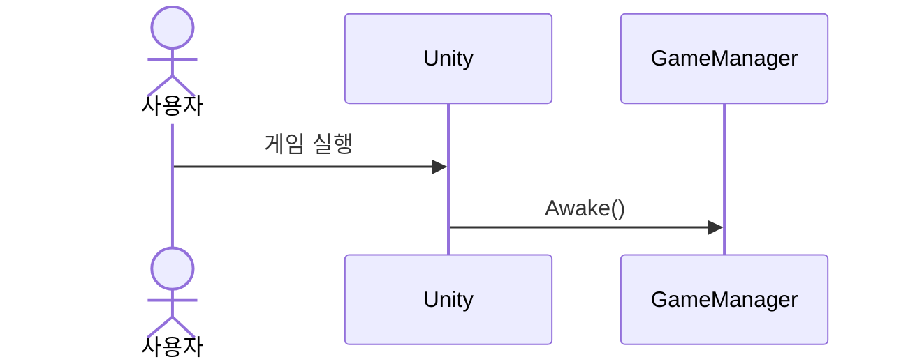

# DESIGN — 작성 기준과 선택 기록

이 파일은 여기에 명시한 파일에 한해 작성 및 수정하는 기준과 형식을 정의한다.

## 적용 범위
### 대상 파일들 (목차)
1. [STATUS.md](STATUS.md) : 현재 상태, 적용 예정 요구, 미완 사항과 인수인계
2. [Unity `.cs` files](../../project/) : 실제 Unity 파일들
3. [Archive Files](../archive/) : AI 결과물 기록
  - [01_Choice](../archive/01_Choice/) : 개발자가 선택한 것들에 대해 기록
  - [02_Hold](../archive/02_Hold/) : 개발자가 보류하거나 나중에 시도해보기로 한 것들에 대해 기록
4. `/docs/GAME_SPEC.md` : 통합 기획·구조·아트·도구 선정 및 구현 대응 문서 (통합 작업 시 작성)
5. `/docs/QUESTIONS.md` : 충돌·누락 일괄 질문지 (질문 취합 시 작성)

### 공통 작성 원칙
- 기본적으로 사람의 가독성과 이해를 최우선시 하여 작성하고, 큰 주제와 세부 항목을 제목으로 구분하는 형식을 사용한다. 이 원칙은, 별도로 이와 다른 원칙을 설명에 추가하지 않는 이상 기본적으로 적용된다.
- 확인한 사실, 개발자가 확정한 내용, 실험 중인 내용, 미정 사항을 구별한다.
- 같은 정보의 원본은 한 곳에 둔다. 다른 문서에는 필요한 요약과 해당 항목의 링크·번호를 적는다.
- 기존 문서의 기획이나 AI의 제안을 확정 사양·구현 사실로 바꾸어 기록하지 않는다.
- 정해지지 않은 내용과 확인하지 못한 내용은 미정·미확인으로 표시한다. 현재 요청 수행에 필요한 결정은 AGENTS의 일괄 질문 절차로 확인한다. 추측으로 채우지 않는다.
- 관련 작업으로 문서 내용이 달라지면 갱신안을 준비하고 AGENTS.md의 승인 절차에 따른다.
---

## 1. STATUS.md
마지막으로 진행한 작업에 대한 정보는 '## 1. 현재 상황'에 양식에 맞춰 작성한다. 리스트로 된 양식에 맞게 괄호처리된 부분을 정보에 맞게 수정한다.
해당 문단이 작성되는 목적은 새 에이전트 환경에서도 동일하게 작업을 이어나가기 위함인데, 해당 목적을 이루기에는 부족한 부분이 존재할 경우 부가 설명을 해당 문단의 '### 세부 설명'에 작성한다. 
이 '### 세부 설명'은 작업 진행에 따라 계속 변경될 수 있으므로 토큰 최적화를 위해 '목적을 이룰 수 있는 선에서 최대한 요약'하여 '영어'로 작성한다.

사용자가 에이전트와의 대화를 통해 추가한 행동 규칙이나 세부 요구사항들은 '## 2. 맥락'에 그 종류에 맞춰 적절한 문단에 추가한다.
해당 사항들은 표 양식에 맞춰 관리한다.
- '## 2. 맥락' 갱신시 공통 사항
  - 여기에 작성되는 것은 AGENTS.md나 DESIGN.md에 기록되지 않은 행동 방침들을 기록하는 것이다.
  - 대화에서 추가된 사안들을 1차적으로 STATUS.md에 기록한 뒤, 사용자의 판단하에 STATUS.md에 기록된 것을 AGENTS.md나 DESIGN.md에 옮겨 기록한다.
- 구분
  - '구현 목표' : 사용자가 직접 수정하는 영역이므로 임의로 수정하지 않는다.
  - '프로젝트 관리' : Project_Chrono의 디렉토리 구조나 에이전트용 .md 파일에 관한 세부 요구사항·행동 규칙을 기록 
  - '코드 작성 및 구조' : Unity의 `.cs` 파일 작성과 관련하여 세부 요구사항·행동 규칙을 기록
  - '아트 및 디자인' : 아트·디자인 관련 세부 요구사항·행동 규칙을 기록

### 작성 양식
```markdown
## 1. 현재 상황
### 마지막 갱신
- 마지막 갱신 날짜
  - (YYYY-MM-DD)
- 마지막으로 진행한 과제
  - (큰 단위 과제 명) : (세부 단위 과제 명)
  - (진행 정도 서술)
  - (완료 기준)

### 미완·보류 상태로 놓인 것들
- (큰 단위의 과제 명)
  - (세부 단위 별로 기록)

### 세부 설명
(위의 내용만으로는 새 에이전트 환경에서 그대로 작업을 이어나아가기에 부족한 설명을 여기에 모두 적어낸다.)

## 2. 맥락
### 구현 목표
- ...

### '프로젝트 관리' 관련 세부 요구
| 구분 | 세부 요구 사항 |

### '코드 작성 및 구조' 관련 세부 요구
| 구분 | 세부 요구 사항 |

### '아트 및 디자인' 관련 세부 요구
| 구분 | 세부 요구 사항 |

```


## 2. 유니티 프로젝트 디렉토리 내 파일 작성 및 관리 - `/project`

이 문서는 코드 작성 양식을 정한다. 비상 운영의 단계별 파일 수정 범위와 디버깅·검증 권한, 완료 기준은 AGENTS.md의 'Unity 코드 작업'을 따른다.

### 2.1 `.cs` Code Style

- 직접 작성하는 API는 `ConsumeLine`처럼 동작을 명확하게 이름 붙인다. 불필요한 `Try` 접두사는 쓰지 않으며 이름 변경 때 호출부·검사·현재 클래스/시퀀스 문서를 함께 갱신한다. Unity·외부 API의 이름은 변경하지 않는다.
unity 공식의 C#코드와 관련한 [naming and code style](https://unity.com/how-to/naming-and-code-style-tips-c-scripting-unity#prefixes) 안내를 기본으로 따른다.

- sealed 키워드는 붙이지 않는다.
- 특정 화면·UI 요소의 클래스와 C# 파일명은 `UI_이름`으로 작성한다. 예: `UI_Title`, `UI_Loading`, 이후 구현할 `UI_Settings`.
  - UI 전반의 시스템·기반·헬퍼는 밑줄 없이 `UI` 접두사를 쓴다. 예: `UIController`, `UIBase`, `UIInputModule`, `UIManager`, `UIRoot`.
  - 월드 카메라·캐릭터 렌더링·오디오처럼 UI가 아닌 역할에는 이 접두사를 붙이지 않는다. 디렉토리 위치만으로 UI 역할을 판단하지 않는다.
  - 신규·변경 코드 검토에서 역할에 맞는 접두사와 파일명 일치를 확인한다. 기존 Unity 스크립트를 이름 변경·이동할 때 `.meta`·GUID를 보존하고 씬·프리팹 참조를 함께 갱신한다.
- 함수의 인자마다 개행을 하거나, `get; set;` 용법에서 개행을 하지 않아도 괜찮은 것을 개행 함으로써 불 필요하게 코드의 줄 수가 늘어나는 일이 없도록 한다.
- 프로젝트에서 직접 작성하는 런타임·Editor C# 코드는 namespace를 선언하지 않고 전역 타입으로 작성한다. 이후 신규 코드와 기존 코드 수정에도 적용한다.
  - Player, Enemy, UI, Audio, VFX 등의 기능 구분은 디렉토리로 유지한다.
  - `System`, `UnityEngine`, `UnityEditor` 및 외부 패키지를 사용하는 데 필요한 `using`은 유지한다. 외부 패키지와 `/docs/reference`의 원본 namespace는 수정하지 않는다.
  - 2026-11-15 사용자 요청으로 기존 `Chrono.` 접두사 규칙을 교체함. [선택 기록](../archive/01_Choice/No_Namespace_20261115.md) 참조.
- 함수 내에 작성된 코드는 쓰인 목적에 따라 빈 개행문자를 중간에 삽입하여 구분한다.
  - 이 목적에 대해서는 큰 단위로 묶어 간주한다.
  - 구분한 각 구역의 맨 위에 역할·목적을 요약한 `//` 주석을 둔다. 한 동작만 있는 함수에 같은 설명을 반복하기 위해 구역을 만들지는 않는다.
  - 사용 예시
    ```c#
    function()
    {
        ...
        // 화면 표시 갱신
        UI 관련 코드 1;
        UI 관련 코드 2;

        // 다음 입력을 위한 상태 정리
        내부 처리 코드 1;
        내부 처리 코드 2;
        ...
    }
    ```
- `.cs` 파일 내의 함수 작성 순서는 다음을 따른다.
  1. (존재할 경우)클래스 생성자
  2. (존재할 경우)Unity Monobehaviour의 함수들
    - Awake -> Start -> Update -> On... 순서
    - OnEnable/Disable -> OnTrigger/Collision.. -> ... -> OnDestroy 순서
  3. public API 함수들
  4. Monobehaviour 함수가 아닌 private 내부 함수들
    - 클래스 내부에서만 사용할 목적의 Helper 함수는 가장 마지막 순위이다.

### 2.2 주석 작성
코드 작성시 주석 작성 요령을 정의한다.

- Class 위에 `<summary></summary>`를 이용해서 이 클래스의 사용 목적을 작성한다.
  - 이를 작성하는 이유는 개발자가 해당 코드에 대해 이해 및 기억할 수 있도록 하기 위함이다.
- 클래스의 public·private 변수는 선언 옆에 역할 또는 존재 목적을 설명하는 한 줄 `//` 주석을 붙인다. 일반·static 필드, 상수, 프로퍼티와 중첩 데이터 클래스의 필드에 같은 기준을 적용한다. 지역 변수마다 일률적으로 주석을 붙이지 않으며 외부 패키지와 레퍼런스 원본은 수정하지 않는다.
  - 변수명이나 타입만 반복하지 않고 무엇을 참조·보관하는지, 어떤 상태를 알리는지 또는 외부에서 왜 사용하는지를 실제 코드에 맞게 요약한다.
  - 예: `public static GameManager Instance; // 외부에서 GameManager 기능에 접근할 인스턴스`
  - 예: `private bool isPreparing; // 준비 요청의 중복 실행 방지`
  - **작업 순서:** 변수 선언·역할 변경 → 같은 줄에 설명 작성·갱신 → 코드 검토에서 주석 누락과 설명·실제 용도의 일치 여부 확인.
- 특정 함수들 위에는 `<summary></summary>`를 붙여 해당 함수가 어떤 목적으로 작성되었고 어느 외부 요소와 연결되어 있는지 안내한다.
  - 특정 함수들 : Monobehaviour 함수 중 OnEnable/Disable/Destroy를 제외한 함수들, Public API 함수들, Monobehaviour 함수가 아닌 내부 Private 함수들
- 함수 내부에서 빈 줄로 나눈 목적별 구역은 각각 맨 위에 `//`로 역할·목적을 요약한다. 핵심 로직이나 외부 호출이 있는 구역에만 한정하지 않는다. 줄별 코드 번역 대신 그 구역이 필요한 이유나 처리 단계를 적는다.
- 이벤트 구독·해제(`+=`, `-=`, `AddListener`, `RemoveListener` 등)와 코루틴 실행(`StartCoroutine` 등)은 해당 코드 뒤에 목적을 한 줄로 적는다. 비동기 작업을 시작하는 `Forget()`도 같은 기준을 적용한다.
- `yield return`으로 무엇을 기다리며 왜 다음 단계로 넘어가지 않는지 불명확하면 코드 뒤에 목적을 한 줄로 적는다. `yield break`와 `yield return null`은 제외하며 모든 yield에 획일적인 주석을 붙이지 않는다. 예: `yield return LoadTitle(); // 실패한 월드를 정리하고 Title 준비가 끝날 때까지 대기`.
- 한국어 한 문장 주석·summary는 `슬롯 로드 완료 대기`, `Title 복귀`, `현재 카메라 참조`처럼 짧고 자연스럽게 마친다. 단일 문장 끝의 `~함.`·`~임.`·마침표는 쓰지 않는다. 두 문장 이상 이어져 문장을 나눠야 할 때만 `~함.` 형태를 사용한다.
- 작업 순서: 실제 코드의 역할 확인 → 변수 옆 설명·목적별 구역 상단·구독/실행/대기 옆 주석 작성 → 누락·정확성·어투 확인. 주석·공백만 바꿀 때는 실행 코드와 문자열이 유지됐는지 대조하고 불필요한 기능 검사·원작 재조사를 반복하지 않는다.

### 2.3 디렉토리 구조
*미정*

### 2.4 레퍼런스 기반 구현과 초기화 검토
1. GAME_SPEC의 기능 ID·담당 클래스·이번에 구현할 메서드/책임을 특정한다.
2. [REFERENCE_CODE_MAP.md](../REFERENCE_CODE_MAP.md)에서 Sephiria의 대응 파일과 필요한 Dungreed 보조 파일을 찾고 실제 코드의 선언·관련 메서드·호출부·생성부를 읽는다. 유사 책임과 동일 구현을 구분하며 대응 없는 고유 기능은 그 사실을 명시한다.
3. 원작의 참조 방식, 실행 순서, 데이터 흐름과 해제 과정을 파악한 뒤 현재 싱글 플레이·고정 무기·소규모 보스 러시에 필요한 부분만 적용한다. 원작의 규칙이 사용자 확정 사양과 다르면 확정 사양을 따른다.
4. 공유 객체의 Instance가 필요하면 앱·씬·세션 중 유지 범위와 생성 우선순위·최초 참조 시점을 명시한다. Awake는 자기 등록·자기 컴포넌트 준비, Start는 준비된 외부 참조의 일회 확보로 나누거나 실제 executionOrder·명시적 생성 완료 호출로 순서를 정한다. 고정 수명의 참조는 필드에 보관하고 재사용하며 초기화 순서를 피하려고 매 프레임 다시 조회하지 않는다.
   - 초기 활성 씬 객체의 모든 Awake가 끝난 뒤 Start가 실행되는 관계를 사용한다. 동적 생성·비활성 객체나 다른 객체의 Start에서 준비하는 값까지 자동 보장된다고 확대하지 않는다. 해당 경우에는 생성 완료 경계 또는 필요한 실행 순서를 명시한다.
   - static Instance도 씬 전환·교체로 바뀔 수 있다. 앱 수명 소비자에게 씬 수명 참조를 영구 보관하지 않으며, 재입장·대상 교체 때만 갱신/해제한다. 상태값(HP·IsLoading·입력·대상 위치)은 참조와 구분해 현재 값을 읽는다.
   - Update·FixedUpdate·LateUpdate·OnGUI와 반복 호출부에서 Instance/GetComponent/Find 재조회 및 같은 객체의 반복 생성을 확인한다. 이미 초기화에 모인 조회, 실제로 변하는 데이터, 값 타입의 new를 같은 문제로 취급하지 않는다.
   - GUI.skin처럼 특정 실행 문맥이 필요한 API는 최초 유효 호출에서 한 번 준비해 재사용하고 그 이유를 주석으로 남긴다. 매 프레임 재검색하는 대체 경로나 불필요한 초기화 프레임워크를 만들지 않는다.
5. 초기화 검토에는 `생성/등록 → 최초 조회 → 대상 연결 → 사용 → 해제` 순서를 적는다. 없는 서비스는 무한 대기·조용한 부분 성공 대신 기존 실패 복구 경로로 전달한다. 중복 Instance, Player 복제/교체/제거, Title 재진입과 실패 복구에서 정상 객체의 참조·입력이 손상되지 않는지 관련 실행 검사로 확인한다.
6. public·private 변수와 구역·구독·코루틴의 관련 설명, 호출부·씬/프리팹 연결을 함께 갱신하고 실제 컴파일·기능 검증 후 GAME_SPEC와 Notion의 관련 Class·Sequence Diagram에 반영한다. 대응표의 파일 존재 및 관련 기능도 변경에 맞춰 유지한다.


## 3. AI 결과물 - `/docs/archive`
해당 디렉토리의 하위 디렉토리 생성 및 기록과 관련한 내용은 [README.md](../archive/README.md)를 따른다.

### 3.1 개발자 선택 사항 기록 양식 - `/docs/archive/01_Choice`
사용자가 선택해야하는 사항들에 대해 어떤 주제에 대해서 어떠한 이유로 그러한 선택을 하였는지 기록한다.
'선택 주제' 문단 1개와, 그 주제에 대해 나온 '선택 사안' 별로 문단을 만들어 기록한다.


해당 디렉토리에 작성되는 파일의 양식은 다음과 같다.
```markdown
# 선택 주제
주제 : (어떤 주제에 관한 것인지 서술)
- (왜 이런 주제에 대해 선택 사안이 나오게 되었는지 그 경위를 설명)

# 선택 사안 1
- 선택 : (선택된 사안)
- 이유 : (선택한 이유 설명)
- 제시된 다른 선택 사안들
  - (다른 선택 사안 1)
  - (다른 선택 사안 2)
  - ...

# 선택 사안 2
...
```

### 3.2 보류 사항 기록 양식 - `/docs/archive/02_Hold`
'목적' 문단과 '논의 중인 내용' 문단, '확정된 내용' 문단으로 구분한다.
'목적' 문단에는 다루는 보류 사항의 주제와, 그 파일이 작성하게된 목적과 그 경위를 리스트 형태로 작성한다.

'논의 중인 내용' 문단에는 현재 확정이 되지 않은 부분들에 대해 그 부분과 제안된 세부 내용들을 리스트 형태로 작성한다.

'확정된 내용'은 현재 보류된 주제에 대해 여러 내용 중 확정된 내용을 리스트 형태로 작성한다.

해당 디렉토리에 작성되는 파일의 양식은 다음과 같다.
```markdown
# 목적
- 주제 : (보류 사항의 주제)
- (그 파일이 작성하게된 목적과 그 경위 설명)

# 논의 중인 내용
- (확정 되지 않은 부분 1)
  - (제안된/고민 중인 내용 1)
  - (제안된/고민 중인 내용 2)
  - ...
- (확정 되지 않은 부분 2)
- ...
# 확정된 내용
- (확정된 내용 1)
- (확정된 내용 2)
- ...
```

## 4. 통합 문서와 일괄 질문지

### 4.1 `/docs/GAME_SPEC.md`
- 현재 확정 사양의 원본을 이 문서 하나에 모으고 기존 기획·선택 기록은 출처로 연결한다. STATUS와 PLANS에는 사양을 복제하지 않는다.
- 기본 목차: `제출 범위·게임 컨셉`, `핵심 플레이 흐름·완료 조건`, `플레이어·고정 무기·확정 능력`, `적·보스·전투 규칙`, `진행·실패·재시작`, `내부 코드 구조·시스템 연결`, `UI·Sprite·애니메이션·VFX 등 필요 자산`, `Plugin·asset·Unity 버전`, `기능별 구현·검증 현황`, `미정·보류 및 출처`. 해당하지 않는 항목을 만들기 위해 기능을 추가하지 않는다.
- 기능에 안정적인 식별자를 부여하고 목적·규칙·입출력/상태·담당 코드와 연결 관계·필요 자산·완료 조건을 적는다. 구조와 원리를 결과 보고서에 설명할 수 있는 정도로 간결히 작성한다.
- 사양 확정 상태와 실제 구현·검증 상태를 별도로 표시한다. 현재 코드와 확정 사양이 다르면 차이를 남긴다. 발견한 코드나 문서만으로 사용자 확정으로 올리지 않는다.
- 구현 대응 표: `기능 ID | 사양 상태 | 코드·연결 위치 | 구현 상태 | 확인 결과 | 남은 아트 의존 작업 | 그 외 차단 사항`. 자산에는 용도·사용 위치·필요 규격·연결 지점을 기록하고 미정 규격은 질문으로 보낸다.
- 도구 비교 표: `후보 | 필요한 기능 | 대안 | 도입 시간·비용·사용 조건 | Unity 지원 범위·출처·확인일 | 결정 상태·이유`. 선정과 설치 완료를 구분한다.
- 새 답변·변경·구현 결과는 해당 항목에 반영하고 결정 기록에는 기능 ID와 출처를 연결한다. 같은 설명을 여러 결과 문서로 복제하지 않는다.

#### 코드 작업과 Sequence Diagram 기록
- 코드 구현·수정과 같은 작업에서 외부 입력부터 시작하는 실제 호출 흐름을 로컬 GAME_SPEC과 [Notion 정리 페이지](https://app.notion.com/p/41857a6d6d24809a8d15f1a5aa34d48a)에 반영한다. 같은 기능의 기존 흐름을 갱신하며 변경 없는 Case를 중복 생성하지 않는다.
- Notion 위치는 **2장의 해당 기능 표 바로 아래**이다. **기능별로 독립 토글(드롭다운)을 두고 제목을 `F-S01 SequenceDiagram`, `F-P01 SequenceDiagram`처럼 `기능 ID + SequenceDiagram`으로 작성한다.** 토글 내부에는 중복 기능 ID 제목 없이 **번호가 붙은 Case 제목 → Case 설명 → Mermaid 코드 블록** 순서로 둔다. 기존 기능 ID·Case 번호와 사용자가 작성한 내용은 보존하고 새 Case만 이어 붙인다.
- Mermaid 내용 저장과 실제 흐름 대조는 유지한다. **미리보기 표시 모드 설정·화면 확인은 작업 및 완료 체크에서 제외하며, 이를 위해 마우스·브라우저 UI를 조작하지 않는다.** 표시 모드 미확인을 미완 과제로 남기지 않는다.
- 설명에는 시작 입력·처리 목적·결과를 간결히 적고, 다른 기능의 공통 처리를 포함하면 관련 기능 ID와 구현 범위를 표시한다. 미구현 기능 전체가 완료된 것처럼 기록하지 않는다.
- Mermaid는 실제 클래스/API·데이터 전달·성공/실패 분기·비동기 대기 관계를 나타낸다. 준비 완료 대기와 병렬 처리, 저장 요청 반환과 디스크 기록 완료를 구분한다. 코드 연결과 실행 검증 상태는 별도로 기록한다.
- 작업 순서: 코드 구현·변경 → 관련 입력/호출·데이터 흐름 대조 → 로컬 다이어그램 갱신 → 기존 Notion 위치·기능별 토글 확인 및 해당 Case 저장 → 연결 도구의 저장 결과 확인. 주석·공백만 바뀌어 흐름이 같으면 기존 다이어그램을 유지하며 중복 게시하지 않는다. Notion 기록 권한은 AGENTS 4의 해당 범위에 이미 포함되어 있으며 반복 승인 질문은 하지 않는다. 접근 오류·저장 실패가 있으면 로컬 결과를 보존하고 미반영 위치·원인·다음 행동을 STATUS에 남긴다.
- 아래는 Notion 저장 형식 예시이다. 기능 ID·Case 제목·설명·호출은 해당 구현에 맞게 작성한다.

````markdown
<toggle>
F-S01 SequenceDiagram

**① 게임 실행 → Title 준비**

게임 실행을 입력으로 받아 공통 슬롯 로드와 Title 자체 준비가 끝난 뒤 입력을 허용하는 흐름이다.


</toggle>
````

### 4.2 `/docs/QUESTIONS.md`
- 한두 개로 즉답 가능한 질문을 넘으면 충돌과 필수 누락을 한 번에 묶는다. 문서와 채팅에 동일한 질문 ID·선택지를 제시한다. 이미 확정된 답을 다시 받지 않는다.
- `즉시 구현을 막는 결정`과 `후속 단계 전에 필요한 결정`으로 구분한다. 질문 수를 늘리기 위한 선택적 기능 제안은 제외한다.
- 각 항목의 기본 양식은 다음과 같다.

```markdown
### Q1. (확인할 결정)
- 유형: 충돌 / 필수 누락
- 관련 기능·출처: (기능 ID, 파일 경로·제목 또는 코드 위치)
- 확인할 내용: (서로 다른 기존 결정 또는 비어 있는 규칙)
- 선택지: A. (...) / B. (...) / 직접 설명
- 권고안과 이유: (있을 경우. AI 제안이며 확정 아님)
- 영향: (이 답이 필요한 구현·자산·검증 및 차단 여부)
- 사용자 답변: 미응답
- 처리 상태: 답변 대기 / 확정 / 보류 / 임시 적용
- 반영: 미반영 / GAME_SPEC의 해당 항목 및 결정 기록 링크
```

- 문서 끝과 채팅에 `Q1: B, Q2: ...` 답변 예시를 제공한다. 일부만 답한 경우 나머지는 미응답으로 둔다.
- 답변을 받으면 질문지의 답변·반영 상태와 통합 문서를 함께 갱신한다. 질문 ID는 재사용하지 않는다. 결정 이유를 받지 않았다면 기록에 `이유 미기록`을 표시한다.
