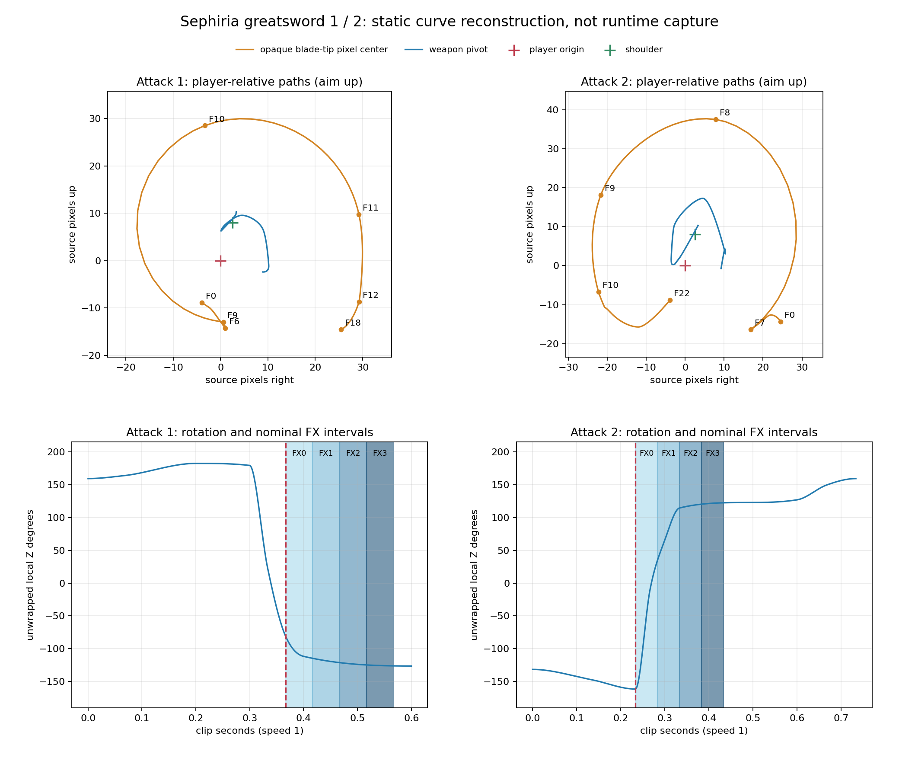
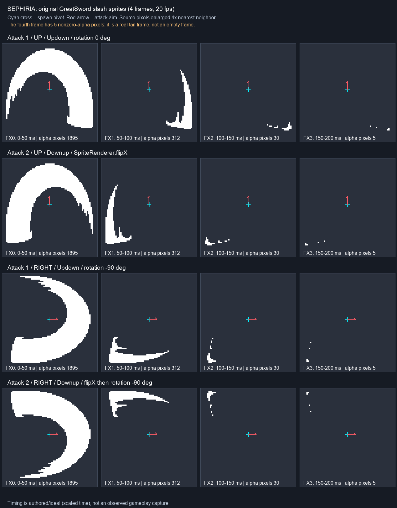

# 세피리아 대검 1·2타 — 공격 모션과 검기 프레임 분석

작성: 2026-11-15 (Asia/Seoul). 목적: Project_Chrono 공격 애니메이션 제작에 앞서 원작의 위치·회전·검기 시간을 분리해 확인한다. 사용자 선택은 **대검의 첫 번째·두 번째 일반 공격을 참고한다**는 것이며, 아래 원작 수치를 그대로 우리 게임에 적용하기로 확정한 것은 아니다.

**핵심:** 검은 플레이어 원점에서 일정한 반지름으로 도는 것이 아니다. `Shoulder/Weapon`의 **로컬 위치와 로컬 Z 회전이 각각 곡선으로 움직이고**, 그 위에 조준 방향·플레이어 이동이 합쳐진다. 검기는 별도로 생성되어 조준 방향을 유지하며 스프라이트를 교체한다. 보유 원본의 검기는 **주요 형태 3장과 작은 잔광 1장, 총 4장**이다.

이 문서는 로컬 추출 C#·Unity 에셋의 **정적 분석과 수치 복원**이다. 실제 원작의 렌더 프레임 녹화·Unity 런타임 Transform 측정은 수행하지 않았다. 보유 추출본 설정은 Unity `2022.3.62f1`, `bundleVersion: DEMO-2`이며 정확한 배포 BuildID는 미확인이다. 출처·검증·남은 관측 범위는 9장을 따른다.

## 1. 확인한 실제 재생 경로

```text
기본 대검 0010_GreatSword
→ Weapon_GreatSword_1.prefab / WeaponSimple_GreatSword
→ PlayerAvatar의 WeaponControllerSimple
→ AnimationWrapper.controller의 Greatsword 레이어(2)
→ GreatSword_Attack1.anim / GreatSword_Attack2.anim
```

장비 데이터에는 `wieldEntity → SwingWeapon_GreatSword_New → GreatSword_New.controller`도 남아 있다. 그러나 현재 Player의 `WeaponControllerSimple`은 그 Controller로 교체하지 않고 공통 `AnimationWrapper`의 레이어를 켠다. 이름이 비슷한 `GreatSword_New_Attack1/2`, `GreatSword_Attack*_0`을 현재 공격과 혼합하지 않았다. 반면 실제 타격 사이 대기 상태가 참조하는 `GreatSword_New_WaitForAttack2`는 유효한 참조다. 파일 이름이 아니라 GUID 연결로 판단했다.

| 항목 | 1타 | 2타 |
| --- | --- | --- |
| 실제 클립 | `GreatSword_Attack1.anim` | `GreatSword_Attack2.anim` |
| GUID | `8249b93a637381f42a856026c59fd5ce` | `3e7bb801c7dca9a41b039c197dba8b64` |
| 저작 sampleRate | 30fps | 30fps |
| 배속 1에서 클립 길이 | 0.600000초 | 0.733333초 |
| 지속 프레임 구간 / 표의 표본 수 | 18구간 / F0~F18의 19표본 | 22구간 / F0~F22의 23표본 |
| 검기 생성 이벤트 | F11 / 0.366667초 | F7 / 0.233333초 |
| 주된 빠른 휘두르기 | F9→F12, −290.983° | F7→F10, +275.962° |

**F0가 시작점**이다. 따라서 F11은 0부터 세는 11번, 화면을 1부터 세면 12번째 표본이다. F18/F22는 종료 경계값이며 그 자세가 한 렌더 프레임 동안 반드시 유지된다는 뜻은 아니다. 상태 전환의 blend duration은 0이다. 기본 3타도 존재하며, `tripleCombo` 특수 분기와 일반 `GreatSword_Attack3` 분기는 별개다. 이번 정밀 표는 요청한 1·2타만 다룬다.

근거: `PlayerAvatar.cs:170`, `WeaponControllerSimple.cs:209,1004`, `WeaponSimple.cs:162`, `Weapon_GreatSword_1.prefab:202`, `PlayerAvatar.prefab:1546,1827`, `AnimationWrapper.controller:164,4140,4189,4388`.

## 2. 공격 명령을 내렸을 때

1. `PlayerInputController.HandleOnFire`가 UI·페이드·입력 차단을 검사한다. 누름은 `PlayerAvatar.StartAttackClientside`, 해제는 `StopAttack`으로 전달한다.
2. `PlayerAvatar`가 행동 가능 상태를 검사한 뒤 `WeaponControllerSimple.AttackButtonDown`을 호출한다. 공격 방향을 저장하고 대검에 입력을 전달한다.
3. `WeaponSimple_GreatSword`가 현재 공격 중이 아니거나 `ATTACK` 입력 버퍼가 허용된 상태에서 Animator의 `Attack` Trigger를 설정한다.
4. 선택된 공격 클립이 시작되면 F0의 `BeginAttackAnimation`이 타수·이동 입력 차단·공격 속도를 설정한다. 이후 Animator가 `Shoulder/Weapon` 위치와 회전 곡선을 평가한다.
5. 생성 이벤트에서 `WeaponControlAnimator → WeaponControllerSimple.CreateBasicAttackSwing → WeaponSimple → NewWeaponFireData`로 이어져 **검기·피해 판정·공격 이동**을 각각 실행한다.
6. 종료 이벤트에서 현재 타격 상태와 이동 입력 차단을 해제한다. 대기 상태에서 다음 입력에 따라 후속 타격으로 전환한다.

공격 중 단순 커서 이동은 저장한 `attackDirection`을 바꾸지 않는다. 하지만 새 `AttackButtonDown`은 대검의 허용 검사 전에 방향을 다시 저장할 수 있다. 버튼을 유지해 다음 타격을 시작할 때도 현재 커서 방향을 다시 잡는다. 아래 표는 **추가 방향 변경 입력 없이 위쪽을 계속 조준하는 조건**이다.

| 애니메이션 이벤트 | 1타 | 2타 | 역할 |
| --- | --- | --- | --- |
| `BeginAttackAnimation` | F0, idx0 | F0, idx1 | 현재 타수와 공격 상태 설정 |
| `AllowInputBuffer("ATTACK")` | F1 | F1 | 후속 공격 입력 허용 |
| `CustomAnimationRequest("Attack_Start")` | F7 | F6 | Player 몸체의 별도 공격 표현 요청 |
| `CreateBasicAttackProjectile` | **F11, idx0** | **F7, idx1** | 검기·판정·공격 이동 생성 |
| `SetSortingOrder_MainWeapon` | F0:−1 → F11:+1 | F0:+1 → F9:−1 | 몸체와 무기의 앞뒤 정렬 변경 |
| `EndAttackAnimation` | F18 | F22 | 현재 공격 종료 |

근거: `PlayerInputController.cs:387,443`, `PlayerAvatar.cs:835,1430`, `WeaponControllerSimple.cs:41,55,337,479,586,651`, `WeaponSimple_GreatSword.cs:113,185`, 두 실제 `.anim`의 `m_Events`.

## 3. 무엇을 중심으로 회전하는가

```text
PlayerAvatar                       플레이어 월드 기준점 P(t)
└ BodyWrapper
  └ AnimationWrapper               지상/점프 등의 몸체 높이·크기
    └ Shoulder                     어깨 오프셋 + 조준 회전 θ
      ├ SwingPoint                 검기 생성점 (local 0,1)
      └ Weapon                     클립 위치 p(t), Z 회전 φ(t)
        └ MainWeapon               장착 시 local 위치0/회전0/크기1
          └ BodySprite             원본 검 이미지, local 위치0/회전0/크기1
```

**플레이어 기준점, 어깨, 검 이미지 피벗, 검기 피벗은 서로 다르다.** 검의 회전축인 Weapon 피벗도 프레임마다 이동한다. 한 고정점을 기준으로 `RotateAround`만 호출하는 구조가 아니다.

### 3.1 기준 좌표와 이미지 피벗

| 기준 | Unity 단위 | 원본 16PPU 환산 |
| --- | --- | --- |
| 장착 시 Shoulder 기본 오프셋 | (0.15625,0.4375) | (2.5,7)px |
| 위쪽 조준 시 Shoulder | **(0.15625,0.5)** | **(2.5,8)px** |
| 수평·아래쪽 조준 시 Shoulder | (0.15625,0.375) | (2.5,6)px |
| Shoulder 기준 SwingPoint | (0,1) | (0,16)px |
| 위 조준 검기 피벗, Player 기준 | **(0.15625,1.5)** | **(2.5,24)px** |

기본 체형의 `fatScale=tallScale=1` 조건이다. `WeaponShoulder.Aim`이 조준점의 Y에 따라 Shoulder Y에 ±0.0625를 더한다. Shoulder 오프셋 자체를 조준각으로 돌리는 것이 아니라, 그 위치에서 하위 Weapon과 SwingPoint를 회전시킨다.

검은 `GreatSword_Tier1` 한 장을 사용한다. 크기는 **11×28px**, PPU16, 이미지 좌하단 기준 피벗은 **(5.5,6)px**이다. `.anim`에는 Sprite 교체·스케일 곡선이 없고 위치와 Euler Z 곡선만 있다. 별도 BladeSpriteAddOn Renderer는 기본 프리팹에서 꺼져 있다.

실제 불투명한 가장 위 칼끝 픽셀은 PNG 좌상단 좌표 `(5,1)`이며 그 픽셀 중심은 좌하단 기준 `(5.5,26.5)`이다. 따라서 검 피벗 기준 칼끝 중심은 `u_tip=(0,20.5/16)=(0,1.28125)`이다. 이미지 **사각형 윗변 중앙** `u_rect=(0,22/16)=(0,1.375)`과 구분했다. CSV에는 두 위치를 모두 저장했다.

### 3.2 프레임별 좌표 계산식

**식의 출처에 대한 사용자 후속 확인(2026-11-16):** 아래 식이 세피리아 C#에 그대로 작성되어 있는 것은 아니다. 원작 코드가 설정하는 Transform 사이 거리·조준 회전과 `.anim`의 위치/회전 키를 Unity가 합성하는 결과를 분석자가 수식으로 표현한 것이다. 위치·각도·시간 값은 원본에서 읽었으며 임의로 만든 운동 공식을 원작 구현이라고 설명하지 않는다. 4절 Hermite 계산도 원작의 별도 공격 C# 공식이 아니라 Animator 곡선에 저장된 접선으로 그 보간 결과를 복원한 것이다.

위 조준·정상 지상·Player X scale +1인 표의 조건에서:

```text
검 피벗의 Player 상대 좌표 H(t) = (0.15625,0.5) + p(t)
검의 칼끝 중심 T(t) = H(t) + R(φ(t)) × (0,1.28125)
픽셀 좌표 = Unity 단위 × 16
월드 좌표 = P(t) + 해당 Player 상대 좌표
```

일반적인 +X 루트 상태의 조준각 θ를 포함하면:

```text
H_world(t) = P(t) + S + R(θ) p(t)
T_world(t) = P(t) + S + R(θ)[p(t) + R(φ(t)) u_tip]
R(a)(x,y) = (cos(a)x − sin(a)y, sin(a)x + cos(a)y)
```

X는 오른쪽, Y는 위쪽, Z각 양수는 반시계 방향이다. `HorayUtility.GetAngle`의 조준각은 위0°, 오른쪽−90°, 아래180°, 왼쪽90°이다. 오른쪽 기준으로 변환할 때는 S=(0.15625,0.375)를 사용한다.

왼쪽 조준은 `TopdownRigidbody.Direction`이 Player 루트 X를 반전한다. 점프·체형 변경도 부모 변환에 영향을 준다. 모든 조건을 포함하는 정확한 표현은 다음과 같다.

```text
H_world(t) = Shoulder.localToWorldMatrix × [p(t),1]
T_world(t) = Shoulder.localToWorldMatrix × [p(t) + R(φ(t))u_tip,1]
```

왼쪽 반사·점프까지 위쪽 수치 표에서 확인한 것으로 취급하지 않는다. 그 경우 원작 런타임의 실제 부모 행렬을 함께 샘플링해야 한다.

근거: `WeaponSimple.cs:162–181`, `WeaponShoulder.cs:24–49`, `WeaponControllerSimple.cs:41–50`, `HorayUtility.cs:33`, `PlayerAvatar.prefab:740,1620,1800,1883`, `TopdownRigidbody.cs:18,639`, `GreatSword_Tier1.asset:10–19` 및 PNG 알파 검사.

## 4. 프레임별 검 위치와 회전



위 그림의 궤적 선은 원본 곡선을 600Hz로 수치 평가한 표시용 곡선이다. 아래 표는 30Hz, 별도 CSV는 30/60Hz다. 600Hz가 원작의 실행 속도라는 뜻은 아니다.

### 4.1 움직임을 구간으로 읽기

| 타격 | 구간 | 실제 움직임 |
| --- | --- | --- |
| 1타 | F0→F6, 0~0.2초 | φ159.300→182.460°. 칼끝을 아래에 둔 채 피벗을 좌하단으로 이동하며 준비 |
| 1타 | F6→F9, 0.2~0.3초 | φ182.460→179.309°. 위치를 조금 되돌리며 가속 직전 준비 |
| 1타 | **F9→F12, 0.3~0.4초** | φ179.309→22.500→−81.121→−111.674°. **−290.983°를 시계 방향**으로 휘두름. 피벗 p는 (−.1,−.03)→(.126,.097)→(.404,−.089)→(.48,−.57) |
| 1타 | F12→F18, 0.4~0.6초 | φ−111.674→−126.396°. 오른쪽 아래로 내려간 검을 감속하며 마무리 |
| 2타 | F0→F7, 0~0.233333초 | φ−131.601→−161.496°. 오른쪽 아래에서 검을 조금 더 뒤로 당김 |
| 2타 | **F7→F10, 0.233333~0.333333초** | φ−161.496→−9.117→65.850→114.466°. **+275.962°를 반시계 방향**으로 휘두름. 피벗 p는 (.49,−.31)→(.13,.58)→(−.34,.11)→(−.38,−.39) |
| 2타 | F10→F18, 0.333333~0.6초 | φ114.466→126.924°. 왼쪽 아래에서 감속 |
| 2타 | F18→F22, 0.6~0.733333초 | φ126.924→159.300°. 피벗을 (.051,.145)로 되돌려 기본 준비 자세로 복귀 |

**1타는 빠른 회전이 이미 진행된 F11에서 검기가 생기고, 2타는 빠른 회전을 시작하는 F7에서 생긴다.** 두 모션에 동일한 정규화 시간으로 FX를 붙이면 원작 타이밍과 달라진다.

키 사이는 직렬화된 `inSlope/outSlope`를 사용하는 unweighted cubic Hermite 보간이다. 선형 보간이나 매 프레임 동일 각도 증가가 아니다. 키 A/B 사이 u=(t−tA)/(tB−tA), d=tB−tA일 때 각 성분의 값은 다음 식으로 복원했다.

```text
v(t) = (2u³−3u²+1)vA + (u³−2u²+u)d·outSlopeA
     + (−2u³+3u²)vB + (u³−u²)d·inSlopeB
```

표의 피벗 X/Y는 **현재 Player 원점 기준 원본 픽셀 좌표**다. Z각은 Shoulder 기준의 연속 Euler 값이며 0~360으로 접지 않았다. `직전 대비`는 직전 1/30초 표본과의 차이, `최초 대비`는 해당 타격 F0와의 차이다. `K`는 원본 위치/회전 키, `보간`은 복원 값이다. 검기 열은 20Hz의 **명목 시간축**이며 실제 렌더 프레임 보장은 6.3절을 따른다.

### 1타 전체 30fps 표

| F | 시간(s) | 피벗 X(px) | 피벗 Y(px) | 로컬 Z(°) | 직전 대비(°) | 최초 대비(°) | 검기 | 키 |
| ---: | ---: | ---: | ---: | ---: | ---: | ---: | --- | --- |
| 0 | 0.0000 | 3.316 | 10.320 | 159.300 | 0.000 | 0.000 | - | K |
| 1 | 0.0333 | 3.299 | 10.159 | 160.790 | 1.490 | 1.490 | - | 보간 |
| 2 | 0.0667 | 3.265 | 9.836 | 163.770 | 2.980 | 4.470 | - | K |
| 3 | 0.1000 | 2.752 | 9.092 | 168.367 | 4.597 | 9.067 | - | 보간 |
| 4 | 0.1333 | 1.666 | 7.876 | 174.605 | 6.238 | 15.305 | - | 보간 |
| 5 | 0.1667 | 0.588 | 6.741 | 180.099 | 5.493 | 20.799 | - | 보간 |
| 6 | 0.2000 | 0.100 | 6.240 | 182.460 | 2.361 | 23.160 | - | K |
| 7 | 0.2333 | 0.130 | 6.388 | 182.343 | -0.117 | 23.043 | - | 보간 |
| 8 | 0.2667 | 0.337 | 6.820 | 181.526 | -0.817 | 22.226 | - | 보간 |
| 9 | 0.3000 | 0.900 | 7.520 | 179.309 | -2.217 | 20.009 | - | K |
| 10 | 0.3333 | 4.516 | 9.552 | 22.500 | -156.809 | -136.800 | - | K |
| 11 | 0.3667 | 8.964 | 6.576 | -81.121 | -103.621 | -240.421 | FX0 | K |
| 12 | 0.4000 | 10.180 | -1.120 | -111.674 | -30.553 | -270.974 | FX0 | K |
| 13 | 0.4333 | 10.085 | -1.723 | -117.256 | -5.582 | -276.556 | FX1 | 보간 |
| 14 | 0.4667 | 9.848 | -2.102 | -121.240 | -3.984 | -280.540 | FX2 | 보간 |
| 15 | 0.5000 | 9.540 | -2.309 | -123.886 | -2.646 | -283.186 | FX2 | 보간 |
| 16 | 0.5333 | 9.232 | -2.393 | -125.454 | -1.568 | -284.754 | FX3 | 보간 |
| 17 | 0.5667 | 8.995 | -2.407 | -126.204 | -0.750 | -285.504 | - | 보간 |
| 18 | 0.6000 | 8.900 | -2.400 | -126.396 | -0.192 | -285.696 | - | K |

### 2타 전체 30fps 표

| F | 시간(s) | 피벗 X(px) | 피벗 Y(px) | 로컬 Z(°) | 직전 대비(°) | 최초 대비(°) | 검기 | 키 |
| ---: | ---: | ---: | ---: | ---: | ---: | ---: | --- | --- |
| 0 | 0.0000 | 9.220 | -0.720 | -131.601 | 0.000 | 0.000 | - | K |
| 1 | 0.0333 | 9.353 | 0.068 | -133.240 | -1.639 | -1.639 | - | 보간 |
| 2 | 0.0667 | 9.654 | 1.800 | -137.274 | -4.033 | -5.673 | - | 보간 |
| 3 | 0.1000 | 9.979 | 3.533 | -142.375 | -5.101 | -10.774 | - | 보간 |
| 4 | 0.1333 | 10.180 | 4.320 | -147.217 | -4.842 | -15.616 | - | K |
| 5 | 0.1667 | 10.262 | 3.988 | -152.817 | -5.600 | -21.216 | - | 보간 |
| 6 | 0.2000 | 10.319 | 3.372 | -158.743 | -5.926 | -27.142 | - | 보간 |
| 7 | 0.2333 | 10.340 | 3.040 | -161.496 | -2.753 | -29.895 | FX0 | K |
| 8 | 0.2667 | 4.580 | 17.280 | -9.117 | 152.379 | 122.484 | FX0 | K |
| 9 | 0.3000 | -2.940 | 9.760 | 65.850 | 74.967 | 197.451 | FX1 | K |
| 10 | 0.3333 | -3.580 | 1.760 | 114.466 | 48.616 | 246.067 | FX2 | K |
| 11 | 0.3667 | -3.568 | 1.208 | 118.858 | 4.392 | 250.460 | FX2 | 보간 |
| 12 | 0.4000 | -3.533 | 0.815 | 121.332 | 2.473 | 252.933 | FX3 | 보간 |
| 13 | 0.4333 | -3.473 | 0.554 | 122.441 | 1.109 | 254.042 | - | 보간 |
| 14 | 0.4667 | -3.388 | 0.400 | 122.739 | 0.299 | 254.341 | - | 보간 |
| 15 | 0.5000 | -3.277 | 0.326 | 122.783 | 0.043 | 254.384 | - | 보간 |
| 16 | 0.5333 | -3.139 | 0.305 | 123.125 | 0.342 | 254.726 | - | 보간 |
| 17 | 0.5667 | -2.974 | 0.312 | 124.320 | 1.196 | 255.922 | - | 보간 |
| 18 | 0.6000 | -2.780 | 0.320 | 126.924 | 2.604 | 258.525 | - | K |
| 19 | 0.6333 | -2.408 | 0.720 | 137.007 | 10.083 | 268.608 | - | 보간 |
| 20 | 0.6667 | -1.500 | 1.920 | 149.391 | 12.384 | 280.992 | - | K |
| 21 | 0.7000 | 1.228 | 6.520 | 156.369 | 6.978 | 287.970 | - | 보간 |
| 22 | 0.7333 | 3.316 | 10.320 | 159.300 | 2.931 | 290.901 | - | K |


전체 프레임 이미지: [1타 19표본](Sephiria_GreatSword_Attacks_20261115/attack1_frames.png), [2타 23표본](Sephiria_GreatSword_Attacks_20261115/attack2_frames.png). 빨강은 Player 원점, 초록은 Shoulder, 노랑은 검 피벗, 하늘색은 FX 피벗이다. 원본 이미지를 수치 위치에 합성한 분석용 그림이며, 검이 보이도록 FX를 검 뒤에 표시했다. 게임의 셰이더·몸체 가림·정렬을 재현한 실행 캡처는 아니다.

### 4.2 1타에서 2타로 넘어갈 때

1타 끝은 `p=(.4,−.65), φ=−126.396°`, 2타 시작은 `p=(.42,−.545), φ=−131.60126°`로 약간 다르다. 실제 중간 `WaitForAttack2`는 `GreatSword_New_WaitForAttack2.anim`으로 0.166667초(5프레임)에 두 자세를 잇는다. 그러나 Attack 입력이 있으면 대기 상태에서 즉시 2타로 전환할 수 있어 **5프레임의 간격이 항상 끼는 것은 아니다**. 두 공격 표의 시간 원점은 각각 독립이며, 실제 콤보의 합산 시간에는 입력 시점과 이 대기 시간이 영향을 준다.

## 5. 검기가 생성되는 위치와 방향

검의 위치 곡선을 따라 FX를 매번 새로 그리는 방식이 아니다. 생성 순간 `Shoulder.SwingPoint.position`을 받아 별도 SpriteFx를 생성하고 **Shoulder의 조준 회전만** 전달한다. 검 자체의 회전 φ는 FX에 전달하지 않는다.

```text
생성 시 F_world = Shoulder.TransformPoint(0,1,0)
생성 후 F_world(t) = Player.position(t) + 생성 때 저장한 위치 차
FX의 회전 = 생성 당시 Shoulder.eulerAngles
FX의 기본 크기 배율 = 1 + WeaponRange/100
```

`SpriteFx.SetParent`는 실제 Transform 부모 지정이 아니라 Player 참조와 월드 위치 차를 저장한다. 이후 `Update`는 위치만 따라간다. 따라서 공격 중 검이 계속 회전하더라도 FX의 호가 검을 따라 회전하지 않는다. 생성 후 조준이 바뀌어도 해당 FX 회전은 유지된다. 루트 방향 부호는 FX X scale에 반영되며, 원작 두 타격의 모양 차이는 아래 flipX와 별도로 존재한다.

| 타격 | 사용 FX 프리팹 | 같은 조준에서의 차이 | 위쪽 조준 시 소멸하는 쪽 |
| --- | --- | --- | --- |
| 1타 | `GreatSwordSwingFx-Updown` | SpriteRenderer.flipX=0 | 오른쪽 아래 |
| 2타 | `GreatSwordSwingFx-Downup` | **같은 이미지에 flipX=1** | 왼쪽 아래 |

기본 위 조준 생성점은 Player에서 `(2.5,24)px` 떨어진 곳이다. 오른쪽 조준에서는 S=(2.5,6)px에 회전한 SwingPoint=(16,0)px를 더해 **(18.5,6)px**가 된다. 오른쪽으로 조준한 그림에서 1타 잔광은 왼쪽 아래, 2타 잔광은 왼쪽 위에 남는다. 반경 증가 배율은 모양의 크기에 적용하며 생성점을 다시 확대하지 않는다.

근거: `WeaponSimple.cs:315–338`, `NewWeaponFireData.cs:95–121`, `SpriteFx.cs:72–77,139–167`, `Weapon_GreatSword_Attack1(M).asset:28`, `Weapon_GreatSword_Attack2(M).asset:28`, 두 FX 프리팹의 `m_FlipX`.

## 6. 검기 4장의 정확한 순서와 유지 시간



### 6.1 무엇이 3단계처럼 보이는가

원본 `GreatSwordSwingFx.asset`은 `fps:20`, `repeat:0`, `frameIdx 0/1/2/3`이다. 파일에서 항목이 0,2,1,3 순서로 저장돼 있어도 재생은 인덱스 조회에 따라 **0→1→2→3**이다.

| FX | 원본 Sprite | 모양의 역할 | 불투명 픽셀 수 | 생성 후 명목 유지 구간 |
| --- | --- | --- | ---: | --- |
| FX0 | `GreatSword0_Swing0` | 넓은 전방 호가 한 번에 등장 | 1895 | [0,0.05)초 |
| FX1 | `GreatSword0_Swing1` | 진행 끝부분 한쪽 호만 남음 | 312 | [0.05,0.10)초 |
| FX2 | `GreatSword0_Swing2` | 끝부분의 작은 조각 | 30 | [0.10,0.15)초 |
| FX3 | `GreatSword0_Swing3` | 거의 사라진 5픽셀 꼬리 | 5 | [0.15,0.20)초 |
| 종료 | IDLE→EXIT→Despawn | 표시 종료 | 0 | 명목 0.20초 이후 |

주요 3단계+미세 잔광이라는 구분은 관찰을 설명하기 위한 분석자의 표현이다. **원본이 3프레임이라는 뜻은 아니다.** 우리 애니메이션을 정확히 3장으로 만들지는 이후 제작 결정이다.

네 원본 PNG의 알파는 0/255만 존재하며, 기본 FX 색은 흰색·알파1, 재질은 `Sprite-Unlit-Default`다. 점점 투명해지는 alpha 곡선 대신 **흰 영역 자체가 작아지는 이미지 교체**로 사라진다. `transformAttributes`도 비어 있으므로 각 단계를 별도 위치/회전 키로 움직이는 구조가 아니다.

### 6.2 공격 시간축에서의 위치

구간은 시작 포함·끝 제외다. 분수 F는 검기의 20Hz 교체 시점을 공격의 30Hz 시간축에 표시한 값이다.

| FX | 1타 시간(s) | 1타 F30 구간 | 2타 시간(s) | 2타 F30 구간 | 명목 60Hz 표본 수 |
| --- | --- | --- | --- | --- | ---: |
| FX0 | [.366667,.416667) | [11,12.5) | [.233333,.283333) | [7,8.5) | 3 |
| FX1 | [.416667,.466667) | [12.5,14) | [.283333,.333333) | [8.5,10) | 3 |
| FX2 | [.466667,.516667) | [14,15.5) | [.333333,.383333) | [10,11.5) | 3 |
| FX3 | [.516667,.566667) | [15.5,17) | [.383333,.433333) | [11.5,13) | 3 |

공격 시작부터 60Hz로 이상적으로 표본을 찍으면 1타 FX0/1/2/3은 F60의 **22–24 / 25–27 / 28–30 / 31–33**, 2타는 **14–16 / 17–19 / 20–22 / 23–25**에 해당한다. 1타 F60=34, 2타 F60=26에서 종료하는 명목 모델이다. 실제 Update의 표시 결과와 구분한다.

### 6.3 “실제로 몇 렌더 프레임인가”의 한계

검의 클립은 30fps 저작 데이터지만 Animator는 매 업데이트의 시간에 곡선을 평가한다. FX는 `Animator2D_Basic.Update`의 **별도 20fps 타이머**다. `Timer.Update`는 한 간격을 넘으면 한 프레임만 진행하고 초과 시간을 버린다.

- 안정적인 60fps 업데이트에서는 한 장이 약 3회 Update, 약50ms가 되는 조건을 만들 수 있다.
- 안정적인 30fps 업데이트에서는 33.3ms 한 번으로 50ms에 못 미쳐 대체로 **2회 Update≈66.7ms** 뒤 다음 장으로 간다. 원본 30fps 공격 F의 1.5프레임이 실제 모니터에서 그대로 표시되는 것은 아니다.
- 생성 프레임의 Update 순서·프레임 드롭·부동소수 오차·시간 정지에 따라 교체 시점과 총 표시 시간이 달라진다. 표는 이 변동을 제거한 **명목 저작 시간**이다.
- `frameMoveType=0(SCALED)`이므로 `Time.timeScale`의 영향을 받는다. 마지막 FX3도 한 간격을 유지한 뒤 인덱스4가 maxFrameIdx3을 넘어 종료한다.

따라서 원작 녹화의 정확한 렌더 프레임 번호는 실제 캡처가 있어야 확정할 수 있다. 현재 자료로 확정한 것은 원본 곡선·이벤트·이미지·타이머 구조와 그 기준 수치다.

### 6.4 검기의 피벗을 보존해야 하는 이유

네 PNG는 모두 **70×66px**, PPU16, 전체 캔버스 좌하단 기준 공통 피벗 **(35,33)px**이다. 추출 Sprite의 잘린 영역은 서로 다르며, 잘린 rect에 대한 정규화 피벗은 음수이거나1보다 클 수 있다.

| Sprite | 추출 rect (x,y,w,h) | rect 기준 pivot |
| --- | --- | --- |
| Swing0 | (0,.076120496,70,65.92388) | (.5,.4994226) |
| Swing1 | (47.076122,0,22.923878,50.923878) | (−.5267923,.64802605) |
| Swing2 | (48.012913,0,21.987087,8.987087) | (−.5918434,3.671935) |
| Swing3 | (51.012913,0,18.987087,5.9870872) | (−.84335804,5.5118623) |

`rect.xy + rect.wh × pivot`를 계산하면 모두 (35,33)이다. 작은 잔광 조각을 잘라서 **조각 중앙을 새 피벗으로 잡으면 위치가 튄다**. 전체 캔버스를 유지하거나 잘라낸 오프셋까지 피벗에 반영해야 한다.

근거: `GreatSwordSwingFx.asset:18–25`, `SpriteFx.cs:58–62,123`, `Animator2D_Basic.cs:54–82`, `Timer.cs:104–120`, 네 `Sprite/GreatSword0_Swing*.asset:10–19`.

## 7. 공격 속도·플레이어 이동·피해 판정과의 관계

### 7.1 공격 속도

`WeaponControllerSimple.UpdateAnimatorAttackSpeed`의 배속 A는 다음과 같다.

```text
A = (100 + AttackSpeed 능력치) / 100 × (1 + attackSpeedAmplify)
공격 클립의 실제 경과 시간 = 클립 시간 / A   [A가 일정하고 시간 정지가 없을 때]
```

기본 프리팹 `attackSpeedAmplify=0`이다. **FX의 animationSpeed에는 이 A를 전달하지 않는다.** 따라서 공격이 빨라지면 검기 생성 시점은 앞당겨지지만 FX의 명목4×50ms는 그대로다. A=2라면 1타 검기는 약.183333초에 생겨 명목.383333초까지, 2타는 약.116667초에 생겨 명목.316667초까지 남는다. 1타 모션은 .3초에 끝나므로 FX가 다음 타격에 겹칠 수도 있다. 이 예시는 배속2의 계산 예이며 실측이 아니다.

### 7.2 Player 원점 자체의 이동

두 `Weapon_GreatSword_Attack*(M).asset`은 생성 이벤트에서 기본 `attackDashTime=.3`, `attackDashSpeed=4`, `Deceleration`, `InputDirection`의 공격 이동을 시작한다. **이동 입력이 있으면 입력 방향, 없으면 조준 방향**이다. 항상 검을 휘두르는 쪽으로만 전진하는 것은 아니다.

기본 능력치·무충돌의 연속 시간 근사는 `v(τ)=4(1−τ/.3)`, 총거리 .6Unity 단위=9.6px다. 실제 값은 능력치·이동 배율·deltaTime 적분·충돌 보정에 따라 달라진다. 따라서 표와 그림은 **그 시점의 Player 원점에 대한 상대 위치**이고, 월드 경로에는 움직이는 P(t)를 더해야 한다.

### 7.3 검기와 판정

두 데이터의 `showSwingFxOnMeleeCollision=0`이며 검기 SpriteFx와 `meleecollision/GreatSwordSwing 1/2.prefab`의 피해 판정은 별개다. 검기의 흰 픽셀·잔광 유지 시간을 곧 피해 범위·지속 시간으로 해석하지 않는다. 이번 문서는 애니메이션 제작용 분석이며 피해 판정의 전체 수치 분석으로 확대하지 않았다.

근거: `WeaponControllerSimple.cs:1020`, `WeaponSimple.cs:451–485`, `NewWeaponFireData.cs:12,49–86,95–121`, `UnitAvatar.cs:1111–1121,6392–6399`.

## 8. Project_Chrono 제작에 사용할 자료와 적용 순서

분석에서 얻은 제작 기준이며 **아직 게임에 적용하지 않은 제안**이다.

1. Player 기준점·Shoulder·Weapon 피벗을 구분하고 검 이미지의 손잡이 피벗부터 맞춘다. 현재 확정된 우리 검 이미지의 크기·디자인은 별도로 유지한다.
2. 1타/2타의 위치 곡선과 회전 곡선을 함께 옮겨 준비→가속→감속의 리듬을 비교한다. 원본 키와 접선은 JSON, 원본 로컬 좌표는 CSV에 있다.
3. 위쪽 조준을 기준으로 무기 피벗·실제 칼끝 경로를 맞춘 뒤 다른 조준 방향·반사·캐릭터 가림을 검사한다.
4. 검기는 별도 피벗·조준 회전으로 생성하고 각 이미지의 공통 피벗을 유지한다. 1타/2타의 서로 다른 이벤트 시점과 flipX를 반영한다.
5. 우리 게임의 검기3단계 구성과 원작4장 중 작은 잔광을 어떻게 맞출지는 제작 단계에서 결정한다. 원작 분석 완료만으로 기존 VFX 시안이 승인·적용된 것으로 기록하지 않는다.
6. 이후 실제 실행에서 공격 배속·입력 버퍼·시간 정지·Player 이동·앞뒤 정렬을 함께 확인한다. 원본 프레임 번호와 현재 게임의 렌더 프레임 번호를 혼용하지 않는다.

## 9. 산출물·재현·근거

### 9.1 읽기용 자료

- [1타 전체 프레임 그림](Sephiria_GreatSword_Attacks_20261115/attack1_frames.png), [2타 전체 프레임 그림](Sephiria_GreatSword_Attacks_20261115/attack2_frames.png)
- [궤적·회전·검기 시간 비교](Sephiria_GreatSword_Attacks_20261115/motion_and_timing.png), [검기 원본4장·방향 비교](Sephiria_GreatSword_Attacks_20261115/vfx_contact_sheet.png)
- [1타 30fps CSV](Sephiria_GreatSword_Attacks_20261115/motion_attack1_30fps.csv), [2타 30fps CSV](Sephiria_GreatSword_Attacks_20261115/motion_attack2_30fps.csv)
- [1타 60fps CSV](Sephiria_GreatSword_Attacks_20261115/motion_attack1_60fps.csv), [2타 60fps CSV](Sephiria_GreatSword_Attacks_20261115/motion_attack2_60fps.csv)
- [원본 곡선·접선·이벤트·계산 표본 JSON](Sephiria_GreatSword_Attacks_20261115/motion_curves_and_frames.json), [FX 피벗·알파·GUID JSON](Sephiria_GreatSword_Attacks_20261115/vfx_metadata.json)
- [분석 근거 파일 SHA-256 목록과 검증 결과](Sephiria_GreatSword_Attacks_20261115/validation.json)

CSV의 위치는 Unity 단위이며 본문 표만16PPU 픽셀로 환산했다. `local_x/y`는 Shoulder 기준, `up_aim_player_relative_*`는 Player 기준이다. `sprite_top_center`는 이미지 사각 경계, `opaque_tip_center`는 실제 칼끝 픽셀 중심이다.

### 9.2 재현 스크립트

같은 폴더의 `motion_extract.py → vfx_extract.py → build_figures.py` 순으로 실행한다. 원본 경로는 저장소의 `docs/reference/sephiria/`이며 파일을 수정하지 않는다. 이 작업에서는 기존 `D:/03_DevTools/03_Complier/Python3119/python.exe`의 Pillow/Matplotlib를 사용했다. 새 의존성은 설치하지 않았다.

검증한 범위: 실제 무기·Player·Controller·클립 GUID 연결, 원본 키에서 보간 결과 일치,30fps42표본/60fps82표본과 종료 경계, 검 피벗·불투명 칼끝 픽셀, FX4장의 알파 개수·공통 피벗, 이미지 시각 확인 및 코드/계산식의 독립 검토. 실제 원작 실행·좌측 부모 행렬·가변 렌더 프레임 계측은 미실행이다. Project_Chrono 런타임 코드·씬·공격 아트를 바꾸지 않아 Unity 컴파일·플레이 검사를 반복하지 않았다.

### 9.3 원본 경로 색인

아래 경로는 저장소 루트 기준이다. 위 각 절의 `파일:행` 표기는 이 색인의 파일을 가리킨다. 세부 해시는 `validation.json`에 저장했다.

| 분류 | 실제 원본 |
| --- | --- |
| 입력·Player | `docs/reference/sephiria/code/ingame code/Assembly-CSharp/PlayerInputController.cs`, `PlayerAvatar.cs` |
| 무기 연결·애니메이션 이벤트 | 같은 코드 폴더의 `WeaponControllerSimple.cs`, `WeaponSimple.cs`, `WeaponSimple_GreatSword.cs`, `WeaponControlAnimator.cs` |
| 좌표·이동 | 같은 코드 폴더의 `WeaponShoulder.cs`, `HorayUtility.cs`, `TopdownRigidbody.cs`, `UnitAvatar.cs` |
| FX·시간 | 같은 코드 폴더의 `NewWeaponFireData.cs`, `SpriteFx.cs`, `Animator2D_Basic.cs`, `Animator2D_SpriteRenderer.cs`, `Timer.cs` |
| 기본 무기 | `docs/reference/sephiria/assets/ExportedProject/Assets/Resources/weapon/0010_GreatSword.asset` |
| 무기·Player 프리팹 | 같은 Assets 아래 `GameObject/Weapon_GreatSword_1.prefab`, `GameObject/PlayerAvatar.prefab` |
| 현재 Animator | 같은 Assets 아래 `AnimatorController/AnimationWrapper.controller` |
| 현재 두 공격·대기 클립 | 같은 Assets 아래 `AnimationClip/GreatSword_Attack1.anim`, `GreatSword_Attack2.anim`, `GreatSword_New_WaitForAttack2.anim` |
| 두 타격 설정 | 같은 Assets 아래 `MonoBehaviour/Weapon_GreatSword_Attack1(M).asset`, `Weapon_GreatSword_Attack2(M).asset` |
| 검기 프리팹 | 같은 Assets 아래 `Resources/fx/GreatSwordSwingFx-Updown.prefab`, `GreatSwordSwingFx-Downup.prefab` |
| 검기 프레임 순서 | 같은 Assets 아래 `MonoBehaviour/GreatSwordSwingFx.asset` |
| 검 Sprite·PNG | 같은 Assets 아래 `Sprite/GreatSword_Tier1.asset`, `Texture2D/GreatSword_Tier1.png` |
| 검기 Sprite·PNG | 같은 Assets 아래 `Sprite/GreatSword0_Swing0~3.asset`, `Texture2D/GreatSword0_Swing0~3.png` |

