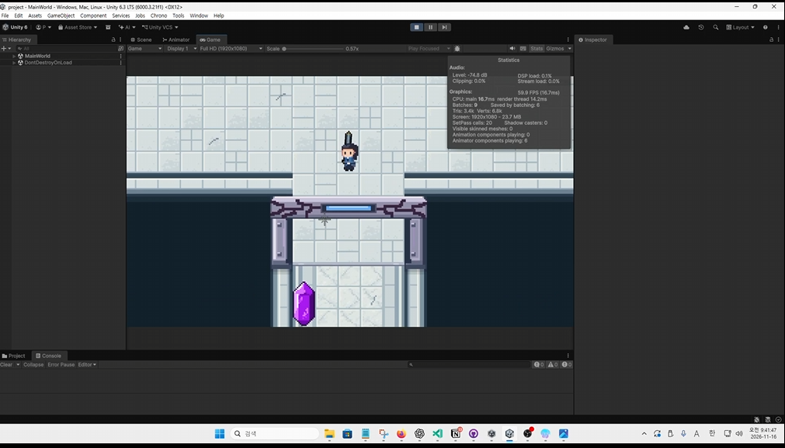
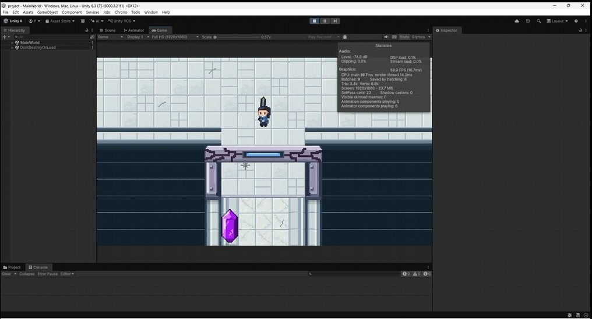

# Tilemap 밝은 가로줄 해결 — Texture Bleeding과 시각적 안정성 개선

기록일: 2026-11-16 (Asia/Seoul)

**결과:** 맵 Sprite Atlas에 타일을 패킹하고 4px 패딩을 확보한 뒤 사용자가 기존 밝은 줄 현상의 해결을 확인했다. 캡처·원본 텍스처의 배치를 대조한 진단은 **Texture Bleeding**이다. 이 기록은 발생 현상, 원인 추적, 실제 저장된 해결 설정과 UX 개선 경험을 정리한다.

## 1. 발생 현상과 플레이 경험의 문제

Unity Editor의 Game 뷰에서 맵에 밝은 가로줄이 순간적으로 나타났다. 처음에는 줄이 위에서 아래로 빠르게 내려가는 것처럼 보여 렌더링 과부하나 화면 동기화 문제를 의심했다. 사용자가 VSync를 적용해도 현상이 계속됐으며, 영상을 촬영해 확인한 뒤 타일 단위의 문제일 가능성을 제시했다.

제공된 캡처에서는 복도 양옆의 어두운 영역에 밝은 줄이 일정한 간격으로 반복된다. 두 번째 캡처의 왼쪽 어두운 영역에서 줄 간격은 약 28~29픽셀로, 해당 캡처에 표시된 타일 한 칸의 크기와 맞는다. 이 수치는 축소된 첨부 이미지의 표시 픽셀이며 게임의 원본 렌더 해상도나 타일 원본 크기를 뜻하지 않는다.

반복적으로 나타나는 밝은 줄은 배경이 갈라지거나 깜빡이는 인상을 주고, 캐릭터 이동과 전투 화면에서 불필요하게 시선을 끌 수 있다. 따라서 이 사례의 UX 개선 대상은 **이동 중 배경의 시각적 안정성과 화면의 일관성**이다. 플레이어 집중도나 피로도의 변화는 별도로 측정하지 않았다.

### 문제 보고 당시의 비교 캡처

아래 두 장은 모두 해결 전 사용자가 제공한 자료다. 첫 번째는 줄이 두드러지지 않는 순간이고, 두 번째는 줄이 나타난 순간이다. 첫 번째를 해결 후 결과로 사용하지 않는다.

## 2. 원인을 좁힌 과정

| 단계 | 확인 내용 | 판단 |
| --- | --- | --- |
| 최초 가설 | 순간적으로 화면을 훑는 줄처럼 보인다는 사용자 설명 | 부하·화면 효과·화면 동기화 문제를 후보로 두었으며 원인으로 확정하지 않음 |
| VSync 비교 | 사용자가 VSync에서도 발생한다고 보고 | VSync 적용만으로 해결되지 않음을 확인 |
| 영상·캡처 확인 | 어두운 영역에 일정한 타일 간격으로 여러 줄이 반복 | 타일 경계와 텍스처 샘플링 문제를 우선 조사 |
| 기존 설정 확인 | 원본 텍스처 Point, Mipmap OFF, 무압축, Grid Gap 0 | 기본 임포트 옵션을 다시 바꾸는 것만으로 원인을 설명하기 어려움 |
| 원본 타일 대조 | 어두운 타일에 선이 없고, 타일 시트에서 밝은 이웃 타일이 여백 없이 맞닿음 | 경계에서 이웃 픽셀을 읽는 Texture Bleeding 진단을 뒷받침 |
| Atlas 적용 후 확인 | 맵 Atlas가 저장됐으며 사용자가 해결됐다고 응답 | 해당 사용자 재현 조건에서 증상 해결 확인 |

Frame Debugger는 한 프레임 안의 그리기 순서를 분석하는 도구다. 이번 조사에서는 짧게 나타나는 줄을 포착한 Frame Debugger 자료가 없으므로, 특정 draw call이나 GPU 샘플 좌표를 직접 확인했다고 기록하지 않는다. 사용자가 제공한 영상 캡처에서 반복 패턴을 확인하고 원본 배치와 대조한 것이 원인을 좁히는 데 유효했다.

## 3. 원인 — 타일 경계에서 밝은 이웃 픽셀을 읽는 현상

Texture Bleeding은 텍스처의 특정 영역을 그릴 때 경계 밖의 이웃 영역 색이 결과에 섞이거나 나타나는 현상이다. 하나의 이미지에서 여러 타일을 여백 없이 잘라 사용하면 타일 가장자리에서 다른 타일의 픽셀을 읽을 여지가 있다. 카메라의 연속적인 이동과 픽셀 경계의 상대 위치가 달라지면서 줄이 간헐적으로 보일 수 있다.

이번 프로젝트에서 확인한 구체적인 근거는 다음과 같다.

- 문제 영역은 `LaboratoryLayout`의 `outside` Tilemap이며, 복도 양옆에 `environment-009` 타일을 사용한다.
- `environment-009`는 16×16픽셀 전체가 불투명한 단색 `RGB(17, 33, 44)`다. 원본 자체에 밝은 선은 없다.
- [원본 타일 시트](../../../project/Assets/Art/Environment/Laboratory/Textures/environment-tileset.png)의 좌상단 기준 `(16, 16)`에서 시작하는 이 타일 바로 아래 `(16, 32)`에는 밝은 바닥 타일 `environment-017`이 있다. 그 상단은 주로 `RGB(214, 223, 223)`이다. 오른쪽 이웃 `environment-010`도 밝은 바닥이다.
- 타일들은 16픽셀 간격으로 여백 없이 맞닿아 있었고, 조사 당시 별도 Sprite Atlas는 없었다.
- 카메라의 배경색도 어두워, 단순한 빈틈이 밝은 선으로 보인다는 설명보다 밝은 이웃 픽셀을 읽는 설명이 관찰과 더 잘 맞는다.

원본 텍스처의 Point 필터는 이웃 색을 보간하지 않지만, 샘플 좌표가 이웃 타일 영역으로 넘어가는 것까지 막지는 않는다. Clamp 역시 텍스처 전체의 바깥 경계를 처리하는 설정이며, 한 시트 내부의 각 Sprite 경계를 독립적으로 보호하는 설정은 아니다.

카메라 이동은 증상이 나타나는 조건을 설명하는 후보이며, 이번 기록을 위해 카메라 코드를 바꾸거나 이동·줌별 효과를 분리 측정하지는 않았다. GPU 내부의 정확한 오차 발생 지점도 직접 추적하지 않았다.

## 4. 해결 방법과 실제 적용 상태

사용자는 타일 시트를 별도 Sprite Atlas에 등록해 패킹하는 방안을 적용한 뒤 해결을 확인했다. Unity 공식 문서에서도 Atlas의 Padding을 이웃 Sprite의 픽셀이 다른 Sprite에 나타나는 것을 방지하는 간격으로 설명한다. [Sprite Atlas 설정 문서](https://docs.unity3d.com/6000.3/Documentation/Manual/class-SpriteAtlas.html) — 확인일 2026-11-16.

현재 저장된 파일은 [map.spriteatlasv2](../../../project/Assets/map.spriteatlasv2)와 [Importer 설정](../../../project/Assets/map.spriteatlasv2.meta)이다. Atlas의 Packable GUID가 `environment-tileset.png.meta`의 GUID와 일치한다.

| 항목 | 실제 저장값 |
| --- | --- |
| 패킹 대상 | `environment-tileset.png`의 Sprite들 |
| Padding | 4px |
| Allow Rotation | OFF |
| Tight Packing | OFF |
| Generate Mip Maps | OFF |
| Compression | None |
| Atlas Filter Mode | **Bilinear** (`filterMode: 1`) |
| 기본 바인딩 / Include in Build | ON (`bindAsDefault: 1`) |

**초기 제안과 실제 적용을 구분한다.** 안내에서는 Atlas도 Point로 설정하는 안을 제시했지만, 해결 확인 뒤 읽은 실제 Atlas는 Bilinear다. 원본 텍스처의 Point 설정과도 별개다. 따라서 이 사례를 “Point로 바꿔 해결했다”로 기록하지 않는다. **Sprite Atlas 패킹과 4px 패딩을 포함한 위 설정 조합을 적용한 뒤 해결됐다**고 기록한다. 개별 옵션마다 효과를 분리한 실험은 수행하지 않았다.

재현·적용 절차는 `Sprite Atlas 생성 → Objects for Packing에 타일 시트 추가 → 패딩·패킹·텍스처 설정 확인 → Pack Preview → Play 재시작 → 같은 장소에서 이동 비교`다. 이번 문서 작업에서는 사용자가 만든 Atlas를 읽기만 했으며 게임 에셋과 설정을 다시 변경하지 않았다.

## 5. 결과와 확인 범위

| 구분 | 결과 |
| --- | --- |
| 사용자 직접 확인 | “좋아 해결되었어”라는 응답으로 기존 줄 현상의 해결 확인 |
| 파일 확인 | Atlas 대상 텍스처와 실제 패딩·필터·압축·패킹 설정 대조 완료 |
| 근거 보관 | 해결 전 첨부 캡처 2장을 원본 바이트 그대로 보관 |
| 해결 후 이미지 | 이번 대화에서 별도 캡처를 받지 않음 |
| 성능 | FPS 향상·GPU 부하 감소·최적화 효과를 측정하지 않음 |
| 추가 실행 | 문서 작성 중 Unity 실행·컴파일·빌드 검사를 추가 수행하지 않음 |

해결 결과는 사용자가 확인한 Editor 재현 조건에 해당한다. 다른 해상도·줌·제출 빌드의 결과까지 확인한 것으로 확대하지 않는다. 문서 기록은 완료이며, 이 문제를 미해결 상태로 남기지는 않는다.

## 6. UX 개선 경험으로 사용할 문장

> 카메라 이동 중 타일맵에 밝은 가로줄이 반복적으로 나타나 배경이 갈라지거나 깜빡이는 문제가 있었다. 처음에는 렌더링 과부하와 화면 동기화를 의심했지만, VSync 적용 후에도 증상이 남아 영상을 촬영하고 프레임을 확인했다. 줄의 간격이 타일 크기와 일치한다는 점을 바탕으로 원본 타일 시트를 조사했고, 어두운 타일 바로 옆에 밝은 타일이 여백 없이 배치된 것을 확인해 Texture Bleeding으로 원인을 좁혔다. 이후 타일을 Sprite Atlas에 패킹하고 4px 패딩을 확보한 뒤 실제 플레이에서 줄이 사라졌음을 확인했다. 이 경험을 통해 화면의 시각적 안정성을 개선했으며, 문제의 인상만으로 원인을 단정하기보다 재현 영상과 에셋 구조를 대조해 해결하는 과정을 익혔다.

이 문장은 사용자가 직접 확인한 해결 결과에 근거한 보고서용 초안이다. 성과는 시각적 오류 제거로 서술하며, 성능 향상이나 정량적인 사용자 만족도 개선 수치는 덧붙이지 않는다.
